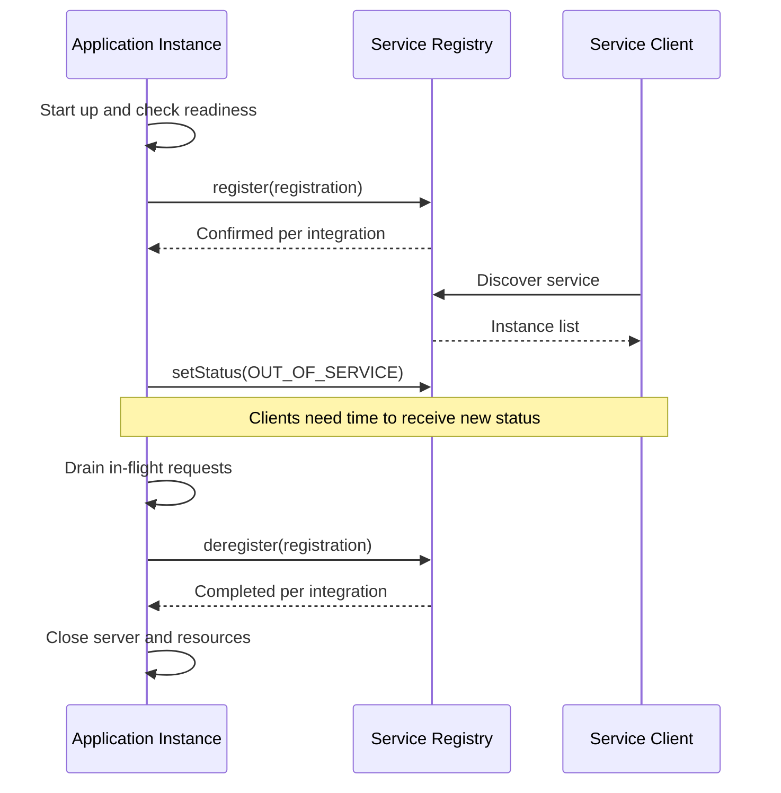

# Registering, Deregistering, and Changing Instance Status

In a distributed system, a service usually runs across multiple instances. Each instance has its own network address, port, identifier, and metadata. The service registry stores this information so other components can find a suitable instance when calling the service. The lifecycle of a registry record should align with the instance's request-serving lifecycle: register when the instance is ready, update status when its capacity to accept load changes, and deregister when the instance leaves the system.

In Spring Cloud, `ServiceRegistry` and `Registration` in Spring Cloud Commons provide an abstraction layer for these operations. Applications can work through a common API, while how records are stored, statuses are represented, synchronization works, and failed instances are detected depend on the registry provider's implementation.

## 1. Two Core Objects

`Registration` describes an instance that can be registered. It extends `ServiceInstance`, so the information attached to a record typically includes service ID, host, port, security protocol, URI, and metadata. Some registries also require an instance ID to distinguish replicas providing the same service ID.

`ServiceRegistry<R extends Registration>` is the contract for operating on the registry. The main methods are:

| Method | Meaning |
| --- | --- |
| `register(R registration)` | Adds the instance to the registry so other components can discover it. |
| `deregister(R registration)` | Removes the instance's record from the registry. |
| `setStatus(R registration, Object status)` | Requests the registry to change the instance's status. |
| `getStatus(R registration)` | Reads the status returned by the registry implementation for the instance. |
| `close()` | Closes or releases resources managed by the implementation. |

The type parameter `R` allows each integration to use its concrete `Registration` type. The `status` value is typed as `Object` because Spring Cloud Commons does not enforce a single common set of statuses across all providers. Therefore, applications must follow the data type and set of values used by the active implementation.

The classes in Spring Cloud Commons only define the contract. They do not create a shared registry themselves, nor do they dictate every registration rule. An integration such as Eureka, Consul, or ZooKeeper provides the corresponding implementation and may add automatic registration, heartbeats, leases, health checks, or status synchronization.

## 2. Registering an Instance When Ready

Registration is the step of publishing an instance to the service discovery system. The record must accurately describe the address reachable by other instances. If the host or port is wrong, the registry may hold a structurally valid record, yet calls to the instance will fail.

A sensible startup sequence typically includes these steps:

1. Load configuration and initialize the application.
2. Start the server, prepare required dependencies, and determine the actual serving address.
3. Check readiness conditions for receiving requests.
4. Register the instance with the service registry.
5. Maintain status and record renewal mechanisms as required by the provider.

Not every application calls `register` directly. Many Spring Cloud integrations manage registration through the Spring lifecycle and auto-registration configuration. When using this mechanism, understand when the integration performs registration and avoid adding a manual registration flow that creates duplicate records or unintended overwrites for the same instance.

When manual control is required, application code works with `ServiceRegistry` and the `Registration` object provided by the integration. The following example illustrates operations on the common contract; `registry`, `registration`, and status values must be supplied according to the integration in use:

```java
import org.springframework.cloud.client.serviceregistry.Registration;
import org.springframework.cloud.client.serviceregistry.ServiceRegistry;

public class InstanceRegistrationController<R extends Registration> {

    private final ServiceRegistry<R> registry;
    private final R registration;

    public InstanceRegistrationController(
            ServiceRegistry<R> registry,
            R registration) {
        this.registry = registry;
        this.registration = registration;
    }

    public void register() {
        registry.register(registration);
    }

    public Object currentStatus() {
        return registry.getStatus(registration);
    }

    public void changeStatus(Object status) {
        registry.setStatus(registration, status);
    }

    public void deregister() {
        registry.deregister(registration);
    }
}
```

This snippet focuses on how to call the API. It is not a complete auto-configuration: the type `R`, the registry bean, how `Registration` is built, and the status values must match the integrated registry library. In a real application, do not construct a registration object missing host, port, or instance ID and expect the integration to infer them.

### Choosing Identifiers and Metadata

Service ID usually represents the logical name clients use, such as `order-service`. Instance ID distinguishes individual replicas, for example `order-service-10.0.2.15-8081`. Each replica needs a distinct identifier according to the registry's rules. If multiple instances share the same ID in a system that requires unique IDs, a later registration may overwrite or conflict with the previous record.

Metadata can carry information such as deployment zone, API version, processing group, or routing labels. Put only values into metadata that are meaningful for discovery or routing; do not put secrets, tokens, or sensitive information into records that are typically read by many components.

## 3. Changing Instance Status

A registered instance should not always receive traffic. For example, an application may need maintenance, cache warm-up, handling a dependency outage, or preparation for shutdown. `setStatus` lets you ask the registry to update the record's status; `getStatus` lets you read the status provided by the implementation.

For example, before maintenance, an application can transition the instance to a status equivalent to `OUT_OF_SERVICE`:

```java
// Illustrative value; replace with the constant or status type
// defined by your current registry integration.
registry.setStatus(registration, "OUT_OF_SERVICE");

Object status = registry.getStatus(registration);
```

Do not assume the string `OUT_OF_SERVICE` or `UP` has the same meaning in every registry. Some integrations use an enum, while others use a string or custom type. Some registries also restrict valid state transitions. Check the contract of your implementation and handle the exact type returned by `getStatus`.

Changing status can support different operational goals:

- **Ready to receive traffic:** the instance has started up and can serve requests.
- **Temporarily stop receiving traffic:** the instance stays running to finish in-flight requests, but clients should not select it for new requests.
- **Unavailable:** the instance encountered an error or no longer meets serving conditions.
- **Recovered:** after maintenance or once dependencies stabilize, the instance is transitioned back to a status that allows traffic.

The names and representations of the states above are only operational descriptions. The specific registry determines which statuses exist and whether clients exclude the instance from selection.

### Registry Status vs. Application Health and Readiness

Registry status does not replace application health checks. A health indicator reflects the state of an application or dependency according to check rules; readiness indicates whether the application is ready to receive traffic; registry status is data used by the discovery system or clients. These mechanisms can be wired together, but they are not automatically synonymous.

For example, an instance may remain running with its health endpoint still reachable while draining for maintenance. During that phase, the application needs to stop accepting new requests, finish in-flight requests, and only then shut down. If you only change the registry status without controlling the server, requests can still arrive via direct addresses or clients with stale caches.

Registries and clients typically have propagation delays or caches. Therefore, a successful `setStatus` call does not guarantee that every client immediately stops selecting the instance. The drain process must account for status propagation delay, cache expiration, and completion time for active requests.

## 4. Deregistering When an Instance Leaves the System

Deregistration removes the instance record from the registry so clients stop discovering it. This is a critical step when an application shuts down gracefully, is replaced by a new version, or leaves a deployment group.

A graceful shutdown workflow is typically organized as follows:

1. Stop accepting new requests or transition to a non-serving status if the registry supports it.
2. Wait for in-flight requests to complete within the shutdown timeout.
3. Call `deregister` to delete the instance record.
4. Close the server and release application resources.

The exact order depends on the integration and deployment platform. For example, an environment may need to update readiness first, wait for the load balancer to stop sending requests, and only then deregister. Coordinate the Spring lifecycle, the server, and the deployment platform so the server is not closed too early.

The following diagram shows a high-level flow:



If the process is killed abruptly, the application may not have time to call `deregister`. Many registries handle stale records using heartbeats, leases, TTLs, or health checks. This is a fallback mechanism of the integration and registry; it should not be used as an excuse to skip deregistration during a graceful shutdown.

`close()` is a lifecycle method of `ServiceRegistry` that the implementation may use to release resources. Do not call `close()` arbitrarily after every deregister: the registry may be a shared bean or managed by Spring. Only close it yourself when the application truly owns the implementation's lifecycle and the integration documentation instructs you to do so.

## 5. Error Handling and Operational Scenarios

Registry operations are calls to an external system or infrastructure component. They can fail due to connection loss, timeouts, invalid credentials, missing records, or identity conflicts. Applications need clearly defined behavior when each operation fails.

| Scenario | Resolution approach |
| --- | --- |
| Registration fails at startup | Log with context, apply bounded retry/backoff per policy, and decide whether the instance may accept traffic while unregistered. |
| Status change fails | Do not assume the instance has been drained; verify actual status and coordinate readiness or another traffic-steering mechanism. |
| Deregistration fails | Log the error, retry within the shutdown limit, and rely on the registry's TTL/lease/health check as an additional safeguard. |
| Stale record persists | Check heartbeats, TTL, instance ID, and the provider's cleanup rules. |
| Multiple instances share an identifier | Generate a unique instance ID per replica and verify the registry's record update rules. |
| Clients keep calling a drained instance | Check caches, refresh intervals, propagation delay, and client retry/load-balancing settings. |

Retries need bounds and backoff to avoid overloading the registry during an outage. Operations may only be retried safely when the implementation guarantees appropriate behavior; do not assume `register` or `deregister` has identical idempotency across all providers. When an application must continue starting while the registry is unavailable, that decision must match system availability requirements and expose clear observability into registration state.

Logs should record service ID, instance ID, operation, outcome, and failure cause. Metrics can track failed registration counts, registration duration, status update errors, and shutdown deregistration failures. Avoid logging full metadata or credentials.

## 6. Testing the Registration Lifecycle

Testing should verify both the API call sequence and the behavior observed by clients. You can use a fake `ServiceRegistry` implementation or mocks to test orchestration logic:

- When the instance meets readiness conditions, `register` is called with the expected registration.
- When draining starts, the application sends the expected status per the integration.
- When maintenance ends, status is restored according to the registry's rules.
- During graceful shutdown, the application calls `deregister` before finishing server shutdown in the designed order.
- When the registry times out or returns an error, the application applies the retry policy and logs the failure properly.

Mocks only prove that the application calls the contract properly. An integration test against a real registry or equivalent environment should also verify that the record appears, changes status, disappears after deregister, and is discovered by clients within the expected window. You should also test abrupt instance termination to evaluate TTL, lease, or heartbeat behavior.

## 7. Deployment Checklist

- [ ] Registration contains accurate service ID, instance ID, host, port, and metadata.
- [ ] Registration timing aligns with readiness and the Spring lifecycle.
- [ ] A single mechanism is responsible for registering the instance, avoiding duplicate registrations.
- [ ] Status codes and data types match the active integration.
- [ ] The drain process gives clients enough time to observe changes and finish in-flight requests.
- [ ] Graceful shutdown calls deregister and enforces a timeout for error handling.
- [ ] Heartbeats, leases, or TTLs are configured as an abnormal record cleanup layer.
- [ ] Logs, metrics, and tests cover registration, status changes, and deregistration.

Good instance lifecycle management helps the service registry reflect the system's actual serving capacity more accurately. In Spring Cloud, `ServiceRegistry` provides a unified operation point, while ultimate reliability depends on the integration, status configuration, readiness, synchronization mechanisms, and the application's shutdown workflow.
