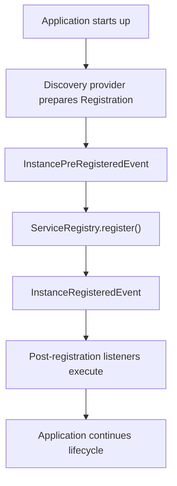
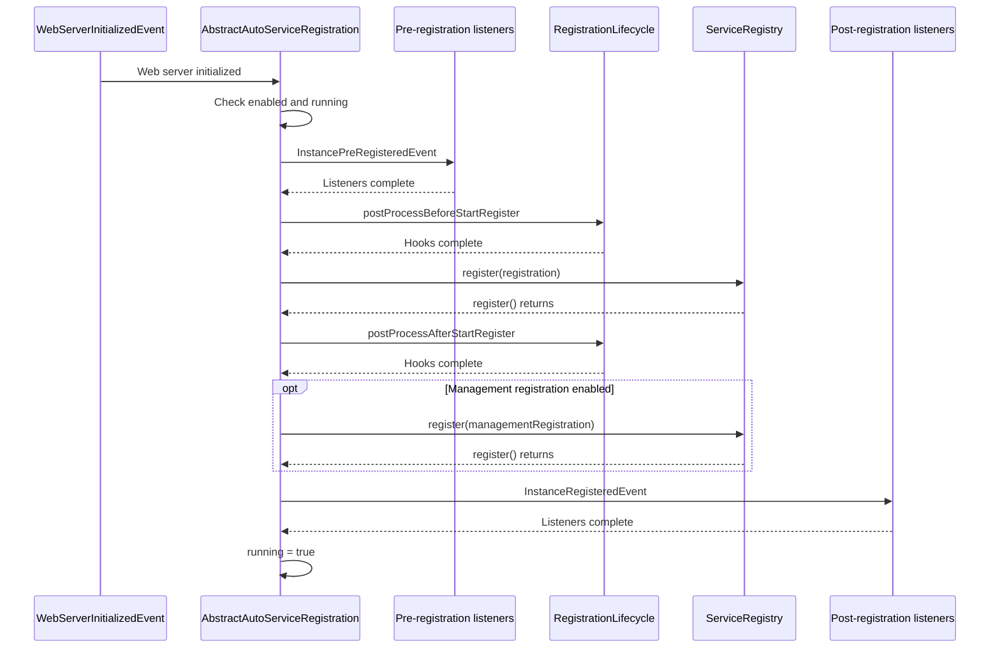

# InstancePreRegisteredEvent and InstanceRegisteredEvent

When a Spring Cloud application registers itself with a service registry, other components sometimes need to know when the registration process is about to begin and when the registration call has completed. For example, an application might need to inspect metadata before publishing the instance, record registration timestamps, update metrics, or notify an internal component that discovery has been initialized.

Spring Cloud Commons provides two application events for the auto-registration lifecycle:

- `InstancePreRegisteredEvent`: published before the instance is sent to `ServiceRegistry`.
- `InstanceRegisteredEvent<T>`: published after the instance registration operation has been executed.

The two events mark two distinct milestones. The pre-registration event carries a `Registration` object; the post-registration event carries a generic configuration payload supplied by the implementation. You should neither assume both events carry the same payload type nor treat the post-registration event as proof that every consumer already sees the instance or that the application is ready for traffic.

This lesson belongs to the **ServiceRegistry** chapter of **SPRING_CLOUD_CORE**. It focuses on event structure, publishing order in `AbstractAutoServiceRegistration`, listener registration, coordination with `RegistrationLifecycle`, testing, and handling registration failure scenarios.

## 1. Learning Objectives

After this lesson, you will be able to:

- Explain the roles of `InstancePreRegisteredEvent` and `InstanceRegisteredEvent`.
- Distinguish the `Registration` payload from the generic `config` payload.
- Describe the auto-registration sequence in `AbstractAutoServiceRegistration`.
- Identify when events are published relative to `ServiceRegistry.register()`.
- Register listeners using `ApplicationListener` or `@EventListener`.
- Choose the appropriate event for pre-registration checks and post-registration handling.
- Distinguish auto-registration events from manual `ServiceRegistry.register()` calls.
- Understand the impact of `spring.cloud.service-registry.auto-registration.enabled`.
- Distinguish successful registration from Ready state, health, and actual discoverability.
- Use `RegistrationLifecycle` when modifying registration before sending it to the registry.
- Test event order, provider failures, and behavior when auto-registration is disabled.

## 2. Background: Service Auto-registration

In a distributed system, each instance typically needs to publish its information to a registry so other services can locate it. This information is represented by the `Registration` abstraction, while registry operations are standardized through `ServiceRegistry`.

A discovery implementation can automatically register the local service on application startup. Spring Cloud Commons provides the `AutoServiceRegistration` abstraction and the `AbstractAutoServiceRegistration` base class to support this common lifecycle.



Events let other components react to the lifecycle without calling provider-specific APIs for Eureka, Consul, Zookeeper, or other providers directly.

### 2.1. What Is Registration?

`Registration` is a **marker interface** denoting objects that can be passed to `ServiceRegistry`; it extends `ServiceInstance`. Therefore, listeners can access inherited common properties such as `getServiceId()`, `getHost()`, `getPort()`, `isSecure()`, `getUri()`, and `getMetadata()`. `getInstanceId()` has a default implementation on `ServiceInstance`, so a provider may return `null` if it does not supply an instance ID.

The concrete implementation type still depends on the provider, such as `EurekaRegistration` or `ConsulRegistration`. When provider-specific details beyond the `ServiceInstance` contract are needed, check the concrete type and use the corresponding provider API.

### 2.2. What Is ServiceRegistry?

`ServiceRegistry<R extends Registration>` is the abstraction that performs registration, deregistration, and status update operations:

```java
public interface ServiceRegistry<R extends Registration> {

    void register(R registration);

    void deregister(R registration);

    void close();

    void setStatus(R registration, String status);

    <T> T getStatus(R registration);
}
```

The two events in this lesson wrap around the auto-registration process that uses this abstraction. They do not replace `ServiceRegistry`, nor are they APIs for registering a service.

## 3. InstancePreRegisteredEvent

`InstancePreRegisteredEvent` belongs to package:

```java
org.springframework.cloud.client.discovery.event
```

It is an application event published **before the local service instance is registered with the discovery service**.

Core API:

```java
public class InstancePreRegisteredEvent extends ApplicationEvent {

    public InstancePreRegisteredEvent(
            Object source,
            Registration registration) {
        // constructor
    }

    public Registration getRegistration() {
        // returns registration
    }
}
```

The event supplies the registration object intended to be sent to the registry. Because `Registration` extends `ServiceInstance`, listeners can read standard instance fields like service ID, host, port, URI, and metadata without casting to a provider type.

### 3.1. Event Payload

| Component | Meaning |
| --- | --- |
| `source` | Component executing auto-registration and publishing the event |
| `registration` | `Registration` object describing the instance about to be registered |
| `getRegistration()` | Returns the registration attached to the event |

In implementations based on `AbstractAutoServiceRegistration`, `source` is typically the provider's auto-registration instance, and the registration is retrieved via `getRegistration()`.

### 3.2. What Can a Listener Do?

Suitable use cases:

- Emit structured logs containing service ID, host, port, or instance ID via the `ServiceInstance` contract.
- Validate required metadata before publishing.
- Record a metric marking registration start time.
- Generate a correlation ID for lifecycle logs.
- Signal internally so another component can observe the registration process.

Example listener:

```java
@Component
public class RegistrationPrecheckListener {

    private static final Logger log =
            LoggerFactory.getLogger(RegistrationPrecheckListener.class);

    @EventListener
    public void onPreRegistered(InstancePreRegisteredEvent event) {
        Registration registration = event.getRegistration();

        log.info(
                "Preparing service registration: serviceId={}, host={}, port={}",
                registration.getServiceId(),
                registration.getHost(),
                registration.getPort());
    }
}
```

The example logs only necessary identifying metadata. Do not log credentials, tokens, or full metadata if metadata may contain sensitive data.

### 3.3. This Event Is Not a Portable Mutation Point for Registration

`Registration` is a shared abstraction, but object mutability depends on the implementation. Some providers use mutable objects; others may return recreated objects or enforce custom semantics.

If you need to add metadata or adjust the registration before sending it to the registry, do not rely on mutating the object obtained from the event in a listener. In the `AbstractAutoServiceRegistration` lifecycle, `RegistrationLifecycle` hooks run after the pre-registration event and before the `register` call. That is a better-suited extension point for pre-processing registration data.

## 4. InstanceRegisteredEvent<T>

`InstanceRegisteredEvent<T>` is also in package:

```java
org.springframework.cloud.client.discovery.event
```

This event is published **after the local service instance has been registered via the discovery service**.

Core API:

```java
public class InstanceRegisteredEvent<T> extends ApplicationEvent {

    public InstanceRegisteredEvent(Object source, T config) {
        // constructor
    }

    public T getConfig() {
        // returns provider configuration
    }
}
```

Crucially, the data type `T` is generic. The payload is not guaranteed to always be a `Registration`. In `AbstractAutoServiceRegistration`, the event is created with the provider configuration obtained from `getConfiguration()`. The base class's `getConfiguration()` API is currently marked deprecated; the provider implementation determines the actual payload.

### 4.1. Reading the Payload Properly

General-purpose listeners should use a wildcard:

```java
@Component
public class RegistrationCompletedListener {

    @EventListener
    public void onRegistered(InstanceRegisteredEvent<?> event) {
        Object providerConfig = event.getConfig();

        // Record a registration-completed metric or audit event.
    }
}
```

Do not write:

```java
Registration registration = event.getConfig();
```

unless the application has confirmed that the specific provider passes that exact type. `getConfig()` returns `T`, and `T` can be a provider-specific configuration object.

### 4.2. Post-Registration Use Cases

- Record that the registration call has completed.
- Increment a registration count metric.
- Record an audit entry with service ID and instance ID.
- Notify an internal component that the discovery lifecycle has passed the registration step.
- Start a task that depends on registration, provided that task is not on the critical startup path.

Example:

```java
@Component
public class DiscoveryRegistrationMetrics {

    private final MeterRegistry meterRegistry;

    public DiscoveryRegistrationMetrics(MeterRegistry meterRegistry) {
        this.meterRegistry = meterRegistry;
    }

    @EventListener
    public void onRegistered(InstanceRegisteredEvent<?> event) {
        meterRegistry.counter("service.registry.registration.completed")
                .increment();
    }
}
```

The metric above merely illustrates recording the event. In a production system, add tags with bounded cardinality, such as service name or provider; avoid tagging with unbounded instance IDs if instance counts are large.

## 5. Comparing the Two Events

| Criterion | `InstancePreRegisteredEvent` | `InstanceRegisteredEvent<T>` |
| --- | --- | --- |
| Timing | Before the registration call | After the registration call |
| Payload | `Registration` | Generic configuration `T` supplied by the provider |
| Accessor | `getRegistration()` | `getConfig()` |
| Purpose | Observe/validate info about to be registered | Record completion of the registration step |
| Can be used for | Pre-audit, metadata checks, start metrics | Post-audit, completion metrics, internal notifications |
| Proves registry convergence? | No | Not necessarily |
| Proves application is Ready? | No | No |

The two events mark two points in one lifecycle. Do not swap the pre-event for the post-event or vice versa when listeners need to react at different stages.

## 6. Publishing Order in AbstractAutoServiceRegistration

`AbstractAutoServiceRegistration` is a widely used base class in Spring Cloud Commons. It listens for `WebServerInitializedEvent`, captures the web server's actual port, and begins auto-registration when the provider is enabled.

In the current implementation, the core of `start()` follows this high-level order:

1. Check whether auto-registration is enabled.
2. Check that the instance is not already marked running/registered.
3. Publish `InstancePreRegisteredEvent`.
4. Run `RegistrationLifecycle.postProcessBeforeStartRegister(...)`.
5. Call `ServiceRegistry.register(...)`.
6. Run `RegistrationLifecycle.postProcessAfterStartRegister(...)`.
7. If configured, register the management service and run its corresponding hooks.
8. Publish `InstanceRegisteredEvent`.
9. Update the `running` flag.



The diagram shows the standard flow of the base class. Providers may override hooks or implement custom lifecycles, so inspect the active adapter if operational requirements depend on exact ordering.

### 6.1. Pre-Event Fires Before RegistrationLifecycle Hooks

An important detail: in `AbstractAutoServiceRegistration`, `InstancePreRegisteredEvent` is published before `postProcessBeforeStartRegister(...)`.

Consequently, a listener handling the pre-event may see the registration before lifecycle hooks add or adjust metadata. If you need to inspect the final data right before it is sent to the registry, use `RegistrationLifecycle` or the appropriate provider extension point.

### 6.2. Post-Event Fires After Main Registration Steps

`InstanceRegisteredEvent` is published after:

- The main service registration call completes.
- `postProcessAfterStartRegister(...)` hooks complete.
- The management service is registered if enabled and supported by the provider.

The post-event payload comes from the implementation's `getConfiguration()`. Therefore, it is not necessarily the same object as the `Registration` passed into `ServiceRegistry.register()`.

### 6.3. The running Flag Updates After the Event

In the base class implementation, `running` is set to `true` after `InstanceRegisteredEvent` is published. Hence, a listener handling the event should not rely on `AutoServiceRegistration.isRunning()` to assume the flag has already flipped.

The event marks the registration milestone in the lifecycle; the internal `running` state updates in the subsequent step.

## 7. RegistrationLifecycle and How It Differs from Events

`RegistrationLifecycle<R>` is an extension point for steps before and after registration and deregistration. It differs from application events:

- Events broadcast signals for observing listeners.
- Lifecycle hooks participate directly in the registration workflow.

Key hooks include `postProcessBeforeStartRegister(R)`, `postProcessAfterStartRegister(R)`, `postProcessBeforeStopRegister(R)`, and `postProcessAfterStopRegister(R)`. `RegistrationLifecycle` also provides ordering via `Ordered`; check the Javadoc for your release train if you need to control ordering across multiple lifecycle beans.

### 7.1. When Adding Metadata

If the provider's registration allows metadata updates:

```java
public class VersionMetadataLifecycle
        implements RegistrationLifecycle<MyRegistration> {

    @Override
    public void postProcessBeforeStartRegister(MyRegistration registration) {
        registration.getMetadata().put("release", "2026.11");
        registration.getMetadata().put("region", "ap-southeast-1");
    }
}
```

The example uses a provider-specific registration type for illustration. In a real project, implement the exact generic type and register the lifecycle bean according to the provider's mechanism.

### 7.2. When to Use Events?

| Need | Suitable mechanism |
| --- | --- |
| Observe that registration is about to occur | `InstancePreRegisteredEvent` |
| Inspect or modify metadata in the lifecycle before register | `RegistrationLifecycle.postProcessBeforeStartRegister` |
| Record that the registration call completed | `InstanceRegisteredEvent` |
| Record metrics/audits from multiple independent components | Application event listeners |

Do not use event listeners as a substitute for lifecycle hooks when logic must execute in a guaranteed internal provider order.

## 8. Registering Listeners with ApplicationListener

You can implement a listener using `ApplicationListener`:

```java
@Component
public class PreRegistrationApplicationListener
        implements ApplicationListener<InstancePreRegisteredEvent> {

    @Override
    public void onApplicationEvent(InstancePreRegisteredEvent event) {
        Registration registration = event.getRegistration();

        // Validate or record safe registration metadata.
    }
}
```

For the post-registration event:

```java
@Component
public class PostRegistrationApplicationListener
        implements ApplicationListener<InstanceRegisteredEvent<?>> {

    @Override
    public void onApplicationEvent(InstanceRegisteredEvent<?> event) {
        Object config = event.getConfig();

        // Record registration completion.
    }
}
```

`ApplicationListener` works well when you want the event type explicit in the class signature or need a dedicated listener class.

## 9. Registering Listeners with @EventListener

For typical applications, `@EventListener` is more concise:

```java
@Component
public class ServiceRegistrationEvents {

    private static final Logger log =
            LoggerFactory.getLogger(ServiceRegistrationEvents.class);

    @EventListener
    public void beforeRegistration(InstancePreRegisteredEvent event) {
        Registration registration = event.getRegistration();

        log.info(
                "Registration starting: serviceId={}, instanceId={}",
                registration.getServiceId(),
                registration.getInstanceId());
    }

    @EventListener
    public void afterRegistration(InstanceRegisteredEvent<?> event) {
        log.info(
                "Registration call completed: configType={}",
                event.getConfig() == null
                        ? "null"
                        : event.getConfig().getClass().getName());
    }
}
```

Listener beans are created inside the `ApplicationContext`. In the standard `AbstractAutoServiceRegistration` flow, events fire after the web server initializes, so normal listener beans are already registered.

### 9.1. Separating Listeners by Responsibility

You do not need to place all handling inside a single class. You can separate:

- Registration audit listener.
- Metrics listener.
- Policy validation listener.
- Internal notification listener.

Separating concerns makes testing and failure isolation easier. Avoid having one listener simultaneously log, make HTTP calls, send messages, and mutate business state.

### 9.2. Ordering Multiple Listeners

If multiple listeners handle the same event with ordering dependencies, use `Ordered` or `@Order` per Spring's event multicaster mechanism.

```java
@Component
public class FirstRegistrationListener {

    @EventListener
    @Order(10)
    public void onRegistered(InstanceRegisteredEvent<?> event) {
        // Runs before listeners with a larger order value.
    }
}
```

Lower order values take precedence. Do not rely on component-scan order or classpath file ordering.

## 10. Disabling Auto-registration and Its Impact on Events

Spring Cloud Commons allows disabling automatic service registration. You can use configuration:

```yaml
spring:
  cloud:
    service-registry:
      auto-registration:
        enabled: false
```

Spring Cloud Commons documentation also describes `@EnableDiscoveryClient(autoRegister = false)` in setups using that annotation.

When auto-registration is disabled, `InstancePreRegisteredEvent` and `InstanceRegisteredEvent` are not published by the standard auto-registration flow.

### 10.1. When Should It Be Disabled?

Some scenarios:

- The instance is registered by an external process.
- The application must wait for custom conditions before registering.
- A different control plane manages the registration lifecycle.
- Tests want to start the application without connecting to a real registry.

Example:

```java
@Configuration(proxyBeanMethods = false)
@EnableDiscoveryClient(autoRegister = false)
public class ManualRegistrationConfiguration {
    // Registration is triggered by an explicit application workflow.
}
```

When calling `ServiceRegistry.register(...)` manually, do not assume the two auto-registration events will fire automatically. If business logic needs similar events, publish a separate domain event after the manual operation completes, with clear naming and semantics.

### 10.2. Distinguishing Disabled from Registration Failure

| Scenario | Pre event | Post event |
| --- | --- | --- |
| Auto-registration disabled | No | No |
| Provider reports disabled via `isEnabled()` | No | No |
| Auto-registration flow runs normally | Yes | Yes, after register step |
| Error before firing pre-event | No | No |
| Error after pre-event but before register finishes | Yes | Usually no |
| Register returns and post-listener runs | Yes | Yes |

Absence of the post-event does not automatically prove the registry never received the instance; inspect provider logs and error timing.

## 11. Post-Registration Event Does Not Mean Registry Convergence

`ServiceRegistry.register()` has a `void` return signature. When this call returns, `AbstractAutoServiceRegistration` can publish `InstanceRegisteredEvent`.

However, some providers or client SDKs may process asynchronously, send network requests, or rely on heartbeat/consistency windows. Therefore:

- The post-event indicates that the register step in the lifecycle was invoked and returned.
- It does not necessarily prove every registry node sees the instance.
- It does not prove `DiscoveryClient` on another client already returns the instance.
- It does not prove the load balancer has started selecting the instance.
- It does not prove health checks have turned passing.

If you need to confirm actual discoverability, query the registry or check from a representative consumer after an appropriate propagation delay.

### 11.1. Distinguishing from ApplicationReadyEvent

`InstanceRegisteredEvent` may be published during context startup after the web server initializes. `ApplicationRunner` and `CommandLineRunner` beans may not have finished running at that point.

Therefore, do not treat the post-event as a signal that the application is Ready. `ApplicationReadyEvent` belongs to the Spring Boot lifecycle; the two registration events belong to the service registry lifecycle.

### 11.2. Distinguishing from ReadinessState

`ReadinessState.ACCEPTING_TRAFFIC` indicates the application is ready to accept traffic according to availability checks. Registration events do not automatically change readiness state.

If an application must only accept traffic after registration succeeds, explicitly design a readiness policy or health check integrated with registration state.

## 12. Synchronous Listeners and Error Handling

Spring application events are dispatched synchronously by default. Listeners run on the event-publishing thread unless the application customizes the event multicaster or uses async mechanisms.

This has several consequences:

- A slow pre-registration listener delays registration.
- A pre-registration listener throwing an exception can prevent registration from proceeding under default synchronous dispatch.
- A slow post-registration listener prolongs the lifecycle after the registry call already completed.
- A post-registration listener throwing an exception can cause the startup/registration flow to report failure even though the preceding register call succeeded.

### 12.1. Do Not Put Long Tasks in Pre-Listeners

Avoid performing the following directly inside a pre-listener:

- Making multiple external API calls.
- Waiting on a long approval workflow.
- Running migrations or loading large datasets.
- Waiting for another service to start up.

If you need precondition checks before registration, use fast, bounded-timeout validation. For logic directly participating in registration, prefer lifecycle hooks.

### 12.2. Do Not Let Listener Errors Obscure Outcomes

If a post-listener calls a webhook or sends a message and that operation fails, do not obscure the registration outcome. Instead:

- Record separate metrics for listener errors.
- Use retry/outbox patterns for notifications requiring reliability.
- Do not throw exceptions arbitrarily from post-registration listeners.
- Separate logs showing `registry.register()` succeeded from logs showing an internal notification failed.

If configuring asynchronous listeners, completion order no longer matches event publication order. Do not put `@Async` on a pre-listener if business rules require it to complete before `register`.

## 13. Example: Auditing the Registration Lifecycle

An application wants to log when registration starts and finishes without depending directly on Eureka or Consul.

```java
@Component
public class RegistrationAuditListener {

    private static final Logger log =
            LoggerFactory.getLogger(RegistrationAuditListener.class);

    @EventListener
    public void onPreRegistered(InstancePreRegisteredEvent event) {
        Registration registration = event.getRegistration();

        log.info(
                "Service registration started: registrationType={}",
                registration.getClass().getName());
    }

    @EventListener
    public void onRegistered(InstanceRegisteredEvent<?> event) {
        Object config = event.getConfig();

        log.info(
                "Service registration completed: providerConfigType={}",
                config == null ? "null" : config.getClass().getName());
    }
}
```

This example does not assume `event.getConfig()` is a `Registration`. If correlation between the two events is needed, you can build context keyed by instance ID/service ID in the pre-listener and match against the post-registration payload if the provider supplies matching info. Include a TTL-based eviction mechanism to avoid leaking state if the post-event never arrives.

### 13.1. Do Not Retain Events or Registrations Long-Term

`Registration` may be a mutable provider object. Do not hold references to it indefinitely in singletons or caches without a clear lifecycle contract. Extract needed values into an immutable DTO instead:

```java
public record RegistrationSnapshot(
        String serviceId,
        String host,
        int port,
        String instanceId) {
}
```

A snapshot DTO keeps audits and metrics decoupled from internal provider objects. Common fields can be extracted via `ServiceInstance`; provider-specific fields should be extracted by a dedicated mapper.

## 14. Example: Registration Precheck

A listener can validate required fields before the registry is called:

```java
@Component
public class RegistrationPrecheck {

    @EventListener
    public void validate(InstancePreRegisteredEvent event) {
        Registration registration = event.getRegistration();

        if (registration == null
                || registration.getServiceId() == null
                || registration.getServiceId().isBlank()) {
            throw new IllegalStateException(
                    "Registration and service ID are required before registration");
        }

        if (registration.getHost() == null || registration.getHost().isBlank()) {
            throw new IllegalStateException(
                    "Advertised host is required before registration");
        }
    }
}
```

This example illustrates a synchronous listener that can block the registration flow if validation fails. Use this approach only when halting registration is the intended behavior and exception propagation is controlled.

If the check needs to mutate the registration, add metadata, or enforce complex policy, consider `RegistrationLifecycle` instead of modifying objects inside an event listener.

## 15. Testing Event Order

Test both events and the `ServiceRegistry.register()` call using a controlled lifecycle test.

### 15.1. Testing Event Payloads

```java
@Test
void preRegisteredEventExposesRegistration() {
    Registration registration = mock(Registration.class);
    InstancePreRegisteredEvent event =
            new InstancePreRegisteredEvent(this, registration);

    assertThat(event.getRegistration()).isSameAs(registration);
}
```

This test verifies that the pre-event retains the passed-in registration.

For the post-event:

```java
@Test
void registeredEventExposesProviderConfiguration() {
    Object providerConfig = new Object();
    InstanceRegisteredEvent<Object> event =
            new InstanceRegisteredEvent<>(this, providerConfig);

    assertThat(event.getConfig()).isSameAs(providerConfig);
}
```

This test demonstrates that `getConfig()` returns a generic payload without enforcing the `Registration` type.

### 15.2. Testing Publication Order Relative to register

Use a fake `ServiceRegistry` and a listener that records events into a list:

```java
class RecordingRegistrationEvents {

    private final List<String> timeline;

    RecordingRegistrationEvents(List<String> timeline) {
        this.timeline = timeline;
    }

    @EventListener
    public void before(InstancePreRegisteredEvent event) {
        timeline.add("pre-event");
    }

    @EventListener
    public void after(InstanceRegisteredEvent<?> event) {
        timeline.add("post-event");
    }
}
```

Fake registry:

```java
class RecordingServiceRegistry
        implements ServiceRegistry<MyRegistration> {

    private final List<String> timeline;

    RecordingServiceRegistry(List<String> timeline) {
        this.timeline = timeline;
    }

    @Override
    public void register(MyRegistration registration) {
        timeline.add("register");
    }

    // Implement remaining ServiceRegistry methods for the test.
}
```

Expected output in the normal flow:

```text
pre-event
register
post-event
```

If the test uses `RegistrationLifecycle`, add markers for before/after hooks to verify the exact execution order.

### 15.3. Testing Disabled Auto-registration

Initialize the context with:

```yaml
spring:
  cloud:
    service-registry:
      auto-registration:
        enabled: false
```

Verify:

- The provider does not perform auto-registration.
- No `InstancePreRegisteredEvent` is fired.
- No `InstanceRegisteredEvent` is fired.

If the application has a separate manual registration path, test that path separately. Do not use the auto-registration test result to conclude that all `ServiceRegistry.register()` calls are disabled.

### 15.4. Testing register Failures

Make the fake registry throw an exception:

```java
doThrow(new IllegalStateException("registry unavailable"))
        .when(serviceRegistry)
        .register(any());
```

Expectations:

- Pre-event was published.
- `register` was called.
- Post-event is not published if the flow halts at the exception.
- The `running` flag is not considered to have flipped to `true`.

If the provider implements custom retries or swallows exceptions, tests must model that implementation accurately.

### 15.5. Integration Testing with a Real Registry

Unit tests do not prove that the registry persisted the registration or that consumers can discover the instance. An integration test should:

1. Start a test registry.
2. Start the application with auto-registration enabled.
3. Capture pre- and post-events.
4. Query the registry using the appropriate API/provider.
5. Verify service ID, host, port, and metadata.
6. Check that `DiscoveryClient` returns the instance after propagation time.
7. Close the context and verify deregistration according to the provider.

## 16. Troubleshooting

| Symptom | Possible cause | Resolution |
| --- | --- | --- |
| Pre-event not received | Auto-registration disabled or provider bypasses standard lifecycle | Check properties, provider, and auto-registration bean |
| Pre-event received without post-event | `ServiceRegistry.register()` or post-register hook failed | Read exceptions and provider logs |
| Post-event received but clients cannot discover instance | Registry/provider processes asynchronously or propagation delay | Query registry directly, check heartbeats and health |
| Pre-listener sees missing metadata | Event fires before `RegistrationLifecycle` pre-hook | Use lifecycle hooks to add metadata |
| `getConfig()` cannot be cast to Registration | Generic payload is a different provider configuration | Use `InstanceRegisteredEvent<?>` and inspect payload type safely |
| Post-listener runs yet `isRunning()` is still false | `running` flag updates after post-event publication | Do not rely on this flag as a condition inside the listener |
| Application startup fails even though registry received instance | Post-listener threw an exception after register | Isolate listener errors from register outcome; avoid throwing arbitrarily |
| No events during manual registration | Events belong to the auto-registration lifecycle | Publish a dedicated domain event after manual registration if needed |
| Duplicate registrations appear | Multiple lifecycles/registration paths running or retrying | Audit auto-registration and manual registration |
| Instance registered but not Ready | Registration happens before startup runners finish | Combine with readiness/health filtering |
| Management instance does not appear | Management registration disabled or management port not separated | Check provider properties and ports |
| Event listener runs twice | Multiple contexts/providers or multiple starts/retries | Log source, context, instance ID, and lifecycle invocations |

### 16.1. Ordered Verification Checklist

When events do not appear or registry results are unexpected, check in order:

1. Is the discovery starter/provider on the classpath and is auto-configuration enabled?
2. Is `spring.cloud.service-registry.auto-registration.enabled` set to `false`?
3. Does the provider implement the auto-registration lifecycle?
4. Has the web server or corresponding lifecycle trigger initialized?
5. Does the registration object have a valid service ID, host, and port?
6. Was the pre-event published?
7. Did `ServiceRegistry.register()` return or throw an exception?
8. Was the post-event published?
9. Did the registry store the instance and is its health/status appropriate?
10. Do `DiscoveryClient` and consumers see the instance after propagation?

Do not diagnose an issue from a single event alone. Cross-check lifecycle logs, provider status, and actual discovery results.

## 17. Observability and Operations

Both events provide convenient hooks for generating telemetry on the registration lifecycle.

Metrics to track:

- Number of registrations started.
- Number of registration calls completed.
- Registration failure rate.
- Duration from pre-event to post-event.
- Listener error count.
- Re-registration count after provider recovery.

You can build a timer by recording the timestamp in the pre-listener and stopping it in the post-listener. The correlation key should be the instance ID if the provider supplies a stable value; since `ServiceInstance#getInstanceId()` may return `null`, prepare a correlation ID or suitable fallback key. Use a TTL to avoid holding state if the post-event never arrives.

### 17.1. Distinguishing Lifecycle Metrics from Registry Metrics

A post-event metric measures the time until the register call completes within the application lifecycle. It does not necessarily measure registry cluster convergence time or the time until consumers discover the instance.

If you need to measure propagation, build a separate probe:

1. Wait for the post-event.
2. Query the registry or `DiscoveryClient`.
3. Measure elapsed time until the instance appears.
4. Record a timeout if the instance does not appear within the limit.

Do not merge both durations into one metric and label it generically as "registration latency."

### 17.2. Actuator Service Registry Endpoint

Spring Cloud Commons can expose the `/serviceregistry` endpoint when Actuator and corresponding configuration are enabled. This endpoint lets you inspect or change registration status according to provider semantics.

The status endpoint is distinct from the two auto-registration events:

- GET reads the current status.
- POST updates status if the provider supports the requested value.
- `InstancePreRegisteredEvent` and `InstanceRegisteredEvent` reflect the registration lifecycle.

Status values such as `UP`, `DOWN`, `OUT_OF_SERVICE`, or `UNKNOWN` depend on the provider. Protect the endpoint with authentication/authorization and expose it only on an appropriate management network.

## 18. Design Principles

- Use `InstancePreRegisteredEvent` to observe or validate information before registration.
- Use `InstanceRegisteredEvent<?>` to handle logic after the registration step.
- Do not assume the `getConfig()` payload is always a `Registration`.
- Use `RegistrationLifecycle` when modifying the registration in the proper lifecycle hook.
- Do not assume the post-registration event proves registry convergence or consumer discoverability.
- Do not treat registration events as `ApplicationReadyEvent` or readiness state.
- Do not rely on `isRunning()` in post-listeners because the flag updates after the event in the base implementation.
- Do not place long-running network tasks inside synchronous listeners.
- Do not let audit/notification errors arbitrarily break the registration lifecycle.
- Remember that disabling auto-registration disables both events of the automatic flow.
- When registering manually, publish a custom domain event if business logic needs notifications.
- Test event order, register failures, disabled auto-registration, and registry propagation.

## 19. Summary

`InstancePreRegisteredEvent` and `InstanceRegisteredEvent` are two Spring Cloud Commons application events for the auto-registration lifecycle. The pre-registration event carries a `Registration` via `getRegistration()` and is published before `ServiceRegistry.register()`. The post-registration event carries a generic payload `T` via `getConfig()` and is published after the registration step has executed.

In `AbstractAutoServiceRegistration`, the standard sequence is pre-event, pre-registration lifecycle hooks, register, post-hooks, optional management registration, post-event, and then updating the `running` flag. Consequently, the pre-event does not necessarily reflect edits made by lifecycle hooks, and the post-event does not prove registry convergence or application readiness.

Use events to observe and coordinate independent components, use `RegistrationLifecycle` to intervene directly in registration data, and run integration tests against a real provider when discovery guarantees are required. When auto-registration is disabled, these two events are not emitted by the standard flow; manual registration requires its own notification mechanism if required by the business domain.

## 20. References

- [Spring Cloud Commons — ServiceRegistry Auto-Registration Events](https://docs.spring.io/spring-cloud-commons/reference/spring-cloud-commons/common-abstractions.html#service-registry-auto-registration)
- [Spring Cloud Commons API — InstancePreRegisteredEvent](https://javadoc.io/static/org.springframework.cloud/spring-cloud-commons/5.0.2/org/springframework/cloud/client/discovery/event/InstancePreRegisteredEvent.html)
- [Spring Cloud Commons API — InstanceRegisteredEvent](https://javadoc.io/static/org.springframework.cloud/spring-cloud-commons/5.0.2/org/springframework/cloud/client/discovery/event/InstanceRegisteredEvent.html)
- [Spring Cloud Commons API — AbstractAutoServiceRegistration](https://javadoc.io/static/org.springframework.cloud/spring-cloud-commons/5.0.2/org/springframework/cloud/client/serviceregistry/AbstractAutoServiceRegistration.html)
- [Spring Cloud Commons API — RegistrationLifecycle](https://javadoc.io/static/org.springframework.cloud/spring-cloud-commons/5.0.2/org/springframework/cloud/client/serviceregistry/RegistrationLifecycle.html)
- [Spring Cloud Commons source — AbstractAutoServiceRegistration](https://github.com/spring-cloud/spring-cloud-commons/blob/main/spring-cloud-commons/src/main/java/org/springframework/cloud/client/serviceregistry/AbstractAutoServiceRegistration.java)
- [Spring Cloud Commons — Service Registry Actuator Endpoint](https://docs.spring.io/spring-cloud-commons/reference/spring-cloud-commons/common-abstractions.html#service-registry-actuator-endpoint)
