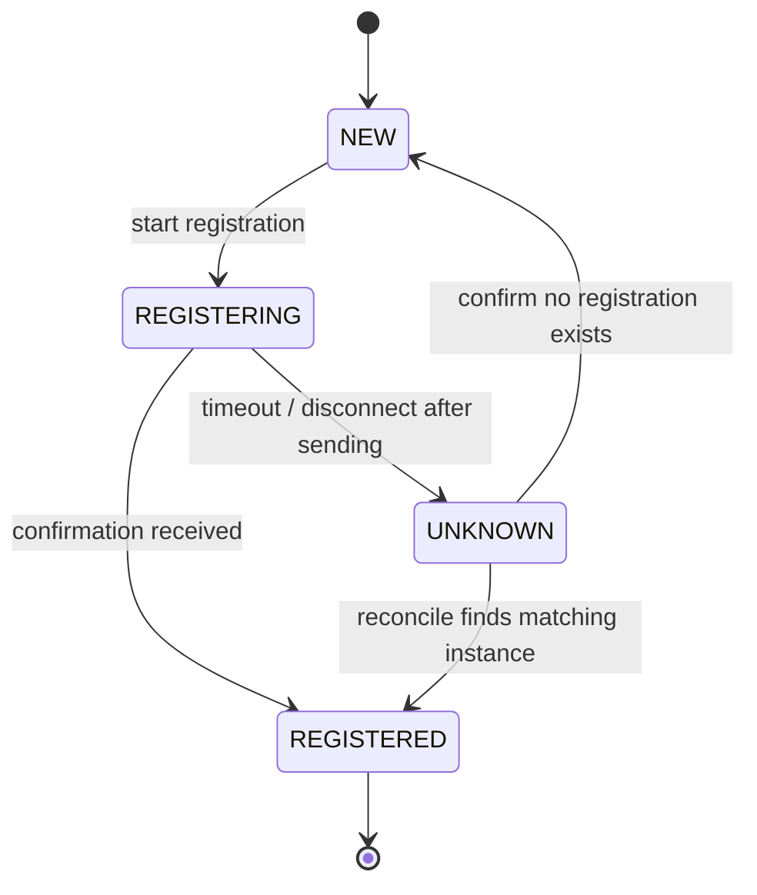

# Registering the Right Instance and Handling Repeated Calls

## 1. The Problem

A service can run across multiple replicas. Each replica must be registered so consumers can find it, yet the registry needs to distinguish replicas from one another. When an instance starts up, Spring Cloud can register it automatically. If application code also calls `ServiceRegistry.register()` manually, the same instance can receive multiple registration requests.

Repeated calls also arise when connectivity to the registry is flaky. The application sends a registration request but times out before receiving a response. At that point, you cannot conclude that the registry failed to record the instance. Retrying immediately with a new identifier can leave two registrations in the registry for a single process. Retrying with another replica's identifier can overwrite or collide with a running instance's registration, depending on the implementation.

In this lesson, **registering the right instance** means:

- Each replica has an appropriate service ID and instance ID.
- Host, port, scheme, metadata, and health check describe the exact endpoint consumers can call.
- A process keeps its identity stable throughout its lifetime, including during registration retries.
- Another instance has its own identity and does not overwrite a running replica's registration.
- Registration, status updates, and deregistration follow a lifecycle with a clear owner.

This lesson belongs to the **ServiceRegistry** chapter of the **SPRING_CLOUD_CORE** module. The module helps learners understand core Spring Cloud abstractions in distributed systems, including Spring Cloud Commons, externalized configuration, discovery, service registry, service-to-service communication, and testing and operations.

After this lesson, learners will be able to:

- Explain the roles of `ServiceRegistry` and `Registration`.
- Distinguish service ID from instance ID across multiple replicas.
- Choose the proper registration implementation for the registry in use.
- Avoid manual registrations duplicating auto-registration.
- Handle timeouts and retries when registration outcomes are uncertain.
- Design application-level registration operations that are safe to call repeatedly.
- Deregister the right instance on shutdown and test repeated-call scenarios.

## 2. The Spring Cloud Commons ServiceRegistry Contract

Spring Cloud Commons provides the `ServiceRegistry` abstraction so discovery providers implement a common interface. The contract defines these operations:

```java
public interface ServiceRegistry<R extends Registration> {

    void register(R registration);

    void deregister(R registration);

    void close();

    void setStatus(R registration, String status);

    <T> T getStatus(R registration);
}
```

`Registration` is a marker interface extending `ServiceInstance`. It carries data describing an instance such as service ID, instance ID, host, port, URI, secure flag, and metadata. `Registration` itself does not dictate how a registry stores data or handles two register commands sharing an identity.

| Component | Responsibility |
| --- | --- |
| Registration | Describes the instance to be registered. |
| ServiceRegistry.register() | Sends the registration to the registry implementation. |
| ServiceRegistry.deregister() | Removes the corresponding registration. |
| ServiceRegistry.setStatus() | Updates status according to provider conventions. |
| ServiceRegistry.getStatus() | Reads status according to provider conventions. |
| ServiceRegistry.close() | Closes registry client resources per implementation lifecycle. |

Implementations use their own registration types, for example:

| Provider | Registration / ServiceRegistry |
| --- | --- |
| Eureka | EurekaRegistration / EurekaServiceRegistry |
| Consul | ConsulRegistration / ConsulServiceRegistry |
| Zookeeper | ZookeeperRegistration / ZookeeperServiceRegistry |

When using `ServiceRegistry`, pass the exact `Registration` type required by the corresponding implementation. Never construct an arbitrary registration object and cast it to call another registry.

**Important limitation:** the shared contract does not guarantee `register()` is idempotent, does not define an idempotency key, and does not guarantee exactly-once delivery. How a provider handles duplicate registrations depends on the registry, version, and instance identity. Therefore, applications must design clear identities and lifecycles while verifying the semantics of the active provider.

## 3. Distinguishing Service ID and Instance ID

Service ID is the logical name consumers use to look up a service. Instance ID distinguishes each individual registration of that service.

Example with three replicas:

| Service ID | Instance ID | Host | Port |
| --- | --- | --- | ---: |
| inventory-service | inventory-01 | inventory-01.internal | 8080 |
| inventory-service | inventory-02 | inventory-02.internal | 8080 |
| inventory-service | inventory-03 | inventory-03.internal | 8080 |

Replicas share a service ID so consumers call the same logical service. Each replica has its own instance ID so the registry tracks them independently.

If two concurrently running replicas share the same instance ID, one provider may treat the later registration as an update to the earlier one, while another provider may reject it or behave differently. Never rely on the registry automatically distinguishing two processes merely because their hosts or metadata differ.

### 3.1. Identity Must Remain Stable Within a Process Lifecycle

A proper instance ID has these traits:

- Unique across active replicas of the same service.
- Unchanged across registration retries of the same process.
- Used consistently when updating status and deregistering.
- Traceable back to a pod, container, VM, or process for diagnostics.

Do not generate a new UUID on every `register()` call. If each retry generates a new instance ID, a single process can leave multiple registrations behind. If every replica shares a single ID, replicas can overwrite one another.

### 3.2. Eureka

Spring Cloud Netflix Eureka generates instance IDs by default in the form:

```text
${spring.cloud.client.hostname}:${spring.application.name}:${spring.application.instance_id:${server.port}}
```

Example:

```yaml
spring:
  application:
    name: inventory-service

eureka:
  instance:
    instance-id: ${spring.cloud.client.hostname}:${spring.application.name}:${spring.application.instance_id:${server.port}}
```

When deploying on a platform with its own instance ID, feed that ID into `spring.application.instance_id`. When running multiple replicas on the same host, ports or platform instance IDs must distinguish the replicas.

### 3.3. Consul

Spring Cloud Consul defaults to taking the service name from `spring.application.name`, instance ID from the Spring Application Context ID, and port from `server.port`. The default Context ID takes the form:

```text
${spring.application.name}:${profiles}:${server.port}
```

You can set a custom instance ID:

```yaml
spring:
  application:
    name: inventory-service
  cloud:
    consul:
      discovery:
        instance-id: ${spring.application.name}:${spring.application.instance_id:${server.port}}
```

In environments with platform identities, use the pod/container/VM ID to avoid relying on ports when multiple processes can share the same port across separate network namespaces. For instance, Kubernetes can inject the Pod UID or Pod name into an environment variable and reference it in `instance-id`.

### 3.4. Do Not Use Network Address as the Sole Identity if Addresses Can Change

IP addresses can be reassigned after a pod is recreated or a host changes networks. If the instance ID is just an IP, a new instance can accidentally reuse an old instance's ID. Conversely, an instance receiving a new IP can leave behind an old registration until leases or health checks clean it up.

Use a runtime-provided identifier combined with service ID and replica-distinguishing info. Host and port must still be kept accurate, but do not treat them as durable identities by default.

## 4. Registering the Right Instance Endpoint

A registration is more than just a name. It must accurately describe the endpoint consumers can reach:

| Field | What to verify |
| --- | --- |
| Service ID | Logical name matching what consumers look up. |
| Instance ID | Unique across replicas and stable within the process lifecycle. |
| Host/IP | Resolvable and routable from the consumer network. |
| Port | Application port consumers must call, not confused with management port. |
| Scheme / secure | Matches HTTP or HTTPS at the hop consumers connect to. |
| Health check | Correct path, port, scheme, and readiness state. |
| Metadata | Follows the contract actually understood by consumers or LoadBalancer. |

For example, if an application binds an ephemeral port with `server.port=0`, the registration must use the actual port after the web server starts, never `0`. Spring Cloud auto-registration hooks into the web server lifecycle and listens for `WebServerInitializedEvent` to obtain the actual port before initiating registration.

If the management server runs on a separate port, a provider may register a separate management service. For example, Spring Cloud Consul registers a separate service when `management.server.port` differs from the application port. That is a distinct registration with its own purpose—do not mistake it for duplicate registration of the business application.

## 5. Auto-registration and Manual Registration

When a discovery provider is on the classpath, Spring Cloud automatically registers the running Spring Boot application by default. Under standard configuration, there is no need to call `ServiceRegistry.register()` manually in `@PostConstruct` or `ApplicationRunner`.

Auto-registration can be disabled if the application wants direct control:

```yaml
spring:
  cloud:
    service-registry:
      auto-registration:
        enabled: false
```

Or use `EnableDiscoveryClient(autoRegister = false)` when annotation-based configuration is needed. `EnableDiscoveryClient` is no longer mandatory to activate discovery when an implementation is already on the classpath.

Choose only one owner for registration operations:

| Model | Approach |
| --- | --- |
| Use default lifecycle | Let Spring Cloud auto-register and auto-deregister. Do not call `register()` again in business code. |
| Manage lifecycle manually | Disable auto-registration, create a provider-compatible registration, and drive register, status, and deregister from a dedicated component. |
| Only observe registration | Listen to pre/post registration events or read status; do not issue extra register calls. |

### 5.1. Pre- and Post-Registration Events

Spring Cloud Commons publishes two events when auto-registration runs:

- `InstancePreRegisteredEvent`: before the instance is registered.
- `InstanceRegisteredEvent`: after the instance is registered.

Listeners can log, record metrics, or trigger integration steps that depend on registration. Neither event is published when `spring.cloud.service-registry.auto-registration.enabled=false`.

Do not handle the pre-registration event by making another `register()` call for the same instance. That creates a second registration path outside the existing lifecycle. If you need to alter the payload before sending, use the provider's appropriate extension point/lifecycle callback.

### 5.2. Why Can Registering Too Early Yield the Wrong Port?

`@PostConstruct` can run before the embedded web server finishes starting. At that point, the actual port—especially with `server.port=0`—may still be undetermined.

Spring Cloud auto-registration uses the web server initialization event to start the registration lifecycle. If managing manually, schedule the operation after the server has an actual address and port, and only emit registration once the instance is eligible to accept traffic.

## 6. What Does Calling register Repeatedly Mean?

There are several reasons the same registration command gets sent more than once:

1. Auto-registration and manual code both register the same instance.
2. Two listeners handle the same startup event.
3. A scheduled job or health callback calls `register()` periodically.
4. A call times out and the client retries even though the registry may already have received the request.
5. A process restarts before the old registration has been cleaned up.
6. Two replicas accidentally use the same instance ID.

Three situations must be distinguished:

| Situation | Meaning | Resolution |
| --- | --- | --- |
| Repeated call in same process | Multiple code paths send the same registration | Pick a single lifecycle owner and guard against duplicate calls inside the app. |
| Retry after error guaranteed not sent | Registry never received the request | Apply bounded retries with backoff. |
| Timeout after sending request | Unknown whether registry committed or not | Reconcile by identity before resending; do not create a new ID. |

A timeout response does not prove the operation failed. The registry may have recorded the registration while the response was lost in transit. This is an **unknown outcome** state.

### 6.1. Same ID vs. Different ID

Two registrations with the same service ID and instance ID may be treated by a provider as an update, overwrite, lease renewal, or rejection. Same ID with different payloads can also mutate host, port, metadata, or health checks on an existing registration.

Two registrations with the same service ID but different instance IDs typically represent two separate instances. That is right when they truly are two replicas. If it is merely a retry from one process, generating a new instance ID can leave multiple records in the registry for that same process.

You cannot deduce every provider's behavior from the method name `register()`. Read the specific registry's documentation and test against the exact version being deployed.

## 7. Designing Safe Repeatable Registration Operations

The goal of application-level idempotent handling is that if the same registration request is triggered multiple times within the same process, it neither spawns competing registration flows nor generates new identities.

A simple state machine can use these states:

| State | Meaning |
| --- | --- |
| NEW | Registration request has not been sent yet. |
| REGISTERING | A registration attempt is currently in progress. |
| REGISTERED | Registration confirmation was received. |
| UNKNOWN | Request may have reached the registry, but the client does not know the outcome. |

Workflow:



The example below illustrates locking concurrent calls and holding the `UNKNOWN` state to enforce reconciliation before retrying:

```java
import org.springframework.cloud.client.serviceregistry.Registration;
import org.springframework.cloud.client.serviceregistry.ServiceRegistry;

public final class RegistrationCoordinator<R extends Registration> {

    private enum State {
        NEW, REGISTERING, REGISTERED, UNKNOWN
    }

    private final ServiceRegistry<R> serviceRegistry;
    private final R registration;
    private State state = State.NEW;

    public RegistrationCoordinator(
            ServiceRegistry<R> serviceRegistry,
            R registration) {
        this.serviceRegistry = serviceRegistry;
        this.registration = registration;
    }

    public synchronized void register() {
        if (state == State.REGISTERED) {
            return;
        }
        if (state == State.UNKNOWN) {
            throw new IllegalStateException(
                    "Registration outcome is unknown; reconcile before retry");
        }
        if (state == State.REGISTERING) {
            return;
        }

        state = State.REGISTERING;
        try {
            serviceRegistry.register(registration);
            state = State.REGISTERED;
        }
        catch (RuntimeException ex) {
            // Keep UNKNOWN because an exception does not prove the registry missed the request.
            // Return to NEW only after reconciliation confirms no registration exists.
            state = State.UNKNOWN;
            throw ex;
        }
    }

    public synchronized void markReconciled(boolean sameInstanceExists) {
        if (state != State.UNKNOWN) {
            throw new IllegalStateException("No unknown registration to reconcile");
        }
        state = sameInstanceExists ? State.REGISTERED : State.NEW;
    }
}
```

This is an example of in-process coordination, not a complete implementation for every registry. `markReconciled` should only be called after querying the registry by provider identity with enough reliability to determine whether the registration exists. With caches or eventual consistency, a single query showing no instance could be stale.

An in-memory state machine is also lost when the process restarts. If multiple processes coordinate registration for a shared logical resource, use a lock/idempotency mechanism in a shared scope or assign ownership of registration to a single controller.

### 7.1. Reconcile by Identity, Not by Service ID Alone

When the registration outcome is unknown, locate the exact instance:

- Compare service ID.
- Compare instance ID according to provider conventions.
- Cross-check host, port, and key metadata if the provider lacks a reliable instance ID.
- Verify status and health checks.

Do not merely check whether the service exists, since a service ID can have multiple replicas. Seeing three existing instances does not prove the fourth instance you just tried to register is present.

`DiscoveryClient.getInstances(serviceId)` can help observe instances, though results may be cached or lag behind the registry. When deciding on a retry, use the provider's API/consistency guarantees or wait out the defined convergence window.

### 7.2. Do Not Create a New Identity for a Retry

A retry must reuse the same process's registration identity. If the registry supports upsert by instance ID, reusing the identity lets you resend the payload without creating a new logical instance. However, rely on that behavior only after verifying provider documentation and version.

Do not reuse an old process's instance ID for a new process if the old process could still be running. A shared ID can cause the two processes to overwrite each other's registrations.

## 8. Bounded Retries and Backoff

Never retry infinitely or spin continuously in a tight loop. During a registry outage, many instances retrying aggressively at once can amplify load and prolong the outage.

A retry policy should include:

- Maximum attempt count.
- Increasing backoff between attempts.
- Jitter so replicas do not retry in lockstep.
- Reasonable connection and read timeouts.
- Classification of retryable errors vs. non-retryable configuration errors.
- Logs/metrics for attempt counts, wait intervals, and final outcomes.

Spring Cloud Consul supports retries during registration. Per current documentation, add `spring-retry` and `spring-boot-starter-aspectj` to the classpath. Defaults are six attempts, initial interval 1,000 ms, and multiplier 1.1; configurable via `spring.cloud.consul.retry.*`. This mechanism applies to both Consul Config and Discovery registration.

Example configuration:

```yaml
spring:
  cloud:
    consul:
      retry:
        enabled: true
        max-attempts: 6
        initial-interval: 1000
        max-interval: 2000
        multiplier: 1.1
```

Verify property names and defaults against your Spring Cloud Consul version. Built-in provider retries also do not replace using a stable instance ID or reconciling when the previous request's outcome is unknown.

### 8.1. Fail-Fast or Keep Running?

For some systems, an application cannot accept traffic unless registration succeeds. In that case, startup should fail fast so orchestration can restart or keep the instance out of traffic.

For systems allowed to run temporarily without discovery, you can continue startup while keeping readiness false and retrying per policy. Never report readiness `UP` solely because the web server opened a port if consumers cannot find the instance.

Spring Cloud Consul provides `spring.cloud.consul.discovery.fail-fast` to decide behavior when registration fails. The current default is `true`; review documentation for your active version before changing it.

## 9. Registration and Deregistration Lifecycle

Instance registration is part of the application lifecycle:

1. Construct the registration from service ID, instance ID, and endpoint.
2. Wait for the web server to initialize to obtain the actual port.
3. Run pre-registration preparations if any.
4. Send the registration to the provider.
5. Confirm registration and publish post-registration status.
6. Maintain heartbeats or health checks per provider.
7. On shutdown, pull the instance out of traffic if requests need draining.
8. Deregister the exact instance and close registry client resources.

Spring Cloud Commons includes `AbstractAutoServiceRegistration` to manage the auto-registration lifecycle. This class listens for `WebServerInitializedEvent`, starts registration after server initialization, publishes `InstancePreRegisteredEvent` and `InstanceRegisteredEvent`, and invokes stop/deregister when the context closes.

### 9.1. Deregister Must Use the Exact Instance Identity

On shutdown, cancel the registration of the current instance. Do not use a shared service ID to delete the whole service when the goal is stopping a single replica.

With Eureka, clients send periodic heartbeats to renew their lease; current documentation describes a default 30-second interval and 90-second lease expiration. If heartbeats stop, the instance can be evicted from the registry per lease policy. Graceful shutdown should still deregister to shorten the window where a dead instance lingers in discovery.

With Consul, Spring Cloud Consul creates an HTTP health check polling `/actuator/health` every 10 seconds by default. If the health check fails, the instance is marked `critical`. Consul also supports TTL checks where the application sends heartbeats actively. Do not treat health checks as a replacement for deregistration during normal shutdown.

### 9.2. Drain Traffic Before Removing Registration

For services actively handling requests, you may need to:

- Transition instance status to `OUT_OF_SERVICE` or a provider-supported maintenance state.
- Wait for LoadBalancer/consumers to stop choosing the instance via health/status and cache mechanisms.
- Wait for active requests to complete within the graceful shutdown timeout.
- Call `deregister()` on the exact registration.
- Close the registry client per lifecycle.

Status values are provider-specific. Eureka has states such as `UP`, `DOWN`, `OUT_OF_SERVICE`, and `UNKNOWN`; Consul may represent maintenance and health checks differently. Do not assume the same status string carries identical force across all registries.

## 10. Avoiding Accidental Management Service Registration

If the management server uses a separate port, some providers register the management endpoint as a separate service. With Consul, when `management.server.port` differs from the application port, docs describe two registrations: the application service and a management service with a distinct suffix.

This can cause dashboards to display two services originating from the same application. Clarify the purpose of each registration:

| Registration | Intended consumer |
| --- | --- |
| Application service | Business consumers calling application APIs. |
| Management service | Admin tooling, health checks, or operations calling management endpoints. |

Do not configure business consumers to call the management service. If you do not want the management service registered, check the corresponding Spring Cloud Commons/provider management auto-registration properties.

## 11. Observability and Diagnostics

When the registry has duplicate, missing, or stale registrations, check in order:

1. Does `spring.application.name` match the expected service ID?
2. Does each replica have a unique instance ID?
3. Does a process generate a new instance ID on every retry?
4. Is auto-registration enabled while manual code also calls `register`?
5. Was registration sent after the web server got its actual host/port?
6. Do host, port, scheme, and health check match the real endpoint?
7. Did the registry receive the request while the client timed out before receiving the response?
8. Do consumers/discovery clients hold stale caches?
9. Does shutdown deregister the right registration?
10. Does the registry have leases/health checks to clean up dead instances?

Emit structured logs containing:

- Service ID and instance ID.
- Registered host and port.
- Active provider/registry.
- Correlation ID or registration attempt ID.
- Attempt count and backoff delay.
- Outcome: success, definite failure, or unknown outcome.
- Status and deregistration timestamp.

Do not log tokens, passwords, private keys, or sensitive metadata payloads. Never log just "register failed"; include enough identity to match the registration in the registry.

Spring Cloud Commons provides the `/serviceregistry` Actuator endpoint when a `Registration` bean exists. GET returns the current status; POST can change status via the JSON `status` field. Valid values depend on the provider. Protect the endpoint with authentication, authorization, and network access restrictions.

## 12. Testing Registration and Repeated Calls

Do not check only that `register()` was called. Verify identity, invocation count, state after errors, and shutdown behavior.

| Test case | Setup | Verification target |
| --- | --- | --- |
| Auto-registration | Start app with discovery provider | Instance registers after web server gets its actual port. |
| Manual registration | Disable auto-registration and call coordinator | Only the designated component performs registration. |
| Sequential repeated calls | Call `register()` multiple times with same registration | App stops sending extra calls once confirmed `REGISTERED`. |
| Concurrent calls | Multiple threads request registration of same instance | Only one local operation enters `REGISTERING`. |
| Timeout after send | Provider may have recorded it, but client gets no response | State becomes `UNKNOWN`; no new instance ID generated and no blind retry. |
| Reconcile finds instance | Registry holds instance with matching identity | Coordinator transitions to `REGISTERED`. |
| Reconcile finds no instance | Provider confirms no registration after accounting for consistency/cache | Allows retry with the same identity. |
| Two replicas | Two registrations with same service ID but different instance IDs | Registry displays two distinct instances. |
| Duplicate instance ID | Two replicas accidentally share an ID | Test exposes overwrite or conflict risk per provider. |
| Shutdown | Stop one replica in a multi-replica group | Only that replica's registration is deregistered. |
| Health check | Instance becomes unhealthy | Registry marks status per provider; consumers stop picking it per policy. |
| Separate management port | Management server registered separately | Business consumers do not mistakenly pick the management registration. |

### 12.1. Unit Testing with a Fake ServiceRegistry

A fake registry can count `register()` and `deregister()` calls:

```java
import java.util.ArrayList;
import java.util.List;

import org.springframework.cloud.client.serviceregistry.Registration;
import org.springframework.cloud.client.serviceregistry.ServiceRegistry;

class RecordingServiceRegistry<R extends Registration>
        implements ServiceRegistry<R> {

    private final List<R> registrations = new ArrayList<>();
    private final List<R> deregistrations = new ArrayList<>();

    @Override
    public void register(R registration) {
        registrations.add(registration);
    }

    @Override
    public void deregister(R registration) {
        deregistrations.add(registration);
    }

    @Override
    public void close() {
    }

    @Override
    public void setStatus(R registration, String status) {
    }

    @Override
    public <T> T getStatus(R registration) {
        return null;
    }

    public List<R> registrations() {
        return List.copyOf(registrations);
    }
}
```

Test the coordinator with the same registration:

```java
coordinator.register();
coordinator.register();
coordinator.register();

assertThat(recordingRegistry.registrations()).hasSize(1);
```

This is a unit test for the application's coordination layer. It does not prove how a real provider handles duplicate registrations. Run dedicated integration tests against Eureka, Consul, or the deployed provider.

### 12.2. Integration Testing with a Real Registry

In integration tests:

- Start the registry using an appropriate test environment.
- Start two application contexts or two instances with the same service ID but different instance IDs.
- Read the instance list from the registry or discovery client.
- Verify each registration has the correct host, port, metadata, and status.
- Resend the same operation with the same identity and observe provider semantics.
- Stop one instance and verify the remaining instance stays registered.
- Kill an instance abruptly to test lease/health-check cleanup.

If the test relies on a discovery client with caching, wait or synchronize according to the provider's mechanism. Never use a single immediate assertion to conclude registration failed merely because the instance has not appeared in a consumer cache yet.

## 13. Common Errors

| Symptom | Possible cause | Resolution |
| --- | --- | --- |
| Multiple instances appear for one process | Retries generate new instance IDs or multiple code paths register | Keep identity stable and designate one lifecycle owner. |
| New replica makes old replica disappear | Two processes share the same instance ID | Generate a unique ID per replica. |
| Instance has port 0 | Registered before web server assigned actual port | Register after `WebServerInitializedEvent` or use auto-registration lifecycle. |
| Startup calls register twice | Auto-registration and manual registration both enabled | Disable one mechanism or remove manual register calls. |
| Retry after timeout creates duplicate registration | Client assumes timeout guarantees uncommitted | Transition to `UNKNOWN` and reconcile by identity. |
| Registry retains dead instance | No graceful deregister and lease/health cleanup hasn't expired | Enable deregistration, tune health check/lease intervals, and monitor stale registrations. |
| Shutdown deletes wrong replica | Deregister uses insufficiently specific identity | Deregister the exact instance ID of the current process. |
| Consumer misses newly registered instance | Cache or registry/discovery sync interval | Query registry directly and account for convergence window. |
| Health check stays critical | Wrong path, port, scheme, or management context path | Inspect health endpoint from the registry agent's perspective. |
| Business consumer calls management endpoint | Confused management registration with application registration | Separate service IDs and consumer policies. |

## 14. Design Guidelines

1. **Use default auto-registration when no special lifecycle is needed.** Avoid calling `register()` manually as well.
2. **If managing manually, disable auto-registration.** Let a single component own register, status, and deregister.
3. **Keep service ID stable and instance ID unique per replica.** The same process must use the same identity across all retries.
4. **Create registration after the endpoint is ready.** Pay special attention to `server.port=0`, management ports, and advertised addresses.
5. **Do not assume `ServiceRegistry.register()` is exactly-once or idempotent.** Verify provider semantics.
6. **Classify error outcomes.** A timeout after sending is an unknown state; reconcile before retrying.
7. **Use bounded retries with backoff and jitter.** Prevent multiple replicas from causing a retry storm.
8. **Deregister the exact instance on shutdown.** Drain traffic and update status before deleting the registration if needed.
9. **Test against a real provider.** Fake registries only validate application coordination logic.
10. **Monitor identity and state.** Log service ID, instance ID, endpoint, attempt, and outcome to catch duplicate or stale registrations.

## 15. Self-Check Questions

1. What roles do `ServiceRegistry` and `Registration` play in Spring Cloud Commons?
2. Why can service ID be identical across replicas while instance ID must distinguish them?
3. Why should you not generate a new instance ID on every registration retry?
4. Why can combining auto-registration with manual registration cause duplicate operations?
5. When are `InstancePreRegisteredEvent` and `InstanceRegisteredEvent` published?
6. Why can `@PostConstruct` register the wrong port when an application uses `server.port=0`?
7. How does a timeout after sending a registration request differ from an error guaranteed to have occurred before the request was sent?
8. Why can `ServiceRegistry` not guarantee exactly-once delivery across all providers?
9. What information must be checked when reconciling a registration with an unknown outcome?
10. Design a test proving that two replicas share a service ID with distinct instance IDs, and retrying one replica does not create an extra instance.

## 16. Official References

- [Spring Cloud Commons — ServiceRegistry, Auto-registration, and Actuator Endpoint](https://docs.spring.io/spring-cloud-commons/reference/spring-cloud-commons/common-abstractions.html)
- [Spring Cloud Netflix — Registering with Eureka and Instance IDs](https://docs.spring.io/spring-cloud-netflix/reference/spring-cloud-netflix.html)
- [Spring Cloud Consul — Service Registration, Instance ID, and Health Checks](https://docs.spring.io/spring-cloud-consul/reference/discovery.html)
- [Spring Cloud Consul — Retry When Registry Is Unavailable](https://docs.spring.io/spring-cloud-consul/reference/retry.html)
- [Netflix Eureka — REST Operations](https://github.com/Netflix/eureka/wiki/Eureka-REST-operations)

Duplicate registration handling, retries, heartbeats, and deregistration depend on the provider and version. Before deploying automatic retries, verify identity semantics, registry read consistency, and cleanup rules for the registry in use.
