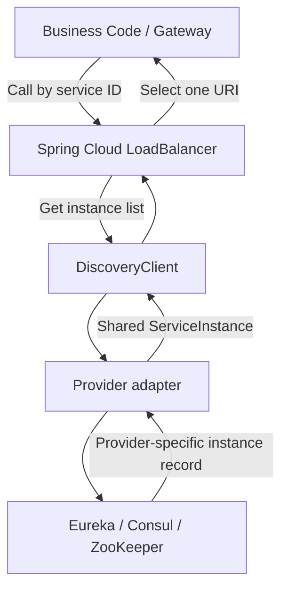
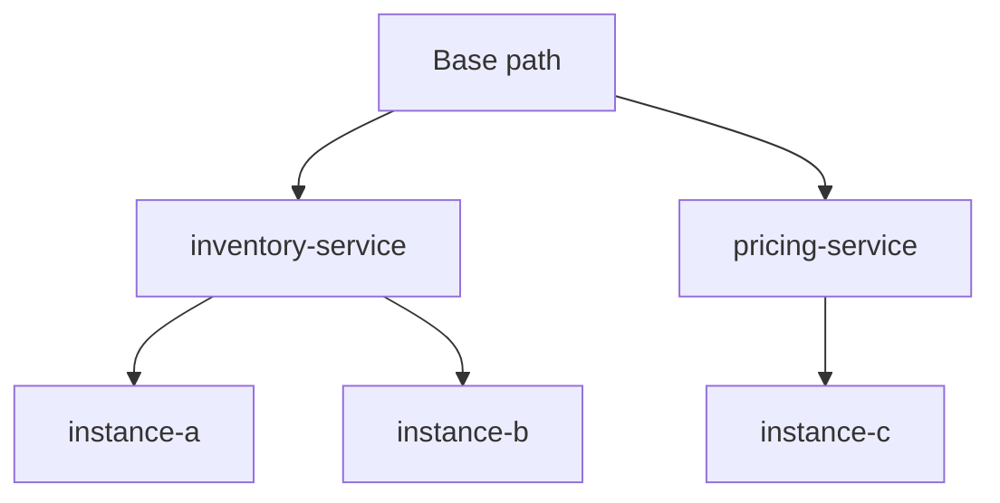

# Shared Contract Limits vs. Eureka, Consul, and ZooKeeper

## 1. Why Do We Need a Shared Contract?

In a microservice system, an application often needs to find the address of another service without hardcoding each instance's hostname or IP. A service registry stores information about published instances; a discovery client queries the registry to find suitable instances.

Spring Cloud Commons provides an abstraction layer so business code can use a single way to query services, whether the underlying implementation is Eureka, Consul, or ZooKeeper. The goal is to reduce direct coupling to each product's proprietary API. For example, a gateway layer can call `DiscoveryClient.getInstances("inventory-service")` without knowing whether the registry stores instances in Eureka, Consul, or ZooKeeper.

However, the abstraction only unifies **part of the programming contract**. It does not turn three systems into one product sharing the same data model, failure detection mechanism, update latency, consistency, instance status, or cluster operations.

This lesson focuses on the boundary between the Spring Cloud Commons contract and each registry's specific capabilities. After this lesson, readers will be able to:

- Identify what can be written once using the Commons API.
- Recognize data and behavior that depend on the provider.
- Explain differences in registration, heartbeats, health checks, caching, watches, and statuses.
- Design shared contract tests while still writing provider-specific integration tests for each registry.
- Plan migrations among Eureka, Consul, or ZooKeeper without assuming only dependencies need to change.

## 2. What Does Spring Cloud Commons Standardize?

Two key abstractions are `DiscoveryClient` and `ServiceRegistry`.

### 2.1. DiscoveryClient: Looking Up Service Instances

`DiscoveryClient` provides a blocking API to find instances by service ID. Commonly used methods are:

| Method | Role |
| --- | --- |
| `getInstances(serviceId)` | Returns the list of instances the implementation finds for the service ID |
| `getServices()` | Returns the list of service IDs known to the implementation |
| `description()` | Provides a description of the discovery implementation |

Spring Cloud Commons also provides `ReactiveDiscoveryClient` for reactive flows. Whether the application uses the blocking or reactive API does not change the underlying registry semantic differences.

The returned object is `ServiceInstance`. This is a shared model for an instance's connection info, typically containing service ID, instance ID, URI, host, port, secure flag, and metadata. Applications can use the URI to call the endpoint and read metadata to apply custom rules.

This contract answers the question **"which instance addresses are provided by the discovery implementation for this service?"**. It does not guarantee every instance in the list is successfully serving requests at the moment of the call.

### 2.2. ServiceRegistry: Registering and Deregistering

`ServiceRegistry` provides shared operations such as:

- `register(Registration)`: registers a service instance.
- `deregister(Registration)`: deregisters the instance.

`Registration` is a marker interface. Each provider has its own registration type, such as `EurekaRegistration`, `ConsulRegistration`, and `ZookeeperRegistration`. Therefore, injecting a `ServiceRegistry` does not mean registration objects are constructed identically across providers.

Commons also provides auto-registration and the events `InstancePreRegisteredEvent`, `InstanceRegisteredEvent`. Auto-registration can be disabled via `spring.cloud.service-registry.auto-registration.enabled=false` or matching discovery client config. `@EnableDiscoveryClient` is no longer mandatory just to enable discovery when an implementation is already on the classpath.

### 2.3. ServiceInstance Is a Shared Data Model, Not the Entire Registry Record

A registry may store more fields than `ServiceInstance` represents. When translating data from the registry to the Commons model, the adapter exposes only what fits the abstraction and its implementation choices.

| Data | Represented generally by Commons? | What to verify per provider |
| --- | --- | --- |
| Service ID | Yes | Naming rules, case sensitivity, namespaces, and groups |
| Instance ID | Yes | ID generation rules and uniqueness requirements |
| URI/host/port | Yes | How addresses are derived behind proxies, NAT, ingress, or multiple networks |
| Secure/HTTPS | Yes | How the provider advertises scheme and TLS certificates |
| Metadata | Yes, as a map | Key rules, tags, size limits, and how metadata is interpreted |
| Registration status | No single uniform enum across all providers | Valid status set and instance filtering semantics |
| Health check | Does not standardize check algorithms | HTTP checks, TTL heartbeats, lease heartbeats, or custom logic |
| Watch/change notification | No single uniform model in DiscoveryClient | Polling, blocking queries, watchers, caches, and events |
| ACL, auth, TLS to registry | Not fully abstracted | Credentials, certificates, tokens, ACLs, and per-datacenter permissions |
| Cluster topology | No | Peer replication, gossip/Raft, ensembles, and quorum |

### 2.4. LoadBalancer Is a Separate Layer

`DiscoveryClient` supplies the instance list; `Spring Cloud LoadBalancer` chooses an instance for a request. Do not confuse these two responsibilities.



LoadBalancer can apply instance selection strategies, filter by metadata, or handle retries according to configuration. However, it does not create identical health checks across all registries, nor does it guarantee the input list is always up to date.

## 3. What Lies Outside the Shared Contract?

Looking only at method signatures makes it easy to assume providers behave equivalently. In practice, the following details remain specific to each implementation and configuration.

### 3.1. Registration and Instance Lifecycle

The shared contract includes register/deregister operations, but does not specify:

- How often an instance must send heartbeats.
- How soon a lease expires when heartbeats stop.
- Whether the registry polls an HTTP endpoint or the application actively sends TTL heartbeats.
- When a process dies abruptly, whether the record disappears immediately or only after a timeout.
- When a client loses connectivity to the registry while the service keeps running, whether the record is kept, marked suspect, or removed.
- Upon restart, whether the instance preserves its ID or creates a new one.

These decisions directly affect how quickly services appear in or vanish from discovery results.

### 3.2. Health and Status

Commons can provide an aggregate health indicator based on the discovery implementation. That does not mean Commons' health indicator checks each business endpoint.

A provider may:

- Infer liveness from heartbeats.
- Call an HTTP health endpoint from an agent or server.
- Require the application to send TTL heartbeats.
- Store its own status and filter instances by status.
- Use metadata to emulate an out-of-service state.

An `UP` status in the registry also does not prove the service's database, message broker, or business dependencies are healthy. Health checks must be designed for the right goal: whether the process is alive, whether the application is ready for traffic, or whether full business operations can succeed.

### 3.3. List Freshness and Consistency

`getInstances()` has no shared parameter to request a specific freshness guarantee. It returns data according to the provider's cache, polling, watch, or API query mechanism.

Consequently, these scenarios can differ:

- A newly registered instance is not yet visible to clients.
- A stopped instance remains in a client's cache.
- The registry suffers a network partition and nodes see different views.
- A watcher disconnects and must resynchronize.
- A query returns a stale list while new updates are propagating.

Calling code needs timeouts, bounded retries, empty-list handling, and connection-error handling. Never use discovery as absolute proof that a returned address can still serve requests.

### 3.4. Metadata and Routing

Commons exposes metadata as a key/value map. It does not standardize:

- Key names such as `zone`, `region`, `version`, `weight`, `group`, or `tag`.
- Whether values are generated automatically by the provider or declared by the application.
- Whether metadata filters instances by default or merely serves as application data.
- Preference rules for same zone, same datacenter, or same region.

If LoadBalancer needs metadata for routing, configure the corresponding supplier or policy. Simply placing a `zone` key in metadata does not automatically enable zone-aware routing across every provider.

## 4. Comparing Eureka, Consul, and ZooKeeper

All three systems can serve service discovery in Spring Cloud applications, yet their underlying platforms and operations differ.

| Aspect | Eureka | Consul | ZooKeeper |
| --- | --- | --- | --- |
| Platform role | Dedicated client-server service registry for discovery | Platform for service discovery, health checks, KV, and DNS/HTTP APIs | Distributed coordination system; discovery built on Curator Service Discovery |
| Spring Cloud integration | Spring Cloud Netflix Eureka | Spring Cloud Consul | Spring Cloud Zookeeper, using Curator |
| Registration | Client registers metadata and sends heartbeats/lease renewals | Client registers via Consul HTTP API; agent runs health checks or TTL | Curator stores ServiceInstance under a znode tree by service name and instance ID |
| Failure detection | Heartbeats and leases; can optionally forward Actuator health status | HTTP health checks or TTL checks | Session/ephemeral node lifecycle and Curator/provider checks |
| List updates | Client registry cache and fetch intervals; server peer replication | HTTP API/DNS; catalog watch uses blocking queries and emits events | Direct queries or cache updated via ZooKeeper watchers |
| Metadata | `eureka.instance.metadataMap` | Service metadata, tags, and discovery properties | Flexible Curator ServiceInstance payload |
| Special statuses | Statuses like `UP`, `DOWN`, `OUT_OF_SERVICE`, `UNKNOWN` | Check states like passing/warning/critical; TTL heartbeats | Spring Cloud Zookeeper can represent `OUT_OF_SERVICE` via metadata and LoadBalancer supplier |
| Notable distinct capabilities | Peer replication, region/zone, client cache | DNS and HTTP API, agents, gossip/Raft, datacenters, health checks | Coordination primitives, watches, ephemeral znodes, sessions, and quorum |

This table describes how current integrations are documented. Exact behavior can vary with release train, server version, starter, and health check choices.

## 5. Eureka: Heartbeats, Caching, and Deployment Zones

Eureka is Netflix's service registry and client/server system. Spring Cloud Netflix brings Eureka into the Spring Boot model via starters and auto-configuration.

### 5.1. Registration and Heartbeats

When a client registers, it sends metadata such as host, port, health URL, and instance details. The client keeps sending heartbeats to Eureka Server. Current Spring Cloud Netflix documentation notes a default heartbeat interval of 30 seconds; if heartbeats do not arrive within the configured lease duration, the server typically evicts the instance from the registry.

This introduces an intentional delay between process termination and when other clients stop seeing the instance. Shortening heartbeat intervals can make discovery update faster, but also increases traffic and alters server operational assumptions.

### 5.2. Client Cache and Peer Replication

Eureka clients maintain an in-memory registry cache so they do not query the server on every request. Eureka Servers can be configured as peers replicating registrations with one another. As a result, the registry is not just a direct-query API; it involves client-side caching and peer-replicated state.

Consequently, when a new instance registers, clients may not see it immediately because time is needed for metadata to appear on the server and reach client caches. When evaluating discovery latency, account for heartbeats, server replication, and registry fetch intervals.

### 5.3. Health Status Does Not Default to Actuator Health

By default, Eureka uses heartbeats to determine whether a client is active. Unless Eureka health check integration is enabled, the application's Actuator health status is not automatically propagated to the registry; after registration, Eureka may continue publishing the instance as `UP`.

You can enable it:

```yaml
eureka:
  client:
    healthcheck:
      enabled: true
```

Per Spring Cloud Netflix documentation, this property should be placed in `application.yml`; placing it in `bootstrap.yml` can cause unintended `UNKNOWN` status. For complex health logic, Eureka lets you implement a custom `HealthCheckHandler`.

### 5.4. Zones and Regions

Eureka supports multi-zone and multi-region deployments. Clients can prefer registries in nearby zones; instance metadata can advertise a zone so Spring Cloud LoadBalancer filters instances by zone.

These are Eureka-specific semantics and related LoadBalancer settings. When migrating to Consul or ZooKeeper, map zones/regions to datacenters, metadata, or corresponding suppliers; do not assume Eureka property names work in another provider.

## 6. Consul: Agents, Health Checks, TTLs, and Catalog Watch

Consul provides service discovery via HTTP API and DNS. Spring Cloud Consul uses the HTTP API for registration and querying; non-Spring Cloud applications can still look up services via Consul DNS.

### 6.1. Agents and Clusters

Consul runs agents/servers. Servers communicate using a gossip protocol and use Raft for consensus. Therefore, operating Consul encompasses agents, server clusters, ACLs, datacenters, DNS, and HTTP APIs rather than merely configuring a single registry URL.

### 6.2. Default HTTP Health Check

Spring Cloud Consul creates an HTTP health check to `/actuator/health` by default, typically every 10 seconds. If the check fails, the service instance is marked `critical`. You can change the path, interval, or disable the HTTP health check via the corresponding discovery properties.

If the application changes its management port, context path, or servlet path, update the health check URL. Otherwise, Consul may mark the instance `critical` even though the real health endpoint works at a different path.

### 6.3. TTL Checks

Consul also supports TTL checks. With this approach, the application sends heartbeats to the Consul agent instead of the agent polling an HTTP health endpoint. Current Spring Cloud Consul docs specify a default TTL heartbeat of 30 seconds when enabled.

The two check types have different failure models:

| HTTP check | TTL check |
| --- | --- |
| Agent calls the application endpoint | Application sends heartbeats to the agent |
| Tests the health endpoint from the agent's network perspective | Depends on the application's heartbeat logic continuing to run |
| Requires proper URL, headers, and network routing | Requires TTL interval tuning and handling heartbeat interruptions |
| Marks `critical` when HTTP check fails | Status depends on TTL expiration or the application's health provider |

Do not choose solely based on which configuration takes fewer lines. Decide what health signals you want to measure and which network failures you want to detect.

### 6.4. Metadata, Datacenters, and Catalog Watch

Consul supports metadata and tags. Spring Cloud Consul maps service metadata into `ServiceInstance.getMetadata()`. When using multiple datacenters, service ID alone may not suffice to determine where to query; datacenter configuration for the service may be needed.

Catalog Watch uses blocking HTTP API calls to detect service catalog changes. When new data appears, Spring Cloud publishes a heartbeat event. This is Spring Cloud Consul's own update mechanism, not a generic watch method in `DiscoveryClient`.

## 7. ZooKeeper: Curator, Znodes, Watchers, and Sessions

ZooKeeper is a distributed coordination system. Spring Cloud Zookeeper uses the Curator Service Discovery extension to register and look up service instances.

### 7.1. Service Discovery Data Structure

Curator represents an instance with `ServiceInstance`, containing service name, ID, address, port or SSL port, and an optional payload. Instances are serialized and stored in ZooKeeper as a path hierarchy, grouped by service name and then instance ID.



Spring Cloud Zookeeper provides a discovery starter to auto-configure the client, registration, and `DiscoveryClient`. The ZooKeeper ensemble address is configured via `spring.cloud.zookeeper.connect-string`.

### 7.2. Sessions and Ephemeral Nodes

ZooKeeper maintains a session between the client and the ensemble. For records created as ephemeral znodes, a node exists as long as the creating session remains valid; when the session expires, ZooKeeper deletes ephemeral nodes belonging to that session.

This differs from Eureka's heartbeat/lease model or Consul's HTTP/TTL checks. During a network partition, a client may lose connectivity without its session expiring immediately. Applications and Curator must handle `SUSPENDED`, `LOST`, and `RECONNECTED` connection states and restore registrations/caches appropriately.

Do not interpret a single TCP disconnect event as immediate proof that the service has been removed from ZooKeeper. Session timeouts and Curator states determine when a session is considered lost.

### 7.3. Watchers and ServiceCache

Curator provides direct queries and `ServiceCache`. `ServiceCache` keeps the instance list in memory, using ZooKeeper watchers to update when instances are added, modified, or deleted. The cached list reflects the latest observed state; Curator documentation explicitly notes there is no absolute freshness guarantee.

Therefore, code using the cache must tolerate brief staleness while watchers sync or connections recover. For critical operations, still handle connection failures to instances after discovery returns a URI.

### 7.4. OUT_OF_SERVICE Status in Spring Cloud Zookeeper

Do not assume ZooKeeper and Curator share Eureka's status model. Spring Cloud Zookeeper documentation states that the Curator Service Discovery recipe does not directly support Eureka-like `OUT_OF_SERVICE` behavior.

Spring Cloud Zookeeper uses payload metadata to represent this status, and Spring Cloud LoadBalancer's `ZookeeperServiceInstanceListSupplier` filters out instances whose status is not `UP` according to integration rules. Thus, this behavior depends on the adapter and LoadBalancer supplier rather than being a default semantic of all ZooKeeper clients.

## 8. Key Differences Seen Through Commons

| Operational question | What Commons allows | What must still be verified per provider |
| --- | --- | --- |
| Find instances by service ID | Call `getInstances(serviceId)` | Whether the list is healthy-only or includes warning/critical instances |
| List services | Call `getServices()` | Cost of querying the full catalog and when caches refresh |
| Register instance | Call `ServiceRegistry.register()` with matching Registration | Registration structure, ID, tags, payload, ACL, and auto-register timing |
| Deregister | Call `deregister()` | Cleanup on graceful shutdown, crash, session timeout, or network partition |
| Change status | `/serviceregistry` endpoint when Registration bean exists | Valid enums/statuses, whether filtered from discovery or metadata-only |
| Health | `DiscoveryClient` health indicator | Whether registry health checks measure process, endpoint, or TTL heartbeat |
| Select instance | Use Spring Cloud LoadBalancer | Zone/datacenter preference, metadata suppliers, and error-instance exclusion |
| Detect changes | Can combine implementation events/caches | Polling, blocking queries, watchers, event lag, and reconnect behavior |
| Security | Configure security in the app | Tokens, TLS, mTLS, ACLs, read/write permissions, and peer communication security |

## 9. Example: Using the Shared Contract Properly

Business code should depend on `DiscoveryClient`, not directly on `EurekaClient`, `ConsulClient`, or `CuratorFramework` unless provider-specific features are required.

```java
import java.util.List;

import org.springframework.cloud.client.ServiceInstance;
import org.springframework.cloud.client.discovery.DiscoveryClient;
import org.springframework.stereotype.Service;

@Service
public class InventoryDirectory {

    private final DiscoveryClient discoveryClient;

    public InventoryDirectory(DiscoveryClient discoveryClient) {
        this.discoveryClient = discoveryClient;
    }

    public List<ServiceInstance> findInventoryInstances() {
        return discoveryClient.getInstances("inventory-service");
    }

    public ServiceInstance requireAnyInventoryInstance() {
        List<ServiceInstance> instances = findInventoryInstances();
        if (instances.isEmpty()) {
            throw new IllegalStateException(
                    "No inventory-service instance is currently discoverable"
            );
        }
        return instances.get(0);
    }
}
```

This snippet illustrates the lookup contract. In production applications, never assume the first element is the best instance. To pick an instance for HTTP requests, use Spring Cloud LoadBalancer instead of indexing `0` manually.

Example creating a LoadBalanced `RestTemplate`:

```java
@Configuration
public class ClientConfiguration {

    @Bean
    @LoadBalanced
    RestTemplate inventoryRestTemplate() {
        return new RestTemplate();
    }
}
```

Then call by service ID:

```java
String result = inventoryRestTemplate.getForObject(
        "http://inventory-service/api/items/42",
        String.class
);
```

Code calling by service ID can remain unchanged when switching providers if dependencies and LoadBalancer configuration are compatible. However, how LoadBalancer receives lists, filters health, reads metadata, and handles errors must still be re-tested after changing registries.

## 10. The ServiceRegistry Actuator Endpoint and Status Limits

Spring Cloud Commons provides the `/serviceregistry` actuator endpoint when the application context has a `Registration` bean.

- `GET /actuator/serviceregistry` returns the current registration status.
- `POST /actuator/serviceregistry` accepts JSON with a `status` field to request a status change.

Example payload:

```json
{
  "status": "OUT_OF_SERVICE"
}
```

Valid values depend on the provider. Eureka supports statuses such as `UP`, `DOWN`, `OUT_OF_SERVICE`, `UNKNOWN`. Spring Cloud Zookeeper can implement `OUT_OF_SERVICE` via metadata and an instance-filtering supplier. Never send a Eureka enum to Consul or ZooKeeper expecting the same outcome.

This endpoint also does not replace health checks. Changing status manually is an administrative action; the registry still runs its own mechanisms to update status via heartbeats or checks.

## 11. Design Pitfalls When Assuming Abstraction Means Equivalence

### 11.1. Switching Providers While Keeping Old Health Assumptions

An application previously using Eureka heartbeats might assume an instance only disappears after its lease expires. When moving to Consul HTTP checks, instances can be marked `critical` due to a wrong health URL or an unreachable agent. Moving to TTL without sending heartbeats also flips status.

### 11.2. Treating Metadata as If Every Registry Understood the Same Keys

`zone`, `region`, `version`, or `weight` are merely raw data unless the provider adapter or LoadBalancer policy interprets them. Standardize an organizational metadata schema and build matching adapters/suppliers.

### 11.3. Relying on List Order

The order returned by `getInstances()` is not a priority contract. Never select the first element as a load-balancing or failover mechanism. Use LoadBalancer and test its selection strategy.

### 11.4. Treating the Status Actuator as a Standardized Command

`/serviceregistry` provides a common endpoint, yet status values and their effect on discovery depend on the provider. Verify both stored status and actual instance lists after changing it.

### 11.5. Ignoring Caches and Watchers When Measuring Convergence

Eureka client caches, Consul catalog watches, and ZooKeeper `ServiceCache` all have different update mechanics. A test that registers an instance and immediately queries it can fail flakily unless it waits for appropriate convergence conditions.

## 12. Migrating from One Registry to Another

When migrating from Eureka to Consul or ZooKeeper, or vice versa, check in order:

1. **Dependencies and versions:** swap starters using a compatible Spring Cloud release train/BOM; avoid mixing independent versions.
2. **Control plane connectivity:** configure Eureka URLs, Consul agent/API, or ZooKeeper connect strings; set timeouts, retries, and TLS.
3. **Service names and instance IDs:** preserve service IDs clients look up; ensure instance IDs are unique across replicas.
4. **Advertised addresses:** verify hostnames, ports, HTTPS schemes, addresses behind NAT, proxies, containers, and management ports.
5. **Auto-registration:** confirm when instances register, whether manual registration is needed, and how deregistration runs on shutdown.
6. **Health checks:** translate heartbeats to HTTP/TTL or appropriate session semantics; verify paths, intervals, and status when dependencies fail.
7. **Metadata:** map tags, zones, regions, groups, versions, and payloads; update LoadBalancer suppliers if needed.
8. **Status and maintenance:** test `OUT_OF_SERVICE`, deregistration, and blue/green/canary procedures.
9. **Caching and latency:** measure time for new registrations to appear, dead instances to vanish, and caches to recover after network partitions.
10. **Security:** configure ACLs, tokens, TLS/mTLS, register/deregister permissions, and query permissions.
11. **Cluster operations:** prepare backups, peer replication, quorum, datacenters, and alerts following the provider model.
12. **Rollback:** keep the ability to revert to the old provider until confirming all clients and workloads have migrated cleanly.

Do not run two registries simultaneously without a plan for duplicate registrations, diverging data sources, and clients reading the wrong provider. If running side by side during migration, define which source is authoritative and how membership is reconciled.

## 13. Shared Contract Testing and Provider Testing

Tests should be split into two layers.

### 13.1. Contract Tests for Applications Using Commons

These tests can run against any implementation:

| Test case | Action | Verification target |
| --- | --- | --- |
| Service exists | Call `getInstances(serviceId)` | Returns a list with valid `ServiceInstance` structures |
| Service does not exist | Call `getInstances()` with unknown ID | Application handles empty list properly |
| Instance URI | Read `getUri()` | Scheme, host, and port match the caller's network |
| Metadata | Read `getMetadata()` | Application handles missing fields or absent keys |
| Service list | Call `getServices()` | Does not assume ordering or a small catalog |
| Load balancing | Call by service ID | Requests route to the instance chosen by LoadBalancer |
| Connection failure | Make one instance unreachable | Retries/timeouts/fallbacks do not cause infinite loops |

### 13.2. Provider-Specific Integration Tests

The following tests must be tailored to the registry:

| Provider | Required tests |
| --- | --- |
| Eureka | Heartbeat/lease, client cache, peer replication, health-check integration, zones, and status |
| Consul | HTTP check, TTL check, critical/passing states, metadata/tags, datacenters, and catalog watch |
| ZooKeeper | Session expiration, ephemeral registration, watcher reconnect, ServiceCache freshness, ACLs, and metadata status |

### 13.3. Distributed Failure Testing

Beyond the happy path, test:

- Registry temporarily unreachable.
- Client partitioned from the registry while the service still serves traffic.
- Process killed abruptly without running deregister.
- Health endpoint timing out or returning an unready state.
- Duplicate instance IDs.
- Watcher or client cache resynchronizing after reconnect.
- Registry cluster losing quorum or a peer node going down.

The goal is determining convergence times and fail-safe behavior. Do not merely verify that an API returns HTTP 200 or that `getInstances()` is non-empty.

## 14. Observability and Operations

Metrics and logs should distinguish three layers:

1. **Application:** readiness state, failed requests, service call latency.
2. **Discovery adapter:** registry query errors, registration counts, cache refreshes, health/watch event processing time.
3. **Registry cluster:** leader/quorum, peer replication, agent health, sessions, ACLs, and instance counts per service.

Commons provides `DiscoveryClientHealthIndicator`, though by default it may call `getServices()`. In systems with very large catalogs, querying every service on every health check can be expensive. You can disable service retrieval and use `probe()` if supported by the implementation, or disable the indicator as needed.

Never rely on a single indicator like "registry reachable" to conclude end-to-end discovery is healthy. An application can reach the registry yet still advertise a wrong URI, hold a stale cache, or fail to call service instances due to network issues.

## 15. Choosing a Registry Based on Real Requirements

| When prioritizing | Consider |
| --- | --- |
| Simple service registry/client model, peer replication, and client-side caching | Eureka |
| HTTP API/DNS, flexible health checks, TTL, metadata, and datacenters | Consul |
| Already operating ZooKeeper for coordination and wanting Curator-based discovery | ZooKeeper |
| Fixed endpoint list without needing a dynamic registry | `SimpleDiscoveryClient` |

No single provider is best in every scenario. Choose based on health semantics, convergence latency, topology, operability, security, and reliance on features beyond service discovery.

## 16. References

- [Spring Cloud Commons — Common Abstractions](https://docs.spring.io/spring-cloud-commons/reference/spring-cloud-commons/common-abstractions.html): `DiscoveryClient`, `ServiceRegistry`, auto-registration, actuator endpoint, and LoadBalancer.
- [Spring Cloud Netflix — Eureka Clients and Server](https://docs.spring.io/spring-cloud-netflix/reference/spring-cloud-netflix.html): registration, heartbeats, health checks, caching, peer replication, zones/regions, and Eureka status.
- [Spring Cloud Consul — Service Discovery](https://docs.spring.io/spring-cloud-consul/reference/discovery.html): HTTP/DNS, health checks, TTLs, metadata, datacenters, and Catalog Watch.
- [Spring Cloud Zookeeper — Service Discovery](https://docs.spring.io/spring-cloud-zookeeper/reference/discovery.html): Curator integration, registration, and querying with `DiscoveryClient`.
- [Spring Cloud Zookeeper — Service Registry](https://docs.spring.io/spring-cloud-zookeeper/reference/service-registry.html): `Registration`, `ServiceRegistry`, and `OUT_OF_SERVICE` status.
- [Apache Curator — Service Discovery](https://curator.apache.org/docs/service-discovery/): `ServiceInstance`, `ServiceProvider` structure, registration, querying, and `ServiceCache`.
- [Apache Curator — Error Handling](https://curator.apache.org/docs/errors/): connection states, session expiration, and retry policies.
- [Apache ZooKeeper — Programmer's Guide](https://zookeeper.apache.org/doc/current/zookeeperProgrammers.html): sessions, ephemeral znodes, watchers, and the ZooKeeper data model.

The Spring Cloud Commons contract lets application code rely on a common API to look up and register services. Yet this contract does not standardize every way registries detect failures, update caches, maintain clusters, check health, handle statuses, or enforce security. When selecting or migrating among Eureka, Consul, and ZooKeeper, keep business logic on the shared abstractions while testing and operating each provider's specific semantics.
