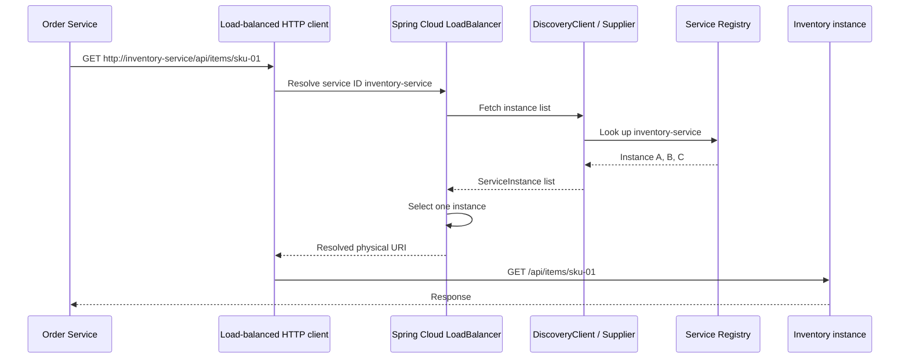

# Logical Service Names and Physical Network Addresses

## 1. Why separate the service name from the machine address?

In a distributed system, a service typically has multiple instances running across different machines, containers, or pods. Each instance has its own network address, such as host and port. When redeploying, scaling replicas, migrating regions, or changing infrastructure, those addresses can change.

If consumer source code calls an address such as `http://10.24.8.21:8081` directly, the application is coupled to a specific physical instance. When the instance is replaced or moved to another node, the consumer's configuration must be updated accordingly. If multiple consumers maintain lists of addresses, synchronizing and removing failed instances becomes the responsibility of each individual application.

Spring Cloud introduces a more stable identification layer: the **logical service name (service ID)**. A consumer calls by service name, for example `inventory-service`. Service discovery and client-side load balancing find the list of available instances, select one instance, and translate the call into the appropriate physical network address.

This lesson belongs to the **Service Calls** chapter of **SPRING_CLOUD_CORE**. The goal is to distinguish a service ID from a hostname/IP/port, understand the roles of `DiscoveryClient` and Spring Cloud LoadBalancer, and know when a URL represents a logical service name or a physical address.

## 2. Logical service names and physical addresses

The two types of identifiers answer two different questions:

- **Logical service name** answers: which service's functionality does the consumer want to call?
- **Physical address** answers: which host, port, and scheme should the request be sent to right now?

Consider an inventory management service with three instances:

| Identifier | Example value | Meaning |
| --- | --- | --- |
| Service ID | `inventory-service` | Logical name for consumers to request the inventory service |
| Instance A | `http://10.24.8.21:8081` | Current network address of one instance |
| Instance B | `http://10.24.8.22:8081` | Current network address of the second instance |
| Instance C | `https://inventory-3.internal:8443` | Network address and scheme of the third instance |

Consumers should depend on `inventory-service`. The discovery system maintains the mapping from the service ID to the currently available instances. The load balancer picks one instance from that list for each request.

A service ID does not have to be a DNS hostname with an A/AAAA record. When using Spring Cloud LoadBalancer, a URI like `http://inventory-service/api/items` uses the host part `inventory-service` as a **virtual host/service name**. A client marked with `@LoadBalanced` passes this name through the instance selection mechanism before sending the request.

Conversely, the URI `http://10.24.8.21:8081/api/items` already contains a physical host and port. Service discovery is not needed to locate an instance if the client sends directly to that URL, but the consumer takes responsibility for updating the address when infrastructure changes.

## 3. How is a service call resolved?

With an HTTP client integrated with Spring Cloud LoadBalancer, the basic flow consists of:

1. The consumer creates a request with a URI containing a service ID, for example `http://inventory-service/api/items/sku-01`.
2. A load-balancer interceptor or exchange filter recognizes that the request requires load balancing.
3. Spring Cloud LoadBalancer retrieves the instance list for the service ID from `ServiceInstanceListSupplier`.
4. The supplier typically obtains data from a `DiscoveryClient` present on the classpath or from the static configuration of `SimpleDiscoveryClient`.
5. The load balancer selects an appropriate `ServiceInstance`.
6. The client replaces the virtual host with the physical URI of the selected instance, preserving the path, query, and required request components.
7. The HTTP client sends the request to the selected host/port address.



A logical service name does not establish a network connection on its own. It needs a component that knows how to map a service ID to an instance. If a regular HTTP client without load-balancer integration is used, the hostname in the URI is handled by the standard resolver as a DNS hostname.

## 4. Roles of abstractions in Spring Cloud

Spring Cloud Commons defines abstractions so consumers do not have to depend directly on a specific registry provider.

| Abstraction | Responsibility |
| --- | --- |
| `DiscoveryClient` | Look up services and instances of a service ID |
| `ServiceInstance` | Describe an instance, including service ID, host, port, URI, secure status, and metadata |
| `ServiceRegistry` | Register or deregister an instance with a registry |
| `Registration` | Describe the instance information to be registered |
| `ServiceInstanceListSupplier` | Supply the list of instances to LoadBalancer |
| `ReactiveLoadBalancer` | Select an instance according to a reactive load-balancing strategy |
| `BlockingLoadBalancerClient` | Integrate instance selection for blocking clients such as RestTemplate and RestClient |

Discovery implementations can come from Eureka, Consul, Zookeeper, or another provider. Consumers use the common abstraction; the specific provider is responsible for communicating with the corresponding registry.

In current versions of Spring Cloud, simply having an appropriate `DiscoveryClient` implementation on the classpath can enable discovery/auto-registration; the `@EnableDiscoveryClient` annotation is no longer required in typical cases. Auto-registration behavior and registration properties still depend on the registry implementation and configuration.

## 5. Using a service ID with RestClient

`RestClient` is Spring Framework's blocking HTTP client. To call a service by logical name, create a `RestClient.Builder` annotated with `@LoadBalanced`. The application also needs Spring Cloud LoadBalancer on the classpath.

Configuration example:

```java
import org.springframework.cloud.client.loadbalancer.LoadBalanced;
import org.springframework.context.annotation.Bean;
import org.springframework.context.annotation.Configuration;
import org.springframework.web.client.RestClient;

@Configuration(proxyBeanMethods = false)
public class HttpClientConfiguration {

    @Bean
    @LoadBalanced
    RestClient.Builder loadBalancedRestClientBuilder() {
        return RestClient.builder();
    }
}
```

The consumer injects the builder with the corresponding qualifier and calls using the service ID:

```java
import org.springframework.cloud.client.loadbalancer.LoadBalanced;
import org.springframework.stereotype.Component;
import org.springframework.web.client.RestClient;

record Item(String sku, int availableQuantity) {
}

@Component
public class InventoryClient {

    private final RestClient restClient;

    public InventoryClient(
            @LoadBalanced RestClient.Builder builder) {
        this.restClient = builder.build();
    }

    public Item findItem(String sku) {
        return restClient.get()
                .uri("http://inventory-service/api/items/{sku}", sku)
                .retrieve()
                .body(Item.class);
    }
}
```

In the example, `inventory-service` is the logical service name. The consumer does not need to know which host or port the instance is on. When LoadBalancer selects an instance, the request is sent to the corresponding physical URI.

If the application has multiple `RestClient.Builder` beans of the same type, use the `@LoadBalanced` qualifier to distinguish the load-balanced builder from a regular builder. You can declare a separate regular builder and mark it with `@Primary` if you want it injected by default at injection points where no qualifier is specified.

The LoadBalancer dependency should be managed via a compatible Spring Cloud BOM:

```xml
<dependency>
    <groupId>org.springframework.cloud</groupId>
    <artifactId>spring-cloud-starter-loadbalancer</artifactId>
</dependency>
```

If using Eureka/Consul/Zookeeper, add the corresponding discovery starter. If there is no registry-backed DiscoveryClient, Spring Cloud Commons can use `SimpleDiscoveryClient` with a statically configured instance list.

## 6. Other HTTP clients can also use a service ID

Spring Cloud Commons provides integration for multiple clients. The common requirement is that requests must pass through a client configured with LoadBalancer.

### 6.1. RestTemplate

```java
import org.springframework.cloud.client.loadbalancer.LoadBalanced;
import org.springframework.context.annotation.Bean;
import org.springframework.context.annotation.Configuration;
import org.springframework.web.client.RestTemplate;

@Configuration(proxyBeanMethods = false)
public class LegacyHttpClientConfiguration {

    @Bean
    @LoadBalanced
    RestTemplate loadBalancedRestTemplate() {
        return new RestTemplate();
    }
}
```

Usage:

```java
import org.springframework.cloud.client.loadbalancer.LoadBalanced;
import org.springframework.stereotype.Component;
import org.springframework.web.client.RestTemplate;

@Component
public class LegacyInventoryClient {

    private final RestTemplate restTemplate;

    public LegacyInventoryClient(@LoadBalanced RestTemplate restTemplate) {
        this.restTemplate = restTemplate;
    }

    public String getItems() {
        return restTemplate.getForObject(
                "http://inventory-service/api/items",
                String.class
        );
    }
}
```

`RestTemplate` is no longer automatically created by Spring Boot in the legacy way; applications must declare a bean if they want to inject it. When both a regular RestTemplate and a load-balanced one exist, use `@Primary` or a qualifier to avoid injecting the wrong bean.

### 6.2. WebClient

With WebFlux, you can create a load-balanced `WebClient.Builder`:

```java
import org.springframework.cloud.client.loadbalancer.LoadBalanced;
import org.springframework.context.annotation.Bean;
import org.springframework.context.annotation.Configuration;
import org.springframework.web.reactive.function.client.WebClient;

@Configuration(proxyBeanMethods = false)
public class ReactiveHttpClientConfiguration {

    @Bean
    @LoadBalanced
    WebClient.Builder loadBalancedWebClientBuilder() {
        return WebClient.builder();
    }
}
```

The consumer calls the logical service name:

```java
import org.springframework.cloud.client.loadbalancer.LoadBalanced;
import org.springframework.stereotype.Component;
import org.springframework.web.reactive.function.client.WebClient;
import reactor.core.publisher.Mono;

@Component
public class ReactiveInventoryClient {

    private final WebClient webClient;

    public ReactiveInventoryClient(
            @LoadBalanced WebClient.Builder builder) {
        this.webClient = builder.build();
    }

    public Mono<Item> findItem(String sku) {
        return webClient.get()
                .uri("http://inventory-service/api/items/{sku}", sku)
                .retrieve()
                .bodyToMono(Item.class);
    }
}
```

The reactive integration uses `ReactiveLoadBalancer`. Appropriate Spring Cloud LoadBalancer and Spring WebFlux dependencies are required.

### 6.3. Regular clients and load-balanced clients are two separate choices

An application may need both types of clients:

| Client | Example URI | How it is handled |
| --- | --- | --- |
| Regular client | `https://partner.example.com/v1` | Standard DNS/HTTP client resolves the hostname |
| Load-balanced client | `http://inventory-service/api/items` | Spring Cloud LoadBalancer resolves the service ID |
| Direct instance client | `http://10.24.8.21:8081/api/items` | Sends to the configured physical address |

You should not mark every HTTP client as load-balanced by default. Only clients designed to call internal services via a service ID need this integration.

## 7. SimpleDiscoveryClient: using a static instance list

If there is no Service Registry-backed DiscoveryClient on the classpath, Spring Cloud Commons can use `SimpleDiscoveryClient`. Instances are declared in configuration by service ID.

Example with two instances of `inventory-service`:

```yaml
spring:
  cloud:
    discovery:
      client:
        simple:
          instances:
            inventory-service:
              - uri: http://inventory-1.internal:8081
              - uri: http://inventory-2.internal:8081
```

This is a way to map a service ID to a list of physical URIs without needing an external registry. LoadBalancer can still pick an instance from the list.

Static configuration is useful for development, testing, small systems, or topologies that rarely change. When instances are added, removed, or change addresses, the configuration list must be updated and reloaded according to the deployment workflow. It does not automatically discover new instances like a dynamic registry.

In Spring Cloud Commons documentation, the equivalent property format is:

```properties
spring.cloud.discovery.client.simple.instances.inventory-service[0].uri=http://inventory-1.internal:8081
spring.cloud.discovery.client.simple.instances.inventory-service[1].uri=http://inventory-2.internal:8081
```

The name `inventory-service` is the service ID; `[0]` and `[1]` are the instance indices; `uri` is the actual physical address.

## 8. Dynamic discovery and registries

In production environments, a registry usually stores multiple instances of the same service. When a service starts, the discovery implementation can register the instance; when an instance stops or is deregistered, the registry updates the queryable list.

Illustrative example:

| Service ID | Instance ID | Host | Port | Status |
| --- | --- | --- | --- | --- |
| `inventory-service` | `inventory-a` | `10.24.8.21` | `8081` | UP |
| `inventory-service` | `inventory-b` | `10.24.8.22` | `8081` | UP |
| `inventory-service` | `inventory-c` | `10.24.9.14` | `8081` | OUT_OF_SERVICE |

The consumer requests `inventory-service`. The discovery client returns matching instances; the supplier/load balancer proceeds to select an address. Whether an instance is considered healthy depends on the registry, discovery implementation, metadata, and supplier/health-check configuration.

Service Registry and LoadBalancer have different responsibilities:

- The Registry holds registration details and instance status.
- DiscoveryClient reads the instance list from the registry.
- LoadBalancer selects an instance from the list provided by the supplier.
- The HTTP client sends the request to the selected physical address.

The registry should not be treated as an HTTP proxy. In the client-side load balancing model, the consumer typically connects directly to the selected instance.

## 9. Logical service names differ from DNS service discovery

Both mechanisms may use a similar memorable name, but they operate at different layers.

| Criterion | Spring Cloud service ID | DNS service discovery |
| --- | --- | --- |
| Resolution component | DiscoveryClient + LoadBalancer | OS/JVM DNS resolver or DNS client |
| Target data | List of `ServiceInstance` | DNS records such as A, AAAA, CNAME, or SRV depending on the environment |
| Instance selection | Client-side LoadBalancer | DNS resolver, network, or infrastructure depending on the deployment mechanism |
| HTTP client integration | Requires a client/filter marked as load-balanced | Regular clients can use a DNS hostname |
| Metadata information | Can include instance ID, zone, secure flag, metadata | DNS records usually do not provide equivalent Spring `ServiceInstance` metadata |
| Address updates | Follows LoadBalancer's registry/supplier/cache | Follows DNS records, TTL, and resolver cache |

For example, in Kubernetes, a Service DNS name may point to a stable ClusterIP; kube-proxy or the cluster's data plane forwards traffic to pods. That is the platform's DNS + virtual IP mechanism. When using Spring Cloud LoadBalancer, the service ID is resolved through DiscoveryClient/Supplier and the client selects the instance.

Service names may overlap between the two mechanisms, but you must not assume that `@LoadBalanced` automatically invokes DNS or that DNS automatically provides `ServiceInstance` objects to Spring Cloud.

## 10. When to use a logical name, and when to use a physical address?

Prefer a logical name when:

- A service has multiple instances.
- Instance addresses change during scaling, rollouts, or scheduling.
- The consumer needs client-side instance selection.
- You need to apply load balancing strategies, zone preference, or metadata.
- You want to decouple consumer configuration from provider deployment details.

Use a physical address when:

- Integrating with external endpoints that have a fixed address or public DNS.
- An administrative/diagnostic connection needs to target a specific node.
- The system has a fixed topology and does not use discovery/load balancing.
- The platform already provides a virtual IP or reverse proxy as a stable entry point.

If using a physical address in configuration, manage it via externalized configuration instead of hard-coding it in business code. If a service ID is used, ensure the client actually has LoadBalancer integration and an instance source.

## 11. What to check when a service ID is not resolved

A common error occurs when a consumer calls:

```text
http://inventory-service/api/items
```

but receives an error stating that the hostname `inventory-service` cannot be resolved. Check in the following order:

1. Was the HTTP client created from a `@LoadBalanced` bean or configured with a LoadBalancer exchange filter?
2. Is the `spring-cloud-starter-loadbalancer` dependency on the runtime classpath?
3. Is there a DiscoveryClient implementation or SimpleDiscoveryClient instance config?
4. Does the service ID in the URI match the registered/configured ID?
5. Does DiscoveryClient return a list of instances?
6. Do the instance URIs have valid host, port, and scheme values?
7. Is there a stale instance cache or has the registry not updated its status yet?
8. Do network policies, firewalls, routes, and TLS allow connecting to the physical address?

If a regular client is used, `inventory-service` will be treated as a hostname by the standard resolver. Merely changing the URL string to a service ID does not automatically activate Spring Cloud LoadBalancer.

## 12. Observability and testing

To confirm that logical-to-physical mapping works, do not check only the final response. Observe the service ID, instance list, and selected address as well.

Tests to include:

- **Binding/Discovery test:** `DiscoveryClient.getInstances("inventory-service")` returns the expected list of instances.
- **LoadBalancer test:** with a list of multiple instances, requests are distributed according to the configured strategy.
- **Physical URI test:** the request retains the correct path/query after the service ID is replaced with host/port.
- **Instance removal test:** when an instance is deregistered or marked unavailable, subsequent requests no longer select it once the supplier/cache updates.
- **No-instance test:** when the list is empty, the client handles the error clearly and does not guess an address.
- **Network test:** from the consumer container/pod, connecting to the physical address advertised by the registry actually succeeds.
- **TLS test:** the scheme and certificate of a secure instance match the client configuration.

Spring Cloud LoadBalancer caches the instance list. Current documentation specifies a default cache TTL of 35 seconds and capacity of 256; this can be adjusted with `spring.cloud.loadbalancer.cache.ttl` and `spring.cloud.loadbalancer.cache.capacity`. If DiscoveryClient already caches data, consider avoiding double caching or setting a TTL aligned with topology update requirements.

Do not log full headers or payloads containing sensitive information just to identify an instance. You can add a correlation ID and non-sensitive instance ID/metadata to logs or metrics to aid tracing.

## 13. Common design mistakes

| Mistake | Consequence | How to fix |
| --- | --- | --- |
| Hard-coding an instance's IP in business code | Consumer is coupled to one node and easily breaks when deployments change | Use a service ID and LoadBalancer if the service has multiple instances |
| Using a service ID with a regular HTTP client | Resolver tries to look up a DNS hostname and bypasses DiscoveryClient | Mark the builder/client with `@LoadBalanced` or add the appropriate filter |
| Having LoadBalancer without an instance source | Cannot map the service ID to a physical URI | Configure a registry-backed DiscoveryClient or SimpleDiscoveryClient |
| Confusing a DNS name with a service ID | Debugging the wrong resolution layer | Determine whether the client uses DNS or Spring Cloud LoadBalancer |
| Assuming Service Registry directly proxies requests | Misunderstanding the data path and network policies | The consumer retrieves instances and then calls the instance directly |
| Configuring SimpleDiscoveryClient without updating the list | Consumer continues using old URIs | Manage the static list alongside the deployment process |
| Using multiple HTTP clients and injecting the wrong bean | Requests go through a non-load-balanced client | Use `@LoadBalanced`, `@Primary`, and explicit qualifiers |
| Registry returns an address unreachable from the consumer | Discovery succeeds but connection fails | Check advertised host/port, network routes, firewall, and TLS |

## 14. Service call design workflow

1. Define a stable service ID for the provider, for example `inventory-service`.
2. Determine the instance source: Eureka, Consul, Zookeeper, SimpleDiscoveryClient, or another discovery provider.
3. Ensure the provider registers a host/port reachable from the consumer.
4. Add Spring Cloud LoadBalancer to the consumer if client-side load balancing is desired.
5. Create an HTTP client with `@LoadBalanced` or the corresponding filter.
6. Call using a URI with the service ID and business path.
7. Configure appropriate timeouts, retries, TLS, and observability on the HTTP client/LoadBalancer.
8. Verify the instance list, selected URI, and registry status in an integration environment.
9. Test during scale up/down, instance failures, and temporary registry unavailability.

## 15. Self-check questions

1. How does a service ID differ from an instance's hostname/IP?
2. Why does `http://inventory-service/...` work with `@LoadBalanced RestClient.Builder` but fail with a regular RestClient?
3. Which parts of the resolution process are handled by `DiscoveryClient` and `ServiceInstanceListSupplier`?
4. How does `ServiceRegistry` differ from `DiscoveryClient` in responsibility?
5. Where does `SimpleDiscoveryClient` get instance URIs from?
6. Why does client-side load balancing cause the consumer to connect directly to an instance instead of going through the registry?
7. At which resolution layer do DNS service discovery and Spring Cloud service IDs differ?
8. When a registry returns an unreachable physical address, what should be checked?
9. Why can instance caching prevent topology changes from being seen immediately?
10. When should a physical URL or DNS name be used instead of a service ID?

## 16. Official references

- [Spring Cloud Commons — Common Abstractions](https://docs.spring.io/spring-cloud-commons/reference/spring-cloud-commons/common-abstractions.html) — `DiscoveryClient`, `ServiceRegistry`, `SimpleDiscoveryClient`, and load-balanced `RestTemplate`, `RestClient`, `WebClient` integrations.
- [Spring Cloud LoadBalancer](https://docs.spring.io/spring-cloud-commons/reference/spring-cloud-commons/loadbalancer.html) — `ServiceInstanceListSupplier`, instance selection algorithms, caching, health checks, and HTTP client integrations.
- [Spring Cloud Commons — Configuration Properties](https://docs.spring.io/spring-cloud-commons/reference/configprops.html) — discovery and LoadBalancer properties.
- [Spring Framework — REST Clients](https://docs.spring.io/spring-framework/reference/integration/rest-clients.html) — `RestClient` and `RestTemplate` APIs.
- [Spring WebFlux — WebClient](https://docs.spring.io/spring-framework/reference/web/webflux-webclient.html) — reactive HTTP client.

*This document focuses on the boundary between logical identification and routing to physical instances. Service names are only understood by LoadBalancer when requests pass through an integrated client; always verify the instance list and advertised addresses from the consumer's network perspective.*