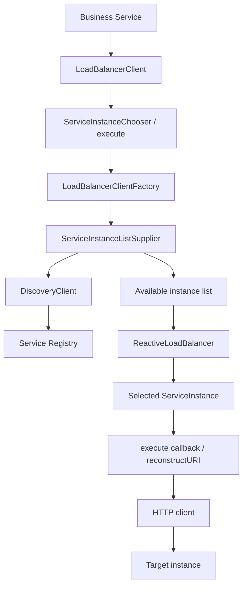

# The Role of LoadBalancerClient in Service Call Contracts

In microservices systems, service-calling code typically knows logical names such as inventory-service, payment-service, or catalog-service. It should not have to maintain lists of IP addresses and ports for each replica, because instances can be added, removed, moved across zones, or change addresses while the application is running.

Spring Cloud Commons defines the **LoadBalancerClient** contract so an application can request selecting a **ServiceInstance** for a service ID, execute a call against the selected instance, or convert a logical URI into a physical address. This contract decouples how an application calls a service from how the system finds instances and picks a target.

This lesson belongs to the **Service Calls** chapter of **SPRING_CLOUD_CORE**. The focus is on understanding the responsibilities of LoadBalancerClient, the choose, execute, and reconstructURI methods, its relationship with DiscoveryClient and ServiceInstanceListSupplier, and how it integrates with RestTemplate, RestClient, and WebClient. The lesson focuses on the client-side service call contract; service registration, HTTP protocols, and retry policies are explained only to the extent needed to use the abstraction properly.

## 1. Learning objectives

After this lesson, learners can:

1. Explain why a caller should use a service ID instead of hardcoding a replica's hostname/IP.
2. Distinguish the roles of DiscoveryClient, ServiceInstanceListSupplier, ReactiveLoadBalancer, and LoadBalancerClient.
3. Describe the data that ServiceInstance provides for a call.
4. Explain the contract of choose(serviceId) and choose(serviceId, request).
5. Distinguish the two execute overloads and know when to reuse a selected instance.
6. Use reconstructURI to convert a logical URI into a physical URI.
7. Distinguish the blocking LoadBalancerClient API from the reactive branch using ReactiveLoadBalancer.
8. Configure a load-balanced HTTP client using the @LoadBalanced annotation.
9. Handle cases where no instance is available, connection errors occur, or instance lists are stale.
10. Test instance selection and observe load balancing outcomes.

## 2. The problem that the LoadBalancerClient contract solves

Suppose a system has three instances of inventory-service:

| Service ID | Instance | Host | Port |
| --- | --- | --- | --- |
| inventory-service | inventory-1 | 10.20.1.11 | 8080 |
| inventory-service | inventory-2 | 10.20.1.12 | 8080 |
| inventory-service | inventory-3 | 10.20.1.13 | 8080 |

Another service needs to call an API:

```http
GET http://inventory-service/api/items/42
```

inventory-service is a logical name. It is not necessarily a directly resolvable DNS hostname. At call time, the client side needs to pick a concrete instance, then send the request to that instance's host and port.

If the code manages addresses manually:

```java
String[] inventoryHosts = {
    "http://10.20.1.11:8080",
    "http://10.20.1.12:8080",
    "http://10.20.1.13:8080"
};
```

the application would have to handle address lists, instance status, topology changes, replica selection, caching, and retries on its own. Those responsibilities couple business code to deployment infrastructure.

With the load balancing contract, business code only needs to know the service ID:

```java
URI logicalUri =
    URI.create("http://inventory-service/api/items/42");
```

Spring Cloud can select an appropriate instance and translate the logical URI to an actual address. When a replica is removed from the registry or a new replica is added, the caller does not need to modify any IP list in code.

## 3. Position of LoadBalancerClient in the architecture

LoadBalancerClient does not register services with a registry itself. Nor is it the service registry itself. This contract sits on the client side, between the service-calling logic and the instance selection mechanism.

Components typically collaborate as follows:

- ServiceRegistry and the discovery provider manage instance registration.
- DiscoveryClient queries the list of instances for a service ID.
- ServiceInstanceListSupplier supplies, caches, or filters the instance list for LoadBalancer.
- ReactiveLoadBalancer selects an instance from the eligible list.
- LoadBalancerClient provides a blocking API for callers to select an instance, execute a request, or reconstruct a URI.
- The HTTP client performs the network connection to the selected instance.



In modern Spring Cloud LoadBalancer, the core selector is ReactiveLoadBalancer. The blocking implementation BlockingLoadBalancerClient implements the LoadBalancerClient contract and bridges blocking APIs to that selection mechanism. For reactive WebClient, Spring Cloud recommends using ReactorLoadBalancerExchangeFilterFunction and the corresponding reactive branch.

### 3.1. Discovery and load balancing are two distinct responsibilities

DiscoveryClient answers the question: "Which instances are registered for this service ID?"

LoadBalancerClient answers the question: "Among the instances that LoadBalancer can use, which instance is chosen for this call?"

Discovery does not itself decide which replica every request must go to. Load balancing uses the instance list and a selection policy to make a decision for each call.

If there is no registry-backed DiscoveryClient, Spring Cloud can use SimpleDiscoveryClient with a list of instances declared in configuration. Thus, the service call contract can still be tested without deploying a real service registry.

## 4. Service ID and ServiceInstance

### 4.1. Service ID is a logical name

serviceId is the identifier of the service that the caller wants to invoke, for example:

- inventory-service
- payment-service
- catalog-service

The service ID is used to look up the corresponding configuration and LoadBalancer. It is not an IP address, port, or instance ID.

The service name must match the name registered by the discovery provider or the key configured in SimpleDiscoveryClient. If the caller passes an incorrect service ID, LoadBalancer may fail to find an instance list.

### 4.2. ServiceInstance describes a concrete replica

ServiceInstance is an abstraction describing an instance's endpoint:

| Method | Meaning |
| --- | --- |
| getInstanceId() | Unique ID of the instance if provided by the provider |
| getServiceId() | Service ID under which the instance is registered |
| getHost() | Hostname or host address |
| getPort() | Port of the instance |
| isSecure() | Whether the instance uses HTTPS |
| getUri() | URI of the instance |
| getMetadata() | Key/value metadata |
| getScheme() | Scheme if provided by the implementation |

For example, an instance might have:

```text
serviceId = inventory-service
instanceId = inventory-2
host = 10.20.1.12
port = 8080
secure = false
metadata = { zone: zone-a, version: v2 }
```

Metadata can be used by a supplier or load balancing policy to filter by zone, API version, hint, or weight. Not every policy automatically understands every metadata key; the corresponding supplier must be configured.

### 4.3. ServiceInstance is not an HTTP response

ServiceInstance only describes the destination. It does not contain the API response, nor does it prove the instance is still healthy at the exact moment the request is sent. The actual connection can still fail if the instance just stopped, or due to a network partition, firewall, or timeout.

Therefore, selecting an instance and succeeding in the call are two different steps.

## 5. The ServiceInstanceChooser contract

LoadBalancerClient extends ServiceInstanceChooser. This contract provides two ways to select an instance.

### 5.1. choose(serviceId)

```java
ServiceInstance instance =
    loadBalancerClient.choose("inventory-service");
```

This method selects a ServiceInstance matching the service ID. The caller receives the instance so it can read the host, port, metadata, or build a request.

If no instance is available, the implementation may return null. The caller must check the result before accessing the instance's properties.

Example:

```java
ServiceInstance instance =
    loadBalancerClient.choose("inventory-service");

if (instance == null) {
    throw new IllegalStateException(
        "No inventory-service instance is available"
    );
}

log.info("Selected instance: {}:{}",
    instance.getHost(), instance.getPort());
```

You should not assume choose always returns an instance. An empty list is an operational state that must be handled explicitly.

### 5.2. choose(serviceId, request)

The second overload takes an additional Request object:

```java
ServiceInstance instance =
    loadBalancerClient.choose("inventory-service", request);
```

The request context can carry information for the selector to use when deciding on an instance. For example, an application can pass a hint to select instances by zone or metadata. Whether the hint takes effect depends on the implementation and configured ServiceInstanceListSupplier.

Simply passing a request context does not make LoadBalancer automatically understand every header or business field. A supplier or selector that supports that context is required.

## 6. The execute contract

execute is the method that executes a request tied to a service ID and a selected instance.

### 6.1. execute(serviceId, request)

This method accepts a service ID and a LoadBalancerRequest<T> callback:

```java
<T> T execute(
    String serviceId,
    LoadBalancerRequest<T> request
) throws IOException;
```

The callback is invoked with the selected instance. It can perform an HTTP call, return data, or carry out another operation against the instance.

Example:

```java
InventoryDto inventory = loadBalancerClient.execute(
    "inventory-service",
    instance -> {
        URI logicalUri = URI.create(
            "http://inventory-service/api/items/42"
        );

        URI targetUri =
            loadBalancerClient.reconstructURI(instance, logicalUri);

        return plainRestTemplate.getForObject(
            targetUri, InventoryDto.class
        );
    }
);
```

Here, LoadBalancer selects an instance before the callback runs. The callback uses that instance to construct the target URI and execute the request.

The contract allows the implementation to perform actions before/after the request, such as collecting metrics or invoking lifecycle processors. Therefore, execute means more than calling choose directly and sending HTTP elsewhere on your own.

### 6.2. execute(serviceId, serviceInstance, request)

The second overload takes an already selected instance:

```java
<T> T execute(
    String serviceId,
    ServiceInstance serviceInstance,
    LoadBalancerRequest<T> request
) throws IOException;
```

This is useful when the caller has already chosen an instance and wants to execute on that exact instance.

Example:

```java
ServiceInstance selected =
    loadBalancerClient.choose("inventory-service");

if (selected == null) {
    throw new IllegalStateException("No inventory instance");
}

InventoryDto inventory = loadBalancerClient.execute(
    "inventory-service",
    selected,
    instance -> {
        URI logicalUri = URI.create(
            "http://inventory-service/api/items/42"
        );
        URI targetUri =
            loadBalancerClient.reconstructURI(instance, logicalUri);

        return plainRestTemplate.getForObject(
            targetUri, InventoryDto.class
        );
    }
);
```

Be careful: if you already selected an instance and then call execute(serviceId, request), that overload may perform a fresh selection. When you want to keep the exact instance already chosen, use the overload with the ServiceInstance parameter.

### 6.3. The callback does not replace the HTTP client

LoadBalancerRequest describes the action to perform with an instance. It does not send HTTP by itself if the callback does not use an HTTP client.

The caller remains responsible for:

- HTTP method and path.
- Request body and headers.
- Serialization/deserialization.
- HTTP client timeouts.
- Status code and exception handling.
- Business rules of the request.

LoadBalancer provides the destination and the load-balanced call lifecycle; the HTTP client performs network communication.

## 7. The reconstructURI contract

### 7.1. Converting a logical URI to a physical URI

In microservices, the initial URI may contain the service name as the host:

```text
http://inventory-service/api/items/42?include=stock
```

After selecting an instance with host 10.20.1.12 and port 8080, the application needs to convert it to the corresponding physical address.

```java
URI logicalUri = URI.create(
    "http://inventory-service/api/items/42?include=stock"
);

URI physicalUri =
    loadBalancerClient.reconstructURI(instance, logicalUri);
```

The result may look like:

```text
http://10.20.1.12:8080/api/items/42?include=stock
```

reconstructURI accepts the instance and the original URI, then builds a URI matching the instance's host/port. The scheme may depend on the instance's security info and how the implementation constructs the URI.

### 7.2. Why not concatenate host and port strings manually?

You should not build URLs via string concatenation in every case:

```java
String url = "http://" + instance.getHost()
    + ":" + instance.getPort() + "/api/items/42";
```

Manual concatenation easily misses the HTTPS scheme, IPv6 literals, encoding, or other URI components. Using reconstructURI keeps the logical-to-physical URI conversion contract centralized in the abstraction.

### 7.3. reconstructURI does not send a request

This method only constructs a URI. It does not:

- Open a socket.
- Check whether the port is listening.
- Validate TLS certificates.
- Retry when connections fail.
- Verify that the instance still exists in the registry.
- Send an HTTP request.

After obtaining the physical URI, the caller still has to use an HTTP client to send the request.

## 8. Complete example with LoadBalancerClient

The example below uses an HTTP client not annotated with @LoadBalanced because the code explicitly calls LoadBalancerClient.execute. As a result, instance selection runs only once per request.

```java
@Configuration(proxyBeanMethods = false)
class InventoryHttpConfiguration {

    @Bean
    RestTemplate plainRestTemplate() {
        return new RestTemplate();
    }
}
```

Service calling inventory:

```java
@Service
class InventoryGateway {

    private final LoadBalancerClient loadBalancerClient;
    private final RestTemplate plainRestTemplate;

    InventoryGateway(
            LoadBalancerClient loadBalancerClient,
            RestTemplate plainRestTemplate) {
        this.loadBalancerClient = loadBalancerClient;
        this.plainRestTemplate = plainRestTemplate;
    }

    InventoryDto getItem() throws IOException {
        return loadBalancerClient.execute(
            "inventory-service",
            instance -> {
                URI logicalUri = URI.create(
                    "http://inventory-service/api/items/42"
                );

                URI targetUri =
                    loadBalancerClient.reconstructURI(
                        instance, logicalUri
                    );

                return plainRestTemplate.getForObject(
                    targetUri, InventoryDto.class
                );
            }
        );
    }
}
```

Execution flow:

1. Caller passes the service ID inventory-service.
2. LoadBalancer retrieves the list of usable instances.
3. The load balancing policy selects an instance.
4. The callback receives the selected ServiceInstance.
5. reconstructURI builds the physical URI.
6. RestTemplate sends the HTTP request to the instance.
7. The result or exception is returned to the caller.

If the callback invokes an HTTP client already marked with @LoadBalanced, the request could be load-balanced a second time. With this manual invocation approach, use a non-load-balanced HTTP client to avoid unintended duplicate selection.

## 9. Automatic integration via @LoadBalanced

In most applications, there is no need to call LoadBalancerClient directly for every request. Spring Cloud provides integration with HTTP clients so callers only need to use the service ID in the URI.

To use the Spring Cloud LoadBalancer implementation, add the following starter to your application dependencies and manage versions through a Spring Cloud release train compatible with Spring Boot:

```xml
<dependency>
    <groupId>org.springframework.cloud</groupId>
    <artifactId>spring-cloud-starter-loadbalancer</artifactId>
</dependency>
```

The starter provides the required integration components and auto-configuration. If the application supplies its own HTTP client or LoadBalancer configuration, verify that the corresponding beans are present in the ApplicationContext.

### 9.1. RestTemplate

Register the bean:

```java
@Configuration(proxyBeanMethods = false)
class HttpClientConfiguration {

    @Bean
    @LoadBalanced
    RestTemplate loadBalancedRestTemplate() {
        return new RestTemplate();
    }
}
```

Usage:

```java
@Service
class InventoryGateway {

    private final RestTemplate restTemplate;

    InventoryGateway(
            @LoadBalanced RestTemplate restTemplate) {
        this.restTemplate = restTemplate;
    }

    InventoryDto getItem() {
        return restTemplate.getForObject(
            "http://inventory-service/api/items/42",
            InventoryDto.class
        );
    }
}
```

@LoadBalanced is a qualifier marking an HTTP client bean to be configured for load balancing. An interceptor handles the logical host in the URI and routes the request to a concrete instance.

Spring Boot does not pre-create a RestTemplate bean automatically the way many older examples assumed; applications must declare an appropriate bean. If both a regular RestTemplate and a load-balanced RestTemplate exist, distinguish them with qualifiers or @Primary so injection is unambiguous.

### 9.2. RestClient

With Spring Framework RestClient, you can annotate the builder:

```java
@Configuration(proxyBeanMethods = false)
class RestClientConfiguration {

    @Bean
    @LoadBalanced
    RestClient.Builder loadBalancedRestClientBuilder() {
        return RestClient.builder();
    }
}
```

Usage:

```java
@Service
class InventoryGateway {

    private final RestClient restClient;

    InventoryGateway(
            @LoadBalanced RestClient.Builder builder) {
        this.restClient = builder.build();
    }

    InventoryDto getItem() {
        return restClient.get()
            .uri("http://inventory-service/api/items/42")
            .retrieve()
            .body(InventoryDto.class);
    }
}
```

In real applications, you can use Spring Boot's builder customizers/configurers to preserve observability settings, message converters, or request factories needed by the application.

### 9.3. Reactive WebClient

For WebClient, Spring Cloud provides a reactive branch. Annotate the builder:

```java
@Configuration(proxyBeanMethods = false)
class WebClientConfiguration {

    @Bean
    @LoadBalanced
    WebClient.Builder loadBalancedWebClientBuilder() {
        return WebClient.builder();
    }
}
```

Usage:

```java
@Service
class InventoryReactiveGateway {

    private final WebClient webClient;

    InventoryReactiveGateway(
            @LoadBalanced WebClient.Builder builder) {
        this.webClient = builder.build();
    }

    Mono<InventoryDto> getItem() {
        return webClient.get()
            .uri("http://inventory-service/api/items/42")
            .retrieve()
            .bodyToMono(InventoryDto.class);
    }
}
```

With the Spring Cloud LoadBalancer starter and Spring WebFlux on the classpath, reactive integration can use ReactorLoadBalancerExchangeFilterFunction. This branch uses ReactiveLoadBalancer instead of calling the blocking LoadBalancerClient directly.

### 9.4. Which API to use when?

| Need | Approach |
| --- | --- |
| Standard blocking HTTP calls | @LoadBalanced RestTemplate or RestClient.Builder |
| Reactive HTTP calls | @LoadBalanced WebClient.Builder |
| Manually select an instance and run a blocking callback | LoadBalancerClient.choose/execute |
| Only construct a URI from an existing instance | LoadBalancerClient.reconstructURI |
| Customize selection by request context | choose(serviceId, request) or configure the corresponding supplier |
| Customize strategy for a specific service ID | @LoadBalancerClient or @LoadBalancerClients |

You should not convert a reactive pipeline to blocking just to use LoadBalancerClient. Stick to the execution model of the HTTP client and framework in use.

## 10. Spring Cloud LoadBalancer behind the contract

### 10.1. ReactiveLoadBalancer

ReactiveLoadBalancer is the abstraction that selects a server from an instance list. Spring Cloud provides implementations such as:

- RoundRobinLoadBalancer: selects sequentially across instances.
- RandomLoadBalancer: selects randomly from the candidate list.

Round-robin does not mean every instance always receives the exact same number of requests in every time window. Differences in request duration, caching, instance count, and connection failures can make actual load uneven.

### 10.2. ServiceInstanceListSupplier

ServiceInstanceListSupplier provides the instance list to LoadBalancer. The supplier can fetch data from a blocking or reactive DiscoveryClient, then apply caching, health checks, zone preference, hints, sticky sessions, or API version filtering.

A high-level processing chain:


LoadBalancer can only select from the list provided by the supplier. If the registry still holds stale instances or the cache has not been refreshed, the caller may pick an instance that has already stopped.

### 10.3. Per-service-ID isolated contexts

Spring Cloud LoadBalancer creates a separate child context for each service ID. By default, these contexts are lazily initialized the first time a service ID is load-balanced. Applications can configure eager loading for critical clients to avoid initialization overhead on the first request.

This also allows configuring separate strategies and suppliers per service—for example, payment-service can have a different policy from inventory-service.

## 11. Configuring an instance list without a registry

In development or test environments, SimpleDiscoveryClient can be used via configuration:

```yaml
spring:
  cloud:
    discovery:
      client:
        simple:
          instances:
            inventory-service:
              - uri: http://localhost:8081
                metadata:
                  zone: zone-a
              - uri: http://localhost:8082
                metadata:
                  zone: zone-b
```

Each entry is an instance of the service ID inventory-service. LoadBalancer can obtain this list through a DiscoveryClient-based supplier.

This configuration style is useful for:

- Testing instance selection logic without needing Eureka/Consul.
- Running multiple service instances locally on different ports.
- Verifying logical URI translation to real host/port values.
- Testing behavior when a service ID has no instances.

This is a static configuration-based instance source and does not automatically reflect process health like a dynamic registry.

## 12. Customizing LoadBalancer per service ID

If a service needs a dedicated policy, @LoadBalancerClient can be used:

```java
@Configuration(proxyBeanMethods = false)
@LoadBalancerClient(
    name = "inventory-service",
    configuration = InventoryLoadBalancerConfiguration.class
)
class InventoryClientConfiguration {
}
```

The custom configuration can provide a ServiceInstanceListSupplier or ReactorLoadBalancer as needed. For example, a service can prefer same-zone instances or use a different selection strategy.

A custom configuration used in @LoadBalancerClient should be placed outside regular component scanning or not annotated with @Configuration in a way that causes it to be accidentally registered in the main context. This prevents beans customized for one service ID from affecting all services.

Do not customize the algorithm if default round-robin already meets requirements. Start from a measurable operational problem, such as zone affinity, health filtering, API versioning, or sticky sessions.

## 13. Handling when no instance is available

Having no instance is a different situation from selecting an instance and having the connection fail.

| Situation | What can happen | How to handle |
| --- | --- | --- |
| Wrong service ID | Supplier finds no list | Check service ID and registration |
| No instances registered yet | Empty list | Check service startup and registry |
| All instances filtered out | Supplier returns empty list | Check zone, hint, API version, and health filters |
| Cache not yet updated | Stale instances may remain in the list | Check TTL, eviction, and discovery refresh |
| Instance selected but stopped | HTTP client hits connection error/timeout | Use timeouts, controlled retries, and health updates |
| LoadBalancer disabled | No load balancing mechanism configured | Check dependencies and spring.cloud.loadbalancer.enabled |

With the blocking implementation, choose may return null if no instance exists. Standard execute implementations typically throw IllegalStateException when no instance is found for the service ID. Callers should handle errors at the service-call boundary and log the service ID clearly.

Do not return a fake business value merely because no instance was found. Translate the error into a response or exception appropriate for the calling service's API contract.

## 14. Retry is not the sole responsibility of choose

Selecting an instance does not mean the request will be automatically retried if the connection fails. Retry is a separate mechanism with its own configuration and policies.

Spring Cloud LoadBalancer can integrate retry for load-balanced HTTP clients. How retry is enabled and its properties depend on the blocking/reactive client, dependencies, and release train. Check the documentation for the version in use before enabling retry.

When designing retries, consider:

- Only retry errors that are likely transient.
- Limit the number of attempts and total duration.
- Use backoff to avoid creating burst traffic.
- Avoid infinite retries when a service is down.
- Do not retry non-idempotent write operations without an idempotency key or deduplication mechanism.
- Verify whether retry picks a different instance or keeps calling the old instance.

For example, a payment creation request might have been processed and committed by the server while the response was lost. If the client retries without idempotency, a second transaction could be created. Load balancing does not solve business-level correctness of retries.

## 15. Lifecycle, transformers, and request observability

### 15.1. LoadBalancerLifecycle

LoadBalancerLifecycle provides callbacks to observe the call lifecycle:

- onStart: begins the load balancing process.
- onStartRequest: an instance has been selected and the request is about to be executed.
- onComplete: the request completed, was discarded, or encountered an error.

Completion info can include the selected instance, execution status, response if any, and exception. These callbacks are useful for metrics, tracing, or additional behavior tied to the call.

### 15.2. Request transformers

For RestTemplate and RestClient, you can declare a LoadBalancerRequestTransformer to transform the HTTP request based on the selected instance. For WebClient, there is LoadBalancerClientRequestTransformer.

For example, adding a header containing the instance ID for inspection or tracing:

```java
@Bean
LoadBalancerRequestTransformer instanceHeaderTransformer() {
    return (request, instance) -> {
        if (instance == null) {
            return request;
        }

        return new HttpRequestWrapper(request) {
            @Override
            public HttpHeaders getHeaders() {
                HttpHeaders headers = new HttpHeaders();
                headers.putAll(super.getHeaders());
                headers.add(
                    "X-Selected-Instance",
                    instance.getInstanceId()
                );
                return headers;
            }
        };
    };
}
```

This is an illustrative example for blocking HTTP clients. Do not use client-added headers as an authentication or authorization mechanism; instance metadata only serves routing/observability according to defined policies.

### 15.3. Metrics

Spring Cloud LoadBalancer has lifecycle integration for Micrometer. When statistics are enabled and a MeterRegistry is present, meters can include:

| Meter | Meaning |
| --- | --- |
| loadbalancer.requests.active | Number of active load-balanced requests |
| loadbalancer.requests.success | Timing of requests that completed successfully |
| loadbalancer.requests.failed | Timing of requests that ended with an exception |
| loadbalancer.requests.discard | Number of requests that could not find an instance to execute |

Metrics can be tagged by service and instance. Adding URI paths containing dynamic IDs can cause cardinality to grow very rapidly. Consider metrics configuration carefully to avoid creating excessive time series.

## 16. Testing the service call contract

A good test suite should verify both instance selection and execution outcome, not just check that the LoadBalancerClient bean is injected.

### 16.1. Verifying service ID and selected instance

With SimpleDiscoveryClient, configure two instances for inventory-service and then call:

```java
ServiceInstance instance =
    loadBalancerClient.choose("inventory-service");

assertThat(instance).isNotNull();
assertThat(instance.getServiceId())
    .isEqualTo("inventory-service");
assertThat(instance.getPort())
    .isIn(8081, 8082);
```

Do not hardcode expectations on instance order unless the test intentionally tests round-robin. The goal of this test is to confirm that the service ID maps to a valid instance.

### 16.2. Verifying reconstructURI

```java
@Test
void reconstructsLogicalUriToSelectedInstance() {
    ServiceInstance instance = new DefaultServiceInstance(
        "inventory-1",
        "inventory-service",
        "localhost",
        8081,
        false
    );

    URI logical = URI.create(
        "http://inventory-service/api/items/42"
    );

    URI physical =
        loadBalancerClient.reconstructURI(instance, logical);

    assertThat(physical.getHost()).isEqualTo("localhost");
    assertThat(physical.getPort()).isEqualTo(8081);
    assertThat(physical.getPath()).isEqualTo("/api/items/42");
}
```

This test confirms that host/port are translated to the concrete instance while the path is preserved.

### 16.3. Testing when no instance is available

Create a service ID with no instances and verify:

- choose does not return a valid instance.
- The caller does not dereference a null value.
- The execute call handles the error according to the chosen contract.
- Logs and metrics clearly record the problematic service ID.

### 16.4. End-to-end HTTP testing

An integration test can start two test HTTP servers on two ports, register them in SimpleDiscoveryClient, and then call via the logical URI:

```text
http://inventory-service/api/items/42
```

The test verifies that the response comes from an instance in the list. If you want to test round-robin, send multiple requests, confirm both instances are picked per policy, and do not assume strict alternation on every single call when retries or caches/filters are involved.

## 17. Common misconceptions

**"LoadBalancerClient is the Service Registry."** The registry stores registration state; DiscoveryClient queries instances; LoadBalancerClient selects the target for a client-side call.

**"serviceId is a real hostname."** A service ID is a logical name used to find an instance list. The actual host/port live in ServiceInstance.

**"choose sends an HTTP request."** choose only selects an instance. To send a request, the caller needs an HTTP client or must use execute.

**"reconstructURI sends a request to the instance."** The method only constructs the physical URI; the HTTP client performs the connection.

**"Having an instance in the registry guarantees the instance is healthy."** Registry/cache updates can lag; an instance can stop immediately after being selected.

**"execute(serviceId, request) reuses the previously chosen instance."** This overload may perform its own selection. If you need to use the exact instance already chosen, pass ServiceInstance into the corresponding overload.

**"@LoadBalanced is just a qualifier name."** The annotation marks HTTP client beans so Spring Cloud attaches an interceptor or filter to process logical URIs.

**"Reactive WebClient should call blocking LoadBalancerClient."** Reactive WebClient should use ReactorLoadBalancerExchangeFilterFunction and ReactiveLoadBalancer.

**"Round-robin guarantees even load distribution."** Round-robin distributes selection turns; actual processing time and load per instance can still differ.

**"Automatic retry makes requests safe."** Retries can cause duplicate side effects. Idempotency, timeouts, and retry limits are needed at the business layer.

## 18. Checklist when designing service calls

Before promoting a service-to-service call to production, verify:

1. Does the service ID match the name in discovery/configuration?
2. Is the HTTP client in use blocking or reactive?
3. Is the client properly marked with @LoadBalanced?
4. If using the manual API, does the callback use the exact selected instance?
5. Does the physical URI have the right scheme, host, port, path, and query?
6. Are connection and response timeouts configured?
7. Is the no-instance-available case handled?
8. Do cache and discovery refresh settings meet instance update timing requirements?
9. Do retries have limits, backoff, and idempotency protection?
10. Do metrics/logs expose the service ID, instance, and request status?
11. Are there integration tests with multiple instances and an empty-list scenario?
12. Has compatibility between the Spring Boot and Spring Cloud release train in use been verified?

## 19. Practice exercises

### Exercise 1. Distinguish abstractions

An order-service needs to call payment-service. Describe the responsibilities of:

- ServiceRegistry.
- DiscoveryClient.
- ServiceInstanceListSupplier.
- ReactiveLoadBalancer.
- LoadBalancerClient.
- RestTemplate or WebClient.

Draw a diagram from the moment the caller passes the service ID until the request reaches a replica.

### Exercise 2. Use execute and reconstructURI

Write a gateway using LoadBalancerClient to call http://catalog-service/api/products/10. Requirements:

- Select an instance using execute.
- Use reconstructURI to build the physical address.
- Use a non-load-balanced blocking HTTP client inside the callback.
- Handle the case where no instance is available.
- Log the selected instance ID.

### Exercise 3. Avoid selecting an instance twice

A piece of code calls choose(serviceId), then calls execute(serviceId, request). Explain why the executing instance might differ from the selected instance and fix it using the appropriate overload.

### Exercise 4. WebClient integration

A WebFlux application uses WebClient to call inventory-service. Configure WebClient.Builder with @LoadBalanced and explain the role of ReactorLoadBalancerExchangeFilterFunction. Why shouldn't you block a reactive pipeline to call LoadBalancerClient?

### Exercise 5. No instances and retries

A payment-service temporarily has no instances in the registry. Describe the outcome of choose and execute, then design suitable timeouts/retries. Explain why a payment creation operation requires an idempotency key.

### Self-check questions

1. Which interface does LoadBalancerClient extend?
2. What information does ServiceInstance contain?
3. How does choose(serviceId) differ from execute(serviceId, request)?
4. When should execute(serviceId, serviceInstance, request) be used?
5. What problem does reconstructURI solve?
6. Why is LoadBalancerClient not a service registry?
7. What else can ServiceInstanceListSupplier do besides retrieving the instance list?
8. How do BlockingLoadBalancerClient and ReactiveLoadBalancer differ in role?
9. Why should WebClient use the reactive branch?
10. How can instance selection be tested without Eureka or Consul?
11. Why does selecting an instance not guarantee that the request will succeed?
12. What mechanism must retry be combined with to avoid creating duplicate side effects?

## 20. References

- [Spring Cloud Commons — Spring Cloud LoadBalancer](https://docs.spring.io/spring-cloud-commons/reference/spring-cloud-commons/loadbalancer.html): LoadBalancer architecture, selection strategies, suppliers, caching, blocking/reactive integration, and metrics.
- [Spring Cloud Commons — Common Abstractions](https://docs.spring.io/spring-cloud-commons/reference/spring-cloud-commons/common-abstractions.html): DiscoveryClient, ServiceRegistry, and using @LoadBalanced with RestTemplate, RestClient, and WebClient.
- [LoadBalancerClient.java — Spring Cloud Commons source](https://github.com/spring-cloud/spring-cloud-commons/blob/main/spring-cloud-commons/src/main/java/org/springframework/cloud/client/loadbalancer/LoadBalancerClient.java): choose/execute/reconstructURI contract.
- [ServiceInstanceChooser — Spring Cloud Commons API](https://javadoc.io/doc/org.springframework.cloud/spring-cloud-commons/5.0.4/org/springframework/cloud/client/loadbalancer/ServiceInstanceChooser.html): ServiceInstance selection methods.
- [ServiceInstance.java — Spring Cloud Commons source](https://github.com/spring-cloud/spring-cloud-commons/blob/main/spring-cloud-commons/src/main/java/org/springframework/cloud/client/ServiceInstance.java): host, port, scheme, instance ID, and metadata information.
- [Spring Guide — Client-Side Load-Balancing with Spring Cloud LoadBalancer](https://spring.io/guides/gs/spring-cloud-loadbalancer/): hands-on example configuring and calling services through LoadBalancer.

## Key takeaways

LoadBalancerClient is the client-side contract for selecting and calling an instance by logical service ID. choose returns instance details; execute runs a callback on the selected instance; reconstructURI turns a logical URI into a physical address. This contract collaborates with DiscoveryClient, ServiceInstanceListSupplier, and Spring Cloud LoadBalancer policies, but does not replace the service registry, HTTP client, timeouts, or business error handling. For blocking clients, you can use LoadBalancerClient or @LoadBalanced integration; for reactive WebClient, use ReactiveLoadBalancer integration. Test instance selection, empty-instance scenarios, and connection failures so the service call contract operates reliably.