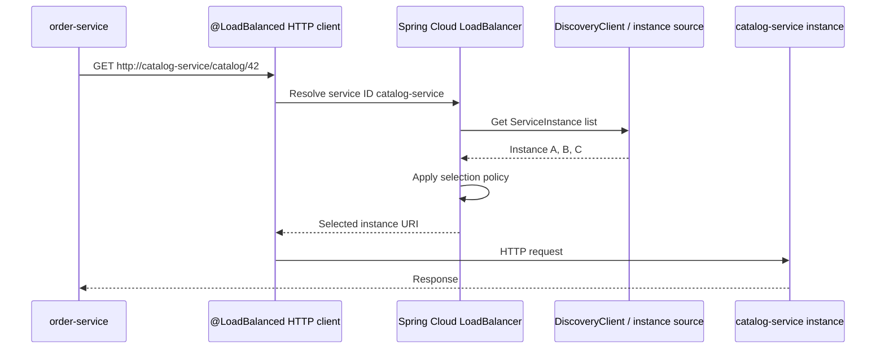

# Meaning of @LoadBalanced and Required Implementation Dependencies

In a Spring Cloud application, clients typically call a service by a logical name such as `catalog-service` rather than hardcoding the IP address of a Pod. For that logical name to be translated into an actual network address, the application needs an instance lookup mechanism and a component that selects an instance for each request. The **`@LoadBalanced`** annotation marks an HTTP client or builder that needs to be integrated with Spring Cloud LoadBalancer.

`@LoadBalanced` does not create a registry by itself, does not look up instances on its own, and is not a load balancing algorithm. It is a marker for Spring to configure the client accordingly. For the call to work, the runtime also requires a Spring Cloud LoadBalancer implementation, a `ServiceInstance` source (such as Eureka/Consul or `SimpleDiscoveryClient`), and the corresponding HTTP client integration.

This lesson belongs to the **Service Calls** chapter of the `SPRING_CLOUD_CORE` module. The goal is to understand the role of `@LoadBalanced`, know which dependencies are needed, distinguish LoadBalancer from DiscoveryClient and registry providers, and configure and test calls using service IDs.

## 1. The problem: calling by service ID instead of a fixed host

Suppose `order-service` needs to call `catalog-service`. The catalog service runs three instances:

| Instance | Host | Port |
| --- | --- | ---: |
| catalog A | `catalog-a.internal` | 8080 |
| catalog B | `catalog-b.internal` | 8080 |
| catalog C | `catalog-c.internal` | 8080 |

If the client hardcodes an address:

```java
String url = "http://catalog-a.internal:8080/catalog/42";
```

then when instance A is replaced or scaled, the application must know the new address. Calling by service ID lets the client use a logical name:

```java
String url = "http://catalog-service/catalog/42";
```

Here `catalog-service` is not necessarily a DNS hostname. With an HTTP client integrated with LoadBalancer, it is a service ID used to look up the instance list. LoadBalancer picks an instance, and then the client sends the request to that instance's host/port.



Without LoadBalancer integration, an HTTP client normally treats `catalog-service` as a hostname and delegates resolution to DNS. Therefore, merely writing a URL with a service ID is not enough; the client must be properly configured.

## 2. What does `@LoadBalanced` actually mean?

`@LoadBalanced` belongs to the `org.springframework.cloud.client.loadbalancer` package. It is a marker/qualifier annotation used by Spring Cloud to identify HTTP client beans that should apply client-side load balancing.

Example:

```java
import org.springframework.cloud.client.loadbalancer.LoadBalanced;
import org.springframework.context.annotation.Bean;
import org.springframework.context.annotation.Configuration;
import org.springframework.web.client.RestTemplate;

@Configuration(proxyBeanMethods = false)
public class HttpClientConfiguration {

    @Bean
    @LoadBalanced
    RestTemplate catalogRestTemplate() {
        return new RestTemplate();
    }
}
```

In compatible configurations, Spring Cloud LoadBalancer auto-configuration locates beans marked with `@LoadBalanced` and adds the component that forwards requests to the selected instance. For `RestTemplate`, the integration is performed via the corresponding interceptor/customizer.

Key points to remember:

- The annotation marks a client bean that needs LoadBalancer integration.
- The instance selection mechanism comes from Spring Cloud LoadBalancer and its suppliers/policies.
- The instance list comes from DiscoveryClient or another discovery source.
- The HTTP client remains responsible for executing requests, timeouts, TLS, serialization, and response handling.
- `@LoadBalanced` does not register the current application with a registry.

In other words, `@LoadBalanced` is the bridge between the HTTP client and LoadBalancer, not the entire service discovery system.

## 3. Required implementations and dependencies

A call using a service ID typically requires the following functional layers:

| Layer | Responsibility | Commonly used dependency/implementation |
| --- | --- | --- |
| HTTP client | Send HTTP requests | `spring-boot-starter-web` for RestTemplate; `spring-boot-starter-webflux` for WebClient |
| Load balancing | Select an instance by service ID | `spring-cloud-starter-loadbalancer` |
| Discovery/instance source | Provide `ServiceInstance` objects | Eureka Client, Consul Discovery, Kubernetes discovery, or SimpleDiscoveryClient |
| Registry backend (if used) | Store and distribute registrations | Eureka Server, Consul, Kubernetes API, or equivalent platform |

### 3.1. Spring Cloud LoadBalancer

When using `@LoadBalanced`, the application needs a compatible Spring Cloud LoadBalancer. Commonly used starter:

```xml
<dependency>
    <groupId>org.springframework.cloud</groupId>
    <artifactId>spring-cloud-starter-loadbalancer</artifactId>
</dependency>
```

Or Gradle:

```groovy
dependencies {
    implementation "org.springframework.cloud:spring-cloud-starter-loadbalancer"
}
```

This starter brings the client-side load balancing implementation into runtime. Do not confuse it with a registry server: LoadBalancer needs an instance list from a discovery source, but it is not where the cluster's registrations are stored.

Some discovery starters may pull in the LoadBalancer dependency depending on configuration/version. If your code uses `@LoadBalanced` directly, inspect the runtime dependency tree and declare the required starter explicitly rather than relying on an uncertain transitive dependency.

### 3.2. HTTP client stack

If using `RestTemplate`, the application needs Spring Web, typically provided by `spring-boot-starter-web`.

If using `WebClient`, the application needs Spring WebFlux, typically provided by `spring-boot-starter-webflux`.

Simply having LoadBalancer does not automatically integrate every HTTP client. Choose the right client stack and bean type supported by your Spring Cloud release train.

### 3.3. Discovery implementation or instance source

LoadBalancer needs a source supplying the list of `ServiceInstance` objects. You can choose one of the following:

- Eureka Client when the registry is Eureka.
- Consul Discovery when using Consul.
- Kubernetes discovery integration when using Kubernetes service discovery in that model.
- `SimpleDiscoveryClient` when the instance list is declared statically via properties.
- A custom `ServiceInstanceListSupplier` or discovery integration if the application has its own instance source.

Discovery dependency example:

```xml
<!-- Choose the integration matching the registry in use. -->
<dependency>
    <groupId>org.springframework.cloud</groupId>
    <artifactId>spring-cloud-starter-netflix-eureka-client</artifactId>
</dependency>
```

Or:

```xml
<dependency>
    <groupId>org.springframework.cloud</groupId>
    <artifactId>spring-cloud-starter-consul-discovery</artifactId>
</dependency>
```

Do not add multiple discovery providers just to try them until one works. Each integration has its own configuration, registration lifecycle, and data source. Choose the provider actually used by your architecture.

### 3.4. Is installing a registry server strictly necessary?

Not every application using `@LoadBalanced` needs to run Eureka Server or Consul Server itself. What is mandatory is that LoadBalancer receives an instance list from an appropriate source.

For example, `SimpleDiscoveryClient` can obtain instances from static configuration. In environments with Kubernetes or an external service discovery platform, the instance source can be supplied via the corresponding integration. A registry server is just one of those options.

## 4. Using `@LoadBalanced` with RestTemplate

### 4.1. Bean declaration

```java
import org.springframework.cloud.client.loadbalancer.LoadBalanced;
import org.springframework.context.annotation.Bean;
import org.springframework.context.annotation.Configuration;
import org.springframework.web.client.RestTemplate;

@Configuration(proxyBeanMethods = false)
public class CatalogHttpConfiguration {

    @Bean
    @LoadBalanced
    RestTemplate catalogRestTemplate() {
        return new RestTemplate();
    }
}
```

Spring Cloud LoadBalancer detects this bean and adds the integration needed for `RestTemplate`.

### 4.2. Calling by service ID

```java
import org.springframework.stereotype.Service;
import org.springframework.web.client.RestTemplate;

@Service
public class CatalogClient {

    private final RestTemplate restTemplate;

    public CatalogClient(RestTemplate catalogRestTemplate) {
        this.restTemplate = catalogRestTemplate;
    }

    public CatalogItem findById(String id) {
        return restTemplate.getForObject(
                "http://catalog-service/catalog/{id}",
                CatalogItem.class,
                id
        );
    }
}
```

In the example, the hostname `catalog-service` is interpreted as a service ID by the LoadBalancer integration. The client looks up the matching instances and sends the request to the selected endpoint.

### 4.3. Why shouldn't you use just any RestTemplate?

If the bean is not annotated with `@LoadBalanced`, the request:

```java
restTemplate.getForObject(
        "http://catalog-service/catalog/42",
        CatalogItem.class
);
```

will normally be processed as an ordinary HTTP URL. The HTTP client will attempt to resolve the hostname `catalog-service` via DNS. If DNS has no matching record, the request fails even when the service registry has instances.

Make sure the right bean is injected into the client. When an application has multiple `RestTemplate` beans, use appropriate qualifiers to avoid accidentally injecting a bean without LoadBalancer integration.

## 5. Using `@LoadBalanced` with WebClient

For reactive applications, Spring Cloud supports LoadBalancer integration for `WebClient.Builder`.

### 5.1. Builder declaration

```java
import org.springframework.cloud.client.loadbalancer.LoadBalanced;
import org.springframework.context.annotation.Bean;
import org.springframework.context.annotation.Configuration;
import org.springframework.web.reactive.function.client.WebClient;

@Configuration(proxyBeanMethods = false)
public class ReactiveHttpConfiguration {

    @Bean
    @LoadBalanced
    WebClient.Builder loadBalancedWebClientBuilder() {
        return WebClient.builder();
    }
}
```

In a matching configuration, Spring Cloud adds a filter to the builder to resolve the service ID and route requests through LoadBalancer.

### 5.2. Using the builder

```java
import org.springframework.stereotype.Component;
import org.springframework.web.reactive.function.client.WebClient;
import reactor.core.publisher.Mono;

@Component
public class ReactiveCatalogClient {

    private final WebClient webClient;

    public ReactiveCatalogClient(
            @LoadBalanced WebClient.Builder builder) {
        this.webClient = builder.build();
    }

    public Mono<CatalogItem> findById(String id) {
        return webClient.get()
                .uri("http://catalog-service/catalog/{id}", id)
                .retrieve()
                .bodyToMono(CatalogItem.class);
    }
}
```

`WebClient` is built from a LoadBalancer-integrated builder. If you call `WebClient.builder()` yourself elsewhere, you cannot assume the new builder also has this filter. Inject the configured builder or create clients through an intentional factory.

### 5.3. Choosing the right client type

- `RestTemplate` fits blocking calls in existing Spring MVC applications.
- `WebClient` supports reactive/non-blocking calls when the entire processing chain is designed accordingly.
- Do not switch to WebClient merely to get load balancing; client selection should be based on the application's execution model and requirements.
- Support for `RestClient` or other HTTP clients depends on the Spring Cloud version and available integration; check documentation for the exact release train before applying the annotation.

## 6. Instance sources: DiscoveryClient and SimpleDiscoveryClient

### 6.1. DiscoveryClient supplies the instance list

In registry-based configurations, the discovery integration implements the `DiscoveryClient` abstraction. LoadBalancer can use that data to fetch the `ServiceInstance` list by service ID.

Example direct lookup for diagnostics:

```java
List<ServiceInstance> instances =
        discoveryClient.getInstances("catalog-service");

if (instances.isEmpty()) {
    throw new IllegalStateException(
            "No instances found for catalog-service"
    );
}
```

Normally, when `@LoadBalanced` is already in use, business code does not need to call DiscoveryClient and manually pick the first element. LoadBalancer takes care of fetching the list and choosing according to policy. Calling DiscoveryClient directly is useful for diagnostics, custom routing, or testing custom logic.

### 6.2. SimpleDiscoveryClient with static configuration

If not using a registry server, instances can be declared via properties:

```yaml
spring:
  cloud:
    discovery:
      client:
        simple:
          instances:
            catalog-service:
              - uri: http://localhost:8081
              - uri: http://localhost:8082
```

Or:

```properties
spring.cloud.discovery.client.simple.instances.catalog-service[0].uri=http://localhost:8081
spring.cloud.discovery.client.simple.instances.catalog-service[1].uri=http://localhost:8082
```

When `SimpleDiscoveryClient` is used as the discovery source, LoadBalancer can retrieve these instances under the `catalog-service` service ID.

This approach fits local development, demos, and tests. A static list does not auto-detect new Pods, send heartbeats, or auto-deregister when a process stops. When topology changes, update configuration and deploy/refresh according to your design.

### 6.3. With Eureka or Consul

When using Eureka or Consul, the discovery integration fetches info from the registry provider. The application must properly configure the registry endpoint, service name, advertised address, and provider health/registration mechanisms.

For example, the service name is commonly associated with:

```yaml
spring:
  application:
    name: catalog-service
```

However, the actual service ID value also depends on the provider and custom properties. Confirm that the registered name matches the logical hostname in the URL used by the client.

## 7. Distinguishing commonly confused components

| Component | Responsibility | Not responsible for |
| --- | --- | --- |
| `@LoadBalanced` | Marks client beans requiring load balancing integration | Does not store a registry, does not look up instances itself |
| Spring Cloud LoadBalancer | Fetches the list and picks an instance by policy | Does not necessarily register the app with a registry |
| `DiscoveryClient` | Looks up a service ID and returns `ServiceInstance` objects | Not an HTTP client that sends requests |
| `ServiceInstance` | Describes host, port, URI, secure flag, and metadata | Does not run health checks or send requests itself |
| `ServiceRegistry` | Registers, updates, and deregisters registrations per provider | Not a client-side load balancer |
| HTTP client | Sends requests, reads responses, handles transport | Does not understand service IDs without discovery/load balancing integration |

An application can use LoadBalancer to call other services without registering itself in a registry. Conversely, an application can register its instance while its HTTP client still calls fixed hosts if it is not integrated with LoadBalancer.

## 8. Dependency graph and checking the classpath

A setup using RestTemplate with Eureka typically needs the following groups:

```text
spring-boot-starter-web
    -> RestTemplate / Spring Web

spring-cloud-starter-loadbalancer
    -> Spring Cloud LoadBalancer
    -> LoadBalancer integration for supported clients

spring-cloud-starter-netflix-eureka-client
    -> Eureka DiscoveryClient / registration integration

spring-cloud-dependencies BOM
    -> Manages compatible Spring Cloud versions
```

This is a responsibility diagram, not a guarantee of every transitive dependency in all versions. A provider starter may pull in several related modules; inspect the actual dependency tree.

Maven:

```bash
mvn dependency:tree '-Dincludes=org.springframework.cloud:*'
```

Gradle:

```bash
./gradlew dependencies --configuration runtimeClasspath
./gradlew dependencyInsight --dependency spring-cloud-loadbalancer --configuration runtimeClasspath
```

Check these points:

1. `spring-cloud-loadbalancer` is on the runtime classpath.
2. An HTTP client stack matching the `@LoadBalanced` bean is present.
3. A DiscoveryClient/provider or SimpleDiscoveryClient configuration supplies instances.
4. The service ID in the URL matches the service ID returned by discovery.
5. Spring Boot and the Spring Cloud release train form a compatible combination.
6. Multiple versions of Spring Cloud or Spring Framework are not forced out of alignment by dependency overrides.

Use the Spring Cloud BOM to manage versions of Spring Cloud modules. Avoid pinning versions for individual artifacts unless there is a specific, tested compatibility reason.

## 9. When multiple HTTP client beans exist

An application may need two clients: a load-balanced client to call internal services and a client calling fixed external URLs.

Example:

```java
import org.springframework.beans.factory.annotation.Qualifier;
import org.springframework.cloud.client.loadbalancer.LoadBalanced;
import org.springframework.context.annotation.Bean;
import org.springframework.context.annotation.Configuration;
import org.springframework.stereotype.Service;
import org.springframework.web.client.RestTemplate;

@Configuration(proxyBeanMethods = false)
public class HttpClientsConfiguration {

    @Bean
    @LoadBalanced
    RestTemplate serviceRestTemplate() {
        return new RestTemplate();
    }

    @Bean
    RestTemplate externalRestTemplate() {
        return new RestTemplate();
    }
}
```

When injecting, use an explicit qualifier:

```java
@Service
public class CatalogClient {

    private final RestTemplate restTemplate;

    public CatalogClient(
            @Qualifier("serviceRestTemplate") RestTemplate restTemplate) {
        this.restTemplate = restTemplate;
    }
}
```

In certain configurations, you can inject using the `@LoadBalanced` qualifier if the bean types and injection points are defined accordingly. When multiple beans share the same type, named qualifiers or custom qualifiers help avoid confusion.

Do not mark every RestTemplate in the application with `@LoadBalanced`. Clients calling public APIs via standard DNS hostnames do not need service discovery; adding unnecessary interceptors increases complexity and can alter URL handling.

## 10. Service IDs in URLs and important rules

### 10.1. Hostname must match the service ID

If the registry stores `catalog-service`, the call must use the matching service ID:

```java
restTemplate.getForObject(
        "http://catalog-service/catalog/42",
        CatalogItem.class
);
```

If you call `http://catalog/42` while the registry only has `catalog-service`, LoadBalancer will not guess a similar name. Verify the service ID through the discovery provider or `DiscoveryClient.getServices()`.

### 10.2. Do not use a specific replica's IP/port in a load-balanced URL

When the URL already specifies a concrete IP/port, the client is no longer asking to pick an instance by service ID. Use the logical service ID so LoadBalancer can distribute requests.

### 10.3. Scheme and secure instances

If an instance is advertised as HTTPS, discovery metadata/`ServiceInstance` must accurately reflect the secure state and the HTTP client must have matching TLS configuration. `@LoadBalanced` does not automatically supply truststores, client certificates, or hostname verification.

### 10.4. Path and query still belong to the target API

LoadBalancer resolves the service ID portion into an instance URI. The path, query parameters, and HTTP method must still match the target service's API. A 404 error after selecting an instance is usually a path/API version or service-side routing issue, not a service ID selection failure.

## 11. Operational limitations

`@LoadBalanced` and LoadBalancer help select an instance, but they do not guarantee a successful request. Several limitations must be designed for:

- An instance can die after being returned by discovery and before the request arrives.
- The registry or discovery cache can temporarily hold stale data.
- DNS/network policies can make an advertised host unreachable from the caller.
- A service ID may have no healthy instances.
- Retries can resend requests; write operations need idempotency or duplicate-execution safeguards.
- HTTP client timeouts and downstream timeouts must be intentionally configured.
- TLS, authentication, and authorization still must be enforced on HTTP clients/servers.
- LoadBalancer does not replace circuit breakers, bulkheads, rate limits, or observability.

Do not enable infinite retries when no instance exists. Set finite timeouts, bound retries, and distinguish instance-not-found errors from HTTP errors returned by the target service.

## 12. Testing `@LoadBalanced`

Testing should separate three layers: the annotated client, the supplied instance list, and requests actually reaching selected instances.

| Goal | How to test | What to verify |
| --- | --- | --- |
| Annotated bean | Start context and retrieve bean by qualifier | The right RestTemplate/WebClient builder is configured |
| LoadBalancer dependency | Inspect runtime dependency tree | A compatible LoadBalancer implementation is present |
| Discovery source | Configure SimpleDiscoveryClient or test provider | Instances exist for the right service ID |
| Service ID resolution | Call a URL using a logical hostname | Request goes through the integration instead of standard DNS |
| Multiple instances | Supply two or more ServiceInstances | Selection follows the configured policy |
| No instances | Configure an empty list | Error is handled cleanly without hanging indefinitely |
| Non-load-balanced client | Use a regular bean with a non-DNS service ID | Confirm behavior differs from the `@LoadBalanced` bean |
| TLS | Supply a secure instance and TLS test server | Scheme/certificate are handled properly |
| Multiple clients | Create both load-balanced and regular beans | Each caller injects the right bean |
| Failure handling | Stop an instance after discovery returns the list | Timeout/retry/fallback behave per policy |

### 12.1. Testing with SimpleDiscoveryClient

An integration test can declare two test endpoints for `catalog-service` using mock HTTP servers on two ports. Then start the context with LoadBalancer and a `@LoadBalanced` RestTemplate, send multiple requests, and observe requests arriving at the test servers.

Do not assert strict round-robin alternation on every call if policies, caching, or suppliers are configured differently. Verify results against the specific policy under test.

### 12.2. Testing with no instances

When the instance list is empty, LoadBalancer cannot choose an endpoint. The application should return a diagnosable error, apply a fallback if business rules permit, and record appropriate metrics. Do not substitute a random host address in place of an error.

### 12.3. Testing missing dependencies

You can create a test context without the LoadBalancer starter to confirm the client configuration is not integrated automatically. The exact failure depends on how auto-configuration is triggered; the key check is ensuring you do not assume the annotation alone brings the implementation.

## 13. Common errors and how to troubleshoot

| Symptom | Possible cause | What to check |
| --- | --- | --- |
| `UnknownHostException: catalog-service` | HTTP client has no LoadBalancer integration or wrong regular bean injected | Check `@LoadBalanced`, qualifiers, and runtime starters |
| Expected `DiscoveryClient` bean missing | Missing provider integration or discovery config inactive | Check discovery starter and auto-configuration |
| No instance found | URL service ID does not match registry or source returns empty list | Check `getServices()`/`getInstances()` and service ID |
| `@LoadBalanced` has no effect | Missing `spring-cloud-starter-loadbalancer` or unsupported client stack | Check dependency tree and builder/client type |
| Bean injection is ambiguous | Multiple RestTemplate/WebClient.Builder beans of the same type | Use explicit qualifiers |
| Request hits the wrong service | Wrong logical hostname or alias configuration | Compare URL against registered service IDs |
| Request picks an instance but connection times out | Host/port unreachable or instance has stopped | Check URI, network, health, and timeouts |
| HTTPS handshake fails | Incorrect secure flag, certificate, or truststore | Check scheme and TLS configuration |
| Only one instance receives requests | Policy/supplier/cache or number of available instances | Check input list and policy |
| Replica changes not yet visible to client | Discovery cache not refreshed or registry out of sync | Check cache, heartbeats, health, and refresh behavior |
| Retry produces duplicate write requests | Retry ignores idempotency | Design idempotency keys or restrict retries |

Diagnostic sequence:

1. Identify the actual HTTP client bean injected into the service.
2. Confirm the bean has `@LoadBalanced` and is a supported client type.
3. Verify Spring Cloud LoadBalancer is on the runtime classpath.
4. Confirm a DiscoveryClient/provider or SimpleDiscoveryClient exists.
5. List service IDs and instances to verify names, hosts, ports, and secure flags.
6. Test connectivity from the exact network namespace to the instance URI.
7. Inspect the LoadBalancer supplier/policy and instance selection logs.
8. Check timeouts, retries, TLS, and responses from the target service.

## 14. Hands-on: configuring order-service to call catalog-service

Suppose you want to run a local example with two catalog instances on ports 8081 and 8082, without needing a registry server yet.

### Step 1 — Add dependencies

Use Spring Boot Web and Spring Cloud LoadBalancer; Spring Cloud versions are managed through a compatible BOM.

```xml
<dependency>
    <groupId>org.springframework.boot</groupId>
    <artifactId>spring-boot-starter-web</artifactId>
</dependency>

<dependency>
    <groupId>org.springframework.cloud</groupId>
    <artifactId>spring-cloud-starter-loadbalancer</artifactId>
</dependency>
```

### Step 2 — Declare static instances

```yaml
spring:
  cloud:
    discovery:
      client:
        simple:
          instances:
            catalog-service:
              - uri: http://localhost:8081
              - uri: http://localhost:8082
```

Both test servers must actually listen on the corresponding ports. In container environments, replace `localhost` with a hostname reachable from the caller.

### Step 3 — Create a load-balanced RestTemplate

```java
@Configuration(proxyBeanMethods = false)
public class ClientConfiguration {

    @Bean
    @LoadBalanced
    RestTemplate catalogRestTemplate() {
        return new RestTemplate();
    }
}
```

### Step 4 — Call by service ID

```java
@Service
public class CatalogClient {

    private final RestTemplate restTemplate;

    public CatalogClient(RestTemplate catalogRestTemplate) {
        this.restTemplate = catalogRestTemplate;
    }

    public String getCatalogItem() {
        return restTemplate.getForObject(
                "http://catalog-service/catalog/42",
                String.class
        );
    }
}
```

### Step 5 — Verify

1. Start the two test servers on ports 8081 and 8082.
2. Start order-service with the SimpleDiscoveryClient configuration.
3. Send a request to order-service's endpoint.
4. Observe which server receives the request and what response is returned.
5. Shut down one test server and test behavior when the discovery source still has or no longer has that instance.
6. Try removing `@LoadBalanced` in a test profile to observe the difference when the hostname `catalog-service` has no DNS record.

This example demonstrates the role of the annotation and instance source without requiring a dedicated registry server. When moving to Eureka/Consul, replace SimpleDiscoveryClient with the appropriate discovery integration; code calling the service ID can stay unchanged.

### Self-check questions

1. What does `@LoadBalanced` mark?
2. Why does this annotation not perform load balancing by itself when the implementation is missing?
3. How do Spring Cloud LoadBalancer and DiscoveryClient differ in responsibility?
4. Why does an HTTP client need an interceptor/filter integrated?
5. If using RestTemplate, how should the bean be declared?
6. With WebClient, should you inject WebClient or the annotated builder in the example?
7. When is SimpleDiscoveryClient sufficient, and when is a registry provider needed?
8. Why can the URL `http://catalog-service/...` cause an `UnknownHostException`?
9. Does `@LoadBalanced` automatically register the current application's instance?
10. Why is it necessary to inspect the runtime dependency tree rather than just looking at source annotations?

**Answer hints:** (1) An HTTP client bean that should use client-side load balancing; (2) The annotation is only a marker/qualifier, and the implementation performs instance selection; (3) DiscoveryClient supplies the instance list, LoadBalancer selects an instance; (4) To resolve the service ID and route requests to a physical URI; (5) Create a `RestTemplate` bean annotated with `@LoadBalanced`; (6) The integrated builder; (7) SimpleDiscoveryClient suits static/local/test topologies, while a registry provider suits dynamic registration and discovery; (8) Because a regular client treats that name as a DNS hostname without integration; (9) No; (10) Because the annotation does not automatically bring in all required dependencies/auto-configuration.

## 15. Core principles to remember

- `@LoadBalanced` is a marker/qualifier for Spring Cloud to identify HTTP clients or builders needing LoadBalancer integration.
- Spring Cloud LoadBalancer is the client-side implementation that selects instances; the annotation does not replace the implementation.
- LoadBalancer needs a `ServiceInstance` source, typically DiscoveryClient/provider or SimpleDiscoveryClient.
- The HTTP client stack must be supported and properly configured; RestTemplate and WebClient have corresponding integrations.
- URLs use a logical service ID, such as `http://catalog-service/...`, and the service ID must match the discovery source.
- `spring-cloud-starter-loadbalancer` is the primary dependency for LoadBalancer; the discovery provider starter is a separate dependency per registry.
- A registry server is not mandatory when using a static instance source or another discovery platform, but an instance source is required.
- `@LoadBalanced` does not register the application, does not provide TLS, does not guarantee instances are always healthy, and does not replace timeouts/retries/circuit breakers.
- Use a compatible Spring Cloud BOM, inspect the runtime dependency tree, and use qualifiers when multiple HTTP client beans exist.
- Test scenarios with multiple instances, no instances, missing dependencies, wrong service IDs, and network/TLS errors.

Understanding `@LoadBalanced` properly enables applications to call services by logical name without hardcoding individual replica addresses. When the marker, LoadBalancer implementation, discovery source, and HTTP client integration are configured consistently, Spring Cloud can pick a suitable instance for each call while keeping business code loosely coupled to specific registry infrastructure.

## References

- [Spring Cloud Commons — Spring Cloud LoadBalancer](https://docs.spring.io/spring-cloud-commons/reference/spring-cloud-commons/loadbalancer.html)
- [Spring Cloud Commons — Common Abstractions](https://docs.spring.io/spring-cloud-commons/reference/spring-cloud-commons/common-abstractions.html)
- [Spring Cloud Commons — SimpleDiscoveryClient](https://docs.spring.io/spring-cloud-commons/reference/spring-cloud-commons/common-abstractions.html)
- [Spring Cloud Netflix — Eureka Client](https://docs.spring.io/spring-cloud-netflix/reference/spring-cloud-netflix.html)