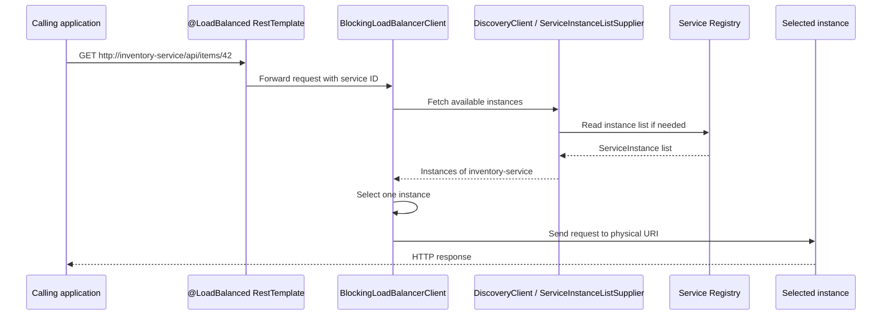

# Creating a Load-Balanced RestTemplate

## 1. Calling a service by logical name

In a distributed system, a service usually has multiple instances running across different machines or containers. If an application calls a service using a fixed IP and port, every time the service scales, replaces an instance, or changes deployment regions, the client may have to update its address.

Spring Cloud Commons provides a mechanism for applications to call a service by **service ID**. Spring Cloud LoadBalancer picks an instance from the discovery list and routes the request to that instance's physical address. For Spring MVC or blocking applications, you can use a `RestTemplate` annotated with `@LoadBalanced`.

For example, instead of calling a fixed address:

```java
restTemplate.getForObject(
        "http://10.20.1.15:8080/api/items/{sku}",
        Item.class,
        sku
);
```

the application calls by service ID:

```java
restTemplate.getForObject(
        "http://inventory-service/api/items/{sku}",
        Item.class,
        sku
);
```

`inventory-service` is the logical name registered in service discovery. Spring Cloud LoadBalancer finds an appropriate instance and replaces the virtual host portion with the real address before sending the HTTP request.

This lesson belongs to the **Service Calls** chapter of the **SPRING_CLOUD_CORE** module. The module focuses on Spring Cloud Commons, Spring Cloud Context, externalized configuration, Spring Boot compatibility, refresh scope, discovery, service registry, service-to-service communication, and how to test/operate common abstractions.

After this lesson, learners can:

- Explain the role of `@LoadBalanced` on a `RestTemplate` bean.
- Add Spring Cloud LoadBalancer to the classpath and declare the bean properly.
- Call services by service ID instead of fixed instance addresses.
- Distinguish a load-balanced `RestTemplate` from a `RestTemplate` calling ordinary hosts.
- Inject the right client when an application has multiple `RestTemplate` beans.
- Understand how LoadBalancer obtains instances from `DiscoveryClient` and picks a target.
- Configure `SimpleDiscoveryClient` for local/test environments.
- Verify caching, retries, timeouts, no-instance errors, and behavior when the registry changes.
- Write tests for routing to registered instances.

## 2. Position of RestTemplate in the service call flow

A call through `@LoadBalanced RestTemplate` passes through the following components:



Responsibilities are separated:

| Component | Responsibility |
| --- | --- |
| `RestTemplate` | Build and send HTTP requests using the blocking API |
| `@LoadBalanced` | Mark the bean so Spring applies load balancing configuration |
| `BlockingLoadBalancerClient` | Resolve a service ID into a physical instance |
| `DiscoveryClient` | Read the list of service instances from a registry or discovery source |
| `ServiceInstanceListSupplier` | Supply the instance list to LoadBalancer, optionally applying caching or filters |
| `Spring Cloud LoadBalancer` | Select an instance according to the configured strategy |
| Service Registry | Store instance information registered by services |

`@LoadBalanced` does not create a service registry or register services automatically. The application still needs an appropriate `DiscoveryClient`, such as Eureka or Consul. In simple environments, `SimpleDiscoveryClient` can be used with a static list of URIs.

## 3. Preparing dependencies

For `RestTemplate` to use LoadBalancer, the application needs Spring Cloud LoadBalancer on the classpath.

With Maven:

```xml
<dependency>
    <groupId>org.springframework.cloud</groupId>
    <artifactId>spring-cloud-starter-loadbalancer</artifactId>
</dependency>
```

If using an actual registry, add the corresponding provider starter, such as Eureka Discovery Client or Consul Discovery. Spring Cloud dependencies should be managed by a Spring Cloud BOM compatible with the project's Spring Boot version; do not manually pick incompatible Spring Cloud and Spring Boot versions.

Examples of possible dependency groups:

| Need | Dependency |
| --- | --- |
| Call services with `RestTemplate` via LoadBalancer | `spring-cloud-starter-loadbalancer` |
| Fetch instances from Eureka | Eureka Discovery Client starter |
| Fetch instances from Consul | Consul Discovery starter |
| Check health endpoints and observe the application | `spring-boot-starter-actuator` |

In current Spring Cloud versions, you do not need to add `@EnableDiscoveryClient` just to enable discovery if an appropriate implementation is already on the classpath. Verify the provider configuration and starter; having the dependency does not mean the registry is connected successfully or already has instances.

## 4. Declaring a load-balanced RestTemplate

### 4.1. Creating a bean with @LoadBalanced

Spring Boot does not automatically create a shared `RestTemplate` bean for every application. The application must declare the bean and mark the bean that needs load balancing with the annotation:

- `org.springframework.cloud.client.loadbalancer.LoadBalanced`

Example:

```java
import org.springframework.cloud.client.loadbalancer.LoadBalanced;
import org.springframework.context.annotation.Bean;
import org.springframework.context.annotation.Configuration;
import org.springframework.web.client.RestTemplate;

@Configuration(proxyBeanMethods = false)
class HttpClientConfiguration {

    @Bean
    @LoadBalanced
    RestTemplate loadBalancedRestTemplate() {
        return new RestTemplate();
    }
}
```

When Spring creates a bean annotated with `@LoadBalanced`, Spring Cloud configuration adds a LoadBalancer interceptor to `RestTemplate`. This interceptor uses `BlockingLoadBalancerClient` to resolve the service ID in the URI.

The bean name `loadBalancedRestTemplate` helps distinguish this client from other HTTP clients in the same application context.

### 4.2. Injecting the client via RestOperations

`RestTemplate` implements the `RestOperations` interface. When injecting a load-balanced client, you can use the `@LoadBalanced` qualifier directly on the constructor parameter:

```java
import org.springframework.cloud.client.loadbalancer.LoadBalanced;
import org.springframework.stereotype.Component;
import org.springframework.web.client.RestOperations;

@Component
class InventoryClient {

    private final RestOperations restOperations;

    InventoryClient(
            @LoadBalanced RestOperations restOperations) {
        this.restOperations = restOperations;
    }

    Item findItem(String sku) {
        return restOperations.getForObject(
                "http://inventory-service/api/items/{sku}",
                Item.class,
                sku
        );
    }
}
```

Using the `RestOperations` interface also avoids certain proxy type issues. In some AOP configurations, a load-balanced bean may be wrapped by a JDK dynamic proxy implementing only the interface; injecting the concrete `RestTemplate` type directly can then cause a cast error. Spring Cloud documentation suggests injecting `RestOperations` or configuring class-based proxies if the application requires the concrete type.

### 4.3. Using RestTemplateBuilder

If you want to leverage Spring Boot customizations provided to `RestTemplateBuilder`, you can mark the builder itself with `@LoadBalanced`, then create the client from that builder:

```java
import org.springframework.boot.autoconfigure.web.client.RestTemplateBuilderConfigurer;
import org.springframework.boot.web.client.RestTemplateBuilder;
import org.springframework.cloud.client.loadbalancer.LoadBalanced;
import org.springframework.context.annotation.Bean;
import org.springframework.context.annotation.Configuration;

@Configuration(proxyBeanMethods = false)
class LoadBalancedBuilderConfiguration {

    @Bean
    @LoadBalanced
    RestTemplateBuilder loadBalancedRestTemplateBuilder(
            RestTemplateBuilderConfigurer configurer) {
        return configurer.configure(new RestTemplateBuilder());
    }
}
```

Inject the annotated builder:

```java
@Component
class CatalogClient {

    private final RestTemplate restTemplate;

    CatalogClient(
            @LoadBalanced RestTemplateBuilder builder) {
        this.restTemplate = builder.build();
    }

    Item find(String sku) {
        return restTemplate.getForObject(
                "http://inventory-service/api/items/{sku}",
                Item.class,
                sku
        );
    }
}
```

This is an alternative configuration approach to declaring a `RestTemplate` bean directly. Do not create a load-balanced builder and then manually call `new RestTemplate()` at the call site, because the new instance will not receive the interceptor configured for the builder.

## 5. Calling a service by service ID

### 5.1. URI structure

URIs used with a load-balanced client have the form:

```text
http://<service-id>/<resource-path>
```

Examples:

| URI | Meaning |
| --- | --- |
| `http://inventory-service/api/items/42` | Call service ID `inventory-service` |
| `http://payment-service/api/payments` | Call service ID `payment-service` |
| `http://notification-service/api/messages` | Call service ID `notification-service` |

The host part of the URI is the **service ID**, not an instance's hostname/IP. The `http` or `https` scheme is the initial scheme for the request; LoadBalancer may adjust the URI according to the security information of the selected `ServiceInstance`.

With `RestTemplate`, standard usage is a URL like `http://service-id/...` or `https://service-id/...`. The `lb://service-id` syntax is common in Spring Cloud Gateway route configuration; do not use it in place of the standard service ID URL in this `RestTemplate` example.

### 5.2. URI parameters and request payloads

You can use the standard overloads of `RestTemplate`:

```java
Item item = restOperations.getForObject(
        "http://inventory-service/api/items/{sku}",
        Item.class,
        sku
);

ResponseEntity<Item> response = restOperations.exchange(
        "http://inventory-service/api/items/{sku}",
        HttpMethod.GET,
        HttpEntity.EMPTY,
        Item.class,
        sku
);
```

With POST:

```java
CreateOrderRequest request = new CreateOrderRequest(customerId, itemIds);

OrderResponse order = restOperations.postForObject(
        "http://order-service/api/orders",
        request,
        OrderResponse.class
);
```

LoadBalancer selects an instance before the request is sent. Body serialization, response conversion, and HTTP status handling still follow `RestTemplate` and the configured `HttpMessageConverter`s.

### 5.3. Service ID must match discovery

The service ID in the URI must match the ID advertised by the discovery provider. If the registry uses `inventory-service` but the client calls `inventory`, LoadBalancer looks up a different service and may find no instances.

Standardize naming conventions across:

- `spring.application.name` of the registered service.
- The service ID advertised by the registry.
- The service ID in the URI called by the client.
- Per-service LoadBalancer configuration for that service.

Do not manually include a hostname, port, or IP in the service ID URI if the goal is to let LoadBalancer select an instance.

## 6. Supplying the instance list to LoadBalancer

### 6.1. Using a dynamic service registry

In production environments, each instance typically registers itself with the registry on startup. The discovery provider reads registrations and supplies `ServiceInstance` objects to LoadBalancer.

For example, `inventory-service` might have three instances:

| Service ID | Host | Port |
| --- | --- | ---: |
| `inventory-service` | `inventory-1.internal` | 8080 |
| `inventory-service` | `inventory-2.internal` | 8080 |
| `inventory-service` | `inventory-3.internal` | 8080 |

The client does not need to know this address list. It simply calls `http://inventory-service/...`; the instance list is updated via the discovery provider and its caching mechanism.

### 6.2. Using SimpleDiscoveryClient for local/test

If there is no registry-based discovery implementation on the classpath, Spring Cloud Commons can use `SimpleDiscoveryClient`, which reads instance URIs from configuration.

Example:

```yaml
spring:
  cloud:
    discovery:
      client:
        simple:
          instances:
            inventory-service:
              - uri: http://localhost:8081
              - uri: http://localhost:8082
            payment-service:
              - uri: http://localhost:8091
```

Then requests to `http://inventory-service/api/items/42` can be routed to one of the two declared local URIs.

This approach is useful for:

- Running multiple services locally without standing up Eureka or Consul.
- Integration tests that want full control over the instance set.
- Demonstrating instance selection mechanics.
- Static environments where addresses rarely change.

`SimpleDiscoveryClient` does not monitor which processes are alive. If a configured address has stopped, it may still appear in the list until configuration changes. For dynamic systems, use a registry with proper registration, health, and deregistration mechanisms.

## 7. How does LoadBalancer select an instance?

### 7.1. Default strategy

Spring Cloud LoadBalancer provides client-side load balancing. The current default strategy is `RoundRobinLoadBalancer`, which cycles sequentially through instances in the list. Other implementations can also be configured, such as `RandomLoadBalancer`.

For example, with three instances, a sequential stream of requests can be distributed as follows:

```text
Request 1 -> inventory-1
Request 2 -> inventory-2
Request 3 -> inventory-3
Request 4 -> inventory-1
Request 5 -> inventory-2
```

This illustrates round robin. When concurrent requests arrive, the instance list changes, or the cache refreshes, do not treat the ordering above as a strict per-request guarantee.

### 7.2. Per-service-ID LoadBalancer context

Spring Cloud LoadBalancer creates a separate child context for each service ID. By default, these contexts are lazily initialized the first time a request needs load balancing to that service.

If you want to pre-initialize contexts for critical services, you can declare:

```yaml
spring:
  cloud:
    loadbalancer:
      eager-load:
        clients:
          - inventory-service
          - payment-service
```

Eager loading avoids context initialization overhead on the first request, at the cost of slightly higher startup time and initial resource usage.

### 7.3. Customizing the strategy

If a service needs its own policy, Spring Cloud allows configuring LoadBalancer per service ID via `@LoadBalancerClient` or `@LoadBalancerClients`.

For example, you can use `RandomLoadBalancer` for an experimental service while keeping round robin for other services. The configuration class for a LoadBalancer client must be placed outside ordinary component scanning or not annotated with `@Configuration` in a way that loads it into the main context unintentionally.

Do not customize the algorithm just to make a single trial look more evenly distributed. First identify the criterion: zone, weight, version, sticky session, or actual load; then choose the matching `ServiceInstanceListSupplier` and LoadBalancer.

## 8. Multiple RestTemplates in the same application

An application may need both kinds of HTTP clients:

- A load-balanced client to call internal services by service ID.
- A regular client to call external APIs by fixed hostname.

Declare them separately and use qualifiers to distinguish them:

```java
@Configuration(proxyBeanMethods = false)
class HttpClientsConfiguration {

    @Bean
    @LoadBalanced
    RestTemplate loadBalancedRestTemplate() {
        return new RestTemplate();
    }

    @Bean
    @Primary
    RestTemplate directRestTemplate() {
        return new RestTemplate();
    }
}
```

Usage:

```java
@Component
class PartnerGateway {

    private final RestOperations internalServices;
    private final RestOperations externalApi;

    PartnerGateway(
            @LoadBalanced RestOperations internalServices,
            RestOperations externalApi) {
        this.internalServices = internalServices;
        this.externalApi = externalApi;
    }

    InventorySummary getInventory(String sku) {
        return internalServices.getForObject(
                "http://inventory-service/api/items/{sku}/summary",
                InventorySummary.class,
                sku
        );
    }

    PartnerStatus getPartnerStatus() {
        return externalApi.getForObject(
                "https://partner.example.com/status",
                PartnerStatus.class
        );
    }
}
```

`@Primary` lets Spring select the regular bean when an injection point has no qualifier. The `@LoadBalanced` parameter selects the load-balanced bean. If all injection points use qualifiers or `@Qualifier` by bean name, you can organize selection according to your application's conventions.

Do not use a load-balanced `RestTemplate` to call internet hostnames like `partner.example.com`: the interceptor treats the hostname in the URI as a service ID and asks LoadBalancer to look it up. Use a regular client for specific hosts.

## 9. Caching, health, and instance data

### 9.1. Instance list caching

Spring Cloud LoadBalancer provides caching for `ServiceInstanceListSupplier`. Current defaults are:

| Property | Default value |
| --- | ---: |
| `spring.cloud.loadbalancer.cache.ttl` | 35 seconds |
| `spring.cloud.loadbalancer.cache.capacity` | 256 |

You can adjust the TTL:

```yaml
spring:
  cloud:
    loadbalancer:
      cache:
        ttl: 10s
        capacity: 512
```

A short TTL reflects instance changes sooner but may increase discovery queries. A long TTL reduces queries but can retain stale addresses longer.

If the discovery provider already caches instances—such as some Eureka configurations—evaluate double caching. When two layers both cache, stale data can persist longer than expected; you can disable the LoadBalancer cache via `spring.cloud.loadbalancer.cache.enabled=false` if the provider already handles caching appropriately.

### 9.2. Instance health

An instance list does not prove on its own that every endpoint is ready to accept requests. An actual registry may filter status by health or registration, but update timing and semantics depend on the provider.

`HealthCheckServiceInstanceListSupplier` can actively call the health endpoints of instances. This mechanism is especially useful with `SimpleDiscoveryClient`, because a static list does not reflect process liveness. With a registry that already supplies healthy instances through its own mechanism, avoid adding redundant health checks without reason.

If using the default `/actuator/health` health check, target services must expose the endpoint appropriately and secure access properly. Do not let health checks become an unauthenticated public management route.

## 10. Retries, timeouts, and service call errors

### 10.1. Load balancing does not imply retries

LoadBalancer picks an instance. Retry is a separate policy deciding whether to resend a request when the previous attempt failed.

With a load-balanced `RestTemplate`, blocking retry can be activated when Spring Retry is on the classpath. If you do not want retries, you can set:

```yaml
spring:
  cloud:
    loadbalancer:
      retry:
        enabled: false
```

Retry properties can limit the number of retries on the same instance and the number of switches to another instance:

```yaml
spring:
  cloud:
    loadbalancer:
      retry:
        max-retries-on-same-service-instance: 0
        max-retries-on-next-service-instance: 1
        retryable-status-codes:
          - 502
          - 503
          - 504
```

Check the dependencies and metadata of your release train to verify retry is enabled through the expected mechanism. Do not assume every request is retried by default.

In particular, retrying POST or transaction-creating operations can produce duplicate data if the server already processed the request and the response was lost. Only retry operations with safe semantics or an idempotency key; limit retry counts and total wait time.

### 10.2. Timeouts belong to the HTTP client

LoadBalancer does not replace connection and read timeouts on the HTTP transport. Configure the request factory/client used by `RestTemplate`:

- Connect timeout bounds the time to establish a connection to the selected instance.
- Read/response timeout bounds the time spent waiting for a response.
- Pool-acquire timeout (if using a connection pool) bounds the time waiting for a connection from the pool.
- Overall deadline at the business call layer bounds total request duration, including retries and backoff.

If timeouts are too long, requests can hold threads and connections for too long. If too short, valid requests can be cut off under high load. Choose based on target latency and upstream timeouts.

### 10.3. No instances found or registry errors

Common scenarios:

| Scenario | Symptom | How to handle |
| --- | --- | --- |
| Service ID does not exist | No instance available to select | Check service ID, registration, and environment profile |
| Registry not synchronized yet | Empty list or missing new instances | Check registration, health, and propagation |
| Registry unreachable | Discovery provider may throw exceptions | Observe provider errors, bounded retries, and readiness |
| Instance stopped but still in cache | Requests to old address fail | Check TTL, deregistration, and multi-layer caching |
| Instance responds with 5xx | HTTP error from instance | Classify status, check health, and review retry policy |
| Timeout | Request does not finish within bounds | Check latency, pool, timeouts, and upstream load |

Do not catch every exception and return an empty or default value silently. Distinguish "no instance available" from "registry unreachable" and "instance received the request but failed to process it".

## 11. Testing a load-balanced RestTemplate

Good tests verify not only that the service method constructs the right request, but also that the service ID URI resolves to one of the declared instances.

### 11.1. Unit tests for service clients

Mock `RestOperations` to verify:

- The service client calls the right logical URI `http://inventory-service/...`.
- Path variables and request bodies are passed correctly.
- The response is converted to the expected DTO.
- HTTP errors are handled per the service client's policy.

This unit test checks application logic; it does not prove discovery or LoadBalancer is working.

### 11.2. Integration tests with SimpleDiscoveryClient

You can spin up two mock HTTP servers on two different ports, then configure two static instances:

```yaml
spring:
  cloud:
    discovery:
      client:
        simple:
          instances:
            inventory-service:
              - uri: http://localhost:18081
              - uri: http://localhost:18082
```

Each mock server returns a distinct identifier, such as `instance-1` or `instance-2`. The integration test injects `@LoadBalanced RestOperations`, calls `http://inventory-service/test` multiple times, and verifies requests actually reach the configured servers.

To keep tests stable:

- Use random ports or ports assigned by the test harness; do not use fixed ports if tests run in parallel.
- Start mock servers before the application context needs to query instances.
- Isolate discovery configuration from any other registry providers on the classpath.
- Do not assert strict round-robin ordering when concurrency is involved.
- Shut down mock servers and close the context after the test.

### 11.3. Testing with a real registry

With Eureka, Consul, or an actual provider, integration tests should verify:

1. Instances register successfully.
2. The client can query the service ID.
3. LoadBalancer picks an instance with a valid URI.
4. When an instance deregisters or changes status, the list updates within acceptable bounds.
5. When the registry temporarily loses connectivity, the application records errors and recovers per policy.
6. Caching does not retain stale instances longer than operational requirements allow.

Mocking `DiscoveryClient` cannot replace testing registration, consistency, and health semantics of a real registry.

## 12. Common pitfalls

| Symptom | Cause | How to fix |
| --- | --- | --- |
| `UnknownHostException: inventory-service` | `RestTemplate` is not load-balanced or bean lacks `@LoadBalanced` | Check the qualifier on the bean and LoadBalancer dependency |
| No instance found | Wrong service ID or discovery has no registration yet | Check `spring.application.name`, provider, and registry |
| Cannot inject `RestTemplate` | Multiple beans or proxy incompatible with concrete type | Use `@LoadBalanced` qualifier, `@Primary`, and inject `RestOperations` |
| URL still calls old IP | Client uses plain `RestTemplate` or hardcoded URL | Use the load-balanced bean and service ID |
| External API call fails with discovery error | Load-balanced client mistakenly used for internet hostname | Use a regular `RestTemplate` for specific hosts |
| Instance replaced but client still calls old address | Caching in registry client or LoadBalancer | Check TTL, double caching, and deregistration timing |
| POST creates duplicate data | Retrying a non-idempotent request | Disable retries or use idempotency keys and an appropriate policy |
| Request waits too long | Timeouts not configured on HTTP transport or retry budget too large | Set connect/read/overall timeouts and cap retries |
| Tests only pass with mocks | Interceptor, discovery, and URI resolution untested | Add integration tests with `SimpleDiscoveryClient` or a real registry |

## 13. Observability and operations

In production deployments, you need to know which service ID a request targeted, which instance was chosen, and what the outcome was.

You can enable LoadBalancer Micrometer statistics when the application has an appropriate `MeterRegistry`:

```yaml
spring:
  cloud:
    loadbalancer:
      stats:
        micrometer:
          enabled: true
```

LoadBalancer metrics track successful, failed, and discarded (no instance found) requests. With `RestTemplate`, metric URIs may include the path; if paths contain high-cardinality IDs, consider disabling path tags to avoid high cardinality per current configuration guidelines.

Beyond metrics, logs should capture the service ID, correlation ID, error type, and instance details at an appropriate level. Avoid logging authorization headers, tokens, personal data, or sensitive payloads. Do not log every request at INFO level under high traffic; rely on metrics and traces for overall visibility.

## 14. Pre-production checklist

1. Is `spring-cloud-starter-loadbalancer` on the classpath and compatible with Spring Boot?
2. Does the application have an appropriate DiscoveryClient provider or `SimpleDiscoveryClient`?
3. Is the `RestTemplate` bean requiring load balancing marked with `@LoadBalanced`?
4. Do service clients inject the right bean via qualifier or `RestOperations`?
5. Do URIs use the exact registered service ID?
6. Is a plain `RestTemplate` used for internet hosts or fixed endpoints?
7. If multiple `RestTemplate` beans exist, are they distinguished with `@Primary`/qualifiers?
8. Is LoadBalancer caching aligned with the registry provider's caching?
9. Are retries bounded and safe for the HTTP methods invoked?
10. Are connect timeouts, read timeouts, and overall deadlines configured?
11. Have you tested with at least two instances and with an instance becoming unavailable?
12. Are metrics, logs, and traces sufficient to identify the selected instance?

## 15. Official references

- [Spring Cloud Commons — Common Abstractions](https://docs.spring.io/spring-cloud-commons/reference/spring-cloud-commons/common-abstractions.html): configuring `@LoadBalanced RestTemplate`, `RestTemplateBuilder`, service ID URIs, multiple `RestTemplate`s, and starter requirements.
- [Spring Cloud LoadBalancer](https://docs.spring.io/spring-cloud-commons/reference/spring-cloud-commons/loadbalancer.html): instance selection algorithms, child contexts, caching, health checks, retries, and metrics.
- [Spring Cloud Commons — Configuration Properties](https://docs.spring.io/spring-cloud-commons/reference/configprops.html): LoadBalancer cache, retry, timeout, and statistics properties.
- [Spring Boot — Calling REST Services with RestTemplate](https://docs.spring.io/spring-boot/reference/io/rest-client.html): how Spring Boot configures and uses REST clients.

**Key takeaway:** To create a load-balanced `RestTemplate`, declare a bean with `@LoadBalanced`, add Spring Cloud LoadBalancer, and use the service ID in URIs such as `http://inventory-service/...`. Discovery provides the instance list; LoadBalancer picks an instance; `RestTemplate` sends the request to the physical URI. Separate internal load-balanced clients from fixed-host clients, and test caching, timeouts, retries, and no-instance scenarios.