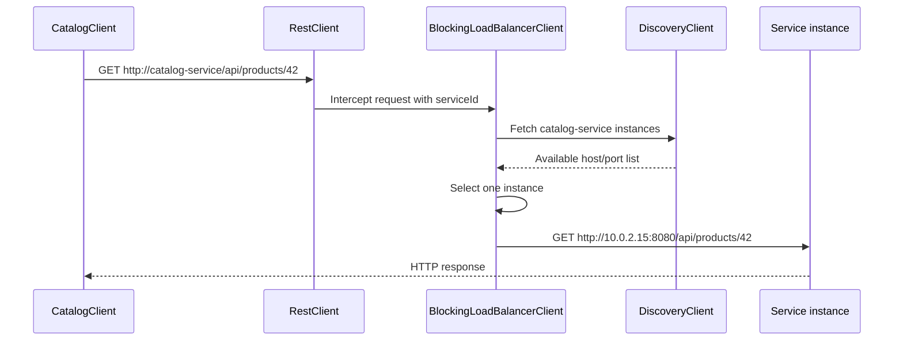

# Creating a Load-Balanced RestClient.Builder by Version

`RestClient` is a synchronous (blocking) HTTP client with a fluent API, introduced in Spring Framework 6.1. Spring Boot 3.2 added support and auto-configuration for this client. Spring Cloud Commons integrates `RestClient` with Spring Cloud LoadBalancer via a `RestClient.Builder` bean annotated with `@LoadBalanced`.

Proper configuration enables the application to call services by service ID, such as `http://catalog-service`. Spring Cloud LoadBalancer looks up the instances of that service, selects one instance, and routes the request to the physical address. The application still uses the familiar `RestClient` API, while instance selection happens at the client layer.

This lesson belongs to the **Service Calls** chapter of the **SPRING_CLOUD_CORE** module. The focus is on creating a load-balanced builder properly, retaining Spring Boot's customizations, distinguishing internal builders from external-API builders, and selecting the right Spring Boot/Spring Cloud pair to avoid using APIs absent in the running version.

## 1. Learning objectives

After this lesson, learners can:

- Explain the roles of `RestClient`, `RestClient.Builder`, and Spring Cloud LoadBalancer.
- Identify the minimum Spring Boot version that includes `RestClient`.
- Choose a Spring Cloud release train compatible with Spring Boot.
- Declare the `spring-cloud-starter-loadbalancer` dependency via the BOM.
- Create a `RestClient.Builder` bean with the `@LoadBalanced` qualifier.
- Use `RestClientBuilderConfigurer` to preserve Spring Boot customizers and observability.
- Inject the right builder when an application has both load-balanced and regular clients.
- Call services by service ID rather than a specific instance's hostname.
- Test service ID resolution, instance selection, and handling when no instance is found.

## 2. Distinguishing RestClient and RestClient.Builder

`RestClient` is the object that executes HTTP requests. `RestClient.Builder` is the configuration object used before creating the client, for example:

- Setting a base URL.
- Adding default headers.
- Configuring message converters.
- Configuring request factories and interceptors.
- Configuring status code handling.
- Attaching an observation registry and customizations for metrics/tracing.

Example of a regular client:

```java
RestClient client = RestClient.builder()
    .baseUrl("https://partner.example.com")
    .defaultHeader("Accept", "application/json")
    .build();
```

The address `partner.example.com` is a real hostname resolved by DNS. If the application needs to call an internal service with multiple instances, a fixed hostname may not reflect the instances currently registered in the registry. This is the case Spring Cloud LoadBalancer solves.

### 2.1. RestClient is a synchronous API

A `RestClient` call waits for the HTTP result to complete before returning. Therefore:

- It suits Spring MVC applications or synchronous processing flows.
- It should not be called directly on an event-loop thread of a WebFlux application.
- If a non-blocking reactive processing chain is required, use `WebClient` with a reactive load balancer.

Do not confuse `RestClient` with `WebClient`. Both have fluent APIs, but their execution models and load balancer integration approaches differ.

## 3. Version requirements for using RestClient

`RestClient` debuted in Spring Framework 6.1. Spring Boot 3.2 is the first Boot generation to integrate official support for this API. Spring Cloud Commons 4.1, part of the 2023.0 release train, includes guidance for creating `@LoadBalanced RestClient.Builder`.

Therefore, the practical baseline for using this integration is **Spring Boot 3.2 or later with a compatible Spring Cloud release train**. Do not force an older Boot project to use RestClient by overriding the Spring Framework version independently.

### 3.1. Compatibility table by release train

| Spring Boot | Compatible Spring Cloud release train | Corresponding Spring Cloud Commons | Use RestClient? |
| --- | --- | --- | --- |
| 3.0.x – 3.1.x | 2022.0.x (Kilburn) | 4.0.x | No RestClient API in Spring Framework 6.0 |
| 3.2.x | 2023.0.x (Leyton) | 4.1.x | Yes |
| 3.3.x | 2023.0.2 and later | 4.1.x | Yes |
| 3.4.x | 2024.0.x (Moorgate) | 4.2.x | Yes |
| 3.5.x | 2025.0.x (Northfields) | 4.3.x | Yes |
| 4.0.x | 2025.1.x (Oakwood) | 5.0.x | Yes |
| 4.1.x | 2025.1.2 and later | 5.0.x | Yes |

The table above maps compatibility between release train generations. Check the official Spring Cloud page for the latest service releases and support status before upgrading. At the time of writing, the project page lists Spring Cloud 2025.1.4 as the latest stable release; older release trains are marked EOL in the OSS support table.

### 3.2. Why must you use a BOM?

Spring Cloud consists of multiple projects with interdependencies on Spring Boot and Spring Framework. If you pick individual versions manually for Commons, LoadBalancer, or discovery clients, dependencies may become incompatible.

Use the BOM to manage versions consistently:

```xml
<properties>
    <spring-cloud.version>2025.1.4</spring-cloud.version>
</properties>

<dependencyManagement>
    <dependencies>
        <dependency>
            <groupId>org.springframework.cloud</groupId>
            <artifactId>spring-cloud-dependencies</artifactId>
            <version>${spring-cloud.version}</version>
            <type>pom</type>
            <scope>import</scope>
        </dependency>
    </dependencies>
</dependencyManagement>
```

If the project uses Spring Boot 3.5, select the release train compatible with Boot 3.5 instead of copying the BOM version from the Boot 4.1 example. The value in the example only illustrates declaration syntax; the actual version must follow your project's Boot/Cloud pairing.

### 3.3. Required dependencies

Add the Spring Cloud LoadBalancer starter:

```xml
<dependency>
    <groupId>org.springframework.cloud</groupId>
    <artifactId>spring-cloud-starter-loadbalancer</artifactId>
</dependency>
```

The starter supplies load balancing infrastructure for integrated HTTP clients. To obtain the instance list, the application needs an appropriate service discovery source, such as Eureka, Consul, or Zookeeper. Without a registry-backed discovery client, Spring Cloud can use `SimpleDiscoveryClient` with an instance list declared via properties.

Do not manually add a version to the starter once the BOM is imported. The BOM selects the compatible version.

## 4. Creating a load-balanced RestClient.Builder

To let Spring Cloud apply the load balancer, create a `RestClient.Builder` bean and annotate it with `@LoadBalanced`:

```java
import org.springframework.boot.autoconfigure.web.client.RestClientBuilderConfigurer;
import org.springframework.cloud.client.loadbalancer.LoadBalanced;
import org.springframework.context.annotation.Bean;
import org.springframework.context.annotation.Configuration;
import org.springframework.web.client.RestClient;

@Configuration(proxyBeanMethods = false)
public class LoadBalancedRestClientConfiguration {

    @Bean
    @LoadBalanced
    RestClient.Builder loadBalancedRestClientBuilder(
            RestClientBuilderConfigurer configurer) {

        return configurer.configure(RestClient.builder());
    }
}
```

The two parts have distinct roles:

- `@LoadBalanced` is the qualifier marking the builder for requests that need service ID resolution through Spring Cloud LoadBalancer.
- `RestClientBuilderConfigurer` applies customizers provided by Spring Boot to the builder, including HTTP client configuration and observability when the corresponding components are present.

Do not omit `RestClientBuilderConfigurer` arbitrarily. Creating a builder manually without applying Boot's configuration can cause the application to lose default customizations the project relies on, such as HTTP client instrumentation.

### 4.1. Why not just call RestClient.builder()?

`RestClient.builder()` creates a plain Spring Framework builder. It does not automatically know that the hostname in a URI is a service ID requiring registry lookup.

A `@LoadBalanced RestClient.Builder` bean is recognized by Spring Cloud and augmented with load balancing mechanics. When a client is built from this builder, requests to logical hostnames like `catalog-service` are processed through `BlockingLoadBalancerClient`.

If a regular builder is injected and you call `http://catalog-service`, the HTTP client will treat it as an ordinary DNS hostname. When DNS has no matching record, the request fails with a name resolution error.

## 5. Using the builder to create a client for a specific service

Example of an application calling the catalog service:

```java
import org.springframework.cloud.client.loadbalancer.LoadBalanced;
import org.springframework.stereotype.Component;
import org.springframework.web.client.RestClient;

@Component
public class CatalogClient {

    private final RestClient restClient;

    public CatalogClient(
            @LoadBalanced RestClient.Builder builder) {

        this.restClient = builder.clone()
            .baseUrl("http://catalog-service")
            .build();
    }

    public ProductResponse findProduct(String productId) {
        return restClient.get()
            .uri("/api/products/{id}", productId)
            .retrieve()
            .body(ProductResponse.class);
    }
}
```

In the example:

- `catalog-service` is the service ID used in discovery.
- `/api/products/{id}` is the API path on the selected instance.
- `builder.clone()` creates a copy to configure a specific base URL without mutating the shared builder.
- `build()` creates a `RestClient` that can be held as an immutable dependency of the component.

`RestClient.Builder` is a mutable builder and provides a `clone()` method. When multiple components share the same builder bean, clone it before setting a base URL, default headers, or per-client interceptors. This keeps one client's configuration from affecting another.

### 5.1. Calling with a full URI

You can omit the base URL and pass the full URI at request time:

```java
@Service
public class PricingClient {

    private final RestClient restClient;

    public PricingClient(
            @LoadBalanced RestClient.Builder builder) {
        this.restClient = builder.clone().build();
    }

    public PriceResponse getPrice(String sku) {
        return restClient.get()
            .uri("http://pricing-service/api/prices/{sku}", sku)
            .retrieve()
            .body(PriceResponse.class);
    }
}
```

Both approaches use the service ID in the host portion of the URI. Choose one consistent style across the project so base paths are easy to inspect and manage.

## 6. How is a service ID resolved to a physical address?

When `RestClient` sends a request through a load-balanced builder, the flow can be visualized as follows:



In the logical URI `http://catalog-service`:

- The `http` scheme indicates the protocol.
- The host `catalog-service` is the service ID.
- The actual port and IP come from `ServiceInstance`.
- The path is preserved to send to the selected instance.

By default, Spring Cloud LoadBalancer uses round-robin to select an instance. The application can configure a different algorithm or custom instance list supplier per service.

### 6.1. Use a service ID, not a fixed instance IP

Appropriate example:

```java
restClient.get()
    .uri("http://catalog-service/api/products")
    .retrieve()
    .body(ProductList.class);
```

Non-load-balanced example:

```java
restClient.get()
    .uri("http://10.0.2.15:8080/api/products")
    .retrieve()
    .body(ProductList.class);
```

In the second example, the host is a physical IP. LoadBalancer has no service ID to look up an instance list. The request goes straight to the specified address.

Do not use `lb://catalog-service` in a `RestClient` URI under the standard configuration shown above. The `lb://` scheme typically appears in Spring Cloud Gateway routes; for a load-balanced `RestClient`, use an HTTP(S) URI whose host is the service ID.

## 7. Integrating with Service Discovery

Spring Cloud LoadBalancer needs to know the currently available instances. The list source can be a discovery implementation or static configuration.

### 7.1. Using Eureka or Consul

If the application uses Eureka, add the compatible Eureka Client starter:

```xml
<dependency>
    <groupId>org.springframework.cloud</groupId>
    <artifactId>spring-cloud-starter-netflix-eureka-client</artifactId>
</dependency>
```

Or use Consul Discovery:

```xml
<dependency>
    <groupId>org.springframework.cloud</groupId>
    <artifactId>spring-cloud-starter-consul-discovery</artifactId>
</dependency>
```

When a discovery implementation is on the classpath and registry connection configuration is valid, Spring Cloud can supply a `DiscoveryClient`. In current configurations, you do not need to add `@EnableDiscoveryClient` just to enable discovery; having the implementation on the classpath is enough to activate the corresponding auto-configuration.

Instances must register the right service ID. If the service registers as `catalog-api` while the client calls `catalog-service`, LoadBalancer will find no instances.

### 7.2. Using SimpleDiscoveryClient when no registry is available

In test environments, you can declare instances directly:

```yaml
spring:
  cloud:
    discovery:
      client:
        simple:
          instances:
            catalog-service:
              - uri: http://localhost:18081
              - uri: http://localhost:18082
```

Requests to `http://catalog-service` can now be distributed to one of the two addresses above. This is a useful setup for testing load balancing without standing up Eureka or Consul.

`SimpleDiscoveryClient` is used when no service-registry-backed discovery client is on the classpath. If the application already has a registry-backed client, configure or mock the appropriate discovery implementation in tests instead of assuming the simple client will automatically take precedence.

## 8. Having both a regular builder and a load-balanced builder

An application often calls both internal services and external APIs. You should not use the same load-balanced builder for every hostname.

- `@LoadBalanced RestClient.Builder` is for URIs whose host is a service ID.
- A regular builder is for URIs with real DNS hostnames, such as partner APIs or public endpoints.

When declaring both builders explicitly:

```java
import org.springframework.boot.autoconfigure.web.client.RestClientBuilderConfigurer;
import org.springframework.cloud.client.loadbalancer.LoadBalanced;
import org.springframework.context.annotation.Bean;
import org.springframework.context.annotation.Configuration;
import org.springframework.context.annotation.Primary;
import org.springframework.web.client.RestClient;

@Configuration(proxyBeanMethods = false)
public class HttpClientConfiguration {

    @Bean
    @LoadBalanced
    RestClient.Builder loadBalancedBuilder(
            RestClientBuilderConfigurer configurer) {
        return configurer.configure(RestClient.builder());
    }

    @Bean
    @Primary
    RestClient.Builder directBuilder(
            RestClientBuilderConfigurer configurer) {
        return configurer.configure(RestClient.builder());
    }
}
```

`@Primary` marks the regular builder as the default choice when an injection point has no qualifier. It does not make the regular builder load-balanced. When calling internal services, always inject with `@LoadBalanced`.

Example component calling an external API:

```java
@Component
public class PartnerClient {

    private final RestClient restClient;

    public PartnerClient(RestClient.Builder directBuilder) {
        this.restClient = directBuilder.clone()
            .baseUrl("https://partner.example.com")
            .build();
    }
}
```

Example component calling an internal service:

```java
@Component
public class InventoryClient {

    private final RestClient restClient;

    public InventoryClient(
            @LoadBalanced RestClient.Builder loadBalancedBuilder) {
        this.restClient = loadBalancedBuilder.clone()
            .baseUrl("http://inventory-service")
            .build();
    }
}
```

If there is only one load-balanced builder and no regular builder, injecting without a qualifier may still resolve to that bean depending on context configuration. However, when multiple builders exist, use explicit qualifiers to avoid selecting the wrong client.

## 9. Preserving Spring Boot observability and HTTP configuration

`RestClientBuilderConfigurer` is the hook that applies `RestClientCustomizer`s and Spring Boot auto-configured settings. This matters when the application uses:

- Micrometer observations and HTTP client metrics.
- Tracing/correlation metadata.
- The request factory chosen by Boot based on classpath dependencies.
- Application-wide message converters and customizers.

Recommended configuration pattern:

```java
@Bean
@LoadBalanced
RestClient.Builder loadBalancedRestClientBuilder(
        RestClientBuilderConfigurer configurer) {

    return configurer.configure(RestClient.builder());
}
```

If you skip the configurer, the builder can still call services via LoadBalancer once the load-balanced infrastructure is attached, but Boot's default customizations might not be applied. In that case, metrics/tracing or the request factory may differ from a Boot-auto-configured client.

If custom timeouts or a specific HTTP transport are required, configure them using a request factory appropriate for your Spring Framework/Boot version, and then verify that the load balancer interceptor remains attached to the builder.

## 10. Testing a load-balanced RestClient.Builder

A thorough test should verify at least four things:

1. The injected builder is the one qualified with `@LoadBalanced`.
2. The URI uses a service ID instead of an instance hostname/IP.
3. Discovery returns selectable instances.
4. Requests are sent to the physical address of an instance and receive the expected response.

### 10.1. Testing with two local instances

Use two mock HTTP servers, such as WireMock or MockWebServer, running on two different ports. Declare them for `SimpleDiscoveryClient`:

```yaml
spring:
  cloud:
    discovery:
      client:
        simple:
          instances:
            catalog-service:
              - uri: http://localhost:18081
              - uri: http://localhost:18082
```

Then invoke `http://catalog-service` multiple times and verify that requests are routed to instances per the configured algorithm. With round-robin, a test can observe alternating selections if the supplier and cache in the test are set up for deterministic results.

Do not assert that tests must always start at instance index 0. Selection order can depend on load balancer state, per-service-ID context, and caching/suppliers. Check the set of instances used or configure a test supplier for deterministic ordering.

### 10.2. Testing a non-existent service

Declare a client calling `http://missing-service` without supplying matching instances. The outcome should be an instance-not-found error from LoadBalancer, not a request sent to a random host.

This test case helps catch when:

- The service ID has a typo.
- The registry has no instances yet.
- An instance has been deregistered.
- The discovery client cannot reach the registry.
- The builder is actually a regular builder attempting to resolve the service ID via DNS.

### 10.3. Testing regular vs. load-balanced builders

Create two beans with different qualifiers, inject them into two components, and verify:

- The load-balanced builder calls internal service IDs.
- The regular builder calls real DNS hostnames.
- No ambiguous bean injection occurs when one builder is marked `@Primary`.
- Per-client configuration on one does not affect the other builder.

### 10.4. Testing HTTP errors and timeouts

Load balancing only selects an instance and forwards the request. It does not replace your application's timeout, status code handling, or retry policies.

Test separately:

- An instance responds with 4xx/5xx.
- An instance closes the connection mid-request.
- A request exceeds the timeout.
- No available instances remain.
- One instance fails while another instance remains healthy.
- Retries are enabled or disabled according to the release train configuration.

For write operations such as POST payment or order creation, do not enable retries blindly. Only retry when the API has an idempotency key or business contract guaranteeing no duplicate side effects.

## 11. Common errors

| Symptom | Possible cause | What to check |
| --- | --- | --- |
| `UnknownHostException: catalog-service` | Builder is not load-balanced or starter is missing | Check `@LoadBalanced` bean, dependencies, and injection qualifier |
| No instance found | Service ID mismatch or discovery returns no instances | Check registry, service ID, and `DiscoveryClient` |
| Ambiguous `RestClient.Builder` bean | Multiple builders without qualifier/primary on injection | Mark regular builder `@Primary`, inject internal builder with `@LoadBalanced` |
| `RestClient` class not found | Spring Boot/Framework too old | Check Boot 3.2+ and Spring Framework 6.1+ |
| `RestClientBuilderConfigurer` not found | Boot dependency generation mismatch or wrong package import | Check Boot 3.2+ and package `org.springframework.boot.autoconfigure.web.client` |
| Request goes directly to fixed IP | URI contains real hostname/IP instead of service ID | Use the service ID as the host in the URI |
| Partner API fails with service resolution error | Using load-balanced builder for external DNS hostname | Use a regular builder for external APIs |
| HTTP client metrics/tracing missing | Manually created builder skips Boot configurer/customizers | Use `RestClientBuilderConfigurer` and inspect the observation registry |
| Another client's base URL changed | Multiple components mutate the same shared builder | Clone the builder before setting client-specific base URLs or headers |
| Gateway MVC reports no service instance found | Internal proxy RestClient mistakenly annotated with `@LoadBalanced` | Use Gateway's `lb()` filter/`lb://` route instead of load-balancing internal RestClients |

## 12. Version- and deployment-specific notes

### 12.1. Boot 3.0 or 3.1 projects

These versions use Spring Framework 6.0 and do not include `RestClient`. Use `RestTemplate` or `WebClient` with the corresponding load balancer integration. Do not add Spring Framework 6.1 separately as a dependency to pull in `RestClient` while staying on Spring Boot 3.0/3.1; mixing Framework generations can break dependency alignment.

### 12.2. Boot 3.2 and later projects

Boot 3.2 ships with Spring Framework 6.1 and provides `RestClient` configuration. Choose Spring Cloud 2023.0.x or a release train compatible with your Boot version. Spring Cloud Commons 4.1.x already includes load-balanced `RestClient` integration.

For Boot 3.3, select an appropriate service release of 2023.0.x; the official compatibility matrix starts mapping Boot 3.3 from 2023.0.2.

### 12.3. Boot 4.x projects

Boot 4.x requires a Spring Cloud release train from the matching generation. According to the current compatibility matrix:

- Boot 4.0.x uses Spring Cloud 2025.1.x.
- Boot 4.1.x requires Spring Cloud 2025.1.2 or later.

Do not use Spring Cloud 2025.0.x with Boot 4.0.1+; the 2025.1 release train was created to support the newer Boot 4.0 generation. Always check the latest service release before updating.

### 12.4. Spring Cloud Gateway applications

Gateway has its own routing/load balancing mechanism. With Spring Cloud Gateway Server MVC, do not annotate the internal RestClient that Gateway uses to proxy routes with `@LoadBalanced`. Gateway needs to apply the `lb()` filter or `lb://` URI in route definitions. If an internal RestClient is load-balanced before Gateway processes the route, the service ID is not resolved at the right stage and may cause instance-not-found errors.

## 13. Practice exercise

An `order-service` application needs to call two services:

- `catalog-service` running three instances in Eureka.
- A partner API `https://shipping.example.com` with a fixed DNS hostname.

Carry out the following:

1. Select a compatible Spring Boot and Spring Cloud release train to use `RestClient`.
2. Add the BOM and `spring-cloud-starter-loadbalancer`.
3. Create a `@LoadBalanced RestClient.Builder` bean using `RestClientBuilderConfigurer`.
4. Create `CatalogClient` calling `http://catalog-service/api/products/{id}`.
5. Create a regular builder for `ShippingClient` calling `https://shipping.example.com`.
6. Use `@Primary` and qualifiers to resolve having multiple builders.
7. Verify the registry returns all three instances of `catalog-service`.
8. Send multiple requests and observe which instances are selected.
9. Remove one instance from the registry and confirm the client continues calling the remaining instances.
10. Test non-existent service IDs, timeouts, HTTP 5xx responses, and retries for idempotent vs. non-idempotent requests.

**Completion criteria:** the application uses the right release train; internal requests use service IDs and are distributed by LoadBalancer; partner requests use the regular builder; no ambiguous bean injection occurs; tests prove requests reach instances returned by the registry.

## 14. Key takeaways

- `RestClient` is a synchronous HTTP client introduced in Spring Framework 6.1; Spring Boot 3.2 provides official support.
- Spring Cloud Commons 4.1 and later include `@LoadBalanced RestClient.Builder` integration.
- Requires `spring-cloud-starter-loadbalancer` and an instance source from discovery or `SimpleDiscoveryClient`.
- Annotate the load-balanced builder with `@LoadBalanced`; inject with the matching qualifier when building clients.
- Use `RestClientBuilderConfigurer` to preserve Spring Boot customizers, request factories, and observability.
- Load-balanced URIs use the service ID as the host, such as `http://catalog-service`; LoadBalancer translates it to a physical address.
- Use a regular builder for external APIs with real DNS hostnames.
- `RestClient.Builder` is mutable; clone it before configuring per-client base URLs or headers.
- Boot 3.0/3.1 lacks `RestClient`; Boot 3.2 and later support this API with matching dependency alignment.
- Load balancing does not replace timeouts, retries, circuit breakers, security, or verifying instance reachability.

## 15. References

- [Spring Cloud Commons — Spring RestClient as a LoadBalancer Client](https://docs.spring.io/spring-cloud-commons/reference/spring-cloud-commons/common-abstractions.html): declaring `@LoadBalanced RestClient.Builder`, `RestClientBuilderConfigurer`, service ID URIs, and multiple builders.
- [Spring Cloud LoadBalancer](https://docs.spring.io/spring-cloud-commons/reference/spring-cloud-commons/loadbalancer.html): `BlockingLoadBalancerClient`, `ServiceInstanceListSupplier`, instance selection algorithms, and caching.
- [Spring Cloud project — Release Train Compatibility](https://spring.io/projects/spring-cloud/): Spring Boot/Spring Cloud compatibility table and latest service releases.
- [Spring Boot 3.2 Release Notes — RestClient Support](https://github.com/spring-projects/spring-boot/wiki/Spring-Boot-3.2-Release-Notes): `RestClient` support in Spring Boot 3.2.
- [Spring Framework 6.1 — RestClient](https://spring.io/blog/2023/07/13/new-in-spring-6-1-restclient): introduction to the synchronous `RestClient` HTTP client.
- [RestClient.Builder API](https://docs.spring.io/spring-framework/docs/6.1.x/javadoc-api/org/springframework/web/client/RestClient.Builder.html): builder operations, `baseUrl`, interceptors, request factories, and `clone()`.
- [Spring Cloud Gateway MVC — LoadBalancer filter](https://docs.spring.io/spring-cloud-gateway/reference/spring-cloud-gateway-server-webmvc/filters/loadbalancer.html): how Gateway MVC handles load-balanced routes.