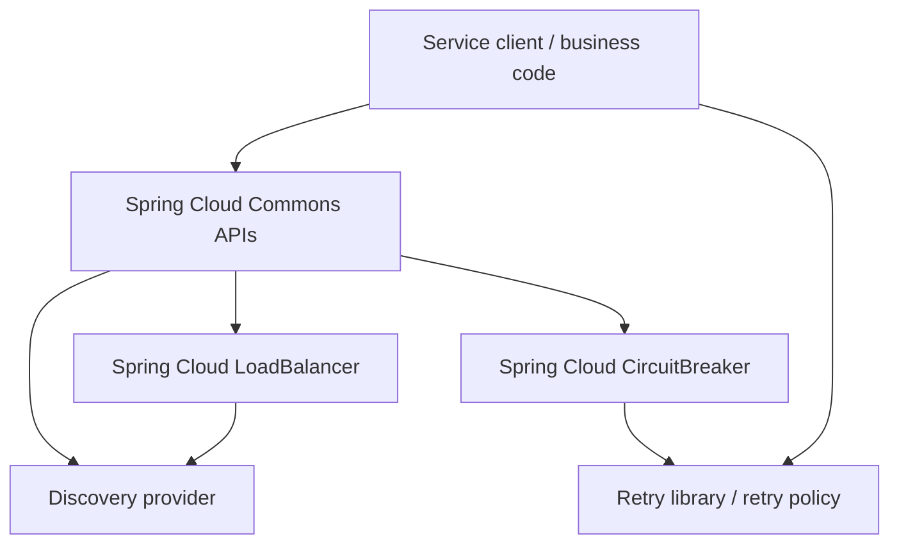

# Boundaries of Commons with Advanced Retry, Circuit Breaker, and Load Balancing Policies

Spring Cloud Commons provides shared contracts so applications can work with discovery, service registration, client-side load balancing, and circuit breakers without coupling directly to a specific provider. However, **an abstraction is not a policy implementation**. Commons lets components communicate through unified APIs; instance selection algorithms, retry strategies, circuit breaker thresholds, statistics windows, and fallback behaviors are usually handled by specialized implementation modules or resilience libraries.

When designing a service-calling client, distinguish three questions:

- **Finding and selecting a target:** which instances does the service have, and which instance does this request go to?
- **Retrying:** if a call fails, should the request be resent, how many times, and to which instance?
- **Circuit breaking:** when a downstream has prolonged failures, when should new calls be rejected to avoid making the situation worse?

These mechanisms work together without replacing one another. Load balancing does not automatically create retries; retries are not a circuit breaker; a circuit breaker does not look up instances. This lesson belongs to the **Service Calls** chapter of the `SPRING_CLOUD_CORE` module, focusing on the boundary between Commons APIs and specialized implementations/policies, dependency selection, ordering of wrappers, and testing.

## 1. Commons provides shared contracts, not every policy

Spring Cloud Commons is the shared foundation layer for many Spring Cloud integrations. It defines abstractions so applications do not depend directly on proprietary APIs of Eureka, Consul, or a specific resilience library.

Commonly encountered abstractions:

| Abstraction | Role | What it does not decide on its own |
| --- | --- | --- |
| `DiscoveryClient` | Look up service IDs and `ServiceInstance` lists | Does not choose retry policies or circuit breaker thresholds |
| `ServiceRegistry` / `Registration` | Register, update status, and deregister instances | Does not select instances per HTTP request |
| `LoadBalancerClient` | Synchronous API to pick an instance or execute a request on one | Not the entire set of load balancing algorithms/policies |
| `ServiceInstance` | Describe host, port, URI, secure flag, and metadata | Does not verify the endpoint is alive at request time |
| `CircuitBreaker` / `CircuitBreakerFactory` | Contract to invoke through a circuit breaker and create breakers by ID | Does not determine thresholds, sliding windows, or implementations |

These interfaces allow other modules to supply implementations. For example, a discovery provider supplies `DiscoveryClient`; Spring Cloud LoadBalancer supplies client-side instance selection; Spring Cloud CircuitBreaker integrates libraries like Resilience4j to execute circuit breakers.



The diagram shows conceptual responsibility boundaries. An application does not have to use every module; the actual dependency graph depends on the client stack and architecture.

## 2. Boundaries of each layer

### 2.1. Discovery and registration

`DiscoveryClient` returns an instance list by service ID. It answers the question "which services are advertised and what are their endpoints?" `ServiceRegistry` deals with registering and managing the state of the current instance.

Lookup example:

```java
List<ServiceInstance> instances =
        discoveryClient.getInstances("catalog-service");
```

This snippet does not pick an instance via round-robin, does not send HTTP, and does not retry. It only fetches discovery data. Nor does the registry decide how many times a request should be retried.

### 2.2. Load balancing

Load balancing takes an instance list and picks one instance for a request. In Spring Cloud, `LoadBalancerClient` is the abstraction in Commons; Spring Cloud LoadBalancer is the standard implementation providing components such as `ReactorLoadBalancer`, `ServiceInstanceListSupplier`, and selection policies.

Example using the instance selection API:

```java
ServiceInstance instance =
        loadBalancerClient.choose("catalog-service");

if (instance == null) {
    throw new IllegalStateException(
            "No instance available for catalog-service");
}

URI target = instance.getUri();
```

This example only illustrates picking an instance. In typical applications, use an HTTP client integrated with `@LoadBalanced` so LoadBalancer handles resolving service IDs in requests. Avoid writing manual instance selection logic inside every service when a LoadBalancer integration is already available.

### 2.3. Retry

Retry decides whether to resend an operation after a failure. It requires classifying retryable errors, maximum attempts, backoff, jitter, deadlines, and stop conditions.

Retries can be implemented with Spring Retry, Resilience4j Retry, Spring Cloud LoadBalancer's retry support, or a custom mechanism. Commons does not impose a universal business retry policy across all calls.

### 2.4. Circuit breaker

A circuit breaker tracks call outcomes and temporarily blocks new calls when a downstream exceeds failure thresholds. It typically has these states:

- **Closed:** allows requests through and records outcomes.
- **Open:** rejects requests immediately, usually routing to a fallback or controlled error.
- **Half-open:** permits a limited number of probe requests to evaluate whether the downstream has recovered.

Commons provides the `CircuitBreaker` abstraction and corresponding factory; Spring Cloud CircuitBreaker connects that abstraction to implementations like Resilience4j. A circuit breaker does not pick service instances on its own and does not retry failed requests by default.

## 3. Commons and Spring Cloud LoadBalancer

### 3.1. LoadBalancerClient is an abstraction

`LoadBalancerClient` belongs to Spring Cloud's shared APIs. It provides a way to select a `ServiceInstance` by service ID and operations to execute requests through the chosen instance.

Code can depend on this abstraction rather than a specific registry implementation. However, functioning at runtime requires an appropriate implementation and instance source.

### 3.2. Spring Cloud LoadBalancer provides the implementation

Spring Cloud LoadBalancer is the client-side load balancing module. It provides extension points to control how instance lists are supplied and how an instance is chosen.

Key components:

| Component | Role |
| --- | --- |
| `ServiceInstanceListSupplier` | Supplies the instance list to LoadBalancer |
| `ReactorLoadBalancer` | Instance selection contract in reactive flows |
| `RoundRobinLoadBalancer` | Selects instances sequentially in rotation |
| `RandomLoadBalancer` | Selects instances randomly |
| `LoadBalancerLifecycle` | Hook to observe request lifecycle stages |
| `LoadBalancerClient` | Synchronous API at the Commons layer for callers to use the abstraction |

Not all advanced policies exist as a single configuration property. Some behaviors require a custom supplier, custom load balancer, or per-service-ID configuration.

### 3.3. Advanced load balancing policies

Common requirements:

| Requirement | Approach |
| --- | --- |
| Round-robin | Use the appropriate round-robin policy |
| Random | Use the random policy |
| Same-zone preference | Provide zone metadata and a zone-filtering supplier/policy |
| Exclude unhealthy instances | Use a health-check supplier or a discovery source with accurate health status |
| Version/canary preference | Use metadata/hints and a custom supplier/policy |
| Capacity-based weighting | Requires a weighted policy or custom implementation |
| Sticky sessions | Requires a policy binding requests/users to instances; not included by default in round-robin |
| Instance list caching | Configure the caching supplier and TTL matching freshness requirements |
| Retry on another instance | Use LoadBalancer retry integration and a policy excluding already-tried instances |

Metadata only takes effect when a supplier or policy reads and uses it. Registering `zone=zone-a` does not make LoadBalancer prefer that zone unless the corresponding behavior is configured.

### 3.4. Selecting an instance is not a health guarantee

An instance present in the discovery list might have just stopped, lost a network route, or become overloaded. LoadBalancer chooses from currently available data; requests can still fail during the actual connection.

Combine health registration, timeouts, bounded retries, and circuit breakers. Do not treat LoadBalancer picking an instance as proof that the downstream will definitely succeed in processing the request.

## 4. Where do retries live?

### 4.1. Business retries and transport retries

Not every error should be retried.

| Error type | Retryable? | Notes |
| --- | --- | --- |
| Transient connection reset | Possibly | Only within retry budget and deadline |
| Timeout | Conditionally | The request may already have been processed by the server; requires idempotency |
| HTTP 503 / 502 | Possibly | Depends on Retry-After, root cause, and policy |
| HTTP 400 due to bad input | Usually no | Resending the same payload will not fix the error |
| HTTP 401 / 403 | Usually no | Fix credentials/permissions; do not loop endlessly |
| HTTP 404 | Usually no | Exceptions exist when eventual consistency is intentionally designed |
| Validation/business rejection | Usually no | Retries do not change business conditions |
| No instance available | Short wait or bounded retry | Avoid creating an unbounded wait loop |

Retries should apply only to transient failures likely to succeed on a subsequent attempt. Error classification must be based on API and transport semantics, not catching every `Exception`.

### 4.2. Attempt count and backoff

A retry policy typically defines:

- Maximum attempts, explicitly clarifying total calls vs. additional retries.
- Wait interval between attempts.
- Increasing backoff, such as exponential backoff.
- Jitter so multiple clients do not retry in lockstep.
- List of retryable exceptions/statuses.
- Total deadline for the operation.
- Cancellation conditions when the caller has timed out or the request is canceled.

Illustrative policy example:

```text
maxAttempts = 3
initialBackoff = 100 ms
backoffMultiplier = 2
maxBackoff = 1 second
jitter = enabled
retryOn = transient connection errors, selected 5xx
doNotRetryOn = validation errors, authentication errors
```

The values above are examples only. Calculate based on SLAs, downstream latency, replica count, and the caller request's time budget.

### 4.3. RetryTemplate is a separate option

If the application uses Spring Retry, you can wrap a call with `RetryTemplate`:

```java
public CatalogItem loadCatalogItem(String id) {
    return retryTemplate.execute(context ->
            catalogHttpClient.findById(id));
}
```

`retryTemplate` must be configured separately for retryable exceptions, attempt counts, backoff, and recovery. Using `RetryTemplate` does not automatically make LoadBalancer pick a different instance on the next try; that depends on how the call integrates with LoadBalancer and where retry sits in the call chain.

Spring Retry is a separate library. Do not attribute Spring Retry policies to Spring Cloud Commons.

### 4.4. Spring Cloud LoadBalancer retries

Spring Cloud LoadBalancer includes retry support for supported client integrations. It can combine instance selection and retries, including trying another instance depending on configuration/suppliers and request context type.

This is retry at the client-side load balancing layer, distinct from business retries at the service layer. Read the retry configuration for your exact release train, check which exceptions/statuses are retried, and verify how the supplier excludes previously tried instances. Do not assume every HTTP client or request method shares identical behavior.

## 5. Circuit breakers: abstraction and implementation

### 5.1. CircuitBreaker in Commons

Spring Cloud Commons defines a circuit breaker abstraction so code can invoke calls through a unified API. A factory creates breakers by ID, while concrete implementations are supplied by a Spring Cloud CircuitBreaker starter.

API-level usage example:

```java
import org.springframework.cloud.client.circuitbreaker.CircuitBreaker;
import org.springframework.cloud.client.circuitbreaker.CircuitBreakerFactory;

public class CatalogFacade {
    private final CircuitBreakerFactory<?, ?> circuitBreakerFactory;
    private final CatalogHttpClient catalogHttpClient;

    public CatalogFacade(
            CircuitBreakerFactory<?, ?> circuitBreakerFactory,
            CatalogHttpClient catalogHttpClient) {
        this.circuitBreakerFactory = circuitBreakerFactory;
        this.catalogHttpClient = catalogHttpClient;
    }

    public CatalogItem find(String id) {
        CircuitBreaker breaker =
                circuitBreakerFactory.create("catalog-read");

        return breaker.run(
                () -> catalogHttpClient.findById(id),
                error -> CatalogItem.unavailable(id)
        );
    }
}
```

`CatalogItem.unavailable` is an illustrative application method. The example shows code calling through the abstraction; it does not configure open thresholds itself.

### 5.2. Spring Cloud CircuitBreaker

Spring Cloud CircuitBreaker provides integration with concrete implementations, commonly Resilience4j. Typical dependency for imperative applications:

```xml
<dependency>
    <groupId>org.springframework.cloud</groupId>
    <artifactId>spring-cloud-starter-circuitbreaker-resilience4j</artifactId>
</dependency>
```

For reactive stacks, use the corresponding Reactor starter per release train documentation:

```xml
<dependency>
    <groupId>org.springframework.cloud</groupId>
    <artifactId>spring-cloud-starter-circuitbreaker-reactor-resilience4j</artifactId>
</dependency>
```

These starters supply the integration; concrete policies such as failure rate threshold, sliding window, wait duration, half-open calls, and exception predicates must be configured per requirements. Adding the dependency alone does not give the system production-ready policies.

### 5.3. Direct Resilience4j vs. Spring Cloud CircuitBreaker

You can use the Resilience4j API directly if the application prefers depending explicitly on that library. Spring Cloud CircuitBreaker fits when you want Spring Cloud's abstraction and the ability to swap supported implementations.

| Choice | Advantage | Trade-off |
| --- | --- | --- |
| Spring Cloud CircuitBreaker abstraction | Application code depends on shared Spring Cloud APIs | Requires implementation starter and corresponding configuration |
| Direct Resilience4j API | Full access to Resilience4j APIs/policies | Code is coupled to a specific implementation |
| Hand-rolled circuit breaker | Complete control over semantics | High risk; must handle concurrency, metrics, state transitions, and testing yourself |

Do not write your own circuit breaker just to avoid a dependency. State machines, synchronization, and failure statistics are very easy to get wrong.

## 6. Distinguishing retry, circuit breaker, and load balancing

| Mechanism | Decides | When it takes effect | Does not replace |
| --- | --- | --- | --- |
| Load balancing | Which instance receives the request | Before sending the request to an instance | Does not retry or open circuits itself |
| Retry | Whether to resend the operation after an error | After an error in the retryable category | Does not track long-term error rates |
| Circuit breaker | Whether to let new requests through | When failure rates exceed thresholds | Does not choose instances or guarantee valid fallbacks |
| Timeout | Maximum wait duration | Per call or across the entire operation | Does not decide whether to retry |
| Bulkhead | Concurrent resource limits | When many requests call a downstream simultaneously | Does not replace a circuit breaker |

These mechanisms address different dimensions of reliability. A system can use load balancing without retries; have retries without a circuit breaker; or use a circuit breaker for a fixed endpoint without discovery.

## 7. Ordering of applied mechanisms

Decorator/wrapper order affects error accounting and attempt counts. There is no single order right for every business case.

### 7.1. Circuit breaker wrapping retry

```text
Caller
  -> CircuitBreaker
      -> Retry
          -> LoadBalancer
              -> HTTP request
```

In this model, the circuit breaker observes the final outcome of the entire retry sequence for one logical call. If a retry succeeds, the breaker can record a logical call success; if retries are exhausted and still fail, the breaker records a failure.

This fits when you want the breaker to reflect the operation's success rate after retries are applied. Ensure total retry duration does not exceed outer timeouts/deadlines.

### 7.2. Retry wrapping circuit breaker

```text
Caller
  -> Retry
      -> CircuitBreaker
          -> LoadBalancer
              -> HTTP request
```

Here each attempt goes through the breaker individually. If the breaker opens between attempts, subsequent retries can be rejected quickly. This pattern can trip the breaker faster because it sees every individual failed attempt.

Verify library semantics and how decorators are composed; do not rely solely on diagrams. Some integrations have built-in retries inside LoadBalancer, causing the actual number of retry layers to exceed expectations.

### 7.3. Timeouts must cover the entire operation

A caller request typically has an overall deadline. If each attempt has a 2-second timeout and retries 3 more times with backoff, total elapsed time can exceed the caller's timeout.

Budget example:

```text
Overall deadline: 2.5 seconds
Per-attempt timeout: 700 ms
Maximum attempts: 2
Backoff: 100 ms
```

This only illustrates budget allocation. Calculate worst-case totals including connection, TLS, response, backoff, and fallback execution. Once the overall deadline expires, do not keep retrying in the background unless business rules permit asynchronous processing.

## 8. Idempotency and the risk of resending requests

Retries can cause an operation to execute multiple times. Especially with HTTP POST or data-writing commands, a client timeout does not prove the server did not process the request.

Example:

1. `order-service` sends a payment creation request.
2. `payment-service` receives it and creates a transaction.
3. The response is lost on the network.
4. The client hits a timeout and retries.
5. Without server-side deduplication, a second transaction may be created.

Common solutions:

- Use a unique idempotency key per logical operation.
- Store results by key on the server so duplicate requests return the same result.
- Design PUT APIs or operations with idempotent semantics where appropriate.
- Only retry errors that are likely transient.
- Do not blindly retry write commands without idempotency guarantees.

A GET operation is generally safer to retry, though hidden side effects, rate limits, and downstream cost still require consideration. Do not decide retries based solely on HTTP method.

## 9. Choosing dependencies by responsibility

An application may need distinct dependencies:

| Need | Common dependency | Responsibility |
| --- | --- | --- |
| Discovery abstraction | Spring Cloud Commons via starter/provider | Shared API for looking up instances |
| Eureka discovery | `spring-cloud-starter-netflix-eureka-client` | Fetch registrations from Eureka |
| Consul discovery | `spring-cloud-starter-consul-discovery` | Consul integration |
| Client-side load balancing | `spring-cloud-starter-loadbalancer` | Pick instances and integrate clients |
| Circuit breaker abstraction + Resilience4j | `spring-cloud-starter-circuitbreaker-resilience4j` | Execute circuit breakers via Spring Cloud API |
| Reactive circuit breaker | `spring-cloud-starter-circuitbreaker-reactor-resilience4j` | Integrate circuit breakers with reactive types |
| Standalone retry | `org.springframework.retry:spring-retry` or Resilience4j Retry | Retry policies outside Commons |
| Metrics/observability | Micrometer and matching integrations | Observe latency, failures, retries, and breaker states |

Do not add every dependency just because it relates to resilience. Choose based on your client stack, discovery provider, and actually required policies. Manage Spring Cloud artifacts with a Spring Cloud BOM compatible with Spring Boot; let dependency management coordinate Spring Security, Spring Framework, and related library versions.

## 10. Designing a bounded catalog call

Suppose `order-service` reads catalog information. A sensible structure may include:

- `DiscoveryClient` or provider supplying instances.
- Spring Cloud LoadBalancer picking an instance for service ID `catalog-service`.
- `@LoadBalanced` HTTP client sending requests.
- Timeouts bounding single-attempt duration.
- Short retries for connection errors or specific 5xx codes.
- A circuit breaker stopping continued calls during prolonged downstream failures.
- A fallback returning a status fitting business rules.

Illustrative application-layer example:

```java
@Service
public class CatalogFacade {

    private final CatalogHttpClient client;
    private final RetryTemplate retryTemplate;
    private final CircuitBreakerFactory<?, ?> circuitBreakerFactory;

    public CatalogFacade(
            CatalogHttpClient client,
            RetryTemplate retryTemplate,
            CircuitBreakerFactory<?, ?> circuitBreakerFactory) {
        this.client = client;
        this.retryTemplate = retryTemplate;
        this.circuitBreakerFactory = circuitBreakerFactory;
    }

    public CatalogItem find(String id) {
        CircuitBreaker breaker =
                circuitBreakerFactory.create("catalog-read");

        return breaker.run(
                () -> retryTemplate.execute(
                        context -> client.findById(id)),
                error -> CatalogItem.unavailable(id)
        );
    }
}
```

The snippet shows the circuit breaker wrapping retry so the breaker observes the final outcome of the retried operation. `RetryTemplate` must be configured to retry only transient failures with bounded attempts/backoff; the circuit breaker must have failure threshold, window, and open duration configured. `CatalogHttpClient` must use a client-side LoadBalancer if its URL uses a service ID.

Do not copy the example into production while omitting those configurations. Even a fallback returning a default object needs clear semantics: never turn a system failure into fake valid data that causes downstream business logic to proceed erroneously.

## 11. Advanced load balancing policies

### 11.1. Zone-aware

If the system runs across multiple availability zones, you can prefer same-zone instances to reduce latency and cross-zone traffic. Zone metadata must be advertised, and a supplier/policy must read that metadata. If the current zone has no instances, decide whether to fall back to another zone or reject the request.

### 11.2. Health-aware

A health-check supplier can probe or filter instances by health status. However, active health checks generate traffic and can increase load when many clients probe concurrently. Set reasonable intervals, timeouts, caches, and failure policies.

### 11.3. Version-aware and canary

You can attach version metadata or use hints to route a subset of requests to a specific version. Ensure compatibility between client and server, and define a fallback policy when no instance matches the requested version. Metadata is a routing signal, not authorization.

### 11.4. Weighted routing

When instances have different capacities, pure round-robin may not fit. Weighted routing needs a reliable weight source and a custom policy. Weights must be updated, tested, and observed; never infer capacity solely from ports or instance IDs.

### 11.5. Sticky routing

Some systems need a user/session to continue hitting the same instance. Sticky routing requires a stable key, a matching policy, and handling when an instance disappears. Do not assume round-robin or instance list caching provides session affinity.

## 12. Common design mistakes

| Anti-pattern | Consequence | How to adjust |
| --- | --- | --- |
| Treating Commons as a full implementation | Missing runtime execution modules and policies | Distinguish abstractions from concrete implementations |
| Retrying every exception | Amplifies load and repeats config/business errors | Retry only selected transient errors |
| Infinite retries | Requests drag on and cause retry storms | Cap attempts, deadlines, backoff, and jitter |
| No idempotency on write operations | Creates duplicate side effects | Use idempotency keys and server-side deduplication |
| Arbitrary circuit breaker thresholds | Opens too early or too late | Use traffic profiles, metrics, and load tests |
| Fallback returning fake data | Masks errors and corrupts business state | Return an explicit degraded state or propagate the error |
| Stacked multi-layer retries | Actual attempts multiply unexpectedly | Designate one primary retry-owning layer |
| Assuming LoadBalancer drops every bad instance | Can still hit stale or mid-flight failing instances | Health integration, timeouts, and failure handling |
| Using metadata as access control | May route to unauthorized instances | Enforce authorization independently |
| Omitting timeouts | Threads/connections held too long | Per-attempt timeouts and overall deadlines |

## 13. Observability and operations

To evaluate policies, observe each layer rather than looking only at overall HTTP 5xx rates.

Useful metrics:

- Available instance count per service ID.
- Instance selection ratios by zone/version.
- LoadBalancer selection latency and no-instance errors.
- Request latency, timeouts, and connection errors.
- Retries per logical request.
- Retry success rate and retry exhaustion count.
- Circuit breaker state transitions: closed, open, half-open.
- Requests rejected while the breaker is open.
- Fallback counts and fallback outcomes.
- Rate of requests canceled upon deadline expiration.

Logs should include correlation/trace IDs, service ID, selected instance ID, attempt number, and breaker name/state when helpful. Do not log sensitive payloads or tokens. Distinguish one logical request from multiple transport attempts to avoid miscounting traffic.

When a circuit breaker opens, define a recovery procedure: monitor the downstream, allow half-open probes, check success rates, and confirm traffic returns to normal. Do not repeatedly reset the breaker just to force requests through while the downstream is still failing.

## 14. Testing mechanisms individually and combined

| Goal | How to test | Expected outcome to verify |
| --- | --- | --- |
| Commons discovery | Stub/mock `DiscoveryClient` | Returns expected service ID and instance list |
| Load balancing | Supply multiple `ServiceInstance` objects | Policy picks instances as configured |
| Zone/metadata policy | Create instances with different metadata | Supplier filters or prefers matching zone/version |
| Retry | Simulate transient error then success | Attempts and backoff stay within bounds |
| Non-retryable error | Simulate 400/validation error | Single call only, no retry |
| Circuit breaker closed | Downstream succeeds | Requests are forwarded |
| Circuit breaker open | Trigger enough failures to hit threshold | Subsequent requests are blocked/fall back |
| Half-open | Recover downstream and allow probes | Breaker closes or re-opens based on probe outcome |
| Timeout/deadline | Slow down downstream | Total duration does not grossly exceed design budget |
| Idempotency | Resend same idempotency key | Server produces only one logical side effect |
| Retry + LoadBalancer | One instance fails, another is healthy | Re-selection follows policy |
| Multi-layer retry | Enable retries at multiple layers in tests | Count total attempts and confirm no unexpected multiplication |
| Fallback | Circuit open or retries exhausted | Fallback obeys business semantics |
| Metrics | Run success/failure/retry flows | Metrics distinguish logical calls from attempts |

Do not test only happy paths. In particular, test the scenario where the server processed the request but the response was lost; this is where retries can create duplicate side effects.

## 15. Diagnostic workflow when service calls are unstable

1. Confirm the service ID and whether DiscoveryClient returns instances.
2. Check host, port, secure flag, metadata, and connectivity from the caller.
3. Identify the active LoadBalancer implementation and supplier/policy.
4. Check per-attempt timeouts and the overall deadline.
5. Read retry logs/metrics to see which errors are retried and actual attempt counts.
6. Check circuit breaker state and exception predicates.
7. Confirm fallbacks do not mask errors or return invalid data.
8. Check whether retries are enabled simultaneously in the HTTP client, LoadBalancer, and service layer.
9. Verify idempotency of write requests.
10. Correlate trace IDs between logical requests and individual attempts.

If discovery has no instances, increasing retries usually will not fix the root cause. If DNS/network is misconfigured, a circuit breaker only makes errors fail faster. If a downstream is overloaded, unbounded retries can worsen the outage. Addressing the right layer shortens investigation time.

## 16. Practice: building policies for catalog read and payment write

### Scenario A — Catalog read

Requirements:

- Multiple catalog instances exist.
- Prefer instances in the same zone.
- Retry at most once on transient connection errors.
- Include a circuit breaker to stop calling repeatedly when catalog fails.
- If the breaker is open, return an explicit unavailable status.

Design approach:

1. Discovery provider advertises instances and zone metadata.
2. Spring Cloud LoadBalancer uses a zone-aware supplier/policy.
3. HTTP client integrates LoadBalancer via `@LoadBalanced`.
4. Per-attempt timeout is set shorter than the overall deadline.
5. Retries apply only to transient connection errors.
6. Circuit breaker wraps retry if you want statistics on the final outcome of the logical call.
7. Fallback returns an unavailable status, not a fake successful catalog item.

### Scenario B — Payment write

Requirements:

- Do not create duplicate transactions on client timeout.
- Only retry well-defined transient errors.
- Bound total elapsed time.
- When the payment provider experiences prolonged failures, a circuit breaker stops new requests.

Design approach:

1. Caller generates a stable idempotency key for a payment request.
2. Payment service stores results keyed by idempotency key.
3. Retry policy has low attempt count, backoff, and a deadline.
4. Circuit breaker tracks downstream failures and restricts traffic when open.
5. Fallback must never return a "paid" result without confirmation.
6. Reconciliation resolves unknown states when a timeout happens after the provider accepted the command.

Both scenarios share discovery/load balancing abstractions yet have different retry semantics because one reads data while the other creates financial side effects.

### Self-check questions

1. Which categories of abstractions does Spring Cloud Commons provide for discovery and service calls?
2. Why does the `LoadBalancerClient` abstraction not imply all load balancing policies are included?
3. Which module provides the Spring Cloud LoadBalancer implementation?
4. Which stage does `ServiceInstanceListSupplier` participate in?
5. At its core decision, how does retry differ from a circuit breaker?
6. Why does a timeout not prove the server has not executed the request?
7. Why is an idempotency key required for retried write operations?
8. Does `CircuitBreakerFactory` belong to the abstraction or a concrete implementation?
9. Why can `CircuitBreaker(Retry(call))` and `Retry(CircuitBreaker(call))` produce different statistics?
10. When do zone/version metadata affect LoadBalancer?
11. Why can retries at multiple layers cause a retry storm?
12. Which metrics help distinguish logical requests from transport attempts?

**Answer hints:** (1) DiscoveryClient, ServiceRegistry/Registration, LoadBalancerClient, and circuit breaker abstractions; (2) It is only a contract, while implementations/policies reside in specialized modules; (3) Spring Cloud LoadBalancer; (4) Supplying the instance list to LoadBalancer; (5) Retry resends after errors, while circuit breaker blocks calls once failure state crosses a threshold; (6) The request may have been processed while the response was lost; (7) So the server identifies and deduplicates repeated side effects; (8) Spring Cloud Commons abstraction; (9) One lets the breaker see only the final logical call result, while the other can record each individual attempt; (10) When a supplier/policy is configured to read that metadata; (11) Attempt counts multiply and increase downstream load; (12) Attempt counts, retry exhausted counts, logical request counts, latency, and breaker metrics.

## 17. Key principles to remember

- Spring Cloud Commons provides shared abstractions; specialized implementations and policies generally live in separate modules.
- `DiscoveryClient` finds instances; `ServiceRegistry` manages registration; `LoadBalancerClient` is the abstraction for selecting/executing requests via an instance.
- Spring Cloud LoadBalancer provides implementations and extension points for instance selection, suppliers, health, zones, hints, and retry integration.
- Retries should apply only to transient errors, with bounded attempts, backoff, jitter, and deadlines.
- A circuit breaker tracks failure states and blocks new requests when a downstream degrades; it does not replace retries or load balancing.
- Spring Cloud CircuitBreaker bridges Commons abstractions to implementations such as Resilience4j; threshold/window/state policies must be configured and tested.
- Timeouts, retries, circuit breakers, and bulkheads solve different problems; clearly define wrapper order and time budgets.
- Retrying write operations requires idempotency; a timeout does not prove the server has not executed side effects.
- Avoid enabling retries across multiple layers without calculating total attempts; monitor logical requests separately from individual transport attempts.
- Test instance selection, retryable/non-retryable errors, breaker transitions, fallbacks, timeouts, idempotency, and metrics.

When the boundary between Commons and specialized implementations is drawn properly, applications can keep business code coupled only to stable abstractions while tailoring policies to each downstream. What matters is explicitly controlling who selects instances, who retries, who trips the circuit, and how much total time a request is allowed to consume.

## References

- [Spring Cloud Commons — Common Abstractions](https://docs.spring.io/spring-cloud-commons/reference/spring-cloud-commons/common-abstractions.html)
- [Spring Cloud Commons — Spring Cloud LoadBalancer](https://docs.spring.io/spring-cloud-commons/reference/spring-cloud-commons/loadbalancer.html)
- [Spring Cloud CircuitBreaker Reference](https://docs.spring.io/spring-cloud-circuitbreaker/reference/index.html)
- [Resilience4j Documentation](https://resilience4j.readme.io/docs)
- [Spring Retry Reference](https://github.com/spring-projects/spring-retry)