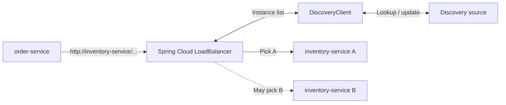

# Dynamic Addresses and the Need to Look Up Instances by Service Name

In a distributed system, a service often runs across multiple processes or containers. Each process is an **instance** with its own network address, whereas an application calling the service only needs to know **which service** can handle the request. As instances are created, replaced, moved, or stopped, IP addresses and ports can change. Therefore, service-calling code needs to separate the **logical identity of a service** from the **physical address of each instance**.

This is a foundational problem that the **Spring Cloud** ecosystem addresses through shared abstractions in Spring Cloud Commons, notably `DiscoveryClient`, `ServiceInstance`, and integration with Spring Cloud LoadBalancer. This lesson focuses on why instances must be looked up by service name, the path of a call, and how to apply, observe, and test this mechanism.

## 1. Why Can't We Rely Forever on Fixed IPs and Ports?

Suppose `order-service` needs to ask `inventory-service` whether an item is in stock. The simplest way to call it is to configure the URL directly:

```properties
inventory.base-url=http://10.20.1.15:8080
```

At first, `10.20.1.15:8080` may be correct. However, when deploying on virtual machines, containers, or an orchestration platform such as Kubernetes, the following situations are very common:

- **Deploying a new version:** old instances are replaced by instances at different IPs.
- **Scaling out or in:** scaling from one instance up to three instances when traffic spikes, then down when load drops.
- **Failure recovery:** a failing instance is terminated; a new instance is started at a different address.
- **Host migration:** the scheduler may run the container on a different node.
- **Multiple environments:** the address of the same service differs across local, staging, and production.

If `order-service` hardcodes an address, it may keep sending requests to a vanished instance or ignore new instances. Manually updating configuration across every calling service is both slow and introduces additional risk as the system changes continuously.

**The actual requirement:** `order-service` says "I need `inventory-service`", while the infrastructure or service discovery component determines which instances can currently accept requests.

## 2. Distinguishing Service Name, Instance, and Network Address

The following three concepts must be clearly distinguished:

| Concept | Meaning | Example |
| --- | --- | --- |
| **Service ID** (logical service name) | Stable identity that callers use to locate the service | `inventory-service` |
| **Service instance** | A specific running copy of a service; multiple instances can share one Service ID | `inventory-service` instances A, B, C |
| **Physical endpoint** | Network-reachable address of an instance or a stable access point | `http://10.20.1.15:8080` |

For example, at a given point in time a discovery source might return:

```text
Service ID: inventory-service
  ├── instance A: http://10.20.1.15:8080
  ├── instance B: http://10.20.1.23:8080
  └── instance C: http://10.20.3.9:8080
```

After a redeployment, A may disappear and D may appear at `10.20.4.10:8080`. **The Service ID remains `inventory-service`**. The instance list is dynamic operational state, not a contract to embed at every call site.

In most systems, callers need more than just an IP: port, HTTP/HTTPS protocol, readiness status, or metadata such as deployment zone. Discovery mechanisms can provide part of this information; exact capabilities depend on the registry system and integration used.

## 3. What Problem Does Service Discovery Solve?

**Service discovery** is the mechanism that maps a logical identity such as `inventory-service` to usable endpoints at query time. It typically has two parts:

1. **Updating the instance information source:** when a running copy appears, stops, or is no longer eligible to receive traffic, the discovery source must reflect that change. Information may come from direct registration, heartbeats/health checks, or orchestration platform APIs.
2. **Looking up instances when making a call:** a client-side or infrastructure component queries service information, picks an appropriate endpoint, and forwards the request there.

There is no single registration method across all systems. With Eureka or Consul, an application can register via an integrated client and the registry tracks its presence. With Kubernetes, Pods and Services/EndpointSlices are managed by Kubernetes; applications can be accessed via DNS and a stable Service without registering themselves into Eureka.

Example flow when **the client selects the instance itself**:



The diagram illustrates component responsibilities; it does not mean every HTTP request must query the registry. Clients and load balancers can cache the instance list; synchronization timing depends on configuration and the discovery mechanism.

### Finding instances differs from choosing an instance

Discovery answers the question: **"Which instances are currently known for this Service ID?"** Load balancing answers the next question: **"Which instance should this call be sent to?"**

For example, having A, B, and C in the list is not enough to guarantee A can handle a request. The selector may use round-robin or another strategy; actual availability also depends on health/readiness, update latency, network errors, and retry configuration. **Discovery does not automatically guarantee a request will succeed.**

## 4. Two Service Lookup and Routing Models

| Aspect | Client-side discovery | Server-side discovery |
| --- | --- | --- |
| Who finds and picks the instance? | The calling application itself, via a client/load balancer | An intermediary component such as a proxy, load balancer, or Kubernetes Service |
| What does the caller know? | Service ID and the mechanism to resolve it to instances | A stable address for the intermediary access point |
| Typical flow | Client → client discovery/load balancer → instance | Client → stable access point → instance |
| Advantages | Client can select based on metadata or specific policies | Simpler client, fewer direct dependencies on discovery |
| Trade-offs | Must integrate and operate selection logic in clients | Must operate a routing layer; policies live in infrastructure |
| Examples | Spring Cloud LoadBalancer paired with an appropriate DiscoveryClient | Kubernetes Service, reverse proxy, or load balancer integrated with an endpoint source |

Both approaches can coexist in one architecture. For instance, a Spring Boot application calls services in Kubernetes via Kubernetes Service DNS; in another environment, an application uses Spring Cloud LoadBalancer to select instances directly from Eureka or Consul.

### Does DNS replace service discovery?

DNS maps a name to addresses, so **it can be part of a discovery solution**. For example, a Kubernetes Service has a stable DNS name and Kubernetes routes traffic to matching Pods. However, plain DNS does not provide rich metadata, instance-selection policies, or health status in the way `DiscoveryClient` can represent them. Capabilities and limitations depend on record types, TTLs, DNS caching, and the platform.

What matters is identifying **who resolves the name used by the caller**: DNS/infrastructure or a load-balancing-capable client. If you use a plain `WebClient` with URL `http://inventory-service`, that name only works if DNS/networking can actually resolve it; the hostname string does not automatically turn into a query to Spring Cloud `DiscoveryClient`.

## 5. Core Abstractions in Spring Cloud Commons

Spring Cloud Commons provides a shared API layer so applications depend less on a specific discovery provider:

| Abstraction | Responsibility | Key point to remember |
| --- | --- | --- |
| `DiscoveryClient` | Queries the list of services and instances by Service ID | Not responsible for choosing the optimal instance per request |
| `ServiceInstance` | Represents an instance, including Service ID, host, port, URI, security flag, and metadata | Endpoint information from the discovery source |
| `ServiceRegistry` / `Registration` | Abstractions related to registering or deregistering when supported by the provider | Not every architecture registers instances from within the application |
| Spring Cloud LoadBalancer | Selects an instance from an instance-list supplier and supports HTTP client integration | Requires appropriate dependencies and integration configuration |

Direct query example:

```java
import java.util.List;
import org.springframework.cloud.client.ServiceInstance;
import org.springframework.cloud.client.discovery.DiscoveryClient;
import org.springframework.stereotype.Service;

@Service
public class InventoryDirectory {
    private final DiscoveryClient discoveryClient;

    public InventoryDirectory(DiscoveryClient discoveryClient) {
        this.discoveryClient = discoveryClient;
    }

    public List<ServiceInstance> knownInstances() {
        return discoveryClient.getInstances("inventory-service");
    }
}
```

`getInstances("inventory-service")` can return an empty list when no instances are registered yet, when synchronization is incomplete, or when discovery configuration/connectivity has issues. Any returned list is also a **point-in-time snapshot**, not a promise that the endpoint will still be alive by the time the request arrives.

In regular request-handling code, avoid manually grabbing `instances.get(0)` and concatenating URLs: that bypasses load-balancing policies, empty-list handling, and instance churn. Use a LoadBalancer-integrated HTTP client when the application is responsible for selecting instances.

## 6. Example: Calling by Service Name with Spring Cloud LoadBalancer

Suppose both `order-service` and `inventory-service` are Spring Boot applications. We want `order-service` code to call by Service ID without knowing specific IPs.

### 6.1. Required dependencies

For a project using `WebClient`, you need dependencies providing WebClient and Spring Cloud LoadBalancer (with a compatible Spring Boot/Spring Cloud set):

```xml
<dependencies>
    <dependency>
        <groupId>org.springframework.boot</groupId>
        <artifactId>spring-boot-starter-webflux</artifactId>
    </dependency>
    <dependency>
        <groupId>org.springframework.cloud</groupId>
        <artifactId>spring-cloud-starter-loadbalancer</artifactId>
    </dependency>
</dependencies>
```

These are only the relevant dependencies; the project still needs Spring Cloud version management via a BOM/release train **compatible with the Spring Boot version** in use. When using Eureka, Consul, or another provider, add the corresponding discovery starter. Do not pick an arbitrary Spring Cloud version because APIs and support levels depend on the version combination.

### 6.2. Simple discovery data for local environments

To practice without a registry, you can use Spring Cloud Commons' `SimpleDiscoveryClient` to declare static instances in `order-service`'s `application.yml`:

```yaml
spring:
  cloud:
    discovery:
      client:
        simple:
          instances:
            inventory-service:
              - uri: http://localhost:8081
              - uri: http://localhost:8082
```

Start two copies of `inventory-service` on ports 8081 and 8082 to test. `SimpleDiscoveryClient` is convenient for demos/tests because no registry is needed; the list here **does not automatically discover new containers**. In dynamic deployments, use a real discovery mechanism or a stable infrastructure-managed access point.

### 6.3. Configuring a Service ID-aware WebClient

```java
import org.springframework.cloud.client.loadbalancer.LoadBalanced;
import org.springframework.context.annotation.Bean;
import org.springframework.context.annotation.Configuration;
import org.springframework.web.reactive.function.client.WebClient;

@Configuration
public class HttpClientConfig {
    @Bean
    @LoadBalanced
    WebClient.Builder loadBalancedWebClientBuilder() {
        return WebClient.builder();
    }
}
```

The `@LoadBalanced` bean tells Spring Cloud to configure an instance-selection filter on the corresponding WebClient. When calling:

```java
import org.springframework.cloud.client.loadbalancer.LoadBalanced;
import org.springframework.stereotype.Service;
import org.springframework.web.reactive.function.client.WebClient;
import reactor.core.publisher.Mono;

@Service
public class InventoryClient {
    private final WebClient client;

    public InventoryClient(@LoadBalanced WebClient.Builder builder) {
        this.client = builder.baseUrl("http://inventory-service").build();
    }

    public Mono<StockResponse> checkStock(String sku) {
        return client.get()
                .uri("/api/stock/{sku}", sku)
                .retrieve()
                .bodyToMono(StockResponse.class);
    }

    public record StockResponse(String sku, int available) {}
}
```

Here `http://inventory-service` is a **logical URI**: `inventory-service` is interpreted by Spring Cloud LoadBalancer as a Service ID and resolved to an instance before sending the actual request. The path `/api/stock/{sku}` remains the target service's HTTP contract.

Without `@LoadBalanced` integration, this request goes through the HTTP client's normal host resolution. In an environment without DNS for `inventory-service`, it can fail due to host resolution failure.

In production applications, add timeouts, error handling, observability, and retry policies appropriate to the operation's safety. For state-mutating operations, automatic retries can cause side effects if the endpoint does not support idempotency.

### 6.4. When using a real registry

When switching to Eureka/Consul or a compatible provider:

1. Set up the registry and discovery client appropriate for the provider.
2. Ensure every `inventory-service` instance registers or is recognized by the discovery source under the same **Service ID**.
3. Keep the `http://inventory-service/api/stock/{sku}` call in `order-service`, if HTTP integration remains client-side discovery.
4. Verify readiness conditions, list refresh intervals, instance shutdown handling, and behavior when no instances are found.

Portability here lies in the shared abstraction; registration configuration, health checks, detection, or metadata may vary across providers.

## 7. Instance Lifecycle and List Consistency

Consider a rolling update deployment:

| Stage | What does the discovery source know? | Consequence for callers |
| --- | --- | --- |
| Initially | A and B are serving | Requests may go to A or B |
| C begins starting | C may not have reached readiness yet | C should only enter the traffic pool once sufficiently ready |
| C is ready | A, B, and C are all available | Callers can gradually start seeing C as well |
| A prepares to stop | A is marked unready or removed from routing | New requests should shift to B/C |
| A has stopped | Some clients may still hold stale info in cache | Brief errors may occur; proper timeouts and error handling are needed |

Events are not necessarily visible instantaneously to every client: registries, polling, caches, DNS TTLs, and network transit all introduce **convergence delay**. Therefore, design callers to withstand empty lists, expired instances, and transient network errors.

Some practical principles:

- Register or publish endpoints **only when eligible to serve**; remove from traffic before the process actually exits if the platform supports it.
- Distinguish **liveness** (the process is still running) from **readiness** (able to receive requests); do not treat every running process as a ready endpoint.
- Tailor timeouts and retries to the nature of the API. Discovery does not replace circuit breakers, resource controls, authentication, or monitoring.
- Avoid assuming all instances share identical configuration, API version, or network zone; use metadata/routing policies when needed.

## 8. Relationship with Externalized Configuration and Refresh Scope

In Spring Cloud, externalized configuration and `@RefreshScope` can help update certain bean configuration values when an appropriate refresh mechanism exists. However, **instance addresses changing does not mean configuration must be refreshed on every scaling event**.

- With a **fixed URL** like `inventory.base-url=http://10.20.1.15:8080`, changing an IP can require updating configuration, redistributing configuration, and managing bean lifecycles.
- With **Service ID + discovery**, the logical URL `http://inventory-service` stays unchanged; new endpoints are updated via the discovery source/routing mechanism.
- With a **Kubernetes Service or load balancer with a stable address**, the application uses the stable infrastructure address while infrastructure updates underlying endpoints.

The two mechanisms solve different problems: externalized configuration manages **application configuration values**; service discovery manages **the locations of callable instances**. They can work together but should not be conflated.

## 9. How to Test and Operate

To verify the flow of looking up instances by service name, you can run a hands-on exercise in sequence:

1. Start `inventory-service` on ports 8081 and 8082, with each instance returning a different identifier in its response or logs.
2. Configure `SimpleDiscoveryClient` as in section 6.2 and call from `order-service` using `@LoadBalanced WebClient.Builder`.
3. Send multiple requests and compare logs across both instances to observe request distribution. Do not assume an exact ratio with too few requests.
4. Check `DiscoveryClient.getInstances("inventory-service")`: the right name should return the declared list; a misspelled name may return an empty list.
5. Stop one instance and observe errors that may appear if local configuration still lists that instance's URL. Then update the local list or practice with a registry that tracks live state.
6. Inspect caller logs/metrics/traces: requested Service ID, chosen target instance (if logged), error codes, latency, error rate, and recovery time.

| Symptom | Common cause | What to check |
| --- | --- | --- |
| `inventory-service` not found | Wrong Service ID, missing discovery config, or instance not yet registered | Compare logical names; check `DiscoveryClient` list, provider config, and registration status |
| `UnknownHostException` when calling logical name | HTTP client lacks LoadBalancer integration, or name is absent from DNS | Check `@LoadBalanced` bean, dependencies, and actual name-resolution mechanism |
| Instance list present but requests still fail | Dead endpoint, wrong port, network error, bad readiness, or protocol mismatch | Test direct connectivity to endpoint, check logs, health/readiness status, and timeouts |
| Only one instance receives requests | List has only one instance, selection policy, or too few requests | Check discovery and LoadBalancer config; observe across more requests |
| Still calling a stopped instance | Slow list updates, stale cache, or static local list | Check registration lifecycle, sync intervals, caches, and graceful shutdown flow |

When integrating tracing, preserve correlation between requests in `order-service` and `inventory-service`. Service ID, chosen endpoint, and exception details help distinguish **no instance found**, **unable to connect to instance**, and **instance processed the request but returned an HTTP error code**.

## 10. Common Misconceptions

**"Having a Service ID is enough to make an HTTP call."** Not enough. You must have a name-resolution mechanism: DNS/infrastructure or an HTTP client integrated with discovery + load balancing.

**"DiscoveryClient automatically load balances."** `DiscoveryClient` provides the list of instances. A component such as Spring Cloud LoadBalancer is responsible for picking an instance per call according to a policy.

**"Finding an instance means the instance is healthy."** Data may be stale, health checks may not yet reflect failures, or networking between the two services may be disrupted.

**"Every Spring Cloud application needs Eureka."** Incorrect. Commons is an abstraction; the information source can be Eureka, Consul, another mechanism, or Kubernetes DNS/routing.

**"Scaling containers requires updating URL config in every client."** When calling by Service ID or a stable infrastructure address, physical address changes can be handled by discovery and routing, provided components update state properly.

## 11. Self-Assessment Scenario

A system has three instances of `payment-service`: P1, P2, and P3. After a deployment, P1 is deleted and P4 is created. `checkout-service` still calls `http://payment-service/payments`.

**Question 1:** Why can `checkout-service` keep the same URL?

**Answer hint:** Because the URL expresses a logical Service ID; client-side discovery/load balancing or infrastructure routing maps this name to currently available endpoints.

**Question 2:** If errors to P1 still occur for a few seconds, is that proof discovery is completely broken?

**Answer hint:** Not necessarily. The instance list may not have synchronized yet or caches may not have expired. You must separate instance lookup, selection mechanism, traffic draining, and actual network failures.

**Question 3:** If `checkout-service` uses a Kubernetes Service and stable DNS, is adding `@LoadBalanced` mandatory?

**Answer hint:** No. When a Kubernetes Service already handles routing and the name is resolved by DNS, a standard HTTP client can call that Service address. `@LoadBalanced` is needed when you want Spring Cloud LoadBalancer to resolve logical names on the client side.

## Key Takeaway

For distributed systems using Spring Cloud, the **Service ID is the stable contract between callers and the target service**, while the set of instances is dynamic state shaped by deployments and operations. Spring Cloud Commons standardizes reading instance metadata; Spring Cloud LoadBalancer can use that information to choose targets. Proper design must account for **name resolution**, **instance update latency**, and **error handling** as the system changes.
