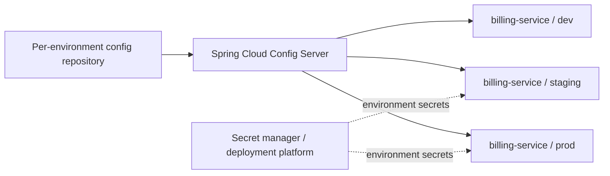

# Externalized Configuration and Differences Across Environments

In a distributed system, the same service typically runs on a developer's machine, test environments, staging, and production. The source code and packaged artifact may be identical, yet dependent service addresses, connection limits, logging levels, and credentials often differ. **Externalized configuration** lets you vary those values per deployment environment without modifying code or repackaging the application.

This lesson belongs to the **Distributed Foundations** chapter of **SPRING_CLOUD_CORE**. The focus is on how Spring Boot organizes and prioritizes configuration, how Spring Cloud adds centralized configuration and runtime configuration updates, and safe deployment and testing practices.

## 1. Learning Objectives

After this lesson, learners can:

- Distinguish **application code**, **environment-specific configuration**, and **secrets**; explain why a single artifact should be deployable across multiple environments.
- Use `application.yml`, profiles, environment variables, and command-line arguments to configure a Spring Boot service.
- Understand the role of `Environment`, `PropertySource`, property source precedence, and typed configuration binding with `@ConfigurationProperties`.
- Explain the place of Spring Cloud Config Client/Server in the Spring Cloud platform, and the difference between startup configuration and runtime refresh.
- Organize dev/staging/prod configuration, protect secrets, test configuration, and troubleshoot common configuration issues.

## 2. Why Do Distributed Systems Need Externalized Configuration?

Suppose `billing-service` calls `payment-service`. When running locally, payment may be a mock server on `localhost`. On staging, billing calls a test system; in production, billing calls the real endpoint with different certificates, timeouts, and rate limits.

If URLs or access keys are hardcoded in Java, every environment change requires editing code and rebuilding the artifact. That approach easily leads to deploying the wrong configuration, poor traceability, and slow incident recovery. Externalized configuration keeps **one build** across environments and shifts environment differences into the deployment process.

| Component | Example | Appropriate home |
| --- | --- | --- |
| Application logic | How invoices are generated and transactions validated | Source code and artifact |
| Shared configuration | Default timeouts, application name, log format | `application.yml` |
| Environment configuration | Payment endpoint, log level, pool size | Profiles, environment variables, or configuration system |
| Secrets | API keys, database passwords, tokens | Secret manager, mounted secrets, or platform-provided environment variables |
| Operational state | Active connection count, health check results | Metrics, logs, monitoring systems; not a configuration source |

For example, a timeout adjustment can be tuned via configuration; changing billing calculation rules, however, remains a business-behavior change requiring code edits and tests.

## 3. How Does Spring Boot Read Configuration?

Spring Boot builds an `Environment` object from multiple `PropertySource`s. Each source supplies key-value pairs such as `payment.connect-timeout=2s`. When the application asks for a key, Spring looks it up in **precedence order**; the value from the higher-precedence source wins.

Familiar sources include:

- `application.yml` or `application.properties` inside and/or outside the artifact;
- profile-specific configuration documents such as `application-dev.yml`, `application-prod.yml`;
- process environment variables, e.g., `PAYMENT_BASE_URL`;
- Java system properties, e.g., `-Dpayment.connect-timeout=3s`;
- application arguments, e.g., `--payment.connect-timeout=1s`;
- additional sources via `spring.config.import`, such as Spring Cloud Config Server or config trees.

**Practical rule:** configuration inside the artifact serves as defaults; external values and values passed at runtime can override them. In common setups, `--key=value` arguments take precedence over environment variables, and environment variables can override values in `application.yml`. However, the full order also depends on file location, profiles, config data documents, imports, and how the application is launched. When two sources conflict, inspect the **actual property origin** rather than relying on an oversimplified precedence rule.

### 3.1. Example using multiple configuration sources

`src/main/resources/application.yml`:

```yaml
spring:
  application:
    name: billing-service

payment:
  connect-timeout: 2s

feature:
  use-sandbox: false
```

At startup:

```bash
java -jar billing-service.jar --spring.profiles.active=prod --payment.connect-timeout=1s
```

The arguments above activate the `prod` profile and set the timeout to `1s`. Even if the prod config declares `4s`, the command-line argument still overrides it to `1s` in standard Spring Boot setups.

Spring Boot supports **relaxed binding**: `payment.connect-timeout` can be supplied via the environment variable `PAYMENT_CONNECT_TIMEOUT`. For environment variables, the typical conversion replaces dots with underscores, removes dashes, and converts to uppercase.

```bash
# Example for Unix-like shells; on Windows use the corresponding environment variable syntax.
PAYMENT_CONNECT_TIMEOUT=5s java -jar billing-service.jar --spring.profiles.active=prod
```

Avoid setting both an environment variable and a command-line argument for the same key without a clear reason; doing so makes determining the effective configuration harder.

### 3.2. Reading typed configuration

Injecting individual values directly via `@Value("${...}")` fits a few simple properties. For a group of business settings, prefer `@ConfigurationProperties` for type safety, grouping, and startup validation.

```java
import java.time.Duration;
import jakarta.validation.constraints.NotBlank;
import jakarta.validation.constraints.NotNull;
import org.springframework.boot.context.properties.ConfigurationProperties;
import org.springframework.validation.annotation.Validated;

@Validated
@ConfigurationProperties(prefix = "payment")
public record PaymentProperties(
    @NotBlank String baseUrl,
    @NotNull Duration connectTimeout
) {}
```

Register configuration property scanning in the application:

```java
import org.springframework.boot.SpringApplication;
import org.springframework.boot.autoconfigure.SpringBootApplication;
import org.springframework.boot.context.properties.ConfigurationPropertiesScan;

@SpringBootApplication
@ConfigurationPropertiesScan
public class BillingApplication {
    public static void main(String[] args) {
        SpringApplication.run(BillingApplication.class, args);
    }
}
```

The application needs the corresponding validation dependency (typically `spring-boot-starter-validation`). `base-url` binds to `baseUrl`; `2s` binds to `Duration`. When a required endpoint is missing or a timeout cannot be parsed, the application fails fast on startup instead of waiting for the first payment call.

You can inject `PaymentProperties` into a service via constructor injection; avoid storing environment-varying values in `static final` constants.

## 4. Separating Dev, Staging, and Prod Configuration with Profiles

A **profile** is a label used to activate a set of configuration settings or beans. Names like `dev`, `staging`, `prod`, and `test` are just team conventions; Spring does not inherently know that `prod` must be safer than `dev`.

A simple layout:

```text
src/main/resources/
  application.yml
  application-dev.yml
  application-staging.yml
  application-prod.yml
```

Keep shared values in `application.yml`, and declare only **differences** in profile-specific files.

`application-dev.yml`:

```yaml
payment:
  base-url: http://localhost:9090

feature:
  use-sandbox: true

logging:
  level:
    com.example.billing: DEBUG
```

`application-staging.yml`:

```yaml
payment:
  base-url: ${PAYMENT_BASE_URL}
  connect-timeout: 3s

feature:
  use-sandbox: true
```

`application-prod.yml`:

```yaml
payment:
  base-url: ${PAYMENT_BASE_URL}
  connect-timeout: 4s

feature:
  use-sandbox: false
```

In staging/prod, the deployment platform must supply `PAYMENT_BASE_URL`. By combining placeholders with validation, an environment missing an endpoint can be blocked before the service receives traffic. Do not set a `localhost` default for mandatory production settings, as it can mask deployment errors.

| Aspect | dev | staging | prod |
| --- | --- | --- | --- |
| Target dependency | Local mock or sandbox | Test/staging service | Production service |
| Logging | Selective DEBUG allowed | INFO and diagnostic details | INFO/WARN, never log sensitive data |
| Secrets | Test accounts, narrow scope | Test secrets managed by platform | Production secrets, least privilege |
| Purpose | Rapid development | Pre-release verification close to prod | Stability, security, and observability |
| Failure config | Easy to test failures | Failure drills | Fail fast on required properties |

Activate a profile in one of the following ways:

```bash
java -jar billing-service.jar --spring.profiles.active=dev
java -jar billing-service.jar --spring.profiles.active=staging
java -jar billing-service.jar --spring.profiles.active=prod
```

Or have the platform set `SPRING_PROFILES_ACTIVE=prod` before starting the process. Avoid placing `spring.profiles.active` inside `application-prod.yml`: the property activating a profile must come from a valid source prior to/outside a document dedicated exclusively to that profile.

Spring allows multiple profiles to be active simultaneously, though when keys overlap, profile order and property sources can change the outcome. For critical environments, establish a consistent profile activation rule, document it in the deploy process, and verify the final resolved properties.

### Profiles are not a security boundary

An `application-prod.yml` file does not automatically make an application secure. Simply misconfiguring `SPRING_PROFILES_ACTIVE` can point to the wrong endpoint. Complement profiles with startup validation, network policies, secret access controls, review processes, and monitoring.

## 5. When a Service Runs Across Many Places: Spring Cloud Config

With a handful of services, each application can receive configuration via files and environment variables. Once there are dozens of services and multiple environments, managing duplicate values, change history, and access control becomes complex. **Spring Cloud Config** provides a centralized configuration management model:



Config Server reads configured backends (commonly Git or another backend) and serves data keyed by **application name, profile, and label**. Config Client fetches configuration at startup. This setup lets teams manage changes centrally, while introducing an operational dependency on Config Server and network connectivity to it.

### 5.1. Client configuration

The application uses the Spring Cloud Config Client dependency, typically `spring-cloud-starter-config`, with a Spring Cloud version compatible with Spring Boot. Example `application.yml`:

```yaml
spring:
  application:
    name: billing-service
  config:
    import: "configserver:http://config-server:8888"
```

With `spring.profiles.active=prod`, the client requests configuration matching `billing-service` and `prod`. If the backend has a label/branch `main`, an illustrative Config Server endpoint is:

```text
GET http://config-server:8888/billing-service/prod/main
```

The path above illustrates Config Server's query interface; actual branches, paths, and authentication policies depend on server configuration. Never expose this endpoint to the public Internet when the data contains internal information.

You can declare an optional config import:

```yaml
spring:
  config:
    import: "optional:configserver:http://config-server:8888"
```

- **Without `optional:`**: when configuration cannot be loaded from a mandatory source, the application can fail startup; suitable when missing config poses a serious risk.
- **With `optional:`**: the application can continue using remaining sources when Config Server is unreachable. Ensure critical properties are still validated; otherwise, the service may run with unsafe defaults.

Each choice should be based on how strongly the application depends on centralized config. Do not enable fallbacks merely to hide infrastructure failures.

### 5.2. How does remote configuration override local configuration?

Spring Cloud adds `PropertySource`s from remote sources into the application's `Environment`. Exact precedence depends on the config loading mechanism, import syntax, profiles, and Spring Boot/Spring Cloud versions. You cannot assume remote values from Config Server always override every environment variable or vice versa.

For example, if `payment.connect-timeout` appears in a local file, remote config, and an environment variable, verify the final effective value in the running application. What matters is **which value takes effect, where it comes from, and whether the application received the intended profile/label**.

### 5.3. Bootstrapping and version compatibility

Different Spring Boot/Spring Cloud generations load early-lifecycle configuration differently:

- Since **Spring Boot 2.4**, the **Config Data** mechanism introduced `spring.config.import` and is the standard way to integrate Config Client in corresponding generations.
- Some legacy projects use `bootstrap.yml` and the bootstrap context; this behavior should not be assumed for new projects. Using legacy bootstrap requires version-appropriate configuration/components.
- Choose the Spring Cloud release train from the **official Spring Boot compatibility matrix**. BOM dependencies must stay aligned; tweaking starter versions independently can trigger auto-configuration or classpath errors.

This lesson focuses on principles that hold across versions; before deploying, consult documentation for the exact versions in use.

## 6. How Does Startup Configuration Differ from Runtime Refresh?

A typical startup proceeds in sequence:

1. The platform supplies profiles, environment variables, mounted files, and startup arguments.
2. Spring Boot/Spring Cloud loads and merges sources into `Environment`.
3. Beans are created and properties bound; validation checks mandatory settings.
4. The service begins serving requests with the configuration active at that time.

Editing a Git file served by Config Server **does not automatically update every running instance**. An update trigger is required, such as a restart, invoking a protected refresh endpoint, or broadcasting a refresh event via suitable infrastructure.

### 6.1. `@RefreshScope` in Spring Cloud Context

Spring Cloud Context provides `@RefreshScope` for beans that need to be recreated after a refresh event. Example:

```java
import org.springframework.beans.factory.annotation.Value;
import org.springframework.cloud.context.config.annotation.RefreshScope;
import org.springframework.stereotype.Component;

@Component
@RefreshScope
public class FeatureGate {
    private final boolean useSandbox;

    public FeatureGate(@Value("${feature.use-sandbox:false}") boolean useSandbox) {
        this.useSandbox = useSandbox;
    }

    public boolean useSandbox() {
        return useSandbox;
    }
}
```

When a refresh updates `Environment` and invalidates beans in refresh scope, a new instance of `FeatureGate` is created on the next access, picking up the new value. This is **supported bean refreshing**, not live-updating every value, object, or connection across the entire JVM.

To use the `/actuator/refresh` endpoint, the application needs the corresponding Spring Cloud/Actuator dependencies and must configure proper exposure, authentication, authorization, and network restrictions. This endpoint is sensitive because it can alter service behavior; never expose it publicly just for convenience.

### 6.2. Limitations of refresh

- Regular beans, static constants, and values already copied into other objects may retain old values.
- `@RefreshScope` does not guarantee that every setting updates safely while requests are in flight.
- Changing database URLs, credentials, connection pools, or security configuration may require reinitializing resources or **restarting** for consistency.
- When multiple instances run concurrently, refreshing one instance does not mean every instance has received the same configuration version.
- Spring Cloud Bus and event-broadcasting mechanisms can help propagate changes, but require designing update ordering, authentication, reliability, and rollback.

For changes affecting connections or security, a rolling restart across instance groups is often easier to control than trying to refresh everything dynamically.

## 7. Secrets, Access Control, and Change Governance

Externalized configuration does not automatically make secrets safe. A password read from an environment variable can still leak through logs, diagnostic dumps, process inspection tools, or server access if the system is misconfigured.

Practical principles:

1. **Never commit real secrets** into source code, `application-prod.yml`, documentation examples, or regular configuration Git repositories.
2. Use a secret manager or platform-managed secrets; apply least privilege per service and environment. Never use production credentials in dev/staging.
3. Avoid printing sensitive values in logs, error messages, diagnostic endpoints, or CI pipelines. Secure `/actuator/env` and `/actuator/configprops` if used for inspection; masking depends on version and configuration and should not be treated as the sole protection.
4. Manage config changes via reviews, explicit versions/labels, staging verification, phased rollouts, and rollback plans.
5. Know when secrets are loaded and how they rotate: environment variables are usually bound to the process at launch; rotating a secret in a secret manager may not automatically update running beans or connection pools.

Spring Boot also supports importing a **config tree**, convenient when Kubernetes or another platform mounts each config key as a file:

```properties
spring.config.import=optional:configtree:/etc/app-secrets/
```

For example, `/etc/app-secrets/payment.api-key` holds a value loaded under key `payment.api-key`. Mount only required secrets, set restrictive file permissions, and avoid logging file contents. Directories, key names, and mount mechanics must match the actual deployment platform.

## 8. Testing and Observing Configuration

Configuration bugs often surface only after leaving a developer's machine: wrong profile, overridden property, missing secret, mispointed URL, failing Config Server, or unapplied refresh. Configuration should therefore be verified alongside functional tests.

### 8.1. A dedicated profile for tests

Example `src/test/resources/application-test.yml`:

```yaml
payment:
  base-url: http://localhost:18080
  connect-timeout: 500ms

feature:
  use-sandbox: true
```

Test class:

```java
import org.junit.jupiter.api.Test;
import org.springframework.beans.factory.annotation.Autowired;
import org.springframework.boot.test.context.SpringBootTest;
import org.springframework.test.context.ActiveProfiles;

import static org.assertj.core.api.Assertions.assertThat;

@SpringBootTest
@ActiveProfiles("test")
class PaymentConfigurationTest {
    @Autowired
    private PaymentProperties properties;

    @Test
    void bindsConfigurationForTestProfile() {
        assertThat(properties.baseUrl())
            .isEqualTo("http://localhost:18080");
        assertThat(properties.connectTimeout())
            .isEqualTo(java.time.Duration.ofMillis(500));
    }
}
```

If the production application requires Config Server, configure the test environment to avoid unintended external dependencies (for example, disabling Config Client where appropriate, or using a controlled test config source). For dynamic endpoints such as Testcontainers, `@DynamicPropertySource` can supply URLs/ports at test runtime.

### 8.2. Recommended checks in CI/CD

| Check | Errors it catches |
| --- | --- |
| Bind `@ConfigurationProperties` and validation | Missing required keys, malformed timeouts, blank URLs |
| Test each supported profile | Overlapping/missing properties across dev, staging, prod |
| Verify effective config in a test/staging environment | Unexpected environment-variable overrides |
| Simulate Config Server unavailability | Incorrect fail-fast or fallback policy |
| Test config update/restart across multiple instances | Some instances retaining stale config |
| Audit secrets and access permissions | Information leaks or wrong-environment credentials |

When diagnosing issues, use startup logs, secured actuator endpoints, and property-origin details provided by the platform. Record **profile name, config version/label, and property source**, but never log secret values.

## 9. Real-World Scenario: Wrong Endpoint During Production Deployment

Suppose after a release, `billing-service` in production still calls the payment sandbox. A sensible root-cause workflow:

1. Confirm the running artifact, active profile, and `SPRING_PROFILES_ACTIVE` variable of the failing instance itself.
2. Check the effective `payment.base-url` property, along with its origin if available, through a secured diagnostic channel.
3. Verify whether `PAYMENT_BASE_URL` is injected into the right deployment/container; match variable names against property keys.
4. If using Config Server, verify `spring.application.name`, profile, label/branch, connectivity, and loaded config version.
5. Check whether the config changed without the instance restarting/refreshing, or whether a bean/cache still holds the old address.
6. Fix the configuration source, roll out cleanly, verify all instances, and monitor payment errors. For sensitive values, verify using safe indicators rather than printing full values to logs.

This is why distributed systems need shared configuration conventions: **one build, explicit property sources, early validation, traceable changes, and controlled restarts**.

## 10. Applied Exercise

Design configuration for `order-service` calling `inventory-service` across three environments:

- **dev:** calls mock inventory at `http://localhost:8089`, timeout `1s`.
- **staging:** reads endpoint from `INVENTORY_BASE_URL`, timeout `2s`.
- **prod:** reads endpoint from `INVENTORY_BASE_URL`, timeout `3s`, must fail startup if the endpoint is missing.

Tasks: create `application.yml` and profile-specific files; define `InventoryProperties` with validation; write a test for the `test` profile; state which source wins if the timeout environment variable is `5s` while the app starts with `--inventory.connect-timeout=4s`. Then explain how you would handle Config Server being temporarily unreachable during a production deploy.

**Reference hints:** in standard Spring Boot setups, the command-line argument `4s` overrides the environment variable `5s`; the production endpoint must be injected and validated; using or omitting `optional:configserver:` depends on whether the application can run safely with the remaining configuration.

## 11. Key Takeaways

- **Spring Boot** provides externalized configuration, profiles, `Environment`, binding, and validation.
- **Spring Cloud Config/Context** adds distributed capabilities such as centralized configuration and refresh scope; they do not replace secret management or rollout strategies.
- Differences across dev/staging/prod should be driven by controlled configuration, not separate per-environment code branches.
- Always verify both **the effective value and its origin** on live instances, especially with multiple override layers.
- Updating config at the source, reloading configuration, and applying it safely across all instances are three distinct steps.
