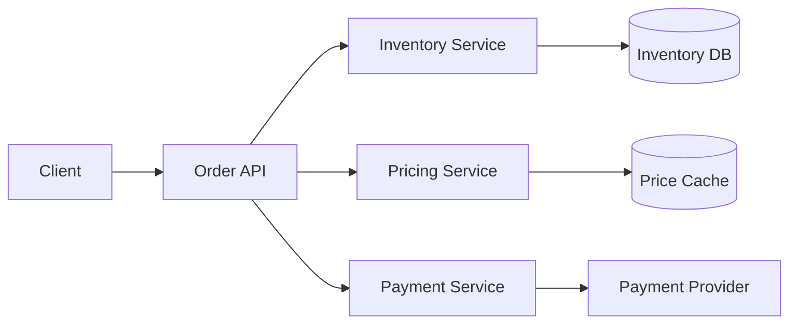
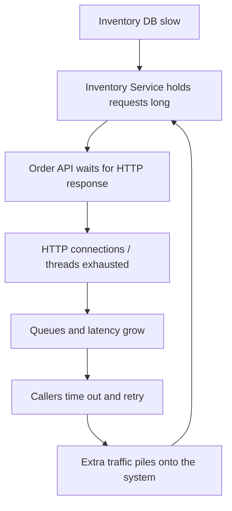

# Partial Failures, Network Latency, and Dependent Resources

In a distributed system, a single request may traverse multiple processes, hosts, networks, and external services. As a result, **one component still being alive** does not mean **the overall request will succeed**. Three issues that routinely appear together are **partial failure**, **network latency**, and **dependent resources**. Understanding how they interact is the foundation for designing systems that can recover and operate reliably.

This lesson belongs to the **Distributed Foundations** chapter of the **SPRING_CLOUD_CORE** module. Examples connect distributed systems principles with core Spring Cloud abstractions such as **Spring Cloud Commons**, **Spring Cloud Context**, externalized configuration, discovery, service registry, inter-service communication, and testability. Spring Cloud helps integrate these mechanisms into Spring Boot applications, but designing time bounds, load limits, and failure behavior remains the system's responsibility.

## 1. Learning Outcomes

After this lesson, learners can:

1. Distinguish partial failures from total system outages and explain why a timeout does not mean the operation failed on the receiver side.
2. Calculate latency budgets for sequential, parallel, and retried call flows; recognize the impact of *tail latency*.
3. Map dependency graphs and identify bottlenecks such as connection pools, thread pools, databases, registries, and configuration systems.
4. Select timeouts, retries, circuit breakers, bulkheads, backpressure, and fallbacks according to each operation's characteristics.
5. Accurately state the role and limits of Spring Cloud abstractions when implementing, testing, and monitoring failure scenarios.

## 2. A Small Request Has Many Points of Failure

Consider an order-creation API: it must check inventory, calculate pricing, and confirm payment. Each step in turn relies on other resources.



Suppose Order API is healthy and Pricing Service responds, while Inventory Service waits far too long on a database query. From Order API's perspective, **only one branch failed**; from the user's perspective, **the entire order placement can fail** if inventory information is mandatory.

There are three distinct design questions:

- **Can the business operation complete?** Checking inventory is mandatory; product recommendations may be optional.
- **Can it complete within the allowed time?** A correct response arriving after the caller's deadline is still useless for that request.
- **Which component will be affected next?** When many requests simultaneously wait on Inventory, Order API's threads, connections, or queues can also be exhausted.

This is why error handling in distributed systems must evaluate the **entire dependency chain**, not just `try/catch` blocks inside individual methods.

## 3. Partial Failure and Uncertain Outcome State

### 3.1. Common failure modes

| Situation | Observation on caller side | What may actually have happened |
| --- | --- | --- |
| Cannot connect to target host | Connect error or connect timeout | Instance stopped, wrong address, DNS or network issue, port not ready |
| Connection dropped during send/receive | I/O exception | Receiver may not have processed it, may be processing it, or may have partially processed it |
| Wait for response exceeded | Read timeout or deadline exceeded | Receiver may still be working, or may have already completed the write |
| Receiver returns `503` | Service unavailable | Overloaded, under maintenance, or downstream dependency unavailable |
| Receiver returns `429` | Too many requests | Rate limited; must respect backoff and retry policy |
| Registry returns stale address | Instance found, but call fails | Discovery data is not yet synchronized with actual instance state |
| A dependency returns bad data | HTTP status may still be `200` | Semantic bug or stale data; retrying will unlikely fix it |

**A timeout is a caller-side observation, not a confirmation of rollback.** For example, Order API sends `POST /payments`, Payment Service commits the transaction, and the response is lost. If Order API automatically resends the payment command without deduplication, the user risks being charged twice.

To retry write operations safely, you must design for it: an **idempotency key**, uniqueness constraints on the receiver, persisted processing state, and a status-query API when the outcome is unknown. Attaching an idempotency key on the caller side without the receiver storing and checking it is not enough.

Not every HTTP error is an infrastructure fault. For instance, `404` because a product code does not exist or `400` due to invalid input are usually business outcomes, not reasons for automatic retry.

### 3.2. Locality of information

Over a network, Order API cannot instantaneously know whether an instance is still alive or just lost connectivity. Health signals, registry data, and caches all have update latency. Therefore:

- An address returned by `DiscoveryClient` **does not guarantee** the next request will connect successfully.
- An instance that just transitioned to *unhealthy* may still have in-flight requests.
- An HTTP-layer timeout tells you nothing about the commit state of a transaction in the target service.
- A passing health check only reflects state at the moment and within the scope checked.

Good design acknowledges **uncertain state** and provides appropriate handling, instead of inferring that no response means no work happened.

## 4. Latency Is Part of Correctness

### 4.1. How is end-to-end latency formed?

Response time consists of many components: waiting to acquire a connection, DNS or instance selection, connection handshake when needed, packet transmission, queue wait time, business processing, data queries, and response transmission. A slow service does not necessarily have high CPU: it may be waiting on another resource.

With three sequential calls, approximately:

\[
T_{\text{sequential}} \approx T_1 + T_2 + T_3 + T_{\text{overhead}}
\]

With two independent calls executed in parallel:

\[
T_{\text{parallel}} \approx \max(T_1,T_2) + T_{\text{coordination}}
\]

For example, Inventory takes 180 ms, Pricing takes 260 ms, and combining results costs 20 ms. Sequential calls take roughly **460 ms**; parallel calls take roughly **280 ms**. However, parallel execution creates higher concurrent load on dependencies and is only valid when the two operations are truly independent.

### 4.2. Tail latency and fan-out

An average of 100 ms does not mean every request finishes near 100 ms. **p95 = 400 ms** means 95% of measurements do not exceed 400 ms; **p99 = 900 ms** means 99% do not exceed 900 ms within that measured dataset. When each request waits on multiple child calls, the chance of hitting a slow branch rises.

Suppose eight independent calls run in parallel and each call has a 99% probability of finishing before threshold `t`. The probability that **at least one** call exceeds the threshold is:

\[
1 - 0.99^8 \approx 7.7\%
\]

This is an example assuming independence, not a formula to apply verbatim to every system. It illustrates why **high fan-out** easily degrades overall p95/p99 latency even when each service's average latency looks healthy.

### 4.3. Budget-based timeouts, not guesswork

Suppose the external API has a **1,500 ms deadline**. The team budgets roughly 200 ms for validation, processing, and response construction, leaving at most 1,300 ms for a dependency call chain. An illustrative policy:

| Component | Budget |
| --- | ---: |
| Per attempt: maximum connection setup | 200 ms |
| Per attempt: maximum response read wait | 400 ms |
| Maximum attempts | 2 attempts |
| Delay between attempts, if enough time remains | 100 ms |
| **Ideal upper bound for the listed parts** | **2 × (200 + 400) + 100 = 1,300 ms** |

The sum above **excludes** DNS, scheduling, queuing, or other processing overhead. Furthermore, a *read timeout* usually bounds individual read-wait intervals and **does not automatically act as an absolute deadline for the entire request**. A connection that keeps trickling bytes slowly can exceed the desired total duration. Therefore, propagate or enforce an **overall deadline** at the orchestration layer and only retry when sufficient budget remains; these numbers are a budget-allocation example, not a real-time guarantee.

Distinguish these concepts:

- **Connect timeout:** prevents waiting too long to establish a connection.
- **Read/response timeout:** limits waiting for data or a response per the HTTP client's mechanism.
- **Overall deadline:** the final point in time when the caller still cares about the result, encompassing attempts and backoff delays.
- **Cancellation:** when the caller stops waiting, cancelable work on the execution side should be stopped; cancellation does not guarantee rolling back already-committed work.

## 5. Dependent Resources and Cascading Failures

A dependency is not just an HTTP endpoint. It also includes connection pools, CPU, worker threads, file descriptor limits, queues, databases, caches, message brokers, DNS, registries, or external providers.

| Resource / dependency | Degradation mode | Consequence in calling service |
| --- | --- | --- |
| Database or HTTP connection pool | Exhausted slots, connection leaks | Requests queue up even while the target service is running |
| Thread pool / event loop | Long-blocking tasks, excessive concurrency | No capacity left to handle incoming requests |
| Queue / broker | Slow consumers, growing queue depth | Increased wait times and risk of stale data |
| Cache | Mass misses, cache outage | Query flood hits the database (*cache stampede*) |
| Discovery / service registry | Stale instances, registry temporarily unreachable | Picks wrong address or fails to discover new instances |
| Config Server / external config | Cannot fetch config at startup or refresh | Service fails to start or keeps using current config depending on setup |
| External provider API | Rate limits, latency spikes | Timeouts, retry cost, and queuing increase |

### 5.1. One slow fault can become a system-wide outage



This feedback loop is a **cascading failure**: the initial fault belongs to one dependency but propagates through the resources of upstream services. Unbounded retries can worsen the condition. For instance, if three layers each retry up to three times for the same operation, calls reaching the bottom layer can grow up to **27** in a worst-case execution path, depending on how retries are nested.

In steady state, Little's Law describes `L = λ × W`, relating work currently in the system (`L`), throughput (`λ`), and time spent in the system (`W`). If throughput stays constant while wait time increases, the number of waiting requests grows as well. Once capacity is exceeded, queues keep accumulating; **adding timeouts on the caller without limiting load on the receiver** is rarely sufficient.

### 5.2. Distinguish dependencies by execution phase

Not every dependency sits on the path of *every* request:

- **Startup path:** loading configuration, acquiring identity, initial connection checks, service registration. Failures here can prevent the application from becoming ready for traffic.
- **Request-serving path:** databases, HTTP services, caches, brokers. Failures directly impact request outcomes and latency.
- **Configuration-change path:** updating the config source and triggering refresh as implemented. Failures here may leave current values in place or fail the update.

For example, using **Spring Cloud Config Client** to load configuration from Config Server on startup **does not mean** every business request calls Config Server. Similarly, using `@RefreshScope` in **Spring Cloud Context** does not by itself create change detection, automatically refresh every instance, or guarantee in-flight requests switch to new configuration atomically.

## 6. Techniques to Limit Fault Blast Radius

The mechanisms below complement one another and must be chosen according to business semantics.

| Technique | Purpose | Key caveat |
| --- | --- | --- |
| **Timeout / deadline** | Bound resource holding time and result wait time | A timeout does not confirm the target operation was canceled or rolled back |
| **Bounded retry** | Survive transient faults such as flaky connections or `503` | Needs attempt caps, deadline, exponential backoff, and jitter; prefer idempotent operations |
| **Circuit breaker** | Temporarily reject calls to a continuously failing dependency | Does not fix the dependency; requires proper thresholds and recovery probing |
| **Bulkhead** | Isolate concurrency or resources across work groups | Poorly sized limits can throttle throughput or cause premature bottlenecks |
| **Backpressure / admission control** | Keep incoming traffic within processing capacity | Must define clear rejection/queuing policies |
| **Fallback / graceful degradation** | Return an alternative result when an optional feature fails | Only use fallback data when business rules allow; do not turn errors into fake data |
| **Idempotency / deduplication** | Prevent duplicate side effects on write operations | Receiver must store and check keys, scope, and key lifecycle |

**Criticality-based policy:**

| Operation | Sensible handling on failure |
| --- | --- |
| Fetching product recommendations | Return an empty list or TTL-bounded cache, with a fallback indicator if needed |
| Reading stock for display | May display "unavailable/unknown" per business rules; never treat a timeout as in stock |
| Confirming stock before order checkout | Reject or move to pending review if unverifiable; avoid confirming unverified orders |
| Charging payment | Use an idempotency key and transaction state; query/reconcile before creating a new transaction when outcome is unclear |

### 6.1. When is retrying safe?

A disciplined retry policy generally requires all of the following:

1. **Classify recoverable errors:** e.g., transient connect timeouts, `503`; do not retry arbitrary `4xx` or validation errors.
2. **Ensure safe semantics:** read-only `GET` requests are usually safer; side-effecting `POST` requests require explicit idempotency design.
3. **Bounds:** small attempt limit, overall deadline, exponential backoff with jitter to avoid synchronized retry storms.
4. **Single retry layer:** avoid uncoordinated nested retries across multiple layers.
5. **Track extra load:** measure both logical user requests and actual **attempts** sent to dependencies.

When a dependency is overloaded, retries can delay recovery. For `429`, respect `Retry-After` guidance and remaining time budget; if insufficient budget remains, fail cleanly.

## 7. Related Spring Cloud Abstractions

Spring Cloud focuses on providing **abstractions and integrations**, whereas resilience policies depend on the libraries, versions, and configuration chosen by the application.

| Component | Role in distributed scenarios | Do not assume |
| --- | --- | --- |
| **Spring Cloud Commons – `DiscoveryClient`** | Looks up `ServiceInstance`s by service name | Discovered instances are guaranteed alive or fast |
| **Spring Cloud Commons – `ServiceRegistry`** | Registration and registration-status abstraction with supported registries | The registry always reflects true health instantaneously |
| **Spring Cloud LoadBalancer** | Selects an instance for service-name calls via enabled integration | It handles all deadlines, retries, circuit breakers, and business errors |
| **Spring Cloud Context – `@RefreshScope`** | Allows scoped beans to be recreated with updated config upon suitable refresh | Automatic detection of every config change or atomic switching for in-flight requests |
| **Spring Cloud Config Client** | Loads externalized configuration via configured mechanism | Config Server is queried on every business request |
| **Spring Cloud CircuitBreaker** | Circuit breaker integration API when an implementation is added | A circuit breaker exists automatically just because `DiscoveryClient` is used |
| **Spring Boot Actuator / Micrometer** | Health, metrics, and observations/traces depending on configuration | Health endpoints replace timeouts or end-to-end business checks |

Here, Spring Cloud Commons defines how an application **expresses** service discovery and invocation; specific registries (such as Eureka, Consul, or environment integrations) provide state storage. Spring Cloud LoadBalancer works only with the appropriate starter, integration, and instance list. Circuit breakers, retries, and bulkheads also require corresponding dependencies or configuration; they do not appear automatically just by declaring a service name.

**Version compatibility:** When configuring Spring Boot, Spring Cloud, and starters, select the Spring Cloud *release train* compatible with the project's Spring Boot version per the official compatibility matrix. APIs and auto-configuration evolve across versions; do not copy snippets from a different version and assume identical behavior.

## 8. Example: Calling Inventory by Service Name with Timeouts

Suppose Inventory Service is published through a discovery implementation and the application has Spring Cloud LoadBalancer. The snippet below illustrates an HTTP client using the **logical name** `inventory-service` while configuring connect and read timeouts. The example uses modern Spring Framework's `RestClient`; imports are omitted for readability.

`application.yml`:

```yaml
client:
  inventory:
    connect-timeout: 200ms
    read-timeout: 400ms
```

Java classes:

```java
@ConfigurationProperties(prefix = "client.inventory")
public record InventoryTimeouts(
        Duration connectTimeout,
        Duration readTimeout
) {}

@Configuration
@EnableConfigurationProperties(InventoryTimeouts.class)
class InventoryClientConfiguration {
    @Bean
    @LoadBalanced
    RestClient.Builder inventoryRestClientBuilder(InventoryTimeouts timeout) {
        var factory = new SimpleClientHttpRequestFactory();
        factory.setConnectTimeout(Math.toIntExact(timeout.connectTimeout().toMillis()));
        factory.setReadTimeout(Math.toIntExact(timeout.readTimeout().toMillis()));
        return RestClient.builder().requestFactory(factory);
    }
}

record StockAvailability(String sku, int available) {}

@Service
class InventoryGateway {
    private final RestClient inventory;

    InventoryGateway(@LoadBalanced RestClient.Builder builder) {
        this.inventory = builder.baseUrl("http://inventory-service").build();
    }

    StockAvailability getAvailability(String sku) {
        return inventory.get()
                .uri("/api/inventory/{sku}", sku)
                .retrieve()
                .body(StockAvailability.class);
    }
}
```

**Analyzing the example:**

- `@LoadBalanced` marks the builder so load-balancing integration can resolve the logical name to an instance; requires the appropriate starter, discovery, or configured instance source.
- `connect-timeout` and `read-timeout` here configure only the request factory's behavior—**not an overall deadline**—and do not implement retries or fallbacks.
- `SimpleClientHttpRequestFactory` keeps the example concise; under load, evaluate appropriate HTTP transports and connection pooling, connection limits, pool acquisition timeouts, and resource lifecycle management.
- If no instance is available or the call fails, the business layer must handle it explicitly: return an error, an "unknown" status, or a valid fallback; do not arbitrarily turn a network error into `available = 0`.
- Do not enable retries indiscriminately across every client. If retries are needed for this `GET`, add a bounded policy tied to an overall deadline and record attempt counts.

To account for end-to-end duration, the orchestrating layer calling Inventory must also bound wait times alongside other work. When runtime config can refresh, decide **whether the client should be recreated to pick up new timeouts** and what happens to in-flight calls. `@RefreshScope` is meaningful only when the bean is placed in that scope and refresh is triggered appropriately.

## 9. Failure Testing Must Reproduce Behavior, Not Just HTTP `200`

Integration tests can use mock HTTP servers, network-fault proxies, or test environments with service discovery; the focus is verifying **actual policies**. A minimum scenario set:

| Test | How to create the scenario | Expected verification |
| --- | --- | --- |
| Slow dependency | Inventory delays responses beyond the deadline | Order API stops waiting within budget; does not hold resources indefinitely |
| Transient error | First call `503`, next call `200` | Retries only if policy permits, within attempt cap and deadline |
| Persistent error | Inventory consistently returns `503` or refuses connections | Circuit breaker/bulkhead (if configured) activates properly; clean error/fallback flow |
| Registry returns stale instance | Configure an address no longer accepting connections | System handles connect error; does not treat discovery as a liveness guarantee |
| Resource exhaustion | Tight connection pool or concurrency limit | Enforces queue/rejection bounds cleanly without taking down independent call paths |
| Lost payment response | Receiver commits while caller times out | No duplicate charges; idempotency and state reconciliation work |
| Config Server failure | Test separately at startup and during refresh trigger | Verifies the environment's intended config policy; does not assume losing Config Server halts all requests |

Tests should measure **actual latency**, **logical request count**, **actual attempt count**, **active/waiting connections or tasks**, and **business outcome**. A test that merely asserts an exception is thrown does not prove the system bounds load or prevents duplicate side effects.

## 10. Production Observability and Operations

To separate root causes from cascading effects, observe both caller and receiver sides:

1. **Latency and error rates per dependency:** p50, p95, p99, timeouts, connect errors, `429`, `503`, separating logical requests from retry attempts.
2. **Resource saturation:** active/waiting connections, busy threads, queue depth, CPU, memory, database connections, and dependency capacity.
3. **Defensive behavior:** retry count, fallback count, circuit breaker state, requests rejected by bulkheads or rate limits.
4. **Distributed tracing:** trace Order → Inventory / Pricing / Payment paths, per-span durations, and failing branches; use correlation IDs to link logs across services.
5. **Health and readiness:** separate process *liveness* from traffic *readiness*; avoid making optional dependencies take the entire application out of service.

For example, if Order API's p99 spikes while Order's CPU is low, check **Inventory wait time**, waiting connections, and downstream database latency first. If attempt counts surge immediately after errors start, retry amplification may be preventing recovery. A dashboard showing only CPU and ingress HTTP status is rarely enough to diagnose root cause.

Tag metrics by dependency name, outcome category, and environment; avoid using high-cardinality user IDs or request IDs as metric labels. Error logs should include useful technical context (target, timeout, attempt, correlation ID) while avoiding sensitive data.

## 11. Design Checklist and Applied Questions

Before putting an inter-service call on a critical path, ask:

- Is this dependency **mandatory** or **optional** to complete the business operation?
- On timeout, can we tell whether the receiver committed? Is the operation idempotent?
- What is the end-to-end request deadline? Can child timeouts and retries exceed that budget?
- Are concurrency, connection pools, and queues bounded so one slow dependency cannot exhaust shared resources?
- Any instance returned by discovery can fail; does the client handle it and expose enough telemetry to detect it?
- If Config Server or the registry is temporarily unavailable, does impact occur at startup, refresh, or request time?
- Do metrics and tracing distinguish root errors, propagated errors, and retry-induced traffic?

**Exercise 1 — Time budget.** An API has a 1,200 ms deadline. Auth takes 100 ms, business validation takes 100 ms. Two independent calls to Inventory and Pricing run in parallel, taking 280 ms and 450 ms respectively. Ignoring other overhead, the minimum total time under this structure is **650 ms** (`100 + max(280, 450) + 100`). If Pricing must be retried after a timeout, retry time must also fit inside the deadline; you cannot add only the final successful attempt's duration.

**Exercise 2 — Unknown outcome.** Order API times out after sending a payment command. Explain why it must not create a new payment command by default; propose an idempotency key and a transaction-status query before deciding the next step.

**Exercise 3 — Cascading failure analysis.** Inventory DB is slow, Inventory Service holds connections, Order API accumulates waiting threads, and the gateway then returns `504`. Identify the root fault, propagation points, and metrics to inspect before increasing thread counts or retry limits.

In a Spring Cloud system, discovery, registries, and centralized configuration make it easier for components to **locate and manage dependencies**; real reliability comes from bounding time, bounding load, preserving operation semantics, and observing how faults propagate through each dependency.
