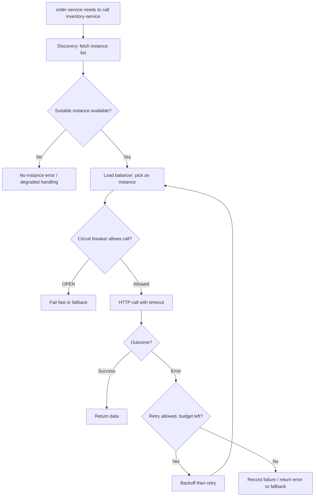
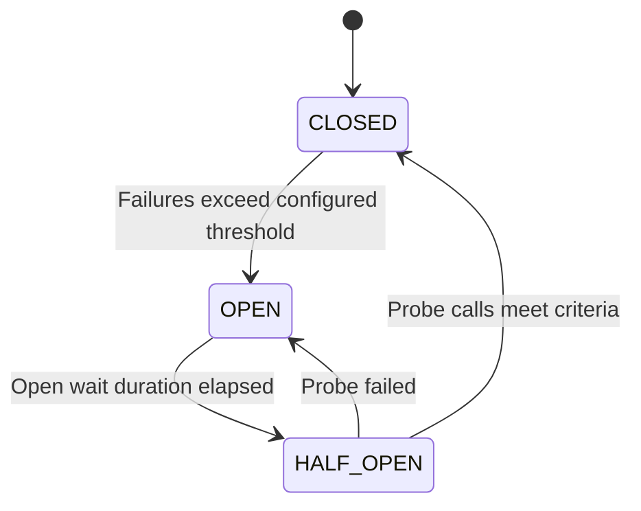

# Distinguishing Discovery, Load Balancing, Retry, and Circuit Breaker

> **Chapter:** Distributed Foundations  
> **Scope:** Spring Cloud Core — common abstractions in Spring Cloud Commons, service lookup, instance selection, and protecting inter-service calls.  
> **Focus:** Four mechanisms answering **four distinct questions** when calling a distributed service.

## 1. Starting Scenario

Suppose an e-commerce system consists of `order-service`, `inventory-service`, and `payment-service`. When a user confirms an order, `order-service` must check stock via `inventory-service`. The inventory service may run across multiple instances:

- `inventory-1` at `10.0.1.11:8080`;
- `inventory-2` at `10.0.1.12:8080`;
- `inventory-3` at `10.0.1.13:8080`.

Instances can be created, restarted, relocated, or fail temporarily. If `order-service` stores only one fixed IP, every request depends on a single machine and configuration quickly becomes stale.

Four questions arise in sequence:

1. **Discovery:** Which instances of `inventory-service` are currently reachable?
2. **Load balancing:** Among those instances, which one should this call be sent to?
3. **Retry:** If the call fails in a potentially recoverable way, should it be retried, how many times, and with what delay?
4. **Circuit breaker:** If the target is failing continuously, should we keep sending requests to it or pause calls to avoid making things worse?

They work together without replacing one another. Discovery knows **addresses**, load balancing decides **the target of a single attempt**, retry decides **whether to make another attempt**, and circuit breaker decides **whether to permit calls through**.

### Learning outcomes

After this lesson, learners can:

- distinguish the purpose, inputs, outputs, and limits of each mechanism;
- explain how Spring Cloud Commons connects discovery to Spring Cloud LoadBalancer;
- choose a retry policy matching HTTP method, idempotency, and time budget;
- describe the CLOSED, OPEN, and HALF_OPEN states of a circuit breaker;
- order retry and circuit breaker properly and predict behavior during downstream degradation;
- propose tests and metrics to verify the system behaves correctly under failure.

## 2. Concept Map: Where Do the Four Mechanisms Sit?

| Mechanism | Primary question | Inputs | Output | Does not solve on its own |
| --- | --- | --- | --- | --- |
| **Service discovery** | Where is the service named `inventory-service`? | Service name, registration data, or discovery source | List of `ServiceInstance`s or available endpoints from the data source | Does not pick a single instance per request; does not retry automatically |
| **Load balancing** | Which instance should serve this call? | Instance list, selection strategy, and request info | One concrete target to send the request to | Does not revive dead instances; does not imply retry by default |
| **Retry** | Should we call again after the error we just hit? | Error type, operation safety, attempt/time limits | One or more conditional attempts | Does not block traffic long term when a service is persistently broken |
| **Circuit breaker** | Should calls be allowed to an unstable dependency? | Success/failure history and threshold configuration | Allow call, fail fast, or invoke fallback | Does not locate targets, balance load, or fix the downstream service |

**Key takeaway:** One mechanism often produces inputs or conditions for another. For example, a load balancer can obtain the instance list from discovery; retry can re-execute an HTTP request with each attempt getting a target selected by the load balancer; a circuit breaker can wrap the entire retry sequence.

### Illustrative call flow



The diagram helps visualize roles and **does not enforce a single implementation order**. In practice, a breaker can wrap the outer retry operation or sit inside each individual attempt. Placement determines how it counts failures; section 7 analyzes this specifically.

## 3. Service Discovery: Turning a Logical Name into Concrete Addresses

### 3.1. The problem discovery solves

In auto-scaling environments, containers and instances change continuously. Instead of hardcoding `http://10.0.1.11:8080`, the client uses the logical name `inventory-service`. A discovery mechanism supplies information about instances currently registered under that name.

There are two common models:

- **Client-side discovery:** the client or a client-side library queries the registry, receives an instance list, and selects a target. Usually paired with client-side load balancing.
- **Server-side discovery:** the client calls a stable address such as a gateway, proxy, or DNS name; infrastructure resolves and selects the target. The application may not directly use a `DiscoveryClient`.

In registry-based systems, the provider may be Eureka, Consul, or Kubernetes environment discovery. Each provider has its own registration, synchronization, health check, and update rules. **Being registered in a registry does not guarantee an instance is actually healthy at the exact moment of a request.**

### 3.2. Related abstractions in Spring Cloud

Spring Cloud Commons defines shared interfaces so business code depends less on a specific registry system:

- `DiscoveryClient`: looks up a service name and retrieves a list of `ServiceInstance`s.
- `ServiceInstance`: describes an instance, such as service ID, host, port, URI, and metadata.
- `ServiceRegistry` and related abstractions: support registration/deregistration when the implementation provides that capability.
- `ReactiveDiscoveryClient`: reactive-programming counterpart when suited to the application.

Example that only **queries information** without performing load balancing:

```java
@Service
class InventoryDirectory {
    private final DiscoveryClient discoveryClient;

    InventoryDirectory(DiscoveryClient discoveryClient) {
        this.discoveryClient = discoveryClient;
    }

    List<URI> availableEndpoints() {
        return discoveryClient.getInstances("inventory-service")
                .stream()
                .map(ServiceInstance::getUri)
                .toList();
    }
}
```

This is illustrative code with `import` statements omitted. To get a real list, the application must configure an appropriate discovery source; Spring Cloud Commons interfaces alone do not create a registry.

### 3.3. Commonly misunderstood limitations

- Registries may lag in updating or clients may use caches. A list of three instances **does not guarantee** all three can respond.
- Discovery returns an empty list when registration is missing or the data source has trouble; blind HTTP retries rarely fix that.
- Registry health checks, client timeouts, and actual load conditions are separate signals.
- DNS or gateways can also solve routing; not every distributed application needs a dedicated service registry.

**Example:** `inventory-2` just died but has not yet been evicted from the registry. Discovery may still return the old address. The load balancer picks it, the request fails, and a valid retry may try again against another instance. Each mechanism handles one part of that event.

## 4. Load Balancing: Choosing a Target per Call

### 4.1. What does a load balancer need?

A load balancer takes a set of available targets and chooses one to handle a request. Strategies can be round-robin, random, or a custom policy accounting for network zones, metadata, and system state.

Spring Cloud LoadBalancer supports selecting a `ServiceInstance` for a service name and integrates with compatible HTTP clients when properly configured. When using discovery, the instance list is typically supplied through a `DiscoveryClient`-backed supplier; the list can be filtered or cached according to configuration.

**Round-robin does not mean CPU load is always balanced.** If requests vary widely in cost, dividing request counts evenly can still produce load skew. Load balancers also do not inherently understand session affinity, geographic regions, hot data, or connection limits.

### 4.2. Client-side vs. server-side load balancing

| Aspect | Client-side | Server-side |
| --- | --- | --- |
| Who picks the instance? | Library inside the caller | Proxy, ingress, gateway, or infrastructure |
| Does caller know multiple instances? | Typically yes | May know only one stable endpoint |
| Examples | Spring Cloud LoadBalancer integrated with `RestClient` or `WebClient` | Reverse proxy, Kubernetes Service, ingress |
| What to observe | Instance set seen by each client, algorithm, and cache | Proxy config, health checks, connection pools |

Both layers can coexist, but you need to know which layer a request actually traverses to avoid duplicate configuration and hard-to-debug routing.

### 4.3. An example integrating Spring Cloud LoadBalancer

A synchronous application using Spring Framework's `RestClient` can define a builder annotated with `@LoadBalanced`:

```java
@Configuration
class DownstreamClientConfiguration {
    @Bean
    @LoadBalanced
    RestClient.Builder loadBalancedRestClientBuilder() {
        return RestClient.builder();
    }
}

@Service
class InventoryHttpClient {
    private final RestClient restClient;

    InventoryHttpClient(@LoadBalanced RestClient.Builder builder) {
        this.restClient = builder.build();
    }

    StockResponse findStock(String sku) {
        return restClient.get()
                .uri("http://inventory-service/api/stocks/{sku}", sku)
                .retrieve()
                .body(StockResponse.class);
    }
}

record StockResponse(String sku, Integer quantity, String status) {}
```

Here `inventory-service` is a **logical service ID** for the load-balancer integration to resolve, not necessarily a normal DNS name. The sample assumes the application has Spring Cloud LoadBalancer, an appropriate instance source, and compatible Spring Boot/Spring Cloud versions. Verify the version set against the compatibility matrix of the release train in use rather than picking starter versions independently.

If no instances exist, the load balancer cannot invent an endpoint. You must decide whether the caller returns an error, uses fallback data, or degrades gracefully.

## 5. Retry: Retrying Likely Transient Failures

### 5.1. Retry is a policy, not a reflex for every error

A request can fail due to a brief disconnect, timeout, or an upstream restarting. Retrying sometimes succeeds. However, if the input is invalid or downstream is overloaded, retries increase latency and multiply load.

A retry policy must explicitly answer:

1. **Which errors are retried?** Separate network errors, timeouts, and HTTP `429`/`503` from business errors or invalid input.
2. **Is the operation safe to repeat?** Consider idempotency and side effects, not just the HTTP method.
3. **What is the maximum number of attempts?** For example, three attempts **including the initial call**, meaning at most two retries.
4. **How long between attempts?** Use backoff, usually with jitter to avoid many clients retrying in lockstep.
5. **What is the overall budget?** If `order-service` only has 300 ms left before its deadline, a third retry after 2 seconds is pointless.

| Outcome type | Is retry usually appropriate? | Caveat |
| --- | --- | --- |
| Transient connection error before response | Conditionally | Caller cannot always tell whether the request reached the server |
| HTTP `429` | Conditionally | Honor `Retry-After` when present; bound frequency and deadline |
| HTTP `502`, `503`, `504` | Conditionally | Only retry when downstream can recover; avoid creating a retry storm |
| HTTP `400` from invalid payload | Usually no | Fix the request; resending helps nothing |
| HTTP `401`/`403` auth/permission failures | Usually no | Fix token/permissions at the source; do not retry blindly |
| HTTP `404` valid per business rules | Usually no | Missing record is a valid result in many APIs |
| Payment or order-creation commands with side effects | Not automatically | Requires an idempotency key and duplicate-prevention contract |

**Idempotency** means calling the same operation multiple times yields the same net effect as calling it once under the API contract. `GET` is typically designed to be safe; `POST` creating a payment can create duplicate transactions if retried after the server committed successfully but the response was lost.

### 5.2. Backoff, jitter, and retry amplification

Immediate tight-loop retries usually harm an overloaded upstream. Exponential backoff widens the wait between attempts; jitter spreads retry timestamps across clients.

As an illustration, with at most three attempts, planned delays might be roughly 200 ms then 400 ms with randomization. Exact values depend on the library and configuration. Added to each attempt's processing time, the total duration **must stay under the business call's deadline**.

If `order-service` retries three times when calling `billing-service`, and `billing-service` also retries three times when calling another system, a single top-level request can generate up to nine calls at the bottom layer. Maintain an end-to-end **retry budget**, set sensible timeouts at each tier, and retry only where enough context exists to decide safely.

### 5.3. Retry in the Spring ecosystem

Retry can be implemented using Spring Retry, Resilience4j Retry, or retry features in a specific HTTP client/load balancer. **Spring Cloud Commons does not enable retries on every request by default.** What is active depends on starters, clients, configuration, and versions in use.

If each retry triggers a new call through a Spring Cloud LoadBalancer-integrated client, the load balancer **may pick a different instance**; this depends on the strategy, cache, and features avoiding previously failed instances. Do not assume retries always switch hosts.

A safe retry should be defined by **operation type and error type** first, and only then configured in a library.

## 6. Circuit Breaker: Cutting Calls When a Dependency Is Unstable

### 6.1. What does a breaker observe?

A circuit breaker monitors calls routed through it. When the failure rate or another signal crosses a configured threshold over a sufficiently large observation window, the breaker can temporarily stop allowing real calls. That lets the caller fail fast or use a fallback and relieves pressure on the failing dependency.

Three typical states:



- **CLOSED:** Permits requests through and records outcomes. "Closed" means a closed electrical circuit—traffic flows.
- **OPEN:** Rejects real calls for a period; can fail fast or invoke a fallback.
- **HALF_OPEN:** Allows a small number of probe calls to evaluate recovery.

Each library has its own details for sliding windows, minimum sample counts, failure rates, slow calls, wait durations, and state transition rules. A breaker does not know a service recovered merely because a registry says "healthy"; it requires real outcome data from permitted calls.

### 6.2. How does a circuit breaker differ from retry?

Retry targets **a single operation encountering a transient fault**; a circuit breaker learns across **many calls over a time window** to stop repeatedly hammering an already-broken dependency.

Suppose `inventory-service` returns `503` for 10 minutes:

- Retry alone: every order may attempt three calls, driving upstream request volume sharply higher.
- With a circuit breaker: once enough failures exceed the threshold, subsequent calls fail fast; upstream gets far less traffic and callers respond sooner.
- In HALF_OPEN: a handful of requests test the real path; if criteria pass, the breaker returns to CLOSED.

**A fallback is not always valid business data.** For stock checks, returning quantity `0` when the service errors could falsely signal "out of stock." Better options are representing `UNKNOWN`, pausing checkout, or returning a handleable business error.

### 6.3. Breakers also have a protection scope

A breaker can be scoped per logical dependency (such as `inventory-service`) or per endpoint/operation group. A service-wide breaker can open because one bad instance is hit frequently even while other instances remain healthy. Per-instance breakers require policies for creating, evicting, and updating keys as instances churn. No single scope fits every application.

A circuit breaker also does not replace **timeouts**, **bulkheads**, **rate limiting**, and **backpressure**. If requests hang indefinitely, counting errors only after completion is too late; if one dependency consumes the entire thread pool, concurrency isolation is required.

## 7. Combining the Mechanisms in One Spring Cloud Call

Suppose an application has:

- a discovery source configured to locate `inventory-service`;
- Spring Cloud LoadBalancer to resolve URIs by service ID;
- Spring Retry for selected transient errors;
- Spring Cloud CircuitBreaker with the Resilience4j implementation to protect the dependency.

The synchronous example below illustrates **a breaker wrapping the entire retry flow**. `import` statements, discovery provider config, HTTP timeouts, and specific HTTP policies are omitted to focus on control flow.

```java
@Configuration
class InventoryClientConfig {
    @Bean
    @LoadBalanced
    RestClient.Builder inventoryRestClientBuilder() {
        return RestClient.builder();
    }

    @Bean
    RetryTemplate inventoryRetry() {
        return RetryTemplate.builder()
                .maxAttempts(3) // At most 3 attempts total, including the initial call
                .exponentialBackoff(200, 2.0, 1_000, true)
                .retryOn(ResourceAccessException.class)
                .build();
    }
}

@Service
class InventoryGateway {
    private final RestClient client;
    private final RetryTemplate retry;
    private final CircuitBreaker breaker;

    InventoryGateway(
            @LoadBalanced RestClient.Builder builder,
            RetryTemplate inventoryRetry,
            CircuitBreakerFactory<?, ?> circuitBreakerFactory) {
        this.client = builder.build();
        this.retry = inventoryRetry;
        this.breaker = circuitBreakerFactory.create("inventory-service");
    }

    StockResult check(String sku) {
        return breaker.run(
                () -> retry.execute(context ->
                        client.get()
                                .uri("http://inventory-service/api/stocks/{sku}", sku)
                                .retrieve()
                                .body(StockResult.class)),
                error -> new StockResult(sku, null, "UNKNOWN"));
    }
}

record StockResult(String sku, Integer quantity, String status) {}
```

Explaining precisely what the code does:

1. `@LoadBalanced` on `RestClient.Builder` asks the load-balancer integration to resolve logical service names in URIs.
2. `RetryTemplate` configures **at most three attempts**, with backoff, actively retrying only `ResourceAccessException` in this sample. By default, HTTP `503` is converted by `RestClient.retrieve()` into an HTTP error, which **is not retried** in this sample configuration.
3. `CircuitBreakerFactory` creates a breaker keyed `inventory-service`; the implementation and trip rules are configured separately.
4. When the final attempt fails or the breaker rejects the call, the fallback returns status `UNKNOWN`. Consumers must treat `quantity = null` as **unknown**, not zero.
5. The sample code does not yet define timeouts, tracing, detailed error classification, null checks, or business rules for fallback. Those conditions must be designed before going to production.

Required starters/libraries must match the project's Spring Boot and **Spring Cloud release train**. Relevant artifacts commonly include `spring-cloud-starter-loadbalancer`, `spring-cloud-starter-circuitbreaker-resilience4j`, and `spring-retry`, plus the discovery provider dependency when using a registry. Spring Cloud Context manages certain configuration and refresh mechanisms, but **refreshing config does not automatically recover network calls or substitute for these four mechanisms**.

### 7.1. Retry inside or outside the breaker?

This choice has practical consequences:

| Wrapping order | Pseudocode | What the breaker sees | Consideration |
| --- | --- | --- | --- |
| **Breaker outside, retry inside** | `breaker(retry(call))` | Final outcome of one operation after retries | One operation may have sent multiple requests; breaker may see fewer error signals |
| **Retry outside, breaker inside** | `retry(breaker(call))` | Outcome of each attempt through the breaker | Individual failures trip the breaker faster; avoid retrying when breaker is already OPEN |

Avoid retrying "circuit breaker is OPEN" exceptions: new attempts are rejected immediately and only waste resources. Also decide whether timeouts wrap each attempt or the overall operation; ideally enforce an **overall deadline** alongside per-attempt time limits.

### 7.2. When another instance needs to be picked

If a request to `inventory-2` fails to connect, retry can make another call via `inventory-service`. The load balancer now has a chance to select `inventory-1` or `inventory-3`. However, the algorithm might still pick `inventory-2`; merely adding retry **does not guarantee failover**. Check failed-instance avoidance, list refresh behavior, and health filtering in your actual configuration.

## 8. Analyzing Common Scenarios

| Incident | How discovery helps | How load balancing helps | How retry helps | How circuit breaker helps |
| --- | --- | --- | --- | --- |
| Adding an instance to scale | Discovers new instance once data updates | Routes a share of calls to the new instance | Not required | Not directly |
| One instance stops | May remove it from list after a delay | Picks remaining instances if data is accurate | May retry if fault is transient and operation is safe | Limits calls when failures repeat |
| Registry returns stale data | May need refresh/health check tuning | Risks picking the dead target | May rescue some requests, no guarantee | Reduces impact when calls repeatedly fail |
| Zero instances for a service | Empty list or unresolvable | No target to pick | Usually unhelpful if outage persists | Fails fast / triggers fallback by design |
| Downstream overloaded, returning `503` | Usually lacks load telemetry | May balance evenly, still overloaded | Only retry with backoff, deadline, and cap | Temporarily sheds traffic past failure threshold |
| `POST` wrote data but response was lost | Cannot confirm business outcome | Cannot confirm business outcome | Risks creating duplicate records | Reduces traffic on wide outage, does not prevent duplicates |

Some problems lie **outside** these four mechanisms:

- Preventing duplicate payments requires idempotency keys, transactions, or proper business design.
- Inter-service consistency requires appropriate data models and protocols; load balancing does not create consistency.
- Resource isolation requires bulkheads, bounded pools, and timeouts.
- Observability requires logs, metrics, tracing, and correlation IDs.

## 9. Designing Timeouts, Retries, and Fallbacks Against a Time Budget

Suppose `order-service` has **800 ms** to return a response before the client gives up. An illustrative configuration below demonstrates the budget calculation:

| Component | Illustrative budget |
| --- | ---: |
| Business logic before/after calling inventory | 100 ms |
| At most two attempts to inventory, 200 ms each | 400 ms |
| Backoff wait between attempts | 100 ms |
| Buffer for network jitter, serialization, scheduling | 200 ms |
| **Total** | **800 ms** |

If only 50 ms remain before the deadline, starting a 200 ms attempt causes the upstream response to expire first. Systems should measure **actual remaining time** rather than relying solely on a fixed retry count.

Fallback choices depend on data criticality:

- For a product recommendations widget: can return an empty list or stale cached data if the user is notified appropriately.
- For account balances, inventory counts, or payment outcomes: never fabricate a success value. You may return `UNKNOWN`, ask the user to try later, or route the workflow to reconciliation.
- For APIs requiring strong consistency: failing fast can be better than serving stale cache data.

Set timeouts for connecting and reading responses, retries by error category, circuit breakers per dependency, and fallbacks per business contract. They must be designed **together** so SLAs are not violated.

## 10. Testing: How to Prove the Four Mechanisms Work Properly?

Do not test only the happy path. The tests below isolate misconfigurations at each layer:

| Test | How to simulate | What to verify |
| --- | --- | --- |
| Discovery | Register or deregister an instance in a test environment | Instance list updates per the expected mechanism and delay |
| Load balancing | Two instances return different `instanceId`s | Requests distribute per policy without depending on a fixed IP |
| Retry | Stub fails connection once then succeeds | Total attempts match cap; backoff occurs; no duplicate side effects |
| Non-retryable error | Stub returns HTTP `400` or business error | Caller does not retry when policy forbids it |
| Circuit breaker | Stub fails consecutively for enough samples per config | Breaker transitions to OPEN and fails subsequent requests fast |
| Recovery | After OPEN duration, make downstream respond successfully | HALF_OPEN runs limited probes then transitions to CLOSED if criteria pass |
| Deadline | Downstream is slow or hangs | Total duration does not exceed the designed budget |
| Fallback | Downstream is completely unavailable | Substitute value reflects business-appropriate "unknown/unavailable" state |

In integration tests, use an HTTP stub or fake service where you control responses, delays, and request counts. For circuit breakers, configure short observation windows in a test profile for deterministic state transitions; do not rely on long production wait durations.

### 10.1. Metrics and logs to watch

- **Discovery:** visible instance count, refresh timestamps, registry connection errors.
- **Load balancing:** requests per service/instance, no-instance errors, distribution skew.
- **Retry:** attempt counts, retry counts, retry reasons, added latency, post-retry success rate.
- **Circuit breaker:** current state, permitted/rejected calls, failure rate, OPEN/HALF_OPEN/CLOSED transitions.
- **End-to-end:** p95/p99 latency, error rate, and resource utilization on both caller and downstream.

Use Micrometer/observability per your project's stack, avoiding unbounded-cardinality metric tags such as request IDs or SKUs on every sample. Correlation IDs belong in traces and logs instead.

## 11. Misconceptions to Avoid

**"Having Eureka/Consul gives automatic load balancing."**  
Not necessarily. A registry supplies instance metadata; you still need an instance-selection layer and matching HTTP client integration. If a caller hits a fixed IP URL, the discovery list does not balance that request.

**"Round-robin skips dead machines."**  
Not guaranteed. The list can be stale; the algorithm can still pick a failing machine until evicted. Health checks, instance filtering, timeouts, and error handling are still necessary.

**"Retries unconditionally improve reliability."**  
False. Retrying non-recoverable errors or side-effecting operations can cause duplicate data and retry storms.

**"A circuit breaker fixes the upstream."**  
A breaker protects the caller and sheds load on the dependency; it does not repair upstream logic, networks, or databases.

**"An OPEN circuit breaker means zero instances exist."**  
Incorrect. An OPEN breaker describes **a protective decision based on observed calls**; discovery may still report multiple instances.

**"A fallback is always a successful result."**  
A fallback is a business decision when a dependency is unavailable. Some workflows must fail or enter a pending state rather than return fake data.

**"Spring Cloud Context config refresh automatically retries/saves requests."**  
Refresh scope can recreate certain beans/configurations under defined conditions, but does not replace instance resolution, timeouts, retry policies, or breakers. Also avoid changing resilience parameters live without understanding how in-flight requests are affected.

## 12. Applied Exercises

**Exercise 1 — Pick the right mechanism.** A system scales from two to six instances. Some callers still hit an old IP and traffic concentrates on nearly a single machine. Identify whether the fault is in discovery, load balancing, or client configuration; propose tests to separate each root cause.

**Exercise 2 — Is retry safe?** `payment-service` receives `POST /charges`. The server recorded the payment, yet the response to the caller timed out. Explain why a direct retry can create a duplicate charge; propose an idempotency key and transaction-status lookup workflow before retrying.

**Exercise 3 — Open circuit.** Over 60 seconds, 80% of requests to `inventory-service` fail. A circuit breaker is OPEN, yet the discovery dashboard still shows three instances. Explain why these two facts do not contradict each other; propose metrics to confirm the caller is failing fast instead of continuing real calls.

**Exercise 4 — Decorator ordering.** Compare `breaker(retry(call))` and `retry(breaker(call))` when each operation is allowed three attempts. Which makes the breaker observe a single aggregated outcome, and which lets it observe individual attempts? Choose one approach and explain how you avoid retrying when the breaker is OPEN.

### Quick self-check

1. Does discovery automatically pick an instance per HTTP request? **No**; that is the responsibility of load balancing or another routing layer.
2. Does retry guarantee the next attempt hits a different instance? **No**; it depends on the client, algorithm, and configuration.
3. Does an OPEN circuit breaker mean the server shut down? **No**; it is a protective state on the caller side.
4. Is retrying `POST` after a timeout safe by default? **No**; you must evaluate idempotency contracts and side effects.
5. Can all four mechanisms be used on a single call path? **Yes**; order, scope, and time budget must be explicitly designed.

## 13. Connecting Back to Spring Cloud Core

In a Spring Cloud distributed system, visualize the layers of responsibility:

- **Spring Cloud Commons** provides common contracts like `DiscoveryClient`, `ServiceInstance`, and related abstractions.
- **Discovery implementations** feed instance information from a registry or infrastructure into the application.
- **Spring Cloud LoadBalancer** picks an instance and integrates with supported HTTP clients.
- **Spring Retry, Resilience4j, and Spring Cloud CircuitBreaker** add resilience policies at the dependency-call layer.
- **Spring Cloud Context and externalized configuration** support loading and refreshing certain configurations; changes and Spring Boot/Spring Cloud compatibility must be managed per release train.

When troubleshooting real incidents, ask in order: **did the caller find instances, which instance did it pick, which attempt failed, was the retry valid, and what state is the breaker in?** Answering all five questions usually pinpoints the cause faster than lumping everything under "service discovery is broken."

**Further reading:** Official documentation for Spring Cloud Commons (DiscoveryClient and ServiceRegistry), Spring Cloud LoadBalancer, Spring Cloud CircuitBreaker; Spring Retry; Resilience4j CircuitBreaker; and the Spring Cloud release train/Spring Boot compatibility matrix for your project's version.
