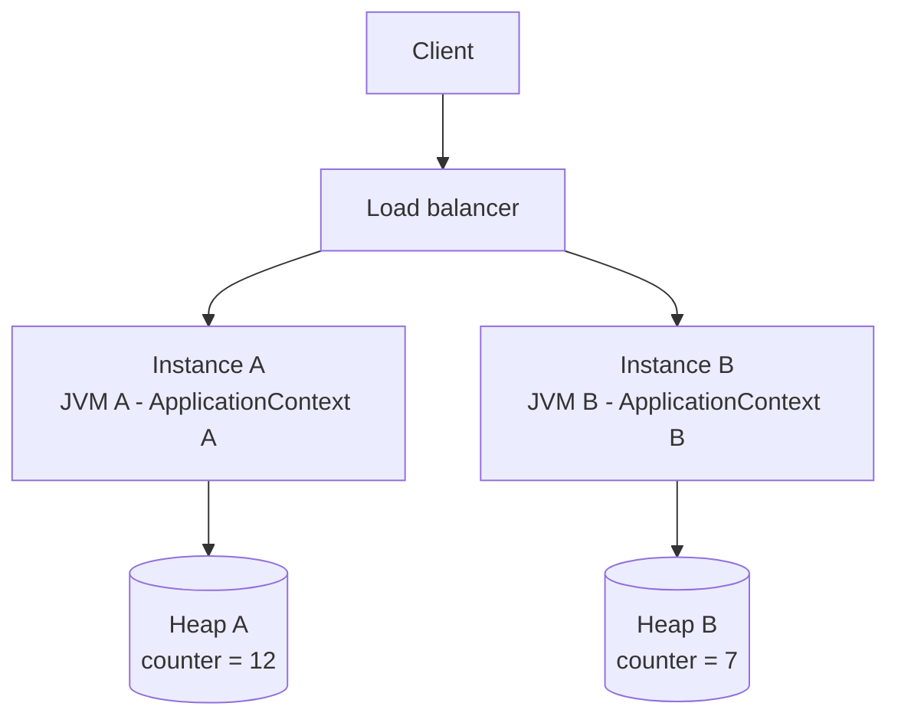
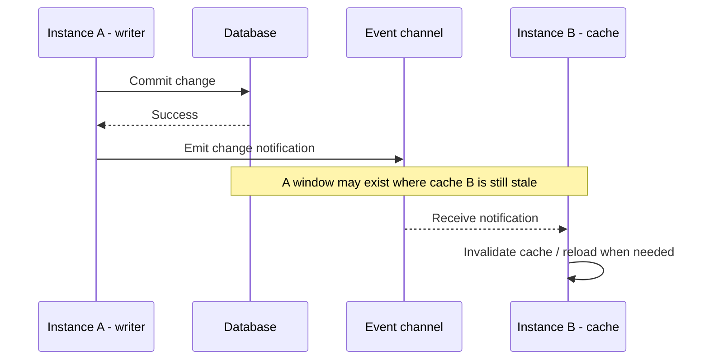
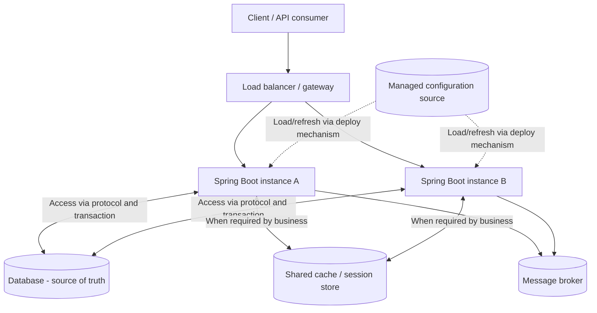

# Local State and Synchronization Limits Across Multiple Instances

In a standalone Spring Boot application, storing data in a `@Service` bean, a `static` field, an in-memory cache, or an `HttpSession` can create the impression that the data exists for **the entire application**. When deploying multiple instances, each instance is typically a separate JVM process with its own heap, lifecycle, and `ApplicationContext`. State placed in instance A's memory therefore **does not automatically appear** in instance B.

This is a prerequisite foundation before using **Spring Cloud Core** abstractions: Spring Cloud Commons helps discover and call services through shared abstractions; Spring Cloud Context helps applications handle configuration, contexts, and certain refresh mechanisms. None of those capabilities turns multiple JVM heaps into a unified distributed state store.

## 1. Learning Objectives

After this lesson, learners can:

1. Distinguish state that is **local to a request, thread, bean, or process/instance** from state shared via an external system.
2. Explain why load balancing, service discovery, service registries, and configuration refresh do not equate to synchronizing business data.
3. Recognize bugs when multiple instances handle sessions, caches, counters, background jobs, locks, and concurrent updates.
4. Choose state storage, consistency mechanisms, and error-handling strategies based on business requirements.
5. Design and test multi-instance scenarios, including restarts, failovers, and staggered configuration updates.

## 2. What Scope Does Local State Actually Have?

**State** is information that changes over time and influences subsequent processing behavior. State lifetime depends on where it is stored, not on whether instances share the same source code or service name.

| Storage location | Typical scope | Example | What usually happens on instance restart |
| --- | --- | --- | --- |
| Local variable in a method | Single invocation | Intermediate variable for price calculation | Ends with the invocation |
| `ThreadLocal` | Executing thread, when managed properly | Request-processing context | Does not survive restarts; also risks leaking across thread pools if not cleared |
| Default Spring bean (`singleton`) | One `ApplicationContext` | `AtomicLong`, `Map` inside a `@Service` | Lost if held only in heap |
| `static` | Corresponding class loader/JVM | Hand-rolled cache | Lost when JVM terminates; not shared with other JVMs |
| In-process cache | Corresponding instance | Caffeine cache or `ConcurrentHashMap` | Lost unless a reload mechanism exists |
| In-memory `HttpSession` | Session scoped to application/instance | Temporary cart, login step | May be lost or unreachable when requests hit another node |
| Shared data store | Per store scope and access config | PostgreSQL, Redis, object storage | Independent of an app instance restart; still depends on store availability |

A Spring `singleton` bean means **one bean per Spring container**, not one unique bean across the whole cluster. `volatile`, `synchronized`, `ReentrantLock`, or `AtomicLong` coordinate threads **within the same JVM**, but do not synchronize across JVMs on their own.

Picture two replicas of the same service:



Both A and B serve the same API, yet `counter = 12` on A and `counter = 7` on B do not conflict at the JVM level: they are **two separate state copies**. A request routed by the load balancer to B will see only the state accessible to B.

> **Principle:** Ask "who must observe this information consistently, over what timeframe, and across which failures?" before deciding to keep it in instance memory.

## 3. Limits That Do Not Disappear With Multiple Instances

### 3.1. Same source code does not mean shared memory

Two Kubernetes Pods or two `java -jar` processes may run from the exact same image. They still have independent heaps; messages, transactions, or shared storage must provide coordination if business logic requires it. No cross-JVM *happens-before* relationship arises merely from using `synchronized` in Java.

### 3.2. Load balancing only distributes traffic

A load balancer selects a target according to a routing policy. It does not replicate sessions, caches, or bean mutations. A user may hit A and then B in succession, making in-memory data appear to "go backward."

**Sticky sessions** reduce node switching by attempting to send the same user to the same instance; they do not create backup replicas. When A crashes, is replaced, scales down, or stickiness drops, state living only on A can still be lost. Sticky sessions should be treated as a routing choice, not a data durability strategy.

### 3.3. Discovery and registries know service addresses, not business data

Abstractions such as `DiscoveryClient` and `ServiceRegistry` in Spring Cloud Commons handle locating, registering, and managing service instance info. They help the system know A and B exist to be called, but **do not store inventory counts, shopping carts, business tokens, or update outcomes** across instances.

Likewise, an HTTP call via service discovery does not guarantee exactly-once execution. Retrying after a timeout can execute the same operation twice, even when the first request committed successfully.

### 3.4. Each instance has an independent lifecycle

Rolling deployments, autoscaling, health-check pod replacements, GC pauses, or network drops can cause instances to observe different states at different times. Proper design must tolerate an instance appearing, vanishing, or handling requests mid-transition without halting the entire cluster simultaneously.

## 4. Experiment: A Bean Counter Is Not a Cluster-Wide Counter

Consider the following Spring Boot controller:

```java
import java.util.concurrent.atomic.AtomicLong;
import org.springframework.web.bind.annotation.GetMapping;
import org.springframework.web.bind.annotation.PostMapping;
import org.springframework.web.bind.annotation.RestController;

@RestController
public class LocalCounterController {
    private final AtomicLong counter = new AtomicLong();

    @PostMapping("/demo/counter")
    public long increment() {
        return counter.incrementAndGet();
    }

    @GetMapping("/demo/counter")
    public long current() {
        return counter.get();
    }
}
```

`AtomicLong` makes increments safe when multiple threads access **one object**. If two instances start independently, each has its own `AtomicLong`:

| Time | Request | A returns | B returns | Interpretation |
| --- | --- | --- | --- | --- |
| T0 | Start A, B | `0` | `0` | Each JVM initializes its own object |
| T1 | `POST` to A | `1` | `0` | Only A's variable increments |
| T2 | `POST` to B | `1` | `1` | Only B's variable increments |
| T3 | `POST` to A | `2` | `1` | There is no shared counter holding `3` |
| T4 | Restart A | `0` | `1` | A loses heap-only data |

You can verify this yourself by running **the same application** on two ports (once the demo controller is included):

```bash
# Two independent terminals; using the same built JAR file.
java -jar app.jar --server.port=8081
java -jar app.jar --server.port=8082

# Send sequentially to each instance.
curl -X POST http://localhost:8081/demo/counter
curl -X POST http://localhost:8082/demo/counter
curl http://localhost:8081/demo/counter
curl http://localhost:8082/demo/counter
```

Outputs `1`, `1`, `1`, `1` after the two POSTs are the expected behavior. This is neither a bug in `AtomicLong` nor in Spring Cloud; the requirement for a cluster-wide counter was never designed into the store.

### Moving the update operation to a shared store

If **business logic requires a cluster-wide monotonic sequence**, every instance must call a system guaranteeing atomic increments. The example below targets **PostgreSQL**, illustrating a single SQL statement instead of the hazardous "read value, add in Java, write back" sequence:

```sql
CREATE TABLE counters (
    id TEXT PRIMARY KEY,
    value BIGINT NOT NULL
);

INSERT INTO counters (id, value)
VALUES ('order-sequence', 1)
ON CONFLICT (id)
DO UPDATE SET value = counters.value + 1
RETURNING value;
```

This statement executes against **the same database** and leverages PostgreSQL's concurrency guarantees to update one row; instances receive results from the shared store. An abstraction such as `CounterRepository.nextValue()` can hide the underlying storage details from the controller.

Do not infer that separate `SELECT` followed by `UPDATE` queries are equally safe. Writes must fit the chosen store's transaction model and data constraints. An atomic counter also **does not solve** a business request being retried twice; deduplication must be designed separately.

## 5. Categories of State and Where to Place Them

Not every piece of state needs to be externalized. Decisions depend on usage scope, cost of data loss, latency tolerance, and consistency requirements:

| Category | Examples | Design direction |
| --- | --- | --- |
| Transient computation state | Request-local variables, processing buffers | Keep local; do not assume survival past the request or restart |
| Durable business data | Orders, payments, quotas | Database with appropriate transactions/constraints; app instances are not the source of truth |
| Multi-node sessions | Shopping carts or server-side sessions | Shared session store (e.g., Spring Session with an appropriate backing store), or a protocol with minimal server session state |
| Reconstructible caches | Catalogs, lookup configs | Local cache with TTL if staleness is acceptable; shared cache and invalidation mechanism when needed |
| Runtime configuration | Thresholds, endpoints, feature flags | Managed config source with versioning and rollout plan; distinguish **shared config source** from **effective value per instance** |
| Background job coordination | Run-once schedules, job assignment | Persistent coordination/claim mechanism, job queue, or cluster-aware scheduler |
| Locks and resource ownership | Processing an invoice in exactly one process | Transactions, unique constraints, optimistic locking, or an appropriate distributed locking mechanism |
| Telemetry | Logs, metrics, traces | Ship to shared collection infrastructure; collecting telemetry differs from syncing business state |

If cache A lags cache B by a few seconds while serving search suggestions, that may be acceptable. If A and B both allow overdrawing a balance because each holds a copy of the balance in heap, the consequences are completely different. **Consistency requirements are dictated by business invariants**, not merely technology names.

### Three questions to choose an approach

1. **Who must observe the same value?** One request, one user, one instance, or the entire system?
2. **Is data loss or staleness tolerable?** Losing state on restart, reading seconds-old data, and duplicate updates are three different risks.
3. **Who coordinates updates?** A database, message broker, cache store, coordinator, or business protocol? If the answer is "each node updates a local variable," reconsider the design.

## 6. Data Consistency Differs from Change Notifications

A system can receive a "data changed" signal while still lacking the latest data. Distinguish clearly:

- **Source of truth:** authoritative store enforcing the invariants business rules require.
- **Copy (replica/cache):** data derived from the source of truth that may be stale for a window of time.
- **Notification (event/invalidation):** signal telling copies to refresh or evict data; the signal itself does not guarantee every node processed it successfully.
- **Transaction boundary:** group of operations committed atomically by a storage system; one database's transaction does not automatically span across services.

For instance, one service updates a product price in the database and emits an event so instances evict their caches. Between commit time and when each instance receives the event, a stale-data window can exist. If an event is lost or a consumer disconnects, TTLs, reconciliation, retries, or source re-reads act as extra safeguards.



The diagram depicts an ideal flow to explain latency; guaranteeing event emission after commit, preventing lost events, or handling consumer failures requires additional design (such as transactional outbox) depending on required reliability.

### Strong consistency, eventual consistency, and practical trade-offs

**Strong consistency per business requirements** usually requires coordinating reads and writes through an appropriate mechanism, such as database transactions and locks/constraints. **Eventual consistency** accepts that copies may diverge temporarily and will converge provided updates are delivered and processed properly. Both carry costs in latency, availability, infrastructure, and operations. Never claim "using Redis/Kafka automatically gives consistency": behavior depends on configuration, protocols, ordering, retries, and failure modes.

## 7. A Common Confusion in Spring Cloud Core: Configuration Refresh

### 7.1. Externalized configuration is still loaded per instance

Suppose two instances of a service both use:

```yaml
pricing:
  discount-limit: 10
```

At startup, each `ApplicationContext` receives properties according to its own property-source precedence and initialization sequence. If the central config source changes `discount-limit` to `15`, there is no reason to assume **every running bean** on A and B switches instantaneously.

Separate questions to examine:

1. Can the instance fetch the new value from its `PropertySource` or config source?
2. Has that instance executed the corresponding refresh/rebind mechanism yet?
3. Does the consuming bean support receiving new values, or must it be recreated/restarted?
4. Must instances switch configuration versions simultaneously to preserve business invariants?

### 7.2. `@RefreshScope` is scoped locally to each application

Spring Cloud Context supports **refresh scope** so a proxy-backed bean can be recreated when the scope is refreshed. Illustrative example:

```java
import org.springframework.beans.factory.annotation.Value;
import org.springframework.cloud.context.config.annotation.RefreshScope;
import org.springframework.stereotype.Service;

@Service
@RefreshScope
public class DiscountPolicy {
    private final int limit;

    public DiscountPolicy(@Value("${pricing.discount-limit:10}") int limit) {
        this.limit = limit;
    }

    public boolean accepts(int discountPercent) {
        return discountPercent <= limit;
    }
}
```

Once **that specific instance** receives a valid refresh and updated configuration is available, the target bean in refresh scope is evicted from the scope cache; the next access can instantiate a fresh target with the updated configuration. This mechanism does not mutate every Java object already holding data, nor is it a tool for synchronizing business state across multiple JVMs. Beans outside the scope, values copied into other fields, or components that do not support refresh may keep old values.

`@ConfigurationProperties` beans have binding/rebinding mechanics tied to Spring Cloud Context depending on configuration and version. Never assume every bean—especially immutable beans or precomputed values—changes instantaneously when the config source updates. Verify behavior in the **actual Spring Boot/Spring Cloud version** running in your project.

### 7.3. Refresh endpoints and Spring Cloud Bus are not cluster-wide transactions

In an application with Spring Boot Actuator and appropriate Spring Cloud components, `POST /actuator/refresh` can be exposed when enabled and authorized. It refreshes the environment/beans within **the instance receiving the request**; it does not automatically invoke all remaining instances.

Spring Cloud Bus (if explicitly added and configured) can broadcast events such as refresh requests across instances via a message broker. However, event broadcasting does not guarantee all instances switch configuration at **one atomic instant**, nor does it turn Bus into a business-state synchronization store.

Example timeline:

| Time | Config source | Instance A | Instance B |
| --- | --- | --- | --- |
| T0 | `discount-limit=10` | Using `10` | Using `10` |
| T1 | Updated to `15` | May still use `10` | May still use `10` |
| T2 | Only A completes refresh | Uses `15` after target beans update | Still uses `10` |
| T3 | B is refreshed/restarted properly | Uses `15` | Uses `15` |

Between T2 and T3, the same valid request could be accepted by A and rejected by B. For thresholds with business impact, plan rollouts, cross-version compatibility, config version tracking, and rollback capability. When decisions require instantaneous global consistency, a centralized decision control point may be needed instead of locally refreshed rules.

**Operational note:** Configuration refresh endpoints must be governed and secured; never expose them openly. When testing, enable endpoints only in permitted environments under matching security policies. Actual refresh behavior depends on dependencies, versions, and how configuration is supplied.

## 8. Common Distributed Bugs and How to Handle Them

### 8.1. Sessions stored in node RAM

A user logs in via A, then the next request lands on B and B finds no session. Enabling sticky sessions can mask the issue day-to-day without eliminating errors during failover. Approaches include shared session storage (e.g., Spring Session with an appropriate backing store) or APIs designed to minimize server-side session state. Even with self-contained tokens, state such as token revocation or immediate permission limits may still require a shared control store.

### 8.2. Local caches holding stale data

A updates the catalog, while B has not evicted its cache and keeps returning old prices. Options include TTLs, cache versioning, invalidation events, distributed caches, or reading directly from the source of truth for sensitive data. Acceptable staleness windows must be defined explicitly—for example, "at most 30 seconds for recommendation data"—rather than saying "the cache will update eventually."

### 8.3. Two schedulers running the same job

If each instance defines a `@Scheduled` method, scaling from one to three instances can execute the job **three times** on each JVM's schedule. Mitigations include work partitioning, database-backed claims, job queues, or cluster-aware schedulers. Using `synchronized` inside the method does not stop another node from running the same job.

### 8.4. Retried requests causing duplicate side effects

A client sends a payment creation request; A commits, yet the response is lost. A retry hitting B can create an extra record unless the system recognizes it as the same request. Solutions include a client-supplied `idempotencyKey`, unique constraints, and persisting outcome state in a shared store.

```sql
-- Conceptual PostgreSQL example: the request identifier key must be unique.
CREATE TABLE payment_requests (
    idempotency_key TEXT PRIMARY KEY,
    payment_id TEXT NOT NULL,
    status TEXT NOT NULL
);
```

The unique constraint stops two instances from inserting **two request rows with the same key** in this table. To guarantee payment is not executed twice, the workflow must also design result-recording transactions, in-progress states, concurrent-request handling, and idempotency at any external payment system. A unique constraint alone is not a complete solution for every side effect.

### 8.5. Mistaking a local lock for a distributed lock

A `ReentrantLock` on A does not lock the same resource on B. When cross-node coordination is needed, prefer invariants where data is written (constraints, version columns, transactions). With distributed locks, handle lease expiration, process pauses, network disconnects, and the case where an old owner writes after its lease was reassigned. **Fencing tokens** or version checks at the storage target may be needed to block writes from stale lock holders.

### 8.6. Relying on node clocks or arrival order

Timestamps across instances can drift; two events can be processed out of send order. "Highest timestamp wins" is not a safe rule for every business domain. When ordering determines outcomes, use authoritative sequences/versions, conditional updates, or appropriate serialization mechanisms.

## 9. Architectural Pattern: Mostly Stateless Instances, Clearly Owned Business Data



In this pattern, instances can hold temporary per-request state or reconstructible caches, while critical data has a dedicated source of truth. This **does not eliminate all distributed problems**: databases, brokers, and caches also have their own failure modes and consistency limits. The benefit is that data control boundaries and coordination responsibilities are clearly defined.

Concrete design principles:

1. **Keep invariants close to the data.** For instance, preventing negative stock must be enforced by a shared transaction/conditional update rather than checking separate cache copies.
2. **Separate read display from write decisions.** Reading from a cache may be fine for display; confirming payment or reserving stock must verify against the authoritative source.
3. **Require idempotency keys on retryable operations.** A timeout does not tell you whether the first request already executed.
4. **Define staleness windows and recovery mechanisms.** TTLs, retries, reconciliation, and monitoring must align with specific business requirements.
5. **Maintain cross-version compatibility during rolling deployments.** For a period, old and new instances may simultaneously serve requests, process events, and read the same database.
6. **Do not use config sync to sync business data.** Refresh belongs to context lifecycles and configuration values; business data needs dedicated storage and consistency mechanisms.

## 10. Multi-Instance Testing

Unit tests running in a single `ApplicationContext` usually miss differences between two JVMs. Include test scenarios with **at least two independent processes/containers** connected to real or equivalent dependencies in the test environment.

| Scenario | How to execute | What to observe |
| --- | --- | --- |
| Request distribution | Alternate requests between A and B | Whether responses depend on instance heap state |
| Node restart / replacement | Write via A, restart A, read via B and new A | Which data must persist and which is allowed to be lost |
| Concurrent writes | Send concurrent requests updating the same entity | No violations of uniqueness, balances, or stock; no lost updates |
| Timeout then retry to another node | Simulate response failure after operation commits | Side effects do not repeat beyond permitted bounds |
| Cache staleness | Write via A, read via B before/after invalidation or TTL | Convergence delay stays within documented limits |
| Per-node refresh | Refresh A first, then B later | Whether differing config versions and behaviors are tolerated by the system |
| Scaled scheduler | Run multiple replicas with the same schedule | How many times the task is actually claimed/processed |
| Shared-store disconnect | Drop connection during reads/writes | Error policy, timeouts, retries, and recovery behavior |

For runtime configuration, add logs/metrics showing **instance ID**, **config version**, **refresh timestamp**, and **refresh result**. For business data, track retry counts, unique-constraint conflicts, cache age, and overdue jobs. Those signals are far more informative than seeing each instance report `UP`.

### Sketch of an integration test

Suppose the system exposes `POST /orders` with `Idempotency-Key` and `GET /orders/{id}`. A multi-node test can:

1. Start two instances A and B pointing to **the same database**, each with its own connection pool and `ApplicationContext`.
2. Send `POST` requests with the same idempotency key to A and B nearly concurrently.
3. Simulate a timed-out response and retry against the remaining node.
4. Query the database and assert the invariant: **one logical request creates exactly one committed business outcome**.
5. Restart A, call `GET` via the new A and B, and confirm the outcome still exists.

This test evaluates the business contract. How assertions and infrastructure are wired depends on your test framework, database, and API; never verify only that both nodes return HTTP `200`.

## 11. Reasoning Scenarios and Self-Check Questions

**Scenario A — The "disappearing" shopping cart.** A system has two replicas. A user adds items through A, then reloads the page through B; the cart is empty. Inspect where session/cart state lives, load-balancing policies, session keys, and shared-store access. Adding more replicas or adding `DiscoveryClient` will not fix local state.

**Scenario B — Two nodes enforcing different discount thresholds.** The config source changed, and only A was refreshed. A request through A is approved; through B it is rejected. Inspect bean refreshability, per-node config version status, and rollout design. If approval requires instantaneous consistency, a unified system-wide decision mechanism is required.

**Scenario C — Overselling stock.** Both A and B read `1` item remaining, each accepts an order, and both decide to sell. A faster cache will not fix a race condition. The non-overselling invariant must be enforced at the authoritative write step, such as a conditional update inside a transaction.

Answer the following questions before checking the hints:

1. Why is `AtomicLong` safe enough for multiple threads on one instance yet insufficient for a cluster-wide counter?
2. If `POST /actuator/refresh` succeeds on A, can you conclude B's beans already use the new config?
3. Do sticky sessions guarantee keeping a shopping cart after pod A is replaced?
4. Can an "invalidate cache" event alone guarantee every node always reads the latest price?
5. Why might retrying a payment request still require an idempotency key even with a load balancer and service discovery?

**Answer hints:** (1) Because `AtomicLong` only protects one object within a single JVM; (2) No, B has its own refresh lifecycle; (3) No, unless backed by proper session persistence and recovery; (4) No, due to delivery latency and event publish/receive failures; (5) Because timeout/retry can re-execute the side effect on another node.

## 12. Takeaways for Continuing with Spring Cloud

- **Spring Cloud Commons** provides abstractions for connecting to and identifying services; **Spring Cloud Context** provides mechanisms for configuration, contexts, and refresh. Neither replaces shared data stores, transactions, or business-state synchronization protocols.
- A JVM, a `singleton` bean, a local cache, or an in-memory `HttpSession` each has its own lifetime boundary. Running multiple replicas of the same service brings those boundaries into sharp relief.
- Synchronizing *change notifications* is not the same as synchronizing *committed outcomes*. Designs must specify the source of truth, data invariants, staleness windows, retries, and recovery plans.
- The way to prove a system is ready to scale is to test two or more instances under concurrent writes, node loss, retries, and staggered configuration rollouts.

This foundation will be reused when studying **service discovery**, **service registries**, **inter-service communication**, **`@RefreshScope`**, **configuration refresh**, **testing**, and **operations** in Spring Cloud Core.
