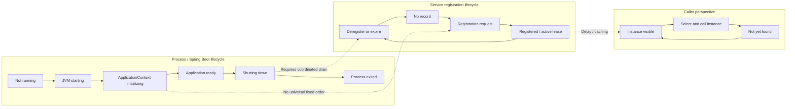
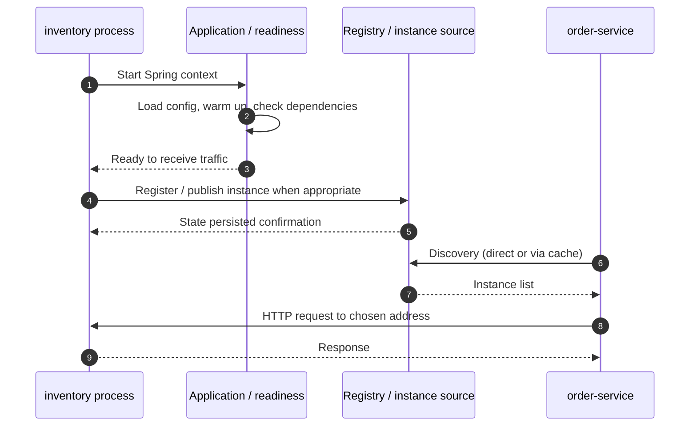
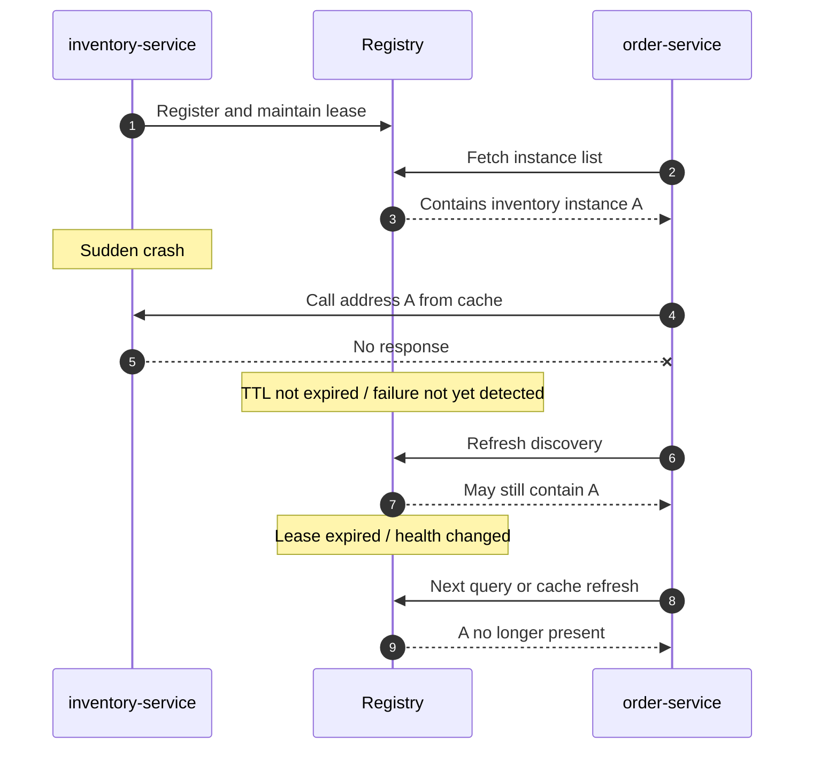

# Distinguishing Process Lifecycle from Service Registration Lifecycle

## 1. The Problem in Distributed Systems

In a single-instance application, the question "is the app running?" is usually answered by checking whether the Java process is alive and the API responds. In a distributed system, that answer is insufficient: an instance can be **running yet not ready to serve**, **ready yet not visible in service discovery**, or **stopped while its stale address is still used by a client**.

This lesson belongs to the **Distributed Foundations** chapter of the **SPRING_CLOUD_CORE** module. The goal is to understand Spring Cloud's core foundations in distributed systems, especially **Spring Cloud Commons**, **Spring Cloud Context**, externalized configuration, and Spring Boot compatibility. The focus here is distinguishing process lifecycle from service registration lifecycle so you can properly apply `DiscoveryClient`, `ServiceRegistry`, `ServiceInstance`, readiness, inter-service communication, testing, and operations.

After this lesson, learners should be able to explain:

- Why **process alive**, **application ready**, **registered**, and **routable** are not equivalent.
- What Spring Boot/Spring Framework manages regarding application lifecycle, versus how Spring Cloud Commons represents service registration and lookup.
- What happens during slow startup, registry disconnects, graceful shutdown, or abrupt process termination.
- How to design, test, and observe so requests are not sent to unready or stopped instances.

## 2. Four States to Observe Independently

To avoid confusion, never rely on a single `UP/DOWN` flag to represent every aspect of an instance.

| Layer | Question | Example signals | What the signal does **not** guarantee |
| --- | --- | --- | --- |
| **Process / OS** | Does the Java process still exist? | PID, process exit code, container running | That the HTTP server opened its port or business logic can process requests |
| **Application / Spring Boot** | Has the application context initialized, and is the app ready for traffic? | `ApplicationReadyEvent`, `ApplicationAvailability`, readiness health group | That the instance is registered in the registry or visible to callers |
| **Service registration** | Is the instance published in the registry or instance-list source? | Registration, lease/heartbeat, registry status or metadata | That the instance is actually healthy and accepting requests right now |
| **Discovery and routing** | Can the client/proxy select and connect to the instance? | `DiscoveryClient` results, caches, LoadBalancer, DNS/EndpointSlice | That discovery results are up to date, or that connectivity/business execution will succeed |

At any moment, these four states can diverge. Specifically:

**`process running` does not imply `ready`; `ready` does not imply `registered`; `registered` does not imply `routable`; and `routable` does not imply a business request will succeed.**

For example, `inventory-service` has opened port 8081, yet is still warming caches or waiting for database connections. The process is alive and TCP connects, yet readiness should be `REFUSING_TRAFFIC`. If the instance appears in the registry too early, `order-service` may call it and get errors even though "is the PID alive?" returns yes.

### 2.1. Diagram of related but distinct states



Dashed arrows represent common operational relationships, **not an invariant sequence** across all discovery providers. Some systems register before the app reports ready; others do not let the app self-register at all, letting the platform manage endpoint lists instead. Spring Boot, Spring Cloud, and the deployment orchestrator each govern a piece.

## 3. Process Lifecycle: From Start to Stop

A typical Spring Boot process goes through these stages:

1. **OS/container spawns the process:** the JVM starts, reading the classpath and environment arguments.
2. **Spring initializes the application context:** Spring Framework creates beans, injects dependencies, runs lifecycle callbacks, and applies configuration.
3. **Web server starts:** for web apps, the server may bind its port during startup. An open port does not mean every business component is ready.
4. **Application transitions to ready:** in Spring Boot, `ApplicationReadyEvent` and `ApplicationAvailability` expose state after application initialization finishes.
5. **Application serves requests:** still depends on databases, brokers, resource limits, downstream services, and readiness policies.
6. **Shutdown signal received:** shutdown can flip readiness, stop accepting new requests, drain in-flight requests, close beans and resources, and then exit the JVM.

Notable differences among Boot signals:

| Event/state | Meaning | Caveat |
| --- | --- | --- |
| `ApplicationStartedEvent` | Context has been refreshed, before `ApplicationRunner` / `CommandLineRunner` finish | Should not be equated with application readiness |
| `ApplicationReadyEvent` | Application completed normal startup, near serving readiness | Does not confirm registry entries are visible to all callers |
| `LivenessState.CORRECT` | Application is alive per Boot's availability model | Do not use liveness to represent temporary external dependency failures |
| `ReadinessState.ACCEPTING_TRAFFIC` | Application indicates it can accept traffic | Effective for routers/registries only if they actually consume this signal |
| `ContextClosedEvent` | Spring context is closing | Not emitted if JVM/container is forcibly killed before context shutdown |

Liveness and readiness are distinct concepts. Liveness generally answers whether the process must be restarted; readiness decides whether traffic should continue being routed to the instance. A transient database outage does not necessarily mean the JVM should be killed and restarted.

## 4. Service Registration Lifecycle: From Publication to Eviction

Service registration publishes an instance's info to a source usable for service lookup: service ID, host/IP, port, instance ID, metadata, and sometimes health/status or lease details.

The registration lifecycle typically involves:

1. **Identifying the instance:** e.g., `inventory-service`, instance ID, IP/hostname, and port.
2. **Registering:** the application, agent, or platform sends details to the registry or updates the endpoint list.
3. **Maintaining registration:** depending on the provider, heartbeats, lease renewals, TTLs, health checks, or state sync.
4. **Discovery:** callers fetch instance lists via clients, DNS, or infrastructure; multi-tier caches may exist.
5. **Status change / deregistration:** the instance becomes unsuitable for requests, deregisters, or is removed from the endpoint source.
6. **Stale entry cleanup:** after deregistration, lease expiration, or platform sync; disappearance at each client can lag further.

This is the **discovery record/system lifecycle**, not the PID lifecycle. There is no rule forcing a registry record to vanish the instant a JVM exits.

### 4.1. What role does Spring Cloud Commons play?

Spring Cloud Commons defines shared abstractions so business code reduces coupling to any single registry:

| Component | Responsibility |
| --- | --- |
| `ServiceInstance` | Represents an instance with service ID, host, port, URI, metadata, etc. |
| `DiscoveryClient` | Looks up service IDs or instances for a service ID |
| `ReactiveDiscoveryClient` | Reactive-style instance lookup counterpart |
| `Registration` | Represents an instance's own registration, extending `ServiceInstance` info |
| `ServiceRegistry<Registration>` | Interface to register, deregister, inspect/set status, or close registry client per implementation capabilities |
| `AbstractAutoServiceRegistration` and concrete integrations | Support mechanism for automatic registration in providers using that model |

These are **programming contracts**. They do not spin up Eureka or Consul servers, run a Kubernetes cluster, or guarantee instantaneous consistency.

Providers maintain state differently. For example:

- **Eureka:** uses client registration and leases/heartbeats; when an instance vanishes abruptly, the registry may retain the record for a period.
- **Consul:** uses service registration and health checks with its own health management model.
- **Kubernetes:** Pod endpoint lists can be managed by platform controllers and readiness; an application using Kubernetes Service DNS does not necessarily register via `ServiceRegistry` inside the JVM.

Therefore, when saying "the service is registered," specify **where it is registered, by whom, with what status/health, and which source callers query**.

### 4.2. What does auto-registration mean?

With Spring Cloud discovery implementations supporting auto-registration, adding the starter and proper config can make the instance register automatically at startup. Spring Cloud Commons provides the common property:

```yaml
spring:
  cloud:
    service-registry:
      auto-registration:
        enabled: false
```

The configuration above **disables common auto-registration** when the implementation honors that mechanism; it does not stop the JVM or prevent Boot from serving HTTP. Moreover, not every discovery environment uses application-driven self-registration.

The ordering of registration relative to `ApplicationReadyEvent` **depends on implementation, version, and lifecycle integration points**. Never design a system assuming "Boot ready always precedes registration" or "registered guarantees ready." Readiness policies, registry status, and routers must be intentionally aligned.

## 5. Easily Confused Timelines

Suppose `order-service` looks up `inventory-service` by service ID. An ideal startup scenario can be pictured as:



**Note:** this is a *desirable design sequence*, not a universal schedule enforced by every Spring Cloud starter by default. In practice, registration may occur before the ready milestone; infrastructure that gates traffic on readiness can still keep requests away from that instance.

The following table illustrates different combinations at a single moment in time:

| Scenario | Process | Boot readiness | Registry | Caller perspective |
| --- | --- | --- | --- | --- |
| Just starting up | Alive | Not ready yet | Usually absent; might register early | May not see it yet |
| Port open, still warming up | Alive | May refuse traffic | Record may already exist | Should not receive traffic until ready |
| Normal operation | Alive | Ready | Valid record present | Callable when network and client work |
| Lost connection to registry | Alive | May still be ready | Remote status may expire or update slowly | Instance may "disappear" from discovery even while API works |
| Process crash | Dead | Can no longer be evaluated | Record may linger until TTL/health acts | Clients may still cache the old address |
| Graceful shutdown in progress | Alive briefly | Should refuse new traffic while draining | Transitioning status or deregistering | May continue seeing stale record during transition |

Operational conclusion from the table: **never use any single signal—process, readiness, registry, or discovery cache—as an absolute proxy for the other three.**

## 6. Two Application Shutdown Scenarios

### 6.1. Graceful shutdown can coordinate traffic draining

When an instance prepares to stop during a rolling deployment or scale-down, the *target* sequence is typically:

1. Inform routers/load balancers/endpoint sources that the instance **will not accept new traffic** (flip readiness/status or deregister depending on platform).
2. Allow enough time for the update to propagate to relevant registries, proxies, DNS, or discovery caches while beginning to drain traffic per server/infrastructure capabilities.
3. Complete or time-bound in-flight requests, then close resources and stop the process.
4. Confirm the old address is no longer selected and new requests route to healthy instances.

Do not treat the sequence above as a built-in callback order guaranteed by Spring Boot or every auto-registration implementation. On some platforms, notifying routers and stopping traffic is platform-driven; in other setups, the application must explicitly manage registration status and draining.

Spring Boot supports graceful shutdown configuration for compatible web servers:

```yaml
server:
  shutdown: graceful

spring:
  lifecycle:
    timeout-per-shutdown-phase: 20s
```

These properties control **the application's shutdown sequence**. They do not guarantee the registry removed the record, client caches expired, or an upstream proxy finished draining. The 20-second timeout is an example value and must be tuned to actual request durations and termination grace period budgets.

### 6.2. Crashes or forced kills leave no chance for clean deregistration

Another scenario is an OOM kill, container power loss, `SIGKILL`, or node network partition. The JVM cannot rely on `ContextClosedEvent` or shutdown hooks to call deregister. Depending on the registry, the old instance disappears only when:

- Lease/heartbeat expires or health checks mark it unhealthy;
- The control plane detects the endpoint is no longer valid;
- An operator removes the entry;
- Client-side caches subsequently refresh or expire.

During this "gap," callers can still see the stale record and hit `connection refused`, timeouts, or network errors. That is why distributed systems must combine health checking, timeouts, endpoint re-discovery, and resilience policies rather than banking solely on shutdown deregistration.



## 7. Observing the Right Layer in Spring Applications

### 7.1. Tracking the Boot application's own state

Java example tracking when the application becomes ready and when the context begins closing:

```java
import org.slf4j.Logger;
import org.slf4j.LoggerFactory;
import org.springframework.boot.context.event.ApplicationReadyEvent;
import org.springframework.context.event.ContextClosedEvent;
import org.springframework.context.event.EventListener;
import org.springframework.stereotype.Component;

@Component
class LocalLifecycleLogger {
    private static final Logger log =
            LoggerFactory.getLogger(LocalLifecycleLogger.class);

    @EventListener
    void onReady(ApplicationReadyEvent event) {
        log.info("ApplicationReadyEvent: application finished startup");
    }

    @EventListener
    void onClosing(ContextClosedEvent event) {
        log.info("ContextClosedEvent: closing application context");
    }
}
```

These two log lines report **application-internal lifecycle**. They do **not** confirm Eureka/Consul registration succeeded, nor that callers have evicted the instance from their caches.

Spring Boot also provides `ApplicationAvailability` to inspect current availability state:

```java
import org.springframework.boot.availability.ApplicationAvailability;
import org.springframework.boot.availability.ReadinessState;
import org.springframework.stereotype.Component;

@Component
class ReadinessInspector {
    private final ApplicationAvailability availability;

    ReadinessInspector(ApplicationAvailability availability) {
        this.availability = availability;
    }

    boolean mayAcceptTraffic() {
        return availability.getReadinessState()
                == ReadinessState.ACCEPTING_TRAFFIC;
    }
}
```

This is readiness **managed by Boot**; for a discovery provider or load balancer to react to this state, ensure the proper integration and health/traffic rules are wired. Critical business dependencies should be reflected in readiness via health indicators where appropriate, but not every external dependency belongs in liveness.

### 7.2. Seeing what the caller actually discovers

The Spring Cloud Commons snippet below queries instances by service ID:

```java
import java.util.List;
import org.springframework.cloud.client.ServiceInstance;
import org.springframework.cloud.client.discovery.DiscoveryClient;
import org.springframework.stereotype.Service;

@Service
class InventoryDiscoveryProbe {
    private final DiscoveryClient discoveryClient;

    InventoryDiscoveryProbe(DiscoveryClient discoveryClient) {
        this.discoveryClient = discoveryClient;
    }

    List<String> instanceUris() {
        List<ServiceInstance> instances =
                discoveryClient.getInstances("inventory-service");
        return instances.stream()
                .map(instance -> instance.getUri().toString())
                .toList();
    }
}
```

If the list contains `http://10.0.0.12:8081`, that proves only that **the discovery implementation returns this instance to the caller** at lookup time. It does not prove connectivity succeeds or that the target instance is ready. If the discovery client caches results, the list may even reflect earlier state.

In multi-instance systems, cross-check data from **both sides**: logs/availability on the target instance and the instance list actually seen by callers. Checking server health alone cannot catch discovery/routing bugs.

### 7.3. Readiness endpoints and limits

When using Spring Boot Actuator with readiness/liveness probes enabled, the application can expose health groups such as `/actuator/health/readiness`. Practical configuration example:

```yaml
management:
  endpoint:
    health:
      probes:
        enabled: true
```

A readiness endpoint helps only if the platform, service mesh, ingress, or discovery integration **actually consumes its output** to gate traffic. Conversely, readiness showing `UP` does not create a registration record in a registry. Restrict access to management endpoints per deployment security policy.

## 8. Real-World Scenario: Deploying a New Version of `inventory-service`

The system has two instances:

| Instance | Version | Initial state |
| --- | --- | --- |
| A | v1 | Running, ready, discoverable |
| B | v2 | Just beginning initialization |

The goal is shifting requests to B without disruption.

**Phase 1 — B starts:** the JVM is up, Boot builds the context and opens the server; B may still be warming up. B should not be chosen for production traffic until it satisfies request-serving readiness. If auto-registration fires early, traffic gating must be enforced via health/readiness or an equivalent mechanism.

**Phase 2 — B becomes eligible:** B is ready and appears in the endpoint source used by callers. Operations should verify both B's responses **and** live call paths from `order-service` or upstream callers, not merely the `ApplicationReadyEvent` log.

**Phase 3 — Draining A:** A is removed from eligible endpoints for new requests while in-flight requests finish within configured timeouts and termination grace periods. A client holding a stale cache may still attempt to pick A; drain windows must account for real caching/routing propagation.

**Phase 4 — A stops:** after coordinated draining, A closes its application context and exits the JVM. If A is killed prematurely during phase 1, records and caches can linger and cause failed requests.

This scenario shows that a clean deployment requires three separate outcomes: **the new instance is truly ready**, **routers/discovery know the right instances**, and **the old instance drains traffic cleanly**.

## 9. Failure Modes and Diagnostic Steps

| Symptom | Possible cause | What to check properly |
| --- | --- | --- |
| Process running, API returns 503 | App not ready yet or business dependency unavailable | Readiness, app logs, database/broker; never judge by PID alone |
| App works locally, caller cannot find it | Not registered, wrong service ID, registry disconnect, expired lease | Registration status, provider config, discovery from caller side |
| Registry lists instance, connection refused | Stale record, wrong port, server stopped, network policy | Address/port/metadata and connectivity from caller, TTL/health |
| Deregistered, yet callers still hit it | Stale client/proxy/DNS cache, propagation delay | Cache TTL, polling/refresh intervals, instance selection logs, upstream routers |
| Boot app ready, no auto-registration | Missing implementation, disabled flag, DNS/platform discovery environment | Dependencies, auto-registration properties, discovery architecture |
| Intermittent errors on every rollout | New instance receives traffic too early or old instance killed before draining | Readiness gating, termination grace period, rollout sequence |
| Registry down, direct API still works | Discovery lifecycle is independent of process lifecycle | Registry availability, caching, health, and caller failover behavior |
| Actuator health reports `UP` while business fails | Health check omits business conditions, or dependency failed after probe | Real API tests, timeouts, metrics/error logs, health check depth |

A registry-related fault is not necessarily fixed by restarting the JVM. Restarting might simply trigger a new registration attempt while the root cause is a network partition or an unavailable registry.

## 10. Testing Lifecycle Separation

To verify actual behavior, build a scenario matrix instead of testing only "the service starts up":

| Test | Simulated perturbation | Expected observation |
| --- | --- | --- |
| Slow startup | Delay warm-up or dependency readiness | Process is alive yet receives no new traffic before becoming ready |
| Registry unavailable | Block registry connectivity while API is running | Clear policy behavior: registration failures, retries, cache/fallback; process is not treated as dead |
| Unclean kill | Force-kill a registered instance in a test environment | Measure time until registry and callers drop the old instance, plus transition timeouts |
| Graceful shutdown | Rolling restart or scale-down | New requests stop reaching old instance; in-flight requests drain within timeout |
| Stale cache | Freeze/delay instance-list updates on caller | Verify retries/re-discovery/timeouts behave as designed |
| Readiness down while process alive | Flip readiness state in test environment | Traffic is gated by the router; process is not mistaken for dead |
| Address/port change | Restart instance on a different IP or port | Service ID maps to the real URI; no calls to old address after convergence |

For pure unit logic, you can use test doubles for `DiscoveryClient`. To test real lifecycles, run integration tests against **the actual registry or deployment platform**, concrete instances, and callers; mocking `DiscoveryClient` cannot prove lease expiration timing, propagation delays, or proxy draining behavior.

Signals worth recording:

- Time from **process start → application ready** and **application ready → instance visible in discovery**.
- Registration/deregistration counts, registration/heartbeat errors, and provider lease states.
- Instance counts seen by each caller, instances actually selected by LoadBalancer, and connection error rates.
- Delay from traffic removal until zero new requests arrive, and requests aborted during shutdown.
- Log attribution by `service ID`, `instance ID`, version/deployment, and address; avoid logging credentials.

In Spring Cloud Core operations, verify compatible Spring Boot and Spring Cloud release train versions before interpreting lifecycle events or auto-registration properties: implementation details vary across versions and providers. Spring Cloud Context supports certain configuration refresh behaviors, yet **refresh scope is neither equivalent to a process restart nor a guarantee of deregister/re-register**. Changing address, port, or instance metadata at runtime requires verifying whether the implementation updates registration or requires a restart/rollout.

## 11. Common Misconceptions

| Misconception | Correct understanding |
| --- | --- |
| "If the JVM is running, the service is definitely callable." | The process may be alive while the app is not ready, lacks dependencies, or lost network connectivity. |
| "Seeing `ApplicationReadyEvent` means Eureka/Consul registration finished." | That is a Boot event; registration is a separate lifecycle whose timing depends on the provider. |
| "If the registry lists an instance, the instance is healthy." | Records can be stale; health checks, leases, and consumer caches must be considered separately. |
| "`DiscoveryClient` is always an instantaneous source of truth." | Results may be cached and are subject to convergence delay. |
| "Shutdown hooks always clean up registry records." | Crashes/`SIGKILL` bypass cleanup; registries need expiration detection or platform orchestration. |
| "Actuator readiness automatically deregisters from every provider." | Readiness affects routing only when a concrete integration consumes it. |
| "Adding Cloud starters removes the need to handle network errors." | Discovery/load balancing do not replace timeouts, controlled retries, circuit breakers, or business error handling. |
| "Refreshing config is the re-registration lifecycle." | `@RefreshScope` recreates certain beans; service registration follows its own mechanism. |

## 12. Self-Check Questions

1. Why might an instance with an active PID and an open HTTP listening port still need to refuse traffic?
2. If the service registry loses connectivity for 30 seconds while the direct API remains reachable, how can process, registration, and discovery states diverge?
3. What does `ApplicationReadyEvent` prove, and what does it *not* prove about `ServiceRegistry`?
4. Why can `SIGKILL` leave a dead service visible in discovery?
5. During a rolling deployment, what signals must be checked before terminating the old instance?
6. When `DiscoveryClient.getInstances(...)` returns an address, why must the caller still handle connection errors and monitor failures?
7. When migrating from app-driven registry self-registration to Kubernetes Service DNS, who becomes responsible for controlling the endpoint list?

## 13. References

- [Spring Boot — Application Availability](https://docs.spring.io/spring-boot/reference/features/spring-application.html#features.spring-application.application-availability): liveness/readiness, availability state, and related events.
- [Spring Boot — Graceful Shutdown](https://docs.spring.io/spring-boot/reference/web/graceful-shutdown.html): configuration and shutdown behavior for web applications.
- [Spring Boot Actuator — Kubernetes Probes](https://docs.spring.io/spring-boot/reference/actuator/endpoints.html#actuator.endpoints.kubernetes-probes): liveness/readiness health groups.
- [Spring Cloud Commons](https://docs.spring.io/spring-cloud-commons/reference/): `DiscoveryClient`, `ServiceInstance`, service registry, auto-registration, and load balancing.
- [Spring Cloud — Release trains](https://spring.io/projects/spring-cloud): release train compatibility with Spring Boot.

**Key takeaway:** **Process** lifecycle answers *whether application code is running and at which stage*; **registration** lifecycle answers *how the instance is published/maintained in the discovery source*; **readiness** answers *whether the instance should accept traffic*; and **discovery and routing** determine *which addresses callers currently see and pick*. Reliable system design requires tracking all four—especially across startup, crashes, and shutdowns.
