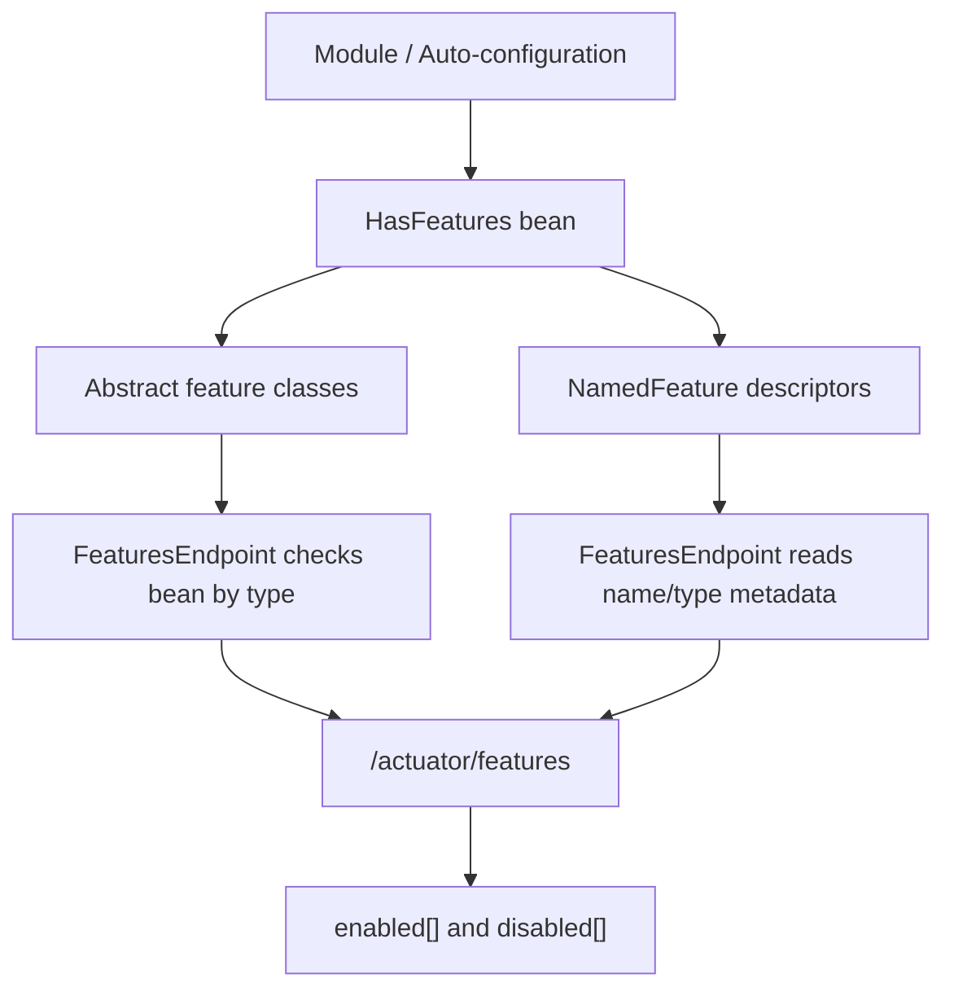

# Declaring HasFeatures and NamedFeature

## 1. Why Declare System Capabilities?

In a Spring Cloud application, many components may or may not be enabled depending on dependencies, configuration, and bean initialization conditions. For example, an application may use service discovery, load balancing, a circuit breaker, an API gateway, or Spring Cloud Bus. When operating many services, teams need to know which capabilities are integrated in each application.

Spring Cloud Commons provides the `HasFeatures` and `NamedFeature` abstractions for modules to publish metadata about those capabilities. Declarations are aggregated at the `/features` Actuator endpoint, which displays the list of features declared as enabled and abstract features for which no corresponding bean was found.

This lesson belongs to the **System Capabilities** chapter of the **SPRING_CLOUD_CORE** module. The module focuses on Spring Cloud Commons, Spring Cloud Context, external configuration, Spring Boot compatibility, refresh scope, discovery, service registry, service communication, and testing/operating common abstractions.

After this lesson, learners can:

- Explain the roles of `HasFeatures` and `NamedFeature`.
- Distinguish abstract features from named features.
- Declare one or more features using `HasFeatures` factory methods.
- Understand how the `/features` endpoint determines enabled/disabled status.
- Read type, name, version, and vendor metadata.
- Register features in conditional configurations so metadata accurately reflects actual components.
- Expose and secure the Actuator endpoint appropriately for the deployment environment.
- Test feature inventory output and avoid confusing it with health checks or feature toggles.

## 2. What Are HasFeatures and NamedFeature?

Both classes belong to the package:

- `org.springframework.cloud.client.actuator.HasFeatures`
- `org.springframework.cloud.client.actuator.NamedFeature`

`HasFeatures` is a bean describing a group of capabilities of a module. It holds two lists:

- **Abstract features:** Java types (interfaces or abstract classes) representing capabilities that can be checked via beans in the Spring ApplicationContext.
- **Named features:** features declared with a human-friendly name and a Java type used to describe metadata.

`NamedFeature` is a descriptor consisting of a display name and a class representing the feature. That class provides type, version, and vendor information in the endpoint output.

You can visualize the relationship:



A module can declare multiple `HasFeatures` beans. The endpoint collects all of these beans and aggregates the results.

### 2.1. Abstract Feature

An abstract feature is suitable when a capability has a clear abstraction or contract in the Spring context, for example:

- `DiscoveryClient`
- `LoadBalancerClient`
- `ReactiveDiscoveryClient`
- `ReactiveLoadBalancer`
- `LockService`

When the endpoint processes an abstract feature, it uses the declared class/interface to look up a bean by type in the ApplicationContext.

- Bean found: the feature is placed in the `enabled` list.
- Bean not found: the simple name of the type is placed in the `disabled` list.

For example, if `DiscoveryClient.class` is declared, the endpoint looks up a bean injectable as `DiscoveryClient`. The display name is `DiscoveryClient`; the type field in the result reflects the actual class of the found bean.

Abstract features allow pre-declaring a set of capabilities that a module cares about, and letting the ApplicationContext confirm which capabilities currently have beans.

### 2.2. Named Feature

A named feature is suitable when a capability has no common abstraction for looking up a bean by interface, or when you want to publish a specific product/functional name:

- Circuit Breaker
- API Gateway
- Spring Cloud Bus
- An application-specific business policy processor
- An integration with an external system

Declaring a named feature requires a name and a representative class:

```java
new NamedFeature("API Gateway", GatewayAutoConfiguration.class)
```

Key point to understand clearly: `FeaturesEndpoint` places declared named features directly into the `enabled` list. It does not look up a bean by the `NamedFeature`'s type the way it handles abstract features. Therefore, the configuration creating the named feature must be guarded by appropriate conditions; if declared unconditionally while the actual feature is not enabled, the endpoint may still report that feature as enabled.

## 3. Factory Methods of HasFeatures

Spring Cloud Commons provides factory methods for creating descriptors concisely.

### 3.1. Declaring Abstract Features

```java
import org.springframework.cloud.client.actuator.HasFeatures;
import org.springframework.cloud.client.discovery.DiscoveryClient;
import org.springframework.cloud.client.loadbalancer.LoadBalancerClient;
import org.springframework.context.annotation.Bean;
import org.springframework.context.annotation.Configuration;

@Configuration(proxyBeanMethods = false)
class DiscoveryFeatureConfiguration {

    @Bean
    HasFeatures discoveryFeatures() {
        return HasFeatures.abstractFeatures(
                DiscoveryClient.class,
                LoadBalancerClient.class
        );
    }
}
```

The endpoint will check both bean types in the ApplicationContext. If only `DiscoveryClient` is present, the result may report `DiscoveryClient` enabled and `LoadBalancerClient` disabled.

This example illustrates how a module publishes the abstractions it supports. In applications that already have Spring Cloud Commons auto-configuration, standard features may already be declared; there is no need to register duplicates just to make the endpoint display them again.

### 3.2. Declaring Named Features

```java
import org.springframework.cloud.client.actuator.HasFeatures;
import org.springframework.cloud.client.actuator.NamedFeature;
import org.springframework.context.annotation.Bean;
import org.springframework.context.annotation.Configuration;

@Configuration(proxyBeanMethods = false)
class IntegrationFeatureConfiguration {

    @Bean
    HasFeatures integrationFeatures() {
        return HasFeatures.namedFeatures(
                new NamedFeature(
                        "Payment Gateway",
                        PaymentGatewayClient.class
                ),
                new NamedFeature(
                        "Fraud Screening",
                        FraudScreeningClient.class
                )
        );
    }
}
```

In the example, the display names are chosen by the application. The passed-in classes provide type and package metadata. Since named features are placed directly in the enabled list, only create the `HasFeatures` bean when the corresponding integrations are actually enabled.

### 3.3. Declaring a Single Named Feature

If there is only one capability, you can use the shorthand factory method:

```java
@Bean
HasFeatures paymentFeature() {
    return HasFeatures.namedFeature(
            "Payment Gateway",
            PaymentGatewayClient.class
    );
}
```

This method is equivalent to creating a `NamedFeature` and passing it into `HasFeatures.namedFeatures(...)`.

### 3.4. Combining Both Types

A module may need to publish both common contracts and custom capabilities:

```java
@Bean
HasFeatures applicationFeatures() {
    return new HasFeatures(
            List.of(
                    DiscoveryClient.class,
                    LoadBalancerClient.class
            ),
            List.of(
                    new NamedFeature(
                            "Order Policy Engine",
                            OrderPolicyEngine.class
                    )
            )
    );
}
```

The constructor takes two lists: abstract feature classes and named feature descriptors. Factory methods are usually more readable when declaring only one type; the constructor is useful when combining both.

## 4. How Does the /features Endpoint Aggregate Data?

Spring Cloud Commons provides an Actuator endpoint with ID `features`. The endpoint is read-only and returns two groups:

- `enabled`: features determined to be enabled.
- `disabled`: names of abstract features for which no matching bean was found.

General processing steps:

1. The endpoint receives the list of `HasFeatures` beans from the ApplicationContext.
2. For each abstract feature class, the endpoint calls `ApplicationContext.getBean(type)`.
3. If a bean is found, the endpoint builds metadata with name as the simple name of the declared type and type as the actual class of the bean.
4. If no bean is found, the endpoint adds the simple name to `disabled`.
5. For each `NamedFeature`, the endpoint uses the declared name and class to build metadata and adds it directly to `enabled`.
6. The endpoint returns the result object for Actuator to serialize to JSON.

### 4.1. Response Structure

Illustrative example:

```json
{
  "enabled": [
    {
      "type": "com.example.discovery.EurekaDiscoveryClient",
      "name": "DiscoveryClient",
      "version": "5.0.4",
      "vendor": "Example Vendor"
    },
    {
      "type": "com.example.payment.PaymentGatewayClient",
      "name": "Payment Gateway",
      "version": null,
      "vendor": null
    }
  ],
  "disabled": [
    "LoadBalancerClient"
  ]
}
```

This is illustrative JSON to explain the structure, not a fixed output for every application. Class, version, and vendor depend on the implementation and package metadata.

### 4.2. Meaning of the Fields

| Field | Meaning |
| --- | --- |
| `enabled` | List of features placed in the enabled state by the endpoint |
| `disabled` | List of abstract feature names for which no bean was found |
| `name` | Simple name of the abstract type or name declared by the named feature |
| `type` | Fully qualified class name of the implementation (abstract feature) or declared class (named feature) |
| `version` | Package implementation version of the class used as type |
| `vendor` | Package implementation vendor of the class used as type |

Version and vendor are retrieved from Java package metadata. When running in a development environment where classes are built without implementation metadata, these two fields may be `null`. Do not treat a null version as proof that the feature is disabled.

### 4.3. The Two Declaration Types Have Different Semantics

| Characteristic | Abstract feature | Named feature |
| --- | --- | --- |
| Input | Class/interface | Display name and class |
| How enabled is determined | Look up bean by type in ApplicationContext | Placed in enabled based on declaration |
| When no bean exists | Feature name is placed in disabled | Endpoint does not automatically check beans to move to disabled |
| Name in result | Simple name of abstract type | Application-declared name |
| Type in result | Actual class of the bean | Class passed to NamedFeature |
| Purpose | Verify presence of an abstraction | Publish a capability with a custom name |

This is the most important distinction when designing a feature inventory. Abstract features reflect whether a bean exists in the context; named features reflect metadata that module configuration has actively published.

## 5. Conditional Feature Registration

### 5.1. Using Conditions When Capability Depends on Configuration

For example, Payment Gateway is only enabled when application configuration allows it:

```java
import org.springframework.boot.autoconfigure.condition.ConditionalOnProperty;
import org.springframework.cloud.client.actuator.HasFeatures;
import org.springframework.cloud.client.actuator.NamedFeature;
import org.springframework.context.annotation.Bean;
import org.springframework.context.annotation.Configuration;

@Configuration(proxyBeanMethods = false)
@ConditionalOnProperty(
        prefix = "app.payment",
        name = "enabled",
        havingValue = "true"
)
class PaymentGatewayFeatureConfiguration {

    @Bean
    HasFeatures paymentGatewayFeature() {
        return HasFeatures.namedFeature(
                "Payment Gateway",
                PaymentGatewayClient.class
        );
    }
}
```

When `app.payment.enabled=true` is configured, the `HasFeatures` bean is registered and the named feature appears in the enabled list. When the condition is not met, the configuration does not create the feature bean and the endpoint does not list that named feature.

The condition above is only accurate if the same condition also controls creating the actual integration. If the client is not created due to another condition, the named feature might still be reported as enabled. Place the condition on a shared configuration or group client creation and feature declaration into the same auto-configuration.

### 5.2. Using Classpath Conditions

For optional modules, you can use `@ConditionalOnClass` to register metadata only when the required library is present:

```java
@Configuration(proxyBeanMethods = false)
@ConditionalOnClass(PaymentGatewayClient.class)
class OptionalPaymentFeatureConfiguration {

    @Bean
    HasFeatures paymentGatewayFeature() {
        return HasFeatures.namedFeature(
                "Payment Gateway",
                PaymentGatewayClient.class
        );
    }
}
```

In auto-configurations with optional dependencies, use the class-name form `@ConditionalOnClass(name = "...")` when you need to avoid direct references to types that may not be on the classpath. This structure prevents the configuration from being loaded when the optional module is absent.

### 5.3. Abstract Features When Wanting Automatic Bean Detection

If an abstraction may or may not exist depending on auto-configuration conditions, you can declare an abstract feature:

```java
@Bean
HasFeatures optionalClientFeatures() {
    return HasFeatures.abstractFeatures(
            PaymentGatewayClient.class
    );
}
```

If a `PaymentGatewayClient` bean is created, the endpoint reports enabled; otherwise, it reports disabled. This approach is appropriate when you want the endpoint to directly reflect bean presence by contract.

Do not declare a concrete implementation class if what needs to be checked is a common abstraction. For example, using `DiscoveryClient.class` instead of `EurekaDiscoveryClient.class` keeps metadata meaningful when the application switches providers from Eureka to Consul.

## 6. Which Features Does Spring Cloud Commons Declare Automatically?

Spring Cloud Commons includes auto-configurations that register standard features when the corresponding conditions are satisfied.

### 6.1. Blocking Discovery

When blocking discovery is enabled and a `DiscoveryClient` bean exists, Commons configuration registers abstract features:

- `DiscoveryClient`
- `LoadBalancerClient`

The endpoint looks up beans by these types. Therefore, if a discovery client is present but no load balancer client exists, the output can show separate statuses for each abstraction.

### 6.2. Reactive Discovery

Reactive Commons may register:

- `ReactiveDiscoveryClient`
- `ReactiveLoadBalancer`

Registration depends on reactive discovery conditions and the corresponding beans/types. Do not infer that an application has reactive load balancing just because it has a blocking `DiscoveryClient`.

### 6.3. Third-Party Module Features

Other Spring Cloud modules can register their own `HasFeatures` in their configurations. For example, the Commons documentation illustrates how the Consul module publishes named features such as Spring Cloud Bus and another capability.

Each module should place its `HasFeatures` bean in an appropriately conditioned configuration. This ensures the `/features` list reflects the capabilities actually integrated in the ApplicationContext.

## 7. Enabling and Accessing the Actuator Endpoint

### 7.1. Required Dependencies

The `/features` endpoint is a Spring Cloud Commons Actuator endpoint. The application needs Spring Boot Actuator and a compatible Spring Cloud Commons on the classpath.

With Maven, the Actuator dependency is typically declared as follows:

```xml
<dependency>
    <groupId>org.springframework.boot</groupId>
    <artifactId>spring-boot-starter-actuator</artifactId>
</dependency>
```

Spring Cloud Commons provides the endpoint; Spring Boot Actuator provides the management infrastructure and exposes the endpoint over web or JMX.

### 7.2. Exposing the Endpoint over HTTP

Spring Boot does not expose all Actuator endpoints over HTTP by default. You can explicitly configure the list of endpoints to expose:

```yaml
management:
  endpoints:
    web:
      exposure:
        include:
          - health
          - info
          - features
```

After the application starts, the default web endpoint has the form:

```text
GET /actuator/features
```

If the application changes `management.endpoints.web.base-path`, the actual path changes according to that configuration.

### 7.3. Disabling the Endpoint

Spring Cloud Commons supports the property:

```yaml
spring:
  cloud:
    features:
      enabled: false
```

When `spring.cloud.features.enabled=false` is set, auto-configuration for the features endpoint is disabled. The default value allows this feature to be enabled when matching Actuator conditions are met.

Whether the endpoint is created in the context and whether it is exposed over HTTP are two separate conditions. Both Spring Cloud configuration and Actuator exposure configuration must be checked.

### 7.4. Protecting Feature Inventory Data

The endpoint is read-only, yet it can disclose:

- Names of internal integrations and capabilities.
- Class or implementation names.
- Package versions and vendors.
- Which abstractions have or have not had beans created.

In production, only expose the endpoint on a management network or require authentication and authorization for operations teams. Do not expose all of Actuator just to read the feature inventory; include only `features` in the allow-list of required endpoints.

## 8. Testing HasFeatures and NamedFeature

Testing should cover both semantics: abstract features depend on beans in the context, whereas named features depend on descriptor declarations.

### 8.1. Testing Abstract Features With and Without Beans

An integration test for the endpoint can declare two abstract features:

```java
@Configuration(proxyBeanMethods = false)
class TestFeatureConfiguration {

    @Bean
    HasFeatures testFeatures() {
        return HasFeatures.abstractFeatures(
                PresentClient.class,
                MissingClient.class
        );
    }

    @Bean
    PresentClient presentClient() {
        return new PresentClient();
    }
}
```

Expected results:

- `PresentClient` appears in `enabled`.
- `MissingClient` appears in `disabled`.

This test confirms the endpoint looks up beans by type, rather than only checking whether a class is on the classpath.

### 8.2. Testing Named Features

Declaration:

```java
@Bean
HasFeatures namedFeature() {
    return HasFeatures.namedFeature(
            "Order Policy Engine",
            OrderPolicyEngine.class
    );
}
```

Verify that `enabled` contains an element with `name=Order Policy Engine` and `type` equal to the canonical class name of `OrderPolicyEngine`. The test should also confirm that if the `HasFeatures` bean is registered, the named feature is listed as declared; the endpoint does not automatically verify whether an `OrderPolicyEngine` bean exists.

### 8.3. Testing the HTTP Endpoint

You can use MockMvc to verify that the endpoint is exposed and returns the expected metadata:

```java
@SpringBootTest(properties = {
        "management.endpoints.web.exposure.include=health,features",
        "spring.cloud.features.enabled=true"
})
@AutoConfigureMockMvc
class FeaturesEndpointIntegrationTest {

    @Autowired
    MockMvc mockMvc;

    @Test
    void returnsFeatureInventory() throws Exception {
        mockMvc.perform(get("/actuator/features"))
                .andExpect(status().isOk())
                .andExpect(jsonPath("$.enabled").isArray())
                .andExpect(jsonPath("$.disabled").isArray());
    }
}
```

If the application has Spring Security, tests must configure an appropriate user/role or mock authentication according to the management endpoint protection policy. Do not disable security in production just to make endpoint tests run.

### 8.4. Test Matrix

| Case | Expected result |
| --- | --- |
| Abstract feature with bean | Feature name appears in `enabled` |
| Abstract feature without bean | Simple class name appears in `disabled` |
| Named feature declared | Appears in `enabled` under the declared name |
| Named feature implementation bean missing while descriptor exists | Endpoint still lists enabled; tests should catch misconfigured declarations |
| Multiple `HasFeatures` beans | Endpoint aggregates the declarations |
| Package lacks implementation version/vendor | Corresponding metadata may be null |
| `spring.cloud.features.enabled=false` | Endpoint auto-configuration is disabled |
| Endpoint lacks web exposure | HTTP route is not exposed even though the endpoint may exist in context |
| Security blocks management endpoint | Unauthenticated/unauthorized requests are rejected per policy |

## 9. Distinguishing Feature Inventory from Health and Feature Toggles

The endpoint name contains the word "features", which can easily cause confusion. `/features` is neither a user-facing feature toggle system nor a replacement for health indicators.

| Mechanism | Question it answers | Example |
| --- | --- | --- |
| `HasFeatures` / `NamedFeature` | Which capabilities does the application declare and which abstractions have beans? | Has `DiscoveryClient`, has `Payment Gateway` |
| Health endpoint | Is the component operating properly according to health checks? | Is the registry reachable? |
| Feature toggle | Is a business feature enabled for a user/group? | Enable the new checkout UI for 10% of users |
| Service discovery | Which instances are currently known to the registry? | Instance list of `inventory-service` |

An abstract feature with a bean may still fail to work properly because the backend is down. Conversely, a named feature declared as enabled does not mean every request to the external system succeeds. Use dedicated health indicators, metrics, tracing, and feature flags for those questions.

## 10. Common Errors and How to Handle Them

| Symptom | Cause | How to handle |
| --- | --- | --- |
| `/actuator/features` not found | Missing Actuator, endpoint auto-configuration disabled, or not exposed | Check dependencies, `spring.cloud.features.enabled`, and web exposure |
| Abstract feature shows disabled | No matching bean by type in context | Check auto-configuration, classpath/property conditions, and bean registration |
| Named feature shows enabled while client is inactive | NamedFeature is placed directly into enabled without probing a bean | Align HasFeatures creation conditions with integration enable conditions |
| Version/vendor is null | Package lacks implementation metadata | Check build/package manifest; do not treat null as disabled |
| Same capability appears multiple times | Multiple HasFeatures beans declare the same feature | Choose a single metadata owner or standardize declarations |
| Unclear display name | Confusing simple class name or arbitrary named feature name | Choose stable, concise, operationally meaningful capability names |
| Endpoint returns 401/403 | Management endpoint is protected by Spring Security | Use operational credentials/roles matching policy |
| Endpoint unreachable externally | Exposed only on management port or internal network | Check management port, base path, and network policy |

## 11. Declaration and Operations Checklist

Before publishing a feature inventory, confirm:

1. Does the feature have a suitable abstraction/interface for bean checking, or does it need a custom name?
2. If using an abstract feature, is the declared class the actual contract that the application injects?
3. If using a named feature, does the class type accurately describe the implementation/capability?
4. Are the conditions for creating the `HasFeatures` bean synchronized with the conditions for enabling the capability?
5. Are there duplicate feature declarations across multiple modules?
6. Is version/vendor package metadata packaged if observability requires it?
7. Is the Actuator dependency present and the `features` endpoint exposed at the right level?
8. Is endpoint access restricted in production?
9. Do operators understand that `enabled` is inventory metadata, not health status?
10. Are there integration tests for abstract features with/without beans and named features?
11. Is the endpoint tested when a feature is disabled by property or missing dependency?
12. Are dedicated health indicators and feature toggles used for their proper purposes?

## 12. Official References

- [Spring Cloud Commons — Common Abstractions, Enabled Features](https://docs.spring.io/spring-cloud-commons/reference/spring-cloud-commons/common-abstractions.html): the two feature types, how to declare `HasFeatures`, and the `/features` endpoint.
- [HasFeatures.java — Spring Cloud Commons](https://github.com/spring-cloud/spring-cloud-commons/blob/main/spring-cloud-commons/src/main/java/org/springframework/cloud/client/actuator/HasFeatures.java): constructor and factory methods `abstractFeatures`, `namedFeatures`, `namedFeature`.
- [FeaturesEndpoint.java — Spring Cloud Commons](https://github.com/spring-cloud/spring-cloud-commons/blob/main/spring-cloud-commons/src/main/java/org/springframework/cloud/client/actuator/FeaturesEndpoint.java): how enabled/disabled are aggregated and how type, name, version, vendor metadata are built.
- [FeaturesEndpointTests.java — Spring Cloud Commons](https://github.com/spring-cloud/spring-cloud-commons/blob/main/spring-cloud-commons/src/test/java/org/springframework/cloud/client/actuator/FeaturesEndpointTests.java): tests for features with beans, features missing beans, and named features.
- [Spring Boot Actuator — Endpoints](https://docs.spring.io/spring-boot/reference/actuator/endpoints.html): exposing, accessing, and securing management endpoints.

**Remember:** `HasFeatures` collects a module's capability metadata. Abstract features are checked by the endpoint via bean lookup by type; named features are published by their declared name and class. `/features` is an application integration capability catalog, not a health check or business feature toggle mechanism.
