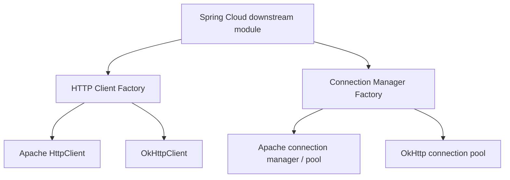

# Role of the Shared HTTP Client Factory and Support Status by Version

## 1. Context

A Spring Cloud application typically calls multiple HTTP services: Config Server, service discovery, business APIs, OAuth services, or external endpoints. Each HTTP client requires several technical decisions such as:

- Choosing a transport library: Apache HttpClient, OkHttp, Reactor Netty, Jetty, or JDK HttpClient.
- Creating and reusing a connection pool.
- Setting limits on total connections and connections per route.
- Configuring timeouts, proxies, TLS, redirects, and authentication.
- Closing resources when the application shuts down.

In older Spring Cloud versions, Spring Cloud Commons provided a group of **HTTP Client Factories** to create Apache HttpClient and OkHttp clients in a shared manner. Downstream modules could use those factories or customize how clients were created without managing the entire connection manager themselves.

This API has an important change history: the classes and interfaces in package `org.springframework.cloud.commons.httpclient` were removed from Spring Cloud Commons starting in 4.0. Therefore, when reading older documentation or upgrading applications, you must distinguish the historical role of those factories from the HTTP client configuration mechanisms currently supported by Spring Boot and Spring Cloud OpenFeign.

This lesson belongs to the **System Capabilities** chapter of the **SPRING_CLOUD_CORE** module. The module helps learners understand the core foundations of Spring Cloud in distributed systems, especially Spring Cloud Commons, Context, external configuration, and compatibility with Spring Boot.

After this lesson, learners can:

- Explain the roles of the HTTP client factory and connection manager factory in Spring Cloud Commons.
- Distinguish older Spring Cloud factories from Spring Framework's `ClientHttpRequestFactory`.
- Identify the Apache and OkHttp classes that were previously provided.
- Identify the API removal milestone and corresponding release trains.
- Choose replacement configuration mechanisms for RestClient, RestTemplate, WebClient, and OpenFeign.
- Avoid depending on removed packages when upgrading Spring Cloud.

## 2. What Problem Does an HTTP Client Factory Solve?

An HTTP client is the component that opens network connections and exchanges requests/responses. Creating a client is not just calling a constructor. With libraries that maintain connection pools, the application also has to manage pool lifecycle, connection reuse policies, concurrency limits, and transport configuration.

If each module creates clients in its own way, the application easily runs into problems:

- Multiple connection pools for the same service or the same transport type.
- Inconsistent timeout and proxy settings across modules.
- One module failing to apply the same TLS or connection limits as another.
- Difficulty swapping HTTP libraries during framework upgrades.
- Failing to close pools properly, leading to thread or socket leaks.

A factory provides a shared, convention-based client creation point. Modules needing an HTTP client can ask the factory to create a client or connection manager. Applications can replace the default factory or provide a builder to customize how clients are constructed.

The historical role of the components can be visualized as follows:



The factory does not send requests itself and does not decide service discovery or load balancing. It focuses on creating the client and connection resources used by modules.

## 3. Factories Previously Provided in Spring Cloud Commons

In older Spring Cloud Commons lines, documentation described the following beans:

| Factory | Role |
| --- | --- |
| `ApacheHttpClientFactory` | Creates an Apache HTTP client. |
| `OkHttpClientFactory` | Creates an OkHttp client; bean is only created when OkHttp is on the classpath. |
| `ApacheHttpClientConnectionManagerFactory` | Creates a connection manager for Apache HTTP clients. |
| `OkHttpClientConnectionPoolFactory` | Creates a connection pool for OkHttp clients. |

These classes and interfaces belonged to the package:

```text
org.springframework.cloud.commons.httpclient
```

Spring Cloud Commons 3.1.9 documentation stated that downstream modules could provide their own implementations of these factories to customize client creation. If an application provided an `HttpClientBuilder` or `OkHttpClient.Builder` bean, the default factory could use that builder as the base for the builder returned to downstream modules.

### 3.1. Role of Connection Managers and Connection Pools

An HTTP client could open a new connection per request, but that incurs TCP/TLS handshake overhead and creates unnecessary load. A connection pool retains reusable connections.

A connection manager or connection pool typically manages:

- Maximum total connections across the entire client.
- Maximum connections to a single host/route.
- Maximum connection lifetime (time-to-live).
- Connection reuse and eviction policies.
- Wait timeout when no free connection is available in the pool.
- Related socket and thread resources.

For example, if a client allows at most 200 connections total and 50 connections per route, multiple requests to the same host may have to wait once that route uses all 50 connections, even when other routes still have capacity in the pool.

The factory helped modules share pool creation policies. However, the factory does not automatically decide which limits fit a workload. Operators still need to choose values based on concurrent requests, upstream count, timeouts, and target service capacity.

### 3.2. Builder Beans as Customization Points

In older versions, documentation allowed providing an `HttpClientBuilder` or `OkHttpClient.Builder` bean. The default factory used the provided builder as the foundation to build the client.

Illustrative example for Commons 3.1.x with Apache HttpClient 4:

```java
import org.apache.http.impl.client.HttpClientBuilder;
import org.apache.http.impl.client.HttpClients;
import org.springframework.context.annotation.Bean;
import org.springframework.context.annotation.Configuration;

@Configuration(proxyBeanMethods = false)
public class LegacyHttpClientConfiguration {

    @Bean
    HttpClientBuilder httpClientBuilder() {
        return HttpClients.custom()
                .setMaxConnTotal(200)
                .setMaxConnPerRoute(50);
    }
}
```

This is an example for the legacy stack, where the builder belongs to Apache HttpClient 4 (`org.apache.http.*`). Do not copy these exact imports or configuration directly to Spring Cloud 4.x/5.x or Spring Framework 6/7: the legacy Commons APIs have been removed, and Spring Framework 6 moved to Apache HttpComponents 5.

For OkHttp, the legacy builder had type `okhttp3.OkHttpClient.Builder`. Similarly, an application should only provide this builder when running on a release train that still includes the corresponding factory and compatible OkHttp dependency.

### 3.3. Enabling or Disabling Factory Beans in Older Versions

Previously documented properties:

```yaml
spring:
  cloud:
    httpclientfactories:
      apache:
        enabled: true
      ok:
        enabled: false
```

The two corresponding keys:

- `spring.cloud.httpclientfactories.apache.enabled`
- `spring.cloud.httpclientfactories.ok.enabled`

They controlled creating the Apache and OkHttp factory beans in Commons versions that supported this API group. Setting `enabled: false` is not a way to swap clients; downstream modules still needed another client creation mechanism if they required that transport.

These keys are part of historical configuration. They cannot restore classes that were removed from Commons 4.x/5.x. When upgrading, code using these factories must be migrated to APIs in modules that are still supported.

## 4. How Do Commons Factories Differ from ClientHttpRequestFactory?

The names sound similar, yet they are different abstractions.

| Criterion | Legacy Commons HTTP Client Factories | Spring Framework `ClientHttpRequestFactory` |
| --- | --- | --- |
| Scope | Creates Apache/OkHttp clients and connection managers used by downstream modules. | Creates a `ClientHttpRequest` for Spring REST client requests. |
| Package | `org.springframework.cloud.commons.httpclient` | `org.springframework.http.client` |
| Primary object | Native HTTP client, builder, and pool. | Adapter between Spring REST APIs and the underlying HTTP library. |
| Where used | Spring Cloud modules that previously integrated the shared factory. | RestTemplate and RestClient via Spring Framework/Boot configuration. |
| Current status | Removed from Commons since 4.0. | Remains a core Spring Framework abstraction. |

For example, `HttpComponentsClientHttpRequestFactory` uses an Apache HttpComponents client to execute requests. It is not the legacy `ApacheHttpClientFactory` from Spring Cloud Commons.

An application can use Spring Framework's `ClientHttpRequestFactory` without needing Spring Cloud Commons HTTP client factories. Likewise, using Spring Cloud LoadBalancer to resolve service IDs does not imply the application must use the legacy factory group.

## 5. Support History by Version

This factory group was documented in older release trains, including Hoxton, 2020.0, and 2021.0. The major change occurred when Spring Cloud Commons moved to 4.0.

| Spring Cloud release train | Spring Cloud Commons | Corresponding Spring Boot | Status of Commons factory group |
| --- | --- | --- | --- |
| Hoxton | 2.2.x | 2.2.x / 2.3.x | Present in legacy documentation. |
| 2020.0 (Ilford) | 3.0.x | 2.4.x / 2.5.x | Present in legacy documentation. |
| 2021.0 (Jubilee) | 3.1.x | 2.6.x / 2.7.x | Present in 3.1.x documentation. |
| 2022.0 (Kilburn) | 4.0.x | 3.0.x / 3.1.x | Classes/interfaces in package `org.springframework.cloud.commons.httpclient` removed. |
| 2023.0 (Leyton) | 4.1.x | 3.2.x / 3.3.x | Legacy Commons APIs no longer present. |
| 2024.0 (Moorgate) | 4.2.x | 3.4.x | Legacy Commons APIs no longer present. |
| 2025.0 (Northfields) | 4.3.x | 3.5.x | Legacy Commons APIs no longer present. |
| 2025.1 (Oakwood) | 5.0.x | 4.0.x | Legacy Commons APIs no longer present. |

The removal milestone was Spring Cloud Commons 4.0.0-RC2. The Spring Cloud 2022.0 release notes explicitly state that interfaces based on Apache HttpClient 4 were removed, and OkHttp interfaces were also removed because only Spring Cloud OpenFeign still used them; the needed parts were moved into OpenFeign. In that same release train, Spring Cloud projects migrated to Apache HttpClient 5.

### 5.1. Distinguishing Two Kinds of "Support"

Do not conflate:

1. **Whether the API exists in the artifact:** are the package and classes provided in the Commons version in use?
2. **Whether the release train is still supported:** is that version still within Spring Cloud/Spring Boot's OSS support policy?

An older Commons version may have contained the factories while its release train has already reached end-of-support. Conversely, a newer supported release train will not contain the legacy factory APIs.

According to the Supported Versions table updated on 2026-03-19, the 2025.1 and 2025.0 lines remained within the supported release trains at the time the table was updated; 2024.0 and older were marked outside OSS support policy. Spring Cloud states a minimum three-year support policy for major versions and twelve months for minor versions, with release train lifecycles tied to their corresponding Spring Boot versions.

When determining support status at upgrade time, re-check the Supported Versions table and current Spring Boot lifecycle. The table above shows version relationships and API status, not a perpetual security support commitment for each release.

## 6. Why Did Spring Cloud Commons Remove This Factory Group?

During the transition to Spring Boot 3 and Spring Framework 6, Spring Cloud Commons removed legacy classes/interfaces in package `org.springframework.cloud.commons.httpclient`.

Spring Cloud Commons issue #1171 noted that these abstractions were only still used by Spring Cloud OpenFeign; other projects no longer depended on them. Therefore, the required pieces were moved into OpenFeign instead of continuing to maintain a shared abstraction with few consumers.

There are two related changes:

- Spring Framework 6 dropped Apache HttpClient 4 support in `HttpComponentsClientHttpRequestFactory`; Apache HttpClient 5 is the replacement path.
- OpenFeign manages HTTP client integration within the OpenFeign module itself, including Apache HttpClient 5 and OkHttp.

This is a change in ownership and APIs, not Spring Cloud dropping support for HTTP clients. Applications can still use Apache HttpClient 5, OkHttp, JDK HttpClient, Reactor Netty, or Jetty through the appropriate integrations.

### 6.1. Legacy Documentation Can Be Misleading

Some older reference HTML URLs still retained sections describing HTTP Client Factories even after the classes were removed. Issue #1171 also noted that the HTTP Client Factories documentation in reference 4.2.1 had become inaccurate; the legacy section was later removed from newer references.

Therefore, when encountering older documentation snippets:

- Check the exact Spring Cloud Commons version the application is using.
- Check packages/classes in the corresponding API Javadoc or artifacts.
- Cross-check release notes and API removal issues.
- Prefer the current reference for the running version instead of copying configuration from legacy pages.

Current Spring Cloud Commons 5.0.4 documentation focuses on actively maintained abstractions and no longer includes the legacy HTTP Client Factories section.

## 7. Replacement Mechanisms for Modern Applications

After the Commons factory group was removed, choose the abstraction matching the HTTP client type used by the application.

| Need | Mechanism to Use |
| --- | --- |
| RestClient | Spring Boot `RestClient.Builder`, `ClientHttpRequestFactoryBuilder`, `RestClientCustomizer`, and `spring.http.clients`. |
| RestTemplate | Spring Boot `RestTemplateBuilder`, `RestTemplateCustomizer`, and `ClientHttpRequestFactory`. |
| WebClient | Spring Boot `WebClient.Builder`, `WebClientCustomizer`, `ClientHttpConnectorBuilder`, and `spring.http.clients.reactive`. |
| OpenFeign | Configuration under `spring-cloud-openfeign`, Apache HttpClient 5, or OkHttp integration. |
| Internal module with custom transport | Create an abstraction within that application/module or use the chosen library's client API directly. |

Spring Boot is responsible for detecting clients on the classpath and creating appropriate request factories/connectors. Spring Cloud Commons is no longer the place providing shared factories for Apache and OkHttp as before.

### 7.1. RestClient and RestTemplate

With Spring Boot 4.0, `RestClient.Builder` is auto-configured and uses a `ClientHttpRequestFactory` matching the library on the classpath. You can configure clients globally via `spring.http.clients` or select a factory for imperative clients.

Example:

```yaml
spring:
  http:
    clients:
      imperative:
        factory: jdk
      connect-timeout: 2s
      read-timeout: 5s
      redirects: dont-follow
```

Property names and allowed values depend on the Spring Boot version. For complex requirements, you can provide a `ClientHttpRequestFactoryBuilder` or `ClientHttpRequestFactoryBuilderCustomizer`.

Example customizing the builder for JDK HttpClient:

```java
import java.net.ProxySelector;

import org.springframework.boot.http.client.ClientHttpRequestFactoryBuilder;
import org.springframework.context.annotation.Bean;
import org.springframework.context.annotation.Configuration;

@Configuration(proxyBeanMethods = false)
class HttpClientConfiguration {

    @Bean
    ClientHttpRequestFactoryBuilder<?> clientHttpRequestFactoryBuilder(
            ProxySelector proxySelector) {
        return ClientHttpRequestFactoryBuilder.jdk()
                .withHttpClientCustomizer(builder ->
                        builder.proxy(proxySelector));
    }
}
```

This example uses Spring Boot 4.0 APIs. For Boot 3.x, check the exact Spring Boot version because property names and builder APIs may differ.

### 7.2. WebClient

WebClient uses `ClientHttpConnector`. Spring Boot auto-detects the connector based on libraries on the classpath. With Boot 4.0, you can select the connector via:

```yaml
spring:
  http:
    clients:
      reactive:
        connector: jetty
```

Or provide `ClientHttpConnectorBuilder` / `ClientHttpConnectorBuilderCustomizer` for deeper customization. If per-WebClient customization is needed, inject `WebClient.Builder` and apply `WebClientCustomizer` at the appropriate scope.

Do not use `ClientHttpRequestFactoryBuilder` for WebClient: imperative clients use request factories, while reactive clients use connectors.

### 7.3. Spring Cloud OpenFeign

OpenFeign now manages HTTP clients inside its own module. For Apache HttpClient 5, HttpClient 5 must be on the classpath; integration can be disabled via `spring.cloud.openfeign.httpclient.hc5.enabled=false`. Applications can provide a `CloseableHttpClient` bean or use HC5-specific properties and customizers.

Example:

```yaml
spring:
  cloud:
    openfeign:
      httpclient:
        hc5:
          enabled: true
          socket-timeout: 5
          socket-timeout-unit: seconds
        max-connections: 200
        max-connections-per-route: 50
```

If using OkHttp with OpenFeign, add the OkHttp dependency and enable `spring.cloud.openfeign.okhttp.enabled=true`. Do not look for `OkHttpClientFactory` in Commons 4.x/5.x; the integration now belongs to OpenFeign.

For Apache HttpClient 5, OpenFeign also provides `HttpClientBuilderCustomizer` and `HttpClientConnectionManagerBuilderCustomizer` to customize the builder and connection manager. These are OpenFeign extension points, not legacy Commons factories.

## 8. Choosing an HTTP Client and Managing Connection Pools

Do not choose a library simply because it was once supported by Commons factories. Base your decision on application style, dependencies, and operational requirements.

| Client | Common Use Cases | Notes |
| --- | --- | --- |
| Apache HttpClient 5 | Applications needing fine-grained control over pools, proxies, routes, TLS, and connection policies. | Use Spring Boot, Spring Framework, or OpenFeign integration depending on the client. |
| OkHttp | Applications already using OkHttp or needing OkHttp's API ecosystem. | With OpenFeign, requires OkHttp dependency and enable property. |
| Reactor Netty | WebClient/reactive workloads. | Spring Boot WebFlux usually brings Reactor Netty onto the default classpath. |
| Jetty client | Systems already using Jetty or wanting Jetty's reactive client. | Requires the appropriate client dependency. |
| JDK HttpClient | Wanting to rely on the JDK and reduce external HTTP dependencies. | Check capabilities and configuration options per JDK/Spring Boot version. |

### 8.1. Sizing Pool Limits for the Workload

When configuring a connection pool, consider:

- How many concurrent requests the application can issue.
- How many routes/upstreams the client calls.
- Average and p95/p99 request durations.
- Connection wait timeout and response timeout.
- Number of application replicas; each replica has its own pool.
- Connection limits and processing capacity of the target service.

For example, if each pod has at most 200 connections and 10 pods are deployed, the upstream may receive up to around 2,000 connections from that application. Increasing per-pod pools without accounting for replica count can overload upstreams.

Do not set connection request timeout too high, causing requests to queue for a long time when the pool is exhausted. Also do not set timeouts too low when upstreams have naturally high latency. Measure with metrics and load tests before finalizing values.

### 8.2. Lifecycle and Closing Resources

An HTTP client may own connection pools, schedulers, or event loops. Create clients as singleton beans or with a clear lifecycle, avoiding creating a new client per request.

When the application shuts down, resources owned by the client must be closed according to the library's contract. With Spring Boot auto-configuration, the framework typically manages the lifecycle of created beans; if creating clients manually, check how the client/connection manager is closed and avoid retaining unused pools.

## 9. Common Upgrade Errors

| Symptom | Possible Cause | How to Handle |
| --- | --- | --- |
| `ApacheHttpClientFactory` not found | Code still imports the Commons package removed in 4.0 | Migrate to Spring Boot request factories or the appropriate Apache HC5 integration. |
| `OkHttpClientFactory` not found | Using legacy Commons API in a newer version | For OpenFeign, use `spring.cloud.openfeign.okhttp.enabled`; for standard applications, configure OkHttp via the appropriate client API. |
| `NoClassDefFoundError` or `NoSuchMethodError` | Mixing Spring Cloud modules across release trains or keeping old Commons dependencies | Use a Spring Cloud BOM compatible with Spring Boot and remove unnecessary version-pinning dependencies. |
| Apache HttpClient 4 incompatible with Spring Framework 6 | Newer framework requires HttpComponents 5 for the corresponding request factory | Migrate to Apache HttpClient 5 and version-appropriate configuration APIs. |
| `spring.cloud.httpclientfactories.*` config creates no beans | Properties belong to the legacy mechanism; factory classes were removed | Use Boot or OpenFeign properties/customizers. |
| Pools created repeatedly | Creating clients per call or client bean is not a singleton | Reuse clients/pools across the application lifecycle. |
| Timeouts and connection limits not applied | Configuring the wrong layer or custom builder not used by the running client | Identify the exact auto-configured client and apply the right extension point. |
| WebClient ignores RestClient configuration | Both client types use different connectors/request factories | Use `ClientHttpConnector` and `WebClientCustomizer` for WebClient. |

### 9.1. Pre-Upgrade Verification Checklist

1. Search for imports starting with `org.springframework.cloud.commons.httpclient`.
2. Search for beans or `spring.cloud.httpclientfactories.*` properties.
3. Identify which modules are injecting or calling those factories.
4. Categorize consumers: RestTemplate, RestClient, WebClient, OpenFeign, or internal modules.
5. Choose replacement APIs per consumer type.
6. Verify Spring Boot and Spring Cloud BOM versions.
7. Run integration tests verifying timeouts, TLS, proxies, connection pools, and shutdown.

Do not just delete dependencies or imports to make the build pass. Verify that actual clients still use the right connection pools, timeouts, and TLS policies after migration.

## 10. Testing HTTP Client Configuration

Testing should focus on observable behavior rather than merely checking whether a factory bean exists.

| Item | What to Verify |
| --- | --- |
| Client selection | The intended HTTP library is selected based on dependencies and configuration. |
| Connection pool | Connections are reused; total and per-route limits take effect. |
| Timeout | Connect timeout, connection-request timeout, and response/socket timeout are applied properly. |
| Proxy | Requests pass through the configured proxy; bypassed hosts behave properly if configured. |
| TLS | Trust stores, certificates, hostname verification, and protocols work as expected. |
| Redirect | Client obeys follow/deny redirect policies. |
| Error handling | Connection errors, timeouts, and HTTP statuses map to appropriate results. |
| Lifecycle | Pools and threads are closed when the context stops. |
| Load test | Connection count does not exceed upstream budget when scaling across multiple replicas. |
| Compatibility | Application runs with the proper Spring Boot/Spring Cloud release train managed by the BOM. |

For OpenFeign, additionally test singleton clients and the number of created connection pools. For WebClient, test the reactive connector. For RestClient/RestTemplate, check the request factory created by Boot configuration.

## 11. Self-Check Questions

1. What types of objects did the legacy HTTP Client Factories in Spring Cloud Commons create?
2. Why must a connection manager or connection pool be managed as a lifecycle resource?
3. How does `ApacheHttpClientFactory` differ from Spring Framework's `ClientHttpRequestFactory`?
4. Why was `OkHttpClientFactory` only created when OkHttp was on the classpath?
5. Which builder beans could be used to customize factories in Commons 3.1.x?
6. Which version milestone removed the `org.springframework.cloud.commons.httpclient` package?
7. Why can't legacy factory APIs be restored simply by setting `spring.cloud.httpclientfactories.apache.enabled=true` on Commons 4.x?
8. Which module currently configures Apache HttpClient 5 and OkHttp for OpenFeign?
9. Which abstractions does Spring Boot use to configure imperative HTTP clients and reactive HTTP clients?
10. During an upgrade, which behaviors should be tested to ensure the new client preserves timeouts, TLS, and connection pools?

## 12. Official References

- [Spring Cloud Commons 3.1.9 — HTTP Client Factories](https://docs.spring.io/spring-cloud-commons/docs/3.1.9/reference/html/)
- [Spring Cloud Commons 5.0.4 — Common Abstractions](https://docs.spring.io/spring-cloud-commons/reference/spring-cloud-commons/common-abstractions.html)
- [Spring Cloud 2022.0 Release Notes](https://github.com/spring-cloud/spring-cloud-release/wiki/Spring-Cloud-2022.0-Release-Notes)
- [Spring Cloud Commons issue #1171 — Remove HttpClient Interfaces and Classes](https://github.com/spring-cloud/spring-cloud-commons/issues/1171)
- [Spring Cloud Supported Versions](https://github.com/spring-cloud/spring-cloud-release/wiki/Supported-Versions)
- [Spring Boot 4.0 — Calling REST Services](https://docs.spring.io/spring-boot/4.0/reference/io/rest-client.html)
- [Spring Cloud OpenFeign 5.0.4 — HTTP Client Configuration](https://docs.spring.io/spring-cloud-openfeign/reference/spring-cloud-openfeign.html)

The factories in this lesson are historical APIs from Spring Cloud Commons 2.x/3.x. With Commons 4.x/5.x, use the mechanisms of Spring Boot, Spring Framework, or dedicated HTTP client modules such as OpenFeign. Always check documentation matching your release train and do not rely on legacy reference pages that retain outdated content.
