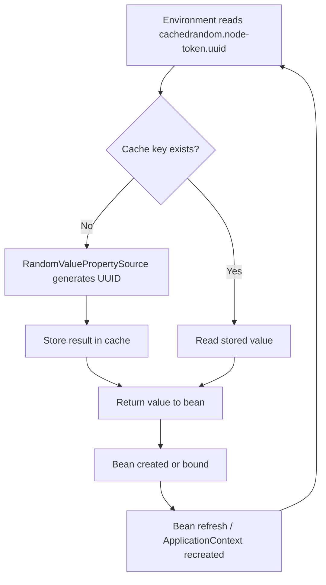

# CachedRandomPropertySource and the Need to Retain Values in Cache

> **Chapter:** Random Values
> **Module:** `SPRING_CLOUD_CORE` — understand the core foundations of Spring Cloud in distributed systems, especially Spring Cloud Commons, Context, externalized configuration, and version compatibility with Spring Boot. Learners explore refresh scope, discovery, service registry, service communication, and how to test and operate common abstractions.
> **Focus:** Spring Boot provides `RandomValuePropertySource` to generate random values when reading a property. Spring Cloud Context adds `CachedRandomPropertySource` to retain generated values under a cache key. This lesson focuses on the syntax, cache lifecycle, stability scope of values, and safe usage in application configuration.

## 1. Why Cache a Random Value?

Random values are useful when an application needs a default value that operators do not have to pre-generate manually. Spring Boot provides properties such as `${random.uuid}`, `${random.int}`, and `${random.value}`. They can be used in configuration or tests.

However, there are situations where an application needs a random value but wants to preserve that same value when the Spring `ApplicationContext` is re-initialized within the same process. For example, a bean is recreated after a refresh, or the application has multiple contexts that are sequentially closed and reopened. If the property is regenerated on every query, the new component may receive a different value from the old component.

Spring Cloud Context addresses this need with `CachedRandomPropertySource`. This property source stores the generated value under a key and returns the stored value for subsequent lookups with the same key. Aside from caching, it works just like Spring Boot's `RandomValuePropertySource`.

You can think of the difference as follows:

- `random.*` requests generating a random value when the property is queried.
- `cachedrandom.*` requests retrieving a random value associated with a cache key; if the key already has a value, that value is returned.

Example:

```properties
# Regular random value
demo.random-id=${random.uuid}

# Random value retained under cache key "application-id"
demo.cached-id=${cachedrandom.application-id.uuid}
```

If the same cache key is looked up multiple times, `CachedRandomPropertySource` retains the generated result so that subsequent reads receive the same value. This is useful when beans or contexts need to observe the same value throughout the cache lifecycle.

## 2. RandomValuePropertySource and CachedRandomPropertySource

### 2.1. Spring Boot's RandomValuePropertySource

`RandomValuePropertySource` is a Spring Boot `PropertySource`. It recognizes properties with the `random.` prefix and generates corresponding values. Common forms include:

| Property | Result |
| --- | --- |
| `random.value` | Random string value |
| `random.int` | Random integer |
| `random.long` | Random long integer |
| `random.uuid` | Random UUID |
| `random.int(10)` | Integer from 0 to less than 10 |
| `random.int[1024,65536]` | Integer from 1024 to less than 65536 |

For the range form with both lower and upper bounds, the lower bound is inclusive and the upper bound is exclusive. The bracket/parenthesis syntax in the example is part of the range syntax supported by Spring Boot.

Example:

```yaml
demo:
  token: "${random.uuid}"
  shard-number: "${random.int[0,16]}"
  test-port: "${random.int[10000,20000]}"
```

Each time the property source is actually asked to generate a random property, it may produce a new result. Therefore, you should not assume that two reads of `${random.uuid}` in two independent places will automatically yield the same UUID.

### 2.2. Spring Cloud's CachedRandomPropertySource

`CachedRandomPropertySource` adds key-based caching to Spring Boot's random mechanism. General syntax:

```text
cachedrandom.[yourkey].[type]
```

Where:

- `cachedrandom` is the prefix to select the cached property source.
- `yourkey` is the key name used to identify the value to retain.
- `type` is the random type supported by Spring Boot's `RandomValuePropertySource`.

Spring Cloud documentation example:

```properties
myrandom=${cachedrandom.appname.value}
```

Here `appname` is the cache key and `value` is the value type. You can use other random types supported by Spring Boot:

```yaml
demo:
  stable-id: "${cachedrandom.instance-id.uuid}"
  stable-number: "${cachedrandom.worker-number.int}"
  stable-long: "${cachedrandom.sequence-seed.long}"
  stable-token: "${cachedrandom.local-token.value}"
```

Name the key to reflect the purpose of the value. Each logical value should have its own key; keep both the key and the chosen type consistent everywhere it is used. Do not reuse the same key for properties with different purposes or types.

### 2.3. What Does Caching Change?

Caching does not turn a random value into a fixed value hardcoded in source code. It only remembers the generated result within the active scope of the cache.

| Aspect | `random.*` | `cachedrandom.*` |
| --- | --- | --- |
| Value generation | Generated when the random property is queried | Generated when the cache key has no value yet |
| Repeated reads of the same property | May receive different results | Receives the cached value again |
| Purpose | Need a new random value | Need a random value stable per key |
| Behavior on context re-initialization | May generate a new value | Can retain the old value while the cache still exists |
| Storage location | Random property source | In-memory cache of the application |

`CachedRandomPropertySource` is suitable when consistency across reads is needed, not long-term data storage.

## 3. Cache Lifecycle and Stability Scope

### 3.1. Preserved Across ApplicationContext Re-initialization

The Spring Cloud documentation describes this property source's use case as keeping a random value consistent even when the Spring `ApplicationContext` is restarted. For example, an application has a context that is closed and recreated within the same process; when the new context reads the same cache key again, it can receive the previously cached value.

This is useful when a component is rebuilt, yet the application still wants to keep a temporary identifier unchanged. That value does not need to be entered into configuration by an operator, and components initialized at different times can share the same result.

### 3.2. Not Persistent Storage

It is important to distinguish between a Spring `ApplicationContext` restart and a Java process restart:

| Event | Should you expect the value to be retained? |
| --- | --- |
| Re-reading the same property in the same context | Yes |
| Creating a new bean or refreshing a bean in the same process | Yes, if using the same key and the cache has not been cleared |
| Closing and recreating the ApplicationContext in the same process | This is the use case described by Spring Cloud |
| Restarting the JVM/process | Should not expect the cache to persist |
| Starting another pod/replica | Does not share the current process's cache |
| Running the application on another machine | No cache synchronization mechanism across machines |

This cache resides in the application's memory. It is not a database, file store, distributed cache, or secret store. When the process terminates, the process memory is released; a new run may generate a different value.

If you need to retain an ID across deployments, machine restarts, or pod recreations, store the ID in a durable place such as a database or managed configuration. If multiple replicas need to share a single value, provide that value from a shared configuration source with an appropriate management mechanism.

### 3.3. Process and Class Loader Scope

An in-memory cache is not a synchronization contract across instances in a distributed system. Two independent JVMs can use the same cache key, yet each JVM generates and stores its own result.

For example, two replicas both declare:

```yaml
app:
  instance-id: "${cachedrandom.instance-id.uuid}"
```

Each replica has its own cache. Therefore, the two replicas may receive two different UUIDs. If the system needs a shared cluster ID, allocate it via a configuration store, database, or an appropriate coordination mechanism.

Also avoid assuming that a cache key is a global identity. It is only meaningful within the scope of the cache that the current application is using.

## 4. Usage in Spring Environment and Application Configuration

### 4.1. Declaring in application.yml

You can use a cached random property directly in YAML:

```yaml
app:
  identity:
    local-instance-id: "${cachedrandom.local-instance-id.uuid}"
    startup-seed: "${cachedrandom.startup-seed.long}"
  diagnostics:
    sample-number: "${cachedrandom.diagnostic-sample.int[100,1000]}"
```

Place placeholders in double quotes so YAML reads the value as a string before Spring resolves the placeholder. When binding to the target type, Spring Boot will convert the value appropriately.

### 4.2. Reading with Environment

A bean can read the property through `Environment`:

```java
import org.springframework.core.env.Environment;
import org.springframework.stereotype.Component;

@Component
public class InstanceIdentity {

    private final String instanceId;

    public InstanceIdentity(Environment environment) {
        this.instanceId = environment.getRequiredProperty(
                "app.identity.local-instance-id"
        );
    }

    public String getInstanceId() {
        return instanceId;
    }
}
```

This bean reads the property already resolved by the Spring Environment. If another bean reads the same property, it receives the same cached value as long as the key remains in the cache.

### 4.3. Binding with ConfigurationProperties

For structured configuration, you can bind using `@ConfigurationProperties`:

```yaml
app:
  identity:
    local-instance-id: "${cachedrandom.local-instance-id.uuid}"
    startup-seed: "${cachedrandom.startup-seed.long}"
```

```java
import org.springframework.boot.context.properties.ConfigurationProperties;

@ConfigurationProperties(prefix = "app.identity")
public class InstanceIdentityProperties {

    private String localInstanceId;
    private long startupSeed;

    public String getLocalInstanceId() {
        return localInstanceId;
    }

    public void setLocalInstanceId(String localInstanceId) {
        this.localInstanceId = localInstanceId;
    }

    public long getStartupSeed() {
        return startupSeed;
    }

    public void setStartupSeed(long startupSeed) {
        this.startupSeed = startupSeed;
    }
}
```

You can register this configuration class using scanning or `@EnableConfigurationProperties` as appropriate for your application. When the bean is rebound, the cached random placeholder still points to the same cache key.

### 4.4. Using with @Value

For a simple property:

```java
import org.springframework.beans.factory.annotation.Value;
import org.springframework.stereotype.Component;

@Component
public class StartupMetadata {

    private final String nodeToken;

    public StartupMetadata(
            @Value("${cachedrandom.node-token.uuid}") String nodeToken) {
        this.nodeToken = nodeToken;
    }

    public String getNodeToken() {
        return nodeToken;
    }
}
```

Whether using `@Value`, `Environment`, or `@ConfigurationProperties`, the value source is still the property source. Choose the binding approach based on your configuration structure and the application's testing needs.

## 5. Relationship with Refresh and Bean Recreation

Spring Cloud Context provides configuration refresh mechanisms and `@RefreshScope`. When a bean in refresh scope is refreshed, the target bean may be recreated on the next access. If that bean reads `cachedrandom.node-token.uuid` and the cache key is still in memory, the resolved value remains the same as before the refresh.

Example flow:



The key point is that refreshing a bean does not mean clearing the random cache. These two lifecycles are separate:

- Refresh scope manages the lifecycle of beans created within the scope.
- The cached random property source manages random values by cache key.

Therefore, if your goal is to issue a new value on every refresh, `cachedrandom.*` is not the right choice. Use a value-generation mechanism driven by refresh events or update the property from a managed configuration source.

Similarly, if the application changes another source property while the cache key remains the same, cached random will not automatically regenerate its value just because a bean is rebound.

## 6. When Should You Use CachedRandomPropertySource?

### 6.1. Suitable Cases

| Need | Why cached random can be useful |
| --- | --- |
| Temporary process-level identifier | Multiple beans need to read the same ID during the application lifecycle |
| Seed for diagnostics or experimentation | Components initialized at different times still use the same seed |
| Default value in local/test environments | No need to prepare fixed values for every run |
| Bean recreated after refresh | The new bean can receive the cached value again |
| Multiple ApplicationContexts in the same process | Contexts can share cache keys under the current caching mechanism |

### 6.2. Unsuitable Cases

Do not use cached random as a replacement for:

- Business IDs that must survive restarts or deployments;
- Primary keys that must be uniquely allocated and durably stored;
- Secrets, passwords, API tokens, or signing keys requiring lifecycle management;
- Values that must be identical across replicas or clusters;
- Transaction sequence numbers that must increase monotonically;
- Idempotency keys that must be recovered after a process crash;
- Configuration that must be accurately reproduced from a repository or configuration management system.

A random UUID has a very low collision probability, yet cached random is not a coordinated ID allocation service. If uniqueness is a business constraint, use a controlled allocation and storage mechanism.

### 6.3. Do Not Use Cache Keys as Secrets

Key names such as `instance-id`, `startup-seed`, or `local-token` are merely labels identifying values. Key names are not passwords, security salts, or access credentials. Avoid placing sensitive values in logs, diagnostic endpoints, or public metadata.

If you need secrets, retrieve them from a secret manager or an appropriate credential management source with clear access control, auditing, rotation, and storage policies.

## 7. Testing and Isolating Cache State

### 7.1. Testing Two Reads of the Same Key

A test can verify that the same cache key returns the same value:

```java
import static org.assertj.core.api.Assertions.assertThat;

import org.junit.jupiter.api.Test;
import org.springframework.cloud.util.random.CachedRandomPropertySource;
import org.springframework.core.env.PropertySource;

class CachedRandomPropertySourceTest {

    @Test
    void returnsSameValueForSameCacheKey() {
        PropertySource<?> randomSource =
                new org.springframework.boot.env.RandomValuePropertySource();

        CachedRandomPropertySource cached =
                new CachedRandomPropertySource(randomSource);

        Object first = cached.getProperty("cachedrandom.test-id.uuid");
        Object second = cached.getProperty("cachedrandom.test-id.uuid");

        assertThat(second).isEqualTo(first);
    }
}
```

This is an example of testing the property source directly. In Spring Boot integration tests, you should also verify that placeholders are resolved through `Environment` and values are bound to beans.

### 7.2. Clearing the Cache in Tests

The `CachedRandomPropertySource.clearCache()` API is provided to clear the cache. You can use it to isolate state between tests:

```java
import org.junit.jupiter.api.AfterEach;
import org.junit.jupiter.api.BeforeEach;
import org.springframework.cloud.util.random.CachedRandomPropertySource;

class RandomConfigurationTest {

    @BeforeEach
    void clearBeforeTest() {
        CachedRandomPropertySource.clearCache();
    }

    @AfterEach
    void clearAfterTest() {
        CachedRandomPropertySource.clearCache();
    }
}
```

Check this API in your project's exact Spring Cloud Context version before using it. If tests run in parallel and share the same cache key, one test calling `clearCache()` can affect another test. You can disable parallel execution for this test group or design distinct keys to avoid contention.

Do not arbitrarily clear the cache in production while multiple beans are using that value. After the cache is cleared, the next read may generate a new value while some existing beans still hold the previously bound value. As a result, components within the same application may temporarily become inconsistent.

### 7.3. Testing the ApplicationContext Lifecycle

To test the exact use case of this lesson:

1. Initialize the first context and read a cached random property.
2. Close the first context while keeping the test process running.
3. Initialize the second context in the same process.
4. Read the property again with the same cache key.
5. Compare the two values.
6. Intentionally clear the cache and read again to confirm the cache has been reset.

This test needs to preserve the cache within the same process. If tests fork a separate JVM for each stage, the in-memory cache cannot be shared across JVMs.

## 8. Common Issues and Diagnostics

| Symptom | Possible Cause | Resolution |
| --- | --- | --- |
| Placeholder remains literally `${cachedrandom...}` | Property source is not registered or placeholder is not resolved | Check Spring Cloud Context dependency, Environment, and property configuration |
| Value changes after process restart | Cache exists only in process memory | Use a database/configuration store if a durable value is needed |
| Two replicas have different values | Each JVM has an independent cache | Provide a shared value from a configuration source or centralized storage |
| Two beans receive different values | Different cache keys or different property types | Compare the exact key and type in the placeholders verbatim |
| Value changes after calling clearCache | Cache was cleared and the next read generates a new value | Clear only in tests or controlled reset procedures |
| Bean refreshed but value did not change | Cache key still exists; this is expected behavior | Use a refresh-driven regeneration mechanism if a new value is required |
| Test depends on previous test's result | Static cache still holds data from the previous test | Clear the cache before/after tests and avoid running the same key in parallel |
| Value bound with wrong type | Random type is incompatible with the target property | Choose an appropriate int, long, uuid, or value type and verify conversion |

When diagnosing, inspect the exact placeholder string, cache key, random type, timing of property reads, and whether any cache-clearing operation occurred. Do not infer solely from the value observed inside one bean, because that bean may be holding a previously bound value.

## 9. Selection and Operational Workflow

Before using `CachedRandomPropertySource`, answer the following questions:

1. Does the value need to change on every read or remain stable per key?
2. Does the value need to be retained when a bean or ApplicationContext is recreated?
3. Does the value only need to exist within a single process, or must it survive restarts/deployments?
4. Do replicas need to share a single value?
5. Is auditing, recovery, or rotation of the value required?
6. Is the property bound once or read repeatedly?
7. Do any tests need to clear the cache to avoid execution-order dependencies?

If the value only needs to be stable within the application's cache, cached random is a lightweight tool. If durability, synchronization, or lifecycle management is required, choose a storage or configuration service that provides those properties.

## 10. Practice Exercises

### Exercise 1 — Random Value Changes Between Reads

An application has two beans that both read `${random.uuid}`. After one bean is refreshed, its new UUID no longer matches the UUID held by the other bean.

Explain the role of `RandomValuePropertySource` and rewrite the property using `cachedrandom.` so both beans read the same value by cache key.

### Exercise 2 — Preserving Instance ID Across Refresh

A service uses `@RefreshScope` for a bean containing instance information. After the bean is recreated, the team wants the instance ID to remain unchanged.

Propose a cached random configuration and describe why the random cache still preserves the value when the target bean is recreated in the same process.

### Exercise 3 — Two Replicas Sharing the Same Cache Key

Two pods run the application with `${cachedrandom.cluster-id.uuid}`. The team expects both to have the same cluster ID, yet observes two different values.

Explain the cache scope and propose an appropriate configuration source for sharing a cluster ID.

### Exercise 4 — Restarting the JVM

An application uses cached random to generate an ID stored in a database table. After deploying a new version, the ID changes and related data no longer matches.

Analyze why an in-memory cache cannot guarantee an ID across process restarts. Propose a durable storage location for the ID.

### Exercise 5 — Flaky Tests

One test reads a cached random value, and the next test also uses that key and expects a fresh value. Results depend on test execution order.

Propose how to use `clearCache()` and how to isolate keys so tests can run independently.

### Quick Self-Check

1. Which component does `CachedRandomPropertySource` belong to? **Spring Cloud Context.**
2. What prefix is used to read cached random values? **`cachedrandom.`.**
3. What is the general syntax of the property? **`cachedrandom.[yourkey].[type]`.**
4. Which property source are the supported `type`s based on? **Spring Boot's `RandomValuePropertySource`.**
5. Does the cache retain values across ApplicationContext recreation in the same process? **This is the use case described by the Spring Cloud documentation.**
6. Is the cache shared between two JVMs? **No.**
7. Does the cache survive after the process exits? **It should not be expected to.**
8. Does refreshing a bean automatically clear the cached random value? **No.**
9. Which API can clear the cache in tests? **`CachedRandomPropertySource.clearCache()`, if the version in use provides this API.**
10. Should cached random be used as a durable business ID? **No.**

**Core takeaway:** `CachedRandomPropertySource` addresses the need to generate a random value and retain the result in memory under a cache key. It is useful when repeated reads or recreated beans within the same process need the same value. The cache is not persistent storage, is not shared across replicas, and does not replace an ID allocation or secret management system.

**References:**

- [Spring Cloud Commons 5.0.4 — CachedRandomPropertySource](https://docs.spring.io/spring-cloud-commons/reference/spring-cloud-commons/cachedrandompropertysource.html)
- [Spring Boot — Externalized Configuration: Configuring Random Values](https://docs.spring.io/spring-boot/reference/features/external-config.html)
- [Spring Boot API — RandomValuePropertySource](https://docs.spring.io/spring-boot/api/java/org/springframework/boot/env/RandomValuePropertySource.html)
- [Spring Cloud Context API — CachedRandomPropertySource](https://javadoc.io/doc/org.springframework.cloud/spring-cloud-context/latest/org/springframework/cloud/util/random/CachedRandomPropertySource.html)

Random types and API details may vary by Spring Boot/Spring Cloud version. Check the documentation of the release train compatible with your application before deploying.
