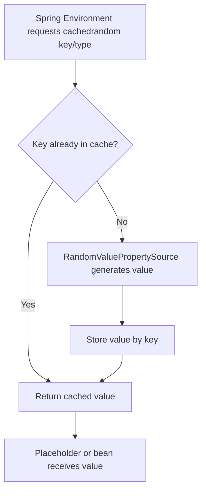

# Syntax cachedrandom.<key>.<type>

In a Spring application, there are values that need to be generated randomly yet remain unchanged when the `ApplicationContext` is restarted. For example, an application might need a local identifier, a configuration value used throughout the process lifecycle, or a test value that stays stable across context recreations.

Spring Boot provides `RandomValuePropertySource` with `random.*` properties. Each time a value is generated, this source uses the random generator for the requested type. Spring Cloud Context adds `CachedRandomPropertySource`, allowing random values to be cached under a key. Its syntax is:

```text
cachedrandom.<key>.<type>
```

Where `key` identifies the cache slot and `type` selects the random value type supported by Spring Boot's `RandomValuePropertySource`. Thanks to caching, the same key can return the previously generated value when the application recreates the Spring `ApplicationContext` within the same process lifecycle.

This lesson belongs to the **Random Values** chapter of **SPRING_CLOUD_CORE**. The content focuses on how to read the syntax, choose keys, use value types, configure them in Properties/YAML, access them via Spring `Environment`, and properly understand the cache's lifetime scope.

## 1. Learning Objectives

After this lesson, you will be able to:

- Explain the role of `CachedRandomPropertySource` in Spring Cloud Context.
- Distinguish `cachedrandom.*` from Spring Boot's `random.*`.
- Read the `cachedrandom.<key>.<type>` structure accurately.
- Choose stable `key`s without unintentional collisions.
- Use `value`, `int`, `long`, `uuid`, and bounded numeric types.
- Configure cached random values in `application.properties` and `application.yml`.
- Access values via `@Value`, `Environment`, and `@ConfigurationProperties`.
- Explain why values remain stable across context recreations but do not constitute persistent storage.
- Design tests for caching behavior.
- Recognize cases where cached random values are not appropriate.

## 2. What Is CachedRandomPropertySource?

`CachedRandomPropertySource` is a `PropertySource` provided by Spring Cloud Context. It generates random values using a mechanism compatible with Spring Boot's `RandomValuePropertySource`, while caching the result based on a key.

Spring Boot can generate values such as integers, longs, UUIDs, or string-formatted random values through `random.*` placeholders. Spring Cloud adds the `cachedrandom` prefix to allow retaining results by key.

Official example:

```properties
myrandom=${cachedrandom.appname.value}
```

In the example above:

- `cachedrandom` selects the cached property source.
- `appname` is the key used to identify the value in the cache.
- `value` is the requested random value type.
- `myrandom` is the application property that receives the result after the placeholder is resolved.

`CachedRandomPropertySource` is a property source in Spring `Environment`. It is neither a Config Server-specific configuration field nor a remote random storage service.

In standard integration, Spring Cloud Context registers this property source into `Environment` via the module's `EnvironmentPostProcessor`. Therefore, the application needs Spring Cloud Context on the classpath and Spring Boot's startup mechanism must load that processor. Normally, you do not need to manually create a `PropertySource` bean for each property. If placeholders are not resolved, check your dependencies and the list of property sources in `Environment`.

## 3. Structure of cachedrandom.<key>.<type>

General syntax:

```text
cachedrandom.<key>.<type>
```

| Component | Role | Example |
| --- | --- | --- |
| `cachedrandom` | Prefix to select the cached random source | `cachedrandom` |
| `<key>` | Key name used to look up the value in the cache | `checkout-node-id` |
| `<type>` | Random type supported by Spring Boot | `uuid`, `int`, `long`, `value` |

Some complete expressions:

```properties
app.node-id=${cachedrandom.checkout-node-id.uuid}
app.shard=${cachedrandom.checkout-shard.int}
app.token=${cachedrandom.checkout-token.value}
app.test-number=${cachedrandom.checkout-test-number.int[1000,9000]}
```

### 3.1. A Key Is a Cache Identifier, Not a Seed

`key` helps Spring Cloud identify a cached value. It is not a seed used to independently compute a reproducible random result.

Example:

```properties
app.node-id=${cachedrandom.checkout-node-id.uuid}
```

The name `checkout-node-id` does not turn the UUID into a deterministic value derived from that string. The first time the key is requested, a random value is generated and cached. Subsequent accesses reuse the cached value.

Therefore:

- Changing the key requests a different cache entry.
- Keeping the same key references the previously cached value.
- A key does not replace a seed or a deterministic generation algorithm.
- A key does not cause different JVMs or replicas to automatically receive the same value.

### 3.2. Choosing Meaningful Keys

Name keys according to the purpose of the value:

```properties
app.node-id=${cachedrandom.checkout-node-id.uuid}
app.local-token=${cachedrandom.checkout-local-token.value}
app.test-port=${cachedrandom.checkout-test-port.int[10000,20000]}
```

Meaningful key names help readers understand what purpose the value serves and reduce the risk of accidentally sharing a cache entry.

If two properties need to share the same value, reference the same key and type expression. If two properties need independent values, assign two distinct keys.

Do not arbitrarily change keys between deployments if the application expects to continue using the previously cached value within the same process.

## 4. Supported Value Types

The `type` part can use types supported by Spring Boot's `RandomValuePropertySource`. Common types:

| Type | Result | Example |
| --- | --- | --- |
| `value` | Random value/string | `cachedrandom.app-token.value` |
| `int` | Random integer | `cachedrandom.shard.int` |
| `long` | Random long integer | `cachedrandom.sequence.long` |
| `uuid` | Random UUID | `cachedrandom.instance.uuid` |
| `int(max)` | Integer from 0 to max - 1 | `cachedrandom.port.int(100)` |
| `int[min,max]` | Integer in range with exclusive upper bound | `cachedrandom.slot.int[10,20]` |
| `long(max)` | Long from 0 to max - 1 | `cachedrandom.limit.long(100000)` |
| `long[min,max]` | Long in range with exclusive upper bound | `cachedrandom.offset.long[1000,9000]` |

Types and suffix parsing depend on the compatible Spring Boot version the application uses. When you need exact syntax details, consult the `RandomValuePropertySource` documentation for that version.

### 4.1. Type value

Use `value` when you need a string-based random value:

```properties
app.random-label=${cachedrandom.checkout-label.value}
```

Example in YAML:

```yaml
app:
  random-label: "${cachedrandom.checkout-label.value}"
```

This option closely matches the `myrandom=${cachedrandom.appname.value}` example in the Spring Cloud documentation.

### 4.2. Type int

Use `int` when you need a random integer:

```properties
app.shard-number=${cachedrandom.checkout-shard.int}
```

The value is generated within the integer range supported by the random generator. If business logic requires a specific range, use the bounded syntax rather than assuming a range.

### 4.3. Type long

Use `long` when you need a long integer value:

```properties
app.local-sequence=${cachedrandom.checkout-sequence.long}
```

This type is suitable for configurations that need a wider numeric range than `int`. It is still just a random value cached by key, not a system-wide unique sequence allocator.

### 4.4. Type uuid

Use `uuid` to generate a UUID-formatted identifier:

```properties
app.instance-id=${cachedrandom.checkout-instance.uuid}
```

UUID is convenient for a local instance identifier. If multiple replicas need a centrally managed identifier or identifier lifecycle control, you must use an allocation mechanism suited to your architecture.

## 5. Range-Bound Syntax for int and long

Spring Boot supports suffixes specifying bounds for `int` and `long`. Spring Cloud `CachedRandomPropertySource` uses the same type mechanism from that random source.

There are two common forms:

```text
int(max)
int[min,max]
```

and:

```text
long(max)
long[min,max]
```

If only `max` is provided, the lower bound is `0` and the upper bound is `max` (exclusive).

If both `min` and `max` are provided, the value is taken from `min` up to before `max`.

### 5.1. Single Upper Bound

Example:

```properties
app.worker-index=${cachedrandom.worker-index.int(8)}
```

The value lies in the range:

\[
0 \leq x < 8
\]

Valid results are `0` through `7`.

With `long`:

```properties
app.worker-offset=${cachedrandom.worker-offset.long(100000)}
```

The value lies in the range:

\[
0 \leq x < 100000
\]

### 5.2. Both Lower and Upper Bounds

Example:

```properties
app.test-port=${cachedrandom.test-port.int[10000,20000]}
```

The value lies in the range:

\[
10000 \leq x < 20000
\]

The upper bound is excluded. Therefore, `20000` is not a valid result.

With `long`:

```properties
app.batch-offset=${cachedrandom.batch-offset.long[100000,900000]}
```

The value lies in the range:

\[
100000 \leq x < 900000
\]

### 5.3. Do Not Confuse the Closing Bracket with a Closed Interval

In `[min,max]` syntax, `]` is the closing character of the placeholder expression. According to Spring Boot's random range rules, `max` is still an exclusive bound.

Example:

```text
cachedrandom.worker.int[1,10]
```

does not mean both `1` and `10` are included; valid results are from `1` through `9`.

### 5.4. Bounds Must Be Valid

When configuring a range, ensure that:

- The bounds can be parsed into integers of the proper type.
- The lower bound is less than the upper bound.
- The values do not exceed the representation range of `int` or `long`.
- The range fits the application's intended use.

If the range is invalid, resolution may throw an error instead of returning a valid value.

## 6. Usage in application.properties

In `application.properties`, cached random expressions can be assigned directly to application properties:

```properties
spring.application.name=checkout-service

app.instance-id=${cachedrandom.checkout-instance.uuid}
app.shard-index=${cachedrandom.checkout-shard.int[0,16]}
app.local-token=${cachedrandom.checkout-local-token.value}
app.retry-window=${cachedrandom.checkout-retry-window.long[1000,5000]}
```

After the placeholders are resolved:

- `app.instance-id` receives the cached UUID.
- `app.shard-index` receives an integer from `0` to `15`.
- `app.local-token` receives a random value of type `value`.
- `app.retry-window` receives a long from `1000` up to before `5000`.

These properties can be referenced elsewhere via standard placeholders:

```properties
app.instance-description=checkout-${app.instance-id}
```

There is no need to repeat the `cachedrandom` expression in every property once an intermediate property exists.

## 7. Usage in application.yml

In YAML, place placeholders inside double quotes so the expression is preserved as a scalar string:

```yaml
spring:
  application:
    name: checkout-service

app:
  instance-id: "${cachedrandom.checkout-instance.uuid}"
  shard-index: "${cachedrandom.checkout-shard.int[0,16]}"
  local-token: "${cachedrandom.checkout-local-token.value}"
  retry-window: "${cachedrandom.checkout-retry-window.long[1000,5000]}"
```

You can reference declared properties:

```yaml
app:
  instance:
    id: "${cachedrandom.checkout-instance.uuid}"
    description: "checkout-${app.instance.id}"
```

This organization keeps random expressions in one clear place while dependent properties simply use standard placeholders.

### 7.1. Why Use Double Quotes?

Double quotes ensure YAML interprets the entire `${...}` expression as a string value. This is especially useful when the expression contains brackets or commas in the range portion:

```yaml
app:
  shard: "${cachedrandom.checkout-shard.int[0,16]}"
```

Avoid letting the YAML parser interpret characters inside the expression as a different data structure.

## 8. Accessing via @Value

Once a property is declared in the configuration file, it can be injected like a normal Spring property:

```java
@Component
public class CheckoutIdentity {

    private final String instanceId;
    private final String localToken;

    public CheckoutIdentity(
            @Value("${app.instance-id}") String instanceId,
            @Value("${app.local-token}") String localToken) {
        this.instanceId = instanceId;
        this.localToken = localToken;
    }

    public String getInstanceId() {
        return instanceId;
    }

    public String getLocalToken() {
        return localToken;
    }
}
```

The bean does not need to know whether the value comes from `CachedRandomPropertySource`, a YAML file, an environment variable, or another configuration source. It simply reads the final resolved property from Spring `Environment`.

## 9. Accessing via Environment

If you need to read values programmatically, you can inject `Environment`:

```java
@Component
public class RuntimeIdentityReporter {

    private final Environment environment;

    public RuntimeIdentityReporter(Environment environment) {
        this.environment = environment;
    }

    public void report() {
        String instanceId = environment.getProperty("app.instance-id");
        Integer shardIndex = environment.getProperty(
                "app.shard-index",
                Integer.class);

        // Use the resolved values in application logic.
    }
}
```

Prefer reading declared application properties, such as `app.instance-id`, instead of letting multiple components construct their own `cachedrandom.*` expressions. This centralizes key and type policy in configuration.

## 10. Combining with ConfigurationProperties

`CachedRandomPropertySource` operates at the `Environment` layer. Therefore, resolved properties can be bound to a `@ConfigurationProperties` class.

YAML example:

```yaml
app:
  identity:
    instance-id: "${cachedrandom.checkout-instance.uuid}"
    shard-index: "${cachedrandom.checkout-shard.int[0,16]}"
```

Configuration class:

```java
@ConfigurationProperties(prefix = "app.identity")
public record IdentityProperties(
        String instanceId,
        Integer shardIndex) {
}
```

Configuration registration:

```java
@Configuration(proxyBeanMethods = false)
@EnableConfigurationProperties(IdentityProperties.class)
public class IdentityConfiguration {
}
```

Usage:

```java
@Service
public class CheckoutIdentityService {

    private final IdentityProperties properties;

    public CheckoutIdentityService(IdentityProperties properties) {
        this.properties = properties;
    }

    public String instanceId() {
        return properties.instanceId();
    }

    public Integer shardIndex() {
        return properties.shardIndex();
    }
}
```

Advantages of this approach:

- Configuration has explicit data types.
- Application logic does not directly depend on `cachedrandom` syntax.
- Configuration can be tested and validated in one place.
- It is easy to swap the value source when the architecture changes.

## 11. How Caching Works Across the Context Lifecycle

The crucial difference between `cachedrandom` and `random` is that results are retained by key.

High-level flow:



The first time a key is resolved, the random source generates the corresponding value and stores it in the cache. Subsequent accesses reuse that value.

The Spring Cloud documentation describes the goal of this mechanism as keeping values consistent even when the Spring `ApplicationContext` is restarted.

### 11.1. Context Restart in the Same Process

Example:

1. The application initializes the first context.
2. `app.instance-id` is resolved from key `checkout-instance`.
3. The first context is closed.
4. The application creates a new context in the same JVM process.
5. The same key is requested again.
6. The cached value is returned.

This is useful for applications that have a context restart mechanism yet still need to preserve a local identifier.

### 11.2. Not Equivalent to Persistence Across JVM Restarts

`CachedRandomPropertySource` is not a durable storage mechanism like a database, file, or secret manager.

The documentation promises consistency across `ApplicationContext` restarts. You should not rely on it to preserve values after the JVM process exits and restarts.

If a value must survive new deployments, machine restarts, or multiple replicas, store that value in an appropriate storage system.

### 11.3. Not a Distributed Cache

Two replicas running in two different JVMs do not share a cache simply because they use the same key:

```text
checkout-instance
```

Each process has its own lifecycle and cache state. Therefore, do not assume:

```text
Replica A: cachedrandom.checkout-instance.uuid
Replica B: cachedrandom.checkout-instance.uuid
```

will generate the same UUID.

If a shared value is needed across instances, use a centralized data source or a consistent allocation mechanism.

## 12. Comparing random and cachedrandom

| Criterion | `random.*` | `cachedrandom.*` |
| --- | --- | --- |
| Source | Spring Boot `RandomValuePropertySource` | Spring Cloud Context `CachedRandomPropertySource` |
| Purpose | Generate random values | Generate and cache random values by key |
| Syntax | `random.<type>` | `cachedrandom.<key>.<type>` |
| Explicit cache key | No | Yes |
| Consistency across context restarts | Not guaranteed | Yes, per key in cache |
| Shared across multiple JVMs | No | No |
| Persisted across process restarts | No | Not guaranteed |

Example:

```properties
app.temporary-id=${random.uuid}
app.stable-context-id=${cachedrandom.checkout-context-id.uuid}
```

`app.temporary-id` uses the regular random source. `app.stable-context-id` uses a dedicated key to preserve the cached value across context recreations within the same process.

Do not infer that `random.uuid` and `cachedrandom.checkout-context-id.uuid` will produce the same result just because they use the same underlying random generator.

## 13. Choosing Keys When Multiple Properties Exist

Suppose an application needs three values:

- Instance ID.
- Shard code.
- Initialization version label.

You can configure:

```yaml
app:
  identity:
    instance-id: "${cachedrandom.checkout-instance-id.uuid}"
    shard-id: "${cachedrandom.checkout-shard-id.int[0,32]}"
    startup-label: "${cachedrandom.checkout-startup-label.value}"
```

Each purpose uses a dedicated key. This gives the values independent lifecycles and prevents a change in type or usage purpose from affecting another property.

### 13.1. Reusing the Same Key When the Same Value Is Needed

```yaml
app:
  identity:
    instance-id: "${cachedrandom.checkout-instance-id.uuid}"
  diagnostics:
    owner-instance-id: "${cachedrandom.checkout-instance-id.uuid}"
```

Both properties reference the same key and the same type, so they can reuse the cached value.

If you change the key or type, treat it as a different cache purpose and retest the behavior in the version in use.

### 13.2. Do Not Share Keys for Unrelated Purposes

Example of what to avoid:

```yaml
app:
  node-id: "${cachedrandom.shared-key.uuid}"
  test-token: "${cachedrandom.shared-key.value}"
```

Two properties have different purposes yet share the same key. This makes the configuration confusing and dependent on implementation details of the cache.

Instead, separate them into:

```yaml
app:
  node-id: "${cachedrandom.checkout-node-id.uuid}"
  test-token: "${cachedrandom.checkout-test-token.value}"
```

## 14. Suitable Use Cases

`CachedRandomPropertySource` is useful when an application needs a random value that stays stable across the cache lifecycle.

Some cases:

- A local ID retained across context recreations within the same JVM.
- A value for diagnostics or correlation within a single process.
- Test configuration that needs stability across context creations.
- An initialization value that only needs to be generated once during a process lifecycle.
- An internal label or identifier that does not require sharing across multiple replicas.

Example:

```yaml
app:
  diagnostics:
    boot-marker: "${cachedrandom.checkout-boot-marker.uuid}"
```

If the context is recreated within the same JVM, the application can continue using the cached boot marker. If the JVM process exits, do not expect that marker to be recovered from `CachedRandomPropertySource`.

## 15. Unsuitable Use Cases

Do not use cached random values as a substitute for durable or shared data.

| Need | Why it is unsuitable | Recommended approach |
| --- | --- | --- |
| JWT signing key shared across replicas | Each JVM has its own cache | Secret manager or KMS |
| Database password that must survive deployments | Cache is not durable storage | Vault or secret store |
| Cluster-wide unique ID | No coordination mechanism across JVMs | ID service or database sequence |
| Token requiring controlled revocation and rotation | Cache keys do not provide secret governance lifecycle | Secret management |
| Configuration that must match across environments | Random values do not produce deterministic results from keys | Fixed configuration or centralized config source |
| Value that must be recovered after JVM restart | Cache does not guarantee persistence | Database or persistent store |

Even when a value is generated by a strong random generator, that does not turn the cache into a secret management system. Secret protection, durable storage, distribution, and rotation are separate responsibilities.

## 16. Interaction with Refresh and Externalized Configuration

`cachedrandom` is a placeholder expression resolved in Spring `Environment`. Once a property is injected into a bean or configuration, the value follows the random source's caching mechanism.

Do not treat refreshing configuration as an operation that automatically generates a new cached random value. The cache mechanism is designed to retain results by key.

If you want a different random value, you can choose a new key for a new purpose. However, changing a key is not equivalent to a secure secret rotation process or a cluster-wide synchronized update.

### 16.1. With Config Server

Config Server can deliver properties containing placeholders to client applications. When the client resolves the placeholder, the `cachedrandom` source must be present in the client's `Environment`.

For example, configuration received from an external source may contain:

```yaml
app:
  instance-id: "${cachedrandom.checkout-instance-id.uuid}"
```

This does not mean Config Server generates and stores the UUID for all clients. The value is resolved in the environment of the application consuming the configuration, using that process's cache.

If multiple clients need the same value, provide a centrally managed value instead of having each JVM generate its own cached random value.

## 17. Testing Cached Random Values

Testing should distinguish between two requirements:

1. The same key is reused from the cache.
2. Numeric types and bounds are resolved properly.

### 17.1. Testing Stability Across Context Restarts

An integration test can create two Spring Boot contexts sequentially in the same JVM:

```java
String firstValue = startContextAndRead("app.instance-id");
closeCurrentContext();

String secondValue = startContextAndRead("app.instance-id");

assertThat(secondValue).isEqualTo(firstValue);
```

`startContextAndRead` is an illustrative helper: start the application with the same key configuration, read the property through `Environment`, then close the context.

This test must ensure:

- Both contexts run in the same JVM.
- The same key and type are used.
- `CachedRandomPropertySource` is registered in `Environment`.
- The cache is not cleared between the two startups.

### 17.2. Testing Numeric Ranges

With configuration:

```properties
app.shard=${cachedrandom.checkout-shard.int[10,20]}
```

You can verify:

```java
Integer shard = environment.getProperty("app.shard", Integer.class);

assertThat(shard).isNotNull();
assertThat(shard).isGreaterThanOrEqualTo(10);
assertThat(shard).isLessThan(20);
```

Do not test by asserting the value always equals a specific number, because the purpose of this property is to generate a random value.

### 17.3. Do Not Test Distinctness via a Single Random Comparison

If two different keys generate two random integers, theoretically they can still collide on the same value. Therefore, avoid writing tests that rely solely on the assumption:

```java
assertThat(first).isNotEqualTo(second);
```

for two integer values with a small domain.

If you need to verify that keys are configured independently, inspect the expressions and per-key caching behavior rather than relying on a single random outcome.

### 17.4. Test Isolation

Because the cache can outlive a single `ApplicationContext`, the test suite should use distinct keys per test or test group.

Avoid letting multiple tests accidentally share a key and depend on execution order.

## 18. Common Issues and Diagnostics

| Symptom | Possible Cause | How to Check |
| --- | --- | --- |
| `cachedrandom` placeholder is not resolved | Spring Cloud Context or property source not loaded | Check dependencies and PropertySources in Environment |
| Value is unstable after creating a new context | Key/type changed or cache was cleared | Compare expressions in both contexts |
| Two replicas receive different values | Cache is not shared across JVMs | Use a centralized config source or store if the same value is needed |
| Numeric value is outside expected range | Range syntax or bounds misunderstood | Remember the upper bound is exclusive |
| YAML does not resolve expression as expected | Unquoted scalar contains special characters | Wrap the placeholder in double quotes |
| `@ConfigurationProperties` receives unexpected value | Placeholder unresolved or incompatible binding type | Inspect Environment before inspecting the bean |
| Value changes after a new deployment | New JVM has a fresh cache | Do not use this cache for persistence |
| Multiple properties accidentally share a value | Reused the same key | Assign distinct keys for each purpose |
| Tests depend on execution order | Multiple tests share a cache key | Use dedicated test keys and check same-JVM execution |

## 19. Practical Implementation Workflow

When introducing `cachedrandom` into an application, you can follow these steps:

1. Determine whether the value needs to remain stable across `ApplicationContext` recreations.
2. Determine whether the value is only needed within one JVM or must be shared across multiple replicas.
3. Choose a `key` that accurately describes the purpose.
4. Choose a `type` matching the required data type.
5. If using `int` or `long`, clearly define the lower and upper bounds.
6. Declare the placeholder in Properties or YAML.
7. Read the value via `@Value`, `Environment`, or `@ConfigurationProperties`.
8. Test two contexts in the same JVM if stability verification is needed.
9. Review deployment configuration to ensure it does not unintentionally require sharing values across multiple JVMs.
10. Switch to a secret store or persistent store if the value requires long-term management.

## 20. Design Principles

- Use `cachedrandom.<key>.<type>` when you need a random value cached by key.
- Treat the key as a cache identifier, not a seed.
- Use separate keys for independent purposes.
- Use the same key and type when you need to reference the same value again.
- Use range syntax to bound `int` or `long`.
- Remember that the upper bound of a range is exclusive.
- Wrap placeholders in double quotes when writing YAML.
- Access via application properties to reduce direct coupling to random syntax.
- Only expect stability across context restarts within the same process.
- Do not assume the cache is shared across JVMs or replicas.
- Do not use cached random values to store secrets or data requiring persistence.
- Write integration tests to verify caching within the actual application lifecycle.

## 21. Summary

Spring Cloud Context's `CachedRandomPropertySource` adds key-based caching of random values to Spring Boot's random property mechanism. The `cachedrandom.<key>.<type>` syntax consists of the source prefix, cache key, and value type.

`type` can use forms supported by `RandomValuePropertySource` such as `value`, `int`, `long`, `uuid`, and bounded numeric forms. Values are generated when a key is first requested and then reused from the cache, helping maintain consistency across `ApplicationContext` recreations in the same process.

This mechanism suits local random identifiers or configuration tied to a process lifecycle. It does not derive deterministic values from keys, does not share caches across multiple JVMs, and does not persist across process restarts. When secrets, shared IDs, or data that must survive deployments are required, use dedicated management and storage systems.

## 22. References

- [Spring Cloud Commons — CachedRandomPropertySource](https://docs.spring.io/spring-cloud-commons/reference/spring-cloud-commons/cachedrandompropertysource.html)
- [Spring Boot — Configuring Random Values](https://docs.spring.io/spring-boot/reference/features/external-config.html#features.external-config.random-values)
- [Spring Boot API — RandomValuePropertySource](https://docs.spring.io/spring-boot/api/java/org/springframework/boot/env/RandomValuePropertySource.html)
- [Spring Cloud Context API — CachedRandomPropertySource](https://javadoc.io/doc/org.springframework.cloud/spring-cloud-context/latest/org/springframework/cloud/util/random/CachedRandomPropertySource.html)
