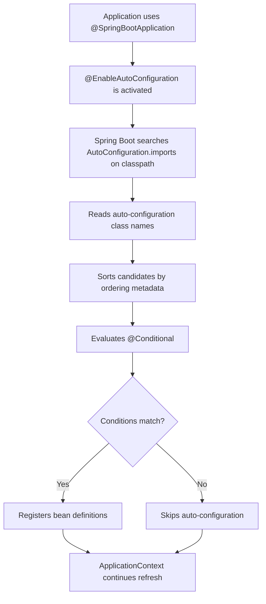

# Registering Auto-Configuration via AutoConfiguration.imports

A Spring Boot library can provide default beans so applications can use them immediately upon adding a dependency. For example, a client library can automatically create `AcmeClient`, timeout settings, and a health indicator when the corresponding dependency is present. This mechanism is called *auto-configuration*.

Spring Boot needs to know which classes are auto-configuration candidates inside JARs on the classpath. Starting in Spring Boot 2.7, the standard registration mechanism is listing class names in the file:

```text
META-INF/spring/org.springframework.boot.autoconfigure.AutoConfiguration.imports
```

Each line contains the fully qualified name of an auto-configuration class. When an application enables `@EnableAutoConfiguration` or uses `@SpringBootApplication`, Spring Boot reads these files from matching JARs, loads the candidates, and evaluates their conditions.

This lesson belongs to the **Auto-Configuration Customization** chapter of **SPRING_CLOUD_CORE**. It focuses on the format and location of `AutoConfiguration.imports`, how to write `@AutoConfiguration` classes, bean creation conditions, application ordering, compatibility with `spring.factories`, testing, and verifying the packaged JAR.

## 1. Learning Objectives

After this lesson, you will be able to:

- Explain why a library needs to register its auto-configuration.
- Identify the exact path and filename of `AutoConfiguration.imports`.
- Write a list of fully qualified class names, one class per line.
- Create a configuration class using `@AutoConfiguration`.
- Combine `@ConditionalOnClass`, `@ConditionalOnMissingBean`, and `@ConditionalOnProperty`.
- Distinguish auto-configuration registration from component scanning and `@Import`.
- Configure ordering using `before`, `after`, `@AutoConfigureBefore`, `@AutoConfigureAfter`, and `@AutoConfigureOrder`.
- Understand the transition from `spring.factories` to `AutoConfiguration.imports` in Spring Boot 2.7 and 3.x.
- Distinguish `@ImportAutoConfiguration` from the default auto-configuration discovery mechanism.
- Write tests using `ApplicationContextRunner`.
- Verify that metadata is included in the JAR and troubleshoot issues when packaging multiple libraries.

## 2. How Is Auto-Configuration Discovered?

Auto-configuration lets Spring Boot configure an application based on dependencies, properties, and existing beans. Applications enable this mechanism via `@EnableAutoConfiguration`, which is typically included in `@SpringBootApplication`.

Overview flow:



The `AutoConfiguration.imports` file only supplies the list of candidates. It does not directly create beans, nor does it force every listed configuration to be applied. Condition annotations determine whether a configuration fits the current application.

### 2.1. Why Is a Registration File Needed?

Suppose a library provides:

```text
com.example.acme.autoconfigure.AcmeAutoConfiguration
```

If this class only has `@Configuration`, Spring Boot will not automatically discover it from arbitrary dependency JARs. Applications might have to manually `@Import` it or component-scan the package containing that class.

The `AutoConfiguration.imports` file solves advertising candidates to Spring Boot. Users only need to add the dependency and enable Spring Boot auto-configuration; they do not need to know the library's internal packages.

### 2.2. The File Lives Inside the Library JAR

A library can have the following layout:

```text
acme-spring-boot-autoconfigure/
└── src/
    └── main/
        ├── java/
        │   └── com/example/acme/autoconfigure/
        │       └── AcmeAutoConfiguration.java
        └── resources/
            └── META-INF/
                └── spring/
                    └── org.springframework.boot.autoconfigure.AutoConfiguration.imports
```

This file must be packaged into the released JAR. Only then can Spring Boot find the resource on the classpath when an application consumes the JAR.

## 3. Path and Format of AutoConfiguration.imports

The full path in source resources is:

```text
src/main/resources/META-INF/spring/org.springframework.boot.autoconfigure.AutoConfiguration.imports
```

After building, the path inside the JAR is:

```text
META-INF/spring/org.springframework.boot.autoconfigure.AutoConfiguration.imports
```

The filename must be exact. Do not append `.txt`, rename the class key, or place the file at the root `META-INF` directory instead of `META-INF/spring`.

### 3.1. Each Line Is a Fully Qualified Class Name

Example contents:

```text
com.example.acme.autoconfigure.AcmeAutoConfiguration
com.example.acme.autoconfigure.AcmeWebAutoConfiguration
com.example.acme.autoconfigure.AcmeMetricsAutoConfiguration
```

Each line declares one class. Use the full name including package and class name; do not include `.class`.

Incorrect examples:

```text
AcmeAutoConfiguration
com.example.acme.autoconfigure.AcmeAutoConfiguration.class
```

Correct example:

```text
com.example.acme.autoconfigure.AcmeAutoConfiguration
```

### 3.2. Comments Are Allowed

Lines starting with `#` are treated as comments:

```text
# Core client configuration
com.example.acme.autoconfigure.AcmeAutoConfiguration

# Optional web integration
com.example.acme.autoconfigure.AcmeWebAutoConfiguration
```

Comments help maintainers understand the purpose of each configuration group. Do not put inline comments at the end of a class name unless you have verified your Spring Boot version's parser supports that format; the clearest approach is placing comments on separate lines.

### 3.3. Nested Classes

Normally, auto-configurations should be top-level classes. In the rare case where you need to list a nested class directly, use `$` to separate the outer and inner class names:

```text
com.example.acme.autoconfigure.AcmeConfigurations$WebAutoConfiguration
```

Do not use `.` instead of `$` in the binary name of a nested class.

### 3.4. Avoid Duplicate Declarations

Each auto-configuration should appear once in the file. Avoid duplicating the same class across multiple lines or across multiple resources produced by builds/shading. If a library is repackaged with resources from multiple dependencies, verify how the packaging tool merges files rather than assuming duplicate entries will be handled as intended.

## 4. Writing an @AutoConfiguration Class

Spring Boot introduced the `@AutoConfiguration` annotation in version 2.7. This annotation is a specialized form of `@Configuration` designed for auto-configuration and always uses `proxyBeanMethods = false`.

Minimal example:

```java
package com.example.acme.autoconfigure;

import org.springframework.boot.autoconfigure.AutoConfiguration;
import org.springframework.context.annotation.Bean;

@AutoConfiguration
public class AcmeAutoConfiguration {

    @Bean
    AcmeClient acmeClient() {
        return new AcmeClient();
    }
}
```

This class must be listed in `AutoConfiguration.imports`:

```text
com.example.acme.autoconfigure.AcmeAutoConfiguration
```

### 4.1. @AutoConfiguration vs. @Configuration

| Annotation | Role |
| --- | --- |
| `@Configuration` | Declares a standard Spring configuration class |
| `@AutoConfiguration` | Declares a configuration class designed to be automatically applied by Spring Boot |

`@AutoConfiguration` is meta-annotated with `@Configuration(proxyBeanMethods = false)`. Therefore, `@Bean` methods are not proxied to intercept inter-method calls as in full `@Configuration` mode.

Auto-configuration design should favor method parameter injection:

```java
@AutoConfiguration
public class AcmeAutoConfiguration {

    @Bean
    AcmeClient acmeClient(AcmeProperties properties) {
        return new AcmeClient(properties.endpoint());
    }

    @Bean
    AcmeHealthIndicator acmeHealthIndicator(AcmeClient acmeClient) {
        return new AcmeHealthIndicator(acmeClient);
    }
}
```

This expresses dependencies via parameters, which aligns with `proxyBeanMethods = false`.

### 4.2. Can You Use @Configuration?

A `@Configuration` class is still a valid Spring configuration, but for top-level auto-configuration classes registered via the imports file, use `@AutoConfiguration`. Nested configurations or configurations imported by an auto-configuration can still use `@Configuration(proxyBeanMethods = false)`.

### 4.3. Do Not Include Auto-Configuration Classes in Component Scanning

Spring Boot recommends that auto-configurations be loaded exclusively through the imports file. Place these classes in a dedicated package so they do not become targets of regular component scanning.

Likewise, do not enable `@ComponentScan` from an auto-configuration to find additional components. Use `@Import` for specific configurations or declare beans explicitly.

Reason: component scanning causes configurations to be loaded through a different path from the auto-configuration mechanism, making conditions, ordering, and exclusions unpredictable.

## 5. Complete Example: AcmeAutoConfiguration

Suppose the Acme library provides a client that connects to an external service. Auto-configuration should only create the client when the client library is on the classpath and the user has not declared a bean themselves.

### 5.1. Properties Class

```java
package com.example.acme.autoconfigure;

import org.springframework.boot.context.properties.ConfigurationProperties;

@ConfigurationProperties("acme.client")
public class AcmeProperties {

    private String endpoint = "https://acme.internal";
    private int connectTimeoutMillis = 2000;

    public String getEndpoint() {
        return endpoint;
    }

    public void setEndpoint(String endpoint) {
        this.endpoint = endpoint;
    }

    public int getConnectTimeoutMillis() {
        return connectTimeoutMillis;
    }

    public void setConnectTimeoutMillis(int connectTimeoutMillis) {
        this.connectTimeoutMillis = connectTimeoutMillis;
    }
}
```

### 5.2. Auto-Configuration

```java
package com.example.acme.autoconfigure;

import com.example.acme.client.AcmeClient;
import org.springframework.boot.autoconfigure.AutoConfiguration;
import org.springframework.boot.autoconfigure.condition.ConditionalOnClass;
import org.springframework.boot.autoconfigure.condition.ConditionalOnMissingBean;
import org.springframework.boot.context.properties.EnableConfigurationProperties;
import org.springframework.context.annotation.Bean;

@AutoConfiguration
@ConditionalOnClass(AcmeClient.class)
@EnableConfigurationProperties(AcmeProperties.class)
public class AcmeAutoConfiguration {

    @Bean
    @ConditionalOnMissingBean
    AcmeClient acmeClient(AcmeProperties properties) {
        return new AcmeClient(
                properties.getEndpoint(),
                properties.getConnectTimeoutMillis());
    }
}
```

### 5.3. Imports File

```text
com.example.acme.autoconfigure.AcmeAutoConfiguration
```

### 5.4. Application Configuration

```yaml
acme:
  client:
    endpoint: https://acme.prod.internal
    connect-timeout-millis: 3500
```

When an application adds the Acme client dependency and Spring Boot enables auto-configuration:

1. Spring Boot reads the imports file in the JAR.
2. `AcmeAutoConfiguration` is treated as a candidate.
3. `@ConditionalOnClass` checks that `AcmeClient` is on the classpath.
4. `AcmeProperties` is registered for property binding.
5. `@ConditionalOnMissingBean` checks whether the user has already provided an `AcmeClient`.
6. If no replacement bean exists, the default bean is created.

## 6. Conditions to Keep Auto-Configuration Non-Invasive

Good auto-configuration backs off when an application provides its own configuration. Common condition annotations include:

| Annotation | Condition |
| --- | --- |
| `@ConditionalOnClass` | Required class is on the classpath |
| `@ConditionalOnMissingClass` | Specified class is not on the classpath |
| `@ConditionalOnBean` | Matching bean already exists |
| `@ConditionalOnMissingBean` | No matching bean exists yet |
| `@ConditionalOnProperty` | Property satisfies the condition |
| `@ConditionalOnResource` | Specified resource exists |
| `@ConditionalOnWebApplication` | Application is a web application of the specified type |
| `@ConditionalOnNotWebApplication` | Application is not a web application |
| `@ConditionalOnExpression` | SpEL expression evaluates to true |

### 6.1. ConditionalOnClass

Used to activate configuration only when an optional library is present:

```java
@AutoConfiguration
@ConditionalOnClass(AcmeClient.class)
public class AcmeAutoConfiguration {
    // ...
}
```

This is helpful when the auto-configuration JAR does not force every integration dependency to be pulled in. Users who do not use the Acme client do not need that dependency.

**Note on @Bean return types:** if an optional class is absent from the classpath, a `@Bean` method returning that type can force the JVM to resolve the type when processing the configuration. Placing `@ConditionalOnClass` on the method itself is not always enough to isolate class loading.

When you need to guard an optional type, isolate it in a nested configuration class with a class-level condition:

```java
@AutoConfiguration
public class AcmeAutoConfiguration {

    @Configuration(proxyBeanMethods = false)
    @ConditionalOnClass(AcmeClient.class)
    static class AcmeClientConfiguration {

        @Bean
        @ConditionalOnMissingBean
        AcmeClient acmeClient(AcmeProperties properties) {
            return new AcmeClient(properties.getEndpoint());
        }
    }
}
```

Spring Boot can read the configuration class's condition metadata before needing to process the bean methods inside. This prevents eager references to nonexistent classes.

### 6.2. ConditionalOnMissingBean

This is the key condition allowing users to replace default beans:

```java
@Bean
@ConditionalOnMissingBean(AcmeClient.class)
AcmeClient acmeClient(AcmeProperties properties) {
    return new AcmeClient(properties.getEndpoint());
}
```

If the application has already declared its own `AcmeClient`, the default bean is not created.

Example application replacement configuration:

```java
@Configuration(proxyBeanMethods = false)
public class CustomAcmeConfiguration {

    @Bean
    AcmeClient customAcmeClient() {
        return new AcmeClient("https://custom-acme.internal");
    }
}
```

Because user beans are registered before auto-configurations are processed, `@ConditionalOnMissingBean` lets auto-configuration back off.

### 6.3. ConditionalOnProperty

You can let users enable or disable a feature:

```java
@Bean
@ConditionalOnProperty(
        prefix = "acme.client",
        name = "enabled",
        havingValue = "true",
        matchIfMissing = true)
AcmeClient acmeClient(AcmeProperties properties) {
    return new AcmeClient(properties.getEndpoint());
}
```

Configuration:

```yaml
acme:
  client:
    enabled: false
```

When `enabled=false`, the bean is not created. `matchIfMissing=true` means an undeclared property is still treated as matching in this example.

### 6.4. ConditionalOnBean

Used when a bean only makes sense if another dependency already exists:

```java
@Bean
@ConditionalOnBean(AcmeClient.class)
AcmeHealthIndicator acmeHealthIndicator(AcmeClient client) {
    return new AcmeHealthIndicator(client);
}
```

Bean conditions depend on the order in which bean definitions have been processed. Spring Boot recommends using `@ConditionalOnBean` and `@ConditionalOnMissingBean` mainly inside auto-configurations, because auto-configurations are applied after user-declared bean definitions.

### 6.5. Avoid Premature Bean Dependencies in SpEL

`@ConditionalOnExpression` can evaluate a SpEL expression. However, referencing a bean in an expression can cause that bean to be initialized very early during refresh, before certain post-processing steps such as `@ConfigurationProperties` binding.

Prefer dedicated conditions like `@ConditionalOnClass`, `@ConditionalOnProperty`, and `@ConditionalOnMissingBean` whenever they can express the requirement.

## 7. Registering Multiple Auto-Configurations

A library may offer multiple integration groups:
- Core client.
- Web MVC integration.
- WebFlux integration.
- Metrics.
- Health indicator.
- Discovery integration.

Multiple classes can be declared in the same file:

```text
com.example.acme.autoconfigure.AcmeCoreAutoConfiguration
com.example.acme.autoconfigure.AcmeWebMvcAutoConfiguration
com.example.acme.autoconfigure.AcmeWebFluxAutoConfiguration
com.example.acme.autoconfigure.AcmeMetricsAutoConfiguration
```

Each class should have a clear responsibility and appropriate conditions.

For example, the MVC configuration can apply only when the application is a servlet web application and MVC libraries are present:

```java
@AutoConfiguration
@ConditionalOnWebApplication(type = ConditionalOnWebApplication.Type.SERVLET)
@ConditionalOnClass(name = "org.springframework.web.servlet.DispatcherServlet")
public class AcmeWebMvcAutoConfiguration {
    // MVC-specific beans
}
```

WebFlux configuration can be kept separate to avoid pulling unnecessary dependencies into servlet applications.

## 8. Auto-Configuration Application Ordering

When an auto-configuration needs to rely on bean definitions from another auto-configuration, you can declare ordering relationships.

`@AutoConfiguration` supports:

- `before`
- `beforeName`
- `after`
- `afterName`

Example:

```java
@AutoConfiguration(after = DataSourceAutoConfiguration.class)
public class AcmeDatabaseAutoConfiguration {
    // ...
}
```

If you want to avoid a direct class dependency on another auto-configuration, use the name:

```java
@AutoConfiguration(
        afterName = "org.springframework.boot.autoconfigure.jdbc.DataSourceAutoConfiguration")
public class AcmeDatabaseAutoConfiguration {
    // ...
}
```

Or use standalone annotations:

```java
@AutoConfigureAfter(DataSourceAutoConfiguration.class)
```

```java
@AutoConfigureBefore(SomeOtherAutoConfiguration.class)
```

### 8.1. AutoConfigureOrder

If you need general ordering without a direct relationship between two configurations, use:

```java
@AutoConfiguration
@AutoConfigureOrder(100)
public class AcmeBaseAutoConfiguration {
}
```

`@AutoConfigureOrder` has semantics similar to `@Order`, but applies specifically to auto-configuration ordering.

### 8.2. Configuration Order Is Not Bean Creation Order

Ordering only affects the order in which auto-configurations are applied and bean definitions are registered. It does not guarantee that bean instances will be instantiated in that exact order.

Bean instantiation is governed by the dependency graph, `@DependsOn` relationships, and the container lifecycle.

If one bean needs another bean, express the dependency via `@Bean` method parameters or constructor injection rather than relying on `@AutoConfigureBefore` to control initialization order.

### 8.3. Use Names When Dependencies Are Optional

If auto-configuration A needs to run after a configuration that may not be on the classpath, using `afterName` avoids a direct compile-time dependency.

For annotations used as meta-annotations, `@AutoConfiguration` Javadoc recommends using `beforeName` and `afterName` instead of referencing `Class<?>` values that may not exist.

## 9. Distinguishing AutoConfiguration.imports, @Import, and @ImportAutoConfiguration

These three mechanisms are related but serve different purposes.

| Mechanism | Purpose |
| --- | --- |
| `AutoConfiguration.imports` | Advertises candidates for Spring Boot to discover via `@EnableAutoConfiguration` |
| `@Import` | Explicitly imports a configuration or selector into the current configuration |
| `@ImportAutoConfiguration` | Imports a specific set of auto-configurations following Spring Boot ordering rules |

### 9.1. @Import

Example:

```java
@Configuration(proxyBeanMethods = false)
@Import(AcmeTransportConfiguration.class)
public class AcmeInternalConfiguration {
}
```

`@Import` is suited for a primary auto-configuration to load related sub-configurations. It does not replace the global auto-configuration registration file.

### 9.2. @ImportAutoConfiguration

Example:

```java
@ImportAutoConfiguration(AcmeAutoConfiguration.class)
class AcmeIntegrationTestConfiguration {
}
```

This annotation is often useful in tests or when you intentionally want to import a specific set of auto-configurations. It applies the same ordering rules as `@EnableAutoConfiguration`, but scoped to the specified classes rather than discovering all `ImportCandidates`.

When `classes` is not passed, `@ImportAutoConfiguration` can read a file in `META-INF/spring` named after the annotated class's fully qualified name with a `.imports` suffix. This file is not `org.springframework.boot.autoconfigure.AutoConfiguration.imports`.

An entry in a dedicated `@ImportAutoConfiguration` file can use the `optional:` prefix to skip classes missing from the classpath.

### 9.3. Do Not Confuse the Imports Files of the Two Mechanisms

Global auto-configuration registration file:

```text
META-INF/spring/org.springframework.boot.autoconfigure.AutoConfiguration.imports
```

Dedicated imports file for a class annotated with `@ImportAutoConfiguration`:

```text
META-INF/spring/com.example.acme.AcmeTestConfiguration.imports
```

The second filename depends on the annotated class's fully qualified name. Do not choose an arbitrary name if you expect the annotation to find the file automatically.

## 10. Compatibility with spring.factories

Before Spring Boot 2.7, auto-configuration was typically registered in `META-INF/spring.factories` under the key:

```properties
org.springframework.boot.autoconfigure.EnableAutoConfiguration=\
com.example.acme.autoconfigure.AcmeAutoConfiguration,\
com.example.acme.autoconfigure.AcmeWebAutoConfiguration
```

Spring Boot 2.7 introduced `AutoConfiguration.imports` while maintaining backward compatibility for legacy entries in `spring.factories` for auto-configuration.

Spring Boot 3 removed support for registering auto-configuration via the `org.springframework.boot.autoconfigure.EnableAutoConfiguration` key in `spring.factories`. Other keys in `spring.factories` are unaffected by this change.

### 10.1. Compatibility Table

| Spring Boot Version | Auto-Configuration Registration Mechanism |
| --- | --- |
| 2.6 and earlier | `spring.factories` with the `EnableAutoConfiguration` key |
| 2.7.x | `AutoConfiguration.imports` is the new way; legacy `spring.factories` remains supported for compatibility |
| 3.x and newer | Use `AutoConfiguration.imports`; legacy auto-configuration key in `spring.factories` is no longer supported |

### 10.2. Libraries Supporting Both Boot 2.7 and Boot 3

During a transition period, a library can list the class in both files to support multiple versions:

`META-INF/spring/org.springframework.boot.autoconfigure.AutoConfiguration.imports`:

```text
com.example.acme.autoconfigure.AcmeAutoConfiguration
```

`META-INF/spring.factories`:

```properties
org.springframework.boot.autoconfigure.EnableAutoConfiguration=\
com.example.acme.autoconfigure.AcmeAutoConfiguration
```

Spring Boot 2.7 supports both locations and deduplicates entries. Spring Boot 3 uses the new imports file.

If you also need to support Spring Boot 2.6 or earlier, check binary compatibility of the auto-configuration class itself. Adding both metadata files does not guarantee that newer annotations/APIs like `@AutoConfiguration` exist in older runtimes. Determine your minimum Boot baseline and choose annotations/APIs compatible with that baseline.

### 10.3. spring.factories Still Has Other Roles

Do not delete `spring.factories` entirely just because auto-configurations moved to the imports file. This file may still contain other extension points such as `ApplicationListener`, `EnvironmentPostProcessor`, or various Spring Boot factories.

Move only the auto-configuration entries under the `EnableAutoConfiguration` key; do not automatically move or delete other keys.

## 11. Packaging and Distributing the Imports File

In a standard Maven or Gradle project, resources under `src/main/resources` are copied to output and packaged into the JAR.

Source structure:

```text
src/main/resources/
└── META-INF/
    └── spring/
        └── org.springframework.boot.autoconfigure.AutoConfiguration.imports
```

After building, the JAR must contain:

```text
META-INF/spring/org.springframework.boot.autoconfigure.AutoConfiguration.imports
```

### 11.1. Inspecting the JAR

You can run:

```bash
jar tf acme-spring-boot-autoconfigure.jar
```

Look for the exact resource:

```text
META-INF/spring/org.springframework.boot.autoconfigure.AutoConfiguration.imports
```

Read the file content from the JAR:

```bash
unzip -p acme-spring-boot-autoconfigure.jar \
  META-INF/spring/org.springframework.boot.autoconfigure.AutoConfiguration.imports
```

If the resource is missing from the JAR, Spring Boot cannot discover auto-configuration through that file, even though the Java class exists.

### 11.2. When Using Maven Shade Plugin

If you use the Maven Shade Plugin to build an uber-JAR from multiple dependencies, several dependencies may contain `AutoConfiguration.imports`. If the resource is overwritten instead of appended, some auto-configurations will disappear.

Configure a transformer to append the resource:

```xml
<transformer implementation=
    "org.apache.maven.plugins.shade.resource.AppendingTransformer">
    <resource>
        META-INF/spring/org.springframework.boot.autoconfigure.AutoConfiguration.imports
    </resource>
</transformer>
```

### 11.3. When Using Gradle Shadow Plugin

With the Gradle Shadow Plugin, append the imports file during merging:

```kotlin
tasks.shadowJar {
    append(
        "META-INF/spring/org.springframework.boot.autoconfigure.AutoConfiguration.imports"
    )
}
```

Exact syntax may vary depending on the Shadow Plugin version; check the documentation for the plugin version you use. After packaging, still verify the resource contents in the final JAR.

### 11.4. Do Not Verify Only on the IDE Classpath

IDEs can run applications directly from classes/resources directories. That does not prove the released JAR contains the correct metadata.

Inspect the actual published artifact or final merged JAR. In multi-module setups, verify that the dependency containing auto-configuration is actually pulled into the consumer application.

## 12. AutoConfiguration.replacements When Renaming Classes

Auto-configuration classes may be referenced in:
- `before` / `after`.
- `exclude` and `excludeName`.
- External configurations or libraries relying on the class name.

If you change the package or class name, you can declare the file:

```text
META-INF/spring/org.springframework.boot.autoconfigure.AutoConfiguration.replacements
```

Example contents:

```text
com.example.acme.autoconfigure.AcmeAutoConfiguration=com.example.acme.autoconfigure.core.AcmeAutoConfiguration
```

This file maps old names to new names so Spring Boot can handle old references in ordering and exclusions.

When replacing a class:

1. Update `AutoConfiguration.imports` to list only the new class.
2. Add the old-to-new mapping in `AutoConfiguration.replacements`.
3. Maintain public API compatibility according to the library's versioning policy.
4. Test exclusions and ordering from a consumer application.

Do not keep both the old and new classes in imports if they create the same set of beans, unless there is a clear reason and mutual exclusion conditions.

## 13. Testing Auto-Configuration with ApplicationContextRunner

`ApplicationContextRunner` lets you spin up a small context with specific combinations of dependencies, properties, and user configurations. This is the right way to test auto-configuration without booting a full application.

Test skeleton example:

```java
import org.junit.jupiter.api.Test;
import org.springframework.boot.autoconfigure.AutoConfigurations;
import org.springframework.boot.test.context.runner.ApplicationContextRunner;

import static org.assertj.core.api.Assertions.assertThat;

class AcmeAutoConfigurationTests {

    private final ApplicationContextRunner contextRunner =
            new ApplicationContextRunner()
                    .withConfiguration(
                            AutoConfigurations.of(AcmeAutoConfiguration.class));

    @Test
    void createsDefaultClient() {
        this.contextRunner.run(context -> {
            assertThat(context).hasSingleBean(AcmeClient.class);
        });
    }
}
```

`AutoConfigurations.of(...)` directly registers the class under test. This test focuses on conditions and bean behavior; it **does not prove** that `AutoConfiguration.imports` has been packaged or discovered by Spring Boot.

### 13.1. Testing User Bean Replacement

```java
@Configuration(proxyBeanMethods = false)
static class UserConfiguration {

    @Bean
    AcmeClient customAcmeClient() {
        return new AcmeClient("https://custom.internal");
    }
}

@Test
void backsOffWhenUserProvidesClient() {
    this.contextRunner
            .withUserConfiguration(UserConfiguration.class)
            .run(context -> {
                assertThat(context).hasSingleBean(AcmeClient.class);
                assertThat(context.getBean(AcmeClient.class).endpoint())
                        .isEqualTo("https://custom.internal");
            });
}
```

This test verifies that `@ConditionalOnMissingBean` lets the application replace the default.

### 13.2. Testing Property Conditions

```java
@Test
void doesNotCreateClientWhenDisabled() {
    this.contextRunner
            .withPropertyValues("acme.client.enabled=false")
            .run(context -> {
                assertThat(context).doesNotHaveBean(AcmeClient.class);
            });
}
```

Tests should cover missing properties, `true`, `false`, and invalid values according to your configuration policy.

### 13.3. Testing Classpath Conditions

Use `FilteredClassLoader` to simulate a dependency missing from the classpath:

```java
@Test
void backsOffWhenClientLibraryIsMissing() {
    this.contextRunner
            .withClassLoader(new FilteredClassLoader(AcmeClient.class))
            .run(context -> {
                assertThat(context).doesNotHaveBean(AcmeClient.class);
            });
}
```

This test verifies that the configuration is skipped when the optional class is absent. If the auto-configuration has multiple nested classes, test each conditional branch.

### 13.4. Testing Web Contexts

If the auto-configuration only operates in servlet or reactive applications, use `WebApplicationContextRunner` or `ReactiveWebApplicationContextRunner` respectively to construct the appropriate context type.

Do not use a non-web context to conclude that a web configuration works correctly.

## 14. Testing the Actual Imports File

Beyond unit tests for conditions, a library should have packaging/discovery verification.

Steps:
1. Build the auto-configuration module JAR.
2. Verify that `META-INF/spring/org.springframework.boot.autoconfigure.AutoConfiguration.imports` is inside the JAR.
3. Verify the resource content lists the exact fully qualified class names.
4. Use the JAR as a dependency in a test consumer application.
5. Start the consumer with `@SpringBootApplication` without manually `@Import`ing the auto-configuration.
6. Verify beans are created when conditions match.
7. Try excluding dependencies or adding custom beans to verify back-off.

Example consumer application:

```java
@SpringBootApplication
public class AcmeConsumerApplication {

    public static void main(String[] args) {
        SpringApplication.run(AcmeConsumerApplication.class, args);
    }
}
```

The consumer does not need to know the name `AcmeAutoConfiguration`. If the bean still appears when only adding the JAR and enabling auto-configuration, discovery is working.

## 15. Troubleshooting Common Issues

| Symptom | Possible cause | How to resolve |
| --- | --- | --- |
| Auto-configuration is not discovered | Wrong filename or wrong location of imports file | Check the path inside the JAR |
| Class is in the JAR but bean does not appear | Condition did not match | Check classpath, property, and bean conditions |
| Works in IDE but fails after publishing | Resource was not packaged or was overwritten | Inspect the published JAR |
| Some auto-configurations disappear after shading | Imports file overwritten when merging JARs | Use a transformer / append resource |
| Default bean overrides user bean | Missing or incorrect `@ConditionalOnMissingBean` | Add the condition and test back-off |
| NoClassDefFoundError with optional dependency | Optional type referenced too eagerly | Isolate with nested configuration guarded by `@ConditionalOnClass` |
| Auto-configuration runs twice | Class loaded via imports and component scan/manual import | Register only via standard auto-configuration mechanism |
| `@AutoConfiguration` fails to resolve on older Boot | Annotation not available in runtime baseline | Choose APIs compatible with minimum Boot version |
| Ordering is not as expected | Misusing `@Order` or expecting bean instantiation order | Use auto-configuration ordering and check dependency graph |
| Boot 3 ignores legacy entries | Registration only exists in legacy `spring.factories` key | Migrate to `AutoConfiguration.imports` |
| `ApplicationContextRunner` passes but app does not auto-configure | Test imports class directly without testing file discovery | Add a consumer/packaging integration test |
| Nested class is not found | Wrong binary name of nested class | Use `$` when listing a nested class directly |

### 15.1. Using Debug to Inspect the Condition Report

You can run the application with:

```bash
java -jar app.jar --debug
```

Spring Boot prints the condition evaluation report, helping identify:
- Which auto-configurations were applied.
- Which auto-configurations were skipped.
- Which conditions did not match.
- Which existing beans caused defaults to back off.

When more detail is needed, check the `ConditionEvaluationReport` logs and enable an appropriate log level for the auto-configuration package.

### 15.2. Verifying Class Names in the File

Cross-check three places:
- The package declared in Java source.
- The compiled class name.
- The fully qualified name in the imports file.

Even a single character mismatch in the package or class name will prevent the candidate from loading as expected.

## 16. Designing Autoconfigure and Starter Modules

A library can be split into two modules:

```text
acme-spring-boot/
    API and implementation
    AutoConfiguration.imports
    ConfigurationProperties

acme-spring-boot-starter/
    Dependency on acme-spring-boot
    Commonly used integration dependencies
```

The autoconfigure module contains:
- Auto-configuration classes.
- API and integration code.
- `@ConfigurationProperties`.
- `AutoConfiguration.imports` file.
- Conditions and bean factory methods.

The starter module is typically a small JAR aggregating the required dependencies so users only need to add one dependency.

Splitting modules is optional. If the library is simple and lacks many optional integrations, auto-configuration and starter can be combined into a single module.

### 16.1. Optional Dependencies

If a feature is only needed when an external library is present, design dependencies and conditions so applications not using that feature do not pull in the entire optional library.

Mark appropriate dependencies as optional in the autoconfigure module and use `@ConditionalOnClass` to enable beans only when the library is present.

### 16.2. Dedicated Property Namespace

Use a prefix owned by your library, for example:

```yaml
acme:
  client:
    endpoint: https://acme.internal
    connect-timeout: 2s
```

Avoid placing library-specific properties under shared namespaces like `spring`, `server`, or `management`. A dedicated namespace reduces collisions and clarifies configuration ownership.

### 16.3. Metadata for IDEs

If the library provides `@ConfigurationProperties`, add descriptions for each property and configure the `spring-boot-autoconfigure-processor` annotation processor for your build tool. The generated metadata gives IDEs autocomplete and documentation support.

This configuration metadata differs from `AutoConfiguration.imports`:
- `AutoConfiguration.imports` registers auto-configuration classes.
- `spring-configuration-metadata.json` describes properties for IDEs and tooling.

## 17. Workflow for Creating and Releasing Auto-Configuration

You can follow this workflow:

1. Create a dedicated package for auto-configuration.
2. Write the top-level class with `@AutoConfiguration`.
3. Declare default beans using method parameter injection.
4. Add conditions for classpath, properties, and user beans.
5. Extract nested configurations for optional dependencies if needed.
6. Register the class in `META-INF/spring/org.springframework.boot.autoconfigure.AutoConfiguration.imports`.
7. Add ordering if there is a genuine relationship with another auto-configuration.
8. Write `ApplicationContextRunner` tests for key conditions.
9. Build the JAR and inspect the imports resource.
10. Run a consumer test adding only the dependency without manually importing classes.
11. Inspect the artifact after shading/repackaging if applicable.
12. Release the autoconfigure and starter modules according to declared version compatibility.

## 18. Design Principles

- Use the exact path `META-INF/spring/org.springframework.boot.autoconfigure.AutoConfiguration.imports`.
- List fully qualified class names, one class per line.
- Use `@AutoConfiguration` for top-level auto-configurations on Spring Boot 2.7 and later.
- Do not rely on component scanning to discover auto-configurations.
- Use `@Import` for needed sub-configurations.
- Use `@ConditionalOnClass` for optional dependencies.
- Use `@ConditionalOnMissingBean` so users can replace default beans.
- Use `@ConditionalOnProperty` for toggleable features.
- Extract nested configurations when needed to avoid loading optional types too early.
- Use `before`/`after` or `@AutoConfigureOrder` when there is an actual ordering requirement.
- Do not confuse bean definition registration order with bean instance initialization order.
- Migrate the `EnableAutoConfiguration` key out of `spring.factories` when supporting Boot 3.
- Do not delete other `spring.factories` keys that are still in use.
- Inspect resources in the final JAR, especially when shading.
- Use `ApplicationContextRunner` for conditions and consumer tests for discovery.
- Maintain a dedicated property namespace and document configurations.

## 19. Summary

`AutoConfiguration.imports` is the standard mechanism for Spring Boot to discover auto-configurations in dependency JARs. The file lives at `META-INF/spring/org.springframework.boot.autoconfigure.AutoConfiguration.imports` and lists fully qualified class names, one per line.

Listed classes typically use `@AutoConfiguration`, combining conditions to create beans only when appropriate dependencies exist and users have not supplied replacements. `before`/`after` and `@AutoConfigureOrder` control auto-configuration application order, while the dependency graph governs actual bean instantiation order.

Spring Boot 2.7 introduced the new imports file while preserving compatibility with legacy entries in `spring.factories`; Spring Boot 3 removed the legacy auto-configuration key while keeping other `spring.factories` keys. To ensure your library works after release, verify the file in the JAR, handle resources properly when shading, and run consumer tests verifying Spring Boot auto-discovers the configuration without manual imports.

## 20. References

- [Spring Boot Reference — Creating Your Own Auto-configuration](https://docs.spring.io/spring-boot/reference/features/developing-auto-configuration.html)
- [Spring Boot API — AutoConfiguration](https://docs.spring.io/spring-boot/api/java/org/springframework/boot/autoconfigure/AutoConfiguration.html)
- [Spring Boot API — ImportAutoConfiguration](https://docs.spring.io/spring-boot/api/java/org/springframework/boot/autoconfigure/ImportAutoConfiguration.html)
- [Spring Boot Reference — Auto-configuration](https://docs.spring.io/spring-boot/reference/using/auto-configuration.html)
- [Spring Boot 2.7 Release Notes — Auto-configuration Registration](https://github.com/spring-projects/spring-boot/wiki/Spring-Boot-2.7-Release-Notes)
- [Spring Boot 3.0 Migration Guide — Auto-configuration Files](https://github.com/spring-projects/spring-boot/wiki/Spring-Boot-3.0-Migration-Guide)
