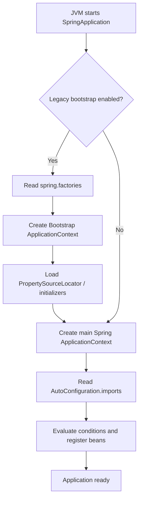

# Distinguishing AutoConfiguration.imports from BootstrapConfiguration in spring.factories

## 1. Why Are There Two Registration Mechanisms?

In a Spring Cloud application, some configurations need to load into the main Spring Boot ApplicationContext, while others must participate in an earlier bootstrap phase to prepare the Environment or initialize external configuration sources.

Two common mechanisms have similar-sounding roles:

- `META-INF/spring/org.springframework.boot.autoconfigure.AutoConfiguration.imports`: the list of auto-configuration classes Spring Boot reads to configure the main ApplicationContext.
- `META-INF/spring.factories` with the key `org.springframework.cloud.bootstrap.BootstrapConfiguration`: the list of configurations Spring Cloud uses to create the Bootstrap ApplicationContext in the legacy bootstrap mechanism.

The common point of confusion is that both register configuration classes inside a JAR, yet they are read by different mechanisms, at different times, and for different purposes. `AutoConfiguration.imports` does not replace all of `spring.factories`; it is specifically the current Spring Boot auto-configuration registration mechanism.

After this lesson, you will be able to:

- Choose the right metadata file for auto-configuration and bootstrap configuration.
- Explain when each configuration type loads in the startup lifecycle.
- Register an auto-configuration inside a JAR using `AutoConfiguration.imports`.
- Register `BootstrapConfiguration` in `spring.factories` and enable legacy bootstrap.
- Distinguish legacy bootstrap from Spring Boot Config Data via `spring.config.import`.
- Inspect packaged JARs and design appropriate tests for each mechanism.

## 2. Two Mechanisms Serving Two Different Phases

### 2.1. AutoConfiguration.imports

`AutoConfiguration.imports` belongs to Spring Boot. When an application enables auto-configuration via `@EnableAutoConfiguration` or `@SpringBootApplication`, Spring Boot looks for resources at:

`META-INF/spring/org.springframework.boot.autoconfigure.AutoConfiguration.imports`

Each line in the file is the fully qualified name of an auto-configuration class. Spring Boot passes these classes through condition evaluation and registers beans in the main ApplicationContext.

Auto-configurations are usually annotated with `@AutoConfiguration`, combined with conditions like `@ConditionalOnClass`, `@ConditionalOnProperty`, and `@ConditionalOnMissingBean` so they only configure beans when matching dependencies exist and the application has not provided a replacement bean.

Example:

```text
com.example.inventory.autoconfigure.InventoryAutoConfiguration
com.example.inventory.autoconfigure.InventoryWebAutoConfiguration
```

This file does not use `key=value` entries. It is simply a list of class names, one per line. Lines starting with `#` can be used for comments.

### 2.2. BootstrapConfiguration

`BootstrapConfiguration` belongs to Spring Cloud and is only used when legacy bootstrap is enabled. Spring Cloud looks for the file:

`META-INF/spring.factories`

and reads the key:

`org.springframework.cloud.bootstrap.BootstrapConfiguration`

The key's value is a comma-separated list of `@Configuration` classes used to build the Bootstrap ApplicationContext.

Example:

```properties
org.springframework.cloud.bootstrap.BootstrapConfiguration=\
com.example.bootstrap.InventoryBootstrapConfiguration,\
com.example.bootstrap.RemotePropertySourceBootstrapConfiguration
```

The bootstrap context is created as the parent context of the main application. It typically contains components that need to run early, such as `PropertySourceLocator` or `ApplicationContextInitializer`. Property sources loaded during the bootstrap phase can be added to the Environment before the main ApplicationContext finishes configuring itself.

### 2.3. Quick Comparison Table

| Criterion | AutoConfiguration.imports | BootstrapConfiguration |
| --- | --- | --- |
| Ecosystem | Spring Boot | Spring Cloud |
| Metadata file | `META-INF/spring/org.springframework.boot.autoconfigure.AutoConfiguration.imports` | `META-INF/spring.factories` |
| Registration format | List of class names, one class per line | `org.springframework.cloud.bootstrap.BootstrapConfiguration` key with comma-separated class list |
| Timing | Phase when Spring Boot processes auto-configuration for the application context | Bootstrap phase before the main application context is created |
| Target context | Main ApplicationContext | Bootstrap ApplicationContext, parent of the main context |
| Purpose | Provide default beans and integrations for the application | Prepare early configuration, PropertySources, and initializers |
| Class annotation | Typically `@AutoConfiguration` | Uses `@Configuration` |
| Activation mechanism | `@EnableAutoConfiguration` or `@SpringBootApplication` | `spring-cloud-starter-bootstrap` or `spring.cloud.bootstrap.enabled=true` from system property/environment |
| Typical examples | Creating default clients, gateways, converters, health indicators | Creating `PropertySourceLocator`, loading configuration sources before main context |

## 3. Startup Lifecycle and Where Each Mechanism Fits

The following diagram illustrates the general flow when an application uses legacy bootstrap:



If legacy bootstrap is not enabled, the branch reading `BootstrapConfiguration` does not run. Spring Boot still reads `AutoConfiguration.imports` normally when auto-configuration is enabled.

### 3.1. The Bootstrap Context Is the Parent Context

In the legacy model, Spring Cloud creates the Bootstrap ApplicationContext before the main context. The bootstrap context is the parent of the main context; beans in the parent can be looked up from the child context according to Spring's ApplicationContext hierarchy rules.

The two contexts share an Environment under the bootstrap mechanism described by Spring Cloud. The bootstrap context can load property sources from external sources and pass initializers to the main SpringApplication before the application initializes.

Do not equate `bootstrap.yml` with `BootstrapConfiguration`:

- `bootstrap.yml` is a property file used to configure the bootstrap context.
- `BootstrapConfiguration` is a Java class registered in `spring.factories` to create beans for the bootstrap context.
- You can use `BootstrapConfiguration` without needing a `bootstrap.yml` if those file properties are not required.

### 3.2. Auto-Configuration Runs in the Main Context

Auto-configuration is not a mechanism for creating a parent context. It adds default beans into the main ApplicationContext after Spring Boot enables auto-configuration.

Auto-configurations are generally designed to back off when an application declares its own beans. For example, `@ConditionalOnMissingBean` lets a starter provide a default implementation without overriding configuration intentionally created by the application.

Therefore, an `@AutoConfiguration` is suited for creating `InventoryClient`, `InventoryGateway`, or `InventoryHealthIndicator` when the application needs that capability. If you need to load remote property sources before the main context processes configuration, that is a bootstrap or Config Data concern, not the purpose of `AutoConfiguration.imports`.

## 4. Declaring Auto-Configuration via AutoConfiguration.imports

Suppose a team builds a starter providing a gateway for the inventory service.

### 4.1. Writing the Auto-Configuration Class

```java
package com.example.inventory.autoconfigure;

import com.example.inventory.client.InventoryClient;
import com.example.inventory.service.InventoryGateway;
import org.springframework.boot.autoconfigure.AutoConfiguration;
import org.springframework.boot.autoconfigure.condition.ConditionalOnBean;
import org.springframework.boot.autoconfigure.condition.ConditionalOnClass;
import org.springframework.boot.autoconfigure.condition.ConditionalOnMissingBean;
import org.springframework.boot.autoconfigure.condition.ConditionalOnProperty;
import org.springframework.context.annotation.Bean;

@AutoConfiguration
@ConditionalOnClass(InventoryClient.class)
@ConditionalOnProperty(
        prefix = "acme.inventory",
        name = "enabled",
        havingValue = "true",
        matchIfMissing = true
)
public class InventoryAutoConfiguration {

    @Bean
    @ConditionalOnBean(InventoryClient.class)
    @ConditionalOnMissingBean
    InventoryGateway inventoryGateway(InventoryClient inventoryClient) {
        return new InventoryGateway(inventoryClient);
    }
}
```

This class is applied only when `InventoryClient` is on the classpath and the `acme.inventory.enabled` property allows it. The default bean is not created if the application already has a matching `InventoryGateway` bean.

### 4.2. Placing the Imports File in Resources

In the auto-configuration module, create the exact path:

```text
src/main/resources/
└── META-INF/
    └── spring/
        └── org.springframework.boot.autoconfigure.AutoConfiguration.imports
```

File contents:

```text
com.example.inventory.autoconfigure.InventoryAutoConfiguration
```

When building the JAR, the resource must be packaged at the corresponding path:

```text
META-INF/spring/org.springframework.boot.autoconfigure.AutoConfiguration.imports
```

Do not put this file's entries into `META-INF/spring.factories` for modern Boot. Current Spring Boot discovers auto-configuration candidates from the `AutoConfiguration.imports` resource.

### 4.3. Ordering and Component Scanning

If an auto-configuration must run before or after another auto-configuration, use the `before`, `beforeName`, `after`, and `afterName` attributes on `@AutoConfiguration`, or `@AutoConfigureBefore` and `@AutoConfigureAfter`.

Auto-configurations should reside in a dedicated library package and must not accidentally become targets of application component scanning. Spring Boot expects auto-configurations to be loaded via the imports file; do not use `@ComponentScan` inside an auto-configuration to scan entire packages.

## 5. Declaring BootstrapConfiguration in spring.factories

Suppose you need to load an additional property source before the main context initializes. You can provide a `PropertySourceLocator` inside a `BootstrapConfiguration`.

### 5.1. Writing the Bootstrap Configuration

```java
package com.example.inventory.bootstrap;

import java.util.Collections;

import org.springframework.cloud.bootstrap.config.PropertySourceLocator;
import org.springframework.context.annotation.Bean;
import org.springframework.context.annotation.Configuration;
import org.springframework.core.env.Environment;
import org.springframework.core.env.MapPropertySource;
import org.springframework.core.env.PropertySource;

@Configuration(proxyBeanMethods = false)
public class InventoryBootstrapConfiguration {

    @Bean
    PropertySourceLocator inventoryPropertySourceLocator() {
        return new PropertySourceLocator() {
            @Override
            public PropertySource<?> locate(Environment environment) {
                String applicationName =
                        environment.getProperty("spring.application.name", "unknown");

                return new MapPropertySource(
                        "inventoryBootstrap",
                        Collections.<String, Object>singletonMap(
                                "inventory.bootstrap.application",
                                applicationName
                        )
                );
            }
        };
    }
}
```

This example creates a simple property source to illustrate where `PropertySourceLocator` operates. In a production system, a locator might query a configuration service or another data source; design dedicated timeouts, authentication, retries, and error handling.

### 5.2. Registering the Class in spring.factories

Create the file:

```text
src/main/resources/META-INF/spring.factories
```

Add the key and class name:

```properties
org.springframework.cloud.bootstrap.BootstrapConfiguration=\
com.example.inventory.bootstrap.InventoryBootstrapConfiguration
```

Spring Cloud uses this list of classes to construct the bootstrap context. You can register multiple classes separated by commas. To control ordering, use `@Order`; the default order is lowest precedence (last).

### 5.3. Enabling Legacy Bootstrap

Starting with Spring Boot/Spring Cloud generations that use Config Data, legacy bootstrap is no longer enabled automatically merely by including `spring-cloud-starter-config`. It must be enabled explicitly in one of two ways:

- Add the `org.springframework.cloud:spring-cloud-starter-bootstrap` dependency.
- Set `spring.cloud.bootstrap.enabled=true` as a system property or environment variable before `SpringApplication` starts.

JVM invocation example:

```bash
java -Dspring.cloud.bootstrap.enabled=true -jar inventory-service.jar
```

Or set an environment variable before running:

```bash
SPRING_CLOUD_BOOTSTRAP_ENABLED=true
```

Putting `spring.cloud.bootstrap.enabled=true` only inside `application.yml` is usually too late to trigger bootstrap context creation, because the application file itself is loaded while initializing the main context. Use a system property, environment variable, or the bootstrap starter as documented for your version.

### 5.4. Be Careful with Component Scanning

Spring Cloud advises against letting `BootstrapConfiguration` classes be accidentally scanned into the main ApplicationContext. Place bootstrap classes in a separate package outside the `@ComponentScan` scope or root package of `@SpringBootApplication`.

If the same class is both component-scanned into the main context and instantiated by the bootstrap loader in the parent context, the application may end up with two bean instances across two contexts. This causes confusion around lifecycle, dependencies, and configuration.

## 6. spring.factories Has Not Disappeared

`spring.factories` is the registration mechanism for many Spring ecosystem extensions via `SpringFactoriesLoader`. `BootstrapConfiguration` is one of the keys Spring Cloud reads.

Spring Boot moving auto-configuration to `AutoConfiguration.imports` does not mean every key in `spring.factories` must move to a new file.

| Registration target | Mechanism |
| --- | --- |
| Current Spring Boot auto-configuration | `AutoConfiguration.imports` |
| Spring Cloud legacy bootstrap configuration | `spring.factories` with key `org.springframework.cloud.bootstrap.BootstrapConfiguration` |
| Other Spring/Boot factory extensions | Continue using `spring.factories` if required by the extension point |
| Spring Boot auto-configuration in older versions before imports | Historically used key `org.springframework.boot.autoconfigure.EnableAutoConfiguration` in `spring.factories` |

In older Spring Boot versions, auto-configuration libraries typically had:

```properties
org.springframework.boot.autoconfigure.EnableAutoConfiguration=\
com.example.inventory.autoconfigure.InventoryAutoConfiguration
```

This is the historical key for registering Boot auto-configuration. It is not the Spring Cloud bootstrap key. For libraries targeting modern Spring Boot, use `AutoConfiguration.imports` per that version's documentation; do not confuse Boot's legacy key with `org.springframework.cloud.bootstrap.BootstrapConfiguration`.

## 7. Modern Config Data vs. Legacy Bootstrap

Spring Boot 2.4 introduced the Config Data API via `spring.config.import`. Spring Cloud Config Client now uses this as the default way to fetch configuration from Config Server.

Example in `application.yml`:

```yaml
spring:
  config:
    import: "optional:configserver:"
```

Or in `application.properties`:

```properties
spring.config.import=optional:configserver:
```

With this approach, you do not need `bootstrap.yml` just to connect to Config Server. If you omit the `optional:` prefix, the application fails startup when it cannot reach Config Server; if you keep `optional:`, connecting is not mandatory when the server is unavailable.

### 7.1. Comparing the Two Ways to Load Configuration

| Criterion | Config Data API | Legacy Bootstrap |
| --- | --- | --- |
| Activation | `spring.config.import=configserver:` | `spring-cloud-starter-bootstrap` or system property/environment `spring.cloud.bootstrap.enabled=true` |
| Timing | During Spring Boot's Config Data processing | Creates bootstrap context before main context |
| Typical files | `application.yml` or `application.properties` | Can use `bootstrap.yml` or `bootstrap.properties` |
| Primary customization | Config Data resolvers/loaders and import mechanism | `BootstrapConfiguration`, `PropertySourceLocator`, `ApplicationContextInitializer` |
| Config source ordering | According to import order and Config Data rules | According to bootstrap context and Spring Cloud property source ordering |
| Recommendation | Modern default for Config Server | Use only when compatibility or legacy bootstrap behavior is required |

`AutoConfiguration.imports` and `BootstrapConfiguration` are not direct drop-in replacements for one another. Nor is the Config Data API merely an alternate syntax for `BootstrapConfiguration`; it is Spring Boot's own configuration-loading mechanism.

### 7.2. When Is BootstrapConfiguration Still Needed?

The legacy bootstrap mechanism may still be appropriate when:

- An application relies on a legacy integration built around `PropertySourceLocator`.
- An `ApplicationContextInitializer` needs to run before the main context is created.
- A system is maintaining bootstrap behavior compatible with an older Spring Cloud platform.
- An internal library is explicitly designed to participate in the bootstrap context.

If you simply need to pull configuration from Spring Cloud Config Server in a new application, start with Config Data import. Enable legacy bootstrap only when there is a concrete technical requirement and you have checked the guide for your Spring Cloud version.

## 8. Can One JAR Contain Both Mechanisms?

Yes. A library can provide auto-configuration for the main context and a bootstrap integration for applications using legacy bootstrap. In that case, the JAR can include two independent resources:

```text
META-INF/
├── spring/
│   └── org.springframework.boot.autoconfigure.AutoConfiguration.imports
└── spring.factories
```

Example contents:

```text
# META-INF/spring/org.springframework.boot.autoconfigure.AutoConfiguration.imports
com.example.inventory.autoconfigure.InventoryAutoConfiguration
```

```properties
# META-INF/spring.factories
org.springframework.cloud.bootstrap.BootstrapConfiguration=\
com.example.inventory.bootstrap.InventoryBootstrapConfiguration
```

The two resources are read independently by two separate mechanisms. When legacy bootstrap is not enabled, the `BootstrapConfiguration` part is ignored; Boot auto-configurations can still be loaded.

If a library supports both initialization styles, keep class responsibilities cleanly separated. Do not register the same class in both files “just to be sure it loads,” because the two contexts have different lifecycles and can create duplicate beans at two levels.

## 9. Common Errors

| Symptom | Possible cause | Resolution |
| --- | --- | --- |
| Auto-configuration does not appear | Wrong path or filename for imports resource | Verify `META-INF/spring/org.springframework.boot.autoconfigure.AutoConfiguration.imports` inside the JAR |
| `BootstrapConfiguration` is not invoked | Legacy bootstrap is not enabled | Add the bootstrap starter or set the system property/environment variable before startup |
| Added `BootstrapConfiguration` to `AutoConfiguration.imports` but no bootstrap context is created | Registered under the wrong mechanism | Move the registration to `spring.factories` under the Spring Cloud key |
| Added auto-configuration to `spring.factories` but modern Boot does not load it | Used legacy registration mechanism | Register the class in `AutoConfiguration.imports` |
| Bootstrap bean appears twice | Bootstrap class was also component-scanned into main context | Move the bootstrap package outside component scanning |
| Property source is missing from Environment | `PropertySourceLocator` not registered or bootstrap not active | Check resource, key, bootstrap activation, and startup logs |
| Config Server is not called | Using Config Data but only configured legacy bootstrap | Add `spring.config.import` or explicitly enable legacy bootstrap as needed |
| Properties in `bootstrap.yml` have no effect | Bootstrap context was not activated | Check starter or system property/environment variable |
| Application starts but auto-configuration creates no beans | Classpath/property/bean condition did not match | Check Condition Evaluation Report and dependency tree |
| Same JAR behaves differently across Boot versions | Registration mechanism differences across versions | Check compatibility matrix and artifact resource metadata |

## 10. Inspecting Packaged JAR Contents

Do not check only files under `src/main/resources`; verify the actual resources inside the released JAR.

List resources:

```bash
jar tf target/inventory-autoconfigure.jar
```

The output should contain the paths:

```text
META-INF/spring/org.springframework.boot.autoconfigure.AutoConfiguration.imports
META-INF/spring.factories
```

If the library only supports auto-configuration, `spring.factories` may not exist. If it only supports legacy bootstrap, `AutoConfiguration.imports` may not exist. What matters is that the right resource is packaged and its content points to real classes.

Inspect resource contents using a JAR extraction tool or by opening the JAR as a ZIP archive. In multi-module builds, inspect the final artifact actually consumed by applications, not just the source module.

## 11. Testing Each Mechanism

Do not use a single type of test to conclude that both mechanisms work.

### 11.1. Testing AutoConfiguration.imports

For auto-configuration, use `ApplicationContextRunner` to load the configuration class directly and verify beans/conditions:

```java
class InventoryAutoConfigurationTests {

    private final ApplicationContextRunner contextRunner =
            new ApplicationContextRunner()
                    .withConfiguration(
                            AutoConfigurations.of(InventoryAutoConfiguration.class)
                    );

    @Test
    void createsDefaultGatewayWhenEnabled() {
        contextRunner
                .withPropertyValues("acme.inventory.enabled=true")
                .withBean(InventoryClient.class, FakeInventoryClient::new)
                .run(context -> assertThat(context)
                        .hasSingleBean(InventoryGateway.class));
    }

    @Test
    void backsOffWhenApplicationProvidesGateway() {
        contextRunner
                .withPropertyValues("acme.inventory.enabled=true")
                .withBean(InventoryClient.class, FakeInventoryClient::new)
                .withBean(InventoryGateway.class, CustomInventoryGateway::new)
                .run(context -> assertThat(context)
                        .hasSingleBean(InventoryGateway.class));
    }
}
```

This test checks bean conditions and auto-configuration back-off behavior. To verify actual resource discovery, add an integration test running an application from the packaged artifact without directly importing the configuration class.

### 11.2. Testing BootstrapConfiguration

`ApplicationContextRunner` does not simulate the full legacy bootstrap lifecycle. Run a `SpringApplication` or integration test with bootstrap enabled and verify:

1. The bootstrap context is created before the main context.
2. The class declared in `spring.factories` is loaded.
3. `PropertySourceLocator` adds the property source to Environment.
4. `ApplicationContextInitializer` is applied before the main context refreshes.
5. Bootstrap beans are not duplicated by component scanning in the main context.

The test must enable bootstrap via system properties or test JVM arguments, or include the bootstrap starter in the test runtime. Do not merely put `spring.cloud.bootstrap.enabled=true` in `application.yml` and assume the mechanism is enabled.

### 11.3. Testing Config Data

If the application uses `spring.config.import`, test configuration import separately:

```yaml
spring:
  config:
    import: "optional:configserver:"
```

You can run against a test Config Server or an appropriate mock endpoint, confirm external properties appear in Environment, and verify behavior when the server is unavailable. This tests the Config Data flow, not `BootstrapConfiguration`.

## 12. Checklist for Shared Library Development

Before releasing a starter or Spring Cloud integration library, verify:

1. Determine whether the configuration class needs to run in the main context or the bootstrap context.
2. Use `@AutoConfiguration` and `AutoConfiguration.imports` for current Spring Boot auto-configurations.
3. Use `BootstrapConfiguration` in `spring.factories` only when legacy bootstrap is genuinely needed.
4. If using legacy bootstrap, document clearly how to enable it via starter or system property/environment variable.
5. Place bootstrap classes in a separate package outside application component scanning.
6. Use classpath, property, and bean conditions to avoid creating configurations when dependencies are absent.
7. Allow applications to replace default beans via `@ConditionalOnMissingBean`.
8. Do not use `AutoConfiguration.imports` to replace a `PropertySourceLocator` that must run in the bootstrap phase.
9. For Config Server in new applications, prefer `spring.config.import` unless there is a reason to use legacy bootstrap.
10. Inspect metadata resources inside the packaged JAR.
11. Test auto-configuration and bootstrap lifecycle with separate tests.
12. Verify compatibility with the Spring Boot and Spring Cloud versions your library claims to support.

## 13. References

- [Spring Boot — Creating Your Own Auto-configuration](https://docs.spring.io/spring-boot/reference/features/developing-auto-configuration.html): `@AutoConfiguration`, `AutoConfiguration.imports` resource, conditions, ordering, and testing.
- [Spring Cloud Commons — Application Context Services](https://docs.spring.io/spring-cloud-commons/reference/spring-cloud-commons/application-context-services.html): Bootstrap ApplicationContext, `BootstrapConfiguration`, `spring.factories`, `PropertySourceLocator`, and context hierarchy.
- [Spring Cloud Config Client](https://docs.spring.io/spring-cloud-config/reference/client.html): Config Data import, Config First Bootstrap, and enabling legacy bootstrap.
- [Spring Boot 2.7 — Creating Your Own Auto-configuration](https://docs.spring.io/spring-boot/docs/2.7.17/reference/htmlsingle/index.html): auto-configuration documentation using `AutoConfiguration.imports` in the Boot 2.7 generation.

`AutoConfiguration.imports` registers Spring Boot auto-configurations to create beans in the main ApplicationContext. `BootstrapConfiguration` registers configurations for Spring Cloud's legacy Bootstrap ApplicationContext via a dedicated key in `spring.factories`. Choose the right mechanism based on when the configuration needs to run and which context needs configuring; if you only need to load configuration from Config Server in a new application, start with the Config Data API via `spring.config.import`.