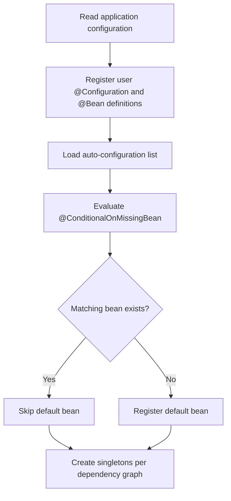

# Designing Custom Beans So Default Auto-Configuration Backs Off

## 1. The Problem

Spring Boot and Spring Cloud provide many auto-configured beans so an application can run with minimal setup code. For example, an application can receive a `DiscoveryClient`, `ServiceRegistry`, or `ReactiveLoadBalancer` from starters added to the classpath.

When the default configuration does not meet requirements, the application may need to replace it with a custom implementation. Good design lets auto-configuration back off automatically whenever a matching bean already exists. That way, the application selects the desired behavior without modifying library source code or creating two competing beans.

A typical scenario:

- The starter provides a default `GreetingService`.
- The application wants a `GreetingService` with custom rules.
- If the application declares no bean, the starter creates the default bean.
- If the application already declares a matching bean, the starter skips the default bean.

Spring Boot supports this pattern via `ConditionalOnMissingBean`. However, the annotation only works properly when the custom bean is registered in the right ApplicationContext, has the appropriate type, and is processed before the auto-configuration that needs to back off.

This lesson belongs to the **Auto-Configuration Customization** chapter of the **SPRING_CLOUD_CORE** module. The module helps learners understand core Spring Cloud abstractions, Spring Cloud Context, externalized configuration, discovery, service registry, service-to-service communication, and testability and operations.

After this lesson, you will be able to:

- Explain how auto-configuration creates default beans conditionally.
- Use `ConditionalOnMissingBean` to allow applications to replace implementations.
- Design `@Bean` methods with sufficiently specific return types for conditions to recognize.
- Distinguish back-off from `Primary`, `Qualifier`, and bean definition overriding.
- Choose between properties, customizers, custom beans, and excluding entire auto-configurations.
- Customize Spring Cloud LoadBalancer configuration per service ID.
- Test both the default bean case and the custom application bean case.

## 2. Auto-Configuration and Default Beans

Auto-configuration is the mechanism by which Spring Boot automatically registers configuration based on the classpath, existing bean definitions, environment, and application type. An auto-configuration typically carries conditions so it only creates beans when appropriate criteria match.

For example, a library might create a default service:

```java
@AutoConfiguration
public class GreetingAutoConfiguration {

    @Bean
    @ConditionalOnMissingBean(GreetingService.class)
    DefaultGreetingService defaultGreetingService() {
        return new DefaultGreetingService();
    }
}
```

When no bean satisfying `GreetingService` exists yet, the method above creates `DefaultGreetingService`. If the application has already registered a bean implementing `GreetingService`, the condition does not match and the method does not register the default bean.

This lets a starter provide ready-to-use behavior while preserving customization control for the application consuming the starter.

### 2.1. How Is Auto-Configuration Loaded?

With Spring Boot 3.x and 4.x, libraries publish auto-configurations via the resource:

```text
META-INF/spring/org.springframework.boot.autoconfigure.AutoConfiguration.imports
```

The resource content lists the fully qualified name of each auto-configuration class, one class per line:

```text
com.example.greeting.autoconfigure.GreetingAutoConfiguration
```

Applications using the starter do not need to component-scan the library's packages to find auto-configurations. Spring Boot loads the classes declared in the imports resource and evaluates their conditions.

In older Spring Boot generations, auto-configuration registration could use `EnableAutoConfiguration` in `META-INF/spring.factories`. When upgrading libraries, use the registration format appropriate for the target Boot version.

## 3. How Does ConditionalOnMissingBean Work?

`ConditionalOnMissingBean` is a condition that matches only when no bean satisfying the specified criteria exists in the BeanFactory yet.

Example:

```java
@Bean
@ConditionalOnMissingBean(GreetingService.class)
DefaultGreetingService defaultGreetingService() {
    return new DefaultGreetingService();
}
```

The condition checks by type `GreetingService`. Any bean matching this type can prevent the default bean from being registered, even if that bean's implementation has a different name.

If `value`, `type`, `name`, or `annotation` is not specified, the target type is inferred from the `@Bean` method's return type. When designing auto-configurations, explicitly specify the type to check when the contract is an interface or stable abstraction.

### 3.1. Conditions Only See Processed Bean Definitions

Conditions are evaluated based on the bean definitions that the application context has processed up to that point. They do not wait for all singletons to be instantiated before deciding.

This is why Spring Boot recommends placing `ConditionalOnBean` and `ConditionalOnMissingBean` on auto-configurations: auto-configurations are loaded after user-declared bean definitions.

Overview sequence:



If a condition is placed on a regular configuration processed too early, a custom bean declared in another configuration might not yet appear in the bean definition registry at check time. Do not rely on accidental component-scan ordering to achieve back-off.

### 3.2. Distinguishing Class-Level and Bean-Method-Level Conditions

You can place the condition at the class level:

```java
@AutoConfiguration
@ConditionalOnMissingBean(GreetingService.class)
public class GreetingAutoConfiguration {

    @Bean
    DefaultGreetingService defaultGreetingService() {
        return new DefaultGreetingService();
    }
}
```

Or on the bean method:

```java
@AutoConfiguration
public class GreetingAutoConfiguration {

    @Bean
    @ConditionalOnMissingBean(GreetingService.class)
    DefaultGreetingService defaultGreetingService() {
        return new DefaultGreetingService();
    }
}
```

A class-level condition prevents the configuration class itself from being registered as a bean configuration when the condition does not match. A bean-method condition only prevents that specific method from creating a bean; other bean methods in the same configuration can still be registered.

For a single default bean, placing the condition directly on the `@Bean` method usually makes the back-off scope clearer.

### 3.3. Ordering Between Auto-Configurations

A bean condition may depend on a bean created by another auto-configuration. In that case, the checking auto-configuration must be processed after the configuration providing that bean. You can declare ordering using the `after`/`before` attributes on `@AutoConfiguration`:

```java
@AutoConfiguration(after = MetricsAutoConfiguration.class)
public class GreetingMetricsAwareAutoConfiguration {
    // Beans here are defined after MetricsAutoConfiguration.
}
```

This ordering controls when bean definitions are registered so conditions see the right candidates. It does not control singleton initialization order; initialization still relies on the dependency graph and dependency relationships.

## 4. Complete Example: Application Provides Its Own Bean

Suppose the library defines a contract:

```java
public interface GreetingService {
    String greet(String name);
}
```

Default implementation:

```java
public class DefaultGreetingService implements GreetingService {

    @Override
    public String greet(String name) {
        return "Hello, " + name;
    }
}
```

Auto-configuration:

```java
import org.springframework.boot.autoconfigure.AutoConfiguration;
import org.springframework.boot.autoconfigure.condition.ConditionalOnMissingBean;
import org.springframework.context.annotation.Bean;

@AutoConfiguration
public class GreetingAutoConfiguration {

    @Bean
    @ConditionalOnMissingBean(GreetingService.class)
    DefaultGreetingService defaultGreetingService() {
        return new DefaultGreetingService();
    }
}
```

An application that wants to customize the greeting can declare a bean:

```java
import org.springframework.context.annotation.Bean;
import org.springframework.context.annotation.Configuration;

@Configuration(proxyBeanMethods = false)
public class ApplicationGreetingConfiguration {

    @Bean
    CustomGreetingService customGreetingService() {
        return new CustomGreetingService();
    }
}
```

Custom implementation:

```java
public class CustomGreetingService implements GreetingService {

    @Override
    public String greet(String name) {
        return "Greetings, " + name + "!";
    }
}
```

When `ApplicationGreetingConfiguration` is registered in the application context, the `CustomGreetingService` bean is present before Spring evaluates auto-configuration. The condition finds a bean implementing `GreetingService`, so `defaultGreetingService()` is not called to register the default bean.

Ensure `ApplicationGreetingConfiguration` is actually loaded: place it within the application's component-scan scope or import it explicitly with `@Import` if it resides outside that scope.

Consumers depend only on the contract:

```java
@Service
public class WelcomeController {

    private final GreetingService greetingService;

    public WelcomeController(GreetingService greetingService) {
        this.greetingService = greetingService;
    }

    public String welcome(String name) {
        return greetingService.greet(name);
    }
}
```

Consumers do not need to know whether the bean came from the starter or the application. That is the benefit of designing auto-configuration around abstractions rather than depending on default implementations.

### 4.1. @Bean Method Return Types Are Crucial

When declaring a custom bean, return an appropriately concrete type:

```java
@Bean
CustomGreetingService customGreetingService() {
    return new CustomGreetingService();
}
```

Spring Boot can use the method's return type metadata to evaluate bean conditions without instantiating beans. If a method only returns `Object`, an overly broad type, or a type that does not expose the contract being checked, conditions may fail to recognize the bean as expected during definition processing.

Let `ConditionalOnMissingBean` check the contract used by consumers, such as `GreetingService.class`, and declare a concrete return type on the method creating the default bean.

## 5. Patterns Easily Confused with Back-Off

`ConditionalOnMissingBean` decides whether a default bean is registered. Several other mechanisms serve different purposes.

| Mechanism | Effect | Does it make auto-configuration back off? |
| --- | --- | --- |
| `ConditionalOnMissingBean` | Skips default bean if a matching bean already exists. | Yes, when the condition and processing order are right. |
| `Primary` | Prioritizes one bean when injection has multiple candidates of the same type. | No. The default bean may still be created. |
| `Qualifier` | Selects a specific bean at the injection point. | No. |
| Same bean name | Identifies a bean by name in the context. | Does not automatically trigger type-based back-off; only affects conditions checking by name. |
| `spring.main.allow-bean-definition-overriding` | Allows a new bean definition to replace one with the same name in certain cases. | Not a back-off mechanism; can mask duplicate configurations. |
| Exclude auto-configuration | Skips loading the entire selected auto-configuration. | Removes configuration, but with a broader scope than replacing a single bean. |

### 5.1. Primary Does Not Make the Default Bean Disappear

Example:

```java
@Bean
@Primary
CustomGreetingService customGreetingService() {
    return new CustomGreetingService();
}
```

If auto-configuration lacks an appropriate condition or the condition does not see this bean, both the default bean and the custom bean can coexist. `Primary` only helps Spring pick the custom bean for injection by type when multiple candidates exist. The default bean remains in the context and can still be retrieved by name or qualifier.

If the goal is to replace the default implementation, use a contract bean condition so the default bean is never created. Use `Primary` only when you genuinely intend to keep multiple implementations and select one as the default injection candidate.

### 5.2. Bean Name Override Is a Different Mechanism

Suppose an auto-configuration declares a bean named `greetingService` and the application also declares a bean with the same name. That is a bean definition name collision. The outcome depends on overriding policy and how the context registers definitions.

Do not rely on matching bean names to replace a default bean designed with `ConditionalOnMissingBean`. Declare the bean by contract and let the condition perform back-off. This is clearer, does not depend on `spring.main.allow-bean-definition-overriding`, and is easier to test.

## 6. Choosing the Right Level of Customization

Not every change requires replacing an entire bean. Pick the smallest customization mechanism that meets the requirement.

| Need | Approach |
| --- | --- |
| Changing URLs, timeouts, service names, or feature flags | Use configuration properties if supported by auto-configuration. |
| Adding headers, interceptors, converters, or callbacks | Use a customizer/hook provided by the library. |
| Replacing core algorithm or behavior | Provide a bean implementation matching the contract checked by auto-configuration. |
| Disabling an entire integration | Exclude the corresponding auto-configuration. |

### 6.1. Prefer Properties When Only Values Change

If the library provides `ConfigurationProperties`, changing configuration values is usually lower risk than replacing beans.

Example:

```yaml
spring:
  cloud:
    loadbalancer:
      retry:
        enabled: false
      cache:
        ttl: 20s
```

A property only takes effect if the module's auto-configuration reads and supports it. Do not assume a property can change every implementation detail.

### 6.2. Use Customizers When Keeping Default Configuration

Customizers let you add partial behavior without rebuilding the entire bean yourself.

General example:

```java
import org.springframework.boot.web.client.RestClientCustomizer;
import org.springframework.context.annotation.Bean;

@Bean
RestClientCustomizer restClientCustomizer() {
    return builder -> builder.defaultHeader(
            "X-Application", "inventory-api");
}
```

This example uses `RestClientCustomizer` from Spring Boot 3.2 and later. Customizers fit when you want to retain the client, connection pool, and lifecycle managed by the framework, while adding headers or tweaking part of the builder. In Spring Boot 4, `RestClientCustomizer` moved to package `org.springframework.boot.restclient`; use the import matching your application's Boot version.

Customizer names and scope depend on the module. Check the documentation of the specific client to know whether a customizer affects all clients or only a single builder/instance.

### 6.3. Replace Beans When Behavior Must Change

If requirements call for changing algorithms, state, or integrations, provide a bean implementing the abstraction that auto-configuration uses as an extension point. Examples include `ServiceInstanceListSupplier`, `ReactorLoadBalancer`, `DiscoveryClient`, or an application-defined service.

When replacing a bean, understand the dependencies the new implementation must provide, its lifecycle, and the hooks consumers expect. A bean of the same type that lacks expected auxiliary behavior can allow the application to start up successfully yet fail at runtime.

### 6.4. Exclude When Not Using the Integration

If the application does not want an entire auto-configuration, exclude it via `spring.autoconfigure.exclude` or the `exclude` attribute of `@SpringBootApplication` / `@EnableAutoConfiguration`.

Example:

```yaml
spring:
  autoconfigure:
    exclude:
      - com.example.greeting.autoconfigure.GreetingAutoConfiguration
```

Excluding removes every bean provided by that auto-configuration. If you only want to replace one bean, use conditional back-off rather than excluding the whole configuration and rebuilding every component yourself.

## 7. Other Conditions That Combine with Back-Off

Auto-configurations often require multiple conditions together:

| Annotation | Checks |
| --- | --- |
| `ConditionalOnClass` | Required class is on the classpath. |
| `ConditionalOnMissingClass` | A class is absent from the classpath. |
| `ConditionalOnBean` | Required dependent bean already exists. |
| `ConditionalOnMissingBean` | Bean that the configuration wants to provide by default does not exist yet. |
| `ConditionalOnProperty` | Property has a matching value. |
| `ConditionalOnResource` | Required resource exists. |
| `ConditionalOnWebApplication` | Application runs in the specified web context type. |
| `ConditionalOnSingleCandidate` | Exactly one candidate bean exists, or one primary candidate. |

Example:

```java
@AutoConfiguration
@ConditionalOnClass(GreetingService.class)
@ConditionalOnProperty(
        prefix = "example.greeting",
        name = "enabled",
        havingValue = "true",
        matchIfMissing = true)
public class GreetingAutoConfiguration {

    @Bean
    @ConditionalOnMissingBean(GreetingService.class)
    DefaultGreetingService defaultGreetingService() {
        return new DefaultGreetingService();
    }
}
```

In this example, the auto-configuration is only considered when the class is present and the property enables it. Then, the bean method only creates the default service if no matching bean exists yet.

Do not cram every condition into one hard-to-read expression. Each condition should reflect a concrete requirement of the integration.

## 8. Customizing Spring Cloud LoadBalancer per Service ID

Spring Cloud LoadBalancer is a real-world example of per-client custom configuration. An application can use a dedicated configuration for `stores` while keeping the default configuration for other services.

Registering the custom configuration:

```java
import org.springframework.cloud.loadbalancer.annotation.LoadBalancerClient;
import org.springframework.context.annotation.Configuration;

@Configuration(proxyBeanMethods = false)
@LoadBalancerClient(
        value = "stores",
        configuration = StoresLoadBalancerConfiguration.class)
public class LoadBalancerClientRegistration {
}
```

Configuration class for the `stores` client:

```java
import org.springframework.cloud.client.ServiceInstance;
import org.springframework.cloud.loadbalancer.core.RandomLoadBalancer;
import org.springframework.cloud.loadbalancer.core.ReactorLoadBalancer;
import org.springframework.cloud.loadbalancer.core.ServiceInstanceListSupplier;
import org.springframework.cloud.loadbalancer.support.LoadBalancerClientFactory;
import org.springframework.context.annotation.Bean;
import org.springframework.core.env.Environment;

public class StoresLoadBalancerConfiguration {

    @Bean
    ReactorLoadBalancer<ServiceInstance> randomLoadBalancer(
            Environment environment,
            LoadBalancerClientFactory loadBalancerClientFactory) {

        String serviceId = environment.getProperty(
                LoadBalancerClientFactory.PROPERTY_NAME);

        return new RandomLoadBalancer(
                loadBalancerClientFactory.getLazyProvider(
                        serviceId, ServiceInstanceListSupplier.class),
                serviceId);
    }
}
```

In this example, the `stores` configuration supplies a custom `ReactorLoadBalancer` to replace that client's default round-robin algorithm with random selection. You need the Spring Cloud LoadBalancer dependency and imports matching your release train.

The class passed to `@LoadBalancerClient` must not be component-scanned as an unintended global configuration. Per Spring Cloud guidance, the client configuration class should either omit `@Configuration` or reside outside the component-scan scope. It is loaded into the LoadBalancer client's own isolated context.

If you want to customize `ServiceInstanceListSupplier`, you can provide a supplier bean in the same client configuration. Maintain the proper order of delegates, caches, and filters; misordering them can cause health checks or filtering not to behave as expected.

### 8.1. When Does a Custom Bean Apply to Only One Service?

`LoadBalancerClient(value = "stores", ...)` specifies the service ID using the custom configuration. Consumers calling `stores` use that configuration context; other clients continue using the default configuration or their own registered configurations.

This differs from placing a custom bean in the root application context. A global bean can affect multiple clients or alter candidate resolution more broadly than intended.

## 9. Testing Back-Off

An auto-configuration should be tested in at least two scenarios:

1. No user bean present: the default bean is created.
2. User bean present: the default bean is not created and consumers receive the custom bean.

`ApplicationContextRunner` helps spin up a lightweight context with control over auto-configurations, user configurations, properties, and classpath.

Test example:

```java
import org.junit.jupiter.api.Test;
import org.springframework.boot.autoconfigure.AutoConfigurations;
import org.springframework.boot.test.context.runner.ApplicationContextRunner;

import static org.assertj.core.api.Assertions.assertThat;

class GreetingAutoConfigurationTests {

    private final ApplicationContextRunner contextRunner =
            new ApplicationContextRunner()
                    .withConfiguration(
                            AutoConfigurations.of(GreetingAutoConfiguration.class));

    @Test
    void createsDefaultWhenUserDoesNotProvideService() {
        contextRunner.run(context -> {
            assertThat(context).hasSingleBean(GreetingService.class);
            assertThat(context.getBean(GreetingService.class))
                    .isInstanceOf(DefaultGreetingService.class);
        });
    }

    @Test
    void backsOffWhenUserProvidesCustomService() {
        contextRunner
                .withUserConfiguration(ApplicationGreetingConfiguration.class)
                .run(context -> {
                    assertThat(context).hasSingleBean(GreetingService.class);
                    assertThat(context.getBean(GreetingService.class))
                            .isInstanceOf(CustomGreetingService.class);
                    assertThat(context)
                            .doesNotHaveBean(DefaultGreetingService.class);
                });
    }
}
```

These two tests verify critical behavior: the default bean is present when no custom bean exists, and disappears when a custom bean is supplied. Do not merely check that `getBean(GreetingService.class)` returns the expected instance; also verify the context no longer contains the default bean so two implementations do not silently coexist with `Primary` masking the problem.

### 9.1. Testing Classpath and Property Conditions

If auto-configuration depends on libraries or properties, add tests for:

- Required class present: auto-configuration is applied.
- Class filtered from classpath: configuration creates no beans.
- Property enabled: default bean is created if no custom bean exists.
- Property disabled: auto-configuration creates no beans.
- Property missing: verify behavior according to `matchIfMissing`.
- Custom bean also present: default bean must still back off.

### 9.2. Reading ConditionEvaluationReport

When the application fails to create a bean or creates the default bean by mistake, check why conditions matched or mismatched:

- Run the application with `--debug` to print the condition evaluation report.
- If Actuator is configured, inspect the `conditions` endpoint to see which auto-configurations matched or did not match.
- Inspect bean definitions in the exact ApplicationContext, especially when parent/child contexts exist.

The report pinpoints which condition failed. For example, a default bean still being created may happen because the custom bean was not component-scanned, has the wrong type, lives in a different context, or was registered after the condition ran.

## 10. Common Design Mistakes

| Symptom | Cause | Resolution |
| --- | --- | --- |
| Default bean still appears | Custom bean not registered in the same context or wrong contract type | Check component scanning, configuration imports, and bean type. |
| Two beans implement the same interface | Using `Primary` instead of back-off or auto-configuration missing missing-bean condition | Add the proper condition on the default bean method. |
| Condition does not recognize custom bean | `@Bean` method returns too generic a type or definition not yet processed | Declare a concrete return type and check ordering. |
| Default configuration disappears completely | Placed `ConditionalOnMissingBean` at class level when only one bean should be skipped | Move the condition down to the appropriate bean method. |
| Custom LoadBalancer affects every service | Configuration class was component-scanned into root context | Move class outside scan scope or omit `@Configuration` per guidance. |
| Property disabled yet bean still exists | Property does not belong to the auto-configuration's prefix/condition | Check property metadata and condition evaluation report. |
| Enabling bean overriding to hide conflicts | Confusing bean name override with type-based back-off | Use `ConditionalOnMissingBean` and clear contracts. |
| Exclusion removes too many components | Excluded an entire auto-configuration to replace one bean | Use a bean replacement or customizer. |
| Tests pass but production fails | Tests do not replicate context hierarchy, classpath, or auto-config order | Use `ApplicationContextRunner` with production-like setup and integration tests. |

## 11. Design Workflow

1. Identify the default bean and the abstraction consumers actually depend on.
2. Check whether auto-configuration already provides properties or customizers for your requirement.
3. If you must replace the bean, determine whether the condition checks by type or by name.
4. Declare the custom bean in the right ApplicationContext and return a concrete type.
5. Place `ConditionalOnMissingBean` on the default `@Bean` method in auto-configuration.
6. Check ordering when a default bean depends on another auto-configuration's bean; use `after`/`before` when needed.
7. For per-service Spring Cloud LoadBalancer configuration, use `LoadBalancerClient` and keep the config class outside global component scanning.
8. Write tests for both the default path and the custom path.
9. Use the condition report to diagnose unexpected results.

## 12. Self-Check Questions

1. Why should auto-configuration provide default beans instead of requiring every application to declare them?
2. What does `ConditionalOnMissingBean` check?
3. Why do conditions only see bean definitions already processed at evaluation time?
4. Why does Spring Boot recommend placing `ConditionalOnMissingBean` on auto-configurations?
5. What is the difference between placing a condition on a class versus on a `@Bean` method?
6. Why does a concrete `@Bean` method return type help conditions operate more reliably?
7. Does `Primary` make the default bean disappear from the context?
8. When should you use a property, a customizer, a custom bean, or exclude an auto-configuration?
9. Why should a `LoadBalancerClient` configuration class stay outside global component scanning?
10. Write two `ApplicationContextRunner` tests proving that the default bean is created when no custom bean exists and backs off when the application supplies its own bean.

## 13. Official References

- [Spring Boot — Creating Your Own Auto-configuration](https://docs.spring.io/spring-boot/reference/features/developing-auto-configuration.html)
- [Spring Boot — ConditionalOnMissingBean API](https://docs.spring.io/spring-boot/4.0/api/java/org/springframework/boot/autoconfigure/condition/ConditionalOnMissingBean.html)
- [Spring Boot — Testing Auto-configuration](https://docs.spring.io/spring-boot/reference/features/developing-auto-configuration.html#features.developing-auto-configuration.testing)
- [Spring Boot 3.5 — RestClientCustomizer API](https://docs.spring.io/spring-boot/3.5/api/java/org/springframework/boot/web/client/RestClientCustomizer.html)
- [Spring Boot 4.0 — RestClientCustomizer API](https://docs.spring.io/spring-boot/4.0/api/java/org/springframework/boot/restclient/RestClientCustomizer.html)
- [Spring Cloud Commons — Custom LoadBalancer Configuration](https://docs.spring.io/spring-cloud-commons/reference/spring-cloud-commons/loadbalancer.html)

Specific conditions and extension points vary by module and release train. When customizing a Spring Cloud bean, verify the exact auto-configuration, contract type, and context where the bean is created in the version you are using.