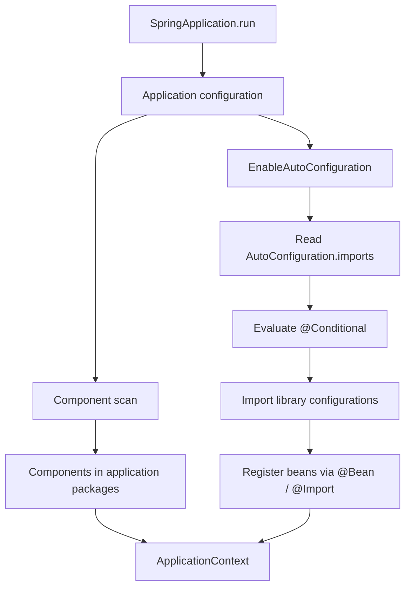

# Limiting Component Scanning for Shared Libraries

A shared library often packages services, repositories, controllers, configurations, health indicators, or adapters so multiple applications can reuse them. Adding a library as a dependency of a Spring Boot application does not mean every Spring-annotated class inside it should automatically become a bean in that application.

Component scan boundaries determine which packages Spring inspects for components. If an application or library sets a base package that is too broad, scanning can pull internal implementations, unrelated configurations, controllers, or beans intended for another application into the ApplicationContext. The consequences can include bean name collisions, unintended configurations, missing dependencies, unexpected endpoints, and behavior shifts whenever a new dependency is added.

For shared libraries, Spring Boot recommends designing auto-configurations in a dedicated package, registering them via Boot metadata, and explicitly importing required configurations/components. If an application genuinely needs to component-scan a library, the scan scope should be opt-in and restricted to a dedicated package.

This lesson belongs to the **Auto-Configuration Customization** chapter of **SPRING_CLOUD_CORE**. The focus is understanding the scope of `@ComponentScan`, how `@SpringBootApplication` determines the default package, how to design package boundaries for libraries, when to use `@Import` or auto-configuration, and how to write tests ensuring a library registers only the beans its contract provides.

## 1. Learning Objectives

After this lesson, you will be able to:

1. Explain the scope and mechanics of component scanning in Spring.
2. Identify the default package scanned by `@ComponentScan` and `@SpringBootApplication`.
3. Recognize the risks of scanning an overly broad root package or scanning a shared library's packages.
4. Design a package layout separating applications, public APIs, internal implementations, and auto-configurations.
5. Distinguish component scanning from auto-configuration.
6. Use `@Import` to register specific configurations or components.
7. Register auto-configurations via `AutoConfiguration.imports`.
8. Use `basePackageClasses`, include filters, and exclude filters when an application intentionally needs scanning.
9. Distinguish component scanning from `@ConfigurationPropertiesScan`, `@EntityScan`, and repository scanning.
10. Test bean scope using `ApplicationContextRunner` and inspect the actual ApplicationContext.

## 2. The Problem When Shared Libraries Expand Component Scanning

Suppose a company has three applications:

- `order-service` handles orders.
- `inventory-service` manages inventory.
- `payment-service` integrates payment gateways.

All three applications use the `acme-shared-platform` library. The library contains these packages:

```text
com.acme.shared
├── api
│   ├── ClockProvider.java
│   └── RequestContext.java
├── client
│   ├── InventoryClient.java
│   └── PaymentClient.java
├── internal
│   ├── DefaultClockProvider.java
│   └── HttpRequestContextFilter.java
├── web
│   └── SharedDiagnosticsController.java
└── autoconfigure
    └── SharedPlatformAutoConfiguration.java
```

Not every application needs every component:

- `order-service` might need `ClockProvider` and `RequestContext`.
- `inventory-service` might only need `ClockProvider`.
- `payment-service` might need HTTP clients and certain health indicators.
- The diagnostics controller might only be enabled in internal environments.

If an application configures `@ComponentScan("com.acme")`, the scanner can pick up components from all three applications and every library whose package starts with `com.acme`. A new class added to the library in a future release could automatically become a bean even though the current application never intended to use it.

This is a configuration boundary problem: library dependencies are shared, but the decision of which beans join the ApplicationContext must be explicit.

## 3. How Does Component Scanning Work?

`@ComponentScan` instructs Spring to find matching classes within specified packages and register them as bean definitions.

Example:

```java
@Configuration(proxyBeanMethods = false)
@ComponentScan(basePackages = "com.acme.orders")
class OrdersConfiguration {
}
```

If `basePackages` or `basePackageClasses` is not specified, Spring begins scanning from the package of the class declaring `@ComponentScan` and descends into subpackages.

With default filters, the scanner detects classes annotated with `@Component` or annotations meta-annotated with `@Component`, such as:

- `@Component`
- `@Service`
- `@Repository`
- `@Controller`
- `@RestController`
- `@Configuration`

As a result, a `@Configuration` class inside a scanned package can also be discovered as a component.

### 3.1. Recursive Scanning of Subpackages

If the base package is `com.acme.orders`, the scanner inspects that package and its subpackages, for example:

```text
com.acme.orders
com.acme.orders.api
com.acme.orders.application
com.acme.orders.domain
com.acme.orders.infrastructure
```

Sibling packages like `com.acme.shared` are not under `com.acme.orders`, so they are not scanned by this configuration.

If the base package is `com.acme`, the scope expands to every subpackage under `com.acme`, including `com.acme.orders`, `com.acme.inventory`, `com.acme.payment`, and `com.acme.shared`.

### 3.2. Default Filters Look Beyond Direct @Component Annotations

A domain annotation can be meta-annotated with `@Component`. For instance, an internal annotation like `@SharedPlatformComponent` can cause a class to be detected by the scanner if that annotation is designed as a Spring stereotype.

Therefore, when investigating why a class appears in the context, check both direct annotations and meta-annotations. Do not only search for the literal string `@Component` in source files.

### 3.3. Component Scanning Does Not Turn Every Java Class into a Bean

A class without a matching stereotype will not automatically become a bean merely because it sits in a scanned package. Such classes can be registered via `@Bean`, `@Import`, registrars, or other configuration mechanisms.

Component scanning is a way to find components by metadata, not a bulk registration of every class in a package.

## 4. @SpringBootApplication Determines the Default Scan Scope

`@SpringBootApplication` combines three core capabilities:

- `@SpringBootConfiguration`: marks the application's primary configuration.
- `@EnableAutoConfiguration`: enables the auto-configuration mechanism.
- `@ComponentScan`: enables component scanning starting from the application class's package.

Example:

```java
package com.acme.orders;

@SpringBootApplication
public class OrdersApplication {

    public static void main(String[] args) {
        SpringApplication.run(OrdersApplication.class, args);
    }
}
```

In this example, the default scanned package is `com.acme.orders` and its subpackages. Placing the application class at the application's root package allows domain components to be discovered without specifying packages as strings.

### 4.1. Why Should You Not Place the Application Class Too High?

If you place the main class in `com.acme`, the default package covers `com.acme.orders`, `com.acme.shared`, `com.acme.payment`, and other subpackages.

In a multi-module system, this placement can cause the application to automatically pick up components from unrelated libraries or modules. If those modules have their own controllers, repositories, or configurations, they can enter the context unexpectedly.

Place the main class in the application's own root package, such as `com.acme.orders`, rather than a shared organization package like `com.acme`.

### 4.2. scanBasePackages Broadens the Scope

`@SpringBootApplication` provides `scanBasePackages` and `scanBasePackageClasses` as aliases for the corresponding `@ComponentScan` attributes.

Example:

```java
@SpringBootApplication(
    scanBasePackages = {
        "com.acme.orders",
        "com.acme.shared"
    }
)
public class OrdersApplication {
}
```

This configuration scans both packages and their subpackages. While explicit, if `com.acme.shared` contains internal components, the application may still register more beans than needed.

Do not use `scanBasePackages = "com"` or an overly broad organization package just to fix a missing bean. Identify the exact package that needs registration.

## 5. Designing Package Boundaries for Shared Libraries

A clear package layout helps an application scan only components it owns.

Example:

```text
com.acme.orders
├── OrdersApplication.java
├── api
├── application
├── domain
└── infrastructure

com.acme.sharedplatform
├── api
├── internal
├── web
└── autoconfigure

com.acme.sharedplatform.autoconfigure
└── SharedPlatformAutoConfiguration.java
```

The application places its main class in `com.acme.orders`, so default component scanning does not cross into `com.acme.sharedplatform`.

The library can supply needed beans through auto-configuration. Spring Boot loads auto-configurations from the library's metadata without expanding the application's component scan to the entire library package.

### 5.1. Separating Public API and Internal Implementations

A useful organization scheme:

| Package | Contents | How it is registered |
| --- | --- | --- |
| `api` | Interfaces, DTOs, public contracts | Not necessarily beans |
| `internal` | Implementations, adapters, helpers | Registered via configuration/import |
| `web` | Filters, controllers, endpoints | Enabled only when the application needs them |
| `autoconfigure` | Spring Boot configuration classes | Registered via AutoConfiguration.imports |
| `properties` | `@ConfigurationProperties` types | Enabled via `@EnableConfigurationProperties` or dedicated scan mechanisms |

There is no need to annotate every class in a library with `@Component`. If a class is simply an implementation constructed by a `@Bean` method, keep it a plain Java class and let configuration control how it is created.

### 5.2. Avoid Placing Auto-Configuration Under Broadly Scanned Application Packages

Spring Boot recommends keeping auto-configurations in a dedicated package so they do not become targets of component scanning. If an application scans a parent package encompassing the library, an auto-configuration could be discovered as a regular configuration outside the auto-configuration loading path.

Check the actual package relationship between the main class and library packages. Two modules sharing a Maven group or residing in the same repository does not mean they should share a component-scan root.

## 6. Distinguishing Component Scanning from Auto-Configuration

These two mechanisms serve different goals:

| Mechanism | Purpose | How Spring locates configuration |
| --- | --- | --- |
| Component scan | Finds components inside selected packages | Walks packages and applies component filters |
| Auto-configuration | Automatically applies library configuration when conditions match | Reads the list of auto-configurations declared in metadata |
| `@Import` | Registers specific configurations or components | Receives explicitly specified classes |
| `@Bean` | Declares a bean within a configuration | Invokes factory methods in loaded configurations |

Component scanning depends on package boundaries. Auto-configuration depends on metadata and conditions. `@Import` depends on explicitly named classes. These mechanisms work together and should not be treated as interchangeable substitutes.

### 6.1. Auto-Configuration Is the Right Choice for Libraries with Starters

If a library should self-configure when an application adds a starter, build an auto-configuration class:

```java
@AutoConfiguration
@ConditionalOnClass(SharedClock.class)
@ConditionalOnProperty(
    prefix = "acme.shared",
    name = "enabled",
    havingValue = "true",
    matchIfMissing = true
)
@Import(SharedClockConfiguration.class)
public class SharedPlatformAutoConfiguration {
}
```

The configuration loads when the required class is on the classpath and the property permits it. `@Import` brings the internal configuration into the context without scanning the entire library package.

Inside the imported configuration:

```java
@Configuration(proxyBeanMethods = false)
class SharedClockConfiguration {

    @Bean
    @ConditionalOnMissingBean
    SharedClock sharedClock() {
        return new DefaultSharedClock();
    }
}
```

`@ConditionalOnMissingBean` allows applications to supply their own implementation. If the application has already declared `SharedClock`, auto-configuration backs off according to the bean method's condition.

### 6.2. Do Not Put @ComponentScan Inside Auto-Configuration

Spring Boot recommends that auto-configurations do not enable component scanning to find additional components. Instead, use `@Import` for specific configurations or components.

Example to avoid:

```java
@AutoConfiguration
@ComponentScan("com.acme.sharedplatform")
public class SharedPlatformAutoConfiguration {
}
```

This opens up scanning across the entire library package. Whenever the library adds a new controller, configuration, or implementation, those classes can automatically register in every application using the starter.

Replace it with:

```java
@AutoConfiguration
@Import({
    SharedClockConfiguration.class,
    SharedRequestContextConfiguration.class
})
public class SharedPlatformAutoConfiguration {
}
```

Each configuration is responsible for creating specific beans and can carry its own conditions. The library retains tight control over registration scope.

## 7. Registering Auto-Configuration via AutoConfiguration.imports

In Spring Boot 2.7 and later, libraries declare auto-configurations in the resource:

```text
META-INF/spring/org.springframework.boot.autoconfigure.AutoConfiguration.imports
```

Example file contents:

```text
com.acme.sharedplatform.autoconfigure.SharedPlatformAutoConfiguration
com.acme.sharedplatform.autoconfigure.SharedWebAutoConfiguration
```

Each line is the fully qualified name of an auto-configuration class. `#` can be used for comments in the file.

Spring Boot reads this resource from the library JAR when auto-configuration is enabled by `@EnableAutoConfiguration` or `@SpringBootApplication`.

### 7.1. The Auto-Configuration Package Should Be Isolated

Auto-configurations should live in a dedicated package such as `com.acme.sharedplatform.autoconfigure`. Isolating the package signals to users that these configurations are loaded by Boot via metadata.

Do not place auto-configuration classes inside an application package being component-scanned. Do not rely on the scanner finding `@Configuration` classes for the library to function.

### 7.2. Differences from Older Mechanisms

Spring Boot versions prior to 2.7 used `META-INF/spring.factories` with the `org.springframework.boot.autoconfigure.EnableAutoConfiguration` key to list auto-configurations.

Since Boot 2.7, `AutoConfiguration.imports` is the documented mechanism for listing auto-configurations. When a library supports multiple Spring Boot generations, check the guide for each version and test the packaged artifact. Do not assume a single metadata resource is recognized identically by every Boot version.

## 8. Use @Import Instead of Scanning When Components Are Known

If a library has a fixed set of components, you can import them directly.

Example:

```java
@Configuration(proxyBeanMethods = false)
@Import({
    SharedRequestContextFilter.class,
    SharedClockConfiguration.class
})
class SharedPlatformConfiguration {
}
```

`@Import` can register configuration classes, component classes, `ImportSelector`s, or `ImportBeanDefinitionRegistrar`s. Explicit imports make it obvious which components enter the context.

If you need to import auto-configurations in tests or slice configurations, use `@ImportAutoConfiguration` or the corresponding Spring Boot test APIs. Auto-configuration has its own loading and ordering rules; do not use regular `@Import` as a replacement for Boot's auto-configuration mechanism.

## 9. When an Application Genuinely Needs to Scan a Library Package

There are cases where an application intentionally wants to scan a small package from a library—for example, a library that provides plain Spring components without publishing a starter.

In that case, the application can narrow scanning with a marker class:

```java
package com.acme.sharedplatform.components;

public interface SharedComponentsMarker {
}
```

Application:

```java
@SpringBootApplication(
    scanBasePackageClasses = {
        OrdersApplication.class,
        SharedComponentsMarker.class
    }
)
public class OrdersApplication {
}
```

`scanBasePackageClasses` is a type-safe option. Spring uses the package containing each marker class as a root package to scan. If the marker's package is `com.acme.sharedplatform.components`, its subpackages are also scanned.

Place the marker in a narrow package containing only components that applications are permitted to pick up. Never place a marker at `com.acme` or an overly high root package.

### 9.1. basePackageClasses Is Safer Than Package Strings

Compare:

```java
@ComponentScan(basePackages = "com.acme.sharedplatform.components")
class SharedComponentsConfiguration {
}
```

and:

```java
@ComponentScan(basePackageClasses = SharedComponentsMarker.class)
class SharedComponentsConfiguration {
}
```

The second option prevents package-name typos and lets IDEs refactor packages along with the marker class. Still, a marker does not restrict recursion; the scope remains the marker's package and all its subpackages.

## 10. Narrowing Scans with includeFilters and excludeFilters

When a package contains both allowed components and classes to exclude, filters can help.

For example, a library defines a custom annotation:

```java
@Target(ElementType.TYPE)
@Retention(RetentionPolicy.RUNTIME)
@Documented
@Component
public @interface SharedPlatformComponent {
}
```

The application scans only classes carrying this annotation:

```java
@Configuration(proxyBeanMethods = false)
@ComponentScan(
    basePackageClasses = SharedComponentsMarker.class,
    useDefaultFilters = false,
    includeFilters = @ComponentScan.Filter(
        type = FilterType.ANNOTATION,
        classes = SharedPlatformComponent.class
    )
)
class SharedComponentsConfiguration {
}
```

With `useDefaultFilters = false`, the scanner does not automatically pick up default stereotypes. `includeFilters` includes only classes matching the specified annotation within the root package scope.

If default filters are not disabled, include filters are applied in addition to default filters. Consequently, any other `@Component`, `@Service`, `@Repository`, `@Controller`, or `@Configuration` in the package can still be discovered.

### 10.1. Common Filter Types

| Filter type | Purpose | Example |
| --- | --- | --- |
| `ANNOTATION` | Matches annotations present directly or meta-annotated on a class | `@SharedPlatformComponent` |
| `ASSIGNABLE_TYPE` | Matches classes implementing or extending a type | `SharedExtension.class` |
| `REGEX` | Matches class names using a regular expression | `.*Shared.*Adapter` |
| `ASPECTJ` | Matches an AspectJ type expression | `com.acme..*Service+` |
| `CUSTOM` | Uses a custom `TypeFilter` implementation | `SharedTypeFilter.class` |

### 10.2. Using excludeFilters for Isolated Exceptions

Example excluding controllers from a package scan:

```java
@Configuration(proxyBeanMethods = false)
@ComponentScan(
    basePackageClasses = SharedComponentsMarker.class,
    excludeFilters = @ComponentScan.Filter(
        type = FilterType.ANNOTATION,
        classes = RestController.class
    )
)
class SharedComponentsConfiguration {
}
```

Exclude filters are useful when the package scope is already fairly narrow and only a few classes need excluding. If you continually add exceptions, revisit the package layout and split packages by capability rather than maintaining a long exclusion list.

## 11. Component Scanning Does Not Replace Specialized Scan Mechanisms

Several Spring Boot annotations have their own distinct scopes:

| Mechanism | What it looks for | Example |
| --- | --- | --- |
| `@ComponentScan` | Spring components | `@Component`, `@Service`, `@Controller` |
| `@ConfigurationPropertiesScan` | Configuration classes annotated with `@ConfigurationProperties` | `SharedPlatformProperties` |
| `@EnableConfigurationProperties` | Registers specified configuration properties types | `@EnableConfigurationProperties(SharedPlatformProperties.class)` |
| `@EntityScan` | JPA entity packages | `@EntityScan(basePackageClasses = OrderEntity.class)` |
| Spring Data repository scan | Repository interfaces | `@EnableJpaRepositories` |

For example, `@SpringBootApplication(scanBasePackages = "...")` only customizes component scanning. It does not automatically extend `@EntityScan` or `@ConfigurationPropertiesScan` to those same packages.

For libraries, an explicit approach is usually easier to control:

```java
@AutoConfiguration
@EnableConfigurationProperties(SharedPlatformProperties.class)
@Import(SharedPlatformConfiguration.class)
public class SharedPlatformAutoConfiguration {
}
```

Do not require applications to scan an entire library package just to register a properties class or a JPA entity. Use the mechanism designed for the specific metadata being registered.

## 12. Risks of Overly Broad Scanning

### 12.1. Unintended Bean Registration

A new class added to a library can automatically become a bean if it lies inside a scanned package and carries a matching stereotype. Application behavior can change simply from upgrading a dependency.

### 12.2. Duplicate Beans or Name Collisions

Two libraries can define components with the same default bean name. If both are scanned, the context may fail with bean definition conflicts or exhibit behavior dependent on overriding settings.

Do not set `spring.main.allow-bean-definition-overriding=true` to mask an uncontrolled package scan. Decide which beans should exist and define clear names or conditions.

### 12.3. Unintended Controllers or Filters

A library containing `@RestController`, `Filter`, `HandlerInterceptor`, or `WebMvcConfigurer` can alter the application's HTTP surface if scanned. This can expose unexpected endpoints, modify CORS, affect the security chain, alter request mappings, or change filter ordering.

### 12.4. Missing Dependencies Due to Environment Mismatches

An implementation written for the servlet stack might be scanned in a reactive application or vice versa. The created bean may fail because required classes or dependencies are absent from the classpath.

Auto-configuration can use `@ConditionalOnClass` and other conditions to register beans only when the environment satisfies requirements. Component scanning provides no equivalent conditional policy on its own.

### 12.5. Slower Startup and Harder Diagnostics

Broad package scans force Spring to read more class metadata and evaluate more candidates. More importantly, registration scope becomes unpredictable as dependencies grow. Keeping package scans narrow makes startup and context behavior easier to explain.

## 13. Interaction Between Component Scanning and Auto-Configuration

A Spring Boot application normally uses both mechanisms:

- Component scanning finds the application's own components.
- Auto-configuration imports configurations from starters and libraries.
- User configuration can override default beans via `@ConditionalOnMissingBean`.

Example:



Auto-configuration runs through its own mechanism and typically backs off when the application has declared a matching custom bean. This lets libraries provide defaults without forcing applications to scan library packages.

### 13.1. Avoid Loading Auto-Configuration Through Two Paths

Do not place an auto-configuration class inside a component-scanned package while also listing it in `AutoConfiguration.imports`. Spring Boot requires auto-configurations to be loaded solely through their metadata and never become component-scan targets.

Loading a configuration class via two paths can make conditions, ordering, and registration sources unpredictable. Keep auto-configurations in a dedicated package and list them only in imports metadata.

## 14. Complete Example for a Shared Library

Suppose a library provides `SharedClock` and `RequestContextFilter`.

Package layout:

```text
com.acme.sharedplatform
├── api
│   └── SharedClock.java
├── internal
│   ├── DefaultSharedClock.java
│   └── RequestContextFilter.java
└── autoconfigure
    ├── SharedClockConfiguration.java
    └── SharedPlatformAutoConfiguration.java

META-INF/spring/
└── org.springframework.boot.autoconfigure.AutoConfiguration.imports
```

API:

```java
public interface SharedClock {
    Instant now();
}
```

Configuration:

```java
@Configuration(proxyBeanMethods = false)
class SharedClockConfiguration {

    @Bean
    @ConditionalOnMissingBean
    SharedClock sharedClock() {
        return new DefaultSharedClock();
    }

    @Bean
    @ConditionalOnProperty(
        prefix = "acme.shared.request-context",
        name = "enabled",
        havingValue = "true"
    )
    RequestContextFilter requestContextFilter() {
        return new RequestContextFilter();
    }
}
```

Auto-configuration:

```java
@AutoConfiguration
@ConditionalOnClass(SharedClock.class)
@ConditionalOnProperty(
    prefix = "acme.shared",
    name = "enabled",
    havingValue = "true",
    matchIfMissing = true
)
@EnableConfigurationProperties(SharedPlatformProperties.class)
@Import(SharedClockConfiguration.class)
public class SharedPlatformAutoConfiguration {
}
```

Metadata file:

```text
com.acme.sharedplatform.autoconfigure.SharedPlatformAutoConfiguration
```

Application:

```java
package com.acme.orders;

@SpringBootApplication
public class OrdersApplication {
}
```

The application does not need to extend component scanning to `com.acme.sharedplatform`. When the starter is on the classpath and auto-configuration is enabled, Boot loads `SharedPlatformAutoConfiguration` via metadata. The configuration registers only beans whose conditions match.

If the application defines its own `SharedClock`, the library's default bean backs off via `@ConditionalOnMissingBean`.

## 15. Testing Scan Scope and Auto-Configuration

Tests should verify both beans that must exist and beans that must not appear. A test checking only that the application context starts up is insufficient to catch overly broad scanning.

### 15.1. Testing Auto-Configuration with ApplicationContextRunner

```java
class SharedPlatformAutoConfigurationTests {

    private final ApplicationContextRunner contextRunner =
        new ApplicationContextRunner()
            .withConfiguration(
                AutoConfigurations.of(
                    SharedPlatformAutoConfiguration.class
                )
            );

    @Test
    void registersSharedClockWhenEnabled() {
        contextRunner
            .withPropertyValues("acme.shared.enabled=true")
            .run(context -> {
                assertThat(context)
                    .hasSingleBean(SharedClock.class);

                assertThat(context)
                    .doesNotHaveBean(OrdersController.class);
            });
    }

    @Test
    void backsOffWhenApplicationProvidesClock() {
        contextRunner
            .withUserConfiguration(CustomClockConfiguration.class)
            .run(context -> {
                assertThat(context)
                    .hasSingleBean(SharedClock.class);

                assertThat(context.getBean(SharedClock.class))
                    .isInstanceOf(CustomSharedClock.class);
            });
    }
}
```

`ApplicationContextRunner` builds a lightweight context with controlled auto-configurations, user configurations, and properties. Tests can check conditions, default beans, and back-off behavior without launching the full application.

### 15.2. Testing That Component Scanning Does Not Cross Boundaries

You can use a context test to verify that an application package registers only components within the chosen package:

```java
new ApplicationContextRunner()
    .withUserConfiguration(OrdersApplication.class)
    .run(context -> {
        assertThat(context).hasSingleBean(OrdersService.class);
        assertThat(context).doesNotHaveBean(PaymentAdminController.class);
    });
```

In real tests, configure necessary dependencies or use minimal slice/context configurations suited to the application. The goal is to prove that components from another module are not registered merely because they share an organization package.

### 15.3. Testing Filters

For scans using include/exclude filters, create a few fixtures:

- A class annotated with `@SharedPlatformComponent`.
- A class annotated only with `@Service`.
- A class annotated with `@RestController`.
- A class outside the base package.

Assert that included classes appear and excluded classes do not. This catches unintended changes when library packages or annotations are refactored.

### 15.4. Testing the Packaged Artifact

Auto-configuration metadata lives inside the JAR's resources. Unit tests running directly against the IDE classpath may miss packaging errors where resources are omitted.

In the library release pipeline, verify the JAR contains the exact path:

```text
META-INF/spring/org.springframework.boot.autoconfigure.AutoConfiguration.imports
```

and that the resource lists all expected auto-configuration classes. For libraries supporting multiple Boot versions, test the artifact across the corresponding version matrix.

## 16. Diagnosing Unexpected Beans

When a library bean unexpectedly appears in the ApplicationContext, check in order:

1. Identify the bean name, bean type, and the resource/class defining it.
2. Check whether the class's package falls under any `@ComponentScan` base package.
3. Check whether the main class uses expanded `scanBasePackages` or `scanBasePackageClasses`.
4. Look for other `@ComponentScan` annotations in imported configurations.
5. Inspect both direct annotations and meta-annotations on the class.
6. Check whether the class was registered via `@Import` or `@Bean`.
7. Inspect auto-configuration imports and bean creation conditions.
8. Use Actuator `beans` if safely exposed to inspect present beans.
9. Use Actuator `conditions` or the debug condition report to find why auto-configuration matched.
10. Write a small test reproducing the scan scope before changing packages or annotations.

Note that the `conditions` endpoint focuses on auto-configuration conditions. A component picked up by component scanning may not show up as an auto-configuration match in that report. Combine bean inventory with the actual scan configuration.

## 17. Compatibility Across Spring Boot Versions

Component scanning and attributes like `basePackages`, `basePackageClasses`, and include/exclude filters have existed in Spring Framework for a long time. However, how libraries publish auto-configuration candidates changed across Spring Boot generations.

| Generation | How auto-configuration is declared |
| --- | --- |
| Spring Boot before 2.7 | `META-INF/spring.factories` with key `EnableAutoConfiguration` |
| Spring Boot 2.7 and later | `META-INF/spring/org.springframework.boot.autoconfigure.AutoConfiguration.imports` |
| Spring Boot 3.x | Continues using `AutoConfiguration.imports` and `@AutoConfiguration` |

`@AutoConfiguration` is the dedicated annotation for auto-configurations in modern Spring Boot. In older codebases, you may encounter classes using `@Configuration` with `spring.factories` metadata.

When a library supports multiple Spring Cloud and Spring Boot release trains, check the project's compatibility matrix and version-specific documentation. Do not copy metadata resources from a newer version into an older Boot project without verifying its discovery mechanism.

## 18. Common Misconceptions

**“Adding a dependency makes Spring automatically scan every component in the library.”** Only components inside scanned packages matching filters are discovered. Auto-configuration uses separate metadata.

**“Putting the main class in the organization's root package is always fine.”** If the root package spans multiple applications and libraries, component scanning can expand too far. Give each application its own root package.

**“`@SpringBootApplication` only enables auto-configuration.”** That annotation also enables component scanning from the package containing the application class.

**“`scanBasePackages` only adds a few classes.”** It enables recursive package scanning, which can pull in many other components in subpackages.

**“A library should scan its entire own package.”** Spring Boot recommends auto-configurations use explicit `@Import` instead of enabling component scanning inside auto-configuration.

**“`@Import` and component scanning are the same.”** `@Import` names specific classes; component scanning searches for candidates by package and filters.

**“`excludeFilters` is the best way to fix overly broad scans.”** If you have to exclude too many classes, narrow the base package or reorganize package boundaries.

**“`@ComponentScan` automatically finds all `@ConfigurationProperties` and JPA entities.”** Those types have dedicated registration mechanisms; component scanning does not replace `@ConfigurationPropertiesScan`, `@EnableConfigurationProperties`, `@EntityScan`, or repository scanning.

**“`AutoConfiguration.imports` is a YAML config file.”** It is a plain text resource listing fully qualified class names, one class per line.

**“A context test that boots proves scanning is right.”** Assert both expected beans and beans that must not appear.

## 19. Shared Library Design Checklist

Before releasing a shared library or starter, confirm:

1. Are application packages separated from library packages?
2. Does the main application class reside in the application's own root package?
3. Does any base package scan cover an overly broad organization package?
4. Do auto-configuration classes reside in a dedicated package?
5. Are auto-configurations excluded from component scanning?
6. Do auto-configurations use explicit `@Import` instead of `@ComponentScan`?
7. Do default beans have appropriate conditions such as `@ConditionalOnClass`, `@ConditionalOnProperty`, and `@ConditionalOnMissingBean`?
8. Is `AutoConfiguration.imports` at the exact resource path inside the JAR?
9. Do optional component scans use a narrow marker package?
10. Are include/exclude filters tested?
11. Do configuration properties, JPA entities, and repositories use their specialized scan mechanisms?
12. Are there tests asserting that out-of-scope components are not registered?
13. Is the packaged artifact verified across supported Boot versions?

## 20. Practice Exercises

### Exercise 1. Finding the Cause of an Overly Broad Scan

The `order-service` application places its main class in package `com.acme` and uses `@SpringBootApplication`. Its dependencies include `inventory-service`, `payment-service`, and `shared-platform`, all using packages starting with `com.acme`.

Explain why controllers from those other modules might appear in the ApplicationContext. Propose a package layout so `order-service` scans only its own code.

### Exercise 2. Designing Auto-Configuration for a Shared Library

The library contains `SharedClock`, `SharedRequestFilter`, and `SharedDiagnosticsController`. Design auto-configuration so that:

- `SharedClock` is created only if the application does not have a replacement bean.
- `SharedRequestFilter` is enabled only when its corresponding property is true.
- The diagnostics controller is enabled only under a profile or property for internal environments.
- `@ComponentScan` is not used in the auto-configuration.

### Exercise 3. Using a Marker Class

The application needs to scan only the package `com.acme.sharedplatform.components`, without scanning `internal`, `web`, or `autoconfigure`.

Create a marker class and configure `scanBasePackageClasses`. Explain why the marker's location determines the scan scope.

### Exercise 4. Writing an Include Filter

A library has an annotation `@SharedPlatformComponent`. Configure `@ComponentScan` to detect only classes carrying that annotation, and explain the role of `useDefaultFilters=false`.

### Exercise 5. Distinguishing Registration Mechanisms

A class `SharedPlatformProperties` is annotated with `@ConfigurationProperties`, a class `OrderEntity` is a JPA entity, and a class `SharedClock` is a `@Component`.

Select the appropriate mechanism to register each type and explain why merely expanding `@ComponentScan` does not fully handle all three cases.

### Exercise 6. Testing the Artifact

Design tests for the shared library to verify:

- Auto-configuration is loaded from JAR metadata.
- Default beans are present when conditions are satisfied.
- Application custom beans take precedence.
- Components outside scanned packages do not appear.
- Auto-configuration classes are not registered via component scanning.

## 21. Self-Check Questions

1. Which package does `@ComponentScan` start from by default?
2. Why can `@SpringBootApplication` cause component scanning to expand unintentionally?
3. How do `scanBasePackages` and `scanBasePackageClasses` differ?
4. Does component scanning traverse subpackages recursively?
5. Which stereotypes are detected by default filters?
6. Why should a library's auto-configurations not be component-scanned?
7. How does `@Import` help constrain bean registration?
8. At what resource path does `AutoConfiguration.imports` reside?
9. When should `basePackageClasses` be used as a marker?
10. How does `useDefaultFilters=false` change include filter behavior?
11. Why do `@ConfigurationPropertiesScan` and `@EntityScan` have separate roles?
12. How do you test that an out-of-scope bean does not appear?
13. How does auto-configuration metadata differ from component scanning?
14. Why should you inspect the JAR after packaging?
15. What metadata changes matter when a library supports Boot versions before and after 2.7?

## 22. References

- [Spring Boot Reference — Creating Your Own Auto-configuration](https://docs.spring.io/spring-boot/reference/features/developing-auto-configuration.html): how to create auto-configuration for shared libraries, AutoConfiguration.imports, conditions, and the recommendation to use `@Import` instead of component scanning.
- [Spring Boot Reference — Using the @SpringBootApplication Annotation](https://docs.spring.io/spring-boot/reference/using/using-the-springbootapplication-annotation.html): relationship among `@SpringBootConfiguration`, `@EnableAutoConfiguration`, and `@ComponentScan`, plus how to customize scan packages.
- [Spring Framework Reference — Classpath Scanning and Managed Components](https://docs.spring.io/spring/reference/6.2/core/beans/classpath-scanning.html): component scanning, stereotypes, include/exclude filters, and filter types.
- [ComponentScan API — Spring Framework 6.1](https://docs.spring.io/spring-framework/docs/6.1.1/javadoc-api/org/springframework/context/annotation/ComponentScan.html): `basePackages`, `basePackageClasses`, `useDefaultFilters`, `includeFilters`, and `excludeFilters`.
- [Spring Boot 2.7 Reference — Creating Your Own Auto-configuration](https://docs.spring.io/spring-boot/docs/2.7.17/reference/htmlsingle/): declaring auto-configurations and imports resources in Boot 2.7.
- [Spring Boot 2.7.0-M2 Reference](https://docs.spring.io/spring-boot/docs/2.7.0-M2/reference/htmlsingle/): examples of `spring.factories` in earlier documentation prior to migrating to the imports resource.

## Takeaways

Component scanning defines a package boundary for finding components, not a mechanism for automatically enabling every feature of a library. For shared libraries, keep application packages separate, place auto-configurations in a dedicated package, register them via `AutoConfiguration.imports`, and use `@Import` to load needed configurations and components. If an application intentionally scans a library package, use a marker class and a narrow package, add filters when necessary, and test for both beans that must exist and beans that must not appear.