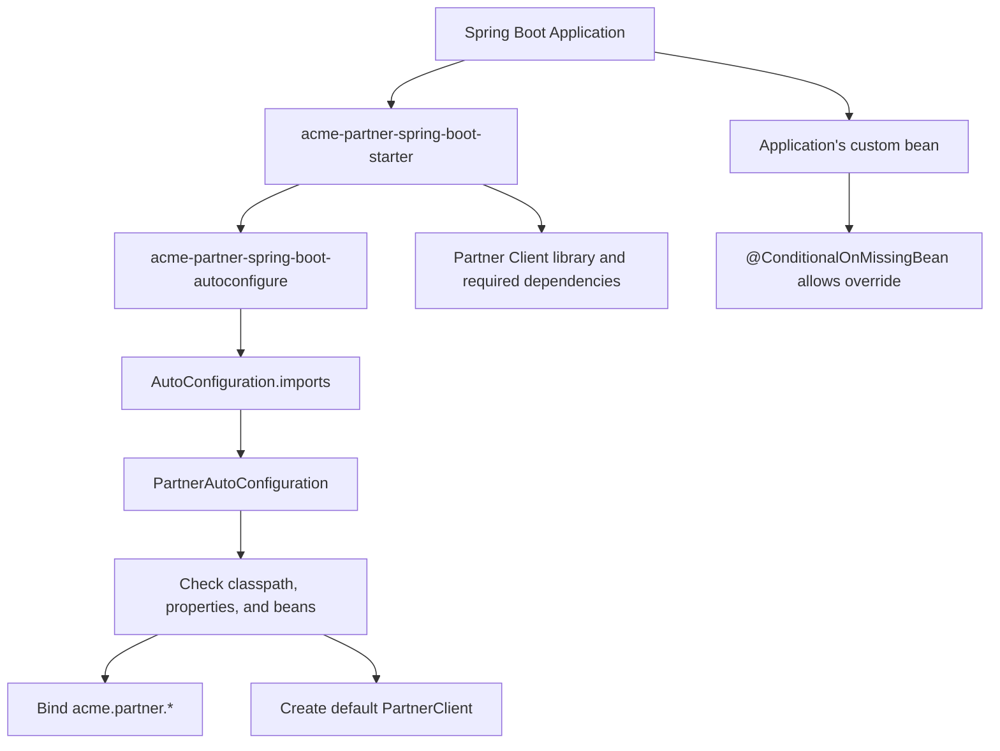

# Packaging Internal Starters with Clearly Namespaced Properties

## 1. Why Does a Starter Need Its Own Configuration Namespace?

A shared library in an organization often needs to provide beans, clients, or infrastructure that initialize automatically across multiple Spring Boot applications. If every application has to declare the same beans and dependencies manually, configuration gets duplicated, drifts out of sync, and becomes difficult to upgrade.

An **internal starter** bundles the required dependencies and wires them up with auto-configuration. Applications simply add a single dependency and customize behavior through properties designed specifically for that library.

For example, suppose a company has a library that calls a partner service. The starter can provide `PartnerClient`, default timeouts, and HTTP transport creation. Consuming applications configure it using keys such as:

```yaml
acme:
  partner:
    enabled: true
    base-url: https://partner.example
    connect-timeout: 2s
    read-timeout: 5s
    max-attempts: 3
```

The `acme.partner` namespace is owned by the organization publishing the starter. Other applications can adopt multiple internal starters without worrying about generic properties overwriting one another.

This lesson belongs to the **Auto-Configuration Customization** chapter of the **SPRING_CLOUD_CORE** module. The module helps learners understand Spring Cloud Commons, Spring Cloud Context, externalized configuration, Spring Boot compatibility, refresh scope, discovery, service registry, service-to-service communication, and how to test and operate shared abstractions.

After this lesson, you will be able to:

- Distinguish a library module, an auto-configuration module, and a starter module.
- Design a stable configuration namespace that avoids colliding with Spring Boot and Spring Cloud.
- Bind properties using `@ConfigurationProperties` with clear data types.
- Generate metadata so IDEs provide autocomplete and validation hints.
- Register auto-configurations via `AutoConfiguration.imports`.
- Use classpath, property, and bean conditions to activate configuration appropriately.
- Allow applications to replace default beans with their own beans.
- Package dependencies without dragging in unnecessary optional integrations.
- Test a starter across multiple classpath and property combinations.
- Manage compatibility, deprecation, and namespace changes across versions.

## 2. Structure of an Internal Starter

### 2.1. Separation of Responsibilities

For a library with one primary feature, you can start with two modules:

```text
acme-partner/
  acme-partner-spring-boot-autoconfigure/
    src/main/java/
      com/acme/partner/autoconfigure/
        PartnerAutoConfiguration.java
        PartnerProperties.java
    src/main/resources/
      META-INF/spring/
        org.springframework.boot.autoconfigure.AutoConfiguration.imports

  acme-partner-spring-boot-starter/
    pom.xml
```

- **Autoconfigure module:** contains auto-configuration classes, property classes, extension callbacks/APIs, and required metadata.
- **Starter module:** declares dependencies on the autoconfigure module plus the libraries users need to get started with the feature.

A starter is typically a nearly empty JAR in terms of code. Its primary role is aggregating dependencies with sensible defaults. If the library is very small and has no optional dependencies, both modules can be combined. If there are multiple integrations or variants, splitting modules lets users pull in only what they need.

Artifact naming examples:

| Module | Artifact |
| --- | --- |
| Auto-configuration | `acme-partner-spring-boot-autoconfigure` |
| Main starter | `acme-partner-spring-boot-starter` |
| Test starter (if needed) | `acme-partner-spring-boot-starter-test` |

Do not start module names with `spring-boot`. Put your product name or organization namespace first to avoid confusion with official Spring Boot starters.

### 2.2. Auto-Configuration Package

Place auto-configuration classes in a dedicated package, for example:

```text
com.acme.partner.autoconfigure
```

Do not place these classes under a consuming application's package expecting component scanning to find them. Spring Boot loads auto-configurations from the imports file inside the JAR. Auto-configuration should not enable component scanning itself to find other beans; use explicit `@Import` when bringing a configuration or component into the context.

This organization ensures consuming applications receive only published configurations while avoiding accidental scanning of internal components outside the starter contract.

### 2.3. Flow When an Application Adds the Starter



Applications can use the default configuration or supply their own beans. A starter should not force applications into a single implementation when a replaceable abstraction can be provided.

## 3. Designing an Owned Namespace

### 3.1. Choosing Your Organization's Prefix

Spring Boot recommends that each starter own a unique namespace. In this example, the prefix is `acme.partner`.

Do not place library-specific properties inside shared namespaces such as:

- `spring.*`
- `server.*`
- `management.*`
- `logging.*`

Those namespaces belong to the contract of Spring Boot or core platform components. If a starter adds keys there, future framework changes can collide with or alter the library's semantics.

Prefixes should convey ownership and capability:

| Namespace | Assessment |
| --- | --- |
| `acme.partner.*` | Clear organization and capability |
| `acme.messaging.kafka.*` | Appropriate if the organization owns a dedicated integration |
| `spring.partner.*` | Avoid; uses the framework namespace |
| `timeout.*` | Too generic, prone to collisions |
| `partner.*` | Can collide with other libraries without an org namespace |

If your organization has multiple starters, standardize on one root namespace and branch by product or domain.

### 3.2. Use kebab-case and Meaningful Property Names

Property files should use lowercase names with hyphens separating words:

```yaml
acme:
  partner:
    connect-timeout: 2s
    read-timeout: 5s
    max-attempts: 3
```

Property names should express clear intent. Use `connect-timeout` instead of `timeout1`; use `max-attempts` instead of `retry` if the property specifically controls the maximum number of attempts.

For booleans, use names that read cleanly as questions, such as `enabled`, `log-request-details`, or `follow-redirects`. Document defaults and scope clearly.

### 3.3. Grouping Properties Logically

As the number of properties grows, group them by capability rather than creating a long flat list:

```yaml
acme:
  partner:
    enabled: true
    endpoint:
      base-url: https://partner.example
      connect-timeout: 2s
      read-timeout: 5s
    retry:
      max-attempts: 3
      initial-backoff: 100ms
    observability:
      include-request-id: true
```

Nested structures help users see which properties relate to endpoints, retries, or observability. This illustrates a multi-group schema; the corresponding `@ConfigurationProperties` class must have nested objects. The flat record in the next section uses the schema `acme.partner.base-url`, `acme.partner.connect-timeout`, and `acme.partner.read-timeout`. Do not create overly deep nesting if it does not represent a meaningful configuration group.

### 3.4. Mind Environment Variables

Spring Boot supports relaxed binding. For environment variables, dots become underscores, hyphens are stripped, and names are uppercased.

Examples:

| Property | Environment variable |
| --- | --- |
| `acme.partner.enabled` | `ACME_PARTNER_ENABLED` |
| `acme.partner.base-url` | `ACME_PARTNER_BASEURL` |
| `acme.partner.connect-timeout` | `ACME_PARTNER_CONNECTTIMEOUT` |

Do not manually insert underscores between words in property names instead of following Spring Boot's standard rules. Verify binding behavior in integration tests and starter deployment docs.

## 4. Binding Configuration with @ConfigurationProperties

### 4.1. Why Use Structured Data Types?

`@ConfigurationProperties` is far better suited for a library's configuration group than scattering `@Value` expressions across beans.

It provides:

- Type-safe binding and relaxed binding.
- Support for nested structures, collections, and maps.
- Metadata for IDE property autocomplete.
- Validation support.
- A single configuration object injectable into multiple beans.
- One central place to manage defaults and property documentation.

Example using a Java record:

```java
package com.acme.partner.autoconfigure;

import java.net.URI;
import java.time.Duration;

import jakarta.validation.constraints.Min;
import jakarta.validation.constraints.NotNull;

import org.springframework.boot.context.properties.ConfigurationProperties;
import org.springframework.boot.context.properties.bind.DefaultValue;
import org.springframework.validation.annotation.Validated;

@ConfigurationProperties("acme.partner")
@Validated
public record PartnerProperties(
        @DefaultValue("false") boolean enabled,
        @NotNull URI baseUrl,
        @DefaultValue("2s") Duration connectTimeout,
        @DefaultValue("5s") Duration readTimeout,
        @DefaultValue("3") @Min(1) int maxAttempts) {
}
```

This example uses constructor binding on a record following modern Spring Boot style. `@DefaultValue` supplies parameter defaults when properties are omitted. If using a JavaBean instead of a record, declare field defaults with getters/setters.

In production code, write property descriptions in Javadoc on fields or record parameters so the annotation processor generates helpful metadata. For records, parameter descriptions can be written using `@param` Javadoc tags at the class level.

### 4.2. Choose Typed Values Instead of Unitless Integers

Use `Duration` for timeouts and intervals:

```yaml
acme:
  partner:
    connect-timeout: 1500ms
    read-timeout: 5s
```

This makes units explicit and avoids ambiguity over whether an integer represents milliseconds, seconds, or minutes.

Similarly:

- Use `DataSize` for buffer or payload sizes.
- Use `URI` or `URL` for endpoints.
- Use enums for choices with a finite set of values.
- Use `List` or `Map` for repeated configuration sets.
- Use boolean for clear on/off toggles.

Avoid using `String` for every property and parsing manually inside multiple beans. Parsing and type checking should happen once during binding.

### 4.3. Validation and Required Configuration

`@Validated` enables Spring Boot to validate the configuration bean when a Jakarta Validation implementation is on the classpath. Annotations like `@NotNull`, `@Min`, `@Max`, and `@Positive` reject invalid configuration early.

Example:

```java
@Validated
@ConfigurationProperties("acme.partner")
public record PartnerProperties(
        @DefaultValue("false") boolean enabled,
        @NotNull URI baseUrl,
        @DefaultValue("2s") Duration connectTimeout,
        @DefaultValue("5s") Duration readTimeout,
        @DefaultValue("3") @Min(1) int maxAttempts) {
}
```

In this example, `baseUrl` is required whenever the properties bean is registered. If the feature is off by default, register the properties inside the nested configuration only when the feature is enabled, as shown in the auto-configuration example later. That way, applications do not have to declare an endpoint when they are not using the integration.

If complex conditional validation is needed, use a validator class or split properties objects by feature group. Avoid letting a required property of an optional integration prevent startup even when that integration is disabled.

### 4.4. Registering the Properties Bean

Auto-configurations can use `@EnableConfigurationProperties`:

```java
@EnableConfigurationProperties(PartnerProperties.class)
@Configuration(proxyBeanMethods = false)
class PartnerClientConfiguration {
    // Beans using PartnerProperties
}
```

For starters, register properties from the auto-configuration itself so users only need to add the dependency. Do not require consuming applications to remember `@EnableConfigurationProperties` or scan the library's packages.

Using `@ConfigurationPropertiesScan` in the main application works well for application-owned configurations, but you should not require users to scan internal starter packages for auto-configuration to work.

## 5. Generating Configuration Metadata for IDEs

### 5.1. What Does Metadata Do?

When users type `acme.partner.` in YAML or properties files, IDEs can suggest property names, data types, defaults, and descriptions if the starter packages configuration metadata.

Spring Boot provides the annotation processor:

```text
org.springframework.boot:spring-boot-configuration-processor
```

In Gradle:

```groovy
dependencies {
    annotationProcessor("org.springframework.boot:spring-boot-configuration-processor")
    annotationProcessor("org.springframework.boot:spring-boot-autoconfigure-processor")
}
```

In Maven, configure the compiler plugin to include the required processors on the annotation processor path. `spring-boot-configuration-processor` generates property metadata; `spring-boot-autoconfigure-processor` collects condition metadata so Boot can filter out non-matching auto-configurations early. Keep processors in build/compile configuration—do not expose them as runtime dependencies of consuming applications.

### 5.2. Writing Property Descriptions

Every property should have a concrete description, such as:

```java
@ConfigurationProperties("acme.partner")
public class PartnerProperties {

    /**
     * Whether the partner integration is enabled.
     */
    private boolean enabled = false;

    /**
     * Timeout for establishing a connection to the partner.
     */
    private Duration connectTimeout = Duration.ofSeconds(2);

    // getters and setters
}
```

Descriptions should state the meaning and units clearly. For booleans, start with “Whether” or “Enable.” For collections, state what the list contains. For `Duration`, note the default unit if users omit a suffix.

### 5.3. Manual Metadata

The annotation processor infers most properties from `@ConfigurationProperties`, but certain defaults or hints cannot be inferred from source alone. When needed, add:

```text
META-INF/additional-spring-configuration-metadata.json
```

Additional metadata files can document defaults, deprecations, value hints, or properties not bound directly to a bean. Only add this file when there is supplemental information to provide; do not ship an empty file just to include it in the JAR.

After building, inspect `META-INF/spring-configuration-metadata.json` in the autoconfigure artifact and test the starter in a sample application to verify IDEs display names, types, and descriptions properly.

## 6. Writing Auto-Configuration

### 6.1. Using @AutoConfiguration

Auto-configuration classes use `@AutoConfiguration`:

```java
package com.acme.partner.autoconfigure;

import org.springframework.boot.autoconfigure.AutoConfiguration;

@AutoConfiguration
public class PartnerAutoConfiguration {
}
```

`@AutoConfiguration` is a specialized form of `@Configuration` for auto-configuration. Add conditions to restrict when the configuration is applied.

Auto-configurations must be registered via the imports file. Merely placing the class in a package is not enough for Spring Boot to discover it if it lies outside component scanning.

### 6.2. Creating Overridable Default Beans

Example of an integration client created only when the library is present and the user enables the feature:

```java
package com.acme.partner.autoconfigure;

import com.acme.partner.client.PartnerClient;

import org.springframework.boot.autoconfigure.AutoConfiguration;
import org.springframework.boot.autoconfigure.condition.ConditionalOnClass;
import org.springframework.boot.autoconfigure.condition.ConditionalOnMissingBean;
import org.springframework.boot.autoconfigure.condition.ConditionalOnProperty;
import org.springframework.boot.context.properties.EnableConfigurationProperties;
import org.springframework.context.annotation.Bean;
import org.springframework.context.annotation.Configuration;

@AutoConfiguration
public class PartnerAutoConfiguration {

    @Configuration(proxyBeanMethods = false)
    @ConditionalOnClass(PartnerClient.class)
    @ConditionalOnProperty(
            prefix = "acme.partner",
            name = "enabled",
            havingValue = "true"
    )
    @EnableConfigurationProperties(PartnerProperties.class)
    static class PartnerClientConfiguration {

        @Bean
        @ConditionalOnMissingBean
        PartnerClient partnerClient(PartnerProperties properties) {
            return new PartnerClient(
                    properties.baseUrl(),
                    properties.connectTimeout(),
                    properties.readTimeout(),
                    properties.maxAttempts()
            );
        }
    }
}
```

Notable points:

- `@ConditionalOnClass` checks that the client library is on the classpath.
- `@ConditionalOnProperty` requires users to enable `acme.partner.enabled=true`. When the property is absent, the configuration does not match because `matchIfMissing=true` is not set.
- `@EnableConfigurationProperties` registers the properties bean inside the enabled configuration branch.
- `@ConditionalOnMissingBean` allows applications to supply their own `PartnerClient`.
- The bean method returns a concrete type so conditions have full type information when evaluated.

This example assumes `PartnerClient`'s constructor accepts those arguments. With real libraries, map to the client's actual API and create resources only after configuration conditions are satisfied.

### 6.3. Isolating Optional Dependencies

If a class checked with `@ConditionalOnClass` is an optional dependency, watch out for class types appearing in method signatures of the outer configuration. A safe pattern is placing methods that directly reference the optional class inside a nested configuration guarded by a class-level condition.

Spring Boot documentation illustrates nested static configurations for this case. Placing the condition on the nested class prevents the JVM from having to resolve method references to classes missing from the classpath before the condition evaluates.

### 6.4. Registering AutoConfiguration.imports

Create the file at the exact path:

```text
src/main/resources/META-INF/spring/org.springframework.boot.autoconfigure.AutoConfiguration.imports
```

Contents:

```text
com.acme.partner.autoconfigure.PartnerAutoConfiguration
```

Each line is a fully qualified auto-configuration class name. Comments starting with `#` are allowed.

Spring Boot reads this file from JARs on the classpath to find auto-configuration candidates. If you forget the file or misspell the class name, auto-configuration will not load even though the code compiles cleanly.

For Spring Boot 2.7 and later, use this imports mechanism. Older versions have the legacy registration mechanism via `META-INF/spring.factories`; do not mix the two without clearly defining the target Boot version.

### 6.5. Do Not Component-Scan the Whole Library

Auto-configurations should declare specific beans with `@Bean` or use `@Import` to bring needed configurations into the context. Avoid:

```java
@ComponentScan("com.acme.partner")
```

inside auto-configuration just to find every component in the library. Broad scanning can pull internal beans, test configurations, or unwanted integrations into the application.

Instead, import a specific configuration or declare beans explicitly. This keeps users in control of what enters the context.

## 7. Designing Conditions and Default Behavior

### 7.1. Common Conditions

| Condition | Purpose | Example |
| --- | --- | --- |
| `@ConditionalOnClass` | Configure only when class/dependency is present | Partner Client library present |
| `@ConditionalOnMissingBean` | Create default bean when user has not declared one | Default `PartnerClient` creation |
| `@ConditionalOnBean` | Create component only when dependent bean already exists | A `CredentialsProvider` exists |
| `@ConditionalOnProperty` | Enable/disable via configuration | `acme.partner.enabled=true` |
| `@ConditionalOnResource` | Require a resource to exist | Truststore file |
| `@ConditionalOnWebApplication` | Apply only in web applications | Web interceptor |
| `@ConditionalOnExpression` | Special SpEL condition | Use only when simpler conditions fall short |

Prefer clear classpath, bean, and property conditions. Avoid SpEL referencing beans inside conditions unless necessary; doing so can trigger premature bean initialization during context refresh.

### 7.2. Choosing Intentional Defaults

For integrations calling external systems, defaulting to off is usually safer if users have not declared endpoints or credentials. For example:

```yaml
acme:
  partner:
    enabled: false
```

Users enable it explicitly:

```yaml
acme:
  partner:
    enabled: true
    base-url: https://partner.example
```

If a starter is designed to always provide a core bean when the dependency is present, you may default to on using `matchIfMissing=true`. Document this decision clearly and make sure defaults do not open network connections, spawn threads, or allocate unexpected resources at startup.

### 7.3. Conditions on Classes and Beans

When using `@ConditionalOnClass` for an optional dependency, extract the related configuration into a nested configuration if method signatures directly reference that class.

For `@ConditionalOnMissingBean`, Spring Boot recommends placing the condition on auto-configurations because auto-configurations are applied after user-declared bean definitions. This gives applications the chance to provide a replacement bean before the default bean is created.

Do not rely on bean initialization order to fix conditions. Auto-configuration ordering controls when bean definitions are registered; instance initialization order still depends on dependencies and lifecycle.

### 7.4. Ordering When Genuinely Needed

If the library's auto-configuration must apply before or after another configuration, use:

- `@AutoConfiguration(before = ...)`
- `@AutoConfiguration(after = ...)`
- `@AutoConfigureBefore`
- `@AutoConfigureAfter`
- `@AutoConfigureOrder`

Add ordering only when there is a real dependency relationship. Do not use ordering to hide unclear bean conditions or force beans to instantiate early.

## 8. Packaging Dependencies for the Starter

### 8.1. Dependencies of the Autoconfigure Module

The auto-configuration module typically needs:

- `spring-boot-autoconfigure` for annotations and conditions.
- The client library that auto-configuration integrates.
- `spring-boot-configuration-processor` on the annotation processor path to generate property metadata.
- `spring-boot-autoconfigure-processor` on the annotation processor path if condition filtering metadata is desired per Boot guidance.

If an integration is optional, mark the corresponding dependency as optional/provided in your build tool so users can add the autoconfigure module without pulling in that library forcibly. Conditional configurations must handle the dependency being absent.

### 8.2. Dependencies of the Starter Module

The starter module aggregates the dependencies needed to use the feature:

```xml
<dependencies>
    <dependency>
        <groupId>com.acme</groupId>
        <artifactId>acme-partner-spring-boot-autoconfigure</artifactId>
    </dependency>

    <dependency>
        <groupId>com.acme</groupId>
        <artifactId>partner-client</artifactId>
    </dependency>

    <dependency>
        <groupId>org.springframework.boot</groupId>
        <artifactId>spring-boot-starter</artifactId>
    </dependency>

    <dependency>
        <groupId>org.springframework.boot</groupId>
        <artifactId>spring-boot-starter-validation</artifactId>
    </dependency>
</dependencies>
```

This is an example dependency aggregator. Versions are managed by the organization's compatible parent/BOM—do not arbitrarily pin a Spring Boot or Spring Cloud version different from the consuming application.

If validation is not a default feature of the starter, keep it optional or split into a starter variant. Do not pull in every library the development team happened to use during implementation.

### 8.3. Do Not Override the Application's Dependency Management

An internal starter should cooperate with the dependency management chosen by the consuming application:

- Use an appropriate Spring Boot BOM or parent to manage Spring Boot versions.
- Use a Spring Cloud BOM compatible with the supported Spring Boot line.
- Avoid hardcoding fixed versions for individual Spring Framework/Spring Boot modules inside the starter.
- Do not force an application to switch release trains just by adding the starter without an upgrade plan.
- Clearly publish the tested matrix of Boot, Spring Cloud, and JDK versions.

A good starter cuts down repetitive configuration without hijacking the host application's dependency version decisions.

## 9. Consuming Applications and Customizability

### 9.1. Adding Only One Dependency

In the consuming application, add:

```xml
<dependency>
    <groupId>com.acme</groupId>
    <artifactId>acme-partner-spring-boot-starter</artifactId>
</dependency>
```

When auto-configuration is properly registered, Spring Boot loads the configuration from the JAR automatically. Users do not need to import auto-configuration classes manually.

### 9.2. Configuring via the Dedicated Namespace

The application declares:

```yaml
acme:
  partner:
    enabled: true
    base-url: https://partner.example
    connect-timeout: 1s
    read-timeout: 4s
    max-attempts: 2
```

These values bind to `PartnerProperties`. Beans in the starter inject the properties object rather than reading `Environment` in multiple places.

### 9.3. Overriding Default Beans

If an application needs custom behavior, it declares a bean of the same type:

```java
@Configuration(proxyBeanMethods = false)
class ApplicationPartnerConfiguration {

    @Bean
    PartnerClient partnerClient() {
        return new CustomPartnerClient();
    }
}
```

If `CustomPartnerClient` implements the matching `PartnerClient` type, `@ConditionalOnMissingBean` in auto-configuration causes the default bean to back off.

The starter's contract should document which beans can be overridden, which qualifiers or bean names are published, and which properties are still used by other beans. Avoid relying on undocumented internal bean names.

### 9.4. Disabling the Starter or Individual Capabilities

Users should have a way to disable the integration:

```yaml
acme:
  partner:
    enabled: false
```

If the starter has multiple capabilities, provide dedicated property branches for each part, such as `acme.partner.metrics.enabled` or `acme.partner.web.enabled`. Each branch must have clear defaults and semantics.

Do not use an ambiguous property like `acme.enabled` to control multiple independent integrations.

## 10. Testing Auto-Configuration

### 10.1. Using ApplicationContextRunner

`ApplicationContextRunner` tests an auto-configuration inside a small context with explicit properties and user configurations.

Example:

```java
class PartnerAutoConfigurationTests {

    private final ApplicationContextRunner contextRunner =
            new ApplicationContextRunner()
                    .withConfiguration(
                            AutoConfigurations.of(PartnerAutoConfiguration.class)
                    );

    @Test
    void createsClientWhenEnabled() {
        this.contextRunner
                .withPropertyValues(
                        "acme.partner.enabled=true",
                        "acme.partner.base-url=https://partner.example"
                )
                .run(context -> {
                    assertThat(context).hasSingleBean(PartnerClient.class);
                    assertThat(context).hasSingleBean(PartnerProperties.class);
                });
    }
}
```

Each test creates an isolated context, making it easy to verify different combinations of classpath, properties, and beans. This is the right tool for verifying conditions and back-off behavior without booting the entire application.

### 10.2. Testing Default Disabled

```java
@Test
void doesNotCreateClientWhenDisabled() {
    this.contextRunner
            .withPropertyValues("acme.partner.enabled=false")
            .run(context -> {
                assertThat(context).doesNotHaveBean(PartnerClient.class);
            });
}
```

Also test the case where the `enabled` property is omitted. In the opt-in example above, the configuration must not activate when the property is missing.

### 10.3. Testing Bean Overrides

```java
@Test
void backsOffWhenApplicationProvidesClient() {
    this.contextRunner
            .withPropertyValues(
                    "acme.partner.enabled=true",
                    "acme.partner.base-url=https://partner.example"
            )
            .withUserConfiguration(UserPartnerConfiguration.class)
            .run(context -> {
                assertThat(context).hasSingleBean(PartnerClient.class);
                assertThat(context.getBean(PartnerClient.class))
                        .isInstanceOf(CustomPartnerClient.class);
            });
}

@Configuration(proxyBeanMethods = false)
static class UserPartnerConfiguration {

    @Bean
    PartnerClient customPartnerClient() {
        return new CustomPartnerClient();
    }
}
```

This test proves auto-configuration does not create the default bean when the user supplies a custom implementation.

### 10.4. Testing Missing Dependencies

If the client library is optional, use `FilteredClassLoader` to simulate a classpath without the library:

```java
@Test
void backsOffWhenClientLibraryIsMissing() {
    this.contextRunner
            .withClassLoader(
                    new FilteredClassLoader(PartnerClient.class)
            )
            .withPropertyValues("acme.partner.enabled=true")
            .run(context -> {
                assertThat(context).doesNotHaveBean(PartnerClient.class);
            });
}
```

The configuration must not fail just because an optional dependency is missing. This test is especially important if the starter allows users to depend solely on the autoconfigure module or choose among multiple integrations.

### 10.5. Testing Binding and Validation

Verify:

- `Duration` binds properly with suffixes such as `ms` or `s`.
- Defaults apply when properties are omitted.
- Invalid values fail the context with a clear error message.
- Properties use the right namespace and do not accidentally read keys from other namespaces.
- Environment variables bind via relaxed binding.
- Nested properties and collections have the expected structure.

### 10.6. Testing the Packaged JAR

`ApplicationContextRunner` with `AutoConfigurations.of(...)` tests the auto-configuration class, but does not prove the imports file in the artifact was packaged properly. Add smoke tests or artifact checks verifying the JAR contains:

```text
META-INF/spring/org.springframework.boot.autoconfigure.AutoConfiguration.imports
META-INF/spring-configuration-metadata.json
```

A test consuming the starter as an external application will catch defects that tests inside the autoconfigure module can miss, such as missing imports resources or missing runtime dependencies.

## 11. Managing Property Changes and Compatibility

### 11.1. The Namespace Is a Public Contract

Even when a starter is internal-only, its properties form a contract between the library team and consuming applications.

Once released, avoid arbitrarily changing:

- Namespace prefix.
- Property names.
- Data types.
- Default behavior.
- Semantics of values.
- Activation conditions.

Renaming a property can prevent many applications from configuring the client after an upgrade.

### 11.2. Adding New Properties

A safer change is adding new properties with sensible defaults. Ensure new defaults do not increase cost, enable unexpected network access, or alter behavior unexpectedly.

If a new property is mandatory for a new capability, validate it only when that capability is enabled.

### 11.3. Deprecating Old Properties

If you need to replace `acme.partner.timeout` with `acme.partner.read-timeout`:

1. Keep support for reading the old property during a transition period.
2. Mark the old property as deprecated using appropriate metadata.
3. Document the replacement property clearly.
4. Log a bounded warning if users still configure the old key.
5. Update examples and documentation.
6. Remove the alias only after the announced migration window.

Spring Boot supports deprecation metadata so IDEs can warn users and suggest replacement properties. Do not silently drop an old key in a minor release while internal applications still use it.

### 11.4. Major Changes and Compatibility Matrices

When bumping the starter's major version:

- Review API packages and overridable bean signatures.
- Confirm compatible Spring Boot and Spring Cloud release trains.
- Test across supported JDKs.
- Verify property binding and validation behavior.
- Verify auto-configuration imports and metadata in the JAR.
- Publish removed, renamed, or default-changed properties.

Do not assume an artifact built for one Spring Boot major version works unchanged with another major version. If you must support multiple lines, compile and test explicitly for each line or publish corresponding artifacts.

## 12. Common Issues and Fixes

| Symptom | Cause | Resolution |
| --- | --- | --- |
| Starter added but no beans appear | Missing or incorrect `AutoConfiguration.imports` file | Check resource path, class name, and JAR contents |
| Auto-configuration does not run | Class missing from classpath or condition not met | Check `@ConditionalOnClass` and condition report |
| Properties do not bind | Prefix or property name mismatch | Use canonical namespace and check `@ConfigurationProperties` |
| IDE does not suggest properties | Missing configuration processor or unpackaged metadata | Check annotation processors and JAR metadata |
| Application fails even though integration is disabled | Required properties bound/validated unconditionally | Register properties inside the appropriate conditional branch |
| Duplicate custom bean error | Missing `@ConditionalOnMissingBean` or wrong condition type | Allow overrides by the published abstraction |
| `ClassNotFoundException` when optional dependency is absent | Outer configuration method signature references optional class | Isolate code in a nested configuration guarded by `@ConditionalOnClass` |
| Properties collide with another starter | Using generic prefix or framework namespace | Move to an organization-owned namespace |
| Starter pulls in too many dependencies | Aggregator starter includes optional integrations by default | Split into starter variants or make dependencies optional |
| Upgrade breaks existing configuration | Incompatible property rename or default change | Deprecate, support aliases, and migrate by version |
| Auto-configuration loads twice | Both component-scanned and listed in imports, or duplicated entries | Use only the imports mechanism for auto-configurations |
| Slow startup or unexpected side effects | Opening connections/threads eagerly at context startup | Lazy-init or allocate resources per lifecycle and actual demand |

## 13. Internal Starter Release Checklist

Before publishing the artifact, confirm:

1. Do module and artifact names carry the organization's namespace?
2. Are auto-configuration and starter modules split sensibly around optional dependencies?
3. Do all custom properties sit under an organization-owned prefix?
4. Do property names use canonical kebab-case and include descriptions?
5. Do properties use types like `Duration`, `DataSize`, and `URI` instead of unitless strings/numbers where appropriate?
6. Is default behavior safe and documented?
7. Are required properties validated only when the corresponding capability is enabled?
8. Is configuration metadata generated and packaged?
9. Does auto-configuration use `@AutoConfiguration` and a proper imports file?
10. Is auto-configuration kept out of component scanning and free of whole-package scanning?
11. Are classpath/property/bean conditions tested?
12. Can applications override default beans?
13. Are optional dependencies isolated without causing `ClassNotFoundException`?
14. Does the starter avoid forcing the application's Boot/Cloud version?
15. Is the packaged JAR tested from a consuming application's perspective?
16. Are a compatibility matrix and property deprecation policy in place?

## 14. Official References

- [Spring Boot — Creating Your Own Auto-configuration](https://docs.spring.io/spring-boot/reference/features/developing-auto-configuration.html): auto-configuration structure, imports file, conditions, starter modules, property namespaces, and testing.
- [Spring Boot — Externalized Configuration](https://docs.spring.io/spring-boot/reference/features/external-config.html): binding, relaxed binding, validation, and differences between `@ConfigurationProperties` and `@Value`.
- [Spring Boot — Configuration Metadata Annotation Processor](https://docs.spring.io/spring-boot/specification/configuration-metadata/annotation-processor.html): generating metadata from `@ConfigurationProperties`, Javadoc, nested properties, and additional metadata.
- [Spring Boot — Auto-configuration API](https://docs.spring.io/spring-boot/api/java/org/springframework/boot/autoconfigure/AutoConfiguration.html): dedicated annotation for auto-configuration.
- [Spring Cloud — Supported Versions](https://spring.io/projects/spring-cloud#overview): compatibility matrix between Spring Cloud release trains and Spring Boot.

**Takeaway:** An internal starter should provide an easy-to-use dependency, while its configuration namespace must be owned by the organization and treated as a stable contract. `@ConfigurationProperties` manages typed properties and metadata; `AutoConfiguration.imports` registers auto-configuration; conditions allow the starter to operate when appropriate dependencies are present, respect enable/disable flags, and back off when an application supplies its own beans.