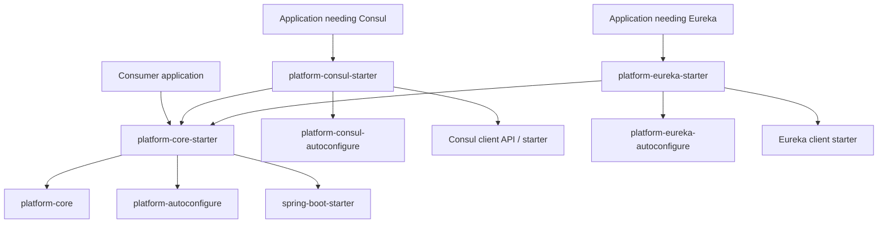

# Avoiding Unnecessary Infrastructure Dependencies in Foundation Starters

## 1. The Problem with a Starter Pulling Too Much Infrastructure

A foundation starter is typically shared across many applications: API services, batch workers, command-line tools, containerized services, or apps that only need a few Spring Cloud abstractions. If a foundation starter pulls in clients for every infrastructure system by default—such as Consul, Eureka, Redis, Kafka, database drivers, cloud SDKs, and tracing exporters—every consumer ends up carrying a bloated classpath even when it does not use those features.

For example, an application that only needs to read the Spring Environment and call the `DiscoveryClient` abstraction can accidentally inherit numerous networking libraries, serializers, client SDKs, and native dependencies. Common consequences include:

- Larger artifacts and deployment images, increasing download and packaging times.
- Multiple library versions in the dependency graph that can conflict with the host application.
- A larger surface area for CVE, license, and supply-chain audits.
- Auto-configurations accidentally activating or opening connections to unneeded infrastructure.
- Difficulty for consumers in telling which libraries are genuinely required for the features they use.
- Upgrading one integration affecting every application that depends on the foundation starter.

The goal of starter design is to provide enough core components for an application to get started, while giving each infrastructure integration its own dedicated dependency and auto-configuration. A well-designed foundation starter makes clear **what is always required**, **what is needed only when a provider is chosen**, and **which conditions cause beans to be created**.

This lesson belongs to the **Auto-Configuration Customization** chapter of **SPRING_CLOUD_CORE**. It focuses on module organization, dependency declarations in Maven/Gradle, protecting auto-configuration with conditions, and testing that a minimal classpath still boots cleanly.

## 2. Classify Dependencies Before Designing a Starter

Before adding a library to a starter, identify which category it belongs to:

| Category | Examples | Should it live in the foundation starter? |
| --- | --- | --- |
| Core APIs and abstractions | Spring Boot core, Spring Cloud Commons, internal interfaces | Usually yes, if every consumer needs them |
| Core auto-configuration | Default beans, property bindings, shared converters | Yes, if safe to run without providers |
| Provider-specific client | Eureka, Consul, Zookeeper, Redis, Kafka, Vault | No; place in a dedicated integration/starter |
| Optional driver or SDK | PostgreSQL driver, AWS SDK, Azure SDK, cloud database clients | No; applications adopting the technology add it themselves |
| Testing tools | JUnit, Mockito, Testcontainers, embedded brokers | Only in test scope or starter-test |
| Version-management dependency | BOMs and dependency constraints | Put in dependency management; does not add artifacts to classpath on its own |

Distinguish three concepts:

- **Dependency management** manages artifact versions and constraints.
- **Dependency declaration** brings artifacts into the dependency graph and classpath.
- **Auto-configuration conditions** decide whether beans/configurations activate when the application runs.

Importing the Spring Cloud BOM in `dependencyManagement` does not pull every Spring Cloud module into the application. Conversely, adding a starter to `dependencies` can pull in that starter's entire dependency tree.

Marking a dependency as optional does not automatically make beans optional either. The dependency graph and bean creation conditions are two separate control layers.

## 3. Recommended Module Structure

For a platform supporting multiple providers, split modules along capability boundaries. For instance, an internal platform providing a shared API with optional Consul or Eureka integration:



Role of each module:

| Module | Responsibility | Typical dependencies |
| --- | --- | --- |
| `platform-core` | Contracts, models, service APIs, and shared config | Spring Cloud Commons if public APIs require those abstractions |
| `platform-autoconfigure` | Default beans not tied to a specific provider | `platform-core`, Spring Boot auto-configuration |
| `platform-core-starter` | Minimal entry point for most applications | Core, auto-config, and `spring-boot-starter` |
| `platform-consul-autoconfigure` | Conditions and beans for Consul integration | Consul API in compile/test; activates only when classes are present |
| `platform-consul-starter` | Explicit opt-in for using Consul | Consul auto-config and Consul discovery starter |
| `platform-eureka-autoconfigure` | Conditions and beans for Eureka integration | Eureka API in compile/test; activates only when classes are present |
| `platform-eureka-starter` | Explicit opt-in for using Eureka | Eureka auto-config and Eureka client starter |
| `platform-starter-test` | Helpers and test fixtures for consumers | Test libraries, never pulled into production runtime |

If a platform has only one simple feature and no optional flavors, auto-configuration and starter can be combined. When there are multiple providers or independent features, splitting modules makes choices explicit and eliminates unnecessary dependencies.

Do not put Consul, Eureka, Redis, or Kafka implementations inside `platform-core`. Core should depend only on required abstractions. Adapter and provider-specific code belongs in its corresponding integration module.

## 4. A Foundation Starter Only Pulls What Is Truly Needed

A starter is usually a thin artifact whose main purpose is bundling sensible dependencies for a use case. Abbreviated Maven POM for `platform-core-starter`:

```xml
<dependencies>
    <dependency>
        <groupId>com.example.platform</groupId>
        <artifactId>platform-core</artifactId>
    </dependency>

    <dependency>
        <groupId>com.example.platform</groupId>
        <artifactId>platform-autoconfigure</artifactId>
    </dependency>

    <dependency>
        <groupId>org.springframework.boot</groupId>
        <artifactId>spring-boot-starter</artifactId>
    </dependency>
</dependencies>
```

This starter does not declare Consul, Eureka, Redis, or Kafka. An application adding only `platform-core-starter` receives shared APIs and shared auto-configuration.

An application wanting Consul adds the dedicated starter:

```xml
<dependencies>
    <dependency>
        <groupId>com.example.platform</groupId>
        <artifactId>platform-consul-starter</artifactId>
    </dependency>
</dependencies>
```

Only `platform-consul-starter`'s POM declares the dependencies needed for that integration:

```xml
<dependencies>
    <dependency>
        <groupId>com.example.platform</groupId>
        <artifactId>platform-core-starter</artifactId>
    </dependency>

    <dependency>
        <groupId>com.example.platform</groupId>
        <artifactId>platform-consul-autoconfigure</artifactId>
    </dependency>

    <dependency>
        <groupId>com.vendor</groupId>
        <artifactId>consul-client-api</artifactId>
    </dependency>
</dependencies>
```

Applications wanting Eureka pick `platform-eureka-starter`. Thus, provider selection is visible right in the dependency declaration and verifiable via the dependency tree.

### 4.1. Managing Versions Does Not Mean Adding Dependencies

You can import a BOM so modules share compatible versions:

```xml
<dependencyManagement>
    <dependencies>
        <dependency>
            <groupId>org.springframework.cloud</groupId>
            <artifactId>spring-cloud-dependencies</artifactId>
            <version>SPRING_CLOUD_RELEASE_TRAIN_VERSION</version>
            <type>pom</type>
            <scope>import</scope>
        </dependency>
    </dependencies>
</dependencyManagement>
```

`SPRING_CLOUD_RELEASE_TRAIN_VERSION` is a placeholder to replace with a release train compatible with your project's Spring Boot baseline. A BOM manages versions when artifacts are declared; it does not add Eureka, Consul, or other starters to the classpath on its own.

Keep versions centralized in a BOM or dependency constraints so different integrations do not pick mismatched versions. Only declare artifacts in `dependencies` when the module genuinely needs them.

## 5. What Does Maven optional Mean?

In Maven, `<optional>true</optional>` changes transitive propagation to consumers. It **does not remove the dependency from the declaring module's own classpath**.

Suppose `platform-consul-autoconfigure` needs to compile against the Consul API, but should not pass that dependency transitively to `platform-autoconfigure` or core-only applications:

```xml
<dependency>
    <groupId>com.vendor</groupId>
    <artifactId>consul-client-api</artifactId>
    <optional>true</optional>
</dependency>
```

Inside `platform-consul-autoconfigure`, the dependency remains present for compilation and tests. When another project depends only on that module, Maven does not automatically propagate `consul-client-api` to that project. Consumers must declare the provider dependency directly, typically via `platform-consul-starter`.

This example omits `<version>` assuming the artifact is managed in the platform or provider BOM. If no dependency management applies, specify a version explicitly.

Key distinction:

| Context | Is the optional dependency present? |
| --- | --- |
| Compile classpath of the module declaring the optional dependency | Yes |
| Runtime classpath of that module per its scope | Yes |
| Consumer depending only on that module | Not propagated transitively |
| Consumer also declaring the provider starter directly | Yes, brought into the graph by the provider starter |

`optional` does not mean the dependency loads only when a method is called, nor does it toggle beans automatically. It is metadata controlling transitivity at the consumer boundary.

### 5.1. When to Use optional vs. Splitting Modules

Maven treats optional dependencies as a fallback when a feature cannot be split into a separate module. When a feature can be split, dedicated modules are usually easier to understand:

- `platform-core` holds what every application needs.
- `platform-consul-autoconfigure` holds Consul-only code.
- `platform-consul-starter` brings Consul integration into an application via explicit choice.

Use `optional` when a module cannot be cleanly split or must support several flavors in one artifact. When there are multiple heavy integrations, stuffing everything into one module with `optional` complicates source code, tests, and auto-configuration.

Do not use `<scope>provided</scope>` to emulate optional. `provided` means the dependency is supplied by the deployment runtime environment; it does not express optional transitivity semantics.

## 6. Gradle: Understanding Dependency Configurations Properly

Gradle does not use Maven's `<optional>true</optional>` model for standard dependency declarations. With the Java Library plugin, configurations have distinct roles:

| Configuration | Current module classpath | Consumer compile classpath | Consumer runtime |
| --- | --- | --- | --- |
| `api` | Compile and runtime | Yes | Yes |
| `implementation` | Compile and runtime | No | Yes |
| `compileOnly` | Compile | No | No |
| `runtimeOnly` | Runtime | No | Yes |
| `testImplementation` | Test compile and test runtime | No | No |
| `testRuntimeOnly` | Test runtime | No | No |

A common pitfall is forgetting that `implementation` **is still propagated to the consumer's runtime**. It is merely hidden from the consumer's compile classpath. Therefore, changing a dependency from `api` to `implementation` is not enough to keep a provider SDK off an application's runtime classpath.

Example where an auto-config module compiles against the Consul API without passing it to every consumer:

```kotlin
plugins {
    `java-library`
}

dependencies {
    implementation(project(":platform-core"))

    // Needed only to compile the conditional integration code.
    compileOnly("com.vendor:consul-client-api")

    // Present when running tests for the Consul-enabled branch.
    testImplementation("com.vendor:consul-client-api")
}
```

A dedicated starter module adds the provider at runtime:

```kotlin
plugins {
    `java-library`
}

dependencies {
    implementation(project(":platform-core-starter"))
    implementation(project(":platform-consul-autoconfigure"))

    // Provider client accompanies only the Consul starter.
    runtimeOnly("com.vendor:consul-client-api")
}
```

`runtimeOnly` works when consumers only need the library at runtime and the starter's public API does not expose provider types. If consumers must compile code directly against provider types, choose the appropriate public dependency configuration and accept that the provider is part of the consumer API.

Use `api` when types from a dependency appear in the library's public API, such as superclasses, interfaces, public method parameters, or public annotations. When a dependency is internal-only, prefer `implementation`. For optional libraries, consider `compileOnly` plus a dedicated module/starter instead of placing them in `api`.

Gradle also supports feature variants for libraries publishing multiple optional features. This is an advanced option when a single artifact must expose separate capabilities. For Spring Boot starters, per-provider modules/starters are generally simpler to understand and verify.

If your build uses the Spring Cloud BOM, Gradle can import a platform to manage versions without adding every artifact to runtime:

```kotlin
dependencies {
    implementation(platform(
        "org.springframework.cloud:spring-cloud-dependencies:SPRING_CLOUD_RELEASE_TRAIN_VERSION"
    ))
}
```

Replace the placeholder with a release train compatible with your Spring Boot baseline. Then declare individual artifacts in appropriate configurations such as `implementation`, `compileOnly`, or `runtimeOnly`.

## 7. Auto-Configuration Must Survive a Minimal Classpath

Separating dependencies solves only half the problem. Auto-configuration must also work cleanly when the provider library is absent from the classpath.

Spring Boot provides common conditions:

| Condition | Question |
| --- | --- |
| `@ConditionalOnClass` | Is the required class on the classpath? |
| `@ConditionalOnMissingClass` | Is a specific class absent? |
| `@ConditionalOnBean` | Does the context already have the dependent bean? |
| `@ConditionalOnMissingBean` | Has the consumer already supplied a replacement bean? |
| `@ConditionalOnProperty` | Did the user enable the feature via a property? |
| `@ConditionalOnResource` | Does the required resource exist? |

An integration often combines multiple conditions:

- The provider API must be on the classpath.
- The feature must be enabled via property if opt-in is desired.
- Dependent beans must exist.
- Auto-configuration creates the default bean only when the consumer has not defined a matching bean.

For example, the Consul feature activates only when explicitly requested:

```yaml
platform:
  discovery:
    consul:
      enabled: true
```

Property conditions should have safe defaults. If a feature opens network connections or allocates external resources, prefer opt-in (not matching by default when the property is omitted) so it activates only when configured by the consumer.

## 8. Isolating References to Optional Classes

A common bug occurs when an auto-configuration has method signatures referencing a provider class even when the provider is absent from the classpath. For example, a bean method returns `ConsulClient`, while `@ConditionalOnClass` sits only on that method. The JVM may need to load classes or inspect method signatures before the method condition evaluates, throwing `NoClassDefFoundError`.

The safe pattern is isolating provider-dependent code inside a separate configuration guarded by a class-level condition. The example below uses an illustrative type `com.vendor.consul.ConsulClient`; in real projects, replace it with the chosen provider's API class:

```java
package com.example.platform.autoconfigure.consul;

import com.vendor.consul.ConsulClient;
import com.example.platform.ConsulAdapter;
import org.springframework.boot.autoconfigure.AutoConfiguration;
import org.springframework.boot.autoconfigure.condition.ConditionalOnBean;
import org.springframework.boot.autoconfigure.condition.ConditionalOnClass;
import org.springframework.boot.autoconfigure.condition.ConditionalOnMissingBean;
import org.springframework.boot.autoconfigure.condition.ConditionalOnProperty;
import org.springframework.context.annotation.Bean;
import org.springframework.context.annotation.Configuration;

@AutoConfiguration
public class PlatformConsulAutoConfiguration {

    @Configuration(proxyBeanMethods = false)
    @ConditionalOnClass(name = "com.vendor.consul.ConsulClient")
    static class ConsulClientConfiguration {

        @Bean
        @ConditionalOnBean(ConsulClient.class)
        @ConditionalOnProperty(
                prefix = "platform.discovery.consul",
                name = "enabled",
                havingValue = "true"
        )
        @ConditionalOnMissingBean
        ConsulAdapter consulAdapter(ConsulClient consulClient) {
            return new ConsulAdapter(consulClient);
        }
    }
}
```

This structure provides four layers of protection:

1. The nested configuration is processed only when the provider class exists.
2. The bean is created only when the context has the required client bean.
3. The property must be explicitly enabled before creating the integration bean.
4. `@ConditionalOnMissingBean` allows consumers to supply their own `ConsulAdapter`.

Putting the class condition on a separate configuration lets Spring Boot read annotation metadata and skip the branch before processing method signatures containing optional types. Placing `@ConditionalOnClass` only on a `@Bean` method whose return type or parameter types reference an absent class can be evaluated too late.

Never let a provider class appear in fields, superclasses, interfaces, annotations, or static initializers of an auto-configuration that is always loaded. Isolate all such references inside nested configurations or dedicated modules.

## 9. Registering Auto-Configuration in the JAR

In modern Spring Boot, auto-configurations are listed in:

```text
META-INF/spring/org.springframework.boot.autoconfigure.AutoConfiguration.imports
```

Example file for the `platform-consul-autoconfigure` module:

```text
com.example.platform.autoconfigure.consul.PlatformConsulAutoConfiguration
```

Each line is one auto-configuration class. Auto-configurations should live in a dedicated package and be loaded solely via the imports file; avoid broad component scans that accidentally load provider configurations when a consumer does not need them.

If you must support an older Spring Boot baseline, use the auto-configuration registration mechanism supported by that baseline and check your project's compatibility matrix. Do not copy metadata files from a different release without verifying version compatibility.

Core auto-configuration and provider auto-configurations can reside in separate artifacts. The generic starter pulls in only core auto-configuration; provider starters add their respective provider auto-configurations.

## 10. BOMs and Starters Have Different Responsibilities

A BOM ensures modules use compatible versions. A starter decides which dependencies enter an application.

Example:

- `platform-dependencies` manages versions of `platform-core`, provider adapters, and Spring Cloud modules.
- `platform-core-starter` declares minimal dependencies for core.
- `platform-consul-starter` declares core plus Consul integration.
- `platform-eureka-starter` declares core plus Eureka integration.

Do not add every provider to a BOM expecting them to show up in applications, or worry that a BOM itself bloats classpaths. A BOM can manage versions for dozens of artifacts without adding a single artifact to the classpath.

Conversely, if a starter declares a provider starter in `dependencies`, that provider is resolved per dependency metadata regardless of whether its version comes from a BOM or is declared directly.

When consumers use multiple starters, a BOM prevents version drift across modules, though it does not replace picking the right starter.

## 11. Testing Auto-Configuration With and Without Dependencies

A solid test suite must prove two scenarios: the minimal classpath boots cleanly, and the integration activates when both dependency and configuration are present.

Spring Boot provides `ApplicationContextRunner` to create small, isolated ApplicationContexts for each scenario. `FilteredClassLoader` simulates a class or package being absent from the runtime classpath.

Example verifying that auto-configuration does not create the adapter when the provider class is absent:

The test module needs `spring-boot-starter-test` in test scope and the provider API on test compile/runtime classpaths so the test can pass the class to `FilteredClassLoader`.

```java
import com.vendor.consul.ConsulClient;
import com.example.platform.ConsulAdapter;
import com.example.platform.autoconfigure.consul.PlatformConsulAutoConfiguration;
import org.junit.jupiter.api.Test;
import org.springframework.boot.autoconfigure.AutoConfigurations;
import org.springframework.boot.test.context.runner.ApplicationContextRunner;
import org.springframework.boot.test.context.FilteredClassLoader;

import static org.assertj.core.api.Assertions.assertThat;

class PlatformConsulAutoConfigurationTests {

    private final ApplicationContextRunner runner =
            new ApplicationContextRunner()
                    .withConfiguration(
                            AutoConfigurations.of(
                                    PlatformConsulAutoConfiguration.class
                            )
                    );

    @Test
    void backsOffWhenConsulLibraryIsMissing() {
        runner.withClassLoader(new FilteredClassLoader(ConsulClient.class))
                .withPropertyValues(
                        "platform.discovery.consul.enabled=true"
                )
                .run(context ->
                        assertThat(context)
                                .doesNotHaveBean(ConsulAdapter.class)
                );
    }
}
```

In this test, the provider class is on the test compile classpath so the test can reference it, and `FilteredClassLoader` simulates a runtime lacking that class. The test does not need to launch a real Consul server.

Additional scenarios to cover:

| Scenario | Outcome to assert |
| --- | --- |
| Provider class absent | Provider auto-configuration creates no bean and context starts cleanly |
| Provider class present, property disabled | Bean is not created and no connection is opened |
| Provider class present, property enabled | Integration bean is created when remaining conditions match |
| Consumer declares its own bean | Auto-configuration backs off without creating a duplicate bean |
| Core starter only | No provider SDK appears in the runtime dependency graph |
| Provider starter included | Provider SDK and integration auto-configuration appear |
| Multiple provider starters | Adapters do not conflict; beans have clear conditions and qualifiers |

Use mocks or fake clients for unit/context tests. Integration tests against real Consul/Eureka/Redis/Kafka belong in dedicated test suites and can use Testcontainers when appropriate. Do not force every consumer to run external infrastructure just to verify the foundation starter can boot.

## 12. Inspecting the Actual Dependency Graph

Do not rely solely on reading POMs or build scripts. Inspect the resolved graph after dependency management and transitive resolution apply.

### 12.1. Maven

Inspect the generic starter's dependency tree:

```bash
./mvnw -pl platform-core-starter dependency:tree
```

Filter for specific infrastructure artifacts:

```bash
./mvnw -pl platform-core-starter dependency:tree \
  -Dincludes=com.vendor:consul-client-api
```

If Consul shows up even though the generic starter is not supposed to support Consul, trace which dependency path pulled it in. Use `dependency:analyze` to find declared-but-unused dependencies and used-but-undeclared dependencies.

Check `effective-pom` when versions or scopes inherited from a parent/BOM cause the outcome to differ from the raw POM file you are looking at.

### 12.2. Gradle

Inspect the runtime classpath:

```bash
./gradlew :platform-core-starter:dependencies --configuration runtimeClasspath
```

Trace the path pulling a specific artifact into the graph:

```bash
./gradlew :platform-core-starter:dependencyInsight \
  --dependency consul-client-api \
  --configuration runtimeClasspath
```

Distinguish `compileClasspath` from `runtimeClasspath`. A dependency absent from a consumer's compile classpath can still appear at runtime because an intermediate module declared it with `implementation`.

### 12.3. Adding Dependency Budgets to Reviews

You can maintain a deny-list of infrastructure artifacts that must not appear in the generic starter. CI can check the dependency tree or run an enforcer rule to fail builds when an unapproved provider appears.

When adding a new dependency, pull requests should answer:

- Which feature requires this library?
- Do all consumers need it?
- Can the dependency move to a provider-specific module?
- Is the auto-configuration guarded by classpath and property conditions?
- Does the generic starter's runtime graph grow unexpectedly?
- Do license, CVE exposure, and artifact size change?

## 13. Common Pitfalls

| Practice | Problem | Fix |
| --- | --- | --- |
| Adding every provider starter to the generic starter | Every application must carry every infrastructure client | Create a separate starter per provider |
| Marking a dependency optional with no provider starter | Consumers do not receive the dependency, so the feature cannot run | Provider-specific starters must declare that dependency directly |
| Assuming `optional=true` removes the dependency from the module's own build | The module still needs it to compile/test | Understand `optional` as a transitivity rule at the consumer boundary |
| Switching to Gradle `implementation` expecting the dependency to vanish at runtime | `implementation` remains a runtime dependency for consumers | Use a separate module or `compileOnly` when appropriate |
| Using `compileOnly` while forgetting provider runtime dependencies | Auto-configuration hits missing classes at runtime | Provider starter supplies the runtime dependency |
| Putting an optional class in the signature of an unconditionally loaded auto-configuration | Can throw `NoClassDefFoundError` before conditions take effect | Isolate inside a nested configuration guarded by `@ConditionalOnClass` |
| Using only property conditions | Property enabled while provider library is absent | Combine class conditions with property conditions |
| Opening connections inside a default bean's constructor | Applications may connect to infrastructure even when not using the feature | Use opt-in, lazy/resource lifecycles, and explicit timeouts |
| Using exclusions to patch every dependency graph | May strip libraries needed by another branch | Fix dependencies in the owning module or split integrations |
| Treating a BOM as a way to add starters | A BOM only manages versions | Declare dependencies explicitly in the right starter |
| Testing only on a full classpath | Misses branches where provider classes are absent | Use `FilteredClassLoader` and test each condition |

## 14. Workflow for Designing a New Integration

When adding a new provider to the platform, follow this order:

1. Identify the core contract applications need; keep the contract in `platform-core`.
2. Create a dedicated auto-configuration module for the provider.
3. Place provider dependencies in the compile/test scopes needed by the integration module; do not pass them through the generic starter.
4. Use `@ConditionalOnClass` to isolate code referencing the provider.
5. Use `@ConditionalOnProperty` to gate feature activation if the integration should be opt-in.
6. Use `@ConditionalOnMissingBean` so consumers can replace default implementations.
7. Register the auto-configuration in metadata appropriate for your Spring Boot baseline.
8. Create a provider-specific starter declaring the provider dependency directly.
9. Write `ApplicationContextRunner` tests for classpaths with and without the provider.
10. Inspect dependency trees for both the generic starter and the provider starter.
11. Confirm the generic starter opens no connections to optional infrastructure at startup.
12. Document required dependencies and properties in the provider starter's docs.

This workflow gives each integration its own version lifecycle, activation conditions, and test suite, while keeping core consumers on a lean classpath with predictable behavior.

## 15. Self-Check Questions

1. Why should a foundation starter avoid pulling in every infrastructure provider?
2. How does dependency management differ from dependency declaration?
3. How does Maven `optional=true` affect the declaring module's classpath versus the consumer's classpath?
4. Why is splitting provider-specific modules usually clearer than stuffing every API into one module with optional dependencies?
5. Does Gradle `implementation` propagate onto the consumer's runtime classpath?
6. When should you use Gradle `api`, `implementation`, `compileOnly`, and `runtimeOnly`?
7. Why must class conditions be isolated from method signatures referencing optional types?
8. What distinct conditions do `ConditionalOnClass`, `ConditionalOnProperty`, and `ConditionalOnMissingBean` resolve?
9. What role does `AutoConfiguration.imports` play inside an auto-configuration JAR?
10. How do you use `ApplicationContextRunner` and `FilteredClassLoader` to test a classpath missing a provider?
11. Why is inspecting the runtime dependency tree more important than checking only the compile classpath?
12. Which components must a provider-specific starter declare for the feature to work?

## 16. Official References

- [Spring Boot — Creating Your Own Auto-configuration](https://docs.spring.io/spring-boot/reference/features/developing-auto-configuration.html) — auto-configuration/starter structure, `ConditionalOnClass`, `ConditionalOnMissingBean`, imports metadata, and `ApplicationContextRunner`.
- [Maven — Optional Dependencies and Dependency Exclusions](https://maven.apache.org/guides/introduction/introduction-to-optional-and-excludes-dependencies.html) — semantics of `optional`, transitivity, and when to split modules.
- [Maven — Introduction to the Dependency Mechanism](https://maven.apache.org/guides/introduction/introduction-to-dependency-mechanism.html) — dependency scopes, transitive resolution, BOMs, and dependency trees.
- [Gradle — The Java Library Plugin](https://docs.gradle.org/current/userguide/java_library_plugin.html) — `api`, `implementation`, `compileOnly`, `runtimeOnly`, and dependency variants.
- [Gradle — Dependency Configurations](https://docs.gradle.org/current/userguide/dependency_configurations.html) — declarable, resolvable, and consumable roles of dependency configurations.

*This material focuses on keeping foundation starters lean, separating providers by need, and ensuring auto-configuration remains safe when optional libraries are absent. Always verify both the runtime dependency graph and `ApplicationContext` behavior on a minimal classpath.*