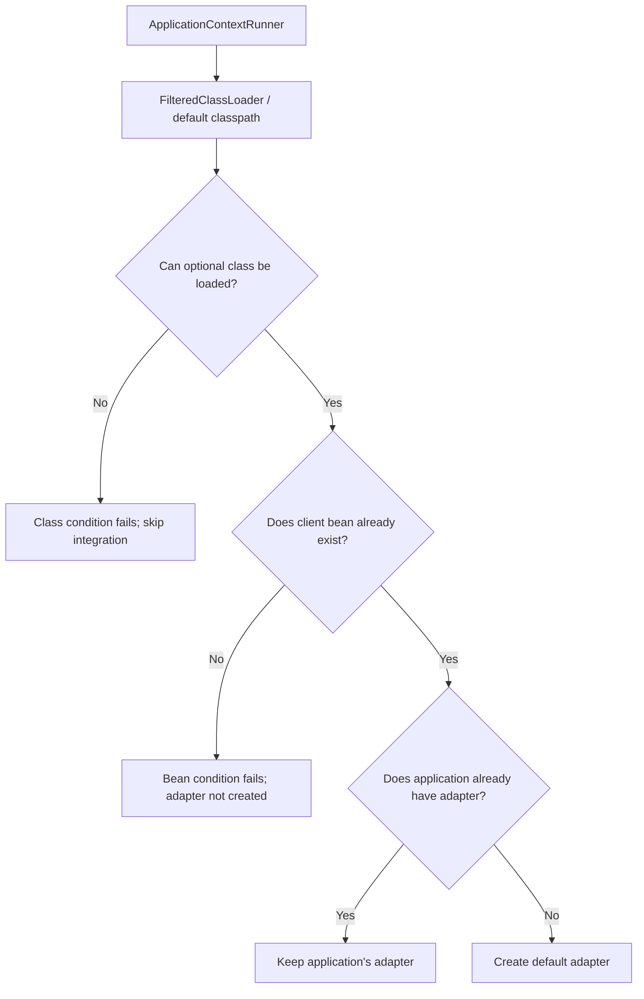

# Simulating Missing or Present Implementations on the Classpath

A Spring Cloud auto-configuration often integrates with optional libraries: a Eureka or Consul client, an internal SDK, or a `DiscoveryClient` implementation. An application may include that library only in certain environments. When the dependency is present, Spring must create the integration bean; when the dependency is absent, the context must still start normally without referencing the missing class.

Testing both scenarios with a single fixed classpath is usually insufficient. If tests always run with all dependencies present, the "missing implementation" branch goes untested. Spring Boot provides `FilteredClassLoader` to simulate a class or package being unavailable to load, combined with `ApplicationContextRunner` to build small contexts for each scenario.

This lesson belongs to the **Testing** chapter of **SPRING_CLOUD_CORE**. It focuses on how to simulate an implementation being present or absent, distinguish classpath conditions from bean conditions, test Spring Cloud auto-configuration, and verify that the application still works when an optional provider is not installed.

## 1. Learning Objectives

After this lesson, you can:

- Distinguish a class being on the classpath from a bean being registered in the `ApplicationContext`.
- Explain the roles of `@ConditionalOnClass`, `@ConditionalOnMissingClass`, `@ConditionalOnBean`, and `@ConditionalOnMissingBean`.
- Use `ApplicationContextRunner` to test an auto-configuration in an isolated context.
- Use `FilteredClassLoader` to hide a class or package during a test run.
- Test both the implementation-present branch and the implementation-absent branch.
- Distinguish the case where the class is present but the bean has not been created.
- Verify behavior when the application provides a replacement bean.
- Simulate Spring Cloud discovery enable/disable flags.
- Recognize the role of provider registration metadata such as `META-INF/spring.factories`.
- Avoid `NoClassDefFoundError` when a dependency is optional.
- Design integration tests to verify that a dependency is truly absent from the artifact.
- Read the condition evaluation report to explain why a configuration was enabled or skipped.

## 2. Two Questions to Test Separately

When integrating an optional implementation, there are two independent questions:

1. **Can the class be loaded from the classpath?**
2. **Has the required bean already been registered in the Spring context?**

A class may be present with no bean using it. Conversely, a bean may be supplied by the application or another configuration without needing auto-configuration to create a default bean.

| Scenario | Class on classpath? | Bean in context? | Meaning |
| --- | --- | --- | --- |
| SDK not installed | No | No | Optional auto-configuration must back off |
| SDK installed, client bean not created yet | Yes | No | Classpath condition passes; bean condition may not match yet |
| SDK installed and client bean configured | Yes | Yes | Integration adapter can be enabled |
| Application supplies its own adapter | May or may not be present depending on design | Application-created adapter exists | Auto-configuration should back off if a replacement bean exists |
| Discovery provider installed | Provider implementation present | Provider bean created if metadata and conditions match | Provider can be used for discovery |
| Discovery provider not installed | No provider implementation | Spring Cloud uses `SimpleDiscoveryClient` when no service-registry-backed client exists | Do not conclude that every `DiscoveryClient` disappears |

Key point: **`@ConditionalOnClass` checks whether a class can be loaded; `@ConditionalOnBean` checks whether a bean already exists in the context.** The two conditions are not interchangeable.



## 3. Relevant Conditions

Spring Boot provides condition annotations commonly used in auto-configuration.

| Annotation | Condition checked | Use case |
| --- | --- | --- |
| `@ConditionalOnClass` | One or more classes exist on the classpath | Optional SDK or API is present |
| `@ConditionalOnMissingClass` | One or more classes are absent from the classpath | Enable fallback branch when another library is absent |
| `@ConditionalOnBean` | Matching bean is already registered | Create adapter only when client bean exists |
| `@ConditionalOnMissingBean` | Matching bean does not yet exist | Create default bean and allow application override |
| `@ConditionalOnProperty` | Property matches specified value or rule | Toggle feature via configuration |
| `@ConditionalOnResource` | Specified resource can be found | Integration depending on metadata file or resource |

### 3.1. Checking the Classpath with ConditionalOnClass

Example:

```java
@AutoConfiguration
@ConditionalOnClass(AcmeRegistryClient.class)
public class AcmeRegistryAutoConfiguration {
    // Beans that require AcmeRegistryClient
}
```

When `AcmeRegistryClient` is not on the classpath, the configuration should not be applied.

You can use a string class name:

```java
@ConditionalOnClass(
        name = "com.acme.registry.AcmeRegistryClient")
```

The `name` form is useful when an auto-configuration module does not have a mandatory compile-time dependency on the optional SDK. It avoids referencing a class literal directly in the annotation.

### 3.2. Checking Beans with ConditionalOnBean

Class presence does not mean the client bean has been created:

```java
@Bean
@ConditionalOnBean(AcmeRegistryClient.class)
AcmeDiscoveryAdapter acmeDiscoveryAdapter(
        AcmeRegistryClient client) {
    return new AcmeDiscoveryAdapter(client);
}
```

If the SDK is on the classpath without an `AcmeRegistryClient` bean, this method is not used to create the adapter.

### 3.3. Allowing Application Overrides with ConditionalOnMissingBean

```java
@Bean
@ConditionalOnMissingBean(AcmeDiscoveryAdapter.class)
AcmeDiscoveryAdapter acmeDiscoveryAdapter(
        AcmeRegistryClient client) {
    return new AcmeDiscoveryAdapter(client);
}
```

If the application already supplies an `AcmeDiscoveryAdapter`, the default auto-configuration backs off. This allows an integration library to be customized without forcing applications onto a fixed implementation.

### 3.4. Testing Properties Independently of the Classpath

```java
@Bean
@ConditionalOnProperty(
        prefix = "acme.discovery",
        name = "enabled",
        havingValue = "true",
        matchIfMissing = true)
AcmeDiscoveryAdapter acmeDiscoveryAdapter(
        AcmeRegistryClient client) {
    return new AcmeDiscoveryAdapter(client);
}
```

Even when the SDK is on the classpath and the client bean exists, the user can still disable the adapter via a property:

```yaml
acme:
  discovery:
    enabled: false
```

When testing, vary one factor at a time so you know exactly which condition drives the outcome.

## 4. ApplicationContextRunner

`ApplicationContextRunner` is a Spring Boot Test utility for creating a lightweight `ApplicationContext`, applying per-test configuration and properties, running assertions, and closing the context.

Skeleton example:

```java
import org.springframework.boot.autoconfigure.AutoConfigurations;
import org.springframework.boot.test.context.runner.ApplicationContextRunner;

class AcmeDiscoveryAutoConfigurationTests {

    private final ApplicationContextRunner contextRunner =
            new ApplicationContextRunner()
                    .withConfiguration(
                            AutoConfigurations.of(
                                    AcmeDiscoveryAutoConfiguration.class));
}
```

`AutoConfigurations.of(...)` registers the auto-configuration classes in the runner. This is the right way to focus on testing conditions and bean behavior.

### 4.1. Each Run Is a Separate Context

Each run can be configured individually:

```java
contextRunner
        .withPropertyValues("acme.discovery.enabled=true")
        .run(context -> {
            // Assertions for this scenario.
        });
```

Methods such as `withPropertyValues`, `withUserConfiguration`, `withBean`, and `withClassLoader` let you build different combinations without modifying global configuration.

The runner manages the context lifecycle for the `run` callback. Do not retain beans or contexts from one test to use in another.

The runner classes and `FilteredClassLoader` live in `spring-boot-test`. In projects using Spring Boot's dependency management, `spring-boot-starter-test` is usually added in test scope; for leaner dependencies, you can declare `spring-boot-test` directly alongside JUnit and AssertJ as needed.

### 4.2. Condition Tests Differ from Discovery Metadata Tests

When using:

```java
AutoConfigurations.of(AcmeDiscoveryAutoConfiguration.class)
```

the test imports the class directly. This test verifies the contents of the auto-configuration and its internal conditions, but **does not prove** that Spring Boot finds the class through registration resources inside the JAR.

To verify discovery metadata, add a consumer/packaging test that depends on the JAR without manually importing the class. This is covered in Section 15.

## 5. FilteredClassLoader Simulating Missing Classes

`FilteredClassLoader` is in package:

```java
org.springframework.boot.test.context.FilteredClassLoader
```

It is a test class loader capable of filtering which classes or resources it allows to be loaded. Rather than deleting dependencies from the machine or editing build files for each test, you create a dedicated class loader just for that context run.

### 5.1. Hiding a Specific Class

```java
new FilteredClassLoader(AcmeRegistryClient.class)
```

The class may still exist on the test runtime classpath, but the context running with this class loader cannot load the specified class.

### 5.2. Hiding an Entire Package

```java
new FilteredClassLoader("com.acme.registry")
```

This is useful when an integration depends on multiple classes in the same package. Choose a package narrow enough not to accidentally hide shared application APIs.

### 5.3. Hiding Resources

`FilteredClassLoader` also supports filtering classpath resources. For example, a specific resource can be hidden to test the fallback branch when metadata does not exist.

Be careful when hiding `META-INF/spring.factories`: this resource can contain entries from many libraries. Hiding the entire resource may drop unrelated factories outside the provider under test.

### 5.4. Using with ApplicationContextRunner

```java
contextRunner
        .withClassLoader(
                new FilteredClassLoader(AcmeRegistryClient.class))
        .run(context -> {
            // Assert that optional integration backs off.
        });
```

`withClassLoader` applies the class loader to the context created by the runner. It does not alter the JVM-wide class loader and does not remove JARs from the dependency graph.

## 6. Example Auto-Configuration with an Optional Dependency

Suppose the Acme library provides `AcmeRegistryClient`. The Spring Cloud integration creates the adapter only when the SDK is present and the client bean has been registered.

```java
package com.example.acme.autoconfigure;

import com.acme.registry.AcmeRegistryClient;
import org.springframework.boot.autoconfigure.AutoConfiguration;
import org.springframework.boot.autoconfigure.condition.ConditionalOnBean;
import org.springframework.boot.autoconfigure.condition.ConditionalOnClass;
import org.springframework.boot.autoconfigure.condition.ConditionalOnMissingBean;
import org.springframework.context.annotation.Bean;
import org.springframework.context.annotation.Configuration;

@AutoConfiguration
public class AcmeDiscoveryAutoConfiguration {

    @Configuration(proxyBeanMethods = false)
    @ConditionalOnClass(
            name = "com.acme.registry.AcmeRegistryClient")
    static class AcmeRegistryConfiguration {

        @Bean
        @ConditionalOnBean(AcmeRegistryClient.class)
        @ConditionalOnMissingBean(AcmeDiscoveryAdapter.class)
        AcmeDiscoveryAdapter acmeDiscoveryAdapter(
                AcmeRegistryClient client) {
            return new AcmeDiscoveryAdapter(client);
        }
    }
}
```

The outer class does not directly reference the optional SDK. The nested configuration is guarded by the classpath condition. When the class is absent, Spring can skip the configuration branch before processing the bean method whose signature references `AcmeRegistryClient`.

This separation is especially important when a library needs to support multiple dependency combinations.

### 6.1. Why Not Put Everything in One Class?

If an auto-configuration class is loaded when the SDK does not exist, method signatures, fields, or annotations referencing SDK types can fail when the JVM or Spring inspects metadata.

Placing dependent parts into a nested configuration with a class-level condition isolates optional references. Use `name` in `@ConditionalOnClass` so the outer configuration does not need to load the SDK class literal.

### 6.2. Do Not Use Conditions to Hide a Mandatory Dependency

If the application always requires `AcmeRegistryClient`, declare that dependency explicitly and fail with a clear configuration error when it is missing. Classpath conditions are appropriate when an integration is genuinely optional, not for masking a missing required dependency.

## 7. Testing When the Implementation Is Not on the Classpath

This is a critical negative branch. The test must prove the context still starts and does not create integration beans that require the SDK.

```java
@Test
void backsOffWhenRegistrySdkIsMissing() {
    this.contextRunner
            .withClassLoader(
                    new FilteredClassLoader(AcmeRegistryClient.class))
            .run(context -> {
                assertThat(context).hasNotFailed();
                assertThat(context)
                        .doesNotHaveBean(AcmeDiscoveryAdapter.class);
            });
}
```

Place this method in the test class that declared `contextRunner` in Section 4; required imports include `FilteredClassLoader`, JUnit `@Test`, and AssertJ `assertThat`.

Expectations:

- The context does not fail on refresh.
- The conditional nested configuration is not applied.
- There is no `AcmeDiscoveryAdapter`.
- No error occurs from attempting to load the hidden SDK class.

If the context fails with `NoClassDefFoundError`, inspect references to the SDK in the outer auto-configuration, method signatures, superclasses, annotations, or eagerly imported configurations.

### 7.1. Hiding a Package Instead of a Single Class

When the adapter uses multiple SDK classes:

```java
@Test
void backsOffWhenRegistryPackageIsMissing() {
    this.contextRunner
            .withClassLoader(
                    new FilteredClassLoader("com.acme.registry"))
            .run(context -> {
                assertThat(context).hasNotFailed();
                assertThat(context)
                        .doesNotHaveBean(AcmeDiscoveryAdapter.class);
            });
}
```

Hiding a package simulates an environment missing the entire SDK. Use the exact package name; do not hide a broad root package like `com.acme` if the application has other modules under it.

### 7.2. Verify Both Back-Off and Context Startup

Asserting only `doesNotHaveBean` is not enough. If the context already failed before assertions ran, the test must fail. `hasNotFailed()` confirms the application still initializes successfully when the optional integration is absent.

## 8. Testing When the Implementation Is on the Classpath

The positive branch runs with the default test class loader. The SDK dependency must be on the test runtime classpath, typically via `testImplementation` or the corresponding test scope.

```java
@Test
void createsAdapterWhenSdkAndClientBeanAreAvailable() {
    this.contextRunner
            .withUserConfiguration(AcmeRegistryClientConfiguration.class)
            .run(context -> {
                assertThat(context).hasNotFailed();
                assertThat(context)
                        .hasSingleBean(AcmeDiscoveryAdapter.class);
            });
}
```

Test configuration supplying the client bean:

```java
import static org.mockito.Mockito.mock;

@Configuration(proxyBeanMethods = false)
static class AcmeRegistryClientConfiguration {

    @Bean
    AcmeRegistryClient acmeRegistryClient() {
        return mock(AcmeRegistryClient.class);
    }
}
```

This example uses Mockito to create a mock client. If the SDK has a simple constructor or provides a test factory, you can use that instead.

This test verifies both conditions pass together:

- `AcmeRegistryClient` can be loaded.
- An `AcmeRegistryClient` bean already exists in the context.

### 8.1. Class Present but Bean Missing

This is a separate test:

```java
@Test
void doesNotCreateAdapterWhenSdkIsPresentButClientBeanIsMissing() {
    this.contextRunner.run(context -> {
        assertThat(context).hasNotFailed();
        assertThat(context)
                .doesNotHaveBean(AcmeDiscoveryAdapter.class);
    });
}
```

The test runs with the normal classpath, so the SDK class is present. However, no configuration creates `AcmeRegistryClient`, so `@ConditionalOnBean` does not match.

Do not merge this test with the "SDK missing" test. The two tests verify two different conditions and make diagnosing failures much faster.

## 9. Testing Application-Supplied Replacement Implementations

If the application can supply its own adapter, verify that the default auto-configuration backs off.

```java
@Configuration(proxyBeanMethods = false)
static class CustomAdapterConfiguration {

    @Bean
    AcmeDiscoveryAdapter customAcmeDiscoveryAdapter() {
        return new CustomAcmeDiscoveryAdapter();
    }
}
```

Test:

```java
@Test
void backsOffWhenApplicationProvidesItsOwnAdapter() {
    this.contextRunner
            .withUserConfiguration(
                    AcmeRegistryClientConfiguration.class,
                    CustomAdapterConfiguration.class)
            .run(context -> {
                assertThat(context).hasSingleBean(
                        AcmeDiscoveryAdapter.class);
                assertThat(context.getBean(AcmeDiscoveryAdapter.class))
                        .isInstanceOf(CustomAcmeDiscoveryAdapter.class);
            });
}
```

The result proves `@ConditionalOnMissingBean` protects user configuration. This is an important branch in Spring Cloud libraries: the default provider can be replaced with the application's own implementation.

## 10. Classpath and Bean Test Matrix

Structure tests as a matrix rather than writing a single combined test.

| SDK class | Client bean | Application-provided adapter | Expected result |
| --- | --- | --- | --- |
| No | No | No | Context runs; no default adapter |
| Yes | No | No | Context runs; `@ConditionalOnBean` does not match |
| Yes | Yes | No | Default adapter is created |
| Yes | Yes | Yes | Application adapter is kept; auto-config backs off |
| No | No | Yes | Valid only if the custom adapter does not depend on the missing SDK |
| Yes | Yes | Multiple adapters | Verify bean cardinality/qualifiers explicitly per contract |

Each row should be an independent test. When a test fails, the test name immediately reveals which classpath/bean combination caused the error.

## 11. Distinguishing Implementation Classes from Spring Beans

A class on the classpath does not automatically become a bean.

For example:

```java
import org.springframework.util.ClassUtils;

ClassUtils.isPresent(
        "com.acme.registry.AcmeRegistryClient",
        context.getClassLoader());
```

A `true` result only states that the class loader can load the class. It does not prove:

- Spring created the corresponding bean.
- Provider auto-configuration was activated.
- A `DiscoveryClient` implementation was registered.
- Connecting to the registry succeeded.
- The service registered or discovery works.

To verify a bean, use context assertions:

```java
assertThat(context).hasSingleBean(AcmeRegistryClient.class);
```

To verify a discovery implementation, check the exact provider type or query `DiscoveryClient` beans according to the test's goal.

### 11.1. Do Not Assert Too Broadly

When no service-registry-backed `DiscoveryClient` is on the classpath, Spring Cloud Commons uses `SimpleDiscoveryClient`, which reads instance information from properties. Therefore, a test should not assert that "no `DiscoveryClient` exists at all" simply because an external Eureka/Consul provider is missing.

Check the specific provider bean:

```java
assertThat(context)
        .doesNotHaveBean(AcmeRegistryDiscoveryClient.class);
```

Then, if needed, separately test the `SimpleDiscoveryClient` fallback against the active configuration.

## 12. Testing Spring Cloud Discovery Flags

The classpath is not the only factor governing discovery. Spring Cloud Commons has properties to toggle discovery globally or per client type.

Example:

```yaml
spring:
  cloud:
    discovery:
      enabled: true
      blocking:
        enabled: true
      reactive:
        enabled: true
```

Combinations can be tested:

```java
@Test
void disablesDiscoveryWhenGloballyDisabled() {
    this.contextRunner
            .withPropertyValues("spring.cloud.discovery.enabled=false")
            .run(context -> {
                // Assert provider-specific discovery integration is disabled.
            });
}
```

Common properties:

| Property | Effect |
| --- | --- |
| `spring.cloud.discovery.enabled=false` | Disables discovery integration globally |
| `spring.cloud.discovery.blocking.enabled=false` | Disables the blocking discovery client group |
| `spring.cloud.discovery.reactive.enabled=false` | Disables the reactive discovery client group |

Check the exact auto-configuration and Spring Cloud version in use, as some health indicators or auxiliary beans have separate conditions. Do not infer that disabling a health indicator disables the entire discovery provider.

### 12.1. Separate Classpath Tests from Property Tests

Keep separate tests for:

- SDK absent from classpath.
- SDK present, but `spring.cloud.discovery.enabled=false`.
- SDK present, discovery enabled, but client bean absent.
- SDK present, discovery enabled, and client bean present.

This separates dependency issues from configuration issues.

## 13. Spring Cloud Implementation Registration Metadata

Some discovery providers not only supply implementation classes but also register configurations via Spring metadata.

Spring Cloud Commons documentation describes `DiscoveryClient` and `ReactiveDiscoveryClient` implementations being discovered via `META-INF/spring.factories`, with the key:

```text
org.springframework.cloud.client.discovery.EnableDiscoveryClient
```

Therefore, to test a real discovery provider, pay attention to:

1. Whether the provider classes are on the classpath.
2. Whether the provider configuration is discovered by Spring from metadata.
3. Whether the provider's conditions match.
4. Whether the provider bean is created.

A provider class may exist while missing or unloaded metadata prevents the expected bean from being created.

### 13.1. Why Hiding Only the Class May Not Be Enough

If a test only hides an implementation class while the `spring.factories` resource still lists the provider configuration, Spring may still attempt to load that configuration and fail with a missing-class error.

For real providers, prefer one of these approaches:

- Use a test fixture/consumer module that does not declare the provider dependency.
- Use a class loader that filters both the provider package and the appropriate registration resource.
- Inspect dedicated resource metadata if the library has its own resource, avoiding accidentally hiding all shared metadata.

### 13.2. Be Careful When Filtering META-INF/spring.factories

`FilteredClassLoader` can hide resources, but `META-INF/spring.factories` can contain factories from Spring Boot and other libraries. If you hide the entire file, the test may accidentally drop `EnvironmentPostProcessor`, listeners, or unrelated extension points.

Do not apply an overly broad resource filter and then conclude that only the discovery provider was disabled. When verifying real provider metadata, testing on an artifact fixture with real dependencies is much more reliable.

## 14. Organizing Test Fixtures With and Without a Provider

A reliable way to test optional dependencies is to create two consumer fixtures:

```text
tests/
├── consumer-with-provider/
│   └── dependency: acme-discovery-starter
└── consumer-without-provider/
    └── no acme-discovery-starter
```

Both fixtures use the same sample application and the same assertions on expected behavior.

### 14.1. Consumer with Provider

- Declare the provider starter on the runtime classpath.
- Start the `ApplicationContext`.
- Verify provider-specific configuration is discovered.
- Verify the corresponding implementation bean is created.
- Use a fake registry or Testcontainers if real communication needs to be tested.

### 14.2. Consumer Without Provider

- Do not declare the provider starter.
- Keep Spring Cloud Commons if the application still uses shared abstractions.
- Start the context.
- Verify no provider-specific beans exist.
- Verify the application does not fail from referencing optional classes.
- Test the expected fallback, such as `SimpleDiscoveryClient`, if the application uses it.

### 14.3. Distinguish Compile and Runtime Dependencies

In an auto-configuration library, the SDK may be declared optional or compile-only depending on the build tool. Positive tests need the SDK on the test runtime classpath to verify the class-present branch.

Negative tests using a no-provider fixture must genuinely omit the dependency from the runtime classpath. Putting `FilteredClassLoader` in a test alone does not prove the published dependency graph is correct.

## 15. Testing Metadata and Artifacts

A test using `ApplicationContextRunner` with `AutoConfigurations.of(...)` does not check registration resources. To verify Spring Boot or Spring Cloud discovers the implementation from the JAR, test the artifact.

Process:

1. Build the JAR for the autoconfigure/provider module.
2. Verify the registration resource is packaged.
3. Add the JAR to a consumer fixture.
4. Start the consumer using `@SpringBootApplication`.
5. Do not manually `@Import` the provider configuration.
6. Verify the provider bean is created when the dependency is present.
7. Run another fixture without the provider dependency.
8. Verify the provider bean does not appear and the context still starts.

For Spring Cloud `DiscoveryClient`, check the exact metadata resource used by the provider. Current Spring Cloud Commons documentation describes the `EnableDiscoveryClient` key in `META-INF/spring.factories`; do not assume every provider registers the same way if implementations have changed across versions.

## 16. Testing Web and Reactive Applications

Some auto-configurations depend on the context type. Using only `ApplicationContextRunner` may not represent a real web application.

Use the appropriate runner:

- `WebApplicationContextRunner` for servlet web applications.
- `ReactiveWebApplicationContextRunner` for reactive web applications.

Servlet testing example:

```java
private final WebApplicationContextRunner webContextRunner =
        new WebApplicationContextRunner()
                .withConfiguration(
                        AutoConfigurations.of(
                                AcmeWebAutoConfiguration.class));
```

Can be combined with a class loader:

```java
webContextRunner
        .withClassLoader(
                new FilteredClassLoader(AcmeServletIntegration.class))
        .run(context -> {
            assertThat(context).hasNotFailed();
            assertThat(context)
                    .doesNotHaveBean(AcmeWebAdapter.class);
        });
```

If an integration is WebFlux-only, use the reactive runner and test the corresponding conditions. Do not use a non-web test to conclude that servlet/reactive branches work properly.

## 17. Reading the ConditionEvaluationReport

When a bean does not appear as expected, the condition report shows which conditions did not match.

You can attach a listener to the runner:

```java
import org.springframework.boot.autoconfigure.logging.ConditionEvaluationReportLoggingListener;
import org.springframework.boot.logging.LogLevel;

private final ApplicationContextRunner contextRunner =
        new ApplicationContextRunner()
                .withInitializer(
                        ConditionEvaluationReportLoggingListener
                                .forLogLevel(LogLevel.INFO))
                .withConfiguration(
                        AutoConfigurations.of(
                                AcmeDiscoveryAutoConfiguration.class));
```

The report can show:

- `@ConditionalOnClass` did not match because the class is missing.
- `@ConditionalOnBean` did not match because the client bean is not registered yet.
- `@ConditionalOnMissingBean` did not match because the application already has an adapter.
- `@ConditionalOnProperty` did not match because the feature is disabled.

Use the report to explain context behavior instead of simply turning up log levels across the whole framework.

## 18. Common Pitfalls

| Symptom | Possible cause | How to handle |
| --- | --- | --- |
| Test missing SDK throws `NoClassDefFoundError` | Outer auto-configuration references optional type too early | Extract nested configuration and use class-level class condition |
| Class present but adapter not created | Client bean does not exist yet or property is disabled | Check `@ConditionalOnBean` and properties |
| Test assumes no provider yet still sees DiscoveryClient | Commons may create `SimpleDiscoveryClient` | Assert against the provider-specific type |
| FilteredClassLoader does not make test fail | Test does not exercise the branch conditioned on that class | Verify context class loader and assertions |
| Hiding package drops many other beans | Package filter is too broad | Hide only the specific SDK package |
| Provider config still loads despite hidden class | Metadata still lists provider configuration | Use dependency-free fixture or filter appropriate metadata |
| Positive test does not create adapter | SDK missing from test runtime or client bean not supplied | Check test dependencies and user configuration |
| `ApplicationContextRunner` passes but real app fails | Test imports class directly without testing packaging/metadata | Add a consumer JAR test |
| Bean created twice | Auto-config lacks `@ConditionalOnMissingBean` or configuration imported multiple ways | Check conditions and discovery metadata |
| Test depends on execution order | Shared static state or external context/cache across runs | Isolate fixtures and do not retain beans/contexts across tests |
| Web test does not represent runtime | Wrong context runner type used | Use servlet or reactive context runner |
| Discovery disabled yet provider class still present | Classpath presence and feature enablement are separate factors | Test both class condition and property condition |

## 19. Minimum Recommended Test Suite

For an optional integration, you should have at least these tests:

| Test | Configuration | Main assertion |
| --- | --- | --- |
| Missing class | Hide SDK with `FilteredClassLoader` | Context has no error; adapter absent |
| Present class, missing bean | Default classpath, no client bean supplied | Adapter absent |
| Present class and bean | Supply mock/fake client bean | Default adapter created |
| User override | Supply custom adapter | Only application's adapter is kept |
| Feature disabled | Corresponding enable/disable property | Auto-configuration backs off |
| Provider metadata | Consumer JAR with provider dependency | Provider bean discovered |
| No provider dependency | Consumer JAR without provider | Context starts and has no provider-specific bean |
| Web/reactive condition | Use matching context runner | Only appropriate branch is activated |

These tests cover classpath, bean registry, properties, metadata, and application type. There is no need to cram everything into one hard-to-read mega test.

## 20. Design Principles

- Distinguish a class being on the classpath from a bean being in the `ApplicationContext`.
- Use `@ConditionalOnClass` for optional dependencies.
- Use nested configurations to isolate method signatures referencing optional classes.
- Use `@ConditionalOnBean` when a client bean must already exist.
- Use `@ConditionalOnMissingBean` to allow applications to replace the default implementation.
- Use `ApplicationContextRunner` to test each combination of conditions.
- Use `FilteredClassLoader` to simulate absent classes or packages.
- Run positive tests with the real dependency on the test runtime classpath.
- Do not conclude that a missing provider means no `DiscoveryClient` exists; test provider-specific beans and fallbacks separately.
- Test discovery properties independently from classpath conditions.
- Pay attention to `spring.factories` metadata or registration resources used by the provider.
- Do not hide all shared resources if you only intend to test one provider.
- Use consumer fixtures to verify the dependency graph and metadata inside the JAR.
- Use `WebApplicationContextRunner` or `ReactiveWebApplicationContextRunner` when conditions depend on context type.
- Read the condition report when a bean fails to appear.
- Keep tests independent, without relying on execution order or shared static state.

## 21. Summary

Simulating missing or present implementations on the classpath verifies whether auto-configuration behaves safely as optional dependencies change. `FilteredClassLoader` lets you hide classes or packages within a single test run; `ApplicationContextRunner` creates a lightweight context to verify the corresponding conditions and beans.

Classpath presence and bean presence must be tested separately. An SDK may exist while the client bean has not been registered; a provider class may exist while discovery metadata has not been loaded; and when no service-registry-backed provider is present, Spring Cloud Commons uses `SimpleDiscoveryClient` for property-based discovery.

A reliable test suite should cover the missing-class branch, class-present/bean-missing branch, client-bean-present branch, replacement-bean branch, and property-disabled feature branch. Finally, consumer tests using the packaged JAR verify the actual dependency graph and metadata that applications will use.

## 22. References

- [Spring Boot Reference — Creating Your Own Auto-configuration: Testing and Overriding the Classpath](https://docs.spring.io/spring-boot/reference/features/developing-auto-configuration.html)
- [Spring Boot API — FilteredClassLoader](https://docs.spring.io/spring-boot/api/java/org/springframework/boot/test/context/FilteredClassLoader.html)
- [Spring Boot API — ApplicationContextRunner](https://docs.spring.io/spring-boot/api/java/org/springframework/boot/test/context/runner/ApplicationContextRunner.html)
- [Spring Boot API — WebApplicationContextRunner](https://docs.spring.io/spring-boot/api/java/org/springframework/boot/test/context/runner/WebApplicationContextRunner.html)
- [Spring Cloud Commons — DiscoveryClient and Discovery Configuration](https://docs.spring.io/spring-cloud-commons/reference/spring-cloud-commons/common-abstractions.html)
- [Spring Cloud Commons — Configuration Properties](https://docs.spring.io/spring-cloud-commons/reference/configprops.html)
- [Spring Boot Test — ApplicationContextRunner Javadoc](https://docs.spring.io/spring-boot/api/java/org/springframework/boot/test/context/runner/AbstractApplicationContextRunner.html)
