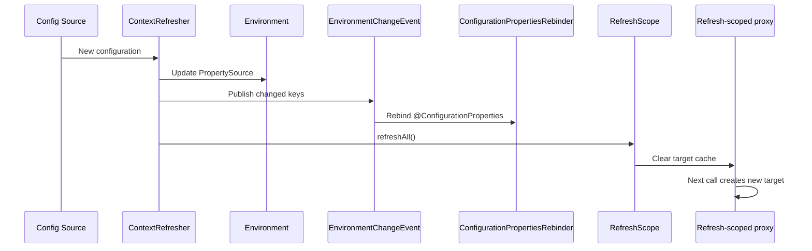

# Testing Rebinding and Refresh Scope Before and After Changes

## 1. Objectives of This Test Layer

In a Spring Cloud application, configuration can change while the application is running. For example, operations increases an HTTP client timeout, toggles a feature flag, or updates an external service address. Once the Environment receives the new value, the application must propagate that value to the beans actually using it.

Spring Cloud Context supports two related yet distinct mechanisms:

- **Rebinding** updates beans annotated with **@ConfigurationProperties** when an **EnvironmentChangeEvent** is published.
- **Refresh Scope** destroys the current target of beans annotated with **@RefreshScope**, so the proxy creates a new target the next time the bean is invoked.

Tests must observe both behaviors. Asserting only that Environment returns the new value does not prove the bean was rebound. Asserting only that a Refresh Scope bean was recreated does not prove the new property source was loaded.

After this lesson, readers can:

- Distinguish values in Environment, `@ConfigurationProperties` beans, and `@RefreshScope` bean targets.
- Test rebinding before and after publishing `EnvironmentChangeEvent`.
- Test that a Refresh Scope target is recreated after the cache is cleared.
- Test the end-to-end refresh flow via `ContextRefresher` or the Actuator endpoint.
- Identify cases that cannot be refreshed, such as constructor-bound properties and beans excluded from refresh scope.

## 2. Two Mechanisms with Distinct Responsibilities

### 2.1. Rebinding of @ConfigurationProperties

Spring Cloud Context registers `ConfigurationPropertiesRebinder` to listen for `EnvironmentChangeEvent`. When it receives an event containing changed keys, the rebinder locates `@ConfigurationProperties` beans and rebinds their values from Environment.

Example:

```java
@ConfigurationProperties(prefix = "client")
public class ClientProperties {

    private String endpoint;
    private int timeout;

    public String getEndpoint() {
        return endpoint;
    }

    public void setEndpoint(String endpoint) {
        this.endpoint = endpoint;
    }

    public int getTimeout() {
        return timeout;
    }

    public void setTimeout(int timeout) {
        this.timeout = timeout;
    }
}
```

If `client.endpoint` or `client.timeout` changes and the application publishes an `EnvironmentChangeEvent` with those keys, the `ClientProperties` bean is rebound. The bean instance is updated in place; it is not replaced by a new instance.

This matters when testing:

- References to `ClientProperties` still point to the exact same object.
- Getter values after rebinding must reflect the new properties.
- Rebinding multiple fields is not an atomic object replacement. Another thread reading the bean mid-rebind may observe an intermediate state.

`@ConfigurationProperties` classes using constructor binding, including Java records, cannot be refreshed via this rebinding mechanism according to current Spring Cloud documentation. For configuration that must change at runtime, choose mutable JavaBean properties or an appropriate refresh-scoped bean design.

### 2.2. Refresh Scope

Beans marked with `@RefreshScope` are managed by Spring through a scoped proxy. The scope caches the initialized target. When `RefreshScope.refresh(name)` or `refreshAll()` is called, the scope destroys the current target. The proxy remains in the ApplicationContext; the next method call creates a new target and injects dependencies with the current configuration values.

Example:

```java
@Bean
@RefreshScope
GreetingClient greetingClient(ClientProperties properties) {
    return new GreetingClient(
            properties.getEndpoint(),
            properties.getTimeout()
    );
}
```

Here, `GreetingClient` receives a snapshot of configuration at the moment the target is created. Even after `ClientProperties` is rebound, the old target keeps the old endpoint and timeout. Only after the target cache is cleared does the proxy create a new `GreetingClient` with the new configuration.

Refresh Scope fits beans initialized from configuration that must be recreated when configuration changes, such as clients, connection factories, or stateful adapters. It does not fetch new configuration from Config Server on its own; the configuration source must update Environment first.

### 2.3. Comparison Table

| Criterion | Rebinding | Refresh Scope |
| --- | --- | --- |
| Target | `@ConfigurationProperties` beans | Beans annotated with `@RefreshScope` |
| Effect | Rebinds fields on the same instance | Destroys current cached target |
| Bean instance | Preserved | Proxy preserved; target recreated |
| When new value appears | After event is handled and rebind completes | After scope refresh and a proxy method call triggers target creation |
| Best suited for | Data config with setters whose values can be rebound | Beans needing re-initialization from new config or consistent state |
| Risks to watch | Concurrent readers may see partially rebound state | New target initialization may fail; handle errors and lifecycle |

## 3. Refresh Sequence in Spring Cloud Context

In the standard flow, `ContextRefresher.refresh()` performs two parts in sequence:

1. Reloads Environment and determines which property keys changed.
2. Publishes `EnvironmentChangeEvent`, so listeners like `ConfigurationPropertiesRebinder` rebind beans and update logger levels.
3. Calls `RefreshScope.refreshAll()` to clear the target cache of Refresh Scope beans.
4. When the application next invokes those proxies, new targets are created from the current configuration.



`EnvironmentChangeEvent` alone only triggers event listeners, including rebinding. If code publishes the event manually, the application must also call `RefreshScope.refreshAll()` or `refresh(beanName)` when scoped targets need to be recreated. `ContextRefresher.refresh()` coordinates both steps.

### 3.1. refreshEnvironment() and refresh() Are Not Identical

`ContextRefresher.refreshEnvironment()` updates Environment and publishes `EnvironmentChangeEvent`, returning the set of changed keys. `ContextRefresher.refresh()` runs that step and then refreshes the entire Refresh Scope.

Therefore:

- Use `refreshEnvironment()` when you only need to update Environment and trigger listeners such as the rebinder.
- Use `refresh()` when you need both rebinding and clearing the Refresh Scope target cache.

Do not call `refreshEnvironment()` and conclude that every `@RefreshScope` bean has been recreated.

## 4. Preparing Configuration and Beans for Testing

To test before and after changes, you need a property source whose value can change during the test run. `@DynamicPropertySource` lets you register a supplier for a property; the supplier can read from an `AtomicReference`.

Test configuration example:

```java
@SpringBootTest(classes = RefreshBehaviorTest.TestApplication.class)
class RefreshBehaviorTest {

    private static final AtomicReference<String> MESSAGE =
            new AtomicReference<>("before");
    private static final AtomicInteger GENERATIONS = new AtomicInteger();

    @DynamicPropertySource
    static void dynamicProperties(DynamicPropertyRegistry registry) {
        registry.add("demo.client.message", MESSAGE::get);
    }

    @Autowired
    private ClientProperties clientProperties;

    @Autowired
    private GreetingClient greetingClient;

    @Autowired
    private ApplicationEventPublisher eventPublisher;

    @Autowired
    private org.springframework.cloud.context.scope.refresh.RefreshScope refreshScope;

    @Test
    void rebindsPropertiesAndRecreatesRefreshScopedTarget() {
        assertThat(clientProperties.getMessage()).isEqualTo("before");
        assertThat(greetingClient.message()).isEqualTo("before");
        int originalGeneration = greetingClient.generation();

        MESSAGE.set("after");
        eventPublisher.publishEvent(
                new EnvironmentChangeEvent(
                        this,
                        Set.of("demo.client.message")
                )
        );

        // Rebinding updates bean properties in place.
        assertThat(clientProperties.getMessage()).isEqualTo("after");

        // Cached target keeps the old snapshot until the scope is refreshed.
        assertThat(greetingClient.message()).isEqualTo("before");
        assertThat(greetingClient.generation()).isEqualTo(originalGeneration);

        refreshScope.refreshAll();

        // Next call through the proxy creates a new target from current properties.
        assertThat(greetingClient.message()).isEqualTo("after");
        assertThat(greetingClient.generation()).isGreaterThan(originalGeneration);
    }

    @SpringBootConfiguration
    @EnableAutoConfiguration
    @EnableConfigurationProperties(ClientProperties.class)
    static class TestApplication {

        @Bean
        @RefreshScope
        GreetingClient greetingClient(ClientProperties properties) {
            return new GreetingClient(
                    properties.getMessage(),
                    GENERATIONS.incrementAndGet()
            );
        }
    }

    @ConfigurationProperties(prefix = "demo.client")
    public static class ClientProperties {

        private String message;

        public String getMessage() {
            return message;
        }

        public void setMessage(String message) {
            this.message = message;
        }
    }

    public static class GreetingClient {

        private final String message;
        private final int generation;

        public GreetingClient(String message, int generation) {
            this.message = message;
            this.generation = generation;
        }

        public String message() {
            return message;
        }

        public int generation() {
            return generation;
        }
    }
}
```

Key imports for the example:

```java
import java.util.Set;
import java.util.concurrent.atomic.AtomicInteger;
import java.util.concurrent.atomic.AtomicReference;

import org.junit.jupiter.api.Test;
import org.springframework.beans.factory.annotation.Autowired;
import org.springframework.boot.SpringBootConfiguration;
import org.springframework.boot.autoconfigure.EnableAutoConfiguration;
import org.springframework.boot.context.properties.ConfigurationProperties;
import org.springframework.boot.context.properties.EnableConfigurationProperties;
import org.springframework.boot.test.context.SpringBootTest;
import org.springframework.cloud.context.config.annotation.RefreshScope;
import org.springframework.cloud.context.environment.EnvironmentChangeEvent;
import org.springframework.context.ApplicationEventPublisher;
import org.springframework.context.annotation.Bean;
import org.springframework.test.context.DynamicPropertyRegistry;
import org.springframework.test.context.DynamicPropertySource;

import static org.assertj.core.api.Assertions.assertThat;
```

This test intentionally publishes the event and calls `RefreshScope` separately to isolate the two mechanisms. `DynamicPropertySource` reads the current value from `MESSAGE`, so the rebinder reads `after` when handling the event. The properties bean keeps its object identity, whereas the scoped target's generation increments on the next proxy call.

## 5. Why Do Before and After Assertions Differ?

The test above verifies four states:

1. **Initially:** Environment, `ClientProperties`, and the `GreetingClient` target all read `before`.
2. **After property source changes without event:** the supplier has the new value, but the properties bean has not been rebound yet.
3. **After EnvironmentChangeEvent:** `ClientProperties` reads `after`, yet the cached `GreetingClient` target still holds the `before` snapshot.
4. **After refreshAll():** the old target is evicted; when the proxy is called, a new target is created and reads `after`.

If you only assert `clientProperties.getMessage()` after the event, the test only proves rebinding. If you only assert `greetingClient.message()` after refresh, the test does not prove the old target held the earlier configuration. Keep assertions at both points to verify the full lifecycle.

You can verify that rebinding preserves instance identity:

```java
ClientProperties originalProperties = clientProperties;

// After publishing EnvironmentChangeEvent:
assertThat(clientProperties).isSameAs(originalProperties);
assertThat(clientProperties.getMessage()).isEqualTo("after");
```

Conversely, `GreetingClient`'s generation proves the target was recreated. Do not compare proxy identity, because the proxy remains the same bean injected into consumers.

## 6. Testing the ContextRefresher Flow in an Application

In a running application, test orchestration through `ContextRefresher.refresh()`:

The `ContextRefresher` type resides in package `org.springframework.cloud.context.refresh`:

```java
import org.springframework.cloud.context.refresh.ContextRefresher;
```

```java
@Autowired
private ContextRefresher contextRefresher;

@Test
void refreshReportsChangedKeys() {
    Set<String> changedKeys = contextRefresher.refresh();

    assertThat(changedKeys).contains("demo.client.message");
    assertThat(clientProperties.getMessage()).isEqualTo("after");
    assertThat(greetingClient.message()).isEqualTo("after");
}
```

This example assumes the test configured a Config Data source or configuration source that can return different values across two loads. Simply injecting `ContextRefresher` without changing the configuration source may yield an empty `changedKeys`; tests must not fake a change and expect the refresher to detect it.

With Config Server, an integration test can use a test server or mock endpoint returning two property versions. Test sequence:

1. Start the application with the `before` value.
2. Verify the properties bean and scoped target use `before`.
3. Update the property in the test configuration source to `after`.
4. Call `contextRefresher.refresh()`.
5. Verify the changed keys set contains `demo.client.message`.
6. Verify both the `@ConfigurationProperties` bean and the `@RefreshScope` target read `after`.

Do not use a static local file as the configuration source and expect `ContextRefresher` to detect file edits unless the active implementation supports reloading that source. Choose a Config Data loader or property source with supported reload behavior.

## 7. Testing via the Actuator Endpoint

Spring Cloud Context provides the `refresh` endpoint to trigger the refresh flow over HTTP. Actuator must be present and the endpoint explicitly exposed:

```yaml
management:
  endpoints:
    web:
      exposure:
        include:
          - health
          - refresh
```

In an HTTP test, send a POST to `/actuator/refresh`:

```bash
curl -X POST http://localhost:8080/actuator/refresh
```

The endpoint returns the list of changed keys. If the list is empty, either the configuration source did not change or the loader did not supply new values.

An integration test can use `TestRestTemplate` or `WebTestClient` to:

1. Call the business endpoint before refresh and confirm it returns `before`.
2. Update the Config Server test fixture.
3. Send POST to `/actuator/refresh`.
4. Verify the response contains the changed key.
5. Call the business endpoint again and confirm it returns `after`.

Never expose the refresh endpoint publicly. It is an administrative operation capable of altering configuration and reinitializing running beans. Protect it with authentication/authorization, restrict network access, and log administrative actions.

## 8. Testing Multiple Instances and Spring Cloud Bus

`ContextRefresher.refresh()` affects a single instance's ApplicationContext. When a service runs multiple replicas, refreshing one instance does not automatically refresh the others.

Spring Cloud Config Client does not poll Config Server by default to detect changes. In multi-instance systems, Spring Cloud Bus can broadcast refresh events to connected applications.

Distributed tests should verify:

- Events are broadcast to the intended application group.
- Each instance receives the event and runs a local refresh.
- All replicas eventually read the new value.
- An instance temporarily disconnected from the bus has a suitable resync mechanism.
- No refresh storms occur due to repeated events or listener loops.

Because bus processing can be asynchronous, tests must not assert immediately after POSTing the event. Use bounded polling or Awaitility to wait until all replicas converge. Timeouts should reflect the test environment's realistic SLA rather than long fixed `Thread.sleep()` calls.

## 9. Cases That Do Not Refresh as Expected

### 9.1. Rebinding Does Not Create a New Object

If a test expects the `@ConfigurationProperties` bean to have a new object identity after refresh, that assertion is wrong. Rebinding updates the bean in place. Assert getter values and preserved identity.

### 9.2. Refresh Scope Does Not Create the Target Immediately on Refresh

`refreshAll()` clears the target cache. A new target is created when the proxy receives the next method call. Therefore, the generation counter increments only after the test invokes a method on the proxy, not immediately upon calling `refreshAll()`.

### 9.3. Putting @RefreshScope on a Configuration Class

Annotating a `@Configuration` class with `@RefreshScope` does not mean every `@Bean` method inside that class automatically belongs to Refresh Scope. If a bean needs to be recreated, annotate that specific bean method or bean class.

### 9.4. Constructor-Bound Properties and Java Records

`@ConfigurationProperties` beans using constructor binding, including records, cannot be updated by the rebinder through the standard mechanism. For runtime-mutable configuration, use mutable properties or wrap configuration inside an appropriate refresh-scoped bean.

### 9.5. Beans on the Never-Refreshable List

Some beans cannot or should not be refreshed. For example, `HikariDataSource` is in the default `spring.cloud.refresh.never-refreshable` list. `spring.cloud.refresh.extra-refreshable` can add certain bean types needing special handling, but you should not force-refresh a resource whose lifecycle does not support it.

### 9.6. Deleting a Property from the Configuration Source

Spring Cloud documentation notes that removing a configuration key from a source and refreshing does not necessarily update property presence in Environment. For on/off toggles, design around explicit values like `enabled=false` rather than relying on property disappearance.

### 9.7. Target Reference Held Outside the Proxy

Components should inject and invoke through the scoped proxy. If the application unwraps the real target and retains a direct reference outside the proxy, that reference will not switch to the new target after refresh. Avoid storing scoped targets in static fields or unmanaged local caches.

### 9.8. Refresh in AOT and Native Images

Context refresh is not supported for Spring AOT transformations and native images per current Spring Cloud documentation. In those environments, set `spring.cloud.refresh.enabled=false` and design configuration around startup initialization.

## 10. Testing Concurrency and Lifecycle

Rebinding and Refresh Scope have different concurrency characteristics:

- Rebinding is serialized across rebinds of the same bean, yet concurrent readers may still see fields mid-update.
- Refresh Scope uses locking to coordinate access and target refresh within the scope; old targets are destroyed via lifecycle callbacks and new targets are created on demand.

If a business operation must read multiple properties—such as endpoint, timeout, and credentials—as one consistent snapshot, do not let threads read mutable properties beans directly while multiple fields are rebinding. Wrap them in a refresh-scoped bean so a refresh swaps the target to a coherent new configuration version.

Concurrency tests need barriers or latches to control timing between readers and refreshers rather than relying on scheduler luck. Those tests should verify business invariants, such as endpoint and credentials always belonging to the same configuration snapshot.

## 11. Before-and-After Test Matrix

| State | Environment | Properties bean | Refresh-scoped target |
| --- | --- | --- | --- |
| Before change | before | before | before |
| Environment updated, no event published | after | May still be before | before |
| After EnvironmentChangeEvent | after | after | Still before if target caches old snapshot |
| After RefreshScope.refreshAll() | after | after | Old target evicted; proxy creates new target when called |
| After next proxy call | after | after | after |

This matrix forms the basis for meaningful assertions. Each step verifies a single effect; when a test fails, you can pinpoint whether the bug lies in the configuration source, the rebinder, or Refresh Scope.

## 12. Checklist When Writing Tests

1. Pick a property source that can mutate and be re-read by Environment.
2. Verify initial values before publishing events.
3. Use a mutable `@ConfigurationProperties` bean to test rebinding.
4. Publish `EnvironmentChangeEvent` with the exact list of changed keys.
5. Verify the properties bean updates in place.
6. Use a `@RefreshScope` bean whose target generation can be observed.
7. Verify the old target retains the old snapshot after rebinding properties alone.
8. Call `refreshAll()` or `refresh(beanName)` and invoke the proxy to trigger new target creation.
9. Verify the new target uses the updated configuration values.
10. Test `ContextRefresher.refresh()` or `/actuator/refresh` against a reloadable configuration source.
11. If using Bus, wait for all replicas to converge using bounded polling.
12. Add tests for missing properties, target initialization failures, and non-refreshable beans.
13. Secure the refresh endpoint and never log secrets in logs or assertion output.

## 13. References

- [Spring Cloud Context — Application Context Services](https://docs.spring.io/spring-cloud-commons/reference/spring-cloud-commons/application-context-services.html): `EnvironmentChangeEvent`, `ConfigurationPropertiesRebinder`, Refresh Scope, `ContextRefresher`, and the refresh endpoint.
- [Spring Cloud Commons — Configuration Properties](https://docs.spring.io/spring-cloud-commons/reference/configprops.html): `spring.cloud.refresh.*` properties.
- [ConfigurationPropertiesRebinder source](https://github.com/spring-cloud/spring-cloud-commons/blob/main/spring-cloud-context/src/main/java/org/springframework/cloud/context/properties/ConfigurationPropertiesRebinder.java): `EnvironmentChangeEvent` listener and how properties beans are rebound.
- [ContextRefresher source](https://github.com/spring-cloud/spring-cloud-commons/blob/main/spring-cloud-context/src/main/java/org/springframework/cloud/context/refresh/ContextRefresher.java): sequence of Environment updates, event publishing, and scope refresh.
- [RefreshScope source](https://github.com/spring-cloud/spring-cloud-commons/blob/main/spring-cloud-context/src/main/java/org/springframework/cloud/context/scope/refresh/RefreshScope.java): refreshing a single bean or the entire scope and clearing the target cache.

A solid refresh test proves every layer: the configuration source genuinely changed, Environment received the new value, `@ConfigurationProperties` was rebound, and the `@RefreshScope` target was recreated when the proxy was called. Only by checking before and after across all these layers do we know the application applies new configuration according to the proper lifecycle.
