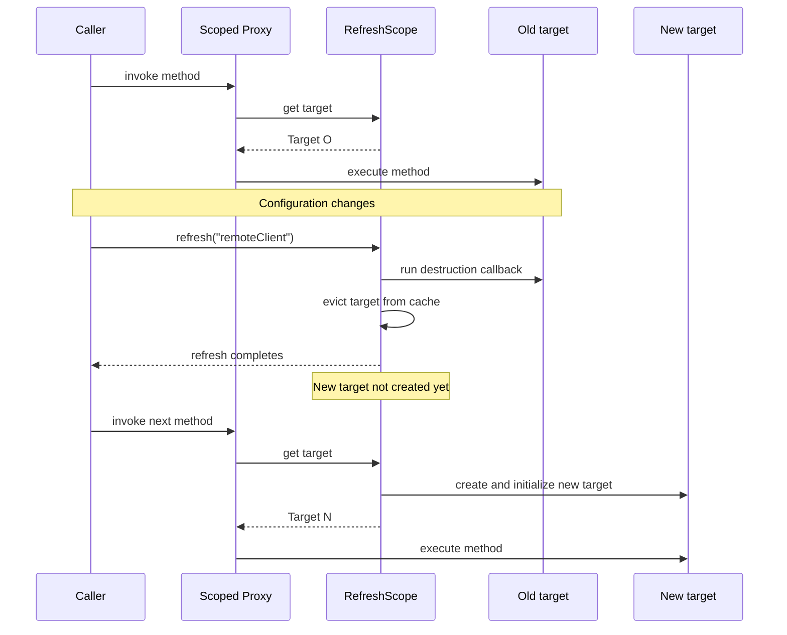

# Testing Refresh Failures and Old Target Disposal

In Spring Cloud Context, beans annotated with `@RefreshScope` are accessed through a scoped proxy. The proxy can be held by other services for the lifetime of the application, while the real target lives in the refresh scope cache. On refresh, Spring Cloud destroys the cached target and invokes registered destruction callbacks. A new target is created only when the next call passes through the proxy.

This behavior creates two separate points to test: **when the old target is destroyed** and **when the new target is initialized**. If the new configuration is invalid, the refresh operation may complete clearing the old target, while the failure only surfaces on the next proxy call. If a test checks only the HTTP response of `/actuator/refresh`, it can miss this initialization failure.

This lesson belongs to the **Testing** chapter of **SPRING_CLOUD_CORE**. It focuses on testing `@RefreshScope` target lifecycles, verifying `@PreDestroy`, `DisposableBean`, or `close()` runs when a target is evicted from cache, simulating failures when creating the new target, verifying errors recorded in `RefreshScope` and `RefreshScopeHealthIndicator`, and testing refresh while requests are in flight.

## 1. Learning Objectives

After this lesson, learners can:

1. Distinguish the scoped proxy from the real target of a `@RefreshScope` bean.
2. Describe the sequence of Environment updates, `EnvironmentChangeEvent` publishing, old target destruction, and new target creation.
3. Test that the old target is disposed exactly once on refresh.
4. Verify that the new target is not created immediately when the cache is cleared.
5. Simulate constructor, factory method, or binding errors during new target creation.
6. Verify exceptions surface on the proxy call following refresh.
7. Verify recorded errors via `RefreshScope.getErrors()` and the health indicator.
8. Distinguish old target destruction errors from new target initialization errors.
9. Test behavior when calls are in flight during a refresh.
10. Design repeatable tests independent of `Thread.sleep` or static state leaking across tests.

## 2. Lifecycle Model to Test

### 2.1. Proxy and Target Are Two Distinct Objects

When declaring:

```java
@Bean
@RefreshScope
RemoteClient remoteClient() {
    return new RemoteClient();
}
```

Spring registers a proxy for other beans to inject. The real target is created and stored in the scope on demand. The target bean name in the scoped proxy mechanism typically takes the form `scopedTarget.remoteClient`.

A service holding the proxy:

```java
@Service
class OrderService {

    private final RemoteClient remoteClient;

    OrderService(RemoteClient remoteClient) {
        this.remoteClient = remoteClient;
    }

    String fetch() {
        return remoteClient.call();
    }
}
```

After refresh, `OrderService` still holds the same proxy. The proxy looks up the current target from refresh scope on every method invocation. Therefore, tests need to observe both objects:

- Proxy: represents the bean injected into components.
- Target: the real instance holding state, connections, or resources that must be released.

Do not use the proxy having the same object identity to conclude that the target was not refreshed.

### 2.2. Happy-Path Lifecycle



Key observations:

1. The old target was already created before refresh.
2. The old target's destruction callback runs when the target is evicted from the scope.
3. The proxy remains usable after refresh.
4. The new target is created on the next access.
5. The new target reads the current configuration from Environment.

### 2.3. Refresh Does Not Mean Immediate New Target Creation

Spring Cloud documentation describes refresh-scoped beans as lazy proxies. `RefreshScope.refresh(String)` evicts the target from cache and forces recreation on the next method call. `refreshAll()` applies this operation to all beans in the scope.

Accordingly, the right test sequence is:

1. Call the proxy to create the initial target.
2. Change the property.
3. Call `refreshScope.refresh("remoteClient")`.
4. Verify the old target has been disposed.
5. Verify the created target count has not increased yet.
6. Call the proxy.
7. Verify the new target is created with the new configuration.

If you only call refresh and check the instantiation count, the test might wrongly conclude refresh did not work simply because the new target has not been accessed yet.

## 3. Distinguishing Refresh Paths

There are two distinct levels of testing:

| API or endpoint | Responsibility | Best suited for |
| --- | --- | --- |
| `RefreshScope.refresh(beanName)` | Destroys cached target of one bean | Unit/integration test of a single target lifecycle |
| `RefreshScope.refreshAll()` | Destroys all targets in refresh scope | Testing multiple refreshed beans |
| `ContextRefresher.refresh()` | Updates Environment, publishes `EnvironmentChangeEvent`, then refreshes scope | Testing full configuration refresh flow |
| `POST /actuator/refresh` | Invokes refresh flow exposed via Actuator | Testing management endpoint and integration |

In the current implementation, `ContextRefresher.refresh()` calls `refreshEnvironment()` first and then `RefreshScope.refreshAll()`. `refreshEnvironment()` updates property sources, detects changed keys, and publishes `EnvironmentChangeEvent`. Listeners such as `ConfigurationPropertiesRebinder` can process that event before refresh scope targets are destroyed.

`RefreshScope.refresh(beanName)` only handles targets in the scope. It does not load new configuration from Config Server or update Environment on its own. Thus, use the direct API when isolating lifecycle behavior; use `ContextRefresher` or the endpoint when testing the full configuration update pipeline.

### 3.1. Bean Name Passed to Refresh

When calling:

```java
refreshScope.refresh("remoteClient");
```

Spring Cloud automatically translates the normal bean name to the `scopedTarget.remoteClient` target name before clearing the cache. In normal tests, pass the bean name declared by the application; there is no need to prepend `scopedTarget.` manually.

The returned boolean indicates whether a target was present in cache and processed. If the target was never created yet, `refresh(beanName)` may return `false` because there was no old target to destroy. Do not treat `false` in that situation as a configuration error.

## 4. Types of Failures to Distinguish

A refresh can fail at different stages:

| Stage | Failure example | What to verify |
| --- | --- | --- |
| Load configuration | Config Server unreachable, malformed property source | Did Environment receive the new configuration? |
| Rebind `@ConfigurationProperties` | Unconvertible value, validation failure | Did the properties bean rebind successfully? |
| Destroy old target | Resource cleanup callback or custom destruction processor throws | How far was the old target processed? |
| Create new target | Constructor, `@Bean` factory method, or DI throws an exception | On which proxy call does the error surface? |
| Runtime after refresh | Target created successfully, yet downstream connection fails | Are health, metrics, and business behavior correct? |

One crucial point: if an error happens while creating the new target, the old target may already have been destroyed beforehand. At that point, the proxy still exists yet has no valid target to serve requests. Tests must verify this state rather than assuming the old target automatically rolls back.

### 4.1. Errors When Creating the New Target

The new target is created via the bean factory when the proxy needs a target. If the constructor or factory method throws an exception, that exception propagates to the caller of the proxy method. `GenericScope` records initialization errors in the scope's error map so the health indicator can report status.

Example:

```java
@Bean
@RefreshScope
RemoteClient remoteClient(Environment environment) {
    String endpoint = environment.getRequiredProperty("client.endpoint");

    if ("invalid".equals(endpoint)) {
        throw new IllegalArgumentException(
            "client.endpoint is invalid"
        );
    }

    return new RemoteClient(endpoint);
}
```

When `client.endpoint=invalid`:

1. `refreshScope.refresh("remoteClient")` destroys the old target.
2. Refresh returns after the old cache entry is removed.
3. The next `remoteClient.call()` begins creating the target.
4. The factory method throws `IllegalArgumentException`.
5. The caller receives the exception because there is no valid target.
6. The scope records the bean creation error.

This error may not appear in the initial refresh operation's response because the target has not been created yet at that time.

### 4.2. Health Indicator Reflecting Refresh Errors

Spring Cloud auto-configures `RefreshScopeHealthIndicator` to check errors from refresh scope and `ConfigurationPropertiesRebinder`. When a bean fails to reinitialize or rebind after refresh, the health indicator transitions to `DOWN` and provides exception details.

You can check the health endpoint:

```text
GET /actuator/health/refresh
```

The health endpoint and contributor details must be exposed per Actuator configuration, access permissions, and application health detail policy. If you do not want to expose a dedicated health contributor, tests can inspect `RefreshScope.getErrors()` and `ConfigurationPropertiesRebinder.getErrors()` directly.

Illustrative configuration:

```yaml
management:
  endpoints:
    web:
      exposure:
        include:
          - health
          - refresh
  endpoint:
    health:
      show-details: always
  health:
    refresh:
      enabled: true
```

Never expose refresh endpoints or health details publicly without proper authentication, authorization, and network restrictions.

## 5. Tracking the Old Target via Destruction Callbacks

### 5.1. Which Callbacks Can Be Tested?

Spring manages bean destruction callbacks such as:

- `@PreDestroy`.
- Beans implementing `DisposableBean`.
- Beans with a `close()` or `shutdown()` method recognized by Spring.
- Custom destroy methods declared on the bean definition.

When a refresh-scoped target is evicted from cache, registered lifecycle callbacks for that target run. Spring Cloud explicitly documents that refreshing a target runs lifecycle methods, including destruction callbacks, and creates a new instance on the next access.

### 5.2. Using AutoCloseable to Count Disposals

Example target with a unique ID recording closed instances:

```java
public class RemoteClient implements AutoCloseable {

    private static final AtomicInteger NEXT_ID = new AtomicInteger();

    private static final List<Integer> CLOSED_IDS =
        new CopyOnWriteArrayList<>();

    private static volatile CountDownLatch CLOSE_ENTERED =
        new CountDownLatch(1);

    private final int id = NEXT_ID.incrementAndGet();

    private final String endpoint;

    public RemoteClient(String endpoint) {
        this.endpoint = endpoint;
    }

    public int getId() {
        return id;
    }

    public String getEndpoint() {
        return endpoint;
    }

    public String callAndWait(CountDownLatch entered, CountDownLatch release)
            throws InterruptedException {
        entered.countDown();
        if (!release.await(2, TimeUnit.SECONDS)) {
            throw new IllegalStateException("Invocation was not released");
        }
        return "completed";
    }

    @Override
    public void close() {
        CLOSED_IDS.add(id);
        CLOSE_ENTERED.countDown();
    }

    public static CountDownLatch closeEnteredLatch() {
        return CLOSE_ENTERED;
    }

    public static List<Integer> closedIds() {
        return List.copyOf(CLOSED_IDS);
    }

    public static int createdCount() {
        return NEXT_ID.get();
    }

    public static void resetCounters() {
        NEXT_ID.set(0);
        CLOSED_IDS.clear();
        CLOSE_ENTERED = new CountDownLatch(1);
    }
}
```

Spring can infer the `close()` destroy method for beans returned from `@Bean` if the object implements `AutoCloseable` and the bean definition does not disable destroy method inference.

Configuration:

```java
@Bean
@RefreshScope
RemoteClient remoteClient(Environment environment) {
    String endpoint = environment.getRequiredProperty("client.endpoint");

    if ("invalid".equals(endpoint)) {
        throw new IllegalArgumentException("Invalid endpoint");
    }

    return new RemoteClient(endpoint);
}
```

### 5.3. Required Assertions

After the first target is created:

```java
String oldEndpoint = remoteClient.getEndpoint();
int oldId = remoteClient.getId();
```

After changing the property and refreshing:

```java
assertThat(refreshScope.refresh("remoteClient")).isTrue();

assertThat(RemoteClient.closedIds())
    .containsExactly(oldId);
```

This assertion proves the old target ran its disposal callback. After calling the proxy again:

```java
assertThat(remoteClient.getEndpoint())
    .isEqualTo("https://new.example");

assertThat(remoteClient.getId())
    .isNotEqualTo(oldId);
```

The test confirms a new target was created and uses the new configuration.

## 6. Preparing a Test Fixture with Controllable Configuration

A good test fixture must control properties without calling a real Config Server. You can use `@DynamicPropertySource` with an `AtomicReference`:

```java
@SpringBootTest(classes = RefreshScopeTestApplication.class)
@DirtiesContext(classMode = DirtiesContext.ClassMode.AFTER_EACH_TEST_METHOD)
class RefreshScopeLifecycleTests {

    private static final AtomicReference<String> ENDPOINT =
        new AtomicReference<>("https://old.example");

    @DynamicPropertySource
    static void properties(DynamicPropertyRegistry registry) {
        registry.add("client.endpoint", ENDPOINT::get);
    }

    @Autowired
    private RefreshScope refreshScope;

    @Autowired
    private RemoteClient remoteClient;

    @Autowired
    private RefreshScopeHealthIndicator refreshScopeHealthIndicator;

    private final ExecutorService executor = Executors.newFixedThreadPool(2);

    @BeforeEach
    void reset() {
        ENDPOINT.set("https://old.example");
        RemoteClient.resetCounters();
    }

    @AfterEach
    void shutdownExecutor() {
        executor.shutdownNow();
    }
}
```

Test configuration:

```java
@SpringBootConfiguration
@EnableAutoConfiguration
static class RefreshScopeTestApplication {

    @Bean
    static RefreshScope refreshScope() {
        RefreshScope scope = new RefreshScope();
        scope.setEager(false);
        return scope;
    }

    @Bean
    @RefreshScope
    RemoteClient remoteClient(Environment environment) {
        String endpoint =
            environment.getRequiredProperty("client.endpoint");

        if ("invalid".equals(endpoint)) {
            throw new IllegalArgumentException("Invalid endpoint");
        }

        return new RemoteClient(endpoint);
    }
}
```

`setEager(false)` lets the test control when the target is created, especially when verifying the pre-creation state. This configuration replaces the default `RefreshScope` bean with a scope that disables eager initialization. In real applications, keep the default configuration unless there is a specific lifecycle requirement.

`@DirtiesContext` isolates the ApplicationContext between tests so cached targets, event listeners, or bean state from an earlier test do not affect later ones. If your fixture avoids static counters or resets everything cleanly, you can choose a lighter context management strategy.

The test fixture needs `spring-cloud-context` and `spring-boot-starter-test`. If testing `RefreshScopeHealthIndicator` or HTTP health endpoints, add `spring-boot-starter-actuator`. Let the Spring Cloud BOM manage dependency versions compatible with your Spring Boot version.

## 7. Testing Successful Refresh and Old Target Disposal

Basic test:

```java
@Test
void refreshDestroysOldTargetAndCreatesNewTargetOnNextCall() {
    String oldEndpoint = remoteClient.getEndpoint();
    int oldId = remoteClient.getId();

    assertThat(oldEndpoint).isEqualTo("https://old.example");

    ENDPOINT.set("https://new.example");

    assertThat(refreshScope.refresh("remoteClient")).isTrue();

    assertThat(RemoteClient.closedIds())
        .containsExactly(oldId);

    // Refresh only evicts old target, does not create new target yet.
    assertThat(RemoteClient.createdCount()).isEqualTo(1);

    // Next proxy call creates the new target.
    assertThat(remoteClient.getEndpoint())
        .isEqualTo("https://new.example");

    assertThat(RemoteClient.createdCount()).isEqualTo(2);
    assertThat(remoteClient.getId()).isNotEqualTo(oldId);

    assertThat(RemoteClient.closedIds())
        .containsExactly(oldId);
}
```

In the test above, `remoteClient.getEndpoint()` after refresh is the first call that triggers new target creation. You can split assertions before and after this call to prove laziness even more clearly.

## 8. Testing Refresh of an Uninitialized Bean

If a bean has never been accessed, the scope has no target instance cached yet. Calling `refresh(beanName)` finds no old target to destroy and may return `false`.

Test:

```java
@Test
void refreshBeforeFirstAccessDoesNotCreateOrDestroyTarget() {
    assertThat(RemoteClient.createdCount()).isZero();

    boolean refreshed = refreshScope.refresh("remoteClient");

    assertThat(refreshed).isFalse();
    assertThat(RemoteClient.createdCount()).isZero();
    assertThat(RemoteClient.closedIds()).isEmpty();

    assertThat(remoteClient.getEndpoint())
        .isEqualTo("https://old.example");

    assertThat(RemoteClient.createdCount()).isEqualTo(1);
}
```

This test separates cache eviction from bean instantiation. If a test does not control eager initialization, the target might already be created during startup and initial assertions would fail. Therefore, the fixture must explicitly configure eager/lazy mode.

## 9. Testing Failures When the New Target Cannot Initialize

### 9.1. Simulating Invalid Configuration

Keep the old target working, then change the property to a value that makes the factory method fail:

```java
@Test
void failedTargetCreationIsVisibleOnNextProxyInvocation() {
    String oldEndpoint = remoteClient.getEndpoint();
    int oldId = remoteClient.getId();

    ENDPOINT.set("invalid");

    assertThat(refreshScope.refresh("remoteClient")).isTrue();

    // Old target has been destroyed.
    assertThat(RemoteClient.closedIds())
        .containsExactly(oldId);

    // New target is only created when the proxy is called.
    assertThatThrownBy(remoteClient::getEndpoint)
        .hasRootCauseInstanceOf(IllegalArgumentException.class);

    assertThat(refreshScope.getErrors())
        .containsKey("scopedTarget.remoteClient");
}
```

Depending on the exception type and Spring version, the caller may receive `BeanCreationException` or another wrapper exception. Therefore, checking the root cause is usually more stable than asserting a specific outer wrapper exception.

### 9.2. Why Doesn't the Error Appear Immediately on Refresh?

`refreshScope.refresh("remoteClient")` handles destroying the old target and removing the cache entry. It does not invoke the factory method to build a replacement target. Consequently, refresh can return success even when the new property is invalid.

The error appears when the proxy needs a new target. In an HTTP application, the first request hitting the bean after refresh may fail while Spring creates the target. That is why tests must invoke the proxy after refresh and assert the exception at the right moment.

### 9.3. Recovering After Fixing the Property

After fixing the configuration, tests must verify the target can be recreated and the error state clears:

```java
ENDPOINT.set("https://recovered.example");

// Evicts the wrapper that recorded the error and clears that bean's error.
assertThat(refreshScope.refresh("remoteClient")).isTrue();

assertThat(refreshScope.getErrors())
    .doesNotContainKey("scopedTarget.remoteClient");

assertThat(remoteClient.getEndpoint())
    .isEqualTo("https://recovered.example");
```

In the current implementation, `GenericScope` records initialization errors by bean name and exposes the error map to the health indicator. Evicting the error wrapper from cache on the next refresh lets the scope try building a new target with the corrected configuration. Verify both the proxy call result and health status after recovery; do not rely solely on having changed the property.

## 10. Distinguishing Target Creation Errors from Property Rebind Errors

Spring Cloud has two mechanisms that often run during the same refresh:

- `RefreshScope`: destroys old targets and creates new targets on next access.
- `ConfigurationPropertiesRebinder`: updates `@ConfigurationProperties` beans upon Environment changes.

If a properties bean fails validation or conversion, the error is recorded by the rebinder. If a refresh-scoped bean's factory method cannot build the target, the error is recorded by refresh scope.

`RefreshScopeHealthIndicator` aggregates errors from both mechanisms. When either reports an error, the health indicator can transition to `DOWN`.

| Bean kind | How it updates | Error check |
| --- | --- | --- |
| `@RefreshScope` bean | Destroys target, creates new target when proxy is called | `RefreshScope.getErrors()` |
| Regular `@ConfigurationProperties` bean | Rebinds on existing instance | `ConfigurationPropertiesRebinder.getErrors()` |
| Bean with both properties config and refresh scope | Depends on registration and version | Test both lifecycles explicitly |

Do not use a `ConfigurationPropertiesRebinder` test to conclude that a refresh-scoped target's destruction callback ran. The two mechanisms have different lifecycles.

## 11. Testing the Health Indicator

If the application has Actuator and the refresh health indicator is enabled, you can verify health status after target initialization fails.

Example:

```java
@Test
void refreshHealthReportsDownWhenTargetCannotBeCreated() {
    ENDPOINT.set("invalid");

    refreshScope.refresh("remoteClient");

    assertThatThrownBy(remoteClient::getEndpoint)
        .hasRootCauseInstanceOf(IllegalArgumentException.class);

    Health health = refreshScopeHealthIndicator.health();

    assertThat(health.getStatus()).isEqualTo(Status.DOWN);
}
```

This is an illustrative test pattern. Depending on the version, the health indicator bean may be retrieved from the ApplicationContext or checked via `HealthEndpoint`. When using the Actuator endpoint, ensure the `refresh` health contributor is registered and tests configure appropriate detail-visibility permissions.

Test both failure modes:

1. Target factory fails after refresh.
2. `@ConfigurationProperties` rebind fails during `EnvironmentChangeEvent`.

Do not assert only the HTTP status of `/actuator/refresh`, because target creation errors can happen on the first business request afterward.

## 12. Testing RefreshScopeRefreshedEvent

`RefreshScope.refresh(beanName)` publishes `RefreshScopeRefreshedEvent` for the refreshed target bean. `refreshAll()` publishes a general event after targets in the scope have been destroyed.

The event notifies other components that the target has been invalidated. It does not prove the new target initialized successfully with the new configuration.

You can capture the event in tests:

```java
@Component
class RefreshEventProbe {

    private final List<String> refreshedNames =
        new CopyOnWriteArrayList<>();

    @EventListener
    void onRefresh(RefreshScopeRefreshedEvent event) {
        refreshedNames.add(event.getName());
    }

    List<String> refreshedNames() {
        return List.copyOf(refreshedNames);
    }
}
```

After calling `refreshScope.refresh("remoteClient")`, check the event name against the target bean name:

```java
assertThat(refreshEventProbe.refreshedNames())
    .contains("scopedTarget.remoteClient");
```

The event is published after target destruction. Do not use this event as a signal that all targets have already initialized cleanly with the new configuration.

## 13. Testing Failures When Disposing the Old Target

Separate disposal callback errors from new target initialization errors.

Some callbacks such as `DisposableBean.destroy()` follow Spring's contract where exceptions are logged so the container can continue destroying remaining beans. Therefore, do not write tests assuming that simply throwing from `destroy()` guarantees `refreshScope.refresh()` rethrows that exception.

Instead:

- Use counters or fake resources to confirm the callback ran.
- Inspect resource state after closing.
- Inspect logs if you need to verify the callback reported an error.
- If using a custom `DestructionAwareBeanPostProcessor`, separately test how the processor handles exceptions on your Spring Framework version.
- Never assume a callback finished successfully just because the target was removed from cache.

For example, the target should close resources via an observable abstraction:

```java
class ManagedConnection implements AutoCloseable {

    private final AtomicBoolean closed = new AtomicBoolean();

    @Override
    public void close() {
        if (closed.compareAndSet(false, true)) {
            // Close the actual socket or connection.
        }
    }

    boolean isClosed() {
        return closed.get();
    }
}
```

Test assertion:

```java
assertThat(connection.isClosed()).isFalse();

refreshScope.refresh("remoteClient");

assertThat(connection.isClosed()).isTrue();
```

If a callback can fail while closing a socket or pool, check warning/error logs and add observability for unreleased resources. Tests must simulate the actual lifecycle callback in use rather than inferring from a fake exception in another method.

## 14. Testing with In-Flight Requests

Refresh can happen while another thread is executing a method on the target. With the corresponding lifecycle decorator and scope cache, Spring Cloud synchronizes target access and destruction callbacks to prevent destroying a target mid-invocation.

Concurrency tests should use `CountDownLatch` or `Phaser`, not `Thread.sleep`.

Test template:

```java
@Test
void refreshWaitsForInFlightInvocationToFinish() throws Exception {
    CountDownLatch entered = new CountDownLatch(1);
    CountDownLatch release = new CountDownLatch(1);
    CountDownLatch refreshStarted = new CountDownLatch(1);
    CountDownLatch closeEntered = RemoteClient.closeEnteredLatch();

    Future<String> call = executor.submit(
        () -> remoteClient.callAndWait(entered, release)
    );

    assertThat(entered.await(2, TimeUnit.SECONDS)).isTrue();

    Future<Boolean> refresh = executor.submit(
        () -> {
            refreshStarted.countDown();
            return refreshScope.refresh("remoteClient");
        }
    );

    assertThat(refreshStarted.await(2, TimeUnit.SECONDS)).isTrue();
    assertThat(closeEntered.await(100, TimeUnit.MILLISECONDS)).isFalse();

    release.countDown();

    assertThat(call.get(2, TimeUnit.SECONDS))
        .isEqualTo("completed");

    assertThat(refresh.get(2, TimeUnit.SECONDS)).isTrue();
    assertThat(closeEntered.await(2, TimeUnit.SECONDS)).isTrue();
}
```

This is an illustrative skeleton; `callAndWait` must signal `entered` once execution is truly inside the target and return only after `release` opens. In real tests, assert that the destruction callback does not run before the invocation completes.

Do not use fixed sleep durations to guess whether a thread has entered the method. Latches control event ordering and keep tests deterministic.

## 15. Testing refreshAll with Multiple Targets

An application can have multiple refresh-scoped beans:

- `remoteClient`.
- `featurePolicy`.
- `tenantResolver`.

After `refreshAll()`, targets already created in the scope must be disposed. Targets never yet created have no instance to close.

Verification table:

| Bean | Accessed before refresh? | Should callback run? |
| --- | --- | --- |
| `remoteClient` | Yes | Yes |
| `featurePolicy` | Yes | Yes |
| `tenantResolver` | No | No old target to close |

Tests should record each target's ID before refresh, then verify those IDs appear in the closed list. When calling each proxy again, verify a new target is created with a new ID.

Do not merely count total callbacks when multiple beans can be created/destroyed during startup or context shutdown. Assigning IDs to each target identifies exactly which bean was disposed.

## 16. Testing That the Old Target Is Not Unintentionally Retained

A common design bug is another component holding a direct reference to the real target instead of the scoped proxy. Holding a direct reference lets that component keep calling the stale object after refresh even though the scope evicted the target from cache.

In application code, inject the Spring-provided proxy. Avoid unwrapping the real target via `AopTestUtils`, `TargetSource`, or reflection and storing it in a long-lived singleton.

A useful test:

1. Inject the proxy into a singleton service.
2. Record the target ID via a diagnostic method.
3. Refresh the bean.
4. Invoke the singleton service again.
5. Verify the target ID changed.
6. Verify the old ID was closed.

If the singleton service still reports the old ID, check whether code retained the real target or cached results from the old target.

## 17. Testing Multiple Consecutive Refreshes

Refresh can occur multiple times while a system runs. Verify each old target is disposed once and each new target is created only when accessed.

Example:

```java
@Test
void repeatedRefreshClosesEachCreatedTargetOnce() {
    int firstId = remoteClient.getId();

    ENDPOINT.set("https://v2.example");
    assertThat(refreshScope.refresh("remoteClient")).isTrue();

    int secondId = remoteClient.getId();

    ENDPOINT.set("https://v3.example");
    assertThat(refreshScope.refresh("remoteClient")).isTrue();

    int thirdId = remoteClient.getId();

    assertThat(secondId).isNotEqualTo(firstId);
    assertThat(thirdId).isNotEqualTo(secondId);

    assertThat(RemoteClient.closedIds())
        .containsExactly(firstId, secondId);
}
```

This test confirms the first and second targets were closed on their respective refreshes; the third target remains active and is not yet in the closed list before the context shuts down.

## 18. Common Testing Mistakes

| Symptom | Possible cause | How to handle |
| --- | --- | --- |
| Refresh returns success yet later requests fail | New target is created lazily and factory method throws | Call proxy after refresh and assert exception |
| Destruction callback never runs | Target was never initialized or bean is not in refresh scope | Call proxy first and check bean definition |
| Proxy has the same identity after refresh | Proxy stays stable by design | Inspect target ID instead of proxy ID |
| New target still uses old property | Environment did not receive new value or higher-precedence source shadows it | Inspect Environment before refresh |
| `refresh(beanName)` returns false | No target in cache or wrong bean name | Check bean name and whether target was created |
| Health indicator reports DOWN | Target failed to initialize or properties rebind failed | Inspect `getErrors()` and exception details |
| Test counts more callbacks than expected | Context shutdown also triggers destroy callbacks or shared static counter | Isolate contexts and track individual target IDs |
| Concurrency test is flaky | Using `Thread.sleep` or failing to synchronize start timing | Use latches, barriers, and bounded timeouts |
| Test refreshes one bean yet another changes too | Called `refreshAll()` or tests modified shared Environment | Use `refresh(beanName)` and control property sources |
| Destroy callback throws yet refresh does not throw | Spring lifecycle adapter logs and handles exceptions per contract | Assert callback side effects and logs; do not assume rethrow |

## 19. Integration Testing Workflow via Actuator

Once direct unit/integration scope tests are solid, test the management endpoint:

1. Expose the `refresh` endpoint in the test environment.
2. Update the property through a test-controlled configuration source.
3. Send `POST /actuator/refresh`.
4. Verify Environment holds the new value.
5. Call a business API using the refresh-scoped bean.
6. Verify the old target was closed.
7. Verify the new target uses the new configuration.
8. Simulate an invalid property and repeat refresh.
9. Call the business API to trigger new target creation.
10. Verify errors and the `refresh` health contributor.

Illustrative exposure config:

```yaml
management:
  endpoints:
    web:
      exposure:
        include:
          - health
          - refresh
```

Never test only the HTTP response of the refresh endpoint. Verify both business APIs using the new target and health status after target initialization.

## 20. Pre-Merge Test Checklist

Before completing a refresh scope test suite, verify:

1. Tests prove the injected bean is a scoped proxy.
2. The old target was created before refresh.
3. The new property enters Environment with the right precedence.
4. Refresh removes the old target from cache.
5. The destruction callback runs and closes old resources.
6. The new target is not created before the next proxy call.
7. The next call creates the new target using the new property.
8. Factory/init errors are thrown on proxy invocation and recorded.
9. The health indicator reflects refresh or rebind errors.
10. Recovery is tested after fixing the property.
11. Repeated refreshes do not double-close or leak targets.
12. Concurrency tests use latches/barriers instead of sleep.
13. Tests distinguish `refresh(beanName)` from `refreshAll()`.
14. Contexts are cleaned up after tests and counters do not leak across tests.
15. Tests target the actual Spring Cloud and Spring Boot release train in use.

## 21. Practice Exercises

### Exercise 1. Verifying Old Target Disposal

A `@RefreshScope` bean opens an HTTP connection pool. Design tests proving:

- The old target is created once.
- `refresh("httpClient")` invokes the callback closing the old pool.
- The proxy still exists.
- The new target is created only when a method is called after refresh.

### Exercise 2. Invalid New Configuration

A factory method requires `client.endpoint`. After refresh, the property becomes `invalid`.

Write tests verifying:

- The old target has been disposed.
- The refresh call evicted the target from cache.
- The next proxy call throws an exception.
- `RefreshScope.getErrors()` contains the corresponding error.
- The health indicator transitions to `DOWN`.

### Exercise 3. Recovering from Error

Following Exercise 2, update the endpoint to a valid value. Design the subsequent refresh step and verify the new target works. Check both the error map and the health indicator after recovery.

### Exercise 4. Distinguishing Refresh from Rebind

An application has both a `@ConfigurationProperties` bean and a `@RefreshScope` bean reading the same configuration. Design separate tests for rebinding and target replacement. Identify which callbacks run and which instances remain unchanged.

### Exercise 5. In-Flight Request During Refresh

A target method takes several seconds to complete. Use `CountDownLatch` to hold the method in flight, trigger refresh on another thread, and then release the latch. Verify the in-flight request completes and the target closing callback runs in the right order.

### Exercise 6. Multiple Targets and refreshAll

An application has three refresh-scoped beans, of which only two have been invoked. Verify the destroy callback count, new target creation count, and behavior of the never-accessed bean.

## 22. Self-Check Questions

1. What problem does `@RefreshScope` solve by creating a scoped proxy?
2. Why can the proxy retain its identity while the target changes?
3. What steps does `RefreshScope.refresh(beanName)` perform?
4. Why isn't the new target necessarily created immediately on refresh?
5. When does `refresh(beanName)` return `false`?
6. When is the old target's destruction callback invoked?
7. Why test both the constructor/factory method and the proxy call after refresh?
8. What kind of errors does `GenericScope.getErrors()` reflect?
9. Which mechanisms does `RefreshScopeHealthIndicator` aggregate errors from?
10. How does `ContextRefresher.refresh()` differ from `RefreshScope.refreshAll()`?
11. Why can't an HTTP 200 response from `/actuator/refresh` serve as proof that the new target works?
12. Why check target IDs instead of proxy identity?
13. How do you test a target that has never been initialized?
14. Why should resource-disposal tests use counters or fake resources?
15. What matters when testing refresh concurrently with an in-flight request?

## 23. References

- [Spring Cloud Commons 5.0.4 — Application Context Services](https://docs.spring.io/spring-cloud-commons/reference/spring-cloud-commons/application-context-services.html): `@RefreshScope` semantics, lazy targets, refresh APIs, health indicator, and Actuator endpoint.
- [RefreshScope.java — Spring Cloud Commons source](https://github.com/spring-cloud/spring-cloud-commons/blob/main/spring-cloud-context/src/main/java/org/springframework/cloud/context/scope/refresh/RefreshScope.java): refreshing targets by name, destroying the whole scope, and publishing `RefreshScopeRefreshedEvent`.
- [GenericScope.java — Spring Cloud Commons source](https://github.com/spring-cloud/spring-cloud-commons/blob/main/spring-cloud-context/src/main/java/org/springframework/cloud/context/scope/GenericScope.java): target cache, lifecycle wrapper, destruction callbacks, and error map.
- [ContextRefresher.java — Spring Cloud Commons source](https://github.com/spring-cloud/spring-cloud-commons/blob/main/spring-cloud-context/src/main/java/org/springframework/cloud/context/refresh/ContextRefresher.java): order of Environment updates, event publishing, and scope refresh.
- [RefreshScopeLazyIntegrationTests.java — Spring Cloud Commons tests](https://github.com/spring-cloud/spring-cloud-commons/blob/main/spring-cloud-context/src/test/java/org/springframework/cloud/context/scope/refresh/RefreshScopeLazyIntegrationTests.java): example testing lazy target creation, old target destruction, and new target creation after refresh.
- [Spring Framework Reference — Lifecycle Callbacks](https://docs.spring.io/spring-framework/reference/core/beans/factory-nature.html): bean initialization and destruction callbacks.
- [DisposableBean API — Spring Framework 6.1](https://docs.spring.io/spring-framework/docs/6.1.21/javadoc-api/org/springframework/beans/factory/DisposableBean.html): `destroy()` contract and how the container handles exceptions during disposal.

## Takeaways

Testing refresh scope must track the real target inside the proxy. `refresh(beanName)` destroys the cached target and runs lifecycle callbacks; a new target is created when the proxy is called next. If the new target fails to initialize, the error surfaces on that call, is recorded in the scope, and can move `RefreshScopeHealthIndicator` to `DOWN`. Test old target closing, new target creation, initialization failures, error recovery, and in-flight requests separately so refreshes never leak resources or hide configuration bugs.
