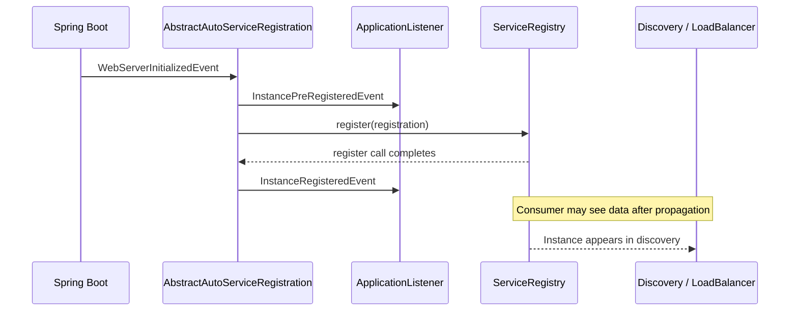
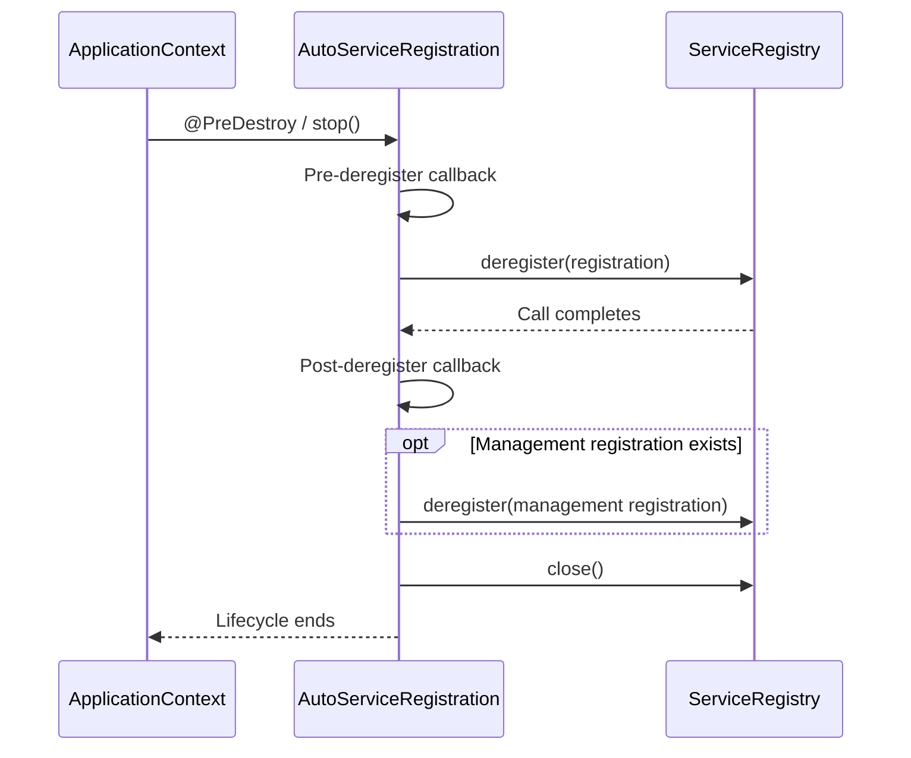

# Testing Registration Events and ServiceRegistry Lifecycle

## 1. Why Test the Registration Lifecycle?

In a Spring Cloud system, an instance can be discovered by other services only once its information is registered with the service registry. Registering at the wrong time, failing to deregister on shutdown, or updating status incorrectly can cause consumers to pick stale addresses, send requests to unready instances, or miss healthy ones.

Spring Cloud Commons provides the `ServiceRegistry` abstraction for managing registrations and two key events for the auto-registration flow:

- `InstancePreRegisteredEvent`: published before the instance is registered.
- `InstanceRegisteredEvent`: published after registration completes.

Tests must verify the registry contract, event ordering, registration timing, behavior when auto-registration is disabled, deregistration on shutdown, and provider-specific status semantics.

This lesson belongs to the **Testing** chapter of the **SPRING_CLOUD_CORE** module. The module helps learners understand Spring Cloud Commons, Spring Cloud Context, externalized configuration, Spring Boot compatibility, refresh scope, discovery, service registries, service communication, and testing/operating shared abstractions.

After this lesson, learners can:

- Distinguish `ServiceRegistry`, `Registration`, `DiscoveryClient`, and auto-registration.
- Describe the registration lifecycle from web server startup to `ApplicationContext` shutdown.
- Distinguish the pre-registration event from the post-registration event.
- Write listeners to observe `InstancePreRegisteredEvent` and `InstanceRegisteredEvent`.
- Test `register`, `deregister`, `setStatus`, `getStatus`, and `close` operations.
- Verify behavior when auto-registration is disabled or manual registration is used.
- Test instance status through Actuator and registry APIs.
- Design integration tests that account for eventual consistency, shutdown, and registry connection failures.

## 2. Components in the ServiceRegistry Contract

### 2.1. ServiceRegistry and Registration

Spring Cloud Commons defines `ServiceRegistry<R extends Registration>`. It is the abstraction for interacting with a specific registration. `Registration` is a marker interface; each provider supplies its own registration type.

Core contract operations include:

| Method | Purpose |
| --- | --- |
| `register(registration)` | Submits the registration to the registry |
| `deregister(registration)` | Removes the registration |
| `setStatus(registration, status)` | Changes status per provider semantics |
| `getStatus(registration)` | Reads current status |
| `close()` | Closes registry implementation resources |

Concrete implementations include:

| Provider | Registration | ServiceRegistry |
| --- | --- | --- |
| Eureka | `EurekaRegistration` | `EurekaServiceRegistry` |
| Consul | `ConsulRegistration` | `ConsulServiceRegistry` |
| Zookeeper | `ZookeeperRegistration` | `ZookeeperServiceRegistry` |

When injecting the abstraction, use the exact registration type supported by the implementation. Never create a Eureka registration object and pass it to a Consul registry.

### 2.2. ServiceRegistry Is Not DiscoveryClient

The two abstractions serve opposite directions:

| Component | Responsibility | Example operations |
| --- | --- | --- |
| `ServiceRegistry` | Writes and manages an instance's registration | Register, deregister, change status |
| `Registration` | Describes the instance to register | Service ID, instance ID, address, and provider metadata |
| `DiscoveryClient` | Reads service and instance lists | `getServices()`, `getInstances(serviceId)` |
| `AbstractAutoServiceRegistration` | Coordinates auto-registration with application lifecycle | Starts when web server is ready; stops when context closes |

A test calling `DiscoveryClient.getInstances()` can confirm the registry exposes the instance, yet does not automatically prove listeners received the right events. Conversely, an event being published does not prove every discovery client sees the registration immediately.

### 2.3. Why Separate Test Categories?

- **Contract/unit tests:** verify an implementation or service wrapper invokes the right registry operations.
- **Event tests:** verify listeners react properly to events without relying on out-of-contract ordering.
- **Lifecycle integration tests:** verify auto-registration ties into web server startup and `ApplicationContext` shutdown.
- **Provider integration tests:** verify registration, status, health filtering, and deregistration against a real registry or provider test instance.

Do not use a mocked unit test to conclude that a real registry has synchronized data or that consumers received the new instance.

## 3. Auto-Registration Lifecycle

### 3.1. Registration Timing

In the standard auto-registration flow, `AbstractAutoServiceRegistration` listens for `WebServerInitializedEvent`. Once the application's web server has initialized and obtained a port, the registration lifecycle can begin.

High-level sequence:

1. The application's web server starts and publishes `WebServerInitializedEvent`.
2. Auto-registration checks whether the provider and configuration permit registration.
3. Publishes `InstancePreRegisteredEvent`.
4. Runs pre-registration callbacks if the provider configures `RegistrationLifecycle`.
5. Calls `ServiceRegistry.register(...)`.
6. Runs post-registration callbacks.
7. If configured and the management server uses a separate port, also registers the management service.
8. Publishes `InstanceRegisteredEvent`.
9. Marks the lifecycle as running.



Key point: `InstanceRegisteredEvent` indicates that the registration call in the lifecycle has completed. In distributed registries, it does not guarantee every registry node or every discovery client has updated its cache at the exact instant the event fires.

### 3.2. InstancePreRegisteredEvent

This event is published before calling `ServiceRegistry.register(...)`. Listeners can use it to record registration intent, emit telemetry, or execute appropriate setup logic.

If the subsequent registration call fails, the pre-registration event may still have fired. Therefore, never use this event as proof that the instance exists in the registry.

### 3.3. InstanceRegisteredEvent

This event is published after the `register` call completes in the auto-registration flow. Listeners can use it to log, update metrics, or trigger post-registration integration steps.

In the current `AbstractAutoServiceRegistration` implementation, the post-registration event is created with the provider's configuration object. Do not assume the payload of `InstanceRegisteredEvent` is always the `Registration` object itself; verify the exact type and semantics for your version and provider.

### 3.4. Shutdown and Deregistration

When `ApplicationContext` closes, `AbstractAutoServiceRegistration` triggers lifecycle stop via destruction callbacks. Typical stop flow:

1. Verify registration is running and auto-registration is still enabled.
2. Run pre-deregistration callbacks.
3. Call `ServiceRegistry.deregister(...)`.
4. Run post-deregistration callbacks.
5. If a management service was registered, deregister it.
6. Call `ServiceRegistry.close()` so the implementation frees resources per its contract.



Proactive deregistration shortens the window where consumers see stale addresses. However, registry providers may still have caches, leases, or propagation delays. Tests must use the provider's acceptable time bounds rather than assuming instantaneous disappearance.

## 4. Enabling, Disabling, and Customizing Auto-Registration

### 4.1. Default Configuration

Spring Cloud Commons typically enables auto-registration when a suitable discovery/service registry implementation is on the classpath.

It can be disabled via property:

```yaml
spring:
  cloud:
    service-registry:
      auto-registration:
        enabled: false
```

For applications using `@EnableDiscoveryClient`, setting `autoRegister=false` also disables auto-registration in annotation configuration. In current Spring Cloud versions, this annotation is no longer strictly required just to enable discovery if an implementation is already on the classpath; check your release train's API and documentation.

The full property name to disable auto-registration is `spring.cloud.service-registry.auto-registration.enabled`. When set to `false`, neither `InstancePreRegisteredEvent` nor `InstanceRegisteredEvent` is published by the auto-registration flow. Event tests must set this property explicitly, or outcomes can diverge between test and production profiles.

### 4.2. Manual Registration

You can disable auto-registration and invoke the registry explicitly from a service or orchestration workflow:

```java
@Service
class ManualRegistrationManager implements AutoCloseable {

    private final ServiceRegistry<MyRegistration> serviceRegistry;

    ManualRegistrationManager(
            ServiceRegistry<MyRegistration> serviceRegistry) {
        this.serviceRegistry = serviceRegistry;
    }

    void register(MyRegistration registration) {
        serviceRegistry.register(registration);
    }

    void deregister(MyRegistration registration) {
        serviceRegistry.deregister(registration);
    }

    @Override
    public void close() {
        serviceRegistry.close();
    }
}
```

Manual registration only calls the `ServiceRegistry` contract. It does not automatically emit the two auto-registration events above. If the application needs domain events for manual registration, publish dedicated custom events after completion and name them clearly so they are not confused with Spring Cloud's events.

### 4.3. Management Service Registration

Some applications run the management server on a separate port. Spring Cloud can register the management endpoint as a separate service when the provider and configuration allow.

Current property:

```yaml
spring:
  cloud:
    service-registry:
      auto-registration:
        register-management: true
```

This property defaults to enabled in current property metadata, though management registration only applies when a dedicated management port exists and the provider supports it. When testing, verify application registration and management registration separately; do not count both as two business instances.

## 5. Writing Listeners to Observe Registration Events

### 5.1. Listeners Using @EventListener

You can record events in a component:

```java
import java.util.List;
import java.util.concurrent.CopyOnWriteArrayList;

import org.springframework.context.event.EventListener;
import org.springframework.stereotype.Component;

import org.springframework.cloud.client.discovery.event.InstancePreRegisteredEvent;
import org.springframework.cloud.client.discovery.event.InstanceRegisteredEvent;

@Component
class RegistrationEventRecorder {

    private final List<String> events = new CopyOnWriteArrayList<>();

    @EventListener
    void beforeRegistration(InstancePreRegisteredEvent event) {
        events.add("pre-registered");
    }

    @EventListener
    void afterRegistration(InstanceRegisteredEvent<?> event) {
        events.add("registered");
    }

    List<String> snapshot() {
        return List.copyOf(events);
    }

    void clear() {
        events.clear();
    }
}
```

The recorder stores only event names to keep the example readable. In real applications, you can also log service names, instance IDs, or correlation IDs from the corresponding registration/configuration. Avoid logging sensitive credentials or metadata.

### 5.2. Do Not Turn Listeners into Startup-Blocking Tasks

Events fire inside the registration lifecycle thread. Synchronous listeners can slow down or break startup if they perform heavy work.

Principles:

- Keep listeners short and observable.
- Do not make long HTTP call loops to multiple external systems directly inside a listener.
- If background work is needed, offload it to a managed executor/queue with retries and metrics.
- Do not treat the pre-registration event as a final readiness signal.
- Ensure listener errors do not unintentionally crash application startup.

If using asynchronous listeners, test ordering and consistency separately. Do not assume async event handling finishes before startup completes.

## 6. Unit Testing the ServiceRegistry Contract

### 6.1. Testing That Wrappers/Services Call the Right Operations

If the application has a service wrapping the registry, use mocks to verify delegation:

```java
@ExtendWith(MockitoExtension.class)
class ManualRegistrationManagerTest {

    @Mock
    ServiceRegistry<MyRegistration> registry;

    @InjectMocks
    ManualRegistrationManager manager;

    @Test
    void delegatesRegisterAndDeregister() {
        MyRegistration registration =
                new MyRegistration("catalog-service", "catalog-1");

        manager.register(registration);
        manager.deregister(registration);

        verify(registry).register(registration);
        verify(registry).deregister(registration);
    }
}
```

This test verifies the application layer calls the right API. It does not verify that the provider writes data into a real registry.

### 6.2. Testing Status

```java
@Test
void readsAndChangesRegistrationStatus() {
    MyRegistration registration =
            new MyRegistration("catalog-service", "catalog-1");

    when(registry.<String>getStatus(registration)).thenReturn("UP");

    assertThat(registry.<String>getStatus(registration)).isEqualTo("UP");

    registry.setStatus(registration, "OUT_OF_SERVICE");

    verify(registry).setStatus(registration, "OUT_OF_SERVICE");
}
```

This is a mock example. When testing a real provider, verify the status returned after calling `setStatus`, and confirm whether that status affects discovery/load balancing per provider semantics.

### 6.3. Testing Close

If a service wrapper owns the registry lifecycle, verify it closes resources at the right time:

```java
@Test
void closesRegistryWhenManagerStops() {
    manager.close();

    verify(registry).close();
}
```

Do not call `close()` arbitrarily from a business request if the registry is a shared singleton in the `ApplicationContext`. Normally, the container lifecycle or auto-registration implementation manages when the provider client closes.

## 7. Test Fixtures for Registration and ServiceRegistry

### 7.1. Simulated Registration

Because `Registration` is a marker interface, tests can define a simple type:

```java
import org.springframework.cloud.client.serviceregistry.Registration;

record MyRegistration(
        String serviceId,
        String instanceId,
        String host,
        int port) implements Registration {
}
```

This is a registration type for test examples, not one used directly with Eureka, Consul, or Zookeeper. Real providers require their own registration classes.

### 7.2. Recording Registry

A fake registry verifies operation sequences without starting an external backend:

```java
import java.util.ArrayList;
import java.util.HashMap;
import java.util.List;
import java.util.Map;

import org.springframework.cloud.client.serviceregistry.ServiceRegistry;

class RecordingServiceRegistry
        implements ServiceRegistry<MyRegistration> {

    private final List<String> calls = new ArrayList<>();
    private final Map<String, String> statuses = new HashMap<>();

    @Override
    public void register(MyRegistration registration) {
        calls.add("register:" + registration.instanceId());
        statuses.put(registration.instanceId(), "UP");
    }

    @Override
    public void deregister(MyRegistration registration) {
        calls.add("deregister:" + registration.instanceId());
        statuses.remove(registration.instanceId());
    }

    @Override
    public void setStatus(MyRegistration registration, String status) {
        statuses.put(registration.instanceId(), status);
        calls.add("status:" + registration.instanceId() + ":" + status);
    }

    @Override
    @SuppressWarnings("unchecked")
    public <T> T getStatus(MyRegistration registration) {
        return (T) statuses.get(registration.instanceId());
    }

    @Override
    public void close() {
        calls.add("close");
    }

    List<String> calls() {
        return List.copyOf(calls);
    }
}
```

This fake keeps state in memory for testing. Do not treat it as an accurate model of leases, heartbeats, health checks, or distributed registry consistency.

### 7.3. Invariants to Verify

| Operation | Tested invariant |
| --- | --- |
| Register | Registration submitted once per expected lifecycle behavior |
| Deregister | Exact registration is removed |
| Set status | Status forwarded to provider with exact value |
| Get status | Returned value reflects provider contract |
| Close | Registry resources released in proper lifecycle |
| Register failure | Post-registration event must not be treated as success |
| Deregister failure | Failure is recorded; do not assume registration vanished |

Do not impose uniform rules such as duplicate registration must always throw or always be idempotent across every provider. Verify the behavior documented by the specific provider.

## 8. Testing the Event Lifecycle

### 8.1. Testing Listeners in Isolation

You can invoke listener methods directly with events in unit tests to verify reaction logic:

```java
@Test
void recordsRegistrationEvents() {
    RegistrationEventRecorder recorder =
            new RegistrationEventRecorder();

    recorder.beforeRegistration(
            new InstancePreRegisteredEvent(this, registration)
    );
    recorder.afterRegistration(
            new InstanceRegisteredEvent<>(this, configuration)
    );

    assertThat(recorder.snapshot())
            .containsExactly("pre-registered", "registered");
}
```

This test verifies only the recorder logic. It does not prove Spring Cloud automatically publishes events at the right times.

### 8.2. Integration Testing with Real Auto-Registration

To test the live lifecycle, start a web application with an appropriate discovery provider and auto-registration enabled. Use the event recorder listener to capture both events.

Example test structure:

```java
@SpringBootTest(webEnvironment = SpringBootTest.WebEnvironment.RANDOM_PORT)
@ActiveProfiles("registry-test")
class ServiceRegistrationLifecycleIT {

    @Autowired
    RegistrationEventRecorder recorder;

    @Autowired
    DiscoveryClient discoveryClient;

    @LocalServerPort
    int port;

    @Test
    void registersAfterWebServerStarts() {
        await().untilAsserted(() ->
                assertThat(recorder.snapshot())
                        .containsSubsequence(
                                "pre-registered",
                                "registered"
                        )
        );

        await().untilAsserted(() ->
                assertThat(discoveryClient.getInstances("catalog-service"))
                        .anyMatch(instance -> instance.getPort() == port)
        );
    }
}
```

This example assumes the `registry-test` profile configures the test provider and `catalog-service` is the registered service ID. Awaitility is used to wait for events and registry propagation instead of fixed sleeps.

Important notes:

- `InstancePreRegisteredEvent` must appear before `InstanceRegisteredEvent`.
- The post-registration event confirms the `register` call finished.
- `DiscoveryClient` seeing the instance may arrive later due to registry propagation or caching.
- If the application uses a separate management port, test management registration independently.
- Each test must use a distinct instance ID or namespace to avoid leftover data from prior runs.

### 8.3. Testing Disabled Auto-Registration

Use a separate context with the property:

```yaml
spring:
  cloud:
    service-registry:
      auto-registration:
        enabled: false
```

Expected outcomes to verify:

- No automatic registration occurs when the web server starts.
- No `InstancePreRegisteredEvent` is emitted from the auto-registration flow.
- No `InstanceRegisteredEvent` is emitted from the auto-registration flow.
- If the application explicitly calls `ServiceRegistry.register()`, manual operations still work according to its own logic.

Never share a recorder across multiple tests without resetting state; otherwise, events from a prior context can cause false passes.

## 9. Testing Deregistration on Shutdown

### 9.1. Why Test Shutdown?

If an instance shuts down while its registration lingers, consumers may continue picking the stopped address. Some registries use heartbeats/leases to evict disconnected instances, yet eviction delays can be longer than desired.

Shutdown tests must verify:

- Lifecycle stop runs when the context closes.
- The provider receives the right deregister command.
- The application registration disappears from the registry within the provider's committed window.
- Any management registration is also removed.
- The registry client closes cleanly per lifecycle.

### 9.2. Unit Testing Stop with a Recording Registry

If a custom lifecycle class owns register/deregister, tests can assert the call sequence:

```java
@Test
void deregistersBeforeClosingRegistry() {
    lifecycle.start();
    lifecycle.stop();

    assertThat(registry.calls()).containsSubsequence(
            "register:catalog-1",
            "deregister:catalog-1",
            "close"
    );
}
```

This fits a custom application-authored lifecycle coordinator. For `AbstractAutoServiceRegistration`, run an integration test via the provider implementation or a controlled test subclass; do not assume calling `ServiceRegistry.register()` directly exercises the entire lifecycle.

### 9.3. Integration Testing Closing the ApplicationContext

You can run the application in a dedicated context, wait for the instance to appear, close the context, and then query the registry using an independent admin client:

```java
ConfigurableApplicationContext context =
        new SpringApplicationBuilder(CatalogApplication.class)
                .web(WebApplicationType.SERVLET)
                .run(testArguments);

try {
    // Wait for instance to appear in registry.
}
finally {
    context.close();
}

// Use a registry admin client outside the closed context
// to wait for the registration to disappear.
```

Do not use the `DiscoveryClient` bean from the closed context to inspect results after shutdown. Use an external admin client, an independent test context, or the registry's API.

## 10. Testing Status via Actuator

### 10.1. The Service Registry Endpoint

Spring Cloud Commons provides an Actuator endpoint with ID `serviceregistry`. The endpoint relies on the `Registration` bean in `ApplicationContext` and the corresponding registry implementation.

- GET `/actuator/serviceregistry`: reads current registration status.
- POST `/actuator/serviceregistry`: requests status change via JSON with a `status` field.

Example body:

```json
{
  "status": "OUT_OF_SERVICE"
}
```

Example endpoint exposure configuration:

```yaml
management:
  endpoints:
    web:
      exposure:
        include:
          - health
          - serviceregistry
```

Expose this endpoint only on a management network and guard POST operations with proper authentication/authorization. Never grant status-change permissions to untrusted users.

### 10.2. Status Is Provider-Dependent

Common values in Eureka include:

- `UP`
- `DOWN`
- `OUT_OF_SERVICE`
- `UNKNOWN`

This is not a universal enum shared across all registries. Other providers may use metadata or different state machines to represent status. For example, Spring Cloud Zookeeper represents `OUT_OF_SERVICE` via metadata and LoadBalancer suppliers filter out instances not in `UP` state.

Status tests must use values supported by the provider and verify real impact on discovery/load balancing. Do not merely assert that GET returns the string that was POSTed.

### 10.3. Status Does Not Replace Readiness

Putting an instance into `OUT_OF_SERVICE` can cause the provider or LoadBalancer to exclude it from candidate selection, yet readiness, health checks, and traffic draining remain distinct mechanisms.

In a controlled rollout:

1. Remove the instance from traffic via the appropriate mechanism.
2. Wait for the registry/load balancer to update.
3. Allow in-flight requests to finish.
4. Close the context and deregister.
5. Verify the instance is no longer returned by discovery.

Do not assume POSTing a status automatically waits for every consumer to refresh its cache.

## 11. RegistrationLifecycle Callbacks

Beyond application events, Spring Cloud Commons provides lifecycle callback extension points for service registration implementations:

- `postProcessBeforeStartRegister(registration)`
- `postProcessAfterStartRegister(registration)`
- `postProcessBeforeStopRegister(registration)`
- `postProcessAfterStopRegister(registration)`

These callbacks belong to `RegistrationLifecycle` and can be used by providers to add processing around registration/deregistration. Management registration has its own callbacks in `RegistrationManagementLifecycle`.

Distinctions:

| Mechanism | Purpose |
| --- | --- |
| Application event | Notifies listeners inside `ApplicationContext` |
| `RegistrationLifecycle` callback | Internal hook around auto-registration implementation operations |
| `ServiceRegistry` API | Executes operations against the registry backend |

When writing custom provider tests, verify pre/post callbacks run in the right order relative to backend calls. Do not use callbacks as a substitute for the register/deregister contract.

## 12. Common Testing Mistakes

| Symptom | Possible cause | How to handle |
| --- | --- | --- |
| No pre/post events received | Auto-registration disabled or no auto-registration implementation present | Check provider dependencies and auto-registration properties |
| Only pre-registration event observed | `register` threw an error or lifecycle stopped before completion | Inspect exceptions and `ServiceRegistry` logs |
| Post-registration event fired yet discovery does not see instance | Registry propagation or client cache not updated yet | Use Awaitility and check provider admin API |
| Manual register does not publish events | `ServiceRegistry` API does not auto-publish auto-registration events | Publish custom domain events if the application needs them |
| Test passes alone but fails in full suite | Shared recorder/state or leftover registrations across tests | Use separate contexts/instance IDs and reset fixtures |
| Stale instance still returned after shutdown | Deregistration error, lease/cache, or propagation delay | Check backend registry and provider TTLs |
| Status endpoint missing | Actuator absent, endpoint not exposed, or missing `Registration` bean | Check dependencies, exposure, and provider config |
| POST status succeeds yet routing does not change | Status value not interpreted as expected by provider/load balancer | Check provider semantics and instance supplier |
| Registry test waits too long | Fixed sleeps or mismatched timeouts | Wait on conditions with Awaitility and tune timeouts to test env |
| Two registrations counted for one app | Separate management port registered an extra service | Check `register-management` and distinguish service/management instances |
| Closing registry breaks other tests | Shared singleton registry closed prematurely across tests | Let `ApplicationContext` manage lifecycle or create isolated fixtures |

## 13. Recommended Test Matrix

| Group | Scenario | Evidence to collect |
| --- | --- | --- |
| Contract | Register a registration | Provider receives exact object and metadata |
| Contract | Deregister registration | Registration removed per provider semantics |
| Contract | Set/get status | Status reads back accurately and takes effect |
| Contract | Close | Provider resources released |
| Events | Auto-registration enabled | Pre-event before, post-event after register |
| Events | Auto-registration disabled | Neither auto-registration event fires |
| Events | Manual registration | Do not expect automatic auto-registration events |
| Startup | Web server binds port | Registration holds accurate live host/port |
| Management | Separate management port | Management registration created/removed per config |
| Shutdown | Close `ApplicationContext` | Deregistration invoked and instance vanishes within provider bounds |
| Status | Transition to `OUT_OF_SERVICE` | Provider and LoadBalancer reflect status |
| Failure | Registry unreachable | Fail-fast or retry/error behavior matches configuration |
| Consistency | Slow registry propagation | Test awaits condition rather than fixed sleep duration |
| Isolation | Parallel test runs | Service ID/instance ID and namespaces do not collide |

## 14. Implementation and Testing Checklist

Before shipping a discovery integration, verify:

1. Does the `Registration` type match the active provider?
2. Are service ID, instance ID, host, port, and metadata accurate?
3. Is auto-registration enabled in the right profiles?
4. Do both pre/post events fire in the auto-registration flow?
5. Do listeners avoid blocking startup with long tasks?
6. Is manual registration clearly distinguished from auto-registration?
7. Does shutdown call `deregister` and close the registry client?
8. Is management service registration accidentally enabled when unintended?
9. Are status values valid for the provider and do they affect routing as expected?
10. Are Actuator endpoints minimally exposed and properly secured?
11. Do integration tests use a real registry or compatible test backend?
12. Do tests wait for propagation via conditions instead of fixed sleeps?
13. Do shutdown tests query the registry through a client that stays alive after context close?
14. Do tests verify events, backend registration, and discovery visibility separately?

## 15. Official References

- [Spring Cloud Commons — Common Abstractions, ServiceRegistry](https://docs.spring.io/spring-cloud-commons/reference/spring-cloud-commons/common-abstractions.html): `ServiceRegistry` contract, auto-registration, both events, and Actuator endpoint.
- [AbstractAutoServiceRegistration.java — Spring Cloud Commons](https://github.com/spring-cloud/spring-cloud-commons/blob/main/spring-cloud-commons/src/main/java/org/springframework/cloud/client/serviceregistry/AbstractAutoServiceRegistration.java): lifecycle tied to `WebServerInitializedEvent`, event publishing, register, stop, and deregister.
- [ServiceRegistry API — Spring Cloud Commons](https://javadoc.io/doc/org.springframework.cloud/spring-cloud-commons/latest/org/springframework/cloud/client/serviceregistry/ServiceRegistry.html): register, deregister, status, and close operations.
- [Spring Cloud Zookeeper — Service Registry](https://docs.spring.io/spring-cloud-zookeeper/reference/service-registry.html): manual registration example and Zookeeper `OUT_OF_SERVICE` semantics.
- [Spring Cloud Netflix — Eureka Client](https://docs.spring.io/spring-cloud-netflix/reference/spring-cloud-netflix.html): Eureka heartbeats, leases, registry caching, and discovery behavior.

**Key takeaway:** `ServiceRegistry` executes operations against registrations; auto-registration coordinates those operations with the application lifecycle. `InstancePreRegisteredEvent` fires before `register`, and `InstanceRegisteredEvent` fires after `register` completes. Test events, backend state, discovery visibility, and shutdown deregistration separately; they are related, yet they are not the same signal.
