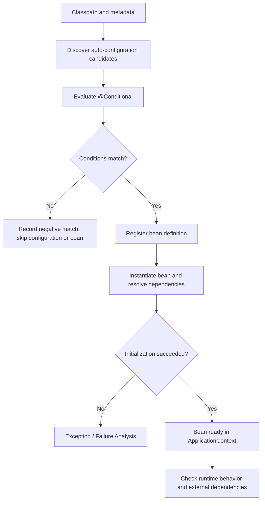
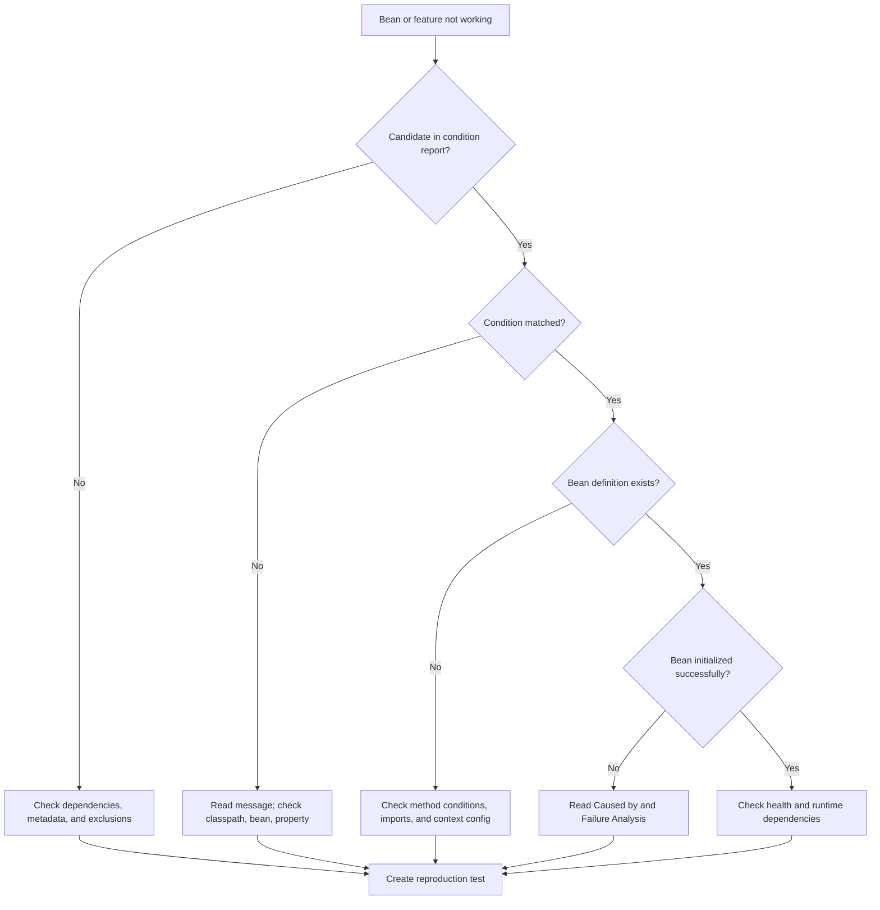

# Diagnosing Auto-configuration Using Conditions and Startup Logs

When a Spring Boot or Spring Cloud bean does not appear, the cause may lie at multiple stages: the auto-configuration class was not discovered, a condition did not match, the configuration was excluded, another bean caused the default configuration to back off, or the bean was declared but failed during initialization. Looking at a stack trace or bean list alone is often not enough to distinguish these cases.

Spring Boot provides `ConditionEvaluationReport` to record condition evaluation results for configurations and auto-configurations. You can view the report via startup logs when enabling `--debug`, query Actuator `/actuator/conditions`, or read the report in tests. Combining these sources with bean lifecycle logs and configuration details helps pinpoint why a feature is not activated.

This lesson belongs to the **Observability** chapter of **SPRING_CLOUD_CORE**. It focuses on reading positive/negative matches, enabling the debug report, using the conditions endpoint, tracing properties and classpath, diagnosing Spring Cloud auto-configurations, and following a startup failure investigation workflow.

## 1. Learning Objectives

After this lesson, you will be able to:

- Describe the stages from auto-configuration discovery to bean initialization.
- Explain the role of `ConditionEvaluationReport`.
- Enable the condition report using `--debug` or the `debug` property.
- Read positive matches, negative matches, and unconditional classes groups.
- Query the report via Actuator `/actuator/conditions`.
- Use the `ConditionEvaluationReport` API in diagnostic tools or tests.
- Distinguish classpath conditions, bean conditions, and property conditions.
- Check excluded configurations via annotations or `spring.autoconfigure.exclude`.
- Distinguish an undiscovered auto-configuration from a discovered auto-configuration whose conditions did not match.
- Cross-reference the condition report with property sources, bean lists, and startup logs.
- Diagnose conditions related to Spring Cloud discovery and service registry.
- Use `ApplicationContextRunner` to reproduce failing conditions.
- Protect sensitive information when enabling Actuator or diagnostic logs in real environments.

## 2. How a Bean Is Formed from Auto-configuration

To read logs accurately, you need to understand the stages a bean goes through. This can be modeled in five steps:

1. Spring Boot discovers auto-configuration classes from metadata on the classpath.
2. Spring evaluates conditions on configuration classes and `@Bean` methods.
3. If conditions match, Spring registers the bean definition.
4. When the container needs to instantiate the bean, dependencies are resolved and the factory method or constructor is executed.
5. The bean runs in the application and depends on external services such as registries, databases, or message brokers.



`ConditionEvaluationReport` focuses on the condition evaluation step. It helps explain why a configuration or bean method was selected or skipped. The report does not replace bean initialization logs, health checks, or runtime connectivity checks.

### 2.1. Three Easily Confused Issue Types

| Case | Symptom | Where to Check |
| --- | --- | --- |
| Auto-configuration not discovered | Class is missing from the condition report | `AutoConfiguration.imports`, JAR metadata, dependencies, and exclusions |
| Auto-configuration discovered but conditions do not match | Has a negative match and explanatory message | `ConditionEvaluationReport`, properties, classpath, and bean conditions |
| Bean definition registered but bean fails to instantiate | Condition matches yet startup throws an exception | Stack trace, dependency injection, constructor, factory method, and lifecycle |

Do not conclude that a class missing from the report failed its conditions. Spring Boot may never have discovered that class for evaluation.

## 3. What Is ConditionEvaluationReport?

`org.springframework.boot.autoconfigure.condition.ConditionEvaluationReport` is the data structure Spring Boot uses to record the evaluation results of `Condition`s during configuration processing.

Each result is attached to a source, typically a configuration class name or bean method. A single source can have multiple conditions evaluated together.

The report provides important groups of information:

| API / Data Group | Meaning |
| --- | --- |
| `getConditionAndOutcomesBySource()` | Condition outcomes grouped by source |
| `getExclusions()` | Excluded auto-configuration classes |
| `getUnconditionalClasses()` | Configuration classes evaluated without any conditions |
| `getParent()` | Report of the parent BeanFactory if present |
| `getDelta(previousReport)` | Changes compared to a previous report |

Each `ConditionOutcome` indicates whether the condition matched and provides an explanatory message. For example, the message might state that a required class is missing, a property was not found, or a needed bean has not been registered.

### 3.1. Positive match

A positive match means the corresponding condition matched. For example:

```text
@ConditionalOnClass found required class 'com.acme.Client'
```

Or:

```text
@ConditionalOnMissingBean did not find any beans
```

This result indicates that the evaluated condition allows the configuration to proceed. It does not guarantee that every bean in the configuration will instantiate successfully.

### 3.2. Negative match

A negative match indicates that a condition did not match. For example:

```text
@ConditionalOnClass did not find required class 'com.acme.Client'
```

Or:

```text
@ConditionalOnProperty did not find property 'acme.client.enabled'
```

With `@ConditionalOnMissingBean`, a negative match may indicate that a bean of the same type already exists, causing the default bean to back off.

### 3.3. Unconditional classes

Some configuration classes have no conditions. They are recorded in the unconditional classes group. Appearing in this group should not be taken as proof that all beans declared by that class were successfully instantiated.

## 4. Enabling the Condition Evaluation Report with --debug

The fastest way to investigate locally or in a test environment is to enable debug mode when starting Spring Boot.

With an executable JAR:

```bash
java -jar app.jar --debug
```

You can use a property:

```properties
debug=true
```

Or YAML:

```yaml
debug: true
```

When debug mode is enabled, Spring Boot writes `ConditionEvaluationReport` to the log. The report lists matching and non-matching auto-configurations along with the reasons.

### 4.1. Example Output

The exact format depends on the version and logging configuration. An abbreviated excerpt might look like this:

```text
Positive matches:
-----------------

AcmeAutoConfiguration matched:
   - @ConditionalOnClass found required class
     'com.acme.Client' (OnClassCondition)

AcmeAutoConfiguration#acmeClient matched:
   - @ConditionalOnMissingBean did not find any beans
     (OnBeanCondition)


Negative matches:
-----------------

AcmeMetricsAutoConfiguration:
   - @ConditionalOnProperty (acme.metrics.enabled=true)
     did not find property 'acme.metrics.enabled'
     (OnPropertyCondition)
```

How to read it:

- `AcmeAutoConfiguration` passed the classpath condition.
- Bean `acmeClient` is allowed to be created because no replacement bean exists yet.
- The metrics configuration was not applied because the property does not exist or does not have a matching value.

### 4.2. --debug Does Not Mean Enabling DEBUG for the Entire Application

`--debug` instructs Spring Boot to enable debug logging for a selected set of core loggers. It does not automatically set every logger in the application and every library to `DEBUG`.

If you need detailed logs for a specific package, you can configure individual loggers:

```yaml
logging:
  level:
    org.springframework.boot.autoconfigure: DEBUG
    org.springframework.cloud: DEBUG
```

Only enable the loggers you need. Enabling DEBUG for the entire Spring Framework or the whole application can generate massive log volume and make finding the root cause harder.

### 4.3. Enabling Debug Per Run

You do not have to commit `debug: true` into production configuration. You can pass `--debug` for a single run to investigate, then turn it back off. This reduces unnecessary logs and avoids accidentally storing diagnostic details long-term.

## 5. Reading the Report in Order

When looking for a missing bean, you do not need to read the entire report from top to bottom. Start with the relevant class or bean method name.

An effective reading order:

1. Find the auto-configuration class name.
2. Check whether that source is in positive matches or negative matches.
3. If it is a negative match, read the full condition message.
4. If the class matched but the bean is missing, search specifically for the `@Bean` method.
5. Check exclusions and user configurations that might have replaced the bean.
6. If the report shows a match, move on to inspect bean creation logs and exceptions.

### 5.1. Class-Level Conditions and Method-Level Conditions

A class may evaluate as matching, yet an `@Bean` method inside it still has its own condition that does not match.

Example:

```java
@AutoConfiguration
@ConditionalOnClass(AcmeClient.class)
public class AcmeAutoConfiguration {

    @Bean
    @ConditionalOnProperty(
            prefix = "acme.client",
            name = "enabled",
            havingValue = "true")
    AcmeClient acmeClient() {
        return new AcmeClient();
    }
}
```

If `AcmeClient` is present, the class-level condition can match. But if `acme.client.enabled` is not `true`, the bean method is still skipped.

Therefore, search for both the class name and the method name in the report.

### 5.2. One Source Can Have Multiple Outcomes

A single source can have multiple conditions. Some conditions may match, yet if even one required condition fails to match, the configuration still will not be applied.

Read all messages for the source under investigation. Do not stop at the first condition saying `matched`.

## 6. Querying via Actuator /actuator/conditions

If the application integrates Spring Boot Actuator, you can view the condition report via the endpoint:

```text
GET /actuator/conditions
```

The endpoint returns the report as JSON, which is convenient when the application is already running and you need to inspect the active configuration state.

### 6.1. Adding the Actuator Dependency

With Maven, add the Actuator starter to the application module:

```xml
<dependency>
    <groupId>org.springframework.boot</groupId>
    <artifactId>spring-boot-starter-actuator</artifactId>
</dependency>
```

The dependency version should be managed by Spring Boot dependency management or the BOM matching your application.

### 6.2. Exposing the conditions Endpoint

By default, Spring Boot only exposes the `health` endpoint over HTTP. To expose `conditions`, configure:

```yaml
management:
  endpoints:
    web:
      exposure:
        include: "health,conditions"
```

If the application already has a list of exposed endpoints, add `conditions` to the existing list so you do not accidentally drop endpoints currently in use.

Then query:

```bash
curl http://localhost:8080/actuator/conditions
```

The actual path may differ if the application changes the management base path or uses a separate management port.

### 6.3. JSON Structure

The response has these main groups:

```json
{
  "contexts": {
    "application": {
      "positiveMatches": {
        "AcmeAutoConfiguration": [
          {
            "condition": "OnClassCondition",
            "message": "@ConditionalOnClass found required class"
          }
        ]
      },
      "negativeMatches": {
        "AcmeMetricsAutoConfiguration": {
          "notMatched": [
            {
              "condition": "OnPropertyCondition",
              "message": "did not find property 'acme.metrics.enabled'"
            }
          ],
          "matched": []
        }
      },
      "unconditionalClasses": []
    }
  }
}
```

This is abbreviated JSON to illustrate the structure, not a fixed response for every application. Context names and condition contents depend on the actual application.

| JSON field | Meaning |
| --- | --- |
| `contexts` | Reported ApplicationContexts |
| `positiveMatches` | Sources whose conditions matched |
| `negativeMatches` | Sources with at least one non-matching condition |
| `notMatched` | Conditions that did not match |
| `matched` | Conditions that matched within a source that had a negative outcome |
| `unconditionalClasses` | Configuration classes without conditions |
| `parentId` | ID of the parent context if one exists |

### 6.4. The Endpoint Is Not Available Just Because Actuator Was Added

To access `/actuator/conditions`, ensure:

- Actuator is on the classpath.
- The endpoint is enabled and not disabled.
- The access policy permits reading the endpoint.
- The endpoint is exposed over HTTP or JMX accordingly.
- The security policy permits the caller to access it.

If you receive HTTP 404, check endpoint exposure, base path, and management port. If you receive 401/403, check authentication, authorization, and SecurityFilterChain.

## 7. Reading the Report via API in ApplicationContext

In an internal tool or integration test, you can retrieve `ConditionEvaluationReport` directly from the BeanFactory.

Example:

```java
import org.springframework.boot.autoconfigure.condition.ConditionEvaluationReport;
import org.springframework.context.ConfigurableApplicationContext;

public class ConditionReportPrinter {

    public void print(ConfigurableApplicationContext context) {
        ConditionEvaluationReport report =
                ConditionEvaluationReport.get(context.getBeanFactory());

        report.getExclusions().forEach(
                name -> System.out.println("Excluded: " + name));

        report.getConditionAndOutcomesBySource()
                .forEach((source, outcomes) -> {
                    outcomes.forEach(item -> {
                        var outcome = item.getOutcome();

                        System.out.printf(
                                "%s -> %s: %s%n",
                                source,
                                outcome.isMatch() ? "MATCH" : "NO MATCH",
                                outcome.getMessage());
                    });
                });
    }
}
```

`ConditionEvaluationReport.get(...)` returns the report attached to the BeanFactory. `getConditionAndOutcomesBySource()` groups outcomes by source; each outcome has a match status and message.

This is a diagnostic API. Do not use the condition report to make runtime business decisions instead of dependency injection or health checks. Reading the report also does not alter already-processed auto-configuration results.

### 7.1. Only Read the Report After the Context Has Condition Data

The report is meaningful after Spring has processed the relevant configurations and conditions. If read too early during bootstrap, the report may not contain complete results yet.

In an application, call it from diagnostic tools only after the context has refreshed successfully. If the context fails to start, use startup logs and the report written upon failure instead of trying to access a non-existent context.

## 8. Diagnosing Common Conditions

Common conditions encountered when reading the report:

| Condition | Common Message | Question to Check |
| --- | --- | --- |
| `OnClassCondition` | Did not find required class | Is the dependency on the runtime classpath? |
| `OnBeanCondition` | Did not find bean or found existing bean | Are the bean type, qualifier, and configuration order right? |
| `OnPropertyCondition` | Did not find property or value did not match | Is the property loaded and does it have the right value? |
| `OnResourceCondition` | Did not find resource | Is the file in the classpath/artifact? |
| `OnWebApplicationCondition` | Incompatible application type | Is the current context servlet, reactive, or non-web? |
| `OnCloudPlatformCondition` | Cloud platform not detected | Does the Environment have the required platform marker? |

### 8.1. Classpath Condition

Example:

```text
@ConditionalOnClass did not find required class
'com.acme.registry.RegistryClient'
```

Check:

- Is the dependency in runtime scope?
- Was the dependency removed by a dependency exclusion?
- Is there a version conflict or classloader isolation issue?
- Is the class in the JAR during build but missing from the final artifact?
- Does the auto-configuration reference an optional class too early in a method signature or superclass?

If an SDK is optional, place the dependent part into a class-level conditional nested configuration to avoid loading non-existent types.

### 8.2. Bean Condition

Example:

```text
@ConditionalOnMissingBean found beans of type
'com.acme.Client'
```

This is usually intentional back-off behavior: the application already provided a bean, so auto-configuration does not create a default bean.

Check:

- Which configuration created the existing bean?
- Are there multiple implementations of the same type?
- Are qualifiers or generic types changing the candidates?
- Is the auto-configuration ordered after user configuration?
- Is the existing bean really the bean that the method is checking for?

If the condition is `@ConditionalOnBean` and no bean is found, verify that the bean definition was registered before the condition was evaluated.

### 8.3. Property Condition

Example:

```text
@ConditionalOnProperty (acme.client.enabled=true)
did not find property 'acme.client.enabled'
```

Check:

- Is the property declared with the right prefix and name?
- Is the corresponding profile activated?
- Is the configuration file imported?
- Does the environment variable have the correct mapped name?
- Is the value overridden by a command-line argument or a higher-precedence source?
- Is `matchIfMissing` configured as intended?

With `@ConditionalOnProperty`, unless `matchIfMissing=true` is set, a missing property typically causes the condition not to match when a specific value is required.

### 8.4. Web Application Condition

A Servlet-only configuration may not be enabled in a reactive application or non-web context.

Check the ApplicationContext type, web dependencies on the classpath, and the runner used in tests. Do not conclude a condition is wrong if a test creates a different context type than production.

## 9. Checking Excluded Auto-configurations

An auto-configuration might not be evaluated because it was explicitly excluded.

It can be excluded by annotation:

```java
@SpringBootApplication(
        exclude = AcmeAutoConfiguration.class)
public class Application {
}
```

Or by class name:

```java
@SpringBootApplication(
        excludeName = "com.example.acme.AcmeAutoConfiguration")
public class Application {
}
```

A property can also be used:

```yaml
spring:
  autoconfigure:
    exclude:
      - com.example.acme.AcmeAutoConfiguration
```

When investigating:

1. Check `getExclusions()` of `ConditionEvaluationReport`.
2. Look for `exclude` or `excludeName` on the startup annotation.
3. Check `spring.autoconfigure.exclude` across all configuration sources.
4. Check whether a test slice or test annotation excludes the auto-configuration.

If a class is in the exclusions list, adjusting conditions inside that class will not help because the class has been excluded from application processing.

## 10. Distinguishing Undiscovered Auto-configuration from Unmatched Conditions

This is one of the most common diagnostic mistakes.

If a class does not appear in either positive or negative matches, there can be several causes:

- The JAR containing the auto-configuration is not on the classpath.
- The `AutoConfiguration.imports` file was not packaged.
- The class name in the metadata is wrong.
- The configuration is excluded.
- The registration mechanism for the extension point is not `AutoConfiguration.imports`.
- The module is using a Spring Boot version incompatible with the library's metadata.

Therefore, inspect the metadata inside the JAR:

```bash
jar tf acme-spring-boot-autoconfigure.jar
```

For modern Spring Boot auto-configurations, check the resource:

```text
META-INF/spring/org.springframework.boot.autoconfigure.AutoConfiguration.imports
```

If using another Spring Cloud library or extension point, verify the exact metadata required by that extension point. Not every Spring Cloud factory or integration is registered via `AutoConfiguration.imports`; some mechanisms still use `META-INF/spring.factories`.

### 10.1. Checking Class Names

Cross-check:

- The fully qualified class name in the source.
- The class name inside the JAR.
- The corresponding line in the imports file.
- The actual artifact version downloaded by the application.

A single wrong character in the package or class name can prevent the auto-configuration from being discovered as expected.

## 11. Auto-configuration Ordering and Bean Conditions

`@ConditionalOnBean` and `@ConditionalOnMissingBean` depend on the bean definitions that have already been processed at the time the condition runs.

Example:

```java
@AutoConfiguration
@AutoConfigureAfter(PlatformClientAutoConfiguration.class)
public class AcmeAdapterAutoConfiguration {

    @Bean
    @ConditionalOnBean(PlatformClient.class)
    AcmeAdapter acmeAdapter(PlatformClient client) {
        return new AcmeAdapter(client);
    }
}
```

If `PlatformClientAutoConfiguration` registers the client bean, scheduling the adapter configuration to run after it lets the condition see the required bean definition.

When the report shows a bean condition did not match, check:

- Was the auto-configuration providing the dependent bean discovered?
- Is the ordering between the two configurations right?
- Was the dependent bean eliminated by another condition?
- Is the bean in a different parent context or child context?

Do not use `@AutoConfigureAfter` to control object instantiation order. That annotation orders the application of auto-configurations; dependency injection still determines bean creation relationships.

## 12. Diagnosing with Related Actuator Endpoints

`conditions` explains condition outcomes. Other endpoints answer different questions.

| Endpoint | Question |
| --- | --- |
| `/actuator/conditions` | Why was a configuration/auto-configuration applied or skipped? |
| `/actuator/beans` | Which beans are currently registered in the context? |
| `/actuator/env` | Which property sources provide configuration and what values are resolved? |
| `/actuator/configprops` | How were `@ConfigurationProperties` bound? |
| `/actuator/loggers` | What levels are loggers using and how can they be changed? |
| `/actuator/startup` | Which startup steps were recorded if `BufferingApplicationStartup` is configured? |
| `/actuator/health` | What is the status of components checked by health indicators? |

Do not use one endpoint as a substitute for another. For instance, `/actuator/conditions` may show that a bean method condition matched, while `/actuator/beans` confirms whether the bean definition is present in the context, and `/actuator/health` reflects the application's health indicators.

### 12.1. Checking Property Sources

If a condition depends on a property, you can use `/actuator/env` or `/actuator/env/{property}` to view the configuration source and origin if provided.

Configuration example:

```yaml
management:
  endpoints:
    web:
      exposure:
        include: "health,conditions,env,configprops"
```

The `env` and `configprops` endpoints can display sensitive configuration information. Spring Boot has sanitization mechanisms, but that should not be used as a reason to expose endpoints publicly.

### 12.2. Verifying Bean Creation

If the report shows a method condition matched yet the bean does not appear in `/actuator/beans`, check logs after the condition evaluation phase:

- Was the bean factory method invoked?
- Did the constructor throw an exception?
- Could dependencies be resolved?
- Did a `BeanPostProcessor` or custom registrar intervene?
- Was the bean filtered out by a profile or another context configuration?

## 13. Startup Logs and Bean Creation Errors

The condition report does not explain every startup failure. When a bean has been selected but fails to instantiate, you must read the exception logs.

Example:

```text
Error creating bean with name 'acmeClient':
UnsatisfiedDependencyException

Caused by: NoSuchBeanDefinitionException:
No qualifying bean of type 'AcmeCredentials' available
```

In this case, the issue is no longer `AcmeAutoConfiguration`'s conditions. The bean was registered, but it is missing the `AcmeCredentials` dependency.

### 13.1. Reading Exceptions from the Root Cause

When startup fails:

1. Find the first exception at the bottom of the stack trace or `Caused by` chain.
2. Identify which bean was being created.
3. Locate the corresponding factory method or constructor.
4. Identify which dependency is missing or which exception was thrown.
5. Cross-reference with the condition report to see why the bean was registered.

Do not read only the outermost exception. `BeanCreationException` or `UnsatisfiedDependencyException` usually wraps a more specific cause inside.

### 13.2. FailureAnalyzer

Spring Boot has a `FailureAnalyzer` mechanism that translates certain startup errors into readable messages, typically including:

- Description: what happened.
- Action: what to do to fix it.

If a Failure Analysis is present, read it first, then cross-reference the stack trace and condition report. FailureAnalyzer does not replace the underlying exception; it presents the cause and recommended action more clearly.

### 13.3. When the Report Does Not Appear

There may be no useful condition report if an error occurs before Spring processes auto-configurations, such as:

- The JVM fails to start.
- A configuration file fails to parse too early.
- A class loading error occurs before the context is created.
- An error occurs in an `EnvironmentPostProcessor` or `ApplicationContextInitializer` before the condition evaluation phase.

In such cases, focus on the first exception, the classpath, and bootstrap configuration. Do not assume every startup failure must produce positive/negative matches.

## 14. Spring Cloud: Additional Checks

Spring Cloud auto-configurations also use Spring Boot conditions, but they introduce additional dependencies, properties, and metadata.

### 14.1. Discovery and Service Registry

If a discovery client is not created, check:

- Is the provider starter on the runtime classpath?
- Is the auto-configuration/provider metadata loaded?
- Does the provider have specific classpath or property conditions?
- Is `spring.cloud.discovery.enabled` turned off?
- Is the application using a blocking or reactive discovery client?
- Is a custom bean causing provider auto-configuration to back off?

Some common properties:

```yaml
spring:
  cloud:
    discovery:
      enabled: true
      blocking:
        enabled: true
      reactive:
        enabled: true
```

These are switches at the general discovery layer. Specific providers can still have their own properties to enable/disable registration, health checks, or registry connections.

### 14.2. Do Not Confuse a Discovery Bean with Successful Registration

A `DiscoveryClient` bean being created does not prove the application registered successfully with the registry. Similarly, a `ServiceRegistry` bean existing does not prove the external registry is reachable.

If the bean is present yet discovery returns no instances, check further:

- Provider configuration and registry endpoint.
- Authentication/TLS/network.
- Registration lifecycle.
- Instance health/status.
- Registry caching or propagation delay.
- Query results from `DiscoveryClient` itself.

### 14.3. Config Server and Remote Properties

If a condition depends on a property provided by Config Server, verify that the property entered the Environment before the condition was evaluated.

Check:

- Does `spring.config.import` declare the right configuration source?
- Is Config Server reachable?
- Are the profile and application name correct?
- Is the remote property source loaded in the expected order?
- Is the value overridden by command-line arguments, environment variables, or a higher-precedence source?

If the property is not in the Environment when the condition runs, the auto-configuration may stay disabled even if the file on Config Server contains the expected value.

### 14.4. Bootstrap and Main ApplicationContext

Some Spring Cloud systems may use a bootstrap context or hierarchical contexts. The condition report may contain multiple contexts, each with its own bean factory and results.

When you see a bean in one context but not in another, identify the exact context holding the component you need. Do not compare beans from parent and child contexts without accounting for inheritance.

## 15. Testing Conditions with ApplicationContextRunner

Once you find the condition causing a behavior, reproduce it with a small test. `ApplicationContextRunner` lets you supply properties and configurations per test case.

Example:

```java
class AcmeAutoConfigurationTests {

    private final ApplicationContextRunner contextRunner =
            new ApplicationContextRunner()
                    .withConfiguration(
                            AutoConfigurations.of(
                                    AcmeAutoConfiguration.class));

    @Test
    void createsClientWhenEnabled() {
        this.contextRunner
                .withPropertyValues("acme.client.enabled=true")
                .run(context -> {
                    assertThat(context).hasNotFailed();
                    assertThat(context).hasSingleBean(AcmeClient.class);
                });
    }

    @Test
    void backsOffWhenDisabled() {
        this.contextRunner
                .withPropertyValues("acme.client.enabled=false")
                .run(context -> {
                    assertThat(context).hasNotFailed();
                    assertThat(context).doesNotHaveBean(AcmeClient.class);
                });
    }
}
```

This test verifies that the condition is reproducible independently of the full application.

### 15.1. Logging the Report in Tests

You can attach `ConditionEvaluationReportLoggingListener` to the runner:

```java
import org.springframework.boot.autoconfigure.logging
        .ConditionEvaluationReportLoggingListener;
import org.springframework.boot.logging.LogLevel;

private final ApplicationContextRunner contextRunner =
        new ApplicationContextRunner()
                .withInitializer(
                        ConditionEvaluationReportLoggingListener
                                .forLogLevel(LogLevel.INFO))
                .withConfiguration(
                        AutoConfigurations.of(
                                AcmeAutoConfiguration.class));
```

This listener logs the condition report at the chosen log level. It is helpful when tests fail because property or classpath conditions do not match as expected.

Do not share a single initializer instance across multiple independent contexts if the API version you use is not designed for sharing; create the initializer through the factory for the appropriate runner.

### 15.2. Testing the Classpath

Use `FilteredClassLoader` to simulate a missing dependency:

```java
this.contextRunner
        .withClassLoader(
                new FilteredClassLoader(AcmeClient.class))
        .run(context -> {
            assertThat(context).hasNotFailed();
            assertThat(context).doesNotHaveBean(AcmeClient.class);
        });
```

This tests the `@ConditionalOnClass` branch without removing the dependency from the build file. When you want to verify actual metadata and dependency graphs, you still need a consumer test with the packaged JAR.

### 15.3. Testing Property Sources Independently

Do not combine a missing-class test with a disabled-property test. Each test should vary one primary factor so that when it fails you can identify the relevant condition.

## 16. Step-by-Step Diagnostic Workflow

When a Spring Cloud bean or feature does not work, you can follow this workflow:

**Step 1 — Identify the target bean**

Note the bean type, bean name, auto-configuration class, and related feature. If you do not yet know the class name, check the provider's documentation or condition report.

**Step 2 — Verify dependencies and metadata**

Check the runtime classpath, JARs, and auto-configuration registration resource. If the class is absent from the report, do not rush to tweak conditions.

**Step 3 — Enable --debug**

Run the application with `--debug` to capture the condition report. Find the source corresponding to the class or bean method under investigation.

**Step 4 — Read negative matches**

If the condition did not match, classify it as a classpath, bean, property, resource, or web condition. Read the full message to determine what data is missing.

**Step 5 — Check exclusions**

Inspect `getExclusions()`, `exclude`/`excludeName` annotations, and the `spring.autoconfigure.exclude` property.

**Step 6 — Cross-reference the Environment**

If the condition depends on a property, check profiles, Config Server, environment variables, command-line arguments, and property source precedence.

**Step 7 — Inspect actual beans**

Use `/actuator/beans` or `ApplicationContext` to determine whether the bean definition appeared. If the condition matched but the bean is missing, read initialization and dependency resolution logs.

**Step 8 — Check runtime behavior**

If the bean was created, check health, network, credentials, registry status, and external dependencies.

**Step 9 — Write a reproduction test**

Use `ApplicationContextRunner` to pin down the classpath, properties, and bean configuration. Tests prevent regressions after fixing the issue.



## 17. Practical Example: AcmeClient Does Not Appear

Suppose a library provides:

```java
@AutoConfiguration
@ConditionalOnClass(AcmeClient.class)
public class AcmeAutoConfiguration {

    @Bean
    @ConditionalOnProperty(
            prefix = "acme.client",
            name = "enabled",
            havingValue = "true",
            matchIfMissing = false)
    @ConditionalOnMissingBean
    AcmeClient acmeClient() {
        return new AcmeClient();
    }
}
```

The application expects an `AcmeClient` bean, but:

```java
context.getBean(AcmeClient.class);
```

throws `NoSuchBeanDefinitionException`.

### 17.1. First Step: Enable the Report

Run:

```bash
java -jar app.jar --debug
```

The report may show:

```text
AcmeAutoConfiguration matched:
   - @ConditionalOnClass found required class 'AcmeClient'

AcmeAutoConfiguration#acmeClient:
   - @ConditionalOnProperty did not find property
     'acme.client.enabled'
```

### 17.2. Interpretation

`AcmeClient` is on the classpath, so the class condition matched. However, the `acme.client.enabled` property does not have the value `true`, so the bean method was not applied.

### 17.3. Check Configuration Sources

Inspect the YAML files, active profiles, and external configuration sources. If the property is managed by Config Server, verify that the client loaded the right application/profile.

### 17.4. Fix the Configuration

```yaml
acme:
  client:
    enabled: true
```

Restart and check the report. If the method condition matches yet the bean still is not created, check `@ConditionalOnMissingBean` and initialization errors next.

This example shows that the condition report does not merely say whether a bean exists or not; it points to the specific condition that caused the bean method to be skipped.

## 18. Protecting Diagnostic Information

Condition reports and Actuator are helpful, but they can expose internal structure:

- Dependency package and class names.
- Which optional libraries are present or absent.
- Property and profile names.
- Which integrations are enabled/disabled.
- Bean types and relationships between modules.

In production environments:

- Only expose `conditions` on an appropriate management network.
- Use authentication and authorization for Actuator.
- Do not open all endpoints with `management.endpoints.web.exposure.include: "*"`.
- Do not log the entire Environment or secrets.
- Protect startup logs and log files according to retention policies.
- Turn off the debug report after completing the investigation.
- Restrict access to the `env`, `configprops`, `beans`, and `conditions` endpoints.

Spring Boot exposes only `health` over HTTP by default. If you additionally expose `conditions`, review the access policy and secure the endpoint according to the application's deployment model.

## 19. Common Diagnostic Mistakes

| Misconception | Reality | Correct Check |
| --- | --- | --- |
| Not seeing a class in the report means its condition did not match | The class may not have been discovered or may have been excluded | Check metadata, JARs, and exclusions |
| A positive match means the bean is working | The report only records condition outcomes | Check bean list, startup logs, and health |
| `@ConditionalOnMissingBean` not matching is a bug | The application may already provide a replacement bean | Find the existing bean and its declaration source |
| `--debug` enables DEBUG for all loggers | Boot only enables selected core loggers | Configure specific loggers if needed |
| `/actuator/conditions` is always accessible when Actuator is present | The endpoint must be enabled, allowed, and exposed | Check exposure, access, security, and management path |
| The condition report explains every startup failure | Errors can happen before the condition phase | Read the first exception and bootstrap logs |
| Having a class on the classpath means the bean exists | Classpath and bean registry are two distinct states | Check `@ConditionalOnBean` and `/actuator/beans` |
| Disabled discovery only needs checking the condition report | The provider might be created but fail to connect to the registry | Check health, network, and registration |
| A property in a file guarantees the condition reads it | The file/profile might not be loaded or might be overridden | Check `/actuator/env` and origin |
| Auto-configuration order decides bean initialization order | Ordering arranges configurations; the dependency graph drives initialization | Check constructor/factory dependencies |

## 20. Operational Principles

- Start with the specific bean name or auto-configuration to investigate.
- Use `--debug` to capture the condition report when reproducing errors.
- Search for both the source class and the bean method.
- Read the full message of non-matching conditions.
- Check exclusions before modifying conditions.
- Distinguish classpath conditions from bean conditions.
- Use Actuator `/conditions` when you need the report from a running application.
- Use `/env` and `/configprops` to trace properties while protecting sensitive data.
- Use `/beans` to verify that the bean is present in the context.
- Read `Caused by` when a bean is registered yet fails initialization.
- For Spring Cloud, check provider metadata, discovery flags, and registration lifecycle.
- Reproduce issues with `ApplicationContextRunner`.
- Enable diagnostic logs/endpoints only within the required scope and timeframe.
- Never use the condition report as a runtime business decision mechanism.

## 21. Summary

`ConditionEvaluationReport` is the central tool for understanding why Spring Boot applies or skips a configuration and auto-configuration. You can view the report via logs when `--debug` is enabled, query Actuator `/actuator/conditions`, or read it directly via API in tests and diagnostic tools.

The key is distinguishing three stages: auto-configuration discovery, condition evaluation, and bean initialization. A missing candidate in the report usually points to metadata/classpath/exclusions; a negative match points to conditions and input data; a positive match where the bean still does not work requires reading initialization logs and checking runtime state.

For Spring Cloud, this same workflow applies to discovery, service registry, and optional integrations. Combining the condition report, property sources, bean list, startup exceptions, and reproduction tests enables accurate diagnosis without turning on system-wide logging or guessing configuration changes.

## 22. References

- [Spring Boot — Troubleshoot Auto-configuration](https://docs.spring.io/spring-boot/how-to/application.html#howto.application.troubleshoot-auto-configuration)
- [Spring Boot API — ConditionEvaluationReport](https://docs.spring.io/spring-boot/api/java/org/springframework/boot/autoconfigure/condition/ConditionEvaluationReport.html)
- [Spring Boot API — ConditionOutcome](https://docs.spring.io/spring-boot/api/java/org/springframework/boot/autoconfigure/condition/ConditionOutcome.html)
- [Spring Boot API — ConditionEvaluationReportLoggingListener](https://docs.spring.io/spring-boot/api/java/org/springframework/boot/autoconfigure/logging/ConditionEvaluationReportLoggingListener.html)
- [Spring Boot Actuator API — Conditions Endpoint](https://docs.spring.io/spring-boot/api/rest/actuator/conditions.html)
- [Spring Boot Reference — Actuator Endpoints and Exposure](https://docs.spring.io/spring-boot/reference/actuator/endpoints.html)
- [Spring Cloud Commons — Common Abstractions](https://docs.spring.io/spring-cloud-commons/reference/spring-cloud-commons/common-abstractions.html)
