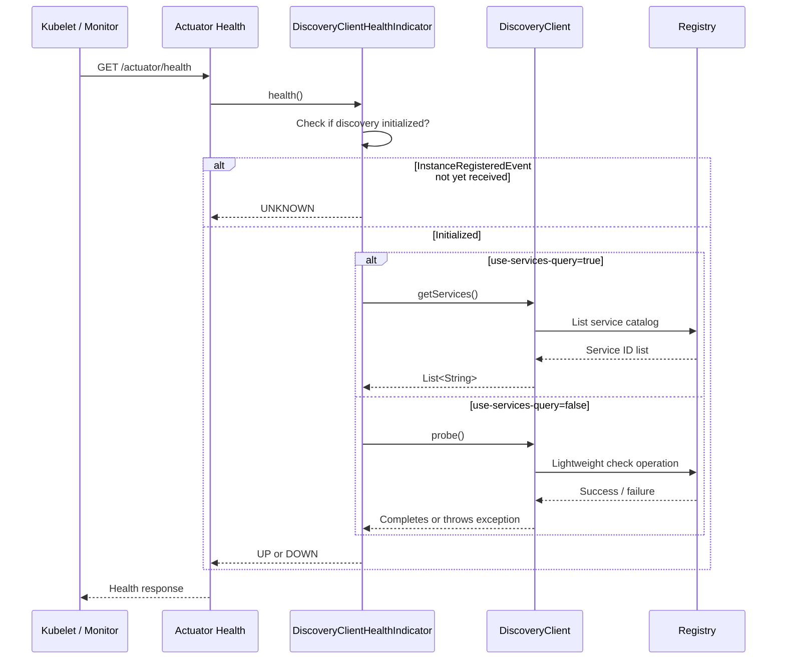

# Reducing Health Check Cost Using probe Instead of Listing Services

## 1. Why Listing All Services Can Make Health Checks Expensive

In microservices systems, each application may register with a service registry and use Spring Cloud `DiscoveryClient` to look up other services. Spring Cloud Commons provides `DiscoveryClientHealthIndicator` to reflect the usability of the discovery client in Spring Boot Actuator.

By default, the health indicator calls `DiscoveryClient.getServices()` on every check. This method returns the list of all service IDs known to the registry. In small environments, the list may have only a few dozen entries. However, on shared platforms with hundreds or thousands of services, querying the catalog can cost network time, data transfer, response deserialization, and collection allocations, while kubelet or monitoring systems may poll the health endpoint continuously.

The goal of this lesson is to use **probe** to check whether the discovery client can communicate with the registry via a lightweight operation, instead of requiring it to list every service on each health check.

There is one important detail to understand before changing the configuration: `DiscoveryClient.probe()` has a default implementation that delegates to `getServices()`. To genuinely reduce cost, the provider must override `probe()` with a lighter operation. Spring Cloud Consul is an example: `getServices()` queries catalog services, whereas `probe()` calls Consul's leader status endpoint.

## 2. `getServices()` and `probe()` Answer Two Different Questions

`DiscoveryClient` is the blocking abstraction in Spring Cloud Commons. The two methods related to health checks serve different purposes:

| Method | Purpose | Data / Result |
| --- | --- | --- |
| `getServices()` | Retrieve all service IDs known to the discovery client | `List<String>` containing service names |
| `probe()` | Check whether the discovery client can still make calls to the backend | `void`; succeeds if no exception is thrown |

For example, a consumer might need to know which services are registered:

```java
List<String> serviceIds = discoveryClient.getServices();
```

This is a catalog query. It is useful for administrative screens, diagnostics, or tasks that genuinely need the service list. It is not necessarily suitable for a health check called many times per minute.

Conversely, a health check typically only needs to know whether the client can reach the discovery backend. It does not need to download the entire service list to answer that question.

### 2.1. The Contract of `probe()`

`DiscoveryClient.probe()` is declared as a default method:

```java
default void probe() {
    getServices();
}
```

The interface Javadoc states: if the call completes without an exception, the client is considered capable of making requests; concrete implementations can override it to use a lighter operation.

This leads to two cases:

- Provider does not override `probe()`: calling `probe()` still executes `getServices()`, so listing cost does not decrease.
- Provider overrides `probe()`: it can check backend status via a lightweight API without loading the catalog.

`probe()` does not return a boolean. When the backend is unavailable, implementations should let an appropriate exception propagate so the health indicator marks it `DOWN`. If an implementation catches and swallows the exception, the health indicator may report `UP` even while the registry is failing.

Examples in this lesson focus on the blocking `DiscoveryClient` and the `void probe()` method. If the application uses `ReactiveDiscoveryClient`, check the contract and reactive health indicator for your exact release train; the reactive API has a different return type and subscription model from the blocking client.

## 3. How `DiscoveryClientHealthIndicator` Works

Spring Cloud Commons auto-configures `DiscoveryClientHealthIndicator` when a `DiscoveryClient` exists and the discovery health indicator is enabled.

Basic flow:

1. Actuator's health endpoint receives a request.
2. `DiscoveryClientHealthIndicator.health()` checks whether the discovery client has been initialized.
3. If `InstanceRegisteredEvent` has not yet been received, the indicator returns status `UNKNOWN`.
4. Once initialized, the indicator obtains the current `DiscoveryClient`.
5. When `use-services-query=true`, the indicator calls `getServices()` and includes the service list in health details.
6. When `use-services-query=false`, the indicator calls `probe()` and omits the service list from details.
7. If the call throws an exception, the indicator returns `DOWN`; if it completes normally, the indicator returns `UP`.



In the current implementation, the `getServices()` branch sets status `UP` once the call succeeds and adds the list to details. It does not mark `DOWN` merely because the list is empty. Therefore, do not use `getServices()` as a check that the registry must contain at least one service.

The `probe()` branch also sets `UP` when the method completes normally. `probe()` tests the client's ability to call the backend; it does not verify that every registered service has healthy instances.

## 4. Enabling Probe Mode via Property

Key property:

`spring.cloud.discovery.client.health-indicator.use-services-query`

| Value | Behavior |
| --- | --- |
| `true` | Default. The health indicator calls `DiscoveryClient.getServices()` and returns the list in details |
| `false` | The health indicator calls `DiscoveryClient.probe()` instead of querying the list |

Configuration example:

```yaml
spring:
  cloud:
    discovery:
      client:
        health-indicator:
          use-services-query: false
```

The current default value is `true`. Setting it to `false` switches the health indicator to the `probe()` call path. Verify whether the discovery provider you use overrides this method with a lighter operation.

You can also explicitly configure related options:

```yaml
spring:
  cloud:
    discovery:
      client:
        health-indicator:
          enabled: true
          include-description: false
          use-services-query: false
        composite-indicator:
          enabled: true
```

Meaning:

| Property | Default | Impact |
| --- | --- | --- |
| `spring.cloud.discovery.client.health-indicator.enabled` | `true` | Enable/disable the generic `DiscoveryClientHealthIndicator` |
| `spring.cloud.discovery.client.health-indicator.include-description` | `false` | Whether to include `DiscoveryClient.description()` in health description |
| `spring.cloud.discovery.client.health-indicator.use-services-query` | `true` | Choose `getServices()` or `probe()` |
| `spring.cloud.discovery.client.composite-indicator.enabled` | `true` | Enable/disable the composite contributor aggregating `DiscoveryHealthIndicator`s |

`include-description=false` avoids putting the description in the health response. This is mainly a response content option; it does not replace choosing probe.

`health-indicator.enabled=false` disables the generic indicator. `composite-indicator.enabled=false` disables the composite contributor aggregating discovery indicators. These two properties control two distinct components; do not confuse them with `use-services-query`.

## 5. Why Changing the Property Alone Might Not Reduce Cost

This is the most critical point during deployment.

Suppose a provider only implements the required methods of `DiscoveryClient` without overriding `probe()`. When configuring:

```yaml
spring:
  cloud:
    discovery:
      client:
        health-indicator:
          use-services-query: false
```

The health indicator calls `probe()`, yet the interface's default method calls `getServices()`. The actual result is still querying the service list.

Therefore, verify both parts:

1. The health indicator configuration is switched to `probe()`.
2. The discovery implementation overrides `probe()` and performs a genuinely lighter request.

Example with Consul:

| Operation | API Called |
| --- | --- |
| `ConsulDiscoveryClient.getServices()` | `ConsulClient.getCatalogServices(...)` |
| `ConsulDiscoveryClient.probe()` | `ConsulClient.getStatusLeader()` |

Querying leader status confirms the Consul client can communicate with the agent/server without downloading the entire service catalog. This is an example of how a provider can implement probe; other providers may use a health endpoint, ping API, or a small metadata request.

## 6. Implementing a Lightweight Probe in Your Own `DiscoveryClient`

If building an internal discovery provider, override `probe()` with a bounded-timeout, low-payload connectivity check API.

Illustrative example:

```java
import java.util.List;

import org.springframework.cloud.client.ServiceInstance;
import org.springframework.cloud.client.discovery.DiscoveryClient;

public final class PlatformDiscoveryClient implements DiscoveryClient {

    private final RegistryApi registryApi;

    public PlatformDiscoveryClient(RegistryApi registryApi) {
        this.registryApi = registryApi;
    }

    @Override
    public String description() {
        return "Platform Registry Discovery Client";
    }

    @Override
    public List<ServiceInstance> getInstances(String serviceId) {
        return registryApi.findInstances(serviceId);
    }

    @Override
    public List<String> getServices() {
        return registryApi.listServices();
    }

    @Override
    public void probe() {
        registryApi.ping();
    }
}
```

In this example, `RegistryApi.ping()` is an API defined by the internal provider. It should send a small request to the registry's status check endpoint and throw an exception if it cannot connect or the backend reports an error.

A minimal contract for that API:

```java
import java.util.List;

import org.springframework.cloud.client.ServiceInstance;

public interface RegistryApi {

    void ping();

    List<ServiceInstance> findInstances(String serviceId);

    List<String> listServices();
}
```

This is code illustrating the integration boundary; the real `RegistryApi` must be implemented using the client SDK of the registry in use.

### 6.1. Principles of a Good Probe

- Do not list all services or instances.
- Do not mutate registry data, register/deregister, or cause side effects.
- Only check dependencies that the discovery client needs to do its job.
- Enforce finite connect/read/request timeouts in the HTTP client or SDK.
- Do not retry repeatedly within a single health check; aggressive retries can amplify incidents.
- Let critical connectivity errors propagate as exceptions so the indicator can return `DOWN`.
- Do not log every successful probe at `INFO` level; health checks are usually called very frequently.
- If the backend has multiple nodes, pick a lightweight API that still adequately represents the operational capability the application needs.

A probe that only checks whether a TCP socket opens may be insufficient if the application also requires authentication, TLS, or the registry API. Conversely, querying the full catalog is usually too heavy for a repeated check. Choose the smallest operation that still verifies the critical communication path.

## 7. Distinguishing Discovery Probe from Overall Application Health

`DiscoveryClient.probe()` only checks the ability to call the discovery backend. It is not an overall health check for the entire application.

| Check | Question |
| --- | --- |
| Discovery probe | Can the application communicate with the discovery backend? |
| Service lookup | Can instances of a specific service ID be retrieved? |
| Provider health check | Is a specific dependency/provider healthy by its own criteria? |
| Application liveness | Is the process/application still in a state where it can keep running? |
| Application readiness | Is the instance ready to accept traffic yet? |

An `UP` discovery probe does not mean every registered service is working. A successful service lookup also does not prove the target service's business API is healthy.

If you need to confirm that a specific essential service can be found, write a dedicated health contributor for that service and call `getInstances("service-id")` with explicit criteria. Do not turn the generic discovery health indicator into a check of the entire topology.

## 8. Using with Kubernetes Liveness and Readiness Probes

Spring Boot Actuator provides health groups for liveness and readiness. In Kubernetes, kubelet polls these endpoints periodically.

- **Liveness** answers whether the application needs to be restarted to recover.
- **Readiness** answers whether the instance should receive traffic at this moment.

Do not place external registry checks into liveness. If Consul/Eureka/Nacos suffers a network issue, Kubernetes could restart application instances en masse even though their processes are still functioning. This can add extra load while the registry is degraded.

For readiness, the decision depends on discovery's role in the request path:

- If the application requires the discovery backend for every critical request and has no cache/fallback, registry unavailability may prevent the instance from serving traffic.
- If the application already has a cached instance list, a fallback, or can continue processing current requests, a brief registry disconnect does not necessarily require taking the instance out of service.
- If the registry is a shared dependency for all replicas, putting it into readiness can stop the entire application from receiving traffic all at once.

By default, Spring Boot does not automatically add external health indicators into liveness/readiness groups. Only add a discovery contributor to readiness when you have explicitly decided that the registry is a mandatory requirement for the instance to serve traffic. Check the actual contributor name in `/actuator/health` before configuring `include`, because it may appear directly or inside the composite discovery contributor.

Basic health groups configuration example:

```yaml
management:
  endpoint:
    health:
      probes:
        enabled: true
      group:
        readiness:
          include: readinessState,discoveryClient
```

The example above merely illustrates adding the `discoveryClient` contributor to readiness. If the application exposes the contributor via `discoveryComposite`, use the exact component ID observed in the health response. Do not add discovery checks to the liveness group.

## 9. Understanding `UNKNOWN`, `UP`, and `DOWN` States

`DiscoveryClientHealthIndicator` tracks the `InstanceRegisteredEvent` event. Before the discovery client is marked initialized, the health indicator returns `UNKNOWN` with description `Discovery Client not initialized`.

After receiving the initialization event:

| Scenario | Typical Result |
| --- | --- |
| `use-services-query=true`, `getServices()` completes | `UP`, with `services` details |
| `use-services-query=false`, `probe()` completes | `UP`, without the services list in details |
| `getServices()` or `probe()` throws an exception | `DOWN` |
| `InstanceRegisteredEvent` not yet received | `UNKNOWN` |

If the application disables auto-registration or the provider does not emit the registration event as in the default flow, inspect the specific lifecycle of your provider and version. Do not rush to conclude the registry is broken just because the indicator stays `UNKNOWN` during startup.

Also distinguish the indicator's `UP` status from service count. In the query branch, the code sets `UP` when the call succeeds even if the list is empty. In the probe branch, the code sets `UP` when the probe completes without throwing an exception.

## 10. Measuring Effectiveness Before and After Switching to Probe

To confirm the change actually lowers cost, observe both latency and request volume to the registry.

Useful metrics:

- Discovery health check duration (p50, p95, p99).
- Number of catalog/list-services requests sent to the registry.
- Number of probe/ping requests sent to the registry.
- Response size and number of returned service IDs while still using `getServices()`.
- Probe error rate and timeout rate.
- Frequency of `/actuator/health` calls from kubelet, load balancers, and monitoring systems.

A simple load model:

`Health checks per second ≈ number of replicas × checks per replica per second`

For example, 60 replicas checked once every 5 seconds produce about 12 health checks per second across the cluster. If each check downloads a large catalog, the registry must process the exact same query repeatedly even when the service list has not changed.

After switching to probe, verify that actual requests changed to the lightweight endpoint. If the provider still calls `getServices()` inside the default `probe()`, latency and catalog load may remain unchanged.

## 11. Testing Probe Configuration and Implementation

Test three things separately: property binding, the health indicator selecting the right method, and the provider overriding `probe()` to perform a lightweight request.

### 11.1. Unit Test for the Provider

Example with a mocked registry API:

```java
import static org.mockito.Mockito.mock;
import static org.mockito.Mockito.verify;
import static org.mockito.Mockito.verifyNoMoreInteractions;

import org.junit.jupiter.api.Test;

class PlatformDiscoveryClientTests {

    @Test
    void probeUsesLightweightRegistryPing() {
        RegistryApi registryApi = mock(RegistryApi.class);
        PlatformDiscoveryClient discoveryClient =
                new PlatformDiscoveryClient(registryApi);

        discoveryClient.probe();

        verify(registryApi).ping();
        verifyNoMoreInteractions(registryApi);
    }
}
```

This test confirms that `probe()` calls ping and does not call `listServices()` or `findInstances()`. In a complete test suite, add a case where `ping()` throws an exception to confirm the error propagates outward.

### 11.2. Testing the Health Indicator Across Both Modes

Write tests for both configurations:

| Configuration | Expectation with Fake `DiscoveryClient` |
| --- | --- |
| `use-services-query=true` | `getServices()` is called; `probe()` is not called |
| `use-services-query=false` | `probe()` is called; `getServices()` is not called directly by the health indicator |
| `probe()` throws exception | Health status is `DOWN` |
| `getServices()` throws exception | Health status is `DOWN` |
| `InstanceRegisteredEvent` not yet published | Health status is `UNKNOWN` |

Note: in `false` mode, if the fake client uses the interface's default implementation, `probe()` will still call `getServices()` internally. Therefore, mock tests should verify both method overriding and downstream calls to the registry API, not just count `probe()` invocations.

### 11.3. Integration Test with Actuator

You can start a Spring Boot test context with:

```java
@SpringBootTest(properties = {
    "spring.cloud.discovery.client.health-indicator.use-services-query=false",
    "management.endpoints.web.exposure.include=health"
})
@AutoConfigureMockMvc
class DiscoveryHealthEndpointTests {
    // Inject MockMvc and a fake DiscoveryClient to test /actuator/health.
}
```

Use a fake provider to control registry responses and avoid depending on a live Consul/Eureka server in regular tests. A separate integration test with Testcontainers can verify the provider's probe works against a real registry version.

## 12. Common Errors and Diagnostics

| Symptom | Possible Cause | Where to Check |
| --- | --- | --- |
| Set `use-services-query=false` yet catalog queries still happen | Provider uses default `probe()` calling `getServices()` | Check whether the implementation class overrides `probe()` |
| Health check is still slow | Probe is still heavy, SDK retries, or timeout is too long | Inspect actual endpoints, request counts, and client timeouts |
| Health status is `DOWN` | Probe threw exception, wrong credentials, TLS, or unreachable backend | Check root cause of exception and provider logs |
| Health status is `UNKNOWN` | `InstanceRegisteredEvent` not received or registration lifecycle incomplete | Check startup sequence and auto-registration |
| Health response still has composite discovery component | Composite contributor is still enabled | Check `spring.cloud.discovery.client.composite-indicator.enabled` and registered contributors |
| `discoveryClient` missing from health response | Generic indicator disabled, no `DiscoveryClient` bean, or contributor inside composite | Check auto-configuration, classpath, and component ID |
| Readiness flips `DOWN` when registry is flaky | Discovery indicator was added to the readiness group | Evaluate whether the registry is truly required to serve traffic |
| Pods continuously restart on registry failure | Liveness depends on external health check | Remove discovery check from liveness; keep liveness reflecting internal app state |

## 13. Production Deployment Checklist

1. Identify where health checks originate: kubelet, load balancer, or monitor.
2. Check whether `getServices()` executes a full catalog query.
3. Set `spring.cloud.discovery.client.health-indicator.use-services-query=false` if you want to use probe.
4. Confirm the provider overrides `DiscoveryClient.probe()` with a lighter API.
5. Configure finite network timeouts for probe.
6. Allow exceptions reflecting connectivity failures to propagate to the health indicator.
7. Do not log successes at INFO level for every probe.
8. Decide independently whether discovery health belongs in readiness.
9. Do not place registry dependencies in liveness if registry outages do not mean the process needs a restart.
10. Measure request count, latency, and error rate before/after changing configuration.
11. Test both disconnected provider scenarios and slow registry response scenarios.
12. Re-verify behavior after upgrading Spring Cloud or switching discovery providers.

## 14. Self-Check Questions

1. Why can `getServices()` be expensive in systems with many services?
2. What is the return type of `DiscoveryClient.probe()` and what is its success convention?
3. Why might `use-services-query=false` not automatically make health checks lighter?
4. How must a provider override `probe()` to avoid downloading the entire service catalog?
5. Which API does Spring Cloud Consul use inside `probe()`?
6. When `getServices()` returns an empty list without throwing an exception, what status does the generic health indicator report?
7. Why might the health indicator return `UNKNOWN` during startup?
8. How does `health-indicator.enabled` differ from `composite-indicator.enabled`?
9. Why should you avoid putting registry dependencies into a Kubernetes liveness probe?
10. Which metrics should be measured to prove probe reduced load?

## 15. Official References

- [Spring Cloud Commons — Common Abstractions, Health Indicators](https://docs.spring.io/spring-cloud-commons/reference/spring-cloud-commons/common-abstractions.html) — configuring `DiscoveryClientHealthIndicator`, `use-services-query`, and composite contributor.
- [Spring Cloud Commons — Configuration Properties](https://docs.spring.io/spring-cloud-commons/reference/configprops.html) — default values and descriptions of health indicator properties.
- [DiscoveryClient.java — Spring Cloud Commons](https://github.com/spring-cloud/spring-cloud-commons/blob/main/spring-cloud-commons/src/main/java/org/springframework/cloud/client/discovery/DiscoveryClient.java) — `probe()` contract and default implementation calling `getServices()`.
- [DiscoveryClientHealthIndicator.java — Spring Cloud Commons](https://github.com/spring-cloud/spring-cloud-commons/blob/main/spring-cloud-commons/src/main/java/org/springframework/cloud/client/discovery/health/DiscoveryClientHealthIndicator.java) — logic selecting `getServices()`/`probe()` and health statuses.
- [ConsulDiscoveryClient.java — Spring Cloud Consul](https://github.com/spring-cloud/spring-cloud-consul/blob/main/spring-cloud-consul-discovery/src/main/java/org/springframework/cloud/consul/discovery/ConsulDiscoveryClient.java) — example overriding probe by querying leader status.
- [Spring Boot Actuator — Endpoints and Kubernetes Probes](https://docs.spring.io/spring-boot/reference/actuator/endpoints.html) — liveness, readiness, and principles for checking external state.

*This document focuses on reducing service catalog query load during health checks. Verify that your provider genuinely has a lightweight probe, measure requests to the registry, and decide independently whether discovery checks should affect readiness.*
