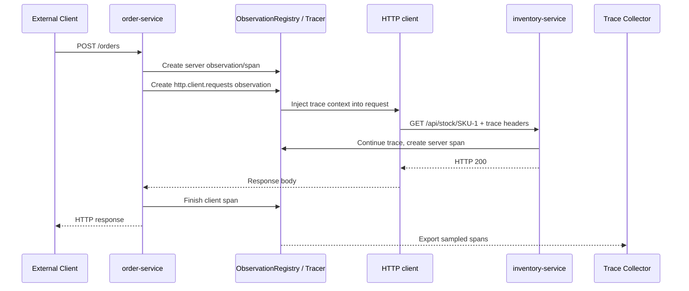

# Tracing Outbound Calls via Spring Boot-Configured Clients

## 1. Why Do Outbound Calls Need Tracing?

In a distributed system, a single request often traverses multiple services. For example, an `order-service` API receives an order creation request, calls `inventory-service` to check stock, and then calls `payment-service` to process payment. If you only inspect logs from each individual application, it is hard to tell where a request slowed down, which service originated an error, or which call failed.

Distributed tracing ties operations belonging to the same request into a single trace. Each service and each HTTP call can create its own span. When a client sends a request to another service, tracing context is propagated via HTTP headers so the target service continues the same trace.

Spring Boot integrates Micrometer Observation and Micrometer Tracing to produce metrics, spans, and correlation IDs. Spring Framework HTTP clients such as `RestClient`, `RestTemplate`, and `WebClient` can create observations for requests/responses. Spring Boot provides builders pre-configured with observation and tracing; Spring Cloud LoadBalancer adds service-ID-to-instance resolution when using load-balanced clients.

This lesson belongs to the **Observability** chapter of the **SPRING_CLOUD_CORE** module. The module focuses on Spring Cloud Commons, Spring Cloud Context, externalized configuration, Spring Boot compatibility, refresh scope, discovery, service registry, service communication, and testing/operating common abstractions.

After this lesson, learners will be able to:

- Distinguish logs, metrics, observations, spans, and traces.
- Explain how Spring Boot configures tracing for HTTP clients.
- Create `RestClient`, `RestTemplate`, or `WebClient` from auto-configured builders.
- Combine `@LoadBalanced` with Spring Boot builders to both resolve service IDs and preserve observation/tracing.
- Understand how trace context is propagated via HTTP headers.
- Read the `http.client.requests` metric and Spring Cloud LoadBalancer metrics.
- Customize observation tags and limit cardinality.
- Test trace propagation across multiple services.
- Diagnose cases where logs exist yet outbound spans are missing.

## 2. Distinguishing Logs, Metrics, Observations, Spans, and Traces

The three pillars of observability are logging, metrics, and traces. They answer different questions:

| Component | Main Question | Example |
| --- | --- | --- |
| Log | What event happened and what are the details? | Order creation request rejected because item is out of stock |
| Metric | How is the system behaving over time? | Error rate, p95 latency, requests per second |
| Observation | What is a measurable and traceable operation? | Duration of an HTTP client exchange |
| Span | What is a specific unit of work within a trace? | Call from order-service to inventory-service |
| Trace | What is the full path of a request across components? | Request flowing through gateway, order, inventory, and payment |

Micrometer Observation is the abstraction bridging metrics and tracing. An observation is handled by `ObservationHandler`s; handlers can create timers/counters and spans depending on configuration. In Spring Boot, `ObservationRegistry` is where components publish observations.

Not every observation becomes an exported span. The outcome depends on handlers, tracers, sampling, and export configuration. Similarly, a metric can still be recorded even when the corresponding trace is not sampled.

### 2.1. Traces and Spans

A trace has a shared `traceId`. Each span has its own `spanId` and can have parent-child relationships with other spans.

Example:

```text
Trace: 4bf92f3577b34da6a3ce929d0e0e4736
|
+-- order-service: HTTP server request
    |
    +-- order-service: validate-order
    |
    +-- order-service: HTTP client -> inventory-service
    |   |
    |   +-- inventory-service: HTTP server request
    |       |
    |       +-- inventory-service: query-stock
    |
    +-- order-service: HTTP client -> payment-service
        |
        +-- payment-service: HTTP server request
            |
            +-- payment-service: authorize-payment
```

A span typically has a start time, duration, operation name, attributes, status, and a link to its parent span. Trace UIs arrange spans chronologically so you can see which operations ran sequentially, which ran in parallel, and where time was spent.

### 2.2. HTTP Client Observations

Spring Framework creates an observation with the default name `http.client.requests` for HTTP clients configured with `ObservationRegistry`. The observation spans the entire exchange, from establishing the connection to reading and deserializing the response body.

When Micrometer Tracing is configured, the HTTP client observation can become a client span. When a metrics registry is present, it also supplies timers and tags for metrics.

## 3. How Spring Boot Configures Tracing for HTTP Clients

### 3.1. Role of Actuator and Micrometer Tracing

Spring Boot Actuator provides dependency management and auto-configuration for Micrometer. For tracing, Boot supports popular tracers such as OpenTelemetry and OpenZipkin Brave.

A typical setup includes these parts:

1. **Actuator/observability infrastructure:** provides `ObservationRegistry`, `MeterRegistry`, and related auto-configurations.
2. **Tracer bridge:** connects Micrometer Tracing to an implementation such as OpenTelemetry or Brave.
3. **Exporter/reporter:** sends spans to a backend or OpenTelemetry Collector.
4. **HTTP client builder:** attaches observation and tracing customizations to clients.
5. **Backend/UI:** stores, searches, and displays traces.

Spring Boot 4.1 provides the OpenTelemetry starter:

```xml
<dependency>
    <groupId>org.springframework.boot</groupId>
    <artifactId>spring-boot-starter-actuator</artifactId>
</dependency>

<dependency>
    <groupId>org.springframework.boot</groupId>
    <artifactId>spring-boot-starter-opentelemetry</artifactId>
</dependency>
```

If the application uses Spring Cloud LoadBalancer, add the corresponding starter:

```xml
<dependency>
    <groupId>org.springframework.cloud</groupId>
    <artifactId>spring-cloud-starter-loadbalancer</artifactId>
</dependency>
```

Spring Boot and Spring Cloud dependencies must be managed with a compatible BOM/release train. Do not manually pin a Micrometer, OpenTelemetry, or Spring Framework version different from your application's dependency management without verifying compatibility.

### 3.2. Configuring Exporters and Sampling

Configuration example for a local environment with OpenTelemetry OTLP/HTTP:

```yaml
spring:
  application:
    name: order-service

management:
  tracing:
    sampling:
      probability: 1.0
    propagation:
      produce:
        - W3C
      consume:
        - W3C
        - B3
        - B3_MULTI
  opentelemetry:
    tracing:
      export:
        otlp:
          endpoint: ${OTEL_EXPORTER_OTLP_TRACES_ENDPOINT:http://localhost:4318/v1/traces}
```

The sampling value in the example is 100% for easy observation during development and testing. Spring Boot defaults to sampling roughly 10% of requests to limit load on the trace backend. In production, choose a rate based on traffic volume, backend capacity, cost, and incident investigation needs.

If using the generic `OTEL_EXPORTER_OTLP_ENDPOINT` environment variable, Spring Boot can automatically map the endpoint and append the `v1/traces` signal path where appropriate. You can configure a dedicated endpoint using `OTEL_EXPORTER_OTLP_TRACES_ENDPOINT`.

Do not place exporter tokens directly in source code or committed configuration files. Supply credentials via a secret manager or secured runtime environment.

### 3.3. What Does Sampling Affect?

`management.tracing.sampling.probability` accepts values from 0.0 to 1.0:

| Value | Meaning |
| --- | --- |
| `0.0` | Sample no new traces under the ratio sampler |
| `0.1` | Sample roughly 10% of new traces |
| `0.5` | Sample roughly 50% of new traces |
| `1.0` | Sample 100% of new traces |

When a parent span exists, parent-based samplers typically preserve the parent's sampling decision for child spans. Thus, if a request arrives from another service, the sampled flag in the incoming context can affect whether outbound spans are recorded.

Sampling decides whether a trace is recorded/exported; it is not the rate of processed requests. Do not use a low sampling rate to mask exporter errors or uninstrumented builders.

## 4. Tracing Flow Through HTTP Clients

Suppose `order-service` calls `inventory-service`:



Main steps:

1. An incoming request to `order-service` creates a server observation/span.
2. When the application calls the HTTP client, the client creates an `http.client.requests` observation.
3. Tracing instrumentation reads the current trace context.
4. The client injects context into HTTP headers in the configured propagation format.
5. The target service extracts context from headers and creates a server span belonging to the same trace.
6. When the response or exception completes, the client span finishes.
7. Spans are sent by the exporter to the backend if the trace is sampled.

There is no need to manually generate a new trace ID for each HTTP call. The goal is to preserve the link between the parent request and downstream operations.

## 5. Creating RestClient from Boot-Configured Builders

### 5.1. Why Use RestClient.Builder?

Spring Boot provides a `RestClient.Builder` bean pre-configured with necessary customizers. Among them is instrumentation for observation and tracing when the corresponding dependencies are present.

Example:

```java
import org.springframework.context.annotation.Bean;
import org.springframework.context.annotation.Configuration;
import org.springframework.web.client.RestClient;

@Configuration(proxyBeanMethods = false)
class HttpClientConfiguration {

    @Bean
    RestClient partnerRestClient(RestClient.Builder builder) {
        return builder
                .baseUrl("https://partner.example")
                .build();
    }
}
```

Here, the application injects the builder provided by Spring Boot, sets the base URL, and builds the client. The builder carries the customizers configured in the application context.

Do not create clients using standalone `RestClient.create()` or `RestClient.builder()` in business code and expect them to automatically receive all of Boot's instrumentation. When creating a builder manually, the application must apply the necessary configurers/customizers.

### 5.2. Using the Client in a Service

```java
import org.springframework.stereotype.Component;
import org.springframework.web.client.RestClient;

@Component
class PartnerClient {

    private final RestClient restClient;

    PartnerClient(RestClient.Builder builder) {
        this.restClient = builder
                .baseUrl("https://partner.example")
                .build();
    }

    PartnerStatus getStatus() {
        return restClient.get()
                .uri("/api/status")
                .retrieve()
                .body(PartnerStatus.class);
    }
}
```

When calling `getStatus()`, the HTTP client observation can record method, URI template, client name, status, outcome, and error. Tracing instrumentation can create a client span and inject context into the request.

Do not instantiate a new client on every call unless there is a special requirement. Creating the client once per application lifecycle reuses the request factory, connection pool, and configuration.

## 6. Combining RestClient with Spring Cloud LoadBalancer

### 6.1. Why Is RestClientBuilderConfigurer Needed?

In Spring Cloud, `@LoadBalanced` marks a builder so the client uses a service ID instead of a physical hostname. When creating a new builder for LoadBalancer manually, skipping `RestClientBuilderConfigurer` can leave the builder missing the customizers Spring Boot uses to install observability.

Spring Cloud Commons advises using Boot's configurer when declaring a `@LoadBalanced RestClient.Builder`. The following configuration keeps Boot's defaults while letting Spring Cloud add LoadBalancer integration:

```java
import org.springframework.boot.restclient.autoconfigure.RestClientBuilderConfigurer;
import org.springframework.cloud.client.loadbalancer.LoadBalanced;
import org.springframework.context.annotation.Bean;
import org.springframework.context.annotation.Configuration;
import org.springframework.web.client.RestClient;

@Configuration(proxyBeanMethods = false)
class LoadBalancedRestClientConfiguration {

    @Bean
    @LoadBalanced
    RestClient.Builder loadBalancedRestClientBuilder(
            RestClientBuilderConfigurer configurer) {
        return configurer.configure(RestClient.builder());
    }
}
```

The `spring-cloud-starter-loadbalancer` dependency must be on the classpath. The URI uses a service ID such as `http://inventory-service`; LoadBalancer picks a `ServiceInstance` and resolves it to a physical address.

### 6.2. Calling a Service ID

```java
import org.springframework.cloud.client.loadbalancer.LoadBalanced;
import org.springframework.stereotype.Component;
import org.springframework.web.client.RestClient;

@Component
class InventoryClient {

    private final RestClient restClient;

    InventoryClient(
            @LoadBalanced RestClient.Builder builder) {
        this.restClient = builder
                .baseUrl("http://inventory-service")
                .build();
    }

    StockView getStock(String sku) {
        return restClient.get()
                .uri("/api/stock/{sku}", sku)
                .retrieve()
                .body(StockView.class);
    }
}
```

Here two independent processing layers work together:

- Spring Cloud LoadBalancer selects an instance from discovery and replaces the service ID with a physical URI.
- Spring Boot/Spring Framework observation records the HTTP exchange and tracing instrumentation propagates context across the request.

A load-balanced client whose builder drops Boot customizers may resolve service IDs fine yet fail to produce outbound traces as expected. Conversely, a client with tracing but without LoadBalancer can only handle URLs that the HTTP transport can resolve directly.

### 6.3. Using RestTemplate When Applications Still Use Blocking Legacy APIs

Spring Boot still provides `RestTemplateBuilder`. When combining with Spring Cloud LoadBalancer, you can create a qualified builder using `RestTemplateBuilderConfigurer`:

```java
import org.springframework.boot.restclient.autoconfigure.RestTemplateBuilderConfigurer;
import org.springframework.boot.restclient.RestTemplateBuilder;
import org.springframework.cloud.client.loadbalancer.LoadBalanced;
import org.springframework.context.annotation.Bean;
import org.springframework.context.annotation.Configuration;

@Configuration(proxyBeanMethods = false)
class LoadBalancedRestTemplateConfiguration {

    @Bean
    @LoadBalanced
    RestTemplateBuilder loadBalancedRestTemplateBuilder(
            RestTemplateBuilderConfigurer configurer) {
        return configurer.configure(new RestTemplateBuilder());
    }
}
```

Inject this builder to create `RestTemplate`:

```java
@Component
class LegacyInventoryClient {

    private final RestTemplate restTemplate;

    LegacyInventoryClient(
            @LoadBalanced RestTemplateBuilder builder) {
        this.restTemplate = builder.build();
    }

    StockView getStock(String sku) {
        return restTemplate.getForObject(
                "http://inventory-service/api/stock/{sku}",
                StockView.class,
                sku
        );
    }
}
```

Do not call `new RestTemplate()` elsewhere and expect it to automatically receive instrumentation. If the application creates its own builder or client, apply the appropriate configurer/customizer for your Boot version.

## 7. WebClient and Reactive Calls

For reactive applications, Spring Boot provides a `WebClient.Builder` pre-configured with observation. When service discovery/load balancing is needed, the application must declare a `@LoadBalanced` builder and apply the `WebClientCustomizer`s provided by Boot:

```java
import org.springframework.beans.factory.ObjectProvider;
import org.springframework.boot.webclient.WebClientCustomizer;
import org.springframework.cloud.client.loadbalancer.LoadBalanced;
import org.springframework.context.annotation.Bean;
import org.springframework.context.annotation.Configuration;
import org.springframework.web.reactive.function.client.WebClient;

@Configuration(proxyBeanMethods = false)
class LoadBalancedWebClientConfiguration {

    @Bean
    @LoadBalanced
    WebClient.Builder loadBalancedWebClientBuilder(
            ObjectProvider<WebClientCustomizer> customizers) {
        WebClient.Builder builder = WebClient.builder();
        customizers.orderedStream().forEach(customizer -> customizer.customize(builder));
        return builder;
    }
}
```

Applying the customizers preserves Boot's observation settings before Spring Cloud adds the LoadBalancer filter.

Reactive client example:

```java
@Component
class ReactiveInventoryClient {

    private final WebClient webClient;

    ReactiveInventoryClient(
            @LoadBalanced WebClient.Builder builder) {
        this.webClient = builder
                .baseUrl("http://inventory-service")
                .build();
    }

    Mono<StockView> getStock(String sku) {
        return webClient.get()
                .uri("/api/stock/{sku}", sku)
                .retrieve()
                .bodyToMono(StockView.class);
    }
}
```

With custom builders, apply Boot-provided `WebClientCustomizer`s before building. Spring Cloud Commons can add the LoadBalancer exchange filter function to the load-balanced builder. Never call `block()` on an event loop to get a synchronous result; keep requests inside the Reactor pipeline so context propagation works properly.

## 8. Trace Context Propagation via HTTP Headers

### 8.1. W3C Trace Context

By default, Spring Boot propagates trace context using W3C. The common header is `traceparent`, formatted as:

```text
traceparent: 00-4bf92f3577b34da6a3ce929d0e0e4736-00f067aa0ba902b7-01
```

The header contains version, trace ID, parent span ID, and trace flags. Receiving services can continue the trace if they use compatible instrumentation.

Spring Boot can also consume B3 and B3 multi-header formats. Propagation settings must be aligned across services and gateways in the system.

### 8.2. Configuring Propagation

You can configure which context formats are produced and which are consumed:

```yaml
management:
  tracing:
    propagation:
      produce:
        - W3C
      consume:
        - W3C
        - B3
        - B3_MULTI
```

If the entire system has standardized on W3C, only produce/consume W3C. If legacy services still use B3, you can consume that format during migration.

Never manually overwrite `traceparent` or B3 headers inside business interceptors. Context creation, injection, and extraction should be managed by tracing instrumentation to avoid breaking parent-child links or generating fake traces.

### 8.3. Baggage and Correlation IDs

Baggage is small metadata propagated alongside tracing context, such as tenant class or deployment region. Only put controlled, non-sensitive attributes that must travel across multiple services into baggage.

Never put access tokens, passwords, emails, phone numbers, order payloads, or personal data into baggage. Baggage can cross many boundaries and increases data exposure risk.

Spring Boot puts `traceId` and `spanId` into the logging context when Micrometer Tracing is active. Logs can include the correlation ID to locate lines belonging to the same trace. To change the correlation ID format, use `logging.pattern.correlation` instead of generating trace IDs manually in code.

## 9. HTTP Client Observations and the http.client.requests Metric

### 9.1. Low-Cardinality Fields

The default `http.client.requests` observation has key low-cardinality keys:

| Key | Meaning |
| --- | --- |
| `method` | HTTP method, e.g., GET or POST |
| `uri` | URI template if available; excludes scheme, host, and port |
| `client.name` | Client name derived from the host in the request URI |
| `status` | HTTP status, IO_ERROR, or CLIENT_ERROR |
| `outcome` | Exchange outcome |
| `error` | Exception class name or none |

Low-cardinality tags have a bounded set of values, making them suitable for metric dimensions. Examples are `method=GET` or `status=200`.

### 9.2. High-Cardinality Fields

The `http.url` field is high-cardinality and goes into traces; it should not be used as a metric tag with an unbounded set of values.

For example, paths `/orders/10001`, `/orders/10002`, `/orders/10003` generate many distinct values. Putting every order ID into a metric label can cause time-series counts to explode rapidly.

Prefer using URI templates:

```java
restClient.get()
        .uri("/api/orders/{orderId}", orderId)
        .retrieve()
        .body(OrderView.class);
```

This call style preserves the `/api/orders/{orderId}` template so observation can record a stable URI when supported by the client. With `RestTemplate`, overloads accepting a URI template and path variables are equally important.

Never record raw query strings containing tokens or sensitive data in traces. High-cardinality data living only in traces does not exempt it from data-protection policies.

## 10. Spring Cloud LoadBalancer Metrics

Spring Cloud LoadBalancer includes `MicrometerStatsLoadBalancerLifecycle`. When enabled and a `MeterRegistry` is present, it provides these meters:

| Meter | Type | Meaning |
| --- | --- | --- |
| `loadbalancer.requests.active` | Gauge | Number of active load-balanced requests |
| `loadbalancer.requests.success` | Timer | Duration of requests ending with a response handed to the HTTP client |
| `loadbalancer.requests.failed` | Timer | Duration of requests ending with an exception |
| `loadbalancer.requests.discard` | Counter | Number of requests that could not obtain an instance to call |

Enable statistics:

```yaml
spring:
  cloud:
    loadbalancer:
      stats:
        micrometer:
          enabled: true
        include-path: false
```

A `MeterRegistry` is required, usually provided when using Spring Boot Actuator and an appropriate metrics registry. The full property is `spring.cloud.loadbalancer.stats.include-path`; setting `false` avoids putting paths with varying IDs into URI tags.

With `RestTemplate`, LoadBalancer does not always have a URI template, so it may use the full path as a tag. With `RestClient` and `WebClient`, URI templates may be available to produce more stable tags. Check cardinality before enabling path tags on high-traffic systems.

### 10.1. Distinguishing HTTP Client Metrics from LoadBalancer Metrics

| Metric Family | What It Measures | Used to Answer |
| --- | --- | --- |
| `http.client.requests` | HTTP exchange from connection through reading body | Did the HTTP client call succeed or error? Which status? What latency? |
| `loadbalancer.requests.*` | Instance selection and request handoff lifecycle via LoadBalancer | Was an instance obtained? Which instance was picked? How did the load-balanced request end? |

These two metric families inspect two different layers. Do not sum or compare their durations as two independent time slices if one metric encompasses the duration of the other.

## 11. Customizing Business Observations

HTTP client observations report protocol details. Sometimes you need a business span wrapping an entire operation, such as `inventory.lookup` or `payment.authorize`.

You can create an observation using `ObservationRegistry`:

```java
import io.micrometer.observation.Observation;
import io.micrometer.observation.ObservationRegistry;

import org.springframework.stereotype.Component;
import org.springframework.web.client.RestClient;

@Component
class InventoryLookup {

    private final RestClient restClient;
    private final ObservationRegistry observationRegistry;

    InventoryLookup(
            RestClient.Builder builder,
            ObservationRegistry observationRegistry) {
        this.restClient = builder
                .baseUrl("http://inventory-service")
                .build();
        this.observationRegistry = observationRegistry;
    }

    StockView find(String sku) {
        return Observation.createNotStarted(
                        "inventory.lookup",
                        observationRegistry
                )
                .lowCardinalityKeyValue("service", "inventory-service")
                .observe(() -> restClient.get()
                        .uri("/api/stock/{sku}", sku)
                        .retrieve()
                        .body(StockView.class));
    }
}
```

The business observation becomes the parent span of the HTTP client observation. The `service` tag has a small set of values, suitable for low-cardinality. Never put SKU or order ID into a low-cardinality key.

If you only need a span without metrics, consider the lower-level Tracer API. For most cases, the Observation API lets you use a single model for both metrics and traces.

### 11.1. Custom Observation Conventions

You can use `ClientRequestObservationConvention` to customize the default observation name or key-values. When writing a custom convention:

- Retain standard keys if dashboards/backends depend on them.
- Only add low-cardinality tags with a finite value set.
- Place unbounded values into high-cardinality trace attributes only when genuinely needed.
- Never add payloads, credentials, or PII.
- Keep tag naming stable and consistent across services.

For global changes, consider `ObservationRegistryCustomizer`, `ObservationFilter`, `ObservationPredicate`, or an appropriate convention bean instead of attaching interceptors to each client manually.

## 12. Context Propagation Across Threads and Reactive Pipelines

Tracing context is normally held in the active execution context. When work switches to another thread or a reactive pipeline, the context must be propagated using an appropriate mechanism.

### 12.1. @Async and Executors

For `@Async` and `AsyncTaskExecutor` auto-configured by Spring Boot, you can enable propagation:

```yaml
spring:
  task:
    execution:
      propagate-context: true
```

If the application configures custom executors, you can use `ContextPropagatingTaskDecorator`:

```java
import org.springframework.context.annotation.Bean;
import org.springframework.context.annotation.Configuration;
import org.springframework.core.task.support.ContextPropagatingTaskDecorator;

@Configuration(proxyBeanMethods = false)
class TaskContextConfiguration {

    @Bean
    ContextPropagatingTaskDecorator contextPropagatingTaskDecorator() {
        return new ContextPropagatingTaskDecorator();
    }
}
```

Attach the decorator to application-created executors. Do not assume ThreadLocals propagate automatically across arbitrary thread pools or custom executors.

### 12.2. Reactor Context

In reactive applications, the Reactor context is the right place to preserve tracing context across operators. Spring Boot supports automatic propagation via:

```yaml
spring:
  reactor:
    context-propagation: auto
```

When a client returns `Mono` or `Flux`, compose the pipeline instead of calling `block()` inside the event loop. If an operator spawns threads or switches schedulers, test propagation inside the real pipeline.

## 13. Testing Outbound Tracing

Tests should verify multiple layers separately:

1. The client is built from the configured builder.
2. The HTTP observation is recorded.
3. Trace context is injected into the request.
4. The target service extracts context and continues the trace.
5. The exporter sends spans to a test backend or test exporter when tests verify export.

### 13.1. Integration Test with a Mock HTTP Server

Use a mock server or WireMock to inspect actual requests:

- Start the application context with tracing enabled and 100% sampling in tests.
- Build the HTTP client from the injected builder.
- Call a mocked endpoint.
- Verify the request includes the expected propagation header, such as `traceparent`.
- Check response/status and exception paths.
- Verify observations are created via a test observation handler or suitable registry.
- Shut down the mock server and context after the test.

Do not hard-code a random trace ID to assert a fixed value. Verify format, presence, and proper trace/parent relationships instead.

### 13.2. Service-to-Service Testing

You can spin up two test applications:

- Service A receives a request and calls Service B using the configured client builder.
- Service B records trace context from the incoming request.
- The test verifies that trace IDs in A and B match, span IDs differ, and parent-child relationships are accurate.
- When calling via LoadBalancer, verify the service ID is resolved and the request reaches a registered test instance.

Unit tests mocking the HTTP client only verify method invocation logic. They do not prove header propagation, request factory instrumentation, or LoadBalancer integration work.

### 13.3. Notes for Spring Boot Tests

Some exporter/tracer reporting components may not initialize the same way as production when using test slices or `@SpringBootTest`. If the goal is testing propagation, use a test handler/recorder to verify spans and headers. If the goal is testing export, configure a test exporter or controlled mock collector.

Never force tests to send traces to a production collector. Tests should isolate endpoints and credentials.

## 14. Diagnosing Missing Outbound Spans

| Symptom | Possible Cause | Where to Check |
| --- | --- | --- |
| Server span exists but no client span | Client created with `new` or builder lacks observation registry | Use Boot's auto-configured builder or configurer |
| HTTP metrics exist but no traces | Missing Micrometer Tracing bridge/exporter or sampling skips trace | Check tracer dependencies, sampling, and export |
| Span exists yet lacks parent | Context was not propagated across thread/reactive boundary | Check executor decorator and Reactor context |
| Target service starts a new trace | Incompatible propagation headers or stripped by proxy | Inspect `traceparent`/B3 on actual requests |
| External URLs are traced, internal services are not | Custom load-balanced builder dropped Boot customizers | Use `RestTemplateBuilderConfigurer` or `RestClientBuilderConfigurer` |
| Request runs yet no span appears in backend | Trace was not sampled or exporter failed | Check sampling, collector endpoint, queue/export logs |
| Metrics have too many series | Tags contain varying paths/IDs or query parameters | Use URI templates and disable LoadBalancer path tags |
| Span contains sensitive data | Convention, baggage, or instrumentation logs raw URL/headers | Strip sensitive data and restrict attributes |
| Logs lack correlation ID | Logging pattern or context propagation not working | Check MDC, tracer, and executor context |

### 14.1. Step-by-Step Debug Checklist

1. Confirm Actuator and tracer implementation dependencies are on the runtime classpath.
2. Check that suitable `ObservationRegistry` and `MeterRegistry` beans exist.
3. Confirm the client was created from a Boot-supplied builder.
4. If the client is load-balanced, confirm the builder was built using Boot's configurer.
5. Check whether the `http.client.requests` metric is recorded.
6. Check trace sampling probability and sampler settings.
7. Inspect whether outbound requests carry propagation headers.
8. Check whether the target service extracts headers and creates a server span.
9. Check exporter/collector and query by exact service name, trace ID, and time range.
10. Check async/reactive context propagation if requests cross thread boundaries.

## 15. Common Design and Operational Mistakes

- **Creating clients manually:** `new RestClient()`, `RestClient.create()`, or `new RestTemplate()` do not automatically receive all auto-configured tracing customizers.
- **Losing Boot customizers when adding LoadBalancer:** load-balanced builders must be configured with Boot configurers/customizers.
- **Following outdated Sleuth guides:** modern Spring Boot applications use Micrometer Tracing; do not copy Sleuth properties or starters from old release trains.
- **100% sampling in production:** can generate huge span volume, increasing collector and storage costs.
- **Using raw URLs as metric tags:** causes cardinality spikes by ID, query string, or path.
- **Passing sensitive data via baggage:** baggage can traverse many service boundaries.
- **Adding trace IDs to headers manually:** easily breaks parent-child links or produces fragmented traces.
- **Looking only at LoadBalancer metrics:** instance selection metrics do not replace HTTP client observations and tracing spans.
- **Treating 5xx status as an exception at every layer:** HTTP 5xx responses and transport errors are distinct states; observe status, outcome, and error together.
- **Neglecting context propagation checks:** tracing can break when crossing executors, threads, or reactive contexts.

## 16. Pre-Deployment Checklist

1. Are Actuator and Micrometer Tracing configured with compatible versions?
2. Are the tracer implementation and exporter/backend explicitly chosen?
3. Is the sampling rate appropriate for traffic and cost?
4. Are outbound clients built from Boot's auto-configured builders?
5. Do load-balanced clients preserve Boot customizers via configurers?
6. Are propagation formats compatible across services?
7. Do `http.client.requests` metrics and trace spans exist for outbound exchanges?
8. Are LoadBalancer statistics enabled if instance selection needs observation?
9. Are URI templates and low-cardinality tags controlled?
10. Do baggage and span attributes avoid sensitive data?
11. Is context propagated across `@Async`, executors, and Reactor pipelines?
12. Do integration tests verify header propagation and trace continuity across two services?
13. Are dashboards/alerts in place for latency, error rates, discarded load-balanced requests, and missing traces?
14. Are trace backend access permissions and data retention limits properly restricted?

## 17. Official References

- [Spring Boot — Tracing](https://docs.spring.io/spring-boot/reference/actuator/tracing.html): tracer implementations, sampling, propagation, correlation IDs, and outbound trace propagation via builders.
- [Spring Boot — Observability](https://docs.spring.io/spring-boot/reference/actuator/observability.html): ObservationRegistry, context propagation, common tags, predicates, and handlers.
- [Spring Boot — Metrics](https://docs.spring.io/spring-boot/reference/actuator/metrics.html): configuring Micrometer registries and HTTP client instrumentation.
- [Spring Framework — Observability Support](https://docs.spring.io/spring-framework/reference/integration/observability.html): `http.client.requests`, HTTP client keys, ObservationConvention, and ObservationRegistry.
- [Spring Cloud Commons — Common Abstractions](https://docs.spring.io/spring-cloud-commons/reference/spring-cloud-commons/common-abstractions.html): `@LoadBalanced`, builder configurers, and RestClient/RestTemplate/WebClient integration.
- [Spring Cloud LoadBalancer](https://docs.spring.io/spring-cloud-commons/reference/spring-cloud-commons/loadbalancer.html): LoadBalancerLifecycle, Micrometer statistics, and cardinality control.
- [RestClientBuilderConfigurer API — Spring Boot 4.1.2](https://docs.spring.io/spring-boot/api/java/org/springframework/boot/restclient/autoconfigure/RestClientBuilderConfigurer.html): configuring builders according to Spring Boot defaults/customizers.
- [RestTemplateBuilderConfigurer API — Spring Boot 4.1.2](https://docs.spring.io/spring-boot/api/java/org/springframework/boot/restclient/autoconfigure/RestTemplateBuilderConfigurer.html): configuring RestTemplateBuilder according to auto-configuration infrastructure.
- [WebClientCustomizer API — Spring Boot 4.1.2](https://docs.spring.io/spring-boot/api/java/org/springframework/boot/webclient/WebClientCustomizer.html): applying observation and other customizers to WebClient.Builder.

**Key takeaway:** To trace outbound calls across services, create HTTP clients from Spring Boot-configured builders. If the client also uses Spring Cloud LoadBalancer, apply Boot's configurer when creating the load-balanced builder to preserve observation and tracing instrumentation. HTTP client observations then record the exchange, tracing propagates context over the network, and LoadBalancer metrics report instance selection.
