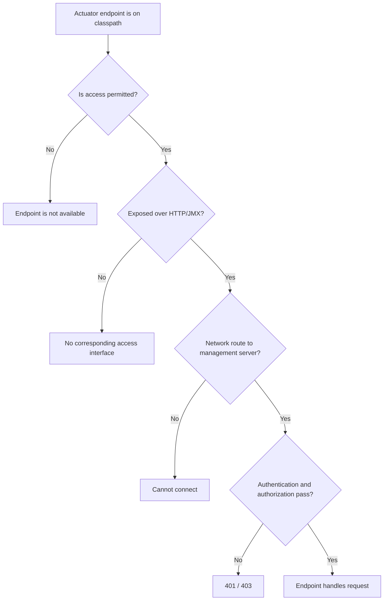

# Limiting Enabled and Exposed Management Endpoints

## 1. Why Limit Management Endpoints?

Spring Boot Actuator and Spring Cloud modules provide endpoints to observe, diagnose, and control applications. For example:

- `health`: application health status.
- `info`: application information.
- `env` and `configprops`: Environment details and bound configuration properties.
- `beans`, `conditions`, `mappings`: internal structure of the ApplicationContext.
- `loggers`: read and modify log levels.
- `refresh`: trigger configuration reload and bean refresh.
- `serviceregistry`: read or change service registration status.
- `busrefresh`: broadcast a refresh request over Spring Cloud Bus when the Bus module is used.
- `shutdown`: trigger application shutdown.

These endpoints assist with system operations, but some can expose configuration, bean names, topology, infrastructure details, or allow modifying runtime state. If exposed broadly, they can become unintended administrative access paths.

The goal of this lesson is to design a small, controlled management surface. Readers will learn how to distinguish between enabled endpoints, endpoints exposed over HTTP/JMX, and endpoints permitted by Spring Security, as well as how to test the actual runtime configuration rather than only inspecting YAML files.

## 2. Three Layers That Determine Whether an Endpoint Can Be Used

An Actuator endpoint does not automatically mean an accessible URL exists. Three layers must be distinguished:

1. **Endpoint access:** whether the endpoint is permitted to operate, and at what level.
2. **Exposure:** which technology the endpoint is exposed over, such as HTTP or JMX.
3. **Network and security:** whether a request reaches the management server and passes authentication/authorization.

Spring Boot considers an endpoint available when access is permitted and the endpoint is exposed. After that, an HTTP request must still pass through the security filter chain and network layers.



For example, `management.endpoint.env.access=unrestricted` only permits the `env` endpoint to operate. If `env` is not listed in `management.endpoints.web.exposure.include`, the `/actuator/env` HTTP URL is still not created. Conversely, exposing `env` does not automatically grant access to users if Spring Security requires a role.

## 3. Access: Enabling Endpoints and Restricting Operations

### 3.1. Access Levels in Current Spring Boot

Starting with Spring Boot 3.4, the access level mechanism is the primary way to configure whether an endpoint is permitted to operate. Use:

- `management.endpoint.<id>.access`: access level for a single endpoint.
- `management.endpoints.access.default`: default access level for all endpoints.
- `management.endpoints.access.max-permitted`: maximum access limit applied across the entire application.

Three commonly used levels:

| Level | Meaning |
| --- | --- |
| `none` | Do not permit access to the endpoint |
| `read-only` | Permit read operations only |
| `unrestricted` | Permit all operations provided by the endpoint |

By default, all endpoints are unrestricted, except `shutdown` and `heapdump`. These two endpoints are restricted by default due to their impact or the data they provide.

For example, allow only the `health` and `info` endpoints to exist:

```yaml
management:
  endpoints:
    access:
      default: none
  endpoint:
    health:
      access: read-only
    info:
      access: read-only
```

With this configuration, all other endpoints are excluded from the ApplicationContext. This differs from simply hiding URLs over HTTP: an endpoint with `none` access is no longer active in the context.

### 3.2. Setting a Maximum Limit with max-permitted

`management.endpoints.access.max-permitted` sets a ceiling on access permissions. This value takes precedence over both the default access and per-endpoint access settings.

```yaml
management:
  endpoints:
    access:
      default: unrestricted
      max-permitted: read-only
  endpoint:
    loggers:
      access: unrestricted
```

Even though `loggers` is configured as `unrestricted`, the `max-permitted: read-only` limit only allows read operations. The endpoint cannot change log levels via write operations.

You can set `max-permitted: none` to disable all endpoints. However, consider any probes required by the deployment platform before applying it.

### 3.3. Access Levels and HTTP Operations

For endpoints of type `@Endpoint`, `@JmxEndpoint`, and `@WebEndpoint`:

- Read access corresponds to `@ReadOperation` methods.
- Write access corresponds to `@WriteOperation` methods.
- Delete access corresponds to `@DeleteOperation` methods.

For `@ControllerEndpoint` or `@RestControllerEndpoint`, read-only corresponds to mappings handling `GET` and `HEAD`. Mappings that modify state require a higher access level.

Therefore, `read-only` is useful when you only want operators to view logger configurations or status without allowing modifications.

### 3.4. Legacy enabled Properties

Spring Boot versions prior to 3.4 commonly used `management.endpoint.<id>.enabled` and `management.endpoints.enabled-by-default`. In current Spring Boot versions, these properties are deprecated in favor of access levels.

When upgrading an application, do not mix the two models. Use `access` for newer versions and check the documentation for the exact Boot version your application runs.

## 4. Exposure: Exposing Endpoints Over HTTP and JMX

Access determines whether an endpoint is permitted to exist; exposure determines whether the endpoint is exposed over a specific technology.

By default, Spring Boot only exposes `health` over HTTP and JMX. Other endpoints do not automatically gain a URL or MBean merely because the Actuator dependency is on the classpath. The controlling properties are `management.endpoints.web.exposure.include`, `management.endpoints.web.exposure.exclude`, `management.endpoints.jmx.exposure.include`, and `management.endpoints.jmx.exposure.exclude`.

### 4.1. HTTP Allowlist

Use an allowlist to expose only the endpoints that are actually needed:

```yaml
management:
  endpoints:
    web:
      exposure:
        include:
          - health
          - info
          - prometheus
```

In this example, HTTP only exposes three endpoints: `health`, `info`, and `prometheus`. The `prometheus` endpoint requires the corresponding Micrometer Prometheus registry on the classpath.

### 4.2. Exclude Always Takes Precedence Over Include

You can combine include and exclude:

```yaml
management:
  endpoints:
    web:
      exposure:
        include: "*"
        exclude:
          - env
          - beans
          - configprops
          - shutdown
```

`exclude` takes higher precedence than `include`. Even when include contains `*`, excluded endpoints are still not exposed over HTTP.

In YAML, the `*` character has special meaning and must be quoted. Do not use `include: "*"` as a production default without evaluating every endpoint.

### 4.3. HTTP and JMX Are Two Independent Exposures

Disabling HTTP exposure does not mean JMX is also disabled. If an endpoint is exposed over JMX, anyone authorized to connect via JMX can still invoke the corresponding MBean. The two JMX properties are `management.endpoints.jmx.exposure.include` and `management.endpoints.jmx.exposure.exclude`; they are independent of `management.endpoints.web.exposure.*`.

For example, expose only `health` over HTTP while allowing `health` and `info` over JMX:

```yaml
management:
  endpoints:
    web:
      exposure:
        include:
          - health
    jmx:
      exposure:
        include:
          - health
          - info
```

If JMX remote management is not used, consider disabling or restricting JMX exposure per deployment environment. You also need to secure the JMX port at the JVM, network, and authentication layers; exposure properties do not replace JMX protocol security.

## 5. Spring Cloud Endpoints Also Follow Actuator Rules

Spring Cloud Context and Commons add their own endpoints. When the corresponding dependency is present and the endpoint is auto-configured, they still follow Actuator access and exposure rules.

| Endpoint ID | Function | Notable Operations |
| --- | --- | --- |
| `refresh` | Reload Environment and refresh beans in the current instance | POST |
| `features` | List recognized Spring Cloud features | GET |
| `serviceregistry` | View or modify registration status | GET, POST |
| `busrefresh` | Broadcast refresh event over Spring Cloud Bus | POST |

Not every application has all of these endpoints. They depend on the modules and configured beans. For example, `busrefresh` only appears when the appropriate Spring Cloud Bus integration is present.

For example, allow reading `features`, `health`, and `info`, without exposing control endpoints:

```yaml
management:
  endpoints:
    web:
      exposure:
        include:
          - health
          - info
          - features
```

If `refresh` is needed in an internal environment, expose it explicitly and require an administrative role. Do not place `refresh`, `busrefresh`, `serviceregistry`, or `shutdown` on a public allowlist just for operational convenience.

## 6. SecurityFilterChain: HTTP Authentication and Authorization

Exposure is not authentication. When Spring Security is on the classpath and the application does not declare its own `SecurityFilterChain`, Spring Boot auto-configures protection for Actuator endpoints other than `health`.

If the application declares any `SecurityFilterChain` bean, Boot's Actuator security auto-configuration backs off. In that case, the application must define rules for both Actuator and the remaining requests.

### 6.1. Separating Security Chains for Actuator and Application

The example below uses Spring Boot 4.1.2 APIs. `EndpointRequest.toAnyEndpoint()` matches only Actuator endpoints; the second chain handles all other requests.

```java
import org.springframework.boot.security.autoconfigure.actuate.web.servlet.EndpointRequest;
import org.springframework.context.annotation.Bean;
import org.springframework.context.annotation.Configuration;
import org.springframework.core.annotation.Order;
import org.springframework.security.config.Customizer;
import org.springframework.security.config.annotation.web.builders.HttpSecurity;
import org.springframework.security.web.SecurityFilterChain;

@Configuration(proxyBeanMethods = false)
public class ManagementSecurityConfiguration {

    @Bean
    @Order(1)
    SecurityFilterChain actuatorSecurity(HttpSecurity http) throws Exception {
        http.securityMatcher(EndpointRequest.toAnyEndpoint())
            .authorizeHttpRequests(authorize -> authorize
                .requestMatchers(EndpointRequest.to("health")).permitAll()
                .anyRequest().hasRole("ACTUATOR_ADMIN")
            )
            .httpBasic(Customizer.withDefaults());

        return http.build();
    }

    @Bean
    @Order(2)
    SecurityFilterChain applicationSecurity(HttpSecurity http) throws Exception {
        http.authorizeHttpRequests(authorize -> authorize
            .anyRequest().authenticated()
        ).httpBasic(Customizer.withDefaults());

        return http.build();
    }
}
```

The first chain allows reading `health` without logging in; all other Actuator endpoints, including `info`, require the `ACTUATOR_ADMIN` role. The second chain protects business routes. Real-world configurations should add an actual user authentication mechanism, such as an OAuth2 Resource Server or an enterprise user store, rather than relying solely on sample HTTP Basic authentication.

In Spring Boot 3.x, the package for `EndpointRequest` is `org.springframework.boot.actuate.autoconfigure.security.servlet.EndpointRequest`; the package changed in Spring Boot 4. Use the correct package for your version.

### 6.2. Authentication and Authorization

Authentication identifies who the caller is. Authorization decides whether that caller is allowed to invoke a specific endpoint or operation.

Roles should be separated:

- Health probe: read only the status required by a load balancer or orchestrator.
- Monitoring agent: read only permitted metrics or health information.
- Operator: read diagnostic information such as `loggers` or `conditions`.
- Administrator: perform state-changing operations such as refresh or shutdown when procedures allow.

Do not grant administrative roles to a monitoring account simply because both need access to Actuator.

### 6.3. CSRF with Write Endpoints

Spring Security enables CSRF protection by default. Actuator endpoints that accept `POST`, `PUT`, or `DELETE` may return `403` if the request lacks a valid CSRF token.

Do not disable CSRF globally just to make `POST /actuator/refresh` work. For machine-to-machine management APIs, you can design a dedicated chain and exempt CSRF only for specific endpoints after evaluating the client, authentication, and network boundary. For applications using browser sessions/cookies, continue requiring CSRF tokens.

## 7. Separating the Management Server and Network Restrictions

You can place Actuator on a separate port to isolate it from the business port:

```yaml
server:
  port: 8080

management:
  server:
    port: 8081
    address: 127.0.0.1
  endpoints:
    web:
      base-path: /manage
      exposure:
        include:
          - health
          - prometheus
```

In this example, the application serves business traffic on port 8080; Actuator uses port 8081 with base path `/manage`. Binding to `127.0.0.1` restricts the management server to the machine/container loopback interface. This is only suitable if the management agent runs in the same network namespace; if monitoring runs in another container or host, bind to a private interface and use a firewall, service mesh, or network policy to restrict access sources.

The corresponding properties are `management.server.port` and `management.server.address`. When configuring them, verify the management context, health probes, ingress, and security filter chain against the deployment topology. A separate port does not automatically protect endpoints if it is still published to an untrusted network.

### 7.1. Endpoint Paths

HTTP paths typically take the form:

`<management-base-path>/<endpoint-id>`

For example:

- Default base path `/actuator`, `health` endpoint: `/actuator/health`.
- Base path `/manage`, `health` endpoint: `/manage/health`.

If the application sets `server.servlet.context-path`, `spring.webflux.base-path`, or a separate management server, the final URL also depends on the corresponding context/base path. Do not hardcode `/actuator/**` in security rules if you have changed the base path; using `EndpointRequest` matches by endpoint metadata instead of assembling URLs manually.

## 8. Custom Endpoints and EndpointFilter

Libraries can create custom Actuator endpoints:

Main imports:

```java
import java.util.Map;
import org.springframework.boot.actuate.endpoint.annotation.Endpoint;
import org.springframework.boot.actuate.endpoint.annotation.ReadOperation;
import org.springframework.boot.actuate.endpoint.annotation.WriteOperation;
```

```java
@Endpoint(id = "inventoryAdmin")
public class InventoryAdminEndpoint {

    @ReadOperation
    public Map<String, Object> status() {
        return Map.of("state", "ready");
    }

    @WriteOperation
    public void reload() {
        // Perform controlled management operation
    }
}
```

A custom endpoint must be registered as a bean and adheres to access/exposure rules just like built-in endpoints. Do not place sensitive data or dangerous operations in `@ReadOperation`/`@WriteOperation` without evaluating permissions and impact.

If a dynamic per-endpoint exposure policy is needed, you can register an `EndpointFilter` bean. For example, an internal platform can expose an endpoint only when an administrative feature flag is enabled. This filter supplements the exposure decision; it does not replace access levels, authentication, authorization, or network policies.

## 9. Production Configuration Following the Allowlist Principle

Example production configuration for monitoring and operators:

```yaml
management:
  server:
    port: 8081
  endpoints:
    access:
      default: none
      max-permitted: read-only
    web:
      exposure:
        include:
          - health
          - info
          - prometheus
    jmx:
      exposure:
        exclude: "*"
  endpoint:
    health:
      access: read-only
      show-details: when-authorized
      roles:
        - ACTUATOR_ADMIN
    info:
      access: read-only
    prometheus:
      access: read-only
```

This configuration applies the following principles:

- Deny endpoint access by default.
- Cap maximum permissions at read-only.
- Expose only the three selected HTTP endpoints.
- Do not expose endpoints over JMX.
- Show health details only to the designated role.

If the system needs `refresh` or `serviceregistry` in a dedicated administrative environment, create a separate profile or configuration for that environment, raise the access level for the specific endpoint, and expose only the required technology. Do not raise `max-permitted` globally if only one endpoint needs write operations; evaluate the corresponding roles and network boundaries.

## 10. Testing Which Endpoints Are Actually Enabled and Exposed

Reading a YAML file is not enough to confirm endpoints are properly protected. You must verify behavior via HTTP or JMX in a started context.

### 10.1. Testing with MockMvc

For Servlet applications with Spring Security, you can verify:

Imports used in the example:

```java
import org.junit.jupiter.api.Test;
import org.springframework.beans.factory.annotation.Autowired;
import org.springframework.boot.webmvc.test.autoconfigure.AutoConfigureMockMvc;
import org.springframework.boot.test.context.SpringBootTest;
import org.springframework.test.web.servlet.MockMvc;

import static org.springframework.security.test.web.servlet.request.SecurityMockMvcRequestPostProcessors.user;
import static org.springframework.test.web.servlet.request.MockMvcRequestBuilders.get;
import static org.springframework.test.web.servlet.result.MockMvcResultMatchers.status;
```

```java
@SpringBootTest
@AutoConfigureMockMvc
class ActuatorSecurityTests {

    @Autowired
    MockMvc mockMvc;

    @Test
    void healthIsReadableWithoutAuthentication() throws Exception {
        mockMvc.perform(get("/actuator/health"))
                .andExpect(status().isOk());
    }

    @Test
    void loggersRequiresAdministratorRole() throws Exception {
        mockMvc.perform(get("/actuator/loggers"))
                .andExpect(status().isUnauthorized());

        mockMvc.perform(get("/actuator/loggers")
                        .with(user("operator").roles("ACTUATOR_ADMIN")))
                .andExpect(status().isOk());
    }

    @Test
    void envIsNotExposed() throws Exception {
        mockMvc.perform(get("/actuator/env")
                        .with(user("operator").roles("ACTUATOR_ADMIN")))
                .andExpect(status().isNotFound());
    }
}
```

This example assumes `health` and `loggers` are exposed, `env` is not in the allowlist, and the application uses HTTP Basic or equivalent test authentication. If the security entry point, CSRF, management port, or base path differs, adjust the assertions to match your actual configuration.

Distinguishing the responses:

| Response | Common Meaning |
| --- | --- |
| `404 Not Found` | Endpoint is not exposed, does not exist, or has no mapping at that URL |
| `401 Unauthorized` | Unauthenticated or invalid credentials |
| `403 Forbidden` | Authenticated but missing required role, or rejected by CSRF protection |
| `200 OK` | Request accepted; still check the payload to ensure no excessive data is leaked |

Do not assert `404` alone to conclude an endpoint is disabled: the endpoint might still be active over JMX or another management port.

### 10.2. Testing Access Levels

To verify `read-only`, confirm that read operations succeed while write operations are unavailable. For example, `loggers` can read logger configurations, while a POST to change a log level is rejected by the access policy or security policy.

To verify `max-permitted`, configure an individual endpoint as `unrestricted`, set the ceiling to `read-only`, and confirm that write operations remain blocked. This tests precedence between per-endpoint access and maximum permitted access.

### 10.3. Testing Profiles and Management Ports

Run integration tests with the production profile or equivalent configuration, and verify:

1. Only endpoints in the allowlist have URLs.
2. Unexposed endpoints return 404 over HTTP.
3. Management endpoints require the appropriate roles.
4. The management port and base path match the configuration.
5. No unintended JMX exposure exists.
6. Health details do not appear for callers without the required role.

With a separate management server port, use a random port in integration tests and query the local management port directly. MockMvc tests on the main application context do not by themselves prove the real-world network binding of the management server.

## 11. Common Configuration Pitfalls

| Symptom | Possible Cause | Resolution |
| --- | --- | --- |
| Added endpoint to include but still returns 404 | Endpoint access is `none`, dependency is missing, or endpoint is not auto-configured | Check access, classpath, and bean conditions |
| Endpoint is exposed even though HTTP exposure is disabled | Endpoint is still exposed over JMX or another management port | Check both web and JMX exposure and deployment topology |
| `exclude` does not behave as expected | Wrong endpoint ID or hitting a different mapping | Confirm the actual endpoint ID and URL |
| Custom SecurityFilterChain removes default Actuator protection | Boot security auto-configuration backed off | Create separate chains for Actuator and the application |
| Endpoint returns 401 | Not logged in or invalid credentials | Check authentication provider/token |
| Endpoint returns 403 | Missing role, insufficient access level, or missing CSRF token | Check authorization and CSRF |
| POST refresh returns 403 despite having the role | CSRF protection is still enabled | Send a CSRF token or design a narrowly scoped exemption |
| `include: "*"` exposes too many endpoints | Wildcard used without a denylist | Switch to an allowlist |
| Management port still accessible externally | Bind address or firewall/network policy is too permissive | Restrict interface and access sources |
| Health payload leaks details | `show-details` or health group is not restricted | Choose `never` or `when-authorized` and configure roles |
| JMX endpoint still accessible | Only web exposure was configured | Configure JMX separately or disable remote JMX |

## 12. Management Endpoint Security Checklist

1. List only the endpoints actually needed for health probes, monitoring, and operators.
2. Use `management.endpoints.access.default=none` if you want an opt-in model.
3. Set per-endpoint access for required endpoints; use `max-permitted` to cap permissions.
4. Use allowlists for HTTP and JMX; avoid wildcards in production.
5. Separately evaluate endpoints with write/delete operations such as refresh, loggers, serviceregistry, and shutdown.
6. Protect endpoints with authentication and role-based authorization.
7. Check CSRF handling for endpoints accepting POST/PUT/DELETE.
8. Separate the management port and restrict interfaces/networks when appropriate.
9. Restrict health details and sensitive configuration information.
10. Test HTTP status codes, payloads, roles, profiles, ports, and JMX exposure.
11. Re-verify security rules whenever adding a `SecurityFilterChain`.
12. Log administrative operations and monitor endpoint configuration changes.

## 13. References

- [Spring Boot 4.1 — Actuator Endpoints](https://docs.spring.io/spring-boot/reference/actuator/endpoints.html): access levels, exposure, include/exclude, `EndpointFilter`, security, and CSRF.
- [Spring Boot — Common Application Properties](https://docs.spring.io/spring-boot/appendix/application-properties/index.html): `management.endpoint.*` and `management.endpoints.*` properties.
- [Spring Security — Servlet Architecture](https://docs.spring.io/spring-security/reference/servlet/architecture.html): SecurityFilterChain and filter chain ordering.
- [Spring Cloud Commons — Common Abstractions](https://docs.spring.io/spring-cloud-commons/reference/spring-cloud-commons/common-abstractions.html): additional Actuator endpoints such as features and serviceregistry.
- [Spring Cloud Context — Application Context Services](https://docs.spring.io/spring-cloud-commons/reference/spring-cloud-commons/application-context-services.html): refresh endpoint and configuration refresh mechanism.

Management endpoints should only operate when clearly needed, only be exposed over the required interfaces, and only be accessible to the right user groups. Verify access, exposure, security, and network together; a secure configuration must be proven with real requests against the exact profile and management port to be deployed.
