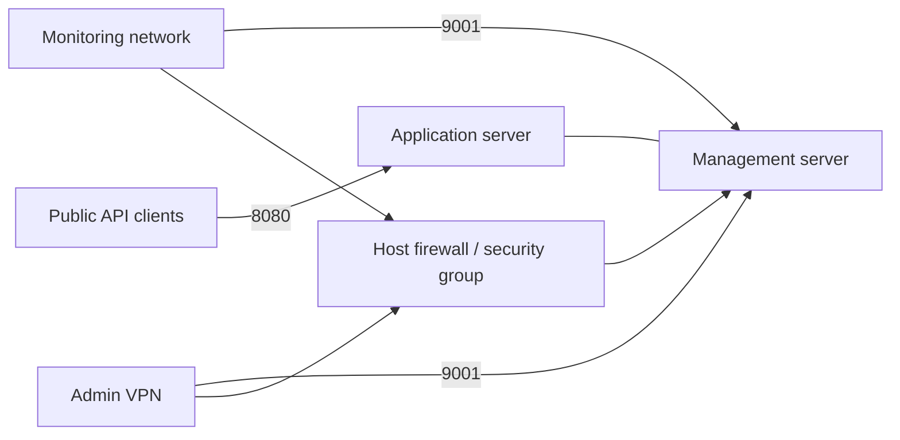
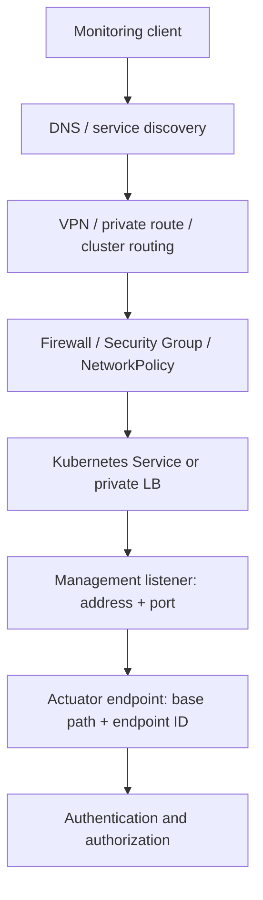

# Separating the Management Port, Listen Address, and Management Network

Spring Boot applications typically serve business requests while also exposing management endpoints via Spring Boot Actuator. Endpoints such as health, metrics, prometheus, env, or beans allow operations teams to inspect application status, configuration, and internal components. If all endpoints share the same listener and network path as business APIs, restricting who is allowed to access them can be harder.

Spring Boot allows configuring a separate port and listen address for the management server. The two key properties are `management.server.port` and `management.server.address`. When the management server runs on a different port from the application port, you can bind the management listener to a dedicated address, use separate TLS settings, and route it over an internal network reserved for monitoring or administration.

However, **separating the port does not create security by itself**. A management listener can still be reached externally if it binds on all interfaces and a firewall, Service, load balancer, or ingress permits traffic to it. You must coordinate the bind address, port, routing, network policy, endpoint exposure, and authentication/authorization.

This lesson belongs to the **Security** chapter of the `SPRING_CLOUD_CORE` module. It explains how to separate the application listener from the management listener, distinguish the bind address from the address clients use to connect, design a management network across VMs/containers/Kubernetes, configure TLS, and verify each protection layer.

## 1. Application Server vs. Management Server

A Spring Boot application can serve two groups of requests:

- **Application traffic:** business requests to controllers, REST APIs, GraphQL, or application protocols.
- **Management traffic:** requests to Actuator such as health, metrics, prometheus, beans, or operational data.

When sharing a single listener, both traffic groups pass through the same port. For example:

```yaml
server:
  port: 8080

management:
  endpoints:
    web:
      base-path: /actuator
```

Both business APIs and Actuator are served on port 8080. The health endpoint has a URL like `http://host:8080/actuator/health` with the default base path.

If a separate management listener is needed:

```yaml
server:
  port: 8080

management:
  server:
    port: 9001
```

The business application continues listening on port 8080; the management server listens on port 9001. With the default base path, Actuator can be called via `http://host:9001/actuator/health`.

Separating listeners is useful when you want to:

- Expose only business APIs through a public load balancer.
- Allow only monitoring systems or administrators to reach the management port.
- Apply separate TLS or client certificates for management traffic.
- Apply separate firewall rules, security groups, or Kubernetes NetworkPolicies.
- Reduce the risk of a public route accidentally forwarding to Actuator.

## 2. Distinguishing Port and Address Properties

Spring Boot provides two main property groups:

| Property | Scope | Meaning |
| --- | --- | --- |
| `server.port` | Application server | Port serving application requests |
| `server.address` | Application server | IP/interface address to which the application server binds |
| `management.server.port` | Management server | Port serving management endpoints when port separation is configured |
| `management.server.address` | Management server | IP/interface address to which the management server binds when running on a separate port |

The port is the TCP port number used by the listener. The address is the local address on the machine/container to which the socket binds. Neither concept is necessarily the destination address a client must use.

Example:

```yaml
server:
  port: 8080
  address: 0.0.0.0

management:
  server:
    port: 9001
    address: 127.0.0.1
```

In this configuration:

- The application server binds port 8080 on all IPv4 interfaces.
- The management server binds port 9001 on loopback.
- Clients on other machines cannot reach the management listener via the host's network address if the listener binds only to loopback.
- Processes on the same host can reach the management listener via `127.0.0.1:9001`.

This configuration fits when a local agent runs on the same host. If the monitoring server is on another machine, binding to loopback prevents it from connecting directly.

### 2.1. A Bind Address Is Not an Advertised Address

`management.server.address` determines which local interface receives connections. It does not automatically create DNS records, routes, firewall rules, or Kubernetes Services.

For example, binding to `10.20.5.15` only makes sense if that address is actually assigned to an interface on the host/container. If the address does not exist or is not ready, the embedded server may fail to bind and the application will not start.

Similarly, binding to `0.0.0.0` means listening on all IPv4 interfaces. It does not mean clients should call `0.0.0.0`; clients must use an IP or DNS name routable to the host.

### 2.2. When Does management.server.address Take Effect?

`management.server.address` can only be configured independently when the management server runs on a different port from the application server, i.e., a separate management port. If management endpoints share the application port, the listener belongs to the application server and its bind address is controlled by `server.address`.

Therefore, do not set `management.server.address` expecting to create an extra separate interface while `management.server.port` still shares the application port. Confirm the port configuration first, then decide the bind address.

### 2.3. Port and Base Path Address Different Layers

`management.server.port` selects the TCP port. `management.endpoints.web.base-path` selects the HTTP path prefix.

Example:

```yaml
management:
  server:
    port: 9001
  endpoints:
    web:
      base-path: /ops
```

The health endpoint will have the path `/ops/health` on port 9001. Changing the base path does not change the port or bind interface; changing the port does not automatically change the base path.

## 3. Separating the Management Port with Spring Boot Configuration

Minimal configuration:

```yaml
server:
  port: 8080

management:
  server:
    port: 9001
  endpoints:
    web:
      exposure:
        include: health,info,prometheus
```

In this example:

- Business requests arrive on port 8080.
- The management HTTP server uses port 9001.
- Only the listed endpoints are exposed over HTTP.
- Exposing endpoints must still be paired with security and network controls.

The `prometheus` endpoint is only available when the application has the corresponding registry, typically the `micrometer-registry-prometheus` dependency. If you have not integrated this registry yet, remove `prometheus` from the exposure list or add the dependency matching your Spring Boot BOM.

Ports can be set via environment variables:

```text
SERVER_PORT=8080
MANAGEMENT_SERVER_PORT=9001
```

Spring Boot supports relaxed binding for configuration properties. For deployments, ports can be placed in a ConfigMap or environment variables, while ensuring control over higher-precedence configuration sources.

### 3.1. Choosing a Separate Port Intentionally

Choose a management port distinct from the application port and document it clearly in runbooks, service manifests, and firewall rules. Do not assume a familiar port is always free on every host; verify port allocation and avoid conflicts with other processes.

Use a fixed dedicated port for production. In tests, some setups may pick a random port to avoid collisions and then read the actual port from the test environment. Never put random test port settings into production configuration.

### 3.2. Separating the Management Context

When the management server uses a different port, Spring Boot sets up a separate management web server/context according to Actuator's mechanism. The management context can access necessary beans from the parent application context, while maintaining its own lifecycle and management listener.

This separates management HTTP endpoints from the business listener. It does not mean all application beans are duplicated or that each endpoint runs in a different JVM.

### 3.3. A Separate Management Port Does Not Automatically Restrict Endpoints

Once a management port is opened, which endpoints are callable still depends on the exposure and access configuration of your Actuator version. For example, exposing only health and prometheus:

```yaml
management:
  endpoints:
    web:
      exposure:
        include: health,prometheus
```

Endpoints such as env, beans, or configprops should not be broadly exposed without a clear need and explicit access control. Separating the port is not a reason to expose every endpoint.

## 4. Choosing an Appropriate Listen Address

### 4.1. Loopback: Only for Processes on the Same Host

```yaml
management:
  server:
    port: 9001
    address: 127.0.0.1
```

Loopback is appropriate when a local agent on the same host reads Actuator. The listener does not accept connections from other network interfaces.

Note: inside a container, `127.0.0.1` is the loopback of the container's network namespace. A monitoring server outside the container, even on the same node, generally cannot reach this listener via the Pod IP or container IP.

### 4.2. Binding to a Private Interface

On a VM with a stable management interface, you can bind to a private IP:

```yaml
management:
  server:
    port: 9001
    address: 10.20.5.15
```

Replace the example address with an actual IP present on the host. Firewalls or security groups must still restrict access sources, such as only the monitoring subnet.

If the host has multiple network interfaces, binding to a private address keeps the listener off the public interface. However, verify routes, NAT, and interfaces after infrastructure changes.

### 4.3. Binding All Interfaces and Restricting with Network Policy

In containers and Kubernetes, Pod IPs are usually assigned dynamically. Hardcoding a static IP in `management.server.address` can prevent the container from starting when the address changes.

A common pattern is binding to all interfaces inside the container:

```yaml
server:
  address: 0.0.0.0
  port: 8080

management:
  server:
    address: 0.0.0.0
    port: 9001
```

Then use a Kubernetes Service, NetworkPolicy, cloud firewall, or security group to restrict who can reach port 9001. Broad binding is only appropriate when external network boundaries are properly configured and verified.

Do not confuse binding `0.0.0.0` with making an endpoint public. It allows the socket to accept connections on available interfaces; network paths and policies determine which sources can reach the listener.

## 5. Management Network in a VM or Physical Server

A simple architecture can look like this:



In this design, application traffic and management traffic have separate listeners. The firewall allows only the monitoring subnet and admin VPN to reach the management port.

Principles:

- Do not open the management port in public firewall rules without a clear operational reason.
- Use private IPs or a management VLAN when supported by the infrastructure.
- Allow only specific source CIDRs rather than the entire internal network.
- Document ports and source ranges in operational documentation.
- Check both IPv4 and IPv6; a listener or firewall rule restricting only IPv4 does not automatically protect IPv6.
- Do not rely on an obscure port number for security.

### 5.1. Verifying Firewalls and Security Groups

Verify in both directions: the listener is bound to the right interface and the firewall permits the right sources. A port may be listening while clients cannot connect due to a firewall; conversely, a firewall may allow a port while the application has no bound listener.

On Linux, common inspection commands include:

```bash
ss -lntp
ip address
ip route
```

Locate the listeners on ports 8080 and 9001, then confirm the local address. For example, `127.0.0.1:9001` differs from `0.0.0.0:9001` and from a specific private IP.

You can test from a monitoring host:

```bash
curl --connect-timeout 2 http://10.20.5.15:9001/actuator/health
```

A successful result only confirms the network path and endpoint are reachable from that location. You still need to verify authentication, TLS, and endpoint exposure.

## 6. Separating Management Traffic in Docker

In a container, the application server and management server run in the same process but can bind two separate ports. Example configuration:

```yaml
server:
  address: 0.0.0.0
  port: 8080

management:
  server:
    address: 0.0.0.0
    port: 9001
  endpoints:
    web:
      exposure:
        include: health,prometheus
```

If only the local host should access the management port via Docker port publishing:

```yaml
services:
  catalog:
    image: example/catalog-service:latest
    ports:
      - "8080:8080"
      - "127.0.0.1:9001:9001"
```

Here the container binds port 9001 on the container interface so Docker can forward traffic; Docker publishes the management port only onto the host's loopback. Clients from other machines cannot reach host port 9001 via a public interface if publishing is indeed restricted to `127.0.0.1`.

If monitoring runs outside the host, publish the management port on the appropriate private interface and use a firewall to restrict sources. Avoid omitting the host address in port mappings if your goal is binding only host loopback, since the default configuration may publish on all host interfaces.

### 6.1. Container Loopback and Host Loopback Are Different

There are two network namespaces:

- `127.0.0.1` inside the container is the container's loopback.
- `127.0.0.1` on the host is the host's loopback.

If the application binds the management listener to loopback inside the container, Docker port forwarding generally cannot connect to the listener through the container interface. If you want Docker to publish the port, the app generally needs to bind to the appropriate container interface, then restrict the host publish address and firewall.

This is why configuring `management.server.address: 127.0.0.1` inside a container can prevent health checks from the host or a monitoring sidecar from connecting as expected.

## 7. Separating Management Services in Kubernetes

In Kubernetes, a Pod can expose both an application port and a management port. You can create two separate Services:

- An Application Service forwarding to port 8080 and routed for business needs.
- A Management Service forwarding to port 9001 and reserved for in-cluster monitoring.

Example Deployment declaring both container ports:

```yaml
apiVersion: apps/v1
kind: Deployment
metadata:
  name: catalog
  namespace: apps
spec:
  replicas: 2
  selector:
    matchLabels:
      app: catalog
  template:
    metadata:
      labels:
        app: catalog
    spec:
      containers:
        - name: catalog
          image: example/catalog-service:latest
          ports:
            - name: http
              containerPort: 8080
            - name: management
              containerPort: 9001
          env:
            - name: SERVER_PORT
              value: "8080"
            - name: MANAGEMENT_SERVER_PORT
              value: "9001"
            - name: MANAGEMENT_SERVER_ADDRESS
              value: "0.0.0.0"
```

Application Service:

```yaml
apiVersion: v1
kind: Service
metadata:
  name: catalog
  namespace: apps
spec:
  type: ClusterIP
  selector:
    app: catalog
  ports:
    - name: http
      port: 80
      targetPort: http
```

Separate Management Service:

```yaml
apiVersion: v1
kind: Service
metadata:
  name: catalog-management
  namespace: apps
spec:
  type: ClusterIP
  selector:
    app: catalog
  ports:
    - name: management
      port: 9001
      targetPort: management
```

The management Service uses `ClusterIP` and does not create a public LoadBalancer or NodePort. An in-cluster monitoring system can call `catalog-management.apps.svc:9001` if DNS and network policies permit it.

### 7.1. ClusterIP Is Not a Complete Security Boundary

ClusterIP limits how a Service is exposed outside the cluster, yet many workloads inside the cluster can still attempt to connect to that address. If only Prometheus or the monitoring namespace should have access, apply a NetworkPolicy and verify that the CNI enforces policies.

Example policy allowing only Prometheus pods in the monitoring namespace to access port 9001:

```yaml
apiVersion: networking.k8s.io/v1
kind: NetworkPolicy
metadata:
  name: allow-catalog-management-from-monitoring
  namespace: apps
spec:
  podSelector:
    matchLabels:
      app: catalog
  policyTypes:
    - Ingress
  ingress:
    - from:
        - namespaceSelector:
            matchLabels:
              kubernetes.io/metadata.name: monitoring
          podSelector:
            matchLabels:
              app: prometheus
      ports:
        - protocol: TCP
          port: 9001
```

Within a single `from` entry, `namespaceSelector` and `podSelector` are combined with logical AND: the source must be a pod with matching labels inside a namespace with matching labels. Check the actual labels of the monitoring namespace and pod before applying.

NetworkPolicy takes effect only if the cluster's network plugin supports and enforces policies. Check both ingress and egress policies in effect, as another policy may affect connectivity.

### 7.2. Do Not Put the Management Service on a Public Ingress

Do not add `catalog-management` to a public ingress or gateway serving Internet clients. If monitoring resides outside the cluster, use a private network, VPN, private load balancer, or secured scraping mechanism; do not route management endpoints through the same public host merely for DNS convenience.

### 7.3. Kubernetes Health Probes

Kubernetes liveness/readiness probes can call Actuator endpoints over either the management port or the application port depending on design. If using the management port, explicitly configure `port: management` and the corresponding `/actuator/health/liveness` or readiness path if the application has enabled these health groups.

Probes must reflect the appropriate status:
- Liveness indicates whether the process needs to be restarted.
- Readiness indicates whether the Pod should receive business traffic.
- Monitoring endpoints provide additional information for observability systems.

Do not arbitrarily include all external dependencies in liveness; a transient dependency failure can cause Kubernetes to restart Pods en masse.

## 8. Dedicated TLS for the Management Server

When the management server runs on a separate port, you can configure separate SSL settings for the management listener:

```yaml
server:
  port: 8080
  ssl:
    enabled: true
    key-store: classpath:app-server.p12
    key-store-password: ${APP_KEYSTORE_PASSWORD}
    key-store-type: PKCS12

management:
  server:
    port: 9001
    ssl:
      enabled: true
      key-store: file:/run/secrets/management-server.p12
      key-store-password: ${MANAGEMENT_KEYSTORE_PASSWORD}
      key-store-type: PKCS12
```

This example illustrates that the two listeners can use separate certificates/keystores. Manage passwords via a secret store or secret injection; never commit real passwords to the repository.

If the management port shares the application port, management endpoints use the application server's SSL configuration. Separate TLS configuration for the management server depends on separating the management listener.

### 8.1. Client Certificates and Trust

In sensitive management networks, client certificates (mTLS) can be required if the embedded server and security infrastructure are configured to support them. In that case, ensure:

- Server certificate has a SAN matching the DNS name the monitoring client calls.
- Server truststore contains the CA authorized to issue client certificates.
- Monitoring client has a matching certificate/private key.
- Rotation and expiry are managed before certificates expire.
- Handshake is tested over the actual network path.

TLS encrypts and authenticates peers at the transport layer. It does not replace application-layer authorization; after TLS succeeds, you must still verify which endpoints the client is allowed to call.

### 8.2. Do Not Disable Hostname Verification

Do not disable hostname verification to work around certificate errors. Issue certificates with Subject Alternative Names matching the exact DNS names or IPs used by clients. When calling via Kubernetes Service DNS, the certificate must match the corresponding DNS name or use a stable management name routed to the Service.

## 9. Distinguishing Bind Address, Service Address, and Public Route

A request to Actuator passes through multiple layers:



Each layer answers a different question:

| Layer | Question |
| --- | --- |
| DNS | Which hostname does the client use? |
| Route | Is there a path from the client to the host/cluster? |
| Firewall/NetworkPolicy | Is this source allowed to reach the port? |
| Service/load balancer | Which backend receives the traffic? |
| Bind address/port | Does the process have a listener on that interface and port? |
| Base path/endpoint exposure | Does the Actuator URL exist and is it exposed? |
| Authentication/authorization | Does the caller have permission to read the endpoint? |

A connection failure can occur at any layer. For example, DNS resolves properly but a firewall drops the port; a Service has endpoints but the process is not bound; the listener accepts connections but Actuator does not expose the endpoint; or HTTP returns 401/403 due to security.

## 10. Management Port and Defense-in-Depth Security Configuration

A production configuration requires at least four decision layers:

1. **Listener:** port and address to which the management server binds.
2. **Network path:** who can route to the listener.
3. **Endpoint exposure:** which endpoints are exposed over HTTP/JMX.
4. **Identity and authorization:** which callers are allowed access.

Example:

```yaml
server:
  port: 8080
  address: 0.0.0.0

management:
  server:
    port: 9001
    address: 0.0.0.0
  endpoints:
    web:
      exposure:
        include: health,prometheus
  endpoint:
    health:
      show-details: when-authorized
```

This is only the application configuration portion. Because the management listener binds on all interfaces, infrastructure must restrict port 9001 to the monitoring network. Endpoint exposure limits the set of endpoints, while security must require an appropriate identity/role.

If internal monitoring only needs to scrape Prometheus, there is no need to expose beans, env, configprops, or shutdown. The broader the access, the larger the blast radius if credentials are leaked.

### 10.1. SecurityFilterChain and Management Endpoints

In servlet applications with Spring Security, ensure management endpoints are protected by appropriate rules. A filter chain can use `EndpointRequest` to identify Actuator endpoints, while coordinating with existing chains and the organization's authentication provider.

Do not add a new `SecurityFilterChain` without reviewing the ordering and matchers of existing chains. A chain with a broader matcher may capture requests before the management chain. Test both allowed and denied access on the management port.

### 10.2. A Separate Management Port Does Not Automatically Mean Separate Security

Separating the port creates a separate listener; it does not automatically create a separate user database, roles, or authentication scheme. If the application shares a Spring Security context, management endpoints can use the same authentication mechanism. If a different trust boundary is desired, design the chain and identity provider explicitly.

## 11. Isolating the Management Network for Spring Cloud Components

Spring Cloud can provide many operational endpoints and integrations:

- Config Client and configuration loading status.
- Discovery client and service registry.
- LoadBalancer.
- Refresh infrastructure.
- Circuit breakers and metrics.
- Actuator health, metrics, prometheus, beans, conditions, and env.

The management port can serve as the place where monitoring collects metrics/health, while sensitive administrative actions require stronger authentication. Not every endpoint needs the same audience.

Example of a reasonable policy:
- Prometheus scrapes `prometheus` over a private monitoring network.
- Kubernetes probes call only the required health groups.
- Operators call diagnostic endpoints over VPN with an administrative role.
- Endpoints capable of modifying state or revealing configuration are not open to regular scrapers.

If multiple caller groups need different permissions, consider separating proxies/routes or applying per-endpoint authentication/authorization rather than granting broad access to the entire port.

### 11.1. Do Not Advertise the Management Port via Business Service Discovery

Do not register the management port as a regular service-to-service endpoint if business clients do not need to call it. The service registry should advertise appropriate business endpoints. If separate monitoring discovery is needed, use dedicated target/scrape configurations and restrict access.

### 11.2. Config Server Should Not Be a Reason to Open the Management Network Broadly

Remote configuration can control port/address/exposure via property sources, yet changing a listener may require a restart or recreating the server context depending on the property and lifecycle. Do not assume refreshing a property will automatically move a bound socket from one port to another.

Listener properties should be treated as deployment/startup configuration. When changing them, perform a controlled rollout and verify the new listener before closing the old path.

## 12. Diagnosing Unreachable Management Endpoints

Start from the specific error:

| Symptom | Possible Failing Layer | How to Check |
| --- | --- | --- |
| Connection refused | No listener or wrong port | Check process and socket bindings |
| Timeout | Firewall, route, or NetworkPolicy dropping traffic | Check from client, host, and network boundary |
| DNS lookup failure | DNS/service discovery | Resolve hostname from the client's exact environment |
| 404 | Wrong base path, unexposed endpoint, or nonexistent endpoint | Check Actuator exposure and URL |
| 401 | Missing or invalid authentication | Check credentials/token and authentication provider |
| 403 | Valid identity but missing permission | Check role/authorization rules |
| TLS handshake failure | Certificate, truststore, protocol, or mTLS | Check certificate chain, SAN, and client auth |
| Reachable only from inside the container | Listener bound to loopback or wrong port publishing | Check container bind address and Docker mapping |
| Application API works but management does not | Wrong management port/address or separate service route | Check `management.server.*` and management Service |
| Monitoring scrapes wrong Pod/port | Target discovery or Service selector | Check labels, endpoints, and targetPort |

### 12.1. Check the Listener First

On the host or container, confirm the actual port and local address:

```bash
ss -lntp
```

Look for the application and management ports. If only port 8080 appears, the management server may not be separated, may not have started, or the port configuration was not loaded. If `127.0.0.1:9001` appears, clients outside the network namespace cannot reach it over another interface.

### 12.2. Test from Multiple Vantage Points

Test step by step from each location:

1. From the process/host itself: call loopback.
2. From a machine in the private subnet: call the private IP/DNS.
3. From the monitoring namespace: call the management Service.
4. From an unauthorized network: confirm the connection is blocked.
5. From the public Internet: confirm the management port is not publicly routed.

A successful test from localhost does not prove the monitoring system can reach it. A successful test from inside the cluster also does not prove ingress or public networks are blocked.

### 12.3. Distinguishing Network Errors from HTTP Errors

- Cannot establish a TCP connection: focus on listener, port, bind address, route, and firewall.
- TCP succeeds but returns 404: focus on path and endpoint exposure.
- Returns 401/403: focus on identity and authorization.
- Returns 5xx: listener and route are working; inspect logs/health and errors in the endpoint handler.

Do not change firewall rules or open ports broadly just to fix 401/403; those are application security-layer errors.

## 13. Changing the Management Port and Rollout

Port/address settings are part of the deployment topology. When changing the management port, update in sync:

- Spring Boot configuration or environment variables.
- Docker port mappings.
- Kubernetes container port and Service targetPort.
- NetworkPolicy and cloud firewall/security groups.
- Prometheus scrape config or ServiceMonitor.
- Kubernetes probes if they call management endpoints.
- Reverse proxy or private load balancer if present.
- Runbooks and dashboards/alerts.

A safe rollout deploys the new configuration, verifies the new management listener from the monitoring network, updates scrape targets, and then removes old rules/ports. Avoid changing listeners, DNS, and firewalls simultaneously without intermediate verification checkpoints.

If the management port is changed while monitoring still scrapes the old port, alerts may report target down even though business traffic continues operating. Distinguish business availability from management plane availability.

## 14. Lab: Creating a Separate Management Plane in Kubernetes

Objectives:

- Application API listens on port 8080.
- Actuator listens on port 9001.
- Prometheus in the monitoring namespace scrapes metrics.
- No public ingress reaches port 9001.
- NetworkPolicy allows only selected Prometheus pods to access the management port.

### Step 1 — Configure Spring Boot

```yaml
server:
  port: 8080
  address: 0.0.0.0

management:
  server:
    port: 9001
    address: 0.0.0.0
  endpoints:
    web:
      exposure:
        include: health,prometheus
```

### Step 2 — Declare Both Ports in the Deployment

```yaml
ports:
  - name: http
    containerPort: 8080
  - name: management
    containerPort: 9001
```

### Step 3 — Create Two Services

Application Service routes to named port `http`. Management Service of type ClusterIP routes to named port `management`. Do not use NodePort or LoadBalancer for the management Service unless an approved, tightly controlled private exposure architecture is in place.

### Step 4 — Restrict Ingress with NetworkPolicy

Allow monitoring pods with designated labels to reach TCP 9001. Verify namespace labels, pod labels, and that the CNI supports NetworkPolicy.

### Step 5 — Test from the Monitoring Namespace

Call `http://catalog-management.apps.svc:9001/actuator/prometheus` from an authorized pod. Confirm the scraper receives metrics and the target transitions to healthy.

### Step 6 — Test from an Unauthorized Source

From a pod outside the monitoring namespace, attempt to connect to port 9001. The connection must be blocked by policy. If still reachable, check CNI enforcement and other NetworkPolicies.

### Step 7 — Verify Public Routes

Confirm public Ingress routes only to the application Service. Ensure no rule, gateway, or external load balancer forwards to the management Service.

### Self-Check Questions

1. Which listeners do `server.port` and `management.server.port` control?
2. When can `management.server.address` be configured independently?
3. What does binding `127.0.0.1` inside a container mean?
4. Why is `0.0.0.0` not an address clients should call?
5. Does separating the management port automatically restrict callers?
6. How does `management.endpoints.web.base-path` differ from the port?
7. Why is ClusterIP not a complete security boundary in Kubernetes?
8. How does the example NetworkPolicy restrict sources by namespace and pod labels?
9. When should `management.server.ssl` be used?
10. Why does TLS not replace authorization?
11. Which components must be updated when changing the management port?
12. How do you distinguish connection refused, timeout, 404, 401, and 403?

**Answer Hints:** (1) The application server port and management server port; (2) When the management server runs on a different port from the application server; (3) Accepts connections only from loopback within the container's network namespace; (4) It is a wildcard bind address, not a routable destination address; (5) No, network controls and authorization are still required; (6) Base path is a URL prefix, port is the TCP listener; (7) Other workloads in the cluster can still reach a ClusterIP; (8) Uses namespaceSelector and podSelector in the same entry to combine source conditions; (9) When the management listener has a separate port and needs separate TLS settings; (10) TLS secures the transport/peer, whereas authorization governs permission to call endpoints; (11) App config, container/service ports, firewall/NetworkPolicy, probes, and monitoring targets; (12) Check TCP listener/route, HTTP path/exposure, and authentication/authorization.

## 15. Key Principles to Remember

- `server.port` and `server.address` configure the application listener; `management.server.port` and `management.server.address` configure the management listener when separated.
- `management.server.address` only takes effect independently when the management server runs on a different port from the application server.
- A bind address is the local interface on which a process listens; it does not create DNS, routes, firewall rules, or advertised addresses.
- `127.0.0.1` inside a container is the container's loopback, not the host's loopback.
- `0.0.0.0` allows the listener to accept connections on all IPv4 interfaces; you must use a firewall or network policy to restrict sources.
- `management.endpoints.web.base-path` controls the URL path, not the port or bind address.
- Separating the management port does not protect endpoints on its own; combine network path, exposure, and authentication/authorization.
- Kubernetes ClusterIP does not replace NetworkPolicy; allow only monitoring workloads to access the management port.
- Separate TLS can be configured for the management listener when the management port differs from the application port.
- Do not expose the management Service through public ingress without a controlled private access architecture.
- Treat port/address settings as deployment configuration; changes require a rollout and updates to probes, Services, firewalls, and monitoring targets.
- Diagnose layer by layer: listener, route, network policy, endpoint path/exposure, TLS, and authorization.

Separating the management listener establishes a clear control point for management traffic. Combined with an appropriate bind address, network segmentation, minimal endpoint exposure, and caller authentication, Actuator can serve monitoring and operations without becoming a side door into the business application.

## References

- [Spring Boot Reference — Monitoring and Management over HTTP](https://docs.spring.io/spring-boot/reference/actuator/monitoring.html)
- [Spring Boot Reference — Actuator Endpoints](https://docs.spring.io/spring-boot/reference/actuator/endpoints.html)
- [Spring Boot Reference — SSL](https://docs.spring.io/spring-boot/reference/features/ssl.html)
- [Kubernetes Documentation — Network Policies](https://kubernetes.io/docs/concepts/services-networking/network-policies/)
- [Docker Compose Documentation — ports](https://docs.docker.com/reference/compose-file/services/#ports)
