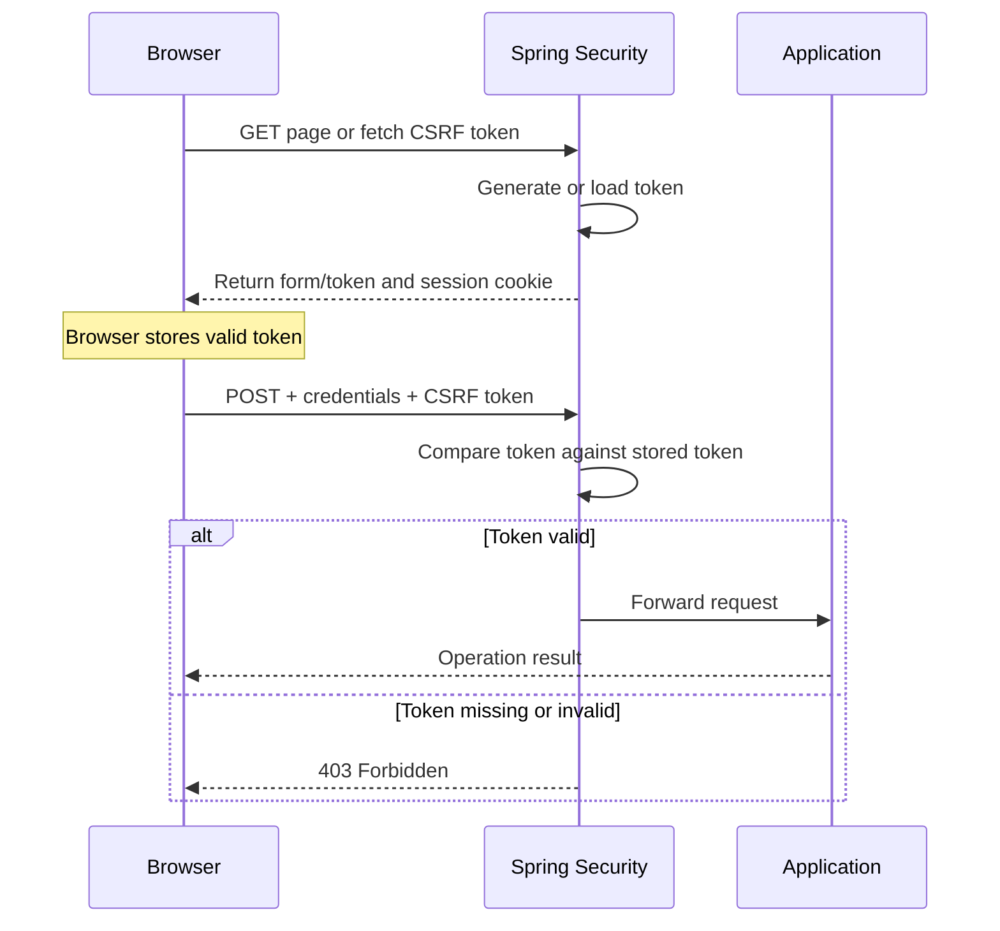

# CSRF for State-Changing Endpoints and Choosing the Right Configuration

Spring Cloud Context and Spring Boot Actuator provide management endpoints that can alter application state. For example, POST /actuator/refresh reloads configuration and refreshes @RefreshScope beans; POST /actuator/env can update the Environment and rebind @ConfigurationProperties; restart, pause, or resume endpoints can also directly affect the application lifecycle.

If these endpoints are invoked from a browser and the browser automatically sends session cookies or other credentials, an external website can trick an operator into sending an unintended request. Cross-Site Request Forgery (CSRF) protects state-changing requests by requiring a token that an external site cannot know and include in the request.

Spring Security enables CSRF by default for unsafe HTTP methods. For Spring Cloud management endpoints, three layers of control must be combined: whether the endpoint is exposed, whether the caller is authenticated and authorized, and whether the request carries a valid CSRF token when invoked with browser credentials. This lesson explains how to choose the right configuration for browser-rendered applications, SPAs, machine-to-machine APIs, and Actuator endpoints.

This lesson belongs to the **Security** chapter of **SPRING_CLOUD_CORE**. The focus is on understanding the CSRF attack model, classifying state-changing endpoints, protecting /actuator/refresh and /actuator/env, passing tokens in forms or JavaScript, scoping CSRF exemptions, distinguishing Servlet from WebFlux, and testing missing, invalid, and valid token cases.

## 1. Learning Objectives

After this lesson, learners can:

1. Explain why browsers automatically sending cookies can create a CSRF vulnerability.
2. Distinguish authentication, authorization, and CSRF protection.
3. Identify safe and unsafe HTTP methods.
4. Explain how Spring Security uses a synchronizer token to protect requests.
5. Identify Spring Cloud Context endpoints capable of changing state.
6. Configure exposure and access permissions for Actuator endpoints.
7. Protect /actuator/refresh and /actuator/env with an admin role and a CSRF token.
8. Integrate tokens with HTML forms, SPAs, and JavaScript clients.
9. Scope ignoringRequestMatchers or a separate security chain for machine-to-machine APIs.
10. Explain why statelessness, JSON, CORS, or HTTP Basic do not by themselves eliminate CSRF risk.
11. Distinguish CSRF in Servlet and WebFlux.
12. Test requests with missing tokens, invalid tokens, valid tokens, and unauthorized users.

## 2. What Is CSRF?

CSRF occurs when a logged-in user's browser is tricked by another website into sending a request to a trusted application. The browser may automatically attach session cookies or stored credentials even though the user did not intend to perform that action.

For example, an operator is logged into a Spring Cloud application's management UI. The browser holds the management site's session cookie. A malicious web page can craft a form that submits a request:

```html
<form action="https://admin.example.com/actuator/refresh"
      method="post">
    <button type="submit">Open report</button>
</form>
```

If the operator visits this page and the browser sends the session cookie to the management server, the request can be authenticated under the operator's session. If the endpoint does not check a CSRF token, the refresh action can execute unintentionally.

The attacker does not need to read cookies or responses. The issue is that the browser automatically attaches valid credentials to a request initiated by a different origin.

### 2.1. Common Conditions for CSRF to Occur

A CSRF scenario typically involves these elements:

- The user is logged in or the browser holds credentials.
- The browser automatically sends those credentials with requests to the target application.
- The application has an endpoint that changes state.
- The endpoint does not require proof that the request originated from a legitimate application page.

A CSRF token adds a random value that external pages cannot read from the target application's origin due to the same-origin policy. The server compares the submitted token against the stored token before allowing the request to proceed.

### 2.2. CSRF Is Not Direct Identity Spoofing

CSRF typically exploits the victim's valid session or credentials. It does not discover passwords on its own and does not bypass authorization by itself. However, if the user holds an administrative role, the forged request runs with that user's own permissions.

Therefore, you must combine:

- Authentication: determines who the caller is.
- Authorization: determines which operations the caller is permitted to perform.
- CSRF protection: verifies that an unsafe request was initiated from a legitimate client.

A request with a valid CSRF token must still pass authentication and authorization.

## 3. Safe and Unsafe HTTP Methods

Spring Security Servlet requires a CSRF token by default for methods other than GET, HEAD, TRACE, and OPTIONS. Methods that typically require a token are POST, PUT, PATCH, and DELETE.

A key API design principle is that safe methods must only read data. GET, HEAD, OPTIONS, and TRACE must not create orders, delete data, alter configuration, refresh contexts, or perform logout.

Example of what not to design:

```java
@GetMapping("/admin/refresh")
String refresh() {
    contextRefresher.refresh();
    return "refreshed";
}
```

Instead, use a method that clearly expresses a state-changing operation:

```java
@PostMapping("/admin/refresh")
String refresh() {
    contextRefresher.refresh();
    return "refreshed";
}
```

Changing an endpoint to POST does not protect the endpoint on its own. It simply allows Spring Security's default CSRF matcher to apply and gives the API accurate semantics.

### 3.1. Why Must GET Be Read-Only?

If GET modifies state, a link, embedded image, redirect, or browser prefetch can accidentally trigger the action. When that happens, CSRF mechanisms focused on unsafe methods have no opportunity to protect the request.

Keep GET for reading status such as health, info, or displaying pages. Actions such as refresh, restart, updating the Environment, pause, resume, or logout must use state-changing methods.

## 4. Synchronizer Token Pattern

Spring Security uses the synchronizer token pattern. The server generates a random token, stores the expected token, and requires the client to send that token back on state-changing requests.

High-level flow:



The token must be sent in a part of the request that the browser does not automatically add when an external site triggers a request—typically the hidden form field _csrf or the HTTP header X-CSRF-TOKEN / X-XSRF-TOKEN.

Simply storing a token in a cookie without requiring the client to send it back in a header or parameter does not establish synchronizer token protection. Cookies are also automatically sent by the browser, just like the credentials CSRF exploits.

### 4.1. Default Token Repositories

In Spring Security Servlet, HttpSessionCsrfTokenRepository is used by default to store the token in HttpSession.

Spring Security also provides CookieCsrfTokenRepository, commonly used when JavaScript needs to read the token from a cookie and place it in a request header.

| Repository | Where Expected Token Is Stored | Common Use Case |
| --- | --- | --- |
| HttpSessionCsrfTokenRepository | HTTP session | Server-rendered forms, session-based applications |
| CookieCsrfTokenRepository | XSRF-TOKEN cookie | SPAs or JavaScript clients that need to read the token |
| Custom repository | Storage implemented by application | Systems with custom session/token mechanisms |

The token is not a session cookie and does not replace a session. It serves as additional proof for state-changing requests.

### 4.2. Default Headers and Parameters

With HttpSessionCsrfTokenRepository, Spring Security typically uses the _csrf parameter and the X-CSRF-TOKEN header.

CookieCsrfTokenRepository by default writes the XSRF-TOKEN cookie and reads the token from the X-XSRF-TOKEN header or _csrf parameter. The client must send the exact header or parameter configured by the repository/request handler.

Do not place a CSRF token in a URL query string because URLs can appear in access logs, browser history, proxy logs, or referrer headers.

## 5. Spring Security Enables CSRF by Default

For Servlet applications using Spring Security, CSRF protection is enabled by default. You can also declare it explicitly in SecurityFilterChain:

```java
@Configuration
@EnableWebSecurity
class SecurityConfiguration {

    @Bean
    SecurityFilterChain securityFilterChain(HttpSecurity http)
            throws Exception {

        http
            .csrf(Customizer.withDefaults())
            .authorizeHttpRequests(auth -> auth
                .anyRequest().authenticated()
            );

        return http.build();
    }
}
```

You do not need to create a CsrfFilter manually or write a custom token comparator. Spring Security combines CsrfFilter, CsrfTokenRepository, CsrfTokenRequestHandler, and AccessDeniedHandler to load, provide, verify tokens, and reject invalid requests.

If your application defines a custom SecurityFilterChain, check the .csrf(...) configuration in that chain. Do not assume adding authorization rules automatically disables or changes CSRF behavior.

### 5.1. When the Token Is Missing or Invalid

When a request requires CSRF protection but the token is missing or mismatches, Spring Security rejects the request with AccessDeniedException. Under typical configuration, the client receives HTTP 403 Forbidden.

If the frontend needs a JSON error response, you can configure a custom AccessDeniedHandler. However, the handler only alters how errors are returned; it must never bypass token verification.

## 6. Spring Security 6: Deferred Tokens and BREACH Protection

When upgrading from Spring Security 5 to 6, two notable changes apply:

1. CSRF tokens are loaded lazily (deferred) by default, avoiding reading the session on every request.
2. Tokens are encoded with randomness when placed into request attributes to help protect against BREACH.

In the Servlet stack, XorCsrfTokenRequestAttributeHandler is the default request handler in Spring Security 6. It provides a randomly encoded token in the request attribute and decodes the token received from the request parameter/header before comparing it with the stored token.

This matters for SPAs using a cookie repository. JavaScript reads the plain token value from the cookie, whereas server-rendered forms may use the XOR-encoded token. If the configured request handler does not account for both submission mechanisms, tokens from an SPA may be decoded incorrectly.

When using a modern SPA configuration, use the request handler recommended by the documentation for your exact Spring Security version. Do not arbitrarily replace XorCsrfTokenRequestAttributeHandler with a handler lacking BREACH protection just to make a single test pass.

## 7. CSRF with HTML Forms and Thymeleaf

For server-rendered HTML, the token is usually placed in a hidden input. Spring Security exposes the token under the _csrf request attribute. View technologies integrated with RequestDataValueProcessor, including Thymeleaf, can automatically insert the token into forms with unsafe methods.

Example rendered HTML:

```html
<form action="/admin/refresh" method="post">
    <input type="hidden" name="_csrf" value="token-from-server"/>
    <button type="submit">Refresh configuration</button>
</form>
```

With Thymeleaf, use the appropriate form action and method so integration automatically adds the hidden field:

```html
<form th:action="@{/admin/refresh}" method="post">
    <button type="submit">Refresh configuration</button>
</form>
```

If building HTML with a template engine without Spring Security integration, explicitly include _csrf.parameterName and _csrf.token in a hidden input. Ensure the token is not escaped or altered during rendering.

## 8. CSRF with SPAs and JavaScript

SPAs typically send JSON via fetch or Axios. Instead of a hidden input, the client reads the token and includes it in a header on state-changing requests.

### 8.1. Using CookieCsrfTokenRepository

Basic configuration:

```java
@Bean
SecurityFilterChain securityFilterChain(HttpSecurity http)
        throws Exception {

    http
        .csrf(csrf -> csrf
            .csrfTokenRepository(
                CookieCsrfTokenRepository.withHttpOnlyFalse()
            )
        )
        .authorizeHttpRequests(auth -> auth
            .anyRequest().authenticated()
        );

    return http.build();
}
```

The repository creates the XSRF-TOKEN cookie. HttpOnly=false allows JavaScript to read the cookie and place its value into the X-XSRF-TOKEN header. Use this setting only when the frontend truly needs to read the cookie. If JavaScript does not need to read the cookie, keep HttpOnly enabled by default to reduce the ability of scripts to read the token.

The snippet above only selects where the token is stored. For SPAs on Spring Security 6 and later, also configure the request handler shown in the next section to handle plain tokens in headers alongside the default XOR handler. If you only change the repository while keeping the default handler, header tokens read by JavaScript from the cookie may fail to decode as the server expects.

Example request:

```javascript
const token = readCookie("XSRF-TOKEN");

await fetch("/actuator/refresh", {
  method: "POST",
  credentials: "same-origin",
  headers: {
    "Content-Type": "application/json",
    "X-XSRF-TOKEN": token
  }
});
```

readCookie is a frontend helper that reads a cookie by name. For a cross-origin frontend, configure CORS and cookie credentials for the exact origin; do not use a wildcard origin when allowing credentials.

### 8.2. Request Handler for SPAs in Spring Security 6

Spring Security 6 uses the XOR handler by default for BREACH protection. Because SPAs send plain tokens read from a cookie, a handler is needed that reads headers as plain text while preserving the XOR handler for tokens rendered into response bodies or hidden forms.

Example following the pattern documented by Spring Security:

```java
final class SpaCsrfTokenRequestHandler
        implements CsrfTokenRequestHandler {

    private final CsrfTokenRequestHandler plain =
        new CsrfTokenRequestAttributeHandler();

    private final CsrfTokenRequestHandler xor =
        new XorCsrfTokenRequestAttributeHandler();

    @Override
    public void handle(
            HttpServletRequest request,
            HttpServletResponse response,
            Supplier<CsrfToken> csrfToken) {

        this.xor.handle(request, response, csrfToken);
        csrfToken.get();
    }

    @Override
    public String resolveCsrfTokenValue(
            HttpServletRequest request,
            CsrfToken csrfToken) {

        String headerValue =
            request.getHeader(csrfToken.getHeaderName());

        CsrfTokenRequestHandler handler =
            StringUtils.hasText(headerValue) ? this.plain : this.xor;

        return handler.resolveCsrfTokenValue(request, csrfToken);
    }
}
```

Attach the handler to the security chain:

```java
http.csrf(csrf -> csrf
    .csrfTokenRepository(
        CookieCsrfTokenRepository.withHttpOnlyFalse()
    )
    .csrfTokenRequestHandler(
        new SpaCsrfTokenRequestHandler()
    )
);
```

This approach keeps the XOR handler for request parameters/rendered tokens and uses the plain handler when the client sends a plain token in a header. Verify the implementation against your application's exact Spring Security version before copying it into a project.

### 8.3. Refreshing Tokens After Login and Logout

Spring Security clears the CSRF token after authentication success and logout success. For SPAs using a cookie repository, the client must obtain a new token before the next unsafe request.

You can expose an endpoint to read the token:

```java
@RestController
class CsrfController {

    @GetMapping("/csrf")
    CsrfToken csrf(CsrfToken csrfToken) {
        return csrfToken;
    }
}
```

The frontend calls /csrf on startup and after successful login/logout, then keeps the received token to send in headers. If the endpoint must be callable prior to authentication, you can permit /csrf specifically in authorization rules; permitting it does not mean state-changing or management endpoints are opened.

Do not log tokens, put tokens in URLs, or store tokens longer than necessary.

## 9. State-Changing Spring Cloud Endpoints

Spring Cloud Commons provides several management endpoints through Spring Boot Actuator. These endpoints can directly affect application configuration or lifecycle.

| Endpoint | HTTP method / behavior | Impact |
| --- | --- | --- |
| /actuator/refresh | POST | Reloads bootstrap context and refreshes @RefreshScope beans |
| /actuator/env | POST when enabled | Updates Environment, rebinds @ConfigurationProperties and logger levels |
| /actuator/restart | Administrative operation; disabled by default | Closes and restarts the ApplicationContext |
| /actuator/pause | Administrative operation | Invokes pause on PauseHandlers |
| /actuator/resume | Administrative operation | Invokes resume on PauseHandlers |

These endpoints are not necessarily exposed or enabled in every application. For example, restart is disabled by default; when restart is disabled, pause/resume are also disabled according to Spring Cloud documentation.

### 9.1. Controlled Enablement of env POST

To allow POST /actuator/env, Spring Cloud requires enabling management.endpoint.env.post.enabled=true and configuring a regex restricting which property keys can be modified.

Example:

```yaml
management:
  endpoint:
    env:
      post:
        enabled: true
        valid-keys-regex: '^acme\.(feature|routing)\..+$'
```

The regex above limits keys to the acme.feature.* and acme.routing.* branches. It only restricts updatable key names; it does not replace authorization, value validation, or auditing. Narrow the allowlist strictly to configurations the operations team is permitted to update.

### 9.2. Exposing Endpoints Over HTTP

Actuator exposes only certain endpoints over HTTP by default. For example:

```yaml
management:
  endpoints:
    web:
      exposure:
        include:
          - health
          - info
          - refresh
          - env
```

Exposing only makes an endpoint routable over the management web interface. It does not grant everyone permission to invoke it, nor does it replace CSRF protection.

If a separate management port or base path is used, URLs and request matchers in Spring Security must match the deployment configuration.

## 10. Protecting Management Endpoints with Authentication, Authorization, and CSRF

An illustrative Servlet configuration for a management application using sessions or HTTP Basic:

```java
@Configuration
@EnableWebSecurity
class ManagementSecurityConfiguration {

    @Bean
    SecurityFilterChain securityFilterChain(HttpSecurity http)
            throws Exception {

        http
            .authorizeHttpRequests(auth -> auth
                .requestMatchers("/actuator/health").permitAll()
                .requestMatchers(
                    HttpMethod.POST,
                    "/actuator/refresh",
                    "/actuator/env"
                ).hasRole("OPS")
                .requestMatchers("/actuator/**").hasRole("OPS")
                .anyRequest().authenticated()
            )
            .csrf(Customizer.withDefaults())
            .httpBasic(Customizer.withDefaults());

        return http.build();
    }
}
```

This configuration illustrates three decisions:

1. The health endpoint is permitted for public reads per the example policy.
2. Remaining Actuator endpoints require the OPS role.
3. CSRF remains enabled for unsafe methods.

hasRole("OPS") corresponds to the ROLE_OPS authority. The application must configure appropriate users, identity providers, or resource authorization to grant this role. If the management port/base path differs, adjust the request matchers.

HTTP Basic does not eliminate CSRF on its own. Browsers can automatically send cached Basic credentials with requests to the target origin, so management endpoints using Basic still require CSRF if accessible from browsers.

### 10.1. Exposure Is Not Authorization

Do not confuse the following settings:

| Setting | Question Addressed |
| --- | --- |
| management.endpoints.web.exposure.include | Which endpoints are exposed over HTTP? |
| management.endpoint.env.post.enabled | Is POST allowed to the env endpoint? |
| valid-keys-regex | Which property keys are permitted to be updated? |
| Spring Security authentication | Who is calling? |
| Spring Security authorization | Does the caller have management permissions? |
| CSRF token | Was the unsafe request initiated from a legitimate client? |
| Network policy / firewall | Which clients can connect to the management port? |

An endpoint can be exposed yet still require authentication, a role, and a CSRF token. Conversely, an unexposed endpoint may return 404 even when the security chain grants access.

### 10.2. Do Not Use GET to Refresh or Update Configuration

If an application creates a custom wrapper endpoint for ContextRefresher.refresh(), use POST or an appropriate unsafe method. Do not turn refresh into GET to avoid CSRF; doing so breaks HTTP semantics and opens the door to unintended invocations.

## 11. When to Keep CSRF and When to Exempt It

CSRF protection should be kept for requests that can be made by ordinary user browsers, especially when authentication relies on session cookies or credentials automatically attached by the browser.

| Client/Credential Type | Needs CSRF? | Reason |
| --- | --- | --- |
| Server-rendered web using session cookie | Yes | Browser sends cookies automatically |
| SPA using session cookie | Yes | Cookies are still sent automatically; token must be sent in a header |
| Browser using HTTP Basic | Yes | Browser can automatically send cached credentials |
| API using JWT in cookie | Yes | Cookies are sent automatically |
| Machine-to-machine API using bearer token in Authorization header attached explicitly by client | Typically can be exempted for that security chain | External sites cannot read and attach the client's bearer token |
| Service-to-service with mTLS, serving no browser traffic | Can be exempted within that API's scope | No automatically sent browser credentials |

Do not reason that REST APIs do not need CSRF, that stateless implies safe, or that using JSON prevents CSRF. Determine how credentials are transmitted and whether a browser can initiate a request carrying those credentials.

### 11.1. Stateless Is Not Automatically Safe

SessionCreationPolicy.STATELESS prevents Spring Security from using HTTP sessions to store the security context under that configuration. Yet if a browser still automatically sends an authentication cookie, JWT cookie, or HTTP Basic credentials, requests remain vulnerable to CSRF.

What matters is whether credentials are automatically attached by the browser, not merely whether the server stores a session.

### 11.2. JSON Does Not Automatically Eliminate CSRF

Do not rely solely on Content-Type: application/json to skip CSRF protection. Certain form submission techniques or special content types can construct requests that applications process unexpectedly. CSRF tokens and content-type validation still need to be designed independently.

### 11.3. CORS Does Not Replace CSRF

CORS primarily governs whether JavaScript from another origin may read responses or send certain preflighted requests. Simple requests such as HTML form submissions may not require a preflight. Therefore, CORS does not replace CSRF tokens.

If an SPA uses cross-origin cookies, configure CORS for specific origins, enable credentials when needed, and configure cookies appropriately. Never use Access-Control-Allow-Origin: * together with credentials.

### 11.4. SameSite Is Defense-in-Depth

Cookie attributes SameSite=Lax or SameSite=Strict can restrict cookies from being sent on certain cross-site requests. This is a useful extra layer of defense, but should not be treated as the sole replacement for the synchronizer token pattern. Behavior depends on navigation type, browser, and domain topology.

## 12. Ignoring CSRF for Specific Machine-to-Machine APIs

Spring Security allows ignoring CSRF for specific request matchers:

```java
@Bean
SecurityFilterChain securityFilterChain(HttpSecurity http)
        throws Exception {

    http
        .csrf(csrf -> csrf
            .ignoringRequestMatchers("/api/machine/**")
        )
        .authorizeHttpRequests(auth -> auth
            .requestMatchers("/api/machine/**").authenticated()
            .anyRequest().authenticated()
        );

    return http.build();
}
```

This merely illustrates the matcher mechanism. Use it only when the route is genuinely dedicated to machine clients, does not serve browsers, does not accept session cookies or automatic browser credentials, and is protected by a dedicated authentication mechanism such as bearer tokens or mTLS.

Do not place /actuator/**, /admin/**, or all of /api/** in the ignore list just to avoid sending tokens. A broad path prefix can inadvertently include endpoints used by browsers.

### 12.1. Separating a Security Chain for Machine-to-Machine APIs

A more controllable option is creating a separate chain for machine routes:

```java
@Bean
@Order(1)
SecurityFilterChain machineApiSecurity(HttpSecurity http)
        throws Exception {

    http
        .securityMatcher("/api/machine/**")
        .csrf(AbstractHttpConfigurer::disable)
        .sessionManagement(session -> session
            .sessionCreationPolicy(SessionCreationPolicy.STATELESS)
        )
        .authorizeHttpRequests(auth -> auth
            .anyRequest().authenticated()
        )
        .oauth2ResourceServer(oauth2 -> oauth2
            .jwt(Customizer.withDefaults())
        );

    return http.build();
}

@Bean
@Order(2)
SecurityFilterChain browserSecurity(HttpSecurity http)
        throws Exception {

    http
        .authorizeHttpRequests(auth -> auth
            .anyRequest().authenticated()
        )
        .csrf(Customizer.withDefaults());

    return http.build();
}
```

The first chain applies only to /api/machine/**, requires a JWT bearer token, and disables CSRF strictly within that scope. The second chain continues protecting all remaining requests with default CSRF.

Ensure the machine chain's matcher is sufficiently narrow, chain ordering is correct, and the fallback chain leaves no routes unprotected. Do not use this stateless chain for management endpoints invoked via browser sessions.

## 13. Protecting Actuator Endpoints Called Only by Automation

Operations systems may call /actuator/refresh from a pipeline or control plane. If the endpoint accepts only bearer tokens explicitly placed in the Authorization header, does not use cookies/sessions, and does not serve browsers, you can design a dedicated management security chain for machine clients.

However, distinguish two scenarios:

- The same endpoint is called by both browsers and automation: keep CSRF, and have automation obtain/send the appropriate token or separate a dedicated route/management interface.
- The endpoint is strictly for machine clients: CSRF can be excluded in a narrow chain while enforcing bearer tokens/mTLS, dedicated roles, and network restrictions.

Do not ignore all of /actuator/** simply because a pipeline is currently the only client. Endpoints might later be opened to a management UI or accessed from a browser if network policies change.

For sensitive management interfaces, prefer a dedicated port or network, strong authentication, least-privilege operational roles, auditing, and source connection restrictions.

## 14. WebFlux: Using ServerHttpSecurity

If the application runs on WebFlux, Spring Security uses SecurityWebFilterChain, ServerHttpSecurity, and CsrfWebFilter instead of Servlet HttpSecurity and CsrfFilter.

CSRF protection is also enabled by default in WebFlux. Tokens are stored by default in WebSession via WebSessionServerCsrfTokenRepository. Starting in Spring Security 6, XorServerCsrfTokenRequestAttributeHandler provides BREACH protection.

Example keeping CSRF for management endpoints:

```java
@Bean
SecurityWebFilterChain springSecurityFilterChain(ServerHttpSecurity http) {
    return http
        .authorizeExchange(exchange -> exchange
            .pathMatchers("/actuator/health").permitAll()
            .pathMatchers("/actuator/**").hasRole("OPS")
            .anyExchange().authenticated()
        )
        .csrf(Customizer.withDefaults())
        .build();
}
```

For a machine-only WebFlux API, CSRF can be disabled in the corresponding security chain using ServerHttpSecurity.csrf(csrf -> csrf.disable()), under the same conditions of no browser traffic and no automatically sent credentials.

Class names, repositories, and request handlers in WebFlux differ from Servlet. Do not copy Servlet's CsrfTokenRequestHandler or CookieCsrfTokenRepository into a reactive configuration; use ServerCsrfTokenRequestHandler, ServerCsrfTokenRepository, or CookieServerCsrfTokenRepository respectively.

## 15. Testing CSRF with MockMvc

A test suite should verify three baseline cases:

1. A POST request without a token is rejected.
2. A POST request with an invalid token is rejected.
3. A POST request with a valid token and an authorized user is processed.

Example:

```java
@SpringBootTest
@AutoConfigureMockMvc
class RefreshEndpointSecurityTests {

    @Autowired
    MockMvc mockMvc;

    @Test
    void refreshWithoutCsrfTokenIsForbidden() throws Exception {
        mockMvc.perform(post("/actuator/refresh")
                .with(user("operator").roles("OPS")))
            .andExpect(status().isForbidden());
    }

    @Test
    void refreshWithInvalidCsrfTokenIsForbidden() throws Exception {
        mockMvc.perform(post("/actuator/refresh")
                .with(user("operator").roles("OPS"))
                .with(csrf().useInvalidToken()))
            .andExpect(status().isForbidden());
    }

    @Test
    void refreshWithValidCsrfTokenCanReachEndpoint() throws Exception {
        mockMvc.perform(post("/actuator/refresh")
                .with(user("operator").roles("OPS"))
                .with(csrf().asHeader()))
            .andExpect(status().is2xxSuccessful());
    }
}
```

The final test requires the refresh endpoint to be enabled, exposed, and backed by the necessary dependencies/configuration. If the endpoint is unavailable, the test may return 404 or fail initialization rather than proving CSRF works. You can use a substitute management test endpoint to verify the filter chain first, then add an integration test against the real Actuator endpoint.

csrf() is a test post-processor that generates a valid token for MockMvc; it does not simulate how a real frontend retrieves tokens from cookies or HTML. For SPAs, add integration tests covering the repository, header name, and request handler.

### 15.1. Testing Authorization Separately from CSRF

A valid token does not mean the user holds administrative privileges. Test a user missing the required role:

```java
@Test
void refreshWithValidCsrfButWithoutOpsRoleIsForbidden() throws Exception {
    mockMvc.perform(post("/actuator/refresh")
            .with(user("viewer").roles("VIEWER"))
            .with(csrf()))
        .andExpect(status().isForbidden());
}
```

Both CSRF and authorization can return 403, for different reasons. When diagnosing, inspect security debug logs or write separate tests for each condition to identify which filter/authorization rule is rejecting the request.

### 15.2. Testing Headers and Parameters

Spring Security test support sends the token as a request parameter by default:

```java
mockMvc.perform(post("/actuator/refresh")
    .with(user("operator").roles("OPS"))
    .with(csrf()));
```

Or send it in a header:

```java
mockMvc.perform(post("/actuator/refresh")
    .with(user("operator").roles("OPS"))
    .with(csrf().asHeader()));
```

Use csrf().useInvalidToken() to confirm invalid tokens are rejected. This tests the filter without manually crafting random tokens in tests.

## 16. Testing CSRF in WebFlux

With WebFlux, use WebTestClient and Spring Security reactive test support:

```java
webTestClient
    .mutateWith(csrf())
    .post()
    .uri("/actuator/refresh")
    .exchange()
    .expectStatus().is2xxSuccessful();
```

Omit .mutateWith(csrf()) to confirm requests lacking a token are rejected. For authorization tests, pair with appropriate test principals/authorities to separate CSRF errors from role errors.

Do not use SecurityMockMvcRequestPostProcessors.csrf() for WebFlux. The two stacks have different test support and request contexts.

## 17. Troubleshooting Common CSRF Errors

| Symptom | Possible Cause | Resolution |
| --- | --- | --- |
| POST /actuator/refresh returns 403 | Missing token, invalid token, or user lacks role | Verify token and authorization independently |
| GET health succeeds but POST refresh is rejected | GET does not require a token; POST requires token and role | Send a valid CSRF token |
| SPA sends XSRF-TOKEN cookie yet still gets 403 | Client did not send header, wrong header name, or request handler does not accept plain tokens | Send X-XSRF-TOKEN, inspect repository/handler |
| SPA works before login but fails after login | Old token cleared after authentication success | Fetch a new token after login |
| Logout request returns 403 | Missing token for POST logout | Include CSRF token with the request |
| JSON API returns 403 | JSON may still require CSRF; token was not sent | Send token in header |
| Stateless API still encounters CSRF | Browser still automatically sends cookies or Basic credentials | Inspect actual credentials used; do not rely solely on STATELESS |
| Endpoint returns 404 | Endpoint not exposed, disabled, or different base path | Check Actuator exposure and endpoint properties |
| Endpoint returns 401 | Unauthenticated or invalid credentials | Check authentication |
| Endpoint returns 403 despite valid token | Insufficient role or request matcher differs from expected | Check authorization rules and filter chain ordering |
| /actuator/env does not accept POST | env POST not enabled or endpoint not exposed | Check management.endpoint.env.post.enabled and management.endpoints.web.exposure.include |
| Refresh runs but unexpected properties changed | Key allowlist too broad or authorization insufficiently strict | Narrow valid-keys-regex, audit, and enforce roles |

## 18. Complementary Measures

CSRF tokens are an important protective layer but do not replace other security measures.

- Expose only strictly necessary management endpoints.
- Place the management interface on a dedicated network whenever possible.
- Use HTTPS for management requests.
- Assign dedicated administrative roles; avoid granting broad admin rights across all services.
- Restrict property keys updatable via /actuator/env.
- Audit caller, endpoint, timestamp, and operation result; never log tokens.
- Use SameSite cookies as an additional defensive layer.
- Protect the application against XSS via output encoding, CSP, and frontend dependency management.
- Never use GET for state-changing actions.
- Verify the Servlet or WebFlux stack matching your application.

CSRF tokens do not protect an application from XSS. If an attacker executes JavaScript within the legitimate origin, the script can read tokens accessible to the SPA and send requests with the user's permissions. Therefore, combine CSRF protection with XSS prevention and authorization.

## 19. Configuration Selection Workflow

When deciding whether to keep, narrow, or disable CSRF, follow these steps:

1. Determine whether the endpoint changes state.
2. Determine whether the endpoint is accessed by a browser.
3. Determine whether credentials are automatically attached by the browser: session cookie, JWT cookie, HTTP Basic, or another mechanism.
4. If a browser can call the endpoint with automatic credentials, keep CSRF and require tokens for unsafe methods.
5. If the endpoint is strictly for machine clients, verify there is no browser traffic and credentials are explicitly attached via bearer headers or mTLS.
6. If an exemption is needed, restrict it to a narrow machine API path or dedicated security chain.
7. Retain authentication, authorization, and network restrictions even when CSRF is disabled in a machine-to-machine chain.
8. For Actuator, evaluate exposure, enablement, roles, CSRF, and property allowlists as separate decisions.
9. Write tests for missing tokens, invalid tokens, valid tokens, and users lacking roles.
10. Re-verify after changing the management port, base path, filter chains, or frontend origins.

## 20. Practice Exercises

### Exercise 1. Forged Refresh Attack

An operator is logged into the management UI using a session cookie. An external site submits a POST form to /actuator/refresh.

Describe why the browser sends the cookie, why the attacker does not need to read the response, and how a CSRF token blocks the request.

### Exercise 2. Protecting /actuator/env

An application enables POST /actuator/env to toggle feature flags. Write the configuration for management.endpoint.env.post.enabled, valid-keys-regex, Actuator exposure, and a SecurityFilterChain requiring the OPS role plus a CSRF token. Explain how to restrict keys so sensitive properties cannot be modified.

### Exercise 3. SPA Using CookieCsrfTokenRepository

An SPA reads the XSRF-TOKEN cookie, yet POST requests return 403 after upgrading Spring Security from 5 to 6. Explain the role of deferred tokens and the XOR handler, then propose an appropriate SpaCsrfTokenRequestHandler.

### Exercise 4. Machine-to-Machine API

A /api/machine/** route accepts only JWT bearer tokens in the Authorization header, serves no browsers, and uses no cookies. Create a separate security chain, disable CSRF within that scope, and keep CSRF for browser routes. Explain why STATELESS alone is not sufficient.

### Exercise 5. Distinguishing 401 and 403

A POST /actuator/refresh returns 403. Design three tests to distinguish: a user lacking a role, a missing/invalid token, and a valid request. Explain why both CSRF and authorization can produce 403.

### Exercise 6. WebFlux

A WebFlux application exposes the management endpoint POST /actuator/refresh. Configure SecurityWebFilterChain, grant the OPS role, retain CSRF, and write a test using WebTestClient.mutateWith(csrf()).

## 21. Quick Self-Check Questions

1. Which browser behavior does CSRF exploit?
2. Why does an attacker not need to read cookies or the application's response?
3. Which HTTP methods does Spring Security Servlet treat as unsafe by default?
4. Why must GET never alter state?
5. How does the synchronizer token pattern work?
6. Where does HttpSessionCsrfTokenRepository store the token?
7. Which default cookie and header does CookieCsrfTokenRepository use?
8. Why is storing a token only in a cookie without sending it back in a header insufficient?
9. What did Spring Security 6 change regarding deferred tokens and BREACH protection?
10. Why must SPAs pay attention to the request handler after upgrading to Spring Security 6?
11. Why do /actuator/refresh and /actuator/env require CSRF when invoked from a browser?
12. How does Actuator exposure differ from authorization and CSRF?
13. Why must management.endpoint.env.post.valid-keys-regex be restricted?
14. Why do statelessness or HTTP Basic not automatically eliminate CSRF?
15. How do CORS and SameSite support CSRF, and what are their limitations?
16. When can a CSRF-free security chain be created for a machine API?
17. How does MockMvc test valid, missing, and invalid tokens?
18. Which filter, repository, and test support does WebFlux use for CSRF?

## 22. References

- [Spring Security 6.5 — Cross Site Request Forgery](https://www.springframework.org/spring-security/reference/6.5/servlet/exploits/csrf.html): synchronizer tokens, repositories, deferred tokens, BREACH protection, SPAs, disabling/ignoring CSRF, and testing.
- [Spring Security — CSRF Considerations](https://www.springframework.org/spring-security/reference/6.5/features/exploits/csrf.html): CSRF principles, safe methods, SameSite, browser credentials, stateless applications, and when to enable/disable CSRF.
- [Spring Security — Testing with CSRF Protection](https://docs.spring.io/spring-security/reference/servlet/test/mockmvc/csrf.html): csrf(), asHeader(), and useInvalidToken() for MockMvc.
- [Spring Cloud Commons 5.0.4 — Application Context Services](https://docs.spring.io/spring-cloud-commons/reference/spring-cloud-commons/application-context-services.html): /actuator/refresh, /actuator/env, /actuator/restart, /actuator/pause, and /actuator/resume endpoints.
- [Spring Security 6.5 — CSRF for WebFlux](https://docs.spring.io/spring-security/reference/6.5/reactive/exploits/csrf.html): CsrfWebFilter, token repositories, request handlers, and integrating tokens in reactive applications.
- [Spring Security — Testing with CSRF for WebFlux](https://docs.spring.io/spring-security/reference/reactive/test/web/csrf.html): testing CSRF with WebTestClient and mutateWith(csrf()).

## Remember

Spring Cloud endpoints such as /actuator/refresh and /actuator/env can alter application state or configuration, so they must be selectively exposed, require proper authentication and authorization, and retain CSRF when browsers can automatically send credentials. Spring Security protects unsafe methods with tokens; HTML forms send tokens in hidden fields, while SPAs send tokens in headers. Exempt CSRF only for narrowly scoped machine-to-machine routes or security chains that serve no browsers and use no automatically sent credentials. Statelessness, JSON, CORS, and SameSite individually do not replace CSRF protection.
