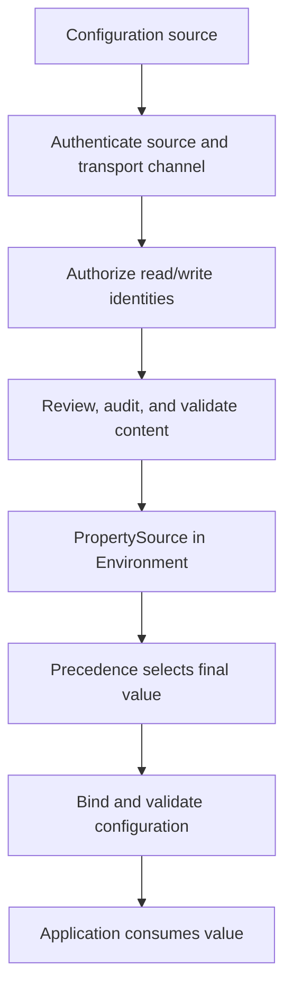

# Controlling Trusted Configuration Sources

Spring Boot and Spring Cloud allow applications to load configuration from many places: files packaged inside the JAR, external files, environment variables, command-line arguments, Spring Cloud Config Server, Vault, or secrets mounted into containers. This composability lets the same application run across multiple environments, yet also creates a critical security boundary: **which sources are permitted to supply or override configuration that the application trusts?**

Spring's `Environment` resolves property values according to `PropertySource` precedence order. That order decides which value wins when multiple sources declare the same key; it does not authenticate the source's identity, verify content signatures, or prove a value is safe. Protecting configuration sources requires combining access control, connection authentication, repository governance, per-application authorization, secret management, and override policies.

This lesson belongs to the **Security** chapter of **SPRING_CLOUD_CORE**. It focuses on the trust model of externalized configuration, property precedence, Spring Cloud Config Client/Server, TLS and authentication, configuration encryption, Vault, config trees, override policies, refresh, and testing these boundaries.

## 1. Learning Objectives

After this lesson, you can:

- Distinguish a configuration source from the trust level of that source.
- Explain why property precedence is not a security policy.
- Recognize Spring Boot configuration sources and their basic precedence order.
- Design how configuration is imported from Spring Cloud Config Server.
- Choose between mandatory and optional configuration sources.
- Protect Config Server with HTTPS, authentication, and per-application authorization.
- Manage Config Client credentials without storing secrets in Git.
- Understand the protection scope of `{cipher}` in Spring Cloud Config.
- Use Spring Cloud Vault or `configtree:` for sensitive data.
- Configure remote property source override policies aligned with the active bootstrap mechanism.
- Control profiles, refresh, and runtime configuration changes.
- Trace the origin of a property and test behavior when a trusted source is unavailable.
- Establish a configuration governance workflow with auditing, review, and least privilege.

## 2. Trust Model for Configuration Sources

An application can receive configuration from multiple sources. Each source has different distribution, write permissions, and lifecycle characteristics.

| Source | Example | Risks to Manage |
| --- | --- | --- |
| Configuration packaged in JAR | `application.yml` inside artifact | Outdated values, secrets accidentally packaged |
| External file | `/etc/myapp/application.yml` | File permissions, mount permissions, and who can modify it |
| Environment variables | `PAYMENTS_ENDPOINT` | Permission to edit deployment manifests or process environments |
| Command-line arguments | `--payments.mode=...` | Permission to launch processes and override settings |
| Spring Cloud Config Server | Git-backed property source | Client authentication, application authorization, Git integrity |
| Vault | Secret backend | Workload identity, policies, and secret lifecycle |
| Config tree | Mounted Kubernetes Secret or Docker secret | Volume access permissions, file permissions, and update mechanism |
| JSON application properties | `SPRING_APPLICATION_JSON` | High-precedence source easily misused for unintended overrides |

There is no default rule in Spring stating that remote files are always safer than environment variables, or that environment variables are always safer than local files. Trust stems from operational governance: who can modify the source, who can read it, how changes are reviewed, whether connections are authenticated, and for which purpose the application may use that source.



This diagram separates trust-establishment steps from value selection. Precedence occurs only after a source has entered the `Environment`; it does not replace authentication, authorization, or content checks.

### 2.1. Distinguishing Three Properties

When evaluating a source, separate three questions:

1. **Can the source be authenticated?** Does the application know it is connecting to the legitimate managed Config Server, Vault, or endpoint?
2. **Is the provider authorized?** Does the current identity have permission to read configuration for the right service and environment?
3. **Is the content controlled?** Are changes reviewed, audited, tested, and released through a proper workflow?

HTTPS addresses transport security and server certificate authentication. It does not verify that whoever edited Git was authorized to change `payments.admin-enabled`. Likewise, a commit inside an internal repository is not inherently safe if repository write permissions are overly broad.

### 2.2. Property Precedence Is Not Trust Ranking

Spring's `Environment` selects values according to `PropertySource` ordering. A higher-precedence source can override values from a lower-precedence source.

That does not mean the higher-precedence source is more trustworthy. For example, command-line arguments can override values in configuration files; if a deployment system lets unauthorized users alter startup arguments, they can alter application behavior without touching the Git repository.

Therefore, protect both the configuration sources and every actor allowed to inject sources into the process.

## 3. Risks of Accepting External Configuration

A property can directly influence application behavior and attack surface. For example:

```yaml
management:
  endpoints:
    web:
      exposure:
        include: "*"

spring:
  datasource:
    url: jdbc:postgresql://unexpected-host/payments
  security:
    user:
      password: weak-password

payments:
  approval:
    required: false
```

If an unauthorized party can alter these values, consequences can include:

- Exposing Actuator endpoints beyond the intended scope.
- Redirecting database connections to an untrusted host.
- Weakening authentication or disabling a business check.
- Altering service endpoints or proxy targets.
- Modifying truststores, TLS settings, or network configuration.
- Enabling overly verbose logging that writes sensitive data to logs.
- Altering discovery, service registration, or routing configurations.

Configuration is not executable code in the traditional sense, yet many properties control components with access to networks, data, or system resources. Treat permission to modify production configuration as a sensitive operational privilege.

### 3.1. Classifying Configuration

Configuration can be divided into three groups to apply appropriate policies:

| Group | Example | How to Manage |
| --- | --- | --- |
| Routine operational configuration | Timeouts, worker counts, feature flags | Config Server or deployment config with review |
| Security configuration | Auth endpoints, TLS, access policies, truststores | Strictly restricted repository/workflow with independent verification |
| Secrets | Passwords, private keys, API tokens, database credentials | Vault, secret manager, or secret volume; avoid storing in Git |

Not every property needs to live in Vault. What matters is not treating an ordinary configuration repository as long-term secret storage without proper access controls, encryption, auditing, and rotation procedures.

## 4. PropertySource Precedence Order in Spring Boot

Spring Boot constructs the `Environment` from multiple `PropertySource` entries. Under current externalized configuration ordering, lower-precedence sources appear earlier and later sources can override earlier values.

Common groups, from lowest to highest precedence:

1. Default properties set via `SpringApplication.setDefaultProperties`.
2. `@PropertySource` on configuration classes.
3. Config data, such as `application.properties` or `application.yml`.
4. `RandomValuePropertySource`.
5. Operating system environment variables.
6. Java system properties.
7. JNDI attributes.
8. `ServletContext` init parameters.
9. `ServletConfig` init parameters.
10. `SPRING_APPLICATION_JSON`.
11. Command-line arguments.
12. Test properties and dynamic test properties in test environments.
13. Devtools global settings when Devtools is enabled.

The detailed list can vary across Spring Boot versions and application types. When handling critical properties, verify the documentation for your exact deployed version.

### 4.1. Example of Multiple Sources Declaring the Same Property

Suppose the following sources all declare `payments.timeout`:

```yaml
# application.yml
payments:
  timeout: 2s
```

Environment variable:

```text
PAYMENTS_TIMEOUT=3s
```

Startup argument:

```bash
java -jar app.jar --payments.timeout=5s
```

In the default configuration, command-line arguments take precedence over environment variables, and environment variables take precedence over config data. The final resolved value is `5s`.

This behavior is convenient for certain operational tasks, but it also means permission to supply command-line arguments must be controlled.

### 4.2. @PropertySource Has Timing Limitations

`@PropertySource` is added to the `Environment` during ApplicationContext refresh. That moment may be too late for properties that must be read before refresh, such as certain `logging.*` or `spring.main.*` settings.

If a property controls bootstrap or configuration loading itself, place it in an early source such as environment variables, system properties, or command-line arguments per Spring Boot guidance.

### 4.3. Config Data and Profile Files

For standard `application` files, profile-specific config data takes precedence over non-profile files. External files outside the JAR typically override files packaged inside the JAR.

Example:

```text
application.yml
application-prod.yml
```

When the `prod` profile is active, values in `application-prod.yml` apply according to profile and config data location rules. If multiple profiles are active, profile order also affects the outcome.

Do not use profile names as an authorization mechanism. Profiles only select which configuration group is activated; permission to read production configuration must be protected at Config Server, Vault, the deployment platform, and the identity system.

## 5. Selecting Configuration Sources by Sensitivity

A practical separation:

- Non-sensitive defaults: packaged inside the JAR.
- Environment-specific values: deployment files or Config Server.
- Secrets read at runtime: Vault or a secret manager.
- Secrets mounted into containers: config tree from a protected volume.
- One-off debugging values: command-line only in controlled environments and workflows.

Example application file containing only secret source location and naming:

```yaml
spring:
  config:
    import: "optional:configtree:/run/secrets/"

payments:
  endpoint: "https://payments.internal"
  connect-timeout: 2s
```

Files inside `/run/secrets/` can provide properties such as `payments.api-key` or `spring.datasource.password`. Secret files never need to be committed to Git.

If a secret source is mandatory for the application to operate safely, consider removing the `optional:` prefix. This causes startup to fail when the secret volume is missing rather than running with incomplete configuration.

## 6. Loading Configuration from Spring Cloud Config Server

Spring Cloud Config Server provides property sources from a managed backend, commonly Git, though other repository implementations are supported. Clients receive configuration based on application name, profile, and label.

With the Spring Boot Config Data API, the modern declaration is `spring.config.import`:

```yaml
spring:
  application:
    name: payments-service
  config:
    import: "configserver:https://config.example.internal"
```

When the import omits the `optional:` prefix, Config Client treats Config Server as mandatory and fails startup if it cannot connect or retrieve configuration. This is usually appropriate when remote configuration contains settings required to run safely.

### 6.1. When to Use optional:?

Example:

```yaml
spring:
  config:
    import: "optional:configserver:https://config.example.internal"
```

`optional:` allows the application to continue starting if the import source is absent or unreachable under Config Data semantics.

Use it only when the application has safe defaults and can function properly without remote configuration. Never use `optional:` to mask authentication failures or outages of a mandatory configuration source; continuing to run on defaults can produce unsafe behavior.

### 6.2. Server Address and Identity Credentials

The server address can be configured via the import URI or `spring.cloud.config.uri`. If the import already includes a URL, that URL takes precedence under Config Client rules over the standalone URI property.

Example:

```yaml
spring:
  config:
    import: "configserver:https://config.example.internal"
  cloud:
    config:
      username: "${CONFIG_SERVER_USER}"
      password: "${CONFIG_SERVER_PASSWORD}"
```

Placeholders obtain credentials from a protected deployment source. Never commit real passwords or tokens to `application.yml`, configuration repositories, or build scripts.

### 6.3. application, profile, and label

Config Client sends identifiers so Config Server locates the right configuration:

- `application`: usually taken from `spring.application.name`.
- `profile`: the application's active profiles.
- `label`: configuration label, typically a branch, tag, or commit ID in a Git backend.

A branch-based label can change over time. For reproducible releases, consider using a commit ID or a governed immutable tag. This lets you trace the exact configuration content used for a deployment.

## 7. Protecting Config Server with Authentication and Authorization

Config Server is a central hub capable of serving configuration for many applications. Protecting server endpoints is therefore a foundational requirement.

Spring Cloud Config allows protecting the server with Spring Security mechanisms, such as HTTP Basic or OAuth2 Resource Server with JWT. For production, choose a mechanism aligned with workload identities and your credential management infrastructure.

### 7.1. HTTP Basic Over HTTPS

Example server configuration using Spring Security:

```yaml
spring:
  security:
    user:
      name: configserver
      password: "${CONFIG_SERVER_PASSWORD}"
```

The client supplies credentials via properties loaded from a secret store:

```yaml
spring:
  cloud:
    config:
      username: "${CONFIG_SERVER_USER}"
      password: "${CONFIG_SERVER_PASSWORD}"
```

HTTP Basic only protects credentials in transit when wrapped in HTTPS. Never transmit Basic credentials over plain HTTP.

### 7.2. OAuth2 Resource Server and JWT

Config Server can be configured to validate JWTs via an issuer or JWKS URI. Clients must have a way to acquire tokens and send the `Authorization: Bearer ...` header.

Spring Cloud Config Client does not automatically obtain OAuth2 tokens for every scenario. When using tokens, the application must integrate token acquisition and header attachment, such as via a customized client or matching Spring Security configuration.

Never hard-code JWTs or refresh tokens in source code. Prefer workload identities, short-lived client credentials, or token issuance managed by the deployment platform.

### 7.3. Per-Application Authorization

An easily overlooked detail: successful authentication does not mean a client should be allowed to read every application's configuration.

With basic security configuration, an authenticated user can request configuration for many different `{application}` values unless the server enforces fine-grained authorization rules. If the repository holds service-specific secrets, restrict clients so each can read only its authorized application configuration.

For example, a policy can compare the `{application}` path segment against the authenticated principal:

```java
@Configuration
@EnableWebSecurity
class ConfigServerSecurityConfiguration {

    @Bean
    SecurityFilterChain configSecurity(HttpSecurity http) throws Exception {
        http.authorizeHttpRequests(authorize -> authorize
                .requestMatchers("/actuator/health").permitAll()
                .requestMatchers("/{application}/**")
                    .access((authentication, context) -> {
                        String requestedApplication =
                                context.getVariables().get("application");
                        String principal =
                                authentication.get().getName();

                        return new AuthorizationDecision(
                                principal.equals(requestedApplication));
                    })
                .anyRequest().authenticated());

        http.httpBasic(Customizer.withDefaults());
        return http.build();
    }
}
```

This example illustrates a principal-name policy. Real-world systems generally map applications to roles, OAuth2 claims, or a policy service; do not assume usernames always equal application names. Also inspect remaining routes, such as Actuator and admin endpoints, under the principle of least privilege.

## 8. TLS and Server Authentication

Config Server returns data that can contain credentials, internal endpoints, and security configurations. Production should use HTTPS to protect both data and credentials in transit.

The server can configure TLS directly via `server.ssl.*` or sit behind a managed reverse proxy/load balancer performing TLS termination. Clients must verify the server certificate against an appropriate truststore.

### 8.1. Client-Side TLS and Mutual TLS

If Config Server requires client certificates, Config Client supports configuring a keystore and truststore:

```yaml
spring:
  cloud:
    config:
      tls:
        enabled: true
        key-store: "/run/secrets/config-client.p12"
        key-store-type: PKCS12
        key-store-password: "${CONFIG_CLIENT_KEYSTORE_PASSWORD}"
        trust-store: "/run/secrets/config-server-trust.p12"
        trust-store-type: PKCS12
        trust-store-password: "${CONFIG_SERVER_TRUSTSTORE_PASSWORD}"
```

`key-store` holds the client identity for authenticating to the server; `trust-store` holds the CA or certificate used to verify the server. If no dedicated truststore is specified, the client can use the JVM default truststore according to the configuration and version.

### 8.2. Do Not Disable Certificate Verification as a "Quick Fix"

Never disable SSL verification or trust all certificates to work around certificate errors in production. Fix the hostname, certificate chain, CA trust, or certificate expiration instead.

If TLS verification is bypassed, an on-path attacker can impersonate Config Server, supply malicious properties, or harvest client credentials.

## 9. Protecting Git Repositories Used as Configuration Sources

When Config Server uses a Git backend, the repository becomes part of the control plane.

Governance measures include:

- Grant Config Server's identity read-only access.
- Restrict write permissions to the teams or groups owning each service.
- Protect production branches with pull requests and mandatory reviews.
- Require configuration validation tests before merging.
- Maintain audit trails for commits and permission changes.
- Use immutable commits/tags for reproducible release configurations.
- Never store plaintext passwords, private keys, or tokens in the repository.
- Separate repositories or paths by security domain when independent access control is needed.
- Manage Config Server deploy keys/tokens outside the repository.
- Verify SSH host keys or TLS certificates when connecting to the Git server.

Example Git backend configuration:

```yaml
spring:
  cloud:
    config:
      server:
        git:
          uri: "https://git.example.internal/platform/configuration.git"
          username: "${CONFIG_GIT_USER}"
          password: "${CONFIG_GIT_TOKEN}"
          clone-on-start: true
```

`clone-on-start` helps catch repository access errors at Config Server startup rather than waiting for the first client request. Credentials in this example must be injected from a secret store or protected deployment environment.

### 9.1. Separating Config Client Permissions from Config Server Permissions

Config Clients only need read access to Config Server. Config Server needs credentials to read the backend repository. Never distribute write-capable Git credentials to client applications.

Separating these two identities ensures that if one service is compromised, the attacker cannot use its credentials to alter configuration repositories across the entire system.

## 10. Encrypting Values in Spring Cloud Config

Spring Cloud Config supports encrypted values in the repository prefixed with `{cipher}`. Config Server decrypts the values before sending property sources to clients.

Example configuration stored in Git:

```yaml
spring:
  datasource:
    username: payments_user
    password: "{cipher}ENCRYPTED_VALUE_FROM_CONFIG_SERVER"
```

The goal is avoiding plaintext passwords in the repository. Anyone reading Git sees ciphertext instead of the secret value.

### 10.1. Encryption at Rest Does Not Replace TLS

`{cipher}` values are decrypted before being returned to the client. Consequently, the client receives plaintext in its Environment to configure datasources or beans.

This mechanism protects data at rest inside the repository, but does not replace:

- HTTPS between clients and Config Server.
- Client authentication and per-application authorization.
- Protection of client memory, logs, and Actuator endpoints.
- Encryption key management.
- Access control over who can call Config Server endpoints.

### 10.2. Managing Encryption Keys

Never store encryption keys alongside ciphertext in the same repository. Manage keys with an appropriate secret/KMS system featuring restricted access and a rotation workflow.

If a key is compromised, corresponding ciphertext loses its protection. If a key is lost, Config Server cannot decrypt historical values; plan for backup, rotation, and re-encryption.

### 10.3. Decryption Failures

When a value fails to decrypt, Config Server can drop the ciphertext value from the property source and add an `invalid`-prefixed property to report the failure. This prevents the application from accidentally using a raw ciphertext string as a password.

Monitor server logs and check the key, algorithm, ciphertext format, and compatibility between server and client versions. Never work around decryption errors by copying ciphertext into a plaintext password field.

## 11. Using Vault for Secrets with Independent Lifecycles

Spring Cloud Vault integrates a Vault secret backend into the Spring `Environment` via the Config Data API. For Spring Boot 2.4 and later, this is preferred over the legacy bootstrap context in current Spring Cloud Vault versions.

Example:

```yaml
spring:
  config:
    import: "vault://"
```

The application must configure the Vault address, TLS, and appropriate authentication mechanism. `vault://` is mandatory by default; if Vault is optional, `optional:vault://` can be used in accordance with operational requirements.

### 11.1. Do Not Use Root Tokens in Applications

Root tokens in quickstarts are only for initial experimentation. Production applications should use identities with policies scoped strictly to required paths and operations.

Infrastructure-dependent authentication options include Kubernetes auth, AppRole, or cloud-platform workload identities. Prefer short-lived or automatically issued credentials over long-lived static tokens.

### 11.2. Separating Regular Configuration from Secrets

Config Server can manage endpoints, timeouts, feature flags, and non-secret values. Vault manages passwords, tokens, and keys with independent lifecycles.

Example:

```yaml
spring:
  config:
    import:
      - "configserver:https://config.example.internal"
      - "vault://"
```

When multiple imports are present, import order and placement affect precedence. Clearly establish which properties are owned by Config Server and which by Vault, and avoid duplicating the same sensitive key across multiple sources.

## 12. Using configtree for Mounted Secrets

Spring Boot supports `configtree:` to read files inside a directory as properties. Filenames become keys and file contents become values.

Example volume mount:

```text
/run/secrets/
├── payments.api-key
└── spring.datasource.password
```

Import declaration:

```yaml
spring:
  config:
    import: "configtree:/run/secrets/"
```

The application can read `payments.api-key` or `spring.datasource.password` as ordinary properties.

### 12.1. Kubernetes Secrets and Docker Secrets

Kubernetes can mount a ConfigMap or Secret as a volume. Docker Swarm can mount Docker secrets into a designated directory.

Use `configtree:` when the platform is already responsible for distributing files and restricting access. Verify:

- The volume is mounted only into containers needing the secret.
- File permissions and process user match least privilege.
- Secrets are never baked into image layers.
- File contents are never logged.
- Update/rotation procedures are tested.
- Whether the application needs a restart or refresh to pick up new values.

### 12.2. Do Not Confuse ConfigMap with Secret

ConfigMap is suitable for non-sensitive configuration. Secret is designed for sensitive data, yet still requires access control, cluster encryption at rest, and API read restrictions. Placing data in an object named `Secret` does not automatically guarantee only authorized workloads can read it.

## 13. Remote Property Source Override Policies

Spring Cloud Config provides properties that control overriding remote values. Distinguish the modern Config Data mechanism from the legacy bootstrap context.

In bootstrap mode, remote property sources can be protected from local overrides by default. To allow local overrides, the remote source must permit them via `spring.cloud.config.allowOverride=true`. This flag must be set in the remote property source; setting it on the local client does not grant override permission.

### 13.1. Flags in Bootstrap Mode

Example remote configuration in the repository granting override permission:

```yaml
spring:
  cloud:
    config:
      allow-override: true
      override-none: false
      override-system-properties: false
```

Set these flags only when the owner of the remote configuration intentionally wants clients to override values according to the chosen policy. Do not place `allow-override` in a local file expecting it to authorize local sources.

| Property | Meaning |
| --- | --- |
| `spring.cloud.config.allowOverride` | Enables detailed override policies; must be granted by the remote source |
| `spring.cloud.config.override-none=true` | Places remote properties at lower precedence so local property sources can override them |
| `spring.cloud.config.override-system-properties=false` | Allows system properties, command-line args, and environment variables to override remote properties while local config files still do not |

These flags must be used strictly according to the documentation of your Spring Cloud version. They are not user authorization mechanisms; they only adjust property source ordering.

### 13.2. Do Not Apply Mechanically to Config Data Imports

The override flags above belong to Config Client behavior under bootstrap context and do not have the same effect when using Spring Boot's Config Data API. With:

```yaml
spring:
  config:
    import: "configserver:https://config.example.internal"
```

manage precedence using Config Data rules: import placement, import ordering, and Spring Boot property source precedence. Do not expect `override-none` to alter import ordering in Config Data mode.

### 13.3. Choosing Policies by Property Ownership

Before allowing local overrides, identify who owns each property:

- Properties safe for operators to override: timeouts or resource limits may be appropriate.
- Security-controlling properties: auth endpoints, TLS, authorization, or access policies require strict protection.
- Secrets: should have a single clear owning source, avoiding copies across multiple property sources.

If command-line arguments and environment variables can override security properties, permission to modify deployment manifests or process arguments must be governed as security policy modification privilege.

## 14. Profiles Are Not Security Boundaries

Profiles such as `dev`, `test`, `staging`, and `prod` activate configuration groups. Profiles do not authenticate callers and do not grant permission to read data.

Do not rely on a client sending `profile=prod` to decide whether that caller may read production secrets. Config Server must authenticate identities and authorize by application/environment/label; Vault requires corresponding policies.

Example:

```yaml
spring:
  profiles:
    active: prod
```

This setting only selects a profile. If a client can switch profiles or request URLs for another configuration, the server must still enforce authorization before returning data.

## 15. Refresh and Runtime Configuration Change Risks

Spring Cloud Context supports updating the Environment and refreshing certain beans upon receiving a refresh event. This enables changing timeouts, feature flags, or endpoints without always restarting the entire process.

However, refresh also alters application behavior after startup. If a configuration source is compromised or misconfigured, the impact can propagate across many running instances.

Principles to apply:

- Restrict who can commit or publish configuration.
- Review changes before release.
- Roll out to a small canary group before cluster-wide application.
- Record the version/commit/label of running configuration.
- Monitor refresh events and binding results.
- Maintain a rollback procedure to a previous configuration version.
- Do not use refresh to rotate secrets unless the secret mechanism guarantees consistency and safety.
- Verify whether beans properly support refresh or require a restart.

### 15.1. Refresh Is Not an Atomic Cluster-Wide Transaction

A refresh event does not guarantee every instance receives it simultaneously or succeeds uniformly. During rollout, replicas may run with two different configuration versions.

For changes affecting security policies, credentials, or communication schemas, design compatibility between old and new versions and verify each instance's state.

### 15.2. Recording Configuration Source and Version

Record deployment metadata such as Git commit ID, Config Server label, image version, and refresh timestamp. There is no need to log full property values; logging source identifiers and versions enables auditing without leaking secrets.

## 16. Tracing the Source of a Property

When a value does not match expectations, determine which source provided the final resolved value.

You can inspect via `Environment`:

```java
@Component
class PropertySourceInspector {

    private final ConfigurableEnvironment environment;

    PropertySourceInspector(ConfigurableEnvironment environment) {
        this.environment = environment;
    }

    void printSourcesFor(String propertyName) {
        for (PropertySource<?> source : environment.getPropertySources()) {
            if (source.containsProperty(propertyName)) {
                System.out.println(
                        propertyName + " is present in " + source.getName());
            }
        }
    }
}
```

This example prints only property source names, not values. When diagnosing sensitive properties, avoid logging plaintext.

### 16.1. Actuator env and configprops

Actuator provides `/actuator/env` to inspect property sources and origin metadata when available; `/actuator/configprops` shows how data was bound into `@ConfigurationProperties`.

These endpoints are helpful yet can reveal internal structure and sensitive configuration names. Expose them only on a protected management interface, restrict access permissions, and maintain proper sanitization.

Never expose `env` or `configprops` publicly just to debug a configuration issue. Inspect them locally/in tests or use constrained logs recording only source names.

### 16.2. Property Origin Is Not an Authentication Signature

Origin may point to the file, line, or property source supplying a value. It helps with traceability, yet does not prove the file/repository was approved by an authorized party.

To prove a source is trusted, you still need Git auditing, author identity, access policies, and distribution channel integrity.

## 17. Validating and Verifying Configuration After Loading

Even an authenticated source can contain erroneous or unsafe values due to human error. Bind configuration to validated types rather than reading loose strings across multiple beans.

Example:

```java
@ConfigurationProperties(prefix = "payments")
@Validated
public record PaymentsProperties(
        @NotNull URI endpoint,
        @NotNull Duration connectTimeout,
        @Min(1) @Max(20) int maxConnections) {
}
```

Register properties with `@ConfigurationPropertiesScan` or `@EnableConfigurationProperties` as appropriate for your application. Validation checks required values, numeric bounds, formats, and business constraints.

### 17.1. Validation Does Not Replace Authorization

`@NotNull`, `@Min`, `@Max`, or custom validators prevent malformed configuration. They cannot determine whether the person editing a property was authorized to change policy.

For example, `payments.admin-enabled=true` may be type-valid yet must never be enabled from an untrusted configuration source. Permission to modify sensitive properties must be enforced at the repository, Config Server, secret manager, and deployment pipeline.

### 17.2. Allowlists for Sensitive Values

For properties that can redirect connections or alter trust, consider allowlists:

- Permitted hostnames or domains.
- Mandatory HTTPS URI scheme.
- Permitted secret path names.
- Accepted profiles/labels.
- Feature flag values managed strictly by an authorized control plane.

Never take an arbitrary URL from a lower-privilege configuration source and use it directly to make HTTP calls, load plugins, or connect to internal addresses.

## 18. Testing Configuration Source Policies

Tests should cover both successful loading and safe behavior when a source is invalid or unavailable.

| Scenario | Expectation |
| --- | --- |
| Mandatory Config Server unreachable | Application fails startup rather than using unintended defaults |
| Config Server marked optional and unreachable | Application runs only if defaults were designed safely |
| Invalid Config Server credentials | Request rejected; password/token never logged |
| Client A requests config for service B | Config Server rejects per authorization policy |
| Untrusted server certificate | TLS handshake fails |
| Nonexistent Git label | Config Server/Client reports error per fail-fast policy |
| Property present in multiple sources | Final value matches designed precedence |
| Config contains value outside allowlist | Validation or policy control rejects it |
| Secret volume not mounted | Startup fails if secret is mandatory |
| Refresh receives new configuration | Beans update per contract and can be rolled back |

### 18.1. Testing Mandatory Config Client

For a Config Server required at startup, omit `optional:`:

```yaml
spring:
  config:
    import: "configserver:https://config.example.internal"
```

Integration tests can start a test Config Server or compatible stub, verify configuration loads, then stop the server and verify the client fails when the mandatory import is unreachable.

### 18.2. Testing Property Precedence

Supply the same key via two or more test sources. Verify the higher-precedence source wins in your active Spring Boot version.

Do not check only `Environment.getProperty`; if the property binds to `@ConfigurationProperties`, inspect the bound object to catch conversion and validation errors.

### 18.3. Testing Per-Application Authorization

Call Config Server endpoints using service A's identity, attempting to fetch:

- Service A's configuration.
- Service B's configuration.
- Permitted shared configuration.
- Production configuration when the identity holds only staging permissions.

Results must reflect the authorization policy, not merely whether authentication succeeded.

## 19. Operational Workflow for Trusted Configuration Sources

A workflow applicable to every change:

1. Identify the property owner and sensitivity level.
2. Select the appropriate source: config repository, Config Server, Vault, or secret volume.
3. Grant read/write permissions by identity and responsibility.
4. Review changes and inspect diffs before merging.
5. Run validation and tests for affected profiles/labels.
6. Release by traceable commit/tag.
7. Verify Config Clients receive the expected version and property origin.
8. Monitor startup, health, and refresh outcomes.
9. Roll back if anomalies occur.
10. Audit access permissions and rotate credentials on schedule or after incidents.

Never use a single shared account with read access to all secrets across all microservices. Isolating identities by workload limits the blast radius if an application is compromised.

## 20. Security Checklist

- [ ] Each configuration source has a clear owner and purpose.
- [ ] Property precedence has been verified in the exact Spring Boot version.
- [ ] Command-line arguments, environment variables, and deployment manifests are protected.
- [ ] Config Server accepts only authenticated connections.
- [ ] Config Server uses HTTPS in production.
- [ ] Clients verify server certificates and hostnames.
- [ ] Authorization by application/profile/label is enforced when configs hold service-specific data.
- [ ] Config Server holds minimal read-only Git permissions.
- [ ] Configuration repositories enforce branch protection, reviews, and auditing.
- [ ] Secrets are never committed in plaintext.
- [ ] `{cipher}` is treated as encryption at rest, not a replacement for TLS.
- [ ] Encryption keys are managed separately from the repository.
- [ ] Secrets are distributed via Vault or a secret manager where appropriate.
- [ ] `optional:` is used only when the application has safe fallbacks.
- [ ] Bootstrap override policies are not confused with Config Data imports.
- [ ] Profiles are never used as an authorization mechanism.
- [ ] Refresh includes rollout, monitoring, and rollback.
- [ ] Actuator `env`, `configprops`, and `conditions` are protected.
- [ ] Logs never write plaintext secrets or tokens.
- [ ] Tests cover cross-application access and unavailable configuration sources.

## 21. Summary

Spring Boot and Spring Cloud allow combining multiple configuration sources, yet `PropertySource` precedence only decides which value wins; it does not authenticate sources or authorize providers. Controlling trusted configuration sources requires securing repositories, Config Server, client identities, secret stores, deployment environments, and refresh workflows.

With Spring Cloud Config, use mandatory imports when remote configuration is required for safe operation, protect the server with HTTPS and authentication, and restrict each client to its authorized applications. `{cipher}` avoids plaintext in repositories, yet values are decrypted before delivery to clients, so TLS and key management remain mandatory. For secrets with independent lifecycles, Vault or mounted secret volumes via `configtree:` are usually better suited.

Finally, verify property precedence, validate bound values, track configuration sources and versions, and test both unavailable sources and unauthorized access. Configuration is trustworthy only when its identity, access permissions, integrity, and change process are all controlled.

## 22. References

- [Spring Boot Reference — Externalized Configuration](https://docs.spring.io/spring-boot/reference/features/external-config.html)
- [Spring Cloud Config — Config Client](https://docs.spring.io/spring-cloud-config/reference/client.html)
- [Spring Cloud Config — Server Security](https://docs.spring.io/spring-cloud-config/reference/server/security.html)
- [Spring Cloud Config — Encryption and Decryption](https://docs.spring.io/spring-cloud-config/reference/server/encryption-and-decryption.html)
- [Spring Cloud Config — Git Backend](https://docs.spring.io/spring-cloud-config/reference/server/environment-repository/git-backend.html)
- [Spring Cloud Config — Property Overrides](https://docs.spring.io/spring-cloud-config/reference/server/environment-repository/property-overrides.html)
- [Spring Cloud Commons — Configuration Properties](https://docs.spring.io/spring-cloud-commons/reference/configprops.html)
- [Spring Cloud Vault — Config Data API](https://docs.spring.io/spring-cloud-vault/reference/config-data.html)
