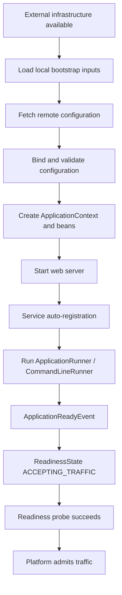
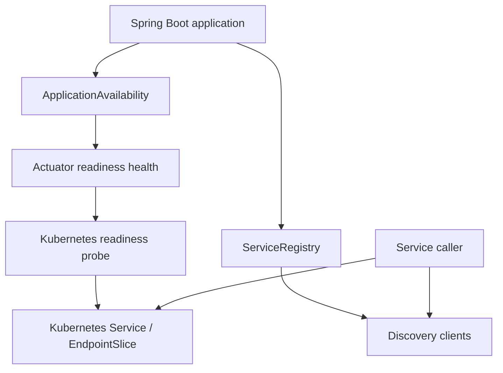
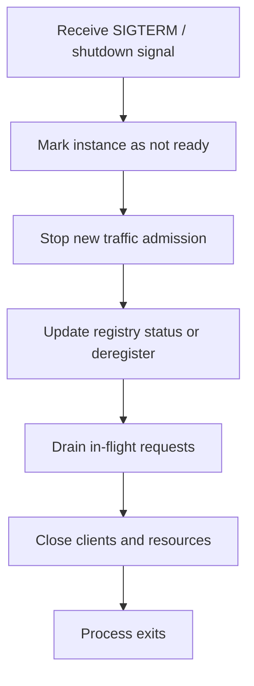

# Readiness Sequencing of Configuration Sources, Registry, and Applications

A Spring Cloud service can only receive stable traffic when multiple components become ready in the right order: external configuration sources must supply the required values, the service registry/discovery must be reachable, the application must finish creating its context and completing startup tasks, and then readiness allows the system to route requests to the instance.

These states are related, not synonymous. Fetching configuration does not prove the database is connected. Registering successfully in a registry does not prove the application is ready to process business logic. Refreshing the `ApplicationContext` does not mean all runners, cache warm-ups, or required dependency checks have finished. Collapsing everything into a single "UP" flag can cause rollouts to send traffic too early or trigger fleet-wide restarts when a shared dependency fails.

This lesson belongs to the **Operations** chapter of the `SPRING_CLOUD_CORE` module. It builds the end-to-end sequence from Config Server, discovery, and `ServiceRegistry` to Spring Boot lifecycle, readiness/liveness, traffic admission, rollout, and shutdown. Examples use Spring Cloud Commons as the common abstraction; details on registration, health propagation, and retry must be verified against your actual provider and release train.

## 1. Map of Readiness States

A microservice typically has at least five states to track:

| State | Question to Answer | Example Evidence |
| --- | --- | --- |
| Configuration available | Has the application loaded the required configuration? | Config Data import succeeded; properties bound and validated |
| Infrastructure reachable | Can required systems be reached? | Database, broker, registry, or secret store passes appropriate checks |
| Registered/discoverable | Has the instance been published and can clients find it? | `ServiceRegistry` confirms registration; discovery returns the instance |
| Application ready | Has the application finished startup and can it handle requests? | Spring Boot `ReadinessState` is `ACCEPTING_TRAFFIC` |
| Traffic admitted | Is infrastructure routing requests to this instance? | Kubernetes Pod Ready, Service EndpointSlice, or healthy load balancer target |

Do not use a single signal as a proxy for everything. For example:

- Config Server returns configuration successfully, but the configuration contains a wrong database URL.
- Eureka accepts registration, but the application is still warming up caches.
- `ApplicationContext` is created, but an `ApplicationRunner` is still loading mandatory data.
- Kubernetes readiness probe succeeds, but Eureka clients have not yet synced the instance to consumers.
- Registry has the instance, but a network policy blocks traffic from callers.

Readiness is the result of multiple conditions and can differ by traffic type. An application might be ready for read requests while not yet ready for write commands if the write backing store is under maintenance. In such cases, design readiness groups or business-aware routing policies instead of relying solely on a single generic health flag.

## 2. Overall Startup Sequence

A common operational sequence:



This is a logical model for designing dependencies and observability; exact ordering for certain integrations may vary by provider, Spring Cloud release train, and configuration. In particular, registry auto-registration typically happens during the provider's integration lifecycle, potentially before application readiness is emitted. Never infer that "registered" means "ready".

Key Spring Boot lifecycle milestones:

1. `ApplicationEnvironmentPreparedEvent`: The `Environment` is prepared, before the context is created.
2. `ApplicationContextInitializedEvent`: The context is prepared and initializers have run, but bean definitions are not yet loaded.
3. `ApplicationPreparedEvent`: Bean definitions are loaded, right before refreshing the context.
4. `ContextRefreshedEvent` and `WebServerInitializedEvent`: The context is refreshed and the web server is initialized.
5. `ApplicationStartedEvent`: The context is refreshed, before calling application/command-line runners.
6. `AvailabilityChangeEvent` with `LivenessState.CORRECT`: The application is considered live.
7. `ApplicationReadyEvent`: Runners have completed.
8. `AvailabilityChangeEvent` with `ReadinessState.ACCEPTING_TRAFFIC`: The application reports it is ready to accept traffic.

These events are useful for understanding when to load configuration, initialize resources, register services, and enable traffic. Listeners run synchronously in the event-publishing thread by default; avoid placing long-running work in event listeners if it delays startup.

## 3. Preparing Infrastructure Before Starting Services

Before starting an application instance, identify which systems are startup dependencies:

| Component | Needed Before Context Creation? | Policy When Unavailable |
| --- | --- | --- |
| Config Server | Yes, if remote config is mandatory | Fail startup or retry within deadline |
| Discovery used to locate Config Server | Yes, if discovery-first lookup is enabled | Fail/retry based on criticality |
| Database | Depends on whether bean creation needs immediate connection | Fail-fast, lazy connection, or mark not-ready |
| Message broker | Depends on whether startup listeners/producers are mandatory | Not-ready or business-level degraded mode |
| Service registry | Usually needed before instance becomes discoverable | Retry registration, hold traffic, or fail per policy |
| Secret store | Yes, if secrets are needed to bind beans or start TLS | Fail startup if required secrets are missing |
| Monitoring backend | Usually not required for business processing | Start normally while emitting observability alerts |

Not every dependency must be up before Spring creates the context. An application can create beans first and connect to the database when needed. However, if business logic cannot serve requests without the database, readiness must reflect that.

### 3.1. Preparing Network, DNS, and Credentials

Before checking application state, verify:

- DNS for Config Server, registry, database, and broker resolves correctly.
- Routes and firewalls allow the expected traffic.
- TLS certificates, truststores, and hostname verification are valid.
- Credentials have permissions to read configuration, register instances, and connect to dependencies.
- System clocks are sufficiently accurate when tokens/certificates are time-sensitive.
- Secrets are supplied via a secret manager, Kubernetes Secret, or appropriate deployment mechanism.

A DNS or credential error should not be handled with infinite retries. Retries only help transient errors; misconfigurations must fail early so operators fix the root cause.

## 4. Loading Configuration from Spring Cloud Config

### 4.1. Config Data Import

In modern Spring Boot, the standard way to import Config Server is `spring.config.import`:

```properties
spring.application.name=catalog-service
spring.config.import=configserver:http://config-server:8888
```

Omitting the `optional:` prefix means Config Server is a mandatory startup dependency. If the client cannot connect or fetch required configuration, Config Client fails startup.

If remote config is truly optional:

```properties
spring.config.import=optional:configserver:http://config-server:8888
```

In that case, the application can continue using local configuration if Config Server is unavailable. Only use `optional` when local configuration is sufficient for safe operation; do not turn a mandatory dependency into optional just so the Pod starts.

A `bootstrap.yml` file is not required when using Config Data import. The legacy bootstrap mechanism has a different lifecycle and must be enabled separately. Do not mix both approaches arbitrarily; choose one according to your version and architecture.

### 4.2. Minimum Configuration to Locate Config Server

Remote configuration cannot be the sole source of information needed to reach Config Server itself. Values such as the Config Server address, bootstrap credentials, TLS trust, and the discovery service address used to find Config Server must be available from local configuration, environment, or another secret source.

Example:

```yaml
spring:
  application:
    name: catalog-service
  config:
    import: "configserver:http://config-server:8888"
```

When using discovery-first lookup:

```yaml
spring:
  application:
    name: catalog-service
  config:
    import: "optional:configserver:"
  cloud:
    config:
      discovery:
        enabled: true
        service-id: configserver

eureka:
  client:
    service-url:
      defaultZone: http://eureka:8761/eureka/
```

The example above illustrates Eureka. The discovery server address must be available from local config or environment, because the client must find Config Server before it can fetch remote property sources. Discovery-first lookup adds an extra network round trip to locate Config Server; in return, Config Server can change coordinates without clients hard-coding new addresses. With Config Data discovery-first, Config Client documentation requires the import to carry the `optional:` prefix; if remote configuration is mandatory and strict fail-fast is needed, consider config-first with a fixed URL or carefully test `spring.cloud.config.fail-fast` behavior for your release train.

### 4.3. Config Server May Be Called Multiple Times at Startup

With Config Data, Spring Boot may load configuration in multiple passes: first with the `default` profile, and then loading additional configuration for activated profiles. Therefore, multiple requests to Config Server during startup can be normal behavior, not necessarily a retry loop.

When analyzing logs, distinguish requests from Config Data profile resolution from retry requests after network errors. Check the application name, active profiles, label, and request timing.

### 4.4. Choosing Fail-Fast vs. Optional

| Scenario | Commonly Suitable Policy |
| --- | --- |
| Remote config contains mandatory database credentials | Required import; fail startup if unreachable |
| Remote config only adds optional feature flags | Optional may be used if local defaults are safe |
| Config Server briefly interrupted during deploy | Required import combined with bounded retry |
| Local config can run but risks targeting wrong environment | Fail-fast to avoid starting with wrong configuration |
| Application must continue running with packaged config snapshot | Design explicit fallback and check freshness/version |

Do not focus solely on whether the process starts. Verify that the application has loaded the right configuration version, profile, and label.

## 5. Retrying When Config Server Is Not Yet Ready

If Config Server may be temporarily unavailable during a rollout, bounded retries help avoid failing immediately on a brief network blip.

Spring Cloud Config Client supports retries when fail-fast is configured and required Spring Retry dependencies are present. With Config Data import, retry parameters can be declared on the import URL:

```properties
spring.config.import=configserver:http://config-server:8888?fail-fast=true&max-attempts=8&initial-interval=500&max-interval=5000&multiplier=1.5
```

These numbers are examples only. Choose `max-attempts`, intervals, and multiplier based on your platform's startup deadline. Config Client documentation also notes adding `spring-retry` and `spring-boot-starter-aop` dependencies for retry integration.

If the import is inside a profile-specific file, retry configuration may need to be placed directly as query parameters on the import statement according to your Spring Cloud Config version's documentation.

### 5.1. Retries Cannot Fix Configuration Errors

Classify scenarios as follows:

- Connection refused or temporary timeout: retriable.
- DNS not yet updated during rollout: short bounded retries can help.
- HTTP 401/403: wrong credentials or permissions; continuous retries usually will not resolve it.
- HTTP 400 due to malformed request: fix client configuration.
- Wrong application/profile/label: verify name and configuration version.
- Config Server cannot reach Git backend: fix backend errors based on server logs.

Retries should have backoff and an overall time limit. If 100 instances retry on the exact same schedule, Config Server can suffer a retry storm. Use jitter where supported, stagger rollouts, and avoid restarting the entire fleet simultaneously.

### 5.2. Do Not Use Readiness as a Substitute for Config Import

Readiness is checked only after the process has started far enough to serve probes. If mandatory configuration cannot be loaded before bean creation, handle it in the startup phase via required import/fail-fast. Do not start the application with dummy values expecting readiness to fix configuration later.

## 6. Validating Configuration Before Admitting Traffic

After loading local and remote properties, the application must bind and validate configuration.

Example:

```java
@ConfigurationProperties(prefix = "catalog.client")
@Validated
public class CatalogClientProperties {

    @NotNull
    private URI baseUrl;

    @NotNull
    private Duration connectTimeout;

    @NotNull
    private Duration readTimeout;

    // getters and setters
}
```

If a required property is missing or invalid, startup should fail with a message clear enough to identify the key to fix. Do not log secret values.

Configuration that is valid by data type is not necessarily valid for the environment. For example, a syntactically valid URI might point to a production database from staging. You can additionally check:

- Hostname belongs to the expected environment.
- TLS is enabled for sensitive endpoints.
- Timeouts are positive and within bounds.
- Profile and Config Server label match the release.
- Feature flags do not form unsupported combinations.
- Secret version is compatible with current certificates or credentials.

Once configuration is validated, create beans and initialize necessary resources. If data warm-up or mandatory business checks are needed, run them via `ApplicationRunner`/`CommandLineRunner` or lifecycle orchestration with an explicit deadline.

## 7. Discovery and Service Registry

### 7.1. Discovery and Registration Solve Two Different Directions

`DiscoveryClient` helps clients find instances of other services. `ServiceRegistry` manages registration of the current instance. They are related, not interchangeable:

- Discovery answers "which instances exist for service X?".
- Registration answers "has the current instance been published to the registry?".
- Health/readiness answers "which kinds of traffic can this instance handle right now?".

An instance can register successfully while not yet ready. A client can hold stale discovery caches after the registry updates. A registry can be reachable while having no suitable instances.

### 7.2. Default Auto-Registration

Spring Cloud Commons allows `ServiceRegistry` implementations to automatically register running services. You can disable auto-registration with:

```yaml
spring:
  cloud:
    service-registry:
      auto-registration:
        enabled: false
```

Or use `@EnableDiscoveryClient(autoRegister = false)` in appropriate configuration.

Spring Cloud Commons publishes two events for auto-registration:

- `InstancePreRegisteredEvent`: published before the service is registered.
- `InstanceRegisteredEvent`: published after the service is registered.

These events are not published when auto-registration is disabled via property. Listeners can be used for logging, emitting metrics, or coordinating related tasks. The "registered" event confirms registration was invoked/completed according to the implementation; it does not prove all discovery clients have received the update or that the application is ready for traffic.

### 7.3. Choosing When to Register

If you want to publish the instance only after runners have finished and before Spring Boot transitions readiness to accepting traffic, you can disable auto-registration and orchestrate registration in `ApplicationReadyEvent`. This is an advanced option requiring knowledge of your specific provider and ensuring deregistration on shutdown.

Configuration skeleton:

```yaml
spring:
  cloud:
    service-registry:
      auto-registration:
        enabled: false
```

Spring Boot emits `ApplicationReadyEvent` after application/command-line runners complete and right before the event transitioning `ReadinessState` to `ACCEPTING_TRAFFIC`. You can use this hook to register synchronously before default readiness allows traffic:

```java
@Component
public class RegistryReadinessListener {

    @EventListener(ApplicationReadyEvent.class)
    public void onApplicationReady() {
        // Invoke registration orchestration using ServiceRegistry
        // and Registration matching your active provider.
    }
}
```

This is a lifecycle hook, not a complete registration implementation. Spring event listeners run synchronously under Spring's event mechanism; registration must complete according to your chosen policy before the listener returns. In a real implementation, you must:

- Inject `ServiceRegistry` and `Registration` typed for your provider.
- Ensure you do not double-register on duplicate events.
- Handle registration failures with bounded retries.
- Deregister or transition status out of traffic on shutdown.
- Consider ordering between readiness and registration to avoid gaps with zero available instances.
- Test against your actual Eureka, Consul, or chosen provider.

If auto-registration remains enabled, do not add manual registration logic alongside it, as that can cause duplicate registrations or inconsistent status updates.

### 7.4. Registry May Not Reflect Application Readiness

With Eureka, default heartbeats do not automatically propagate Spring Boot Actuator health states. Without health check integration enabled, a newly registered client may be advertised as `UP` by Eureka even though the application is not business-ready.

You can enable:

```yaml
eureka:
  client:
    healthcheck:
      enabled: true
```

Spring Cloud Netflix recommends placing this property in `application.yml`, not `bootstrap.yml`, to avoid undesirable registration states. Verify behavior for your exact release train and provider; do not generalize Eureka mechanisms to every `ServiceRegistry` implementation.

### 7.5. Monitoring ServiceRegistry Status

Spring Cloud Commons provides the `/serviceregistry` Actuator endpoint when a suitable `Registration` exists. `GET` reads registration status; `POST` changes status using values supported by the provider.

This endpoint is useful for operations, but `POST` can affect whether the instance receives traffic. Protect it with authentication/authorization and never expose it as a public health probe.

## 8. Spring Boot Liveness and Readiness

Spring Boot provides `ApplicationAvailability` along with liveness/readiness states.

### 8.1. Liveness

Liveness answers the question: is the process still in a state where it can operate or self-recover? If liveness fails persistently, the platform can restart the container.

Do not include database, Config Server, Eureka, or external APIs in liveness in a way that causes a shared dependency failure to restart all Pods. Mass restarts reduce system capacity and cause cascading failures.

Liveness should reflect unrecoverable internal state, such as deadlocks or corrupted process state.

### 8.2. Readiness

Readiness answers the question: can this instance accept business requests right now? Spring Boot defaults to transitioning to `ACCEPTING_TRAFFIC` after context refresh and application/command-line runners finish.

Readiness can transition back to `REFUSING_TRAFFIC` at runtime when the application needs to temporarily pause incoming traffic, such as during maintenance or controlled overload. Orchestration platforms use this signal to stop routing requests to the instance.

### 8.3. Health Groups

When Actuator is used, Spring Boot exposes health groups for liveness and readiness in supported environments:

```text
/actuator/health/liveness
/actuator/health/readiness
```

Health probes can be configured explicitly:

```yaml
management:
  endpoint:
    health:
      probes:
        enabled: true
```

Depending on the environment and Spring Boot version, probes may be auto-configured when Kubernetes is detected. Explicit declaration is helpful when consistent behavior is desired in tests or other environments. Do not expose sensitive health details on public interfaces.

### 8.4. Readiness Dependencies Must Be Chosen Carefully

You can include a dependency in the readiness group if the instance cannot serve business traffic without it. For example:

```yaml
management:
  endpoint:
    health:
      group:
        readiness:
          include: readinessState,db
```

This example only makes sense if the database is truly mandatory for the traffic being served. If the database temporarily fails while the service can still serve cached data or handle another category of requests, overly strict readiness could remove all instances even when partial serving is possible.

Avoid putting every dependency into readiness. Classify them:

- **Hard dependency:** without it, requests cannot be processed properly.
- **Soft dependency:** can degrade, use cache, or return controlled responses.
- **Optional dependency:** does not affect primary traffic.
- **Control-plane dependency:** registry/config/monitoring; failure may affect discovery or management without preventing the process from handling ongoing requests.

## 9. Kubernetes Startup, Liveness, and Readiness Probes

Kubernetes has three probe types with distinct goals:

| Probe | Goal | On Failure |
| --- | --- | --- |
| Startup | Give the application time to complete initial initialization | Kubelet restarts container after failure threshold |
| Liveness | Detect a process that can no longer continue operating | Kubelet restarts container |
| Readiness | Decide whether the Pod should receive traffic from a Service | Pod is marked not-ready and removed from matching Service EndpointSlices |

If a startup probe is configured, Kubernetes does not run liveness/readiness probes until the startup probe succeeds. The readiness probe continues running throughout the lifecycle; when it fails, the container is not restarted solely for readiness failure.

Example:

```yaml
containers:
  - name: catalog
    image: example/catalog-service:latest
    ports:
      - name: http
        containerPort: 8080
    startupProbe:
      httpGet:
        path: /actuator/health/liveness
        port: http
      periodSeconds: 5
      failureThreshold: 36
    livenessProbe:
      httpGet:
        path: /actuator/health/liveness
        port: http
      periodSeconds: 10
      timeoutSeconds: 2
      failureThreshold: 3
    readinessProbe:
      httpGet:
        path: /actuator/health/readiness
        port: http
      periodSeconds: 5
      timeoutSeconds: 2
      failureThreshold: 3
```

Thresholds are examples only. Calculate the total startup budget based on config fetch time, context creation, dependency connections, and warm-up. The startup probe must be long enough for the slowest normal startup, yet not so long that it masks a persistent configuration error.

### 9.1. Do Not Use Liveness to Wait for Config Server

If Config Server is a mandatory dependency, resolve it in the config import/startup phase. Startup probes only grant the process more startup time; they do not fix endpoints, credentials, or remote config. If startup hangs indefinitely due to unbounded retries, the startup probe only delays failure detection.

### 9.2. Readiness and Service Routing

When a readiness probe fails, the Pod is marked not-ready and its IP is removed from the EndpointSlices of matching Services. This stops Kubernetes Services from sending new traffic to that Pod.

This is Kubernetes routing. Eureka/Consul maintain separate registry state and caches; Kubernetes readiness does not automatically update status in external registries without integration.

### 9.3. Separate App Readiness from Non-Essential Dependencies

If the monitoring backend or registry fails, the application may still process already-routed requests and does not need a restart. Base readiness on business serving capability rather than requiring every control-plane system to be green.

## 10. Combining Readiness with ServiceRegistry and Discovery

An architecture may have two independent control planes:



Kubernetes Service routing and external service registries do not synchronize automatically. If a service is called through both paths, design corresponding state policies for both.

For example:

- Readiness fails: Kubernetes stops routing through the Service.
- Registry still reports `UP`: callers using Eureka may keep selecting that instance.
- Registration is deregistered: Eureka callers gradually drop the instance, while a Kubernetes Service may still see the Pod as Ready if its readiness probe still passes.

Avoid conflicting states by choosing one primary routing source, or implementing proper health propagation/registration lifecycles. With multiple registries, understand each provider's cache TTL, heartbeat, eviction, and propagation delay.

### 10.1. When Should Registration Happen Before Readiness?

Some systems need to register instances as soon as the web server initializes so discovery can locate the service. This can be acceptable if:

- Registry status does not cause callers to send traffic before readiness.
- Registry health checks reflect appropriate state.
- Clients implement retries/timeouts and handle unready instances.
- Platform readiness gates still control internal traffic.

Without those guarantees, consider deferring registration until the application is ready or using `OUT_OF_SERVICE` status during warm-up if supported by the provider.

### 10.2. When Should Registration Be Deferred?

Deferring registration makes sense when callers use the registry directly and the provider does not reflect app readiness. However, if registration is a prerequisite for another service to finish starting up, deferring can create a dependency cycle.

For example, A waits for B to register, and B waits for A to register. Detect dependency cycles and design applications to start in a degraded/ready state where possible, or separate bootstrap dependencies from traffic dependencies.

## 11. Avoiding Bootstrap Dependency Cycles

A common dependency cycle:

- Service A needs Config Server to learn the Registry address.
- Config Server needs the Registry to self-register.
- The Registry needs configuration fetched from Config Server.

This cycle prevents any component from starting first.

The solution is to supply a small, independent, stable bootstrap configuration set so control-plane services can start:

- The Registry has its own dedicated endpoints and credentials.
- Config Server has its own Git/backend location and security settings.
- Config Clients have the initial Config Server address or discovery endpoint.
- Remaining configuration is loaded from remote config after the control plane is ready.

Do not place all configuration into the remote store if the very information needed to connect to that remote store exists only there.

### 11.1. Config-First vs. Discovery-First

| Approach | Flow | Characteristics |
| --- | --- | --- |
| Config-first | Client knows Config Server URL from local config | Fewer discovery dependencies during bootstrap |
| Discovery-first | Client connects to registry first, finds Config Server service ID, then fetches config | Flexible Config Server addressing, but adds dependency and extra round trip |

With discovery-first, the minimum details required to reach the registry must come from local config/environment. If the registry is not ready yet, Config Client may fail to locate Config Server and fail to fetch remote config.

### 11.2. Do Not Make an Application Depend on Itself to Start

A service should not need to register successfully in the registry in order to fetch the minimal configuration required for its own registration process. Separate bootstrap metadata from runtime service metadata and use DNS/static endpoints for control-plane services when appropriate.

## 12. Retries, Timeouts, and Startup Deadlines

Every dependency needs a clear timeout and retry budget. Example:

| Dependency | Per-Attempt Timeout | Retry | Total Budget |
| --- | --- | --- | --- |
| Config Server | Connect/read per client configuration | Bounded if required | Within startup deadline |
| Discovery/Registry | Per provider client | Provider-specific | Never retry indefinitely |
| Database | Connect timeout and pool acquisition timeout | Limited | Per startup policy |
| Broker | Connection timeout and metadata timeout | Client-specific | Within rollout budget |
| Warm-up | Per-task timeout | Resumable/checkpointed if possible | Business deadline |

Approximate total startup time:

```text
T_startup =
    T_config_fetch
  + T_context_refresh
  + T_dependency_init
  + T_registry
  + T_runner_and_warmup
  + T_safety_margin
```

If steps execute in parallel, actual total time depends on the critical path rather than simple addition. Even so, measure each phase to know whether slow startup is caused by config, registry, database, or warm-up.

### 12.1. Retries with Backoff

Do not retry in a tight continuous loop. A retry policy should include:

- Maximum attempts or overall deadline.
- Separate connection and read timeouts.
- Exponential backoff with a capped max interval.
- Jitter if supported by the client.
- Distinction between transient and permanent errors.
- Logs with correlation ID, dependency, and attempt number.
- Cancellation of retries when the process shuts down or the deadline expires.

### 12.2. Avoiding Retry Storms During Rollouts

If 50 replicas roll out simultaneously and all retry Config Server every second, the deployment itself can overload Config Server. Coordinate using:

- Rolling updates with appropriate `maxSurge`/`maxUnavailable`.
- Backoff with jitter.
- Concurrency limits on Config Server.
- Config caching/artifact packaging if architecture permits.
- Decoupling liveness from transient dependency outages.
- Alerting when startup retries spike.

## 13. Readiness-Driven Rollouts and Scale-Out

A stable rollout must ensure new instances do not receive traffic before completing required steps.

Example strategy:

1. Check Config Server, registry, database, and network before rollout.
2. Deploy a small batch.
3. Wait for config fetch, bean creation, runners, and readiness to succeed.
4. Confirm instances appear in the registry with the expected status.
5. Verify real requests or synthetic checks against the new instances.
6. Proceed to the next batch.
7. Monitor error rates, latency, registration count, and startup duration.
8. Halt rollout if readiness or dependency health degrades.

### 13.1. Readiness Gates and Rollout Progress

A Kubernetes Deployment only considers a Pod available once it satisfies availability conditions. Readiness probes and `minReadySeconds` help prevent marking a briefly ready instance as immediately stable.

Example:

```yaml
spec:
  minReadySeconds: 10
  strategy:
    rollingUpdate:
      maxSurge: 1
      maxUnavailable: 0
```

This is only an example for a Deployment. Values should account for replica count, cluster resources, and startup duration. `maxUnavailable: 0` may require extra capacity since new instances must be created before old ones are terminated.

### 13.2. Verification After Registration

After the registry reports an instance is registered, verify:

- Host, port, and secure flags are correct.
- Metadata version and zone are correct.
- Health/status reflects desired readiness.
- Discovery clients can see the instance.
- Callers can connect over the real network.
- Load balancers select the instance properly.
- No stale instances or duplicate registrations remain uncleaned.

Successful registration is only one step in a rollout, not the sole condition for advancing to the next batch.

## 14. Shutdown, Deregistration, and Traffic Draining

Startup follows a sequence; shutdown also needs a controlled reverse sequence:



Spring Boot supports graceful shutdown for embedded web servers. You can configure the timeout:

```yaml
server:
  shutdown: graceful

spring:
  lifecycle:
    timeout-per-shutdown-phase: 20s
```

Graceful shutdown allows in-flight requests to complete within the allotted time and stops accepting new requests according to web server behavior. Actual timings must align with Kubernetes `terminationGracePeriodSeconds`, `preStop` hooks, load balancer draining, and caller timeouts.

### 14.1. Registry Must Be Updated When an Instance Stops

Providers can deregister when the context closes or when the registration lifecycle ends. If the application manages registration manually, ensure deregistration is idempotent and leaves no stale instance after shutdown.

You can use `/serviceregistry` or provider APIs to transition status out of traffic before deregistering, though valid statuses and propagation delays depend on the provider.

### 14.2. Do Not Deregister Too Early While Requests Are Still Arriving

If the registry removes an instance before callers and load balancers update their caches, incoming requests may fail. Conversely, if the process exits before deregistering, the registry may keep the instance until heartbeat timeout/eviction.

Coordinate:

- Drain duration.
- Registry status propagation.
- Client discovery cache TTL/refresh.
- Load balancer retry behavior.
- Kubernetes endpoint termination.
- Request timeouts and retry budgets.

There is no universal wait time across all registries. Measure your provider's propagation delay in a real environment.

## 15. Observing the Readiness Sequence

Track metrics and events across every phase:

| Phase | Required Metrics/Logs |
| --- | --- |
| Config fetch | Duration, result, profile, label, retry count |
| Property validation | Binding/validation errors by key, without logging secrets |
| Context refresh | Startup duration, bean initialization failures |
| Dependency init | Connection time, timeouts, pool readiness |
| Registry registration | Registration duration, result, instance ID/status |
| Application readiness | Timestamps transitioning to live and accepting traffic |
| Platform readiness | Probe results, Pod Ready transitions, EndpointSlice updates |
| Traffic admission | Request count, error rate, latency, selected instance |
| Shutdown | Deregistration time, drain duration, forced termination count |

Include a correlation ID or startup instance ID to link logs across Config Client, application, registry, and orchestrator. Record configuration version and application build to investigate cases where old instances use new config or vice versa.

Do not monitor only aggregate health. A service can report health UP while the registry sees no instance, or the registry has the instance while readiness probes fail. Dashboards should represent both control planes.

## 16. Diagnosing by Symptom

| Symptom | Common Cause | Action |
| --- | --- | --- |
| App stops before context creation | Required Config Server unreachable | Check import URL, DNS, TLS, credentials, fail-fast/retry |
| App starts with stale config | Optional import or remote config not resolved as expected | Check active profiles, label, and Config Client logs |
| Discovery-first fails to find Config Server | Bootstrap registry endpoint missing or registry not ready | Check local discovery config and registry |
| Context created but runner hangs | Warm-up or dependency call lacks timeout | Add deadline, log phases, and handle retries |
| Instance in Eureka but receives no Kubernetes traffic | Pod readiness failing or Service selector mismatch | Check readiness probe, labels, and EndpointSlices |
| Pod Ready but Eureka callers cannot invoke it | Instance missing in registry, wrong health status, or stale cache | Check registration, Eureka health check, and discovery cache |
| Registry reports UP while app is not ready | Provider uses heartbeats only or lacks readiness integration | Configure health propagation or defer registration |
| All Pods restart when database fails | Liveness depends on database | Move dependency check to readiness or degraded handling |
| Rollout stuck in Progressing | Startup probe too short, slow Config Server, or readiness never met | Inspect startup phases and probe events |
| Stale instance remains after shutdown | Deregistration failed or registry eviction pending | Check shutdown logs, heartbeats, and provider status |
| Config Server overloaded during deploy | Simultaneous retries or rollout too fast | Add backoff/jitter, batch rollouts, and limit concurrency |

Investigation should flow from inputs to traffic:

1. Check whether the process received the right local bootstrap config.
2. Confirm Config Client loaded the right application/profile/label.
3. Verify required properties bound and validated cleanly.
4. Determine whether `ApplicationContext` and web server refreshed.
5. Check whether runners/warm-ups completed.
6. Inspect Spring Boot `LivenessState` and `ReadinessState`.
7. Check `ServiceRegistry` registration and status.
8. Check whether discovery clients/callers see the instance.
9. Check Kubernetes readiness, Service, and EndpointSlices.
10. Correlate request traces to confirm which instances actually receive traffic.

## 17. Practice: Bringing catalog-service Safely into Traffic

Suppose `catalog-service` uses Config Server, Eureka, and PostgreSQL, running on Kubernetes. The goal is to accept no traffic until configuration is valid, the database is ready, startup tasks have completed, and the instance is published with the proper status.

### Step 1 — Prepare the Control Plane

- Config Server can read the configuration backend.
- Eureka server can accept registrations.
- DNS/network/TLS/credentials have been verified.
- Bootstrap config contains the necessary Config Server or Eureka addresses.

### Step 2 — Configure Mandatory Config Data Import

```yaml
spring:
  application:
    name: catalog-service
  config:
    import: "configserver:http://config-server:8888"
```

Use a required import if missing remote config makes the application unsafe. Add bounded retries if transient errors must be tolerated.

### Step 3 — Validate Business Configuration

Bind `CatalogClientProperties` and database settings. Fail startup if URIs, credentials, timeouts, or profiles are invalid.

### Step 4 — Initialize Dependencies and Warm-Up

Connect to the database, run necessary schema checks, load mandatory caches, and complete runners. Every task has an explicit timeout/deadline.

### Step 5 — Control Registration

If using auto-registration, verify whether the provider publishes appropriate readiness status. If deferring registration, disable auto-registration and use provider-specific `ServiceRegistry` when the application transitions to ready.

### Step 6 — Configure Health Probes

```yaml
management:
  endpoint:
    health:
      probes:
        enabled: true
  endpoints:
    web:
      exposure:
        include: health,prometheus
```

Ensure matching registry/Prometheus dependencies are included when exposing the corresponding endpoints. Do not add unnecessary dependencies merely to make an example configuration run.

### Step 7 — Configure Kubernetes Probes

```yaml
startupProbe:
  httpGet:
    path: /actuator/health/liveness
    port: 8080
  periodSeconds: 5
  failureThreshold: 36

livenessProbe:
  httpGet:
    path: /actuator/health/liveness
    port: 8080
  periodSeconds: 10
  failureThreshold: 3

readinessProbe:
  httpGet:
    path: /actuator/health/readiness
    port: 8080
  periodSeconds: 5
  timeoutSeconds: 2
  failureThreshold: 3
```

If Actuator runs on a separate management port, update the probe port accordingly and ensure kubelet can reach that port. Ensure security rules do not unintentionally block readiness probe endpoints.

### Step 8 — Verify Traffic

- Wait for Pod Ready.
- Check registration and discovery status.
- Send requests from real service callers or synthetic clients.
- Confirm requests only hit ready instances.
- Monitor latency, error rate, and retries.
- Continue rollout once the initial batch is stable.

### Step 9 — Verify Shutdown

Send `SIGTERM` in a test environment, confirm readiness flips state, new traffic stops, in-flight requests drain, the registry updates, and the process exits within the grace period.

## 18. Operations Checklist

Before startup:

- [ ] Config Server and discovery endpoints are reachable from the target network namespace.
- [ ] Bootstrap properties include addresses, TLS, and credentials.
- [ ] Config import is explicitly chosen as required or optional.
- [ ] Retries are bounded and within the startup deadline.
- [ ] Remote application/profile/label are accurate.
- [ ] Required properties are bound and validated.
- [ ] Mandatory dependencies have timeouts and health policies.

During startup:

- [ ] `ApplicationContext` refresh succeeds.
- [ ] Web server binds to the right port.
- [ ] Database/broker/client initialization finishes per policy.
- [ ] Runners/warm-up complete.
- [ ] Liveness and readiness are tracked separately.
- [ ] Registry registration/status aligns with lifecycle.

Before admitting traffic:

- [ ] `ReadinessState` is `ACCEPTING_TRAFFIC`.
- [ ] Kubernetes readiness probe succeeds if running on Kubernetes.
- [ ] Pod appears in the right Service's EndpointSlice.
- [ ] Registry/discovery returns the instance with accurate host, port, and metadata.
- [ ] Callers can connect over the real network.
- [ ] No duplicate registrations or stale instances exist.

During shutdown:

- [ ] Instance stops accepting new traffic.
- [ ] Registry status/deregistration is handled.
- [ ] In-flight requests drain within timeout.
- [ ] Resources and clients close in proper order.
- [ ] Monitoring confirms the instance left the target pool.

### Self-Check Questions

1. Why does loading remote config not mean the application is ready?
2. How does `spring.config.import=optional:configserver:` differ from a required import?
3. Why does a discovery-first Config Client need bootstrap discovery properties?
4. Why can Config Data send multiple requests to Config Server during startup?
5. When do `InstancePreRegisteredEvent` and `InstanceRegisteredEvent` occur?
6. Why does successful registration not prove an instance can safely receive traffic?
7. After which milestone does Spring Boot emit `ReadinessState.ACCEPTING_TRAFFIC`?
8. How does liveness differ from readiness in Kubernetes actions?
9. Why should database failures not be included in liveness checks?
10. How does a failing readiness probe affect EndpointSlices?
11. Why does Kubernetes readiness not automatically update Eureka status?
12. When should auto-registration be disabled in favor of manual registration?
13. Which parameters must be bounded when retrying Config Server?
14. What must be updated during shutdown to avoid stale instances?
15. Why should Config Server, registry, and applications avoid circular bootstrap dependencies?

**Answer Hints:** (1) Properties still must be validated, beans created, dependencies connected, runners executed, and readiness passed; (2) Optional continues when remote config is unavailable, required fails startup; (3) The client must know the registry endpoint before finding Config Server; (4) Config Data may fetch the `default` profile and then fetch activated profiles; (5) Before and after auto-registration; (6) The provider may advertise UP via heartbeats, readiness may not be met, and propagation may be incomplete; (7) After `ApplicationReadyEvent` and when runners finish; (8) Liveness can restart the container, whereas readiness only stops routing traffic; (9) To prevent cascading restarts when a shared dependency fails; (10) The Pod is marked not-ready and removed from matching EndpointSlices; (11) They are two independent control planes requiring integration/health propagation; (12) When instance publication must be deferred until the app is ready and provider lifecycle is properly handled; (13) Attempts, timeouts, backoff, jitter, and total deadline; (14) Readiness, registry status/deregistration, draining, graceful shutdown, and client closing; (15) Because no component can start first if all wait on each other.

## 19. Key Principles to Remember

- Bootstrap config must suffice to reach remote config sources and required control planes; never store Config Server connection info exclusively inside Config Server itself.
- Use required Config Data imports when missing remote config makes the app unsafe; use optional only when local fallbacks are genuinely sufficient.
- Retry Config Server with bounds, backoff, and deadlines; do not retry configuration/authorization errors like transient network failures.
- Config Data may load multiple profiles in multiple passes; distinguish valid requests from retries.
- Spring Cloud Commons supports auto-registration by default; `InstancePreRegisteredEvent` and `InstanceRegisteredEvent` help observe registration lifecycle.
- Registry registration, discovery visibility, application readiness, and platform traffic admission are distinct states.
- Spring Boot transitions liveness to live after context refresh and readiness to `ACCEPTING_TRAFFIC` after runners finish.
- Liveness reflects process self-recovery capability; readiness reflects traffic-handling capability. Never use liveness to track external dependencies.
- Kubernetes startup probes protect initialization time; readiness removes Pods from traffic; liveness restarts containers.
- Kubernetes Services and Eureka/Consul are separate control planes; synchronize states if callers use multiple routing paths.
- Only defer registration when dependency cycles, provider lifecycle, and shutdown semantics are thoroughly understood.
- Rollouts must wait for config, startup tasks, readiness, and registration status criteria; shutdowns must drain and deregister in a controlled manner.

A service is ready when configuration is valid, mandatory dependencies respond, the application has finished its lifecycle, and all relevant routing systems can send traffic safely. Defining each state and transition clearly prevents half-baked startups, premature traffic, retry storms, and stale instances during deployments.

## References

- [Spring Cloud Config Client — Config Data Import, Fail Fast and Retry](https://docs.spring.io/spring-cloud-config/reference/client.html)
- [Spring Cloud Commons — ServiceRegistry Auto-Registration and Events](https://docs.spring.io/spring-cloud-commons/reference/spring-cloud-commons/common-abstractions.html)
- [Spring Boot — Application Events and Availability](https://docs.spring.io/spring-boot/reference/features/spring-application.html)
- [Spring Boot — Actuator Endpoints and Kubernetes Probes](https://docs.spring.io/spring-boot/reference/actuator/endpoints.html)
- [Spring Cloud Netflix — Eureka Health Checks](https://docs.spring.io/spring-cloud-netflix/reference/spring-cloud-netflix.html)
- [Kubernetes — Liveness, Readiness, and Startup Probes](https://kubernetes.io/docs/concepts/workloads/pods/probes/)
- [Spring Boot — Graceful Shutdown](https://docs.spring.io/spring-boot/reference/web/graceful-shutdown.html)
