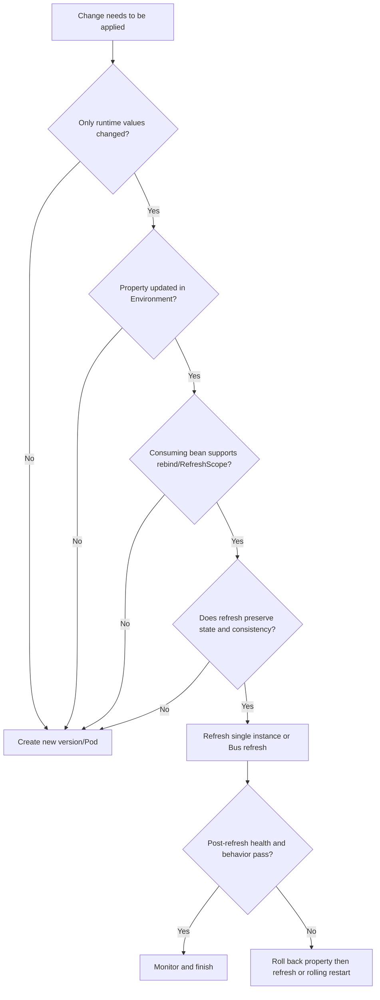
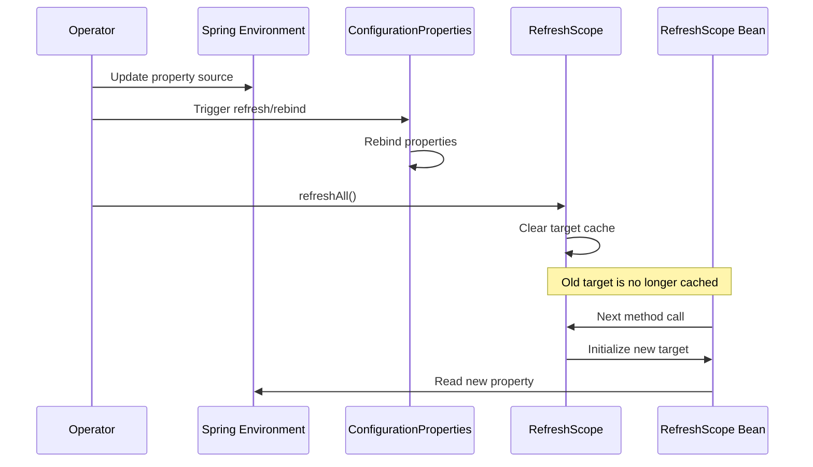
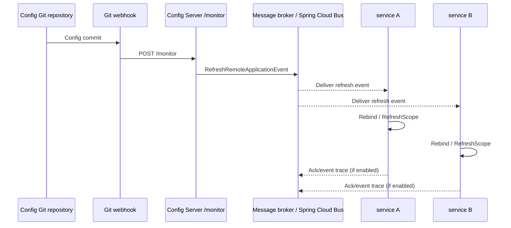

# Choosing Refresh or Rolling Restart by Change Type

## 1. A Configuration Change Does Not Always Require a Restart

In a Spring Cloud system, configuration can change while an application is running. For example, operations teams may need to update a service call timeout, an alert threshold, a partner API address, or enable a routing rule. For certain property types, Spring Cloud Context can update the `Environment`, rebind configuration, and refresh beans annotated with `@RefreshScope` without stopping the process.

However, refresh cannot replace every restart. If a change involves the classpath, bean structure, listening port, JVM arguments, environment variables read at startup, connection types, or components that do not support refresh, a new process must be created. In a multi-replica environment, a rolling restart replaces instances in batches to maintain serving capacity.

This lesson belongs to the **Operations** chapter of the **SPRING_CLOUD_CORE** module. The module focuses on Spring Cloud Commons, Spring Cloud Context, externalized configuration, Spring Boot compatibility, refresh scope, discovery, service registry, service-to-service communication, and how to test and operate shared abstractions.

After this lesson, learners can:

- Classify changes into refreshable, restart-required, or controlled-rollout categories.
- Explain how Spring Cloud Context updates the `Environment`, rebinds `@ConfigurationProperties`, and refreshes `@RefreshScope`.
- Choose between `/actuator/refresh`, `/actuator/busrefresh`, and rolling restart.
- Identify properties and beans that cannot be safely updated inside an existing process.
- Design rollouts with readiness, graceful shutdown, connection draining, and post-deployment verification.
- Plan rollbacks for configuration changes and application version changes.
- Avoid partial refreshes that leave beans within the same request using inconsistent configuration.

## 2. Deciding Based on Change Scope

### 2.1. Quick Selection Matrix

| Change Type | Typically Suitable Approach | Reason |
| --- | --- | --- |
| Timeout, retry limit, or partner URL bound to refresh-capable beans | Refresh | Properties can be updated and dependent beans recreated |
| Business threshold or feature parameter read from mutable `@ConfigurationProperties` | Refresh, after verifying consumers | Spring Cloud can rebind the properties bean |
| Log level change via appropriate management mechanism | Refresh or log level update | Does not necessarily require recreating the process |
| Bean graph change, `@ConditionalOnProperty`, `@ConditionalOnClass`, or auto-configuration | Rolling restart | Conditions and bean definitions are evaluated during context initialization |
| Code, dependency, JAR, image, or JDK change | Rolling restart/deploy | Running runtime does not safely hot-load new code |
| Port, connector, SSL listener, or server thread configuration change | Rolling restart | Network and server resources are created at startup |
| Environment variable, JVM argument, system property, or active profile change | Rolling restart | These values are typically supplied before the process starts |
| Configuration change bound to non-refreshable bean, e.g., `HikariDataSource` | Restart/rollout | Bean is not refreshed by default `RefreshScope` |
| Database schema or inter-version protocol change | Migration and rollout plan | Old and new versions must coexist safely during transition |
| Application running AOT/native image | Restart via deployment process | Spring Cloud Context refresh does not support AOT/native images |

This is a starting matrix. Before choosing refresh, you must know which properties change, which beans hold those values, which beans consume them, and which Spring Cloud/Spring Boot version is running.

### 2.2. Decision Flowchart



The key question is not "can the property change?" but "can every component depending on that property transition safely to the new state?".

## 3. How Refresh Works in Spring Cloud

### 3.1. Environment, Rebind, and RefreshScope

Spring Cloud Context adds partial context refresh capabilities. When new configuration is brought into the `Environment`, the refresh process performs two main groups of work:

1. Rebind beans managed with `@ConfigurationProperties` so they receive new values.
2. Clear the `RefreshScope` target cache so scoped beans are re-instantiated the next time they are used.

`@RefreshScope` creates a lazy proxy. The proxy holds an initialized target bean; when the scope is refreshed, the target is evicted from the cache. The next method invocation creates a new target using the current configuration.



Refresh does not mean the JVM or the entire `ApplicationContext` is recreated. It replaces specific objects designed to receive updated configuration.

### 3.2. Rebinding @ConfigurationProperties

`@ConfigurationProperties` beans can be rebound on refresh. For mutable JavaBeans, Spring updates fields on the same instance. Spring Cloud documentation notes that rebinding may reset fields to defaults before applying new values; concurrent readers might observe intermediate states if the bean is read while rebinding occurs.

If you need a consistent configuration view across a refresh, consider placing the consumer in `@RefreshScope` so the target is swapped rather than letting multiple threads read the same mutating object.

Objects using constructor binding, including constructor-bound Java records, cannot be refreshed through this rebind mechanism. If a record's property changes, choose one of two paths:

- Use a mutable structure with getters/setters and proper validation if runtime refresh is genuinely needed.
- Restart the process to create a new context and bind the record from scratch.

Do not replace a record with a mutable bean solely to avoid restarts if those values affect invariants or business consistency.

### 3.3. RefreshScope and Target Bean Lifecycle

Example of a client reading URL and timeout from configuration:

```yaml
partner:
  api:
    base-url: https://partner-v1.example
    read-timeout: 3s
```

Mutable configuration bean:

```java
import java.net.URI;
import java.time.Duration;

import org.springframework.boot.context.properties.ConfigurationProperties;

@ConfigurationProperties(prefix = "partner.api")
public class PartnerApiProperties {

    private URI baseUrl;
    private Duration readTimeout = Duration.ofSeconds(3);

    public URI getBaseUrl() {
        return baseUrl;
    }

    public void setBaseUrl(URI baseUrl) {
        this.baseUrl = baseUrl;
    }

    public Duration getReadTimeout() {
        return readTimeout;
    }

    public void setReadTimeout(Duration readTimeout) {
        this.readTimeout = readTimeout;
    }
}
```

Register the properties bean in the context:

```java
import org.springframework.boot.context.properties.EnableConfigurationProperties;
import org.springframework.context.annotation.Configuration;

@Configuration(proxyBeanMethods = false)
@EnableConfigurationProperties(PartnerApiProperties.class)
class PartnerApiConfiguration {
}
```

Client reading configuration when target is created:

```java
import java.net.URI;
import java.time.Duration;

import org.springframework.cloud.context.config.annotation.RefreshScope;
import org.springframework.stereotype.Service;

@Service
@RefreshScope
public class PartnerApiClient {

    private final PartnerApiProperties properties;

    public PartnerApiClient(PartnerApiProperties properties) {
        this.properties = properties;
    }

    public URI baseUri() {
        return properties.getBaseUrl();
    }

    public Duration readTimeout() {
        return properties.getReadTimeout();
    }
}
```

When the `Environment` receives new configuration and the refresh scope is invalidated, the next call through the proxy creates a new client target. This example only illustrates bean lifecycle; a real HTTP client must also properly manage connection pools, TLS, retries, and resource cleanup of the old target.

Placing `@RefreshScope` on a `@Configuration` class does not automatically place every bean declared in that class into refresh scope. Beans depending on those beans are not automatically recreated either. Annotate the exact beans that need refreshing and check the full dependency graph.

### 3.4. Limitations of RefreshScope

Consider these limitations before choosing refresh:

- `HikariDataSource` is in the default `spring.cloud.refresh.never-refreshable` list. Changing a JDBC URL or pool setting does not mean the running pool will be replaced safely.
- You can add bean types to `spring.cloud.refresh.extra-refreshable` where supported by the implementation, but you should not force-refresh a resource whose library was not designed for hot replacement.
- Removing a property from a configuration source and refreshing does not necessarily update property presence/absence as expected. Test removal semantics; in some cases, designing logic around explicit values is easier to control.
- Context refresh is not supported for Spring AOT transformations and native images. For such applications, set `spring.cloud.refresh.enabled=false` and use deployment/restart workflows.
- Stateful beans handling requests, holding sockets, threads, or transactions need their own lifecycle management. Clearing the target cache does not drain in-flight operations by itself.

## 4. When to Choose Refresh

### 4.1. Typically Suitable Changes

Refresh is suitable when the change is a runtime configuration value and all consumers are designed to accept new values, for example:

- A partner client's URL or timeout, if the client can be recreated.
- Retry counts, backoff, or circuit breaker thresholds if the library supports runtime updates.
- Business thresholds such as order limits or alert levels.
- Routing lists or allowlists loaded into a refreshable bean.
- Select properties in mutable `@ConfigurationProperties`.
- Log levels via appropriate management endpoints.

Before refreshing, verify the new property source is already loaded into the `Environment`. Triggering refresh while Config Server still returns old configuration will not produce the desired change.

### 4.2. Single-Instance Refresh Workflow

A controlled workflow:

1. Commit new configuration to a versioned configuration source.
2. Verify the application, profile, and label pick up the right configuration version.
3. Review the diff and identify affected beans.
4. Confirm beans are designed to rebind or reside in `RefreshScope`.
5. Test refresh on a canary instance.
6. Verify new properties, health indicators, and request behavior.
7. Expand refresh to remaining instances.
8. Monitor errors, latency, and relevant metrics.
9. If issues arise, restore old configuration and refresh again, or perform a rolling restart if the context is in an inconsistent state.

Do not treat refresh as trial-and-error. Have the prior configuration, instance scope, and stop criteria ready before starting.

### 4.3. The /actuator/refresh Endpoint

For applications with Spring Cloud Context and Actuator, you can expose the refresh endpoint:

```yaml
management:
  endpoints:
    web:
      exposure:
        include:
          - health
          - refresh
```

Send a `POST` to `/actuator/refresh`:

```bash
curl -X POST http://localhost:8080/actuator/refresh
```

This endpoint tells the application to reload applicable bootstrap configuration sources and refresh `@RefreshScope` beans. The endpoint must be exposed explicitly; do not assume it is always available just because an application uses Spring Boot.

Expose the endpoint only on management networks, require proper authentication/authorization, and restrict who can invoke it. Never expose `/actuator/refresh` to the public Internet. A single refresh can alter the behavior of an application actively serving traffic.

### 4.4. /actuator/env Is Not a Default Substitute

Spring Cloud Context supports `POST /actuator/env` to update the `Environment`, rebind `@ConfigurationProperties`, and update log levels. This endpoint must be enabled explicitly:

```yaml
management:
  endpoint:
    env:
      post:
        enabled: true
        valid-keys-regex: "^partner[.]api[.](read-timeout|base-url)$"
  endpoints:
    web:
      exposure:
        include:
          - env
          - refresh
```

The regex in this example permits only designated properties; replace it with an allowlist tailored to your application. Allowing `POST` to Environment can create configuration that diverges from the canonical config source and becomes hard to reproduce after a restart. Therefore, prefer changes in Config Server or versioned config sources; reserve `POST` env for strictly controlled administrative use cases.

## 5. Refreshing Multiple Instances with Spring Cloud Bus

### 5.1. Why Is Bus Refresh Needed?

A multi-replica system cannot refresh only the first instance and assume the whole service is updated. Spring Cloud Bus broadcasts events through a message broker so multiple application instances receive the refresh command.

The `/actuator/busrefresh` endpoint clears `RefreshScope` caches and rebinds `@ConfigurationProperties` on all instances receiving the event. It requires Spring Cloud Bus configured with a binder/broker such as RabbitMQ or Kafka, with applications connected to the same bus.

Example endpoint exposure:

```yaml
management:
  endpoints:
    web:
      exposure:
        include:
          - health
          - busrefresh
```

Send a `POST` to the bus refresh endpoint:

```bash
curl -X POST http://config-admin:8080/actuator/busrefresh
```

### 5.2. Config Monitor and Webhook Flow

When using Spring Cloud Config, you can combine Config Monitor with webhooks from your Git provider. Config Server receives a repository change notification, identifies affected applications, and publishes a `RefreshRemoteApplicationEvent` over Spring Cloud Bus.



Webhooks can broadcast Bus events only when Spring Cloud Bus is enabled on both Config Server and relevant clients. Config Monitor can determine which configuration files changed to target the right group of applications; shared files like global application configuration can affect multiple services.

Webhooks must be authenticated using secrets/signatures per your Git provider. The `/monitor` endpoint should never accept unauthenticated requests from the Internet.

### 5.3. Tracking Bus Refresh Results

Do not treat HTTP 200 from the single instance sending the Bus event as proof that all replicas refreshed successfully. Monitor:

- Whether the broker received and delivered the event.
- Whether instances received the event and executed the refresh.
- Whether any instance reported rebind or bean re-initialization errors.
- Whether the `RefreshScope` health indicator transitioned to `DOWN`.
- Whether metrics and live requests show the new configuration taking effect.

You can enable Bus tracing/acks with appropriate configuration. If an instance misses the event, verify broker connectivity, bus ID, destination, and application status before continuing rollout.

## 6. When Must You Restart or Deploy a New Version?

### 6.1. Changes Affecting Startup

Rolling restart is appropriate when a change alters how the process or `ApplicationContext` is constructed:

- JARs, libraries, code, JDK, or base images.
- Environment variables, JVM arguments, system properties, or active profiles.
- HTTP/HTTPS ports, TLS keystores, connectors, or server configurations.
- Beans created conditionally by classpath/property or auto-configuration.
- Constructor-bound configuration properties, including records.
- Non-refreshable resources such as `HikariDataSource` by default.
- Thread pools, schedulers, executors, or connection factories needing re-initialization.
- Configuration read once in static initializers or constructors of non-refreshable beans.
- Changes to context structure, bean definitions, or the dependency graph.
- AOT/native image applications that do not support Context Refresh.

A property may update in the `Environment` while a bean still holds the old value in a field, constructor, or underlying resource. Without a safe recreation mechanism, refresh creates the illusion of success while the application keeps running old configuration.

### 6.2. ConfigMap, Secret, and Environment Variable Changes

In Kubernetes, distinguish how the application consumes configuration:

| Configuration Delivery | Behavior When Source Changes | Handling Approach |
| --- | --- | --- |
| Environment variable in Pod spec | Current process values do not change automatically | Create new Pods via rollout |
| Volume-mounted ConfigMap/Secret | Files update via Kubernetes projection; app must re-read files | Use configured reload mechanism or rollout |
| ConfigMap/Secret mounted via `subPath` | Does not receive projection updates like standard volume mounts | Roll out Pods |
| Config Server / remote property source | Can reload via refresh if client and beans support it | Refresh or Bus refresh |
| Property read only at startup | Value already retained inside resource/bean | Restart |

Do not assume updating a ConfigMap automatically updates the Spring `Environment`. Explicit reload integration is required, or change the Pod template/checksum so the Deployment creates new replicas.

### 6.3. Database Schema and Service Contract Changes

A database schema change usually cannot be solved merely by refreshing properties. If new code requires new columns or indexes, deploy using the expand-contract strategy:

1. Add the new schema in a way that old code still runs cleanly.
2. Deploy the version that can read/write the new schema while staying compatible with the old version.
3. Shift traffic and confirm all new instances are healthy.
4. Drop old schema elements only after no old instances or consumers use them.

Similarly, inter-service API changes should remain backward-compatible during a rolling update because old and new versions can serve requests concurrently.

## 7. What Is a Rolling Restart?

A rolling restart replaces instances one by one with new processes while remaining replicas keep serving traffic. In a Kubernetes Deployment, the default strategy is `RollingUpdate`; the controller scales up new replicas and scales down old replicas within configured bounds.

Two critical parameters:

- `maxUnavailable`: maximum number or percentage of replicas allowed to be unavailable during an update.
- `maxSurge`: maximum number or percentage of new replicas allowed above the desired replica count during an update.

Example Deployment with three replicas:

```yaml
apiVersion: apps/v1
kind: Deployment
metadata:
  name: order-service
spec:
  replicas: 3
  strategy:
    type: RollingUpdate
    rollingUpdate:
      maxUnavailable: 0
      maxSurge: 1
  selector:
    matchLabels:
      app: order-service
  template:
    metadata:
      labels:
        app: order-service
    spec:
      terminationGracePeriodSeconds: 45
      containers:
        - name: order-service
          image: registry.example/order-service:2.4.0
          ports:
            - name: http
              containerPort: 8080
          readinessProbe:
            httpGet:
              path: /actuator/health/readiness
              port: 8080
            periodSeconds: 5
            failureThreshold: 3
          livenessProbe:
            httpGet:
              path: /actuator/health/liveness
              port: 8080
            periodSeconds: 10
            failureThreshold: 3
```

In this example, Kubernetes can create one additional new Pod before terminating an old Pod. `maxUnavailable: 0` forbids intentionally dropping available Pods below the desired count during rollout; `maxSurge: 1` permits one extra Pod. Sufficient CPU, memory, IPs, and quota must exist to run surge replicas.

The readiness probe should report ready only when the application has finished startup and can serve traffic. The liveness probe detects processes unable to continue operating. Do not include external dependencies in liveness checks in ways that cause a DB or registry outage to trigger mass Kubernetes restarts.

## 8. Readiness, Graceful Shutdown, and Connection Draining

### 8.1. Readiness Before Accepting Traffic

Spring Boot provides availability states:

- `ACCEPTING_TRAFFIC`: the application is ready to receive requests.
- `REFUSING_TRAFFIC`: the application is not accepting new requests.

With Actuator, readiness/liveness health endpoints can back probes. During a rollout, a new Pod should receive traffic only after its context, connection pools, and required dependencies are ready.

Probes can be enabled explicitly:

```yaml
management:
  endpoint:
    health:
      probes:
        enabled: true
```

If the application has long startup tasks, configure a startup probe or suitable initial delay so the liveness probe does not restart the application before startup finishes.

### 8.2. Graceful Shutdown

Spring Boot enables graceful shutdown by default for embedded Tomcat, Jetty, and Reactor Netty. While closing the `ApplicationContext`, the server stops accepting new requests and grants in-flight requests time to finish up to the shutdown phase timeout.

Timeout configuration:

```yaml
spring:
  lifecycle:
    timeout-per-shutdown-phase: 30s
server:
  shutdown: graceful
```

Kubernetes sends `SIGTERM` when terminating a Pod and waits during the termination grace period before issuing `SIGKILL`. Kubernetes' default is typically 30 seconds. If Spring Boot needs 30 seconds for graceful shutdown, the Pod's `terminationGracePeriodSeconds` must exceed that duration and leave headroom for `preStop` hooks, deregistration, or other cleanup.

The earlier Deployment example used 45 seconds to illustrate aligning both timeouts; actual values must reflect your longest request duration, draining, and system cleanup.

### 8.3. Draining and Deregistration Sequence

A safe shutdown coordinates multiple layers:

1. Mark the instance as no longer accepting new traffic via readiness or traffic-draining mechanisms.
2. Wait for load balancers/service routing to update endpoints.
3. Let in-flight requests, active messages, and transactions finish within allowed limits.
4. Stop consumers or schedulers per application lifecycle.
5. Deregister from the service registry if the provider uses separate registration.
6. Close connection pools, HTTP clients, and resources.
7. Exit the process before the termination grace period expires.

Do not rely solely on removing the Pod from a Deployment. With independent service registries like Eureka/Consul, verify registration and consumer caches update as well.

## 9. Controlled Rolling Restart Procedure

A practical rollout should be divided into phases:

### 9.1. Before Rollout

- Verify the image, version, and configuration have been built/reviewed.
- Confirm the new release is compatible with active schemas and APIs.
- Confirm capacity is sufficient to run old and new replicas concurrently.
- Verify readiness/liveness probes and graceful shutdown settings.
- Identify metrics, logs, and SLOs to monitor.
- Record the current revision and rollback command.

### 9.2. During Rollout

You can run:

```bash
kubectl rollout status deployment/order-service
```

Watch new replicas:

```bash
kubectl get pods -l app=order-service
kubectl describe deployment order-service
```

If using canary or progressive delivery, start with a small traffic slice, watch error rates and latency, and then expand. With standard Deployment rolling updates, tune `maxUnavailable` and `maxSurge` to fit capacity and inspect progress batch by batch.

Do not look solely at Pods in `Running` status. A Pod can be `Running` while failing readiness and should not receive traffic yet.

### 9.3. After Rollout

- Confirm the Deployment finished and all new replicas are `Ready`.
- Check version/build info on each instance.
- Verify registry/discovery lists only appropriate instances.
- Confirm requests succeed across service boundaries.
- Compare error rate, latency, saturation, and queue lag before and after.
- Check startup logs, connection errors, migrations, and deprecation warnings.
- Observe long enough to catch issues that appear only under real load.

### 9.4. Rollback

If a rollout fails:

```bash
kubectl rollout history deployment/order-service
kubectl rollout undo deployment/order-service
kubectl rollout status deployment/order-service
```

Rolling back an image does not automatically roll back database schemas or external configuration. Therefore, migrations must be backward-compatible and configuration must be versioned/committed for independent restoration.

## 10. Comparing Refresh and Rolling Restart

| Criterion | Refresh | Rolling Restart |
| --- | --- | --- |
| Scope | Properties, rebind, and refreshable beans | Entire process/Pod |
| Application time | Usually fast, no JVM startup wait | Requires startup and readiness per replica |
| Resources | No new process, though clients/resources may recreate | Needs capacity to run old/new simultaneously |
| Code/dependency changes | No | Yes |
| JVM/env/port changes | Usually no | Yes |
| Constructor-bound record beans | Cannot rebind | Yes |
| Default `HikariDataSource` | Not refreshable | Creates fresh pool on restart |
| Impact on in-flight requests | Can hit target/config mismatch if inconsistently designed | Can drain old requests before shifting traffic |
| Blast radius | Can refresh one instance or many via Bus | Rolls out replica by replica; can pause/rollback |
| Coordination required | Property sources, bean scopes, Bus for multi-instance | Readiness, shutdown, capacity, and compatibility |

Refresh is not always lower risk than restart. A bad refresh can leave a mixed state between old and new beans; a well-prepared rolling restart can be easier to control.

Spring Cloud Context also offers `/actuator/restart` to close and restart the `ApplicationContext`, though it is disabled by default. In multi-replica environments, it is usually better to let the orchestrator perform a rolling restart to manage readiness, capacity, draining, and rollback centrally rather than restarting individual processes over HTTP.

## 11. Operational Scenario Examples

### 11.1. Changing a Partner API Timeout

Suppose `partner.api.read-timeout` changes from 3 seconds to 5 seconds. The client is designed to recreate via `@RefreshScope` and its properties bean supports rebinding.

Approach:

1. Update the property in Config Server.
2. Verify the new value is returned for the right application/profile/label.
3. Refresh one canary instance.
4. Confirm the new client uses the 5-second timeout and health stays `UP`.
5. Use Bus refresh or refresh remaining instances.
6. Monitor latency, timeouts, and error rates.

No rolling restart is needed if the client truly recreates and all instances receive the updated configuration.

### 11.2. Changing the Server Port

Changing `server.port` changes the port the web server binds to. This is configuration tied to startup server resources. Refreshing the `Environment` does not move an already-listening socket to a new port.

Approach: update deployment/configuration and perform a rolling restart. Readiness probes, Service `targetPort`, ingress, and registry registrations must be updated in sync.

### 11.3. Changing the Hikari JDBC URL

`HikariDataSource` is in the default never-refreshable list. Changing a JDBC URL property and calling refresh does not guarantee the existing pool is recreated.

Approach: perform a controlled rolling restart to create fresh pools per replica, verify database connectivity, and validate migration compatibility. If your application has a custom datasource rotation mechanism, test it independently; never blindly force Hikari into `RefreshScope`.

### 11.4. Changing Code and Dependencies

Changing business algorithms, upgrading libraries, or patching dependency CVEs requires a new artifact. Refresh cannot replace bytecode or classes already loaded in the JVM.

Approach: build a new image, run tests/scans, deploy a canary, and perform a rolling restart. Preserve API and database compatibility with old replicas during the transition window.

### 11.5. Changing a Runtime Feature Flag

If a feature flag is bound into a bean capable of runtime updates, refresh may fit. However, if the flag controls which beans are created via `@ConditionalOnProperty` at startup, changing the flag does not re-evaluate auto-configuration conditions.

Approach: use a dedicated runtime feature flag mechanism for hot toggling; use restart when the flag determines `ApplicationContext` structure.

## 12. Verifying a Successful Refresh

After refreshing, do not check only the endpoint's HTTP response. Verify across multiple layers:

1. **Configuration source:** Config Server or property source returns the new value for the right application, profile, and label.
2. **Environment:** the new value appears in the instance's `Environment`.
3. **Binding:** `@ConfigurationProperties` beans receive the expected values.
4. **Target bean:** `@RefreshScope` beans recreate when used.
5. **Health:** the `RefreshScope` health indicator is not `DOWN`.
6. **Behavior:** real requests execute with the new configuration.
7. **Replica coverage:** every service instance received the refresh; no replica retains stale config.
8. **Observability:** logs/metrics show no rebind errors, bean initialization errors, connection errors, or abnormal latency spikes.

You can use `/actuator/env` to inspect the `Environment` within authorized scope, while protecting the endpoint since it may expose sensitive configuration. Never write secret values into logs or operations tickets.

If a refresh causes bean initialization to fail, `RefreshScopeHealthIndicator` may transition to `DOWN` and expose the exception. Treat this as a configuration rollout failure to investigate, and do not continue broadcasting refresh broadly.

## 13. Testing Refresh and Restart Strategies Before Production

### 13.1. Testing Property Refresh

An integration test should:

- Start the context with initial properties.
- Call the refreshable bean and assert initial values.
- Update the property source in the test.
- Trigger refresh/rebind using the exact mechanism the application uses.
- Invoke the bean through its proxy again and confirm the new target reads new values.
- Verify exceptions if a new bean fails initialization.

Do not merely mock `RefreshScope.refreshAll()`; test against a real context to verify proxies and binding behave properly.

### 13.2. Testing Non-Refreshing Properties

Write dedicated tests for:

- Constructor-bound records.
- Non-`RefreshScope` beans capturing property snapshots in constructors.
- `HikariDataSource` or resources in `never-refreshable`.
- Properties deleted from the configuration source.
- A bean depending on another bean where only one is in `RefreshScope`.

These tests pinpoint the exact boundaries of refresh in your application.

### 13.3. Testing Rolling Restarts

In staging, verify:

- New Pods receive traffic only after readiness passes.
- Old Pods stop accepting new traffic on shutdown.
- In-flight requests have enough time to finish.
- Service registries remove old registrations.
- Two coexisting versions do not cause API/schema compatibility errors.
- Image rollback succeeds and configuration can be restored.

Also test scenarios where new Pods fail readiness or fail startup to confirm rollouts halt appropriately instead of terminating all healthy old replicas.

## 14. Common Issues and Fixes

| Symptom | Cause | Remediation |
| --- | --- | --- |
| Refresh succeeds but bean keeps old value | Bean captured snapshot in constructor and is not refreshable | Place the right bean in `RefreshScope` or restart |
| Properties bean updates but client does not | Client not recreated or retains old dependency/resource | Refresh target client and inspect dependency graph |
| Record does not pick up new property | Constructor binding does not support refresh | Rolling restart |
| Hikari still connects to old DB | `HikariDataSource` is non-refreshable by default | Rolling restart or dedicated datasource rotation |
| Some replicas still use old config | Refreshed only one instance or Bus event missed nodes | Track Bus events/acks and verify each replica |
| `RefreshScope` health turns `DOWN` | Bean failed re-initialization or rebind failed | Inspect exception, roll back property, and refresh again after fix |
| Removed property but old behavior persists | Property deletion semantics do not refresh as expected | Use explicit values or restart |
| Updated ConfigMap but app unchanged | No reload integration; env vars read only at startup | Trigger rolling restart or configure appropriate reload |
| New Pod `Running` but gets no traffic | Readiness not satisfied | Check probes, startup tasks, and dependencies |
| Requests fail during rollout | Insufficient graceful shutdown/draining or mismatched timeouts | Tune readiness, shutdown timeout, and termination grace period |
| Rollout stalls mid-way | New Pods not Ready, image/config error, or insufficient capacity | Inspect Deployment conditions/events, pause, or roll back |
| Rolled back image but app still fails | Incompatible schema/config already changed | Use expand-contract migrations and independent config rollback |

## 15. Decision and Operations Checklist

Before choosing refresh or restart, confirm:

1. Which exact properties or components are changing?
2. Is the value read at startup, bound into a bean, or read dynamically per call?
3. Do the holding beans rebind or reside in `RefreshScope`?
4. Do dependent beans also need recreation at the same time?
5. Are constructor binding/records, `HikariDataSource`, or non-refreshable resources involved?
6. Does the change affect classpath, ports, TLS listeners, JVM, environment, or bean graph?
7. Has the new property source been versioned and verified?
8. If using refresh, is the endpoint exposed and secured?
9. If using Bus, did every instance receive the event with ack/health evidence?
10. If restarting, are readiness probes and graceful shutdown working?
11. Does Kubernetes have enough capacity for `maxSurge` and new replicas?
12. Is `terminationGracePeriodSeconds` longer than shutdown/drain/cleanup combined?
13. Are APIs and database schemas compatible between old and new versions?
14. Are metrics, logs, health checks, and rollout stop criteria clearly defined?
15. Can code, config, and schema be rolled back independently?

## 16. Official Reference Documentation

- [Spring Cloud Commons — Spring Cloud Context: Application Context Services](https://docs.spring.io/spring-cloud-commons/reference/spring-cloud-commons/application-context-services.html): rebinding `@ConfigurationProperties`, `@RefreshScope`, refresh limitations, and Actuator endpoints.
- [Spring Cloud Commons — Configuration Properties](https://docs.spring.io/spring-cloud-commons/reference/configprops.html): `spring.cloud.refresh.enabled`, `extra-refreshable`, `never-refreshable`, and refresh properties.
- [Spring Cloud Bus — Bus Endpoints](https://docs.spring.io/spring-cloud-bus/reference/spring-cloud-bus/bus-endpoints.html): `busrefresh`, rebinding, and multi-instance refresh.
- [Spring Cloud Config — Push Notifications and Spring Cloud Bus](https://docs.spring.io/spring-cloud-config/reference/server/push-notifications-and-bus.html): webhooks, Config Monitor, `RefreshRemoteApplicationEvent`, and webhook authentication.
- [Spring Boot — Graceful Shutdown](https://docs.spring.io/spring-boot/reference/web/graceful-shutdown.html): shutdown phase timeouts and how servers stop accepting new requests.
- [Spring Boot — Actuator Endpoints](https://docs.spring.io/spring-boot/reference/actuator/endpoints.html): availability/readiness, health probes, and management endpoints.
- [Kubernetes — Deployments](https://kubernetes.io/docs/concepts/workloads/controllers/deployment/): `RollingUpdate`, `maxUnavailable`, `maxSurge`, progress deadline, and rollout history.
- [Kubernetes — Termination of Pods](https://kubernetes.io/docs/concepts/workloads/pods/pod-termination/): `SIGTERM`, `preStop`, termination grace period, and when Pods leave EndpointSlices.

**Remember:** Choose refresh when changes only affect properties and beans designed for safe in-process updates. Choose rolling restart when changes affect startup, resources, classpath, bean graph, or non-refreshable configuration. With multiple replicas, readiness, graceful shutdown, registry deregistration, capacity, and rollback are all part of the same deployment plan.
