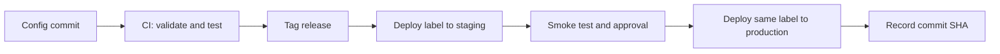

# Configuration Versioning and Rollback Capability

## 1. Why Does Configuration Also Need Versioning?

In a distributed system, configuration determines how each service connects, authenticates, resolves services, retries, times out, limits resources, and toggles features. A single configuration change can affect many instances simultaneously even without a new application build.

For example, changing `read-timeout` from 2 seconds to 200 milliseconds can cause widespread service call failures. Entering an invalid registry address or queue name can prevent a group of instances from communicating. Without knowing which configuration is currently applied and having a clear rollback path, system recovery becomes slow and error-prone.

Spring Cloud Config addresses centralized configuration by placing application configuration into a versioned repository, typically Git. Config Server reads the repository and serves property sources over HTTP; Config Client loads them into the Spring `Environment`. Git provides commit history, branches, tags, and diffing. Spring Cloud Config maps those Git labels to configuration versions that clients can request.

This lesson belongs to the **Operations** chapter of the **SPRING_CLOUD_CORE** module. The module helps learners understand the core foundations of Spring Cloud in distributed systems, especially Spring Cloud Commons, Context, externalized configuration, and compatibility with Spring Boot; learners also explore refresh scope, discovery, service registry, service-to-service communication, and testing and operating shared abstractions.

After this lesson, learners can:

- Explain the role of Git labels in Spring Cloud Config.
- Distinguish commit SHAs, tags, and branches when selecting a configuration version.
- Design a workflow to promote the same configuration version across environments.
- Identify the exact configuration version returned by Config Server.
- Roll back to a good version via `git revert` or pinning clients to a known-good label.
- Trigger refresh and verify instances have picked up new configuration.
- Detect risks from caching, deleted branches, Git backend outages, and configuration drift across instances.

## 2. Versioned Configuration Management Model

A common organization separates configuration from application source code:

```text
inventory-service
├── application.yml
├── inventory-service.yml
├── inventory-service-dev.yml
├── inventory-service-staging.yml
└── inventory-service-prod.yml
```

These files can live in a dedicated Git configuration repository. Config Server receives an application name, profile, and label, then locates the matching property sources. `application.yml` can hold shared values; application-specific and profile-specific files override or add specialized values.

Example:

| File | Scope |
| --- | --- |
| `application.yml` | Shared default values across applications. |
| `inventory-service.yml` | Common configuration for `inventory-service`. |
| `inventory-service-dev.yml` | Values specific to the `dev` profile. |
| `inventory-service-prod.yml` | Values specific to the `prod` profile. |

In operations, it is critical to be able to answer three questions:

1. What configuration is currently applied for this application and profile?
2. Which commit or release did that configuration come from?
3. If a change causes an incident, which exact version can be restored?

Git commits and Config Server responses help trace the answers. Do not merely record "using the production branch," because branch contents can change with every new commit.

## 3. Git Labels in Spring Cloud Config

The Config Server Git backend maps the endpoint's `{label}` parameter to a Git label. A label can be:

- **Commit ID:** a specific commit hash identifying an exact content snapshot.
- **Tag:** a release marker pointing to a commit.
- **Branch:** a branch name pointing to the branch head, which can move when new commits arrive.

Example endpoint:

```text
/{application}/{profile}/{label}
```

A client can request configuration for `inventory-service`, profile `prod`, label `config-v2.7.1`:

```text
http://config-server:8888/inventory-service/prod/config-v2.7.1
```

With a Git backend, `config-v2.7.1` can be a tag, branch, or commit reference that Git can check out.

### 3.1. Commit SHA

A commit SHA identifies a specific snapshot in Git history. When a client is configured with a commit SHA, subsequent startups request that exact content as long as the commit remains in the repository and Config Server can fetch it.

Example:

```yaml
spring:
  cloud:
    config:
      label: 7a4c2d9f8b1e
```

Short SHAs should only be used once verified to be unique in the repository. For auditable releases, record the full commit SHA in the deployment manifest or deployment record.

### 3.2. Release Tags

Tags provide human-readable names for snapshots:

```bash
git tag -a config-v2.7.1 7a4c2d9f8b1e -m "Configuration release 2.7.1"
git push origin config-v2.7.1
```

A release tag should be treated as immutable by team convention: do not move a tag already used in production to another commit. If content must change, create a new tag such as `config-v2.7.2`. Tags can be signed with GPG/SSH if repository policy requires verifying release provenance.

Immutable tags allow multiple environments to share the same snapshot:

| Environment | Config Label |
| --- | --- |
| Staging | `config-v2.7.1` |
| Pre-production | `config-v2.7.1` |
| Production | `config-v2.7.1` |

If staging and production use two separate branches, they may hold different content even with identical filenames. Pinning to the same tag or commit SHA makes promotion verifiable.

### 3.3. Branches

Branches suit continuous development:

```yaml
spring:
  cloud:
    config:
      label: develop
```

When new commits land on `develop`, the content that label points to changes. Thus, branches fit `dev` or environments that frequently pull the latest configuration. Branches are not a good fit for representing an immutable production release.

A branch name like `production` can serve as an alias for current configuration, provided the actual deployed commit SHA is recorded at each deployment. If a branch updates mid-rollout, two instances starting at different times may fetch two different commits.

### 3.4. Rules for Choosing a Label

| Need | Recommended Label |
| --- | --- |
| Daily development | Branch such as `develop` or `feature/...` |
| Testing a scoped change | Feature branch or commit SHA |
| Promotion across staging and production | Release tag or commit SHA |
| Fast recovery to a known-good snapshot | Previous tag or verified commit SHA |
| Continuous configuration stream | Branch with clear commit controls and audit trail |

Never rely solely on a mutable branch name as proof of a production version. Store both the label and the resolved commit SHA.

## 4. Configuring the Config Server Git Backend

Example Config Server pointing to a Git repository:

```yaml
server:
  port: 8888

spring:
  cloud:
    config:
      server:
        git:
          uri: https://git.example.com/platform/config-repository.git
          default-label: main
          clone-on-start: true
          refresh-rate: 0
```

Meaning:

- `uri`: repository read by Config Server.
- `default-label`: default label when a request does not specify one.
- `clone-on-start`: clones the repository when the server starts to catch invalid URIs or credentials early.
- `refresh-rate`: interval at which Config Server checks the Git backend for changes.

In the current Git backend, the server's default label is `main`; if `main` does not exist, the server may try `master` unless fallback is disabled. Config Client has its own documented default binding; to avoid depending on version differences or client/server defaults, configure `spring.cloud.config.label` explicitly for controlled environments.

The value of `spring.cloud.config.label` must be available before Config Data import calls Config Server. Set it in the client's local configuration, environment variables, or deployment arguments; do not place the initial label selector solely inside the remote repository that the request itself needs to read.

### 4.1. Refresh Rate and Repository Caching

`spring.cloud.config.server.git.refresh-rate` is measured in seconds:

| Value | Behavior |
| --- | --- |
| `0` | Fetch Git updates on every configuration request. |
| Positive integer | Rate-limit fetches to the specified interval. |
| Negative integer | Do not refresh the repository from remote. |

If `refresh-rate` is greater than `0`, new commits may not appear immediately in Config Server responses. If negative, the server may keep serving its cloned snapshot until restarted or updated through another mechanism.

During rollback, account for `refresh-rate` and the local working copy of each Config Server instance. Sending a refresh to clients while the server still returns an old commit will not restore the desired configuration.

### 4.2. Controlling the Working Copy

Config Server maintains a local working copy of the Git repository. Operational properties to know:

| Property | Purpose |
| --- | --- |
| `clone-on-start` | Clone at startup to detect connection errors early. |
| `basedir` | Directory storing the working copy; avoid temp directories cleaned by the OS. |
| `force-pull` | Reset the working copy to remote if the local copy becomes dirty or diverged. |
| `delete-untracked-branches` | Delete local branches no longer on remote to prevent checking out stale branches. |

Example:

```yaml
spring:
  cloud:
    config:
      server:
        git:
          uri: https://git.example.com/platform/config-repository.git
          basedir: /var/lib/config-server/repositories
          clone-on-start: true
          force-pull: true
          delete-untracked-branches: true
```

`force-pull` can discard local changes in the working copy to sync with remote. Enable it only when the working copy is a Config Server-managed cache containing no manual edits to preserve. Never use `force-pull` as an application rollback procedure; rollbacks must change labels or Git history through the release workflow.

If a remote branch is deleted while the local branch remains, Config Server may keep checking out the old branch from its working copy. `delete-untracked-branches` prevents this situation. For release tags/commits, keep those tags and commits on remote so every Config Server instance can fetch them.

### 4.3. Multiple Repositories and Patterns

Config Server can route applications/profiles to different repositories using patterns. Example:

```yaml
spring:
  cloud:
    config:
      server:
        git:
          uri: https://git.example.com/platform/shared-config.git
          repos:
            payments:
              pattern: payments-*
              uri: https://git.example.com/payments/config.git
            inventory:
              pattern: inventory-*
              uri: https://git.example.com/inventory/config.git
              clone-on-start: true
```

When using multiple repositories, each repo has its own history, branches, and tags. Release manifests must record the exact repository alongside the label/commit for each application; an identical tag name in two repositories does not guarantee identical content.

## 5. Client Selection of Configuration Version

With Spring Boot Config Data, Config Client connects to Config Server via `spring.config.import`. Example:

```yaml
spring:
  application:
    name: inventory-service
  profiles:
    active: prod
  config:
    import: configserver:https://config.example.com
  cloud:
    config:
      label: config-v2.7.1
```

Here:

- `spring.application.name` identifies the application name.
- Active profile selects the environment configuration set.
- `spring.cloud.config.label` selects the branch, tag, or commit.
- `spring.config.import` declares Config Server as a configuration source.

If the application should continue starting when Config Server is unavailable, use `optional:configserver:`. Without `optional:`, Config Client can fail startup if configuration cannot be fetched. For production, choose fail-fast or optional based on operational requirements; never enable `optional` merely to mask configuration errors.

Example direct request URL:

```bash
curl https://config.example.com/inventory-service/prod/config-v2.7.1
```

The Config Server response includes property sources and a `version` field indicating the revision returned by the repository backend. Record this field in logs or deployment records for traceability.

### 5.1. Labels Containing Slashes

If a branch or tag contains `/`, such as `release/2026.11`, Config Server uses a special marker `(_)` in URLs to avoid ambiguity with path segments:

```text
inventory-service/prod/release(_)2026.11
```

When setting `spring.cloud.config.label` in properties, write the actual Git label name as normal:

```yaml
spring:
  cloud:
    config:
      label: release/2026.11
```

Do not manually replace slashes with `(_)` in client property values; the special representation applies to resource URLs.

### 5.2. Fallback Label Lists

Clients support comma-separated label lists, for example:

```yaml
spring:
  cloud:
    config:
      label: feature/catalog,develop
```

This is useful when trying a feature label first and falling back to another label. However, for production environments requiring exact reproducibility, avoid relying on fallback lists: results can vary depending on which label exists or how the server handles the request.

For requests containing multiple labels, the Git backend also has rules for label errors; by default, if one label errors, the server may fail the request rather than automatically skipping and trying all labels. The property `continue-on-multiple-label-failure` changes this behavior. Verify your exact Config Server version and test the case where the first label is invalid before using fallback lists in production.

## 6. Promoting the Same Configuration Across Environments

A configuration release should move across environments using the exact same snapshot:



Recommended workflow:

1. Developer opens a pull request for the configuration change.
2. CI validates YAML/properties, schemas, required keys, and policy compliance.
3. CI inspects diffs to flag sensitive changes such as URLs, timeouts, TLS, credential references, or retries.
4. After review, merge the commit into the configuration repository.
5. Create a release tag pointing to the merged commit.
6. Deploy the tag to staging and test behavior.
7. Promote that exact tag/commit to production after approval.
8. Record application, profile, repository, label, commit SHA, and deployment timestamp in the release record.

Never edit files directly on the server or inside Config Server's working copy. Changes must go through Git for history, review, and reproducibility.

### 6.1. Release Manifest

A deployment manifest may record:

```yaml
release:
  application: inventory-service
  profile: prod
  configRepository: platform/config-repository
  configLabel: config-v2.7.1
  configCommit: 7a4c2d9f8b1e...
  applicationImage: registry.example.com/inventory:4.12.0
  deployedAt: 2026-11-18T10:30:00Z
```

This is an example of deployment workflow metadata, not required Spring Cloud Config properties. The manifest links the deployed application version and configuration version together.

## 7. Verifying the Currently Served Configuration Version

When an incident occurs, first determine which revision Config Server is returning.

Call the endpoint by application/profile/label:

```bash
curl -sS https://config.example.com/inventory-service/prod/config-v2.7.1
```

Inspect:

- `name`: application name resolved by the server.
- `profiles`: applied profiles.
- `label`: requested/resolved label.
- `version`: repository revision, typically the commit SHA for a Git backend.
- `propertySources`: configuration sources and application order.

Do not expose config endpoints to external networks. Responses may contain internal URLs, feature flags, or sensitive information. Restrict access to operators and avoid logging full property values.

### 7.1. Comparing Two Versions

With Git, use `git diff` to inspect changes:

```bash
git diff config-v2.7.0..config-v2.7.1 -- inventory-service-prod.yml
```

Specifically inspect changes likely to affect runtime:

| Configuration Group | Impact to Evaluate |
| --- | --- |
| Host, port, service ID | Connectivity to services or registry. |
| Timeout, retry, circuit breaker | Latency, load, and resilience. |
| Pool size, concurrency | Resource usage and upstream pressure. |
| TLS, trust store, certificate reference | Handshake success and identity verification. |
| Feature flag | Business behavior and data compatibility. |
| Profile or property source | Which value wins when multiple sources define a key. |

You can view a file at a specific commit:

```bash
git show 7a4c2d9f8b1e:inventory-service-prod.yml
```

Do not compare only an individual file if configuration is also inherited from `application.yml`, application-wide files, or other profiles. Inspect the merged property sources actually returned by Config Server.

## 8. Two Rollback Approaches

Configuration rollback has two distinct goals:

- Restore a live development branch in an auditable way.
- Instruct applications to use a previously known-good snapshot again.

No single Git operation fits every situation.

### 8.1. Approach A — `git revert` to Create a Corrective Commit

If a recent commit introduced faulty configuration onto a branch used by an environment, create an inverse commit:

```bash
git revert 7a4c2d9f8b1e
git push origin main
```

`git revert` creates a new commit reversing the old commit's changes while preserving history. This fits when the branch continues advancing and the team wants the fix recorded in main history.

If production is pinned to a tag, a revert commit on `main` does not alter that tag. Create a new release tag pointing to the reverted commit and update the deployment label to the new tag; preserve the faulty old tag for auditability.

After reverting:

1. Verify the new commit on remote.
2. Wait for Config Server to fetch the new commit.
3. Trigger Config Client refresh or Spring Cloud Bus refresh per deployment strategy.
4. Verify Config Server responses show the new commit SHA.
5. Verify instances have restored the good values.

Never run `git reset --hard` and force-push branches shared across environments as a routine rollback. Rewriting history can desynchronize Config Server working copies and other pipelines from remote.

### 8.2. Approach B — Pin Clients Back to a Good Tag or Commit

To quickly restore a known-good snapshot, switch the client label back to that tag or SHA:

```yaml
spring:
  cloud:
    config:
      label: config-v2.7.0
```

Or:

```yaml
spring:
  cloud:
    config:
      label: 2b8e6a1c4d90...
```

Then roll out clients again or trigger the appropriate configuration reload mechanism. This is useful when the branch has accumulated multiple newer commits and you want to restore an exact older snapshot without rewriting history.

For production, set the label in versioned deployment configuration/manifests rather than manually patching a single instance. Instances should be deployed with the same label to avoid running mixed configurations.

### 8.3. Never Move an Old Release Tag

Do not delete and recreate `config-v2.7.0` to point to a different commit. That undermines release label integrity and can cause two Config Servers to serve different content if caches or working copies are out of sync.

If a fix based on an older snapshot is needed, create a new commit and a new tag, such as `config-v2.7.2`. Leave the old tag pointing to its original commit for audit and rollback.

## 9. Loading New Versions into Config Client

Config Server serving new configuration does not mean every bean across all clients updates immediately. Distinguish:

1. Git repository has the new commit.
2. Config Server fetched and returns the new commit.
3. Config Client reloaded property sources.
4. Application beans or components received the new values.

Each step must be verified independently.

### 9.1. Refreshing a Single Instance

Spring Cloud Context provides the `/actuator/refresh` endpoint to reload applicable bootstrap/remote configuration and refresh `@RefreshScope` beans.

Example:

```bash
curl -X POST http://inventory-01:8080/actuator/refresh
```

The endpoint must be exposed and protected with authentication/authorization. Never expose the refresh endpoint publicly.

A bean using `@RefreshScope`:

```java
import org.springframework.cloud.context.config.annotation.RefreshScope;
import org.springframework.beans.factory.annotation.Value;
import org.springframework.stereotype.Component;

@RefreshScope
@Component
public class InventoryRoutingSettings {

    @Value("${inventory.routing.primary-region}")
    private String primaryRegion;

    public String primaryRegion() {
        return primaryRegion;
    }
}
```

After refresh, scoped beans are recreated when accessed next. Not every bean or property updates automatically merely because `/actuator/refresh` exists. Components outside refresh scope, objects holding stale references, or components that do not support rebinding may require recreation or restart.

For `@ConfigurationProperties`, Spring Cloud supports rebinding on refresh. Still, test the exact bean and property, especially when a property is deleted or a bean depends on values computed once at initialization.

### 9.2. Refreshing Multiple Instances with Spring Cloud Bus

If a service runs multiple replicas, manually calling `/actuator/refresh` on each instance easily misses nodes. Spring Cloud Bus provides `/actuator/busrefresh` to broadcast refresh events to nodes connected to the Bus:

```bash
curl -X POST https://inventory.example.com/actuator/busrefresh
```

Bus refresh clears `RefreshScope` caches and rebinds `@ConfigurationProperties` on receiving instances. Bus requires a broker and matching Spring Cloud Stream configuration, such as RabbitMQ or Kafka.

You can narrow targets by service or instance ID under an appropriate Bus setup. Before refreshing all of production, test broker connectivity, instance event receipt, and retry behavior if a node is temporarily disconnected.

### 9.3. When Are Restarts or Rolling Deployments Necessary?

Refresh is not a universal replacement for restart. Perform a rolling restart or redeploy when:

- Properties are read only at initialization and not rebound.
- Libraries or connection pools do not support updating live configuration.
- Configuration changes affect constructors or bean graph structure.
- Every instance must be guaranteed to boot with the exact same label and snapshot.
- The application holds internal state that cannot be safely reconstructed via refresh.

For critical rollbacks, a rolling deployment pinned to a fixed label is often easier to control than ad-hoc refreshes across instances.

## 10. Handling Config Server Failures

### 10.1. Git Backend Temporarily Unreachable

Once Config Server has cloned the repository, it retains a local working copy. If the remote Git server temporarily loses connectivity, Config Server can continue serving the latest snapshot in its local working copy.

However:

- If the server has not yet cloned the repository and lazy cloning is used, initial requests fail while the Git backend is unreachable.
- `clone-on-start` catches repository errors as soon as Config Server boots.
- If Config Server restarts while the Git backend is down without a local clone, clients cannot fetch labels from the server.
- Clients keep their current configuration if a refresh fails to fetch new configuration; never treat a network-level refresh request return as proof configuration changed.

Enable the Config Server health indicator, validate configured repositories, and monitor fetch/clone errors. With multiple Config Server instances, verify all servers can read the same repository and serve the same label.

### 10.2. Dirty or Diverged Working Copy

If another process modifies files inside the working copy directory or a local repo hits a merge issue, fetches may fail to update as expected. `force-pull` can reset the local working copy to match remote. This is a repository cache repair measure, not a substitute for version pinning or `git revert`.

Grant write access to `basedir` exclusively to the Config Server account; do not share this directory with manual editing workflows. In containers, use volumes/paths with proper permissions and avoid placing the working copy in temp directories pruned during runtime.

### 10.3. Labels Deleted from Remote

Config Server may retain checked-out branches in its local working copy even after those branches are deleted on remote. When a client requests the old label, the server might find the stale local branch.

`delete-untracked-branches: true` cleans up local branches no longer tracked on remote. For tags/commits needed for rollback, do not delete tags and do not garbage-collect commits still referenced by deployment manifests.

### 10.4. Multiple Labels Are Not a Reliable Rollback Mechanism

A label list like `feature-a,main` helps with fallback in some development flows. However, it does not replace release pinning:

- The first label may exist with untested contents.
- If the first label errors, continuing or failing depends on client/server versions and multiple-label failure policy.
- A branch label may move after the prior deployment.

Production should require a single verified label or a specific commit SHA.

## 11. Testing Versioning and Rollback Workflows

Testing must do more than confirm Config Server returns HTTP 200. Verify revisions, property values, and post-refresh effects.

| Test Case | Action | Expected Result |
| --- | --- | --- |
| Label is tag | Request application/profile with created tag | Response returns exact property sources and tag commit version. |
| Label is commit SHA | Request with full SHA | Server returns exact commit snapshot. |
| Label is branch | Push commit to branch and re-fetch | Server returns new revision per refresh-rate config. |
| Promotion | Use same tag in staging and production | Both environments receive identical commit SHA. |
| Revert | Revert faulty commit on branch | New commit reverses change; old history preserved. |
| Pin rollback | Switch client label back to good tag | Client boots/reloads exact prior snapshot. |
| Single-node refresh | Call `/actuator/refresh` | Property sources reload and refresh-scoped beans receive new values. |
| Bus refresh | Call `/actuator/busrefresh` | Event-receiving instances refresh. |
| Git backend unavailable | Disconnect remote after Config Server clone succeeds | Server keeps serving local snapshot; does not claim unfetched revision. |
| Lazy clone failure | Boot server with remote unreachable | Error appears on first request; with `clone-on-start`, fails immediately at startup. |
| Deleted branch | Delete remote branch then request old label | Verify stale branch is not served when cleanup is enabled. |
| Config drift | Compare revisions across instances | Detect instances holding differing revisions. |

### 11.1. Testing Changing and Reverting a Value

Suppose the configuration file contains:

```yaml
inventory:
  routing:
    primary-region: region-a
```

The first commit creates tag `config-v2.7.0`. The next commit changes it to `region-b` and creates tag `config-v2.7.1`.

Test procedure:

1. Query Config Server with label `config-v2.7.0` and verify `primary-region=region-a`.
2. Query with label `config-v2.7.1` and verify `primary-region=region-b`.
3. Boot Config Client with `config-v2.7.1` and verify the bean receives `region-b`.
4. Pin client back to `config-v2.7.0` and restart/refresh using your chosen mechanism.
5. Verify the bean receives `region-a` again.
6. Check logs/release records contain the matching label and commit SHA.

This test proves the full path from Git label to Config Server to application bean. It also catches cases where the server returns the right property but the bean fails to refresh as expected.

### 11.2. Checking Drift Across Instances

Across multiple replicas, record:

- Application name and profile.
- Deployed config label.
- Commit SHA returned by Config Server.
- Timestamp of successful instance refresh.
- Post-refresh health/readiness results.

Do not compare only `spring.cloud.config.label`, because a branch may have moved. Compare resolved commit SHAs to determine whether two instances share the same snapshot.

## 12. Observability and Operations

Emit metrics, logs, or deployment metadata for:

| Information | Purpose |
| --- | --- |
| Repository URI or repository ID | Identify configuration source. |
| Application/profile | Identify resolved configuration set. |
| Label | Know which tag/branch/commit the client requested. |
| Resolved commit SHA | Prove the exact snapshot. |
| Config Server fetch/clone status | Detect remote Git errors. |
| Client refresh timestamp | Know when an instance reloaded. |
| Refresh failure count | Detect instances that missed new configuration. |
| Application version/image | Correlate deployed source code and configuration. |

Never log secret values or full Config Server responses. Logging version metadata is enough for traceability; sensitive values must stay protected by secret management mechanisms.

Config Server provides a health indicator to check `EnvironmentRepository`. You can configure health checks for specific applications, profiles, and labels instead of relying solely on a default repository check. This ensures health status reflects the label production actually depends on.

## 13. Recommended Production Rollback Procedure

When a configuration change causes an incident:

1. Identify the failing application, profile, repository, label, and resolved commit SHA.
2. Compare the current commit against the last confirmed good snapshot.
3. Choose rollback via `git revert` to fix an active branch, or pin clients to a good tag/SHA to restore a specific snapshot.
4. Verify Config Server fetches the target version via the application/profile/label endpoint.
5. Confirm the `version` field in the response matches the release record.
6. Update the deployment label if pinning, or wait for the revert commit on the branch to be fetched.
7. Refresh a canary instance first to verify beans and downstream connectivity.
8. Once the canary passes, refresh remaining instances via Bus or perform a rolling restart.
9. Monitor health, error rates, timeouts, and traffic after rollback.
10. Document root cause, offending commit, recovery commit/tag, and completion timestamp.

Never broadcast a mass refresh before verifying Config Server serves the right version. If the configuration source still returns the faulty snapshot, refreshing only spreads the outage faster.

## 14. Common Issues

| Symptom | Possible Cause | Remediation |
| --- | --- | --- |
| Client still receives old config | Config Server has not fetched new commit or `refresh-rate` delays it | Check server version, Git fetch, and refresh rate. |
| Two instances have different config | Started at different times on a moving branch or uneven refresh | Pin tag/SHA, record resolved SHA, and inspect each instance. |
| Rollback by editing tag fails to update client | Tag cached/checked out or working copy stale | Do not move tags; create a new tag or pin SHA and verify server fetch. |
| Client fails to load label | Label missing, misspelled, or branch/tag slashes unencoded in URL | Check remote ref and URL label encoding. |
| Config Server returns deleted branch | Stale branch still exists in local clone | Consider `delete-untracked-branches` and inspect working copy. |
| Git backend down yet Config Server returns 200 | Server serving old local snapshot | Check version, health indicator, and remote fetch status. |
| Refresh succeeds but bean keeps old value | Bean does not support refresh or retains old state/reference | Use `@RefreshScope`/rebinding properly or restart. |
| Bus refresh updates only some instances | Broker, subscription, or instance connectivity issue | Inspect Bus events, broker, and revisions per instance. |
| `optional:configserver:` hides startup errors | App keeps booting without required config | Remove `optional:` or configure fail-fast/retry per policy. |
| Rollback breaks another profile's config | Checked only one file while ignoring inherited property sources | Test full application/profile and review property source order. |

## 15. Design Guidelines

1. Store configuration in a Git repository with code review and audit trails.
2. Use commit SHAs or immutable tags for releases; reserve branches for continuous development streams.
3. Promote the exact same snapshot across staging and production.
4. Record the label along with the resolved commit SHA in deployment records.
5. Never edit Config Server's working copy directly.
6. Configure `clone-on-start` and health indicators to catch repository issues early.
7. Choose `refresh-rate` based on update freshness needs and Git backend load.
8. Use `force-pull` to repair dirty local working copies, never as a rollback tool.
9. Choose `git revert` or tag/SHA pinning based on recovery goals.
10. Verify Config Server returns the target revision before refreshing clients.
11. Test a canary, confirm beans actually adopt new values, then expand refresh.
12. Use rolling restarts when changes cannot be safely applied via refresh.

## 16. Self-Check Questions

1. Which reference types does Spring Cloud Config map Git labels to?
2. Why does a branch not guarantee immutable configuration?
3. When should tags or commit SHAs be used for production?
4. How does `spring.cloud.config.label` affect Config Server requests?
5. What behaviors correspond to `refresh-rate=0`, positive values, and negative values?
6. Which problems do `clone-on-start`, `force-pull`, and `delete-untracked-branches` solve?
7. What is the difference between `git revert` and pinning clients to an older tag?
8. Why must the `version` field be verified before triggering refresh?
9. How do `/actuator/refresh` and `/actuator/busrefresh` differ?
10. Why might a bean not pick up new values even though Config Client reloaded property sources?
11. How can you detect two instances running two different configuration commits?
12. Design a promotion and rollback workflow so the same tested configuration is used consistently in production.

## 17. Official Reference Documentation

- [Spring Cloud Config — Git Backend](https://docs.spring.io/spring-cloud-config/reference/server/environment-repository/git-backend.html)
- [Spring Cloud Config — Client](https://docs.spring.io/spring-cloud-config/reference/client.html)
- [Spring Cloud Config — Server](https://docs.spring.io/spring-cloud-config/reference/server.html)
- [Spring Cloud Config — Version Control Backend Filesystem Use](https://docs.spring.io/spring-cloud-config/reference/server/environment-repository/version-control-backend-filesystem-use.html)
- [Spring Cloud Config — Health Indicator](https://docs.spring.io/spring-cloud-config/reference/server/health-indicator.html)
- [Spring Cloud Context — Application Context Services and Refresh Scope](https://docs.spring.io/spring-cloud-commons/reference/spring-cloud-commons/application-context-services.html)
- [Spring Cloud Bus — Bus Refresh Endpoint](https://docs.spring.io/spring-cloud-bus/reference/spring-cloud-bus/bus-endpoints.html)

Configuration versioning does not end with saving files in Git. You must maintain the link between label, commit SHA, Config Server response, client refresh, and actual bean state. When every link in the chain is traceable, rollback becomes a verifiable procedure rather than trial-and-error until the system recovers.
