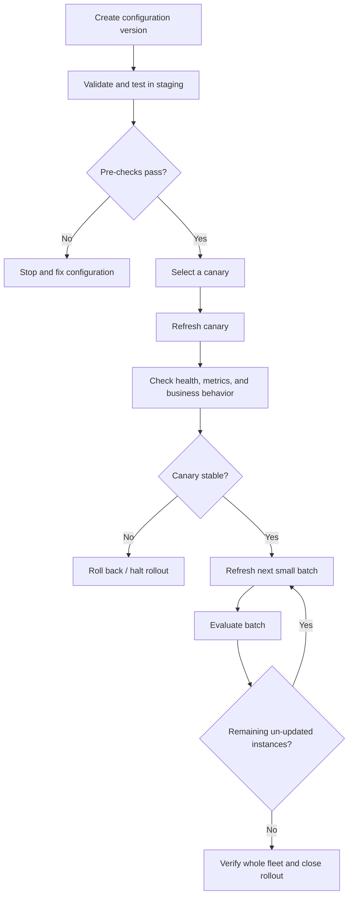

# Rolling Out Configuration Changes Across Multiple Instances in Batches

A service running multiple instances typically receives the same configuration set from Spring Cloud Config Server or another externalized configuration source. When changing timeouts, connection limits, dependency endpoints, or feature flags, updating configuration once and refreshing every instance simultaneously causes all instances to transition state at the exact same moment. If the new value is flawed, the entire service capacity can be degraded before operators notice.

A safer workflow is a phased rollout: identify the configuration version, test on a canary instance, observe behavior, expand to a small batch, and only then update the remainder. Spring Cloud Context provides mechanisms to update the `Environment`, rebind `@ConfigurationProperties`, and refresh `@RefreshScope` beans; Spring Cloud Bus can deliver refresh events to a single instance, a group of instances, or an entire service. These mechanisms are the execution tools inside a rollout workflow, while choosing batches, checking health, and deciding whether to proceed or roll back remain operational responsibilities.

This lesson belongs to the **Operations** chapter of **SPRING_CLOUD_CORE**. It focuses on multi-instance configuration rollout planning, canaries and batches, Spring Cloud Config, refresh endpoints, Spring Cloud Bus, readiness and service discovery, observing results, handling failures, rolling back, and pre-production testing.

## 1. Learning Objectives

After this lesson, you can:

- Explain why configuration changes across multiple instances require controlled rollouts.
- Distinguish updating Config Server from refreshing individual clients.
- Prepare a traceable and rollback-ready configuration version.
- Design canary instances and subsequent batches.
- Invoke `/actuator/refresh` on a single instance or use Spring Cloud Bus to target specific groups.
- Create unique Bus IDs to distinguish instances.
- Use readiness, load balancers, or service registries to control traffic during high-impact refreshes.
- Verify that `@ConfigurationProperties` and `@RefreshScope` have picked up new configuration.
- Monitor health, metrics, logs, and Bus acknowledgements per batch.
- Distinguish sent/received events from genuinely successful refreshes.
- Halt rollouts and roll back upon detecting anomalies.
- Test procedures in staging and identify cases requiring restarts or rolling deployments.

## 2. Why Roll Out in Batches?

Suppose a payment service has 20 instances. Operations wants to update:

```yaml
payments:
  client:
    connect-timeout: 1500ms
    read-timeout: 3s
    max-connections: 80
```

If all instances receive the change together, a flaw such as a too-short timeout or an undersized pool can spike error rates across the whole service. With a phased rollout, only a small fraction of traffic is initially exposed. Operations has time to observe and stop before expanding.

| Approach | Pros | Risks |
| --- | --- | --- |
| Refresh all at once | Fast, minimal steps | Configuration errors impact all instances simultaneously |
| Refresh one instance at a time | Small blast radius, easy to isolate failing instance | High operational effort and time |
| Canary then expanding batches | Balances speed and fault detection | Requires clear instance identification, monitoring, and coordination |
| Rolling restart | Suitable for non-refreshable configuration | Startup time overhead and requires spare capacity |

Batch rollouts are especially valuable when configuration affects connection pools, timeouts, retries, circuit breakers, routing, discovery, or feature flags. For changes that are purely observational without runtime impact, the process can be simpler; still record the version and outcome.

### 2.1. Blast Radius Depends on More Than Instance Count

A 10% batch does not always equal 10% risk. If those instances serve a major tenant, reside in the same availability zone, or handle a specific workload type, impact can be more concentrated than expected.

When selecting batches, consider:

- Instance count and actual traffic received per instance.
- Distribution across zones, nodes, tenants, or partitions.
- Remaining capacity if the batch is taken out of traffic.
- Impact of the configuration on downstream services.
- Rollback capability and time needed for instances to stabilize.

## 3. Phases of a Configuration Change

A rollout should have well-defined phases:

1. **Preparation:** identify changed properties, owner, config version, and success criteria.
2. **Pre-checks:** validate configuration, test in staging, and confirm rollback readiness.
3. **Canary:** apply to one instance or a very small group.
4. **Evaluation:** check health, errors, latency, resources, and business behavior.
5. **Expansion:** refresh subsequent batches in the planned order.
6. **Completion:** verify all instances run the target configuration version.
7. **Closure:** record audit details, outcomes, and rollback version.



Do not advance to the next batch merely because the refresh HTTP request succeeded. Allow an observation window suited to the change type and service traffic.

## 4. Preparing a Traceable Configuration Version

Spring Cloud Config Server usually reads configuration from Git. A Git label can be a branch, tag, or commit ID. For a rollout to be reproducible, you must know the exact content read by each batch.

Example application configuration:

```yaml
spring:
  application:
    name: payments-service
  config:
    import: "configserver:https://config.internal.example"
```

Config Server serves configuration by application, profile, and label. A query URL has the form:

```text
/{application}/{profile}/{label}
```

Example:

```bash
curl https://config.internal.example/payments-service/prod/release-2026-11-18
```

### 4.1. Prefer Immutable Labels for a Release

Branches like `main` move with new commits. If the canary refreshes at 10:00 and the next batch refreshes at 10:15, the two batches could read two different versions if the branch updates in between.

There are two management approaches:

- Freeze the branch during the rollout, merging no additional configuration changes.
- Use an immutable tag or commit ID as the release label.

If clients use an explicit label, declare the label clients must request from Config Server:

```yaml
spring:
  cloud:
    config:
      label: release-2026-11-18
```

Clients must be configured to request this exact label. If the label comes from local/bootstrap configuration or the deployment environment, changing the label may require a restart/redeploy to be re-read. For an in-place refresh rollout, the simplest approach is keeping the current label and freezing that branch for the duration. Record both the label and actual commit ID in the change record; do not merely log "refreshed main config," as `main` may point to a different commit later.

### 4.2. Pre-Release Content Verification

Before refreshing production:

- Inspect diffs of changed properties.
- Verify profile and application name.
- Confirm no unexpected secrets or endpoints were introduced.
- Validate data types, ranges, and units.
- Verify compatibility with the running code version.
- Identify instances that might require restarts.
- Save the pre-change commit/tag for rollback.

Do not bundle unrelated property groups into the same rollout. If multiple simultaneous changes cause an issue, isolating the offending property becomes difficult.

## 5. Classifying Properties Before Refresh

Not every property can be updated safely at runtime.

| Property Type | Example | Application Method |
| --- | --- | --- |
| Rebindable `@ConfigurationProperties` | Timeouts, pool limits supporting updates | Refresh and verify bound values |
| Beans in `@RefreshScope` | Clients holding endpoints or credentials at creation | Clear refresh scope cache, verify next instantiation |
| Startup-only properties | Server port, certain logging/bootstrap settings | Rolling restart or redeploy |
| Unsupported refresh config | Beans listed in `never-refreshable` | Restart or switch to suitable implementation |
| Secrets or credentials | Tokens, certificates, passwords | Follow dedicated secret rotation process, verify new connections |
| Schema/protocol changes | Headers, payloads, routing contracts | Deploy multi-version compatible code before switching fleet-wide |

### 5.1. EnvironmentChangeEvent and Rebinding

When `EnvironmentChangeEvent` fires, Spring Cloud handles changes in standard ways, including:

- Rebinding `@ConfigurationProperties` beans.
- Updating logger levels for `logging.level.*` properties.

Spring Cloud Config Client does not poll for `Environment` changes by default. In multi-instance systems, you can proactively broadcast events via Spring Cloud Bus instead of having every instance poll Config Server independently.

### 5.2. Limitations of Rebinding

Rebinding `@ConfigurationProperties` updates existing beans in place. For objects with multiple interrelated fields, other threads may observe intermediate states during rebinding. If a more consistent view across refreshes is required, consider `@RefreshScope` for the appropriate bean.

Classes using constructor binding, including Java records annotated with `@ConfigurationProperties`, cannot be refreshed via normal rebinding. Design a restart or alternative bean-creation pattern for those cases.

## 6. @RefreshScope and Beans Needing Re-Instantiation

`@RefreshScope` creates a lazy proxy and caches the initialized target bean. When the refresh scope is invalidated, the old target is evicted from cache; the next invocation instantiates a new target with current configuration.

Example:

```java
@Component
@RefreshScope
public class PaymentGatewayClient {

    private final WebClient webClient;

    public PaymentGatewayClient(
            @Value("${payments.gateway.base-url}") String baseUrl) {
        this.webClient = WebClient.builder()
                .baseUrl(baseUrl)
                .build();
    }

    public Mono<String> authorize(String paymentId) {
        return this.webClient.post()
                .uri("/authorizations/{id}", paymentId)
                .retrieve()
                .bodyToMono(String.class);
    }
}
```

When `payments.gateway.base-url` changes and the refresh scope is refreshed, the target client is recreated on next use.

### 6.1. Not Every Bean Auto-Refreshes

Placing `@RefreshScope` on a `@Configuration` class does not automatically put every bean declared by that class into refresh scope. Beans depending on that target may retain stale references if they themselves are not refreshed or do not access dependencies through appropriate proxies.

Explicitly identify which beans need refresh, which only need rebinding, and which require restarts.

### 6.2. Checking Non-Refreshable Beans

Spring Cloud provides `spring.cloud.refresh.never-refreshable` to specify beans/classes that must not be refreshed, and `spring.cloud.refresh.extra-refreshable` for additional bean types.

`HikariDataSource` is non-refreshable by default. Do not assume changing a JDBC URL and triggering refresh automatically creates a fresh Hikari pool. For datasources or stateful resources, verify implementation semantics and consider a rolling restart.

## 7. Refreshing a Single Instance with Actuator

Spring Cloud Context provides `/actuator/refresh` to update configuration and refresh `@RefreshScope` beans.

To expose the endpoint:

```yaml
management:
  endpoints:
    web:
      exposure:
        include: "health,refresh"
```

Invoke on the exact canary instance:

```bash
curl -X POST https://payments-canary-01.internal/actuator/refresh
```

This endpoint must be protected by authentication, authorization, and appropriate network policies. Never expose management endpoints directly to the Internet or through public ingresses without clear requirements and safeguards.

### 7.1. What Does the Refresh Endpoint Do?

Broadly, refresh reloads property sources per Spring Cloud Config/Context mechanisms, detects changed keys, rebinds `@ConfigurationProperties`, and invalidates the `@RefreshScope` cache.

The endpoint's return value may list changed keys. This is a useful signal, though it does not prove all dependent beans are operating with the new values or downstream accepted new connections.

### 7.2. Call the Endpoint Only When Targeting the Intended Instance

In container or Kubernetes environments, many Pods may sit behind one Service/load balancer. Calling `/actuator/refresh` through a shared Service hits only one arbitrary Pod.

To target a canary reliably, use a management address or an orchestration mechanism capable of identifying a specific instance. Never assume a single request through a load balancer refreshes all replicas.

## 8. Using Spring Cloud Bus for Multiple Instances

Spring Cloud Bus delivers events through a broker—typically RabbitMQ or Kafka—via a Spring Cloud Stream binder. Instances joined to the bus receive messages and process events matching their destination.

Common starter:

```xml
<dependency>
    <groupId>org.springframework.cloud</groupId>
    <artifactId>spring-cloud-starter-bus-amqp</artifactId>
</dependency>
```

Or use the Kafka starter matching your release train's dependency management.

Bus refresh endpoint:

```yaml
management:
  endpoints:
    web:
      exposure:
        include: "health,busrefresh"
```

Trigger refresh across the bus:

```bash
curl -X POST https://payments-admin.internal/actuator/busrefresh
```

`/actuator/busrefresh` publishes a refresh event over the bus; target instances process the event to refresh scopes and rebind `@ConfigurationProperties`.

### 8.1. Broadcasting Is Not a Batch Rollout

Calling `/actuator/busrefresh` without a destination usually sends the event to all matching instances on the bus. This is convenient for fleet-wide refresh, but unsuitable for a canary unless destination scoping is applied.

To roll out in batches, use Bus destination paths to target a single instance or a specific group of instances.

## 9. Identifying Instances on Spring Cloud Bus

Every instance needs a unique Bus ID. It can be configured with `spring.cloud.bus.id`; by default, Bus builds an ID from environment metadata such as application name, server port or application index, and instance ID.

Example ID format:

```text
payments-service:2:pod-7f8d9
```

Segments are separated by `:`. For addressing, Spring Cloud Bus uses a `PathMatcher` with `:` as the path separator.

### 9.1. Unique Identifiers Are Mandatory

If multiple instances share the same Bus ID, duplicate-event suppression can prevent messages from being processed as expected. Ensure every replica has a distinct ID, especially across containers on different hosts.

Example explicit configuration:

```yaml
spring:
  application:
    name: payments-service
  cloud:
    bus:
      id: "${spring.application.name}:${INSTANCE_GROUP}:${HOSTNAME}"
```

`INSTANCE_GROUP` and `HOSTNAME` must be supplied by the deployment platform as unique or sufficiently distinct values per your system's policy. If random values are used on restart, IDs may change across runs; that can be acceptable if you only need to address currently running instances.

### 9.2. Verify IDs Before Rollout

Before sending destination-targeted messages:

- Collect Bus IDs from every instance.
- Confirm no duplicates exist.
- Define destination patterns for canary and batches.
- Verify instances outside the target group ignore the message.
- Record the ID list in the change record for cross-checking.

## 10. Targeting One Instance or Batch Using Bus Destinations

Spring Cloud Bus allows appending a destination to the endpoint path. Documentation example:

```text
/actuator/busrefresh/customers:9000
```

Only instances matching the service ID handle the event; other instances ignore it.

To target all instances of a service, use a wildcard:

```text
/actuator/busrefresh/payments-service:**
```

With structured IDs:

```text
payments-service:canary:pod-a
payments-service:batch-1:pod-b
payments-service:batch-1:pod-c
payments-service:batch-2:pod-d
```

You can send:

```bash
curl -X POST \
  https://payments-admin.internal/actuator/busrefresh/payments-service:canary:**
```

Or:

```bash
curl -X POST \
  https://payments-admin.internal/actuator/busrefresh/payments-service:batch-1:**
```

Wildcards must follow Bus `PathMatcher` syntax. Test patterns in staging and verify which instances receive the event before running in production.

### 10.1. Do Not Use a Service-Wide Wildcard for a Canary

The path:

```text
/actuator/busrefresh/payments-service:**
```

targets every instance of the service, not a small batch. Use it only when intentionally refreshing the entire fleet.

### 10.2. Targeting One Specific Instance

When the full Bus ID is known:

```bash
curl -X POST \
  https://payments-admin.internal/actuator/busrefresh/payments-service:canary:pod-a
```

This is appropriate for refreshing a single canary before expanding. Verify the ID matches what the instance actually registered on the bus.

## 11. Canary and Batch Planning

A simple plan for 20 instances:

| Phase | Scope | Promotion Gate |
| --- | --- | --- |
| Canary | 1 instance | Health stable, metrics healthy, smoke test passes |
| Batch 1 | 2 instances | No error or latency spikes beyond threshold |
| Batch 2 | 4 instances | Downstream load and resources stable |
| Batch 3 | 6 instances | No new errors isolated by zone/tenant |
| Final batch | Remaining 7 instances | Prior batches passed and capacity sufficient |
| Final verification | All 20 instances | Every instance reports the target config version |

Batch proportions are not fixed constants. Services with fewer replicas or higher traffic should use smaller batches. Services with spare capacity and low-risk changes can expand faster.

### 11.1. Observation Time Between Batches

There is no single universal wait time. Wait long enough for:

- In-flight requests to pass timeout/retry windows.
- Connection pools to create or evict connections.
- Health checks and metrics to reflect the change.
- Downstream services to exhibit any impact.
- Background jobs or message consumers to complete at least one relevant cycle.

For example, an HTTP timeout change may require observing multiple requests; a batch scheduler change may require waiting for the next job execution cycle.

### 11.2. Maintain Spare Capacity

If instances must be drained before refreshing, confirm remaining instances can handle peak traffic. Never pull too many instances out of the load balancer simultaneously.

## 12. Coordinating Traffic During Refresh

For non-disruptive changes, a canary can be refreshed while serving traffic. For changes that disrupt connections, switch endpoints, or recreate stateful clients, take the instance out of traffic first.

Typical procedure:

1. Mark the instance as refusing new requests via readiness or platform maintenance controls.
2. Confirm the load balancer/service mesh stops sending traffic to the instance.
3. Wait for in-flight requests to finish or drain timeout to elapse.
4. Invoke refresh on the instance.
5. Check health, downstream connectivity, and run a smoke test.
6. Return the instance to ready status.
7. Wait for traffic to stabilize before moving to the next instance.

### 12.1. Readiness Must Be Honored by the Traffic Layer

Setting readiness state does not automatically guarantee every load balancer or consumer stops sending requests. Verify that your deployment platform, ingress, service mesh, or discovery client actually removes the instance from selection.

When using a service registry, you may need to update status using provider-specific APIs or platform maintenance/drain mechanisms. Do not assume all providers share identical semantics for `OUT_OF_SERVICE`, `DOWN`, or deregistration.

### 12.2. Distinguish Readiness from Liveness

- **Readiness:** should this instance receive new traffic?
- **Liveness:** does this process need to be restarted?

A failed configuration refresh does not automatically mean the process needs an immediate restart. Readiness can flip out of traffic while operations investigates. Liveness should reflect the process's ability to keep operating, not act as a substitute for readiness.

## 13. Verification After Each Refresh

After refreshing an instance, verify three layers:

1. **Configuration:** `Environment` or `@ConfigurationProperties` contains the new values.
2. **Beans:** refresh-scoped beans recreate on access without re-initialization errors.
3. **Behavior:** real requests, metrics, and downstream calls work properly.

Observation sources:

| Source | What to Verify |
| --- | --- |
| `/actuator/env` | Property sources and loaded values |
| `/actuator/configprops` | Values bound into `@ConfigurationProperties` |
| `/actuator/health` | Readiness and health indicators, including refresh scope if enabled |
| Application logs | Exceptions during rebinding or bean recreation |
| Metrics | Error rate, latency, connection pools, retries, and saturation |
| Bus trace/ack | Message sent and instances received the event |
| Application-specific diagnostics | Active config version or release ID |

Never log plaintext secrets to verify configuration. Log versions, non-sensitive key names, or safe fingerprints instead of raw values.

### 13.1. RefreshScopeHealthIndicator

Spring Cloud provides `RefreshScopeHealthIndicator`. If a bean fails to re-instantiate or configuration rebinding fails after refresh, the health indicator may transition to `DOWN` and report the exception.

Include this signal in rollout stop criteria. Still, do not rely solely on health indicators: also monitor business errors, latency, and external dependencies.

### 13.2. Bus Acknowledgement Is Not Proof of Successful Refresh

Spring Cloud Bus can trace sent events and acknowledgements from instances. An ack shows the instance received/handled the message at the bus layer; it does not prove every bean now works properly with the new configuration.

Correlate Bus traces with refresh health, logs, metrics, and smoke tests. For centralized tracking, capture sent and ack events to compare expected instances against actual respondents.

## 14. Monitoring Spring Cloud Bus

Bus uses Spring Cloud Stream and a binder such as RabbitMQ or Kafka. For instances to exchange events, the broker must be healthy and applications must share compatible bus configuration.

Example enabling trace:

```yaml
spring:
  cloud:
    bus:
      trace:
        enabled: true
```

Depending on configuration and version, the trace repository can record sent events and acknowledgements. These events help investigate:

- Which instance originated the event?
- What destination was targeted?
- Which instances sent acks?
- Did any instance miss joining the bus or have duplicate IDs?
- Are there broker errors or slow consumers?

### 14.1. The Broker Is an Operational Dependency

Before rollout:

- Verify broker health.
- Check credentials and TLS.
- Inspect queues/topics and consumer groups.
- Confirm all instances needing refresh are connected to the bus.
- Check message latency and backlog.
- Confirm messages will not be filtered out by mismatched destinations.

If the broker is unhealthy, do not assume `/actuator/busrefresh` updated all instances. Use direct refresh on the canary or halt the rollout per runbook until the bus recovers.

### 14.2. Do Not Treat busenv as a Permanent Configuration Release

`/actuator/busenv` can update a key/value in the `Environment` across multiple instances. This is a useful runtime operation in select cases, but it does not replace a managed, version-controlled configuration source.

Updating the `Environment` temporarily without updating Config Server or the canonical source means a future refresh may revert to the old value. Any durable change must be written to the canonical configuration source first or concurrently per your workflow.

## 15. When to Halt a Rollout

Define stop thresholds before starting. Examples:

- Error rate exceeds baseline within an observation window.
- p95/p99 latency spikes significantly.
- Refresh health indicator flips to `DOWN`.
- Connection pools exhaust or connection failures rise.
- Downstream timeouts/retries increase.
- A tenant group or zone experiences concentrated errors.
- An instance fails to return to readiness.
- Bus acknowledgements fall below target instance count without explanation.

When anomalies appear:

1. Stop refreshing subsequent batches.
2. Keep un-updated instances on the stable configuration version.
3. Identify which batches and instances received the change.
4. Check whether errors correlate with the recently changed property.
5. Choose rollback or forward-fix after root-cause assessment.
6. Track each instance's state to prevent incomplete or duplicate rollbacks.

Do not continue rolling out just because some instances remain healthy. Evaluate against all relevant metrics and traffic profiles.

## 16. Configuration Rollback

Rollback must be prepared before starting. When using a Git backend, record the pre-change commit or tag. You can create a revert commit or point configuration back to a verified immutable label.

Rollback procedure:

1. Stop expanding batches.
2. Identify the most recent known-good configuration version.
3. Publish the rollback commit/tag in Config Server.
4. Refresh the canary or failing instances first.
5. Verify health, properties, and behavior have recovered.
6. Expand the rollback in batches just like a forward rollout.
7. Confirm the entire fleet converges on the rollback version.

### 16.1. Do Not Just Revert Git and Stop

Already-refreshed instances keep their current `Environment` state until their next refresh or restart. Reverting the repository does not automatically alter running contexts.

Actively send refreshes to the exact instances that received the faulty version and verify the restored values loaded.

### 16.2. Rollbacks May Not Reverse Side Effects

Some configuration changes trigger side effects that are hard to reverse, such as:

- Connecting to a new database and writing records there.
- Changing routing so messages land in a different queue.
- Enabling a feature that writes data in a new schema.
- Rotating credentials where old credentials have been revoked.

In such cases, rolling back properties is insufficient. You need data compatibility plans, credential overlap, or a dedicated forward-fix.

## 17. Changes Requiring Restart Instead of Refresh

Refresh is not a full application restart. Some properties are read only at startup, some beans do not support refresh, and some changes require recreating the process.

Use rolling restart/redeploy when changes affect:

- `server.port`, context path, or startup-only server settings.
- Bootstrap/config import locations or Config Client identity.
- Dependency graph, classpath, or auto-configuration.
- Immutable beans outside refresh scope.
- Datasources/SDKs without refresh support.
- Native images or AOT transformations unsupported by current context refresh mechanisms.
- Changes requiring code or library version upgrades.

### 17.1. Batched Rolling Restart

The workflow resembles a refresh rollout:

1. Select an instance.
2. Drain traffic.
3. Start a new instance with the specified artifact/config version.
4. Wait for readiness and smoke tests.
5. Admit the instance into traffic.
6. Proceed to the next instance.

When two code versions can run concurrently, maintain protocol and schema compatibility throughout the transition.

## 18. Example Runbook for 12 Instances

Suppose `payments-service` has 12 instances and needs to change `payments.client.read-timeout` from `2s` to `3s`.

### 18.1. Plan

| Batch | Instances | Count |
| --- | --- | ---: |
| Canary | `payments-service:canary:pod-a` | 1 |
| Batch 1 | `payments-service:batch-1:pod-b`, `pod-c` | 2 |
| Batch 2 | `payments-service:batch-2:pod-d`, `pod-e`, `pod-f` | 3 |
| Batch 3 | `payments-service:batch-3:pod-g`, `pod-h`, `pod-i` | 3 |
| Final batch | `payments-service:batch-4:pod-j`, `pod-k`, `pod-l` | 3 |

These IDs are examples; production environments must use verified unique Bus IDs.

### 18.2. Publish Configuration

In the configuration repository:

```yaml
payments:
  client:
    read-timeout: 3s
```

In this in-place refresh workflow, clients track the `main` branch. Commit the change and record both label and commit ID:

```text
config-label: main
config-release: 4f8a2d1
```

Merge no additional changes into `main` during the rollout. The canary and subsequent batches refresh from the frozen branch, while the commit ID traces the exact published content. If choosing an immutable label such as a tag or commit ID instead of a branch, clients must be configured to request that label; changing the label in local/bootstrap configuration may require a rolling restart/redeploy before refresh rollouts.

### 18.3. Refresh Canary

```bash
curl -X POST \
  "https://payments-admin.internal/actuator/busrefresh/payments-service:canary:pod-a"
```

Check configprops, refresh health, latency, timeouts, and a test transaction.

### 18.4. Refresh Batch 1

If the canary passes:

```bash
curl -X POST \
  "https://payments-admin.internal/actuator/busrefresh/payments-service:batch-1:**"
```

Wait for metrics to stabilize and confirm both instances loaded the new configuration.

### 18.5. Expand Batches

Proceed with `batch-2`, `batch-3`, and `batch-4`. After each invocation, cross-check the target instance list with Bus traces/acks and health.

### 18.6. Wrap Up

Verify:

- 12 instances are running.
- All loaded the same config release.
- No instance still holds old values.
- Error rate and latency are within thresholds.
- No refresh failures or abnormal broker backlogs exist.
- The change record contains commit ID, timestamps, and per-batch results.

## 19. Testing the Procedure Before Production

A rollout workflow should be rehearsed in staging with multiple real instances or test fixtures having distinct Bus IDs.

Scenarios to verify:

| Scenario | Expected Outcome |
| --- | --- |
| Canary refresh succeeds | Only the canary receives the new configuration |
| Destination targets batch 1 | Instances outside the batch ignore the event |
| Duplicate Bus IDs | Test detects and blocks rollout |
| Broker disconnected | Alert fires; batch is not marked successful |
| Config Server unreachable | Refresh fails or keeps current config per client semantics |
| Refresh-scoped bean initialization error | Health indicator reflects the failure |
| `@ConfigurationProperties` rebind | New values verified |
| Property removed from remote source | Verify actual behavior; do not assume values vanish across all bean types |
| Label rollback | Updated instances return to prior version |
| Instance misses ack | Runbook detects missing instance and halts batch expansion |
| Instance draining | Receives no new traffic during refresh |
| Restart-required property | Workflow switches to rolling restart |

### 19.1. Testing Deleted Properties

Spring Cloud has a known limitation on refresh: deleting a property from configuration does not necessarily update property presence the way an application expects. If logic depends on property presence or absence, test exact semantics in your version and bean types.

An easier-to-control design is keeping the property and changing its value to an explicit state rather than relying on key deletion to represent state.

### 19.2. Testing Rollback

Do not test only the forward path to new configuration. Test the return path to the prior version as well, including bean refreshes, downstream connections, and behavior while instances hold new configuration before returning to traffic.

## 20. Common Operational Pitfalls

| Symptom | Possible Cause | Remediation |
| --- | --- | --- |
| Only one instance refreshes when calling endpoint via load balancer | HTTP request hits only one backend | Use Bus or invoke each instance's management endpoint |
| All instances refresh simultaneously | Calling `busrefresh` without destination | Stop broadcasting; use destinations for canary/batches |
| Instance misses Bus event | Broker, consumer, destination, or Bus ID error | Inspect broker, traces, and IDs |
| Two instances misprocess events | Duplicate Bus IDs | Assign unique IDs and re-verify |
| Bus ack present yet bean fails | Ack does not prove bean refresh succeeded | Check refresh health, logs, and smoke tests |
| New property in `Environment` yet client uses old endpoint | Bean not refresh-scoped or holds stale object | Inspect dependency graph and bean lifecycle |
| `@ConfigurationProperties` shows intermediate values | In-place rebind while another thread reads | Use `@RefreshScope` for consistent views or deploy restart |
| `HikariDataSource` ignores new config | Hikari is non-refreshable by default | Use rolling restart or dedicated datasource strategy |
| Config Server returns different versions across batches | Branch changed mid-rollout | Freeze branch or use immutable label |
| Refresh endpoint returns error | Config Server/broker/bean refresh failure | Read response, logs, refresh health, and property source state |
| Instance fails to regain readiness | Re-initialization or downstream connection failed | Keep instance out of traffic, investigate, and roll back |
| Reverted Git yet instances still use new values | Updated instances were not refreshed again | Send rollback refresh to the exact updated instances |
| Refresh fails to apply startup-only property | Property read only at boot | Perform rolling restart/redeploy |
| Batch overloads downstream | Many clients recreate connections simultaneously | Shrink batches, add delays, and control connection warm-up |

## 21. Operational Checklist

- [ ] Identify owner and list of changed properties.
- [ ] Classify properties as refreshable vs. restart-required.
- [ ] Prepare config commit/tag and rollback version.
- [ ] Freeze branch or pin label throughout rollout.
- [ ] Test configuration in staging.
- [ ] Define success criteria and stop thresholds.
- [ ] Verify instance list and unique Bus IDs.
- [ ] Test canary and batch destinations.
- [ ] Secure Actuator `refresh`/`busrefresh` endpoints.
- [ ] Confirm broker and Config Server are healthy.
- [ ] Verify readiness/drain is honored by load balancers or service registries.
- [ ] Check metrics, logs, health, and smoke tests after each batch.
- [ ] Do not expand if the previous batch did not pass.
- [ ] Maintain and test the rollback procedure.
- [ ] Verify post-rollout that all instances run the same config release.
- [ ] Record timestamps, commit IDs, batches, and outcomes in the change record.

## 22. Summary

Rolling out configuration changes across multiple instances combines versioned configuration sources, suitable refresh mechanisms, and batch-based orchestration. Spring Cloud Context provides `EnvironmentChangeEvent`, `@ConfigurationProperties` rebinding, and `@RefreshScope`; Spring Cloud Bus delivers refresh events to one instance, a group, or an entire service via destinations.

To reduce risk, start with a canary, monitor health and metrics, and expand batch by batch. Use unique Bus IDs to target the right instances; use readiness or draining when refreshes can disrupt traffic; and verify acknowledgements against actual refresh outcomes. When changes do not support refresh, use a rolling restart.

A rollout is complete only when all instances are verified on the intended configuration version, business behavior is stable, and changes remain traceable and reversible to the prior version.

## 23. References

- [Spring Cloud Commons — Environment Changes and Refresh Scope](https://docs.spring.io/spring-cloud-commons/reference/spring-cloud-commons/application-context-services.html)
- [Spring Cloud Bus — Bus Endpoints](https://docs.spring.io/spring-cloud-bus/reference/spring-cloud-bus/bus-endpoints.html)
- [Spring Cloud Bus — Addressing Instances](https://docs.spring.io/spring-cloud-bus/reference/spring-cloud-bus/addressing.html)
- [Spring Cloud Bus — Configuration and Event Tracing](https://docs.spring.io/spring-cloud-bus/reference/spring-cloud-bus/configuration.html)
- [Spring Cloud Config — Config Client and Externalized Configuration](https://docs.spring.io/spring-cloud-config/reference/client.html)
- [Spring Cloud Config — Git Backend and Labels](https://docs.spring.io/spring-cloud-config/reference/server/environment-repository/git-backend.html)
- [Spring Cloud Commons — Configuration Properties](https://docs.spring.io/spring-cloud-commons/reference/configprops.html)
