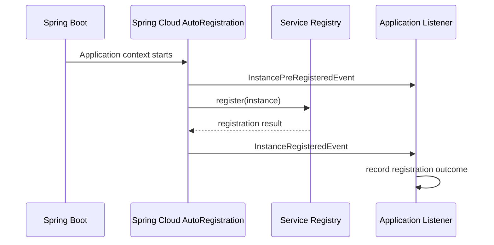

# Liveness, Readiness, and Service Registration Status

In a Spring Cloud system running on Kubernetes or a container orchestration platform, an instance may have a running process while not yet ready for requests; it may be ready to process requests while not yet registered in the service registry; or the registry may still retain stale status after the application has failed. Collapsing these scenarios into a single health signal can route traffic to unready instances or repeatedly restart every replica when a shared dependency fails.

Three state layers must be distinguished:

1. **Liveness** indicates whether the process is still healthy enough to keep running or needs to be restarted.
2. **Readiness** indicates whether the instance can currently accept traffic or should temporarily step out of serving rotation.
3. **Service registration status** indicates how the instance is registered and advertised in a registry such as Eureka or Consul.

Spring Boot Actuator provides health groups for liveness/readiness. Spring Cloud Commons provides the `DiscoveryClient`, `ServiceRegistry`, health indicator, and registration management endpoint abstractions. Specific registries have their own heartbeat, health check, and synchronization timing mechanisms.

This lesson belongs to the **Operations** chapter of the **SPRING_CLOUD_CORE** module. It covers probe design, registration lifecycle management, checking registry state, Kubernetes configuration, and handling inconsistent replica states.

## 1. Learning Objectives

After this lesson, learners can:

- Distinguish liveness, readiness, startup probes, and service registration status.
- Explain `LivenessState` and `ReadinessState` in Spring Boot.
- Configure Actuator health groups for Kubernetes.
- Select the right dependencies to include in readiness checks.
- Understand why liveness should not depend on databases, Config Server, or external registries.
- Track auto-registration via `ServiceRegistry` and registration events.
- Read and change registration status via the Actuator `serviceregistry` endpoint.
- Distinguish health check behavior between Eureka and Consul.
- Handle heartbeat delays, registry caches, and deregistration.
- Inspect Pod, EndpointSlice, and service registry states when traffic fails to reach an instance.

## 2. Three Non-Interchangeable State Layers

| State | Question Answered | Consumer | Typical Action |
| --- | --- | --- | --- |
| Liveness | Can the process keep running? | Kubernetes kubelet or orchestration platform | Restart container when probe failures exceed threshold |
| Readiness | Can the instance accept requests right now? | Kubernetes Service, load balancer, or gateway | Stop routing traffic to unready instances |
| Registration status | What status is the registry advertising for this instance? | Discovery clients, service registry, Spring Cloud LoadBalancer | Allow or restrict client instance selection per registry policy |

An instance can exhibit combinations such as:

- Liveness UP, readiness `OUT_OF_SERVICE`: the JVM is alive, but the app is loading data, draining traffic, or paused from serving.
- Liveness UP, readiness UP, not yet registered: the app is locally ready, but not yet visible in the registry.
- Readiness UP, registration `OUT_OF_SERVICE`: the app can handle direct requests, while discovery clients may skip selecting it.
- Liveness DOWN: the instance needs restarting; the registry may take extra time to evict it from the list.

Do not infer registry state solely from `/actuator/health`. Nor should you infer the process is alive simply because the registry still shows the instance as UP; the registry may simply not have missed enough heartbeats or received a fresh health update yet.

## 3. Liveness in Spring Boot

Liveness signals the internal health of the process. If the application enters an unrecoverable state, Kubernetes can restart the container to return the process to a clean state.

Spring Boot manages `ApplicationAvailability` and provides `LivenessStateHealthIndicator`. This health group is exposed at:

```text
/actuator/health/liveness
```

Key internal states:

- `BROKEN`: the application cannot yet be considered running normally.
- `CORRECT`: the application has passed required initialization and can continue running.

### 3.1. Do Not Include External Dependencies in Liveness

Do not make liveness depend on:

- Shared databases.
- Config Server.
- Eureka or Consul.
- Redis, Kafka, or partner APIs.
- Another service shared by many replicas.

If a shared database temporarily drops connectivity and liveness flips `DOWN` across every replica, Kubernetes can restart all replicas simultaneously. Restarts generate fresh connections, startup load, and retry storms against the already struggling dependency, amplifying the outage.

Liveness should reflect the process's ability to self-recover. A severe thread deadlock or corrupted internal state unable to serve requests justifies marking liveness `BROKEN`; a temporarily unreachable external dependency generally does not.

## 4. Readiness in Spring Boot

Readiness answers: can this instance accept new requests right now? Spring Boot provides `ReadinessStateHealthIndicator` and the health group:

```text
/actuator/health/readiness
```

Internal states:

- `REFUSING_TRAFFIC`: the application is not yet accepting new requests.
- `ACCEPTING_TRAFFIC`: the application can receive traffic.

Spring Boot holds readiness in `REFUSING_TRAFFIC` while startup tasks are running. Once the application signals ready, state transitions to `ACCEPTING_TRAFFIC`.

Readiness can also transition back to refusing traffic when graceful shutdown begins. This lets load balancers stop sending new requests to the instance before the process terminates.

### 4.1. When Should Dependencies Be Added to Readiness?

Add a dependency's health check only when the instance cannot provide core functionality while that dependency is unavailable.

Examples:

- A service reading exclusively from an instance-local database may need that database check in readiness.
- A service with a local cache and fallback when Redis disconnects can stay ready.
- Config Server is called at startup; once configuration has loaded, a temporary Config Server outage does not necessarily make the instance unready.
- An unreachable service registry can affect discoverability, though including registry health in readiness depends on how traffic is routed and instance lists are cached.

Spring Boot does not automatically add external health indicators to the readiness group. Developers must opt in deliberately.

If every replica flips readiness to `REFUSING_TRAFFIC` simultaneously, Kubernetes Services have zero backend endpoints left to forward requests. For ClusterIP or NodePort Services, clients may fail to establish connections rather than necessarily receiving an HTTP 503 response.

## 5. Startup Probes and Availability Lifecycle

Kubernetes provides three common probes:

| Probe | Purpose | On Failure |
| --- | --- | --- |
| `startupProbe` | Give the app enough time for initial startup | Kubelet keeps probing startup; liveness/readiness are suspended until startup succeeds |
| `livenessProbe` | Detect a process needing restart | Restarts container after failure threshold |
| `readinessProbe` | Detect an instance unable to accept traffic | Removes instance from serving endpoints |

Spring Boot describes the availability lifecycle as follows:

| Phase | Liveness | Readiness | HTTP Server |
| --- | --- | --- | --- |
| Starting | `BROKEN` | `REFUSING_TRAFFIC` | Not yet started |
| Started | `CORRECT` | `REFUSING_TRAFFIC` | Not yet accepting business requests |
| Ready | `CORRECT` | `ACCEPTING_TRAFFIC` | Accepting requests |
| Graceful shutdown | `CORRECT` | `REFUSING_TRAFFIC` | Rejects new requests, completes in-flight requests if graceful shutdown is enabled |

`startupProbe` helps when an application needs extended time to fetch config, warm up caches, run migrations, or initialize connections. Without a startup probe and with a short liveness threshold, kubelet may restart the application before startup finishes.

## 6. Enabling Health Groups for Kubernetes

When running in Kubernetes, Spring Boot Actuator auto-configures liveness and readiness health groups. They can be enabled explicitly in other environments via `management.endpoint.health.probes.enabled`.

Example:

```yaml
management:
  endpoint:
    health:
      probes:
        enabled: true
```

Two default endpoints:

- `GET /actuator/health/liveness`
- `GET /actuator/health/readiness`

If the management server runs on a separate port, probes might succeed while the main web server cannot accept connections—for instance, when the management port is alive while the main server port or connection pool is broken.

To expose probes on the main application port, configure:

```yaml
management:
  endpoint:
    health:
      probes:
        enabled: true
        add-additional-paths: true
```

Spring Boot additionally exposes:

- `/livez` for liveness on the main server port.
- `/readyz` for readiness on the main server port.

You can use per-health-group `additional-path` settings to customize paths if your platform follows specific URL conventions.

## 7. Configuring a Kubernetes Deployment

Example Deployment using HTTP port 8080 and health paths on the main server port:

```yaml
apiVersion: apps/v1
kind: Deployment
metadata:
  name: orders-service
spec:
  replicas: 3
  selector:
    matchLabels:
      app: orders-service
  template:
    metadata:
      labels:
        app: orders-service
    spec:
      containers:
        - name: orders-service
          image: example/orders-service:1.0.0
          ports:
            - name: http
              containerPort: 8080
          startupProbe:
            httpGet:
              path: /livez
              port: http
            periodSeconds: 10
            timeoutSeconds: 2
            failureThreshold: 30
          livenessProbe:
            httpGet:
              path: /livez
              port: http
            periodSeconds: 10
            timeoutSeconds: 2
            failureThreshold: 3
          readinessProbe:
            httpGet:
              path: /readyz
              port: http
            periodSeconds: 5
            timeoutSeconds: 2
            failureThreshold: 3
```

In this example:

- The startup probe allows up to roughly 300 seconds of consecutive failures before kubelet concludes startup failed, based on `periodSeconds` multiplied by `failureThreshold`.
- Liveness checks the process after the startup probe succeeds.
- Readiness checks traffic readiness more frequently.

These values are illustrative. Tune `initialDelaySeconds`, `periodSeconds`, `timeoutSeconds`, `failureThreshold`, and `successThreshold` according to actual startup duration distributions and service SLAs. Do not set timeouts so short that temporary CPU spikes fail probes.

If `add-additional-paths` is not enabled, use `/actuator/health/liveness` and `/actuator/health/readiness` and specify whichever port exposes Actuator.

## 8. Customizing the Readiness Health Group

Spring Boot does not include external health indicators in the readiness group by default. If a dependency truly determines whether the instance can serve requests, add that indicator:

```yaml
management:
  endpoint:
    health:
      group:
        readiness:
          include: "readinessState,catalogDependency"
```

Example health indicator checking a core dependency:

```java
import org.springframework.boot.actuate.health.Health;
import org.springframework.boot.actuate.health.HealthIndicator;
import org.springframework.stereotype.Component;

@Component("catalogDependency")
public class CatalogDependencyHealthIndicator implements HealthIndicator {

    private final CatalogConnection catalogConnection;

    public CatalogDependencyHealthIndicator(
            CatalogConnection catalogConnection) {
        this.catalogConnection = catalogConnection;
    }

    @Override
    public Health health() {
        if (catalogConnection.isAvailable()) {
            return Health.up().build();
        }

        return Health.down()
            .withDetail("dependency", "catalog")
            .build();
    }
}
```

`CatalogConnection` in this example represents an application-provided abstraction; checks must use short timeouts and avoid heavy requests on every probe run.

Do not include this indicator in liveness. If the dependency is merely a performance optimization or has a fallback, exclude it from readiness so healthy-enough instances are not pulled from traffic.

## 9. Spring Cloud Commons DiscoveryClient Health Indicator

Spring Cloud Commons auto-configures `DiscoveryClientHealthIndicator` based on the active discovery implementation. This indicator checks the health of the discovery client itself; it is not a comprehensive check of every service instance in the registry.

Key properties:

```yaml
spring:
  cloud:
    discovery:
      client:
        health-indicator:
          enabled: true
          include-description: false
          use-services-query: false
```

Meaning:

- `enabled`: enables/disables the `DiscoveryClient` health indicator.
- `include-description`: controls whether the discovery client description is included in aggregate health output.
- `use-services-query`: defaults to `true`, calling `DiscoveryClient.getServices()`. When `false`, it uses the lighter `DiscoveryClient.probe()`.

In deployments with many services, querying the entire service list on every health check can be expensive. Use `probe()` when the goal is simply verifying the discovery client works.

Spring Cloud Commons also provides `DiscoveryCompositeHealthContributor`, aggregating registered `DiscoveryHealthIndicator` beans. The composite indicator can be disabled with:

```properties
spring.cloud.discovery.client.composite-indicator.enabled=false
```

### 9.1. Discovery Health Is Not Registration Health

`DiscoveryClientHealthIndicator` checks the local discovery client implementation. It does not prove:

- This application's own instance is registered with the right host/port.
- The registry has synced the latest state.
- All consumers have fetched the latest registry snapshot.
- A specific service ID has available instances.
- Consumer requests can actually reach the instance's endpoint.

To confirm a specific service ID has instances, check `DiscoveryClient.getInstances(serviceId)` or inspect Actuator `serviceregistry` and the registry UI/API.

Do not put broad discovery health into liveness. Include a targeted check in readiness only if the application truly cannot serve when discovery disconnects.

## 10. Auto-Registration Lifecycle in Spring Cloud

When a discovery implementation is on the classpath, Spring Cloud can automatically register the running application with the service registry. In modern configurations, `@EnableDiscoveryClient` is no longer strictly required just to enable discovery.

Auto-registration is enabled by default. It can be disabled with:

```yaml
spring:
  cloud:
    service-registry:
      auto-registration:
        enabled: false
```

Or use `@EnableDiscoveryClient(autoRegister = false)` when disabling via annotation configuration.

These two options serve different purposes:

- `spring.cloud.discovery.enabled=false` disables service discovery.
- `spring.cloud.service-registry.auto-registration.enabled=false` disables auto-registration without disabling discovery queries.

Spring Cloud Commons provides the `ServiceRegistry` abstraction with operations:

- `register(Registration)`: registers an instance.
- `deregister(Registration)`: deregisters an instance.

`Registration` is a marker interface; each implementation provides its own registration type, such as Eureka, Consul, or Zookeeper. When using `ServiceRegistry` directly, pass the exact registration type matching the implementation.

## 11. Observing Registration Events

Spring Cloud Commons publishes two events during auto-registration:

- `InstancePreRegisteredEvent`: before the service is registered.
- `InstanceRegisteredEvent`: after the service is registered.

Applications can register listeners to log or run tasks dependent on registration outcomes.

Example flow:



These two events are not emitted when `spring.cloud.service-registry.auto-registration.enabled=false`. When auto-registration is disabled, the application is responsible for calling `ServiceRegistry.register()` and handling deregistration.

Do not treat `InstanceRegisteredEvent` as sole proof that consumers already see the instance. Registries and discovery clients have their own caches and synchronization intervals.

## 12. Reading and Changing Status via the Actuator ServiceRegistry Endpoint

Spring Cloud Commons provides the `serviceregistry` endpoint, which depends on a `Registration` bean in the `ApplicationContext`.

When exposed, the default path is:

```text
/actuator/serviceregistry
```

Read registration status:

```bash
curl -sS http://localhost:8080/actuator/serviceregistry
```

Change registration status via `POST`:

```bash
curl -i -X POST \
  -H "Content-Type: application/json" \
  -d '{"status":"OUT_OF_SERVICE"}' \
  http://localhost:8080/actuator/serviceregistry
```

The endpoint requires a body with a `status` field. Valid values depend on the service registry implementation. For instance, Eureka supports `UP`, `DOWN`, `OUT_OF_SERVICE`, and `UNKNOWN`; do not assume Consul or Zookeeper uses the exact same set of values.

To expose the endpoint:

```yaml
management:
  endpoints:
    web:
      exposure:
        include: "health,info,serviceregistry"
```

Expose this endpoint only on a secured management interface. `POST` alters the live registered instance status and can remove the instance from discovery traffic. Never expose it to public clients.

### 12.1. Status Updates Differ from Deregistration

Setting status to `OUT_OF_SERVICE` or an equivalent registry state typically keeps the instance entry in the registry while preventing selection for traffic per provider policy.

Deregistration removes the registration from the registry. Both operations can be used at different stages:

1. Take the instance out of traffic.
2. Wait for in-flight requests to finish or drain timeout to elapse.
3. Deregister the instance on shutdown.

Exact implementation depends on Eureka, Consul, Zookeeper, and your orchestration platform. Never use a status update as a substitute for deregistration when the goal is completely removing the registration.

## 13. Eureka: Heartbeats and Health Checks

Eureka receives instance metadata such as host, port, status URL, home page, and custom metadata. Clients send periodic heartbeats to signal the instance remains alive.

Common defaults:

- Heartbeat/lease renewal: 30 seconds.
- Lease expiration: 90 seconds.

If heartbeats stop arriving within the lease expiration window, Eureka can evict the instance from the registry. Registries and clients also maintain sync caches; a newly registered instance may take extra time before all clients see it.

### 13.1. Heartbeats Do Not Automatically Propagate Actuator Health

By default, Eureka relies on heartbeats to determine whether a client is alive. Without health check integration enabled, the application's Actuator health state is not automatically sent to Eureka. After successful registration, Eureka may keep advertising the instance as `UP` even when Actuator health has turned non-`UP`.

Enable health check integration in `application.yml`:

```yaml
eureka:
  client:
    healthcheck:
      enabled: true
```

Place this property in `application.yml`, not `bootstrap.yml`. When enabled, application health status propagates to Eureka so clients avoid picking non-`UP` instances.

This integration still differs from a Kubernetes readiness probe. Kubernetes uses readiness to manage Pod endpoints; Eureka uses instance status in the registry for discovery client selection. Both systems can update on different cadences.

### 13.2. Investigating Slow Eureka Registration

If the application logged successful registration yet consumers do not see the instance:

- Check whether the Eureka client has sent heartbeats.
- Check whether the Eureka Server received the registration and instance metadata.
- Check registry fetch intervals and client-side caches on consumers.
- Check whether the registered host/port is reachable from consumers.
- Check zone and metadata if operating across multiple zones.

Do not lower the lease renewal interval excessively just to make registrations appear faster. Eureka makes internal assumptions about heartbeat cadence; keep defaults in production unless tested with a clear rationale.

## 14. Consul: HTTP Health Checks

Spring Cloud Consul creates an HTTP health check when registering a service. By default, Consul calls:

```text
/actuator/health
```

The default interval is 10 seconds. If the health check fails, Consul marks the instance as critical.

You can customize the path and interval:

```yaml
spring:
  cloud:
    consul:
      discovery:
        health-check-path: /actuator/health
        health-check-interval: 15s
```

If using a custom management context path, servlet path, or actuator base path, configure the health check path to match the actual endpoint. Otherwise, Consul will mark the instance critical even while business endpoints work.

You can disable HTTP health checks with:

```yaml
spring:
  cloud:
    consul:
      discovery:
        register-health-check: false
```

Disable it only when an appropriate alternative health check mechanism exists. Never disable it to hide endpoint or routing failures.

### 14.1. Which Health Endpoint Does Consul Call?

By default Consul calls `/actuator/health`, which is the global health endpoint. Global health may aggregate database, discovery, disk space, and other indicators present in the application.

If global health depends on a shared system, an outage in that system can mark every service instance critical. Before modifying health checks, identify which dependencies genuinely impact request serving capability.

## 15. Coordinating Readiness with the Service Registry

In a Spring Cloud application, readiness and registry status should have a clear relationship without needing to be identical.

A typical deployment lifecycle:

1. Process starts; readiness is `REFUSING_TRAFFIC`.
2. Application loads configuration and initializes core dependencies.
3. Application transitions readiness to `ACCEPTING_TRAFFIC`.
4. Service registry registers the instance and starts heartbeats/health checks.
5. Discovery consumers see the instance after registry caches refresh.
6. On shutdown, the application stops accepting new traffic, drains requests, and deregisters.

Depending on the auto-registration implementation, registration can occur during startup before or after readiness changes state. Always verify via logs/events and real registry behavior rather than assuming order from a single annotation.

In Kubernetes, Service routing relies on Pod readiness and EndpointSlices. Eureka/Consul routing relies on registry status and discovery caches. If both mechanisms are active concurrently, define which source governs traffic for each caller type.

## 16. Graceful Shutdown and Removing Instances from Traffic

Upon receiving a shutdown signal, the application should:

- Transition readiness to refuse new traffic.
- Allow in-flight requests time to complete.
- Remove the instance from the service registry if the provider requires explicit deregistration.
- Close connection pools, schedulers, and resources.
- Exit the process before the orchestrator forcefully kills the container.

Spring Boot supports graceful shutdown for web servers. You can configure the maximum duration per shutdown phase:

```yaml
server:
  shutdown: graceful

spring:
  lifecycle:
    timeout-per-shutdown-phase: 30s
```

30 seconds is an example; align it with `terminationGracePeriodSeconds` in Kubernetes, `preStop` hooks, and registry deregistration time. If Kubernetes' grace period is shorter than the application's drain time, the process may be killed prematurely.

## 17. Checking Status in Operations

A quick verification workflow can use the following commands.

Check liveness and readiness:

```bash
curl -i http://localhost:8080/actuator/health/liveness
curl -i http://localhost:8080/actuator/health/readiness
```

Check registration status:

```bash
curl -sS http://localhost:8080/actuator/serviceregistry
```

Check Kubernetes Pods and probe events:

```bash
kubectl get pods -l app=orders-service
kubectl describe pod <pod-name>
kubectl get endpointslice -l kubernetes.io/service-name=orders-service
```

Check application logs:

```bash
kubectl logs <pod-name> -c orders-service --since=15m
```

Verify in order:

- Is the Pod Ready?
- Did any startup/liveness/readiness probe fail?
- Does the EndpointSlice still contain the Pod's address?
- Does the registry have a registration for this instance ID?
- Is the registry status `UP` or a traffic-accepting status?
- Can discovery consumers see the instance and reach its host/port?

## 18. Common Errors

| Symptom | Possible Cause | Remediation |
| --- | --- | --- |
| Containers restart repeatedly when DB fails | Database included in liveness | Remove external dependencies from liveness; consider readiness |
| Pod runs but receives no requests | Readiness is `REFUSING_TRAFFIC` | Check startup tasks, readiness indicators, and EndpointSlices |
| Health endpoint UP yet app port refuses connections | Actuator runs on a separate management port | Use additional probe paths on the main server port |
| Eureka shows UP even while Actuator is DOWN | Heartbeats only; Eureka health check not enabled | Enable `eureka.client.healthcheck.enabled` in `application.yml` |
| Eureka registration appears slowly | Heartbeats, registry cache, or client cache out of sync | Check leases, registry fetches, and metadata; avoid lowering intervals arbitrarily |
| Consul marks service critical | Wrong health check path or global health DOWN | Check `/actuator/health`, context path, and health indicators |
| Service missing from registry | Auto-registration disabled or registration failed | Check classpath, `spring.cloud.service-registry.auto-registration.enabled`, and registration logs |
| `/actuator/serviceregistry` returns 404 | Endpoint not exposed or missing `Registration` bean | Check discovery implementation and actuator exposure |
| POST status succeeds yet traffic keeps arriving | Provider/client cache stale or caller ignores registry | Check registry status, client caches, and routing paths |
| One unready replica breaks all traffic | Readiness depends on a shared system | Re-evaluate dependencies and fallbacks; avoid pulling all replicas simultaneously |
| Old instance persists after shutdown | Deregistration or lease expiration incomplete | Check graceful shutdown, deregistration, and registry TTL/lease |

## 19. Practice Exercise

An `orders-service` system runs three replicas on Kubernetes and registers with Eureka. After a deployment:

- One Pod restarts continuously when the shared database drops connection.
- The other two Pods have readiness UP.
- Eureka still shows all three instances UP.
- Consumers occasionally call the failing Pod.
- During scale-down, old instances remain in the registry for a while.

Perform the following:

1. Inspect liveness/readiness health groups on each Pod.
2. Identify why the database failure caused liveness to fail.
3. Separate the database check from liveness and evaluate whether it belongs in readiness.
4. Check `eureka.client.healthcheck.enabled` and verify its placement in `application.yml`.
5. Review heartbeats, lease expiration, and consumer caches.
6. Read `/actuator/serviceregistry` to confirm each instance's status.
7. Design a traffic-draining workflow before deregistering during scale-down.
8. Configure a startup probe to avoid restarts during long startups.
9. Compare Kubernetes EndpointSlices with Eureka's instance list.
10. Propose alerts when readiness, Pod state, and registry status diverge.

**Completion criteria:** explain why liveness should not depend on databases; distinguish Pod readiness from Eureka status; prove failing instances are no longer selected; and establish a clean deregistration flow on shutdown.

## 20. Key Takeaways

- Liveness governs restarts; readiness governs traffic admission; registration status governs selection by discovery clients.
- Spring Boot provides `/actuator/health/liveness` and `/actuator/health/readiness`.
- `startupProbe` protects applications with long startup times.
- Never put external dependencies into liveness, as doing so can trigger cascading restarts.
- Add dependencies to readiness only when lacking them prevents the instance from serving.
- `management.endpoint.health.probes.add-additional-paths=true` exposes `/livez` and `/readyz` on the main server port.
- Spring Cloud Commons provides `DiscoveryClientHealthIndicator`, `DiscoveryCompositeHealthContributor`, `ServiceRegistry`, and the `serviceregistry` actuator endpoint.
- Auto-registration is enabled by default; you can disable auto-registration independently while keeping discovery.
- Eureka defaults to heartbeats; propagating Actuator health requires `eureka.client.healthcheck.enabled=true` in `application.yml`.
- Consul defaults to polling `/actuator/health` every 10 seconds; the path must match your actual management context.
- `OUT_OF_SERVICE` is a provider status, not equivalent to deregistration.
- Kubernetes readiness, Eureka status, and Consul health checks can update on different schedules.
- During shutdown, pull traffic, drain requests, and deregister according to the registry's lifecycle.

## 21. References

- [Spring Boot — Kubernetes Probes and Application Availability](https://docs.spring.io/spring-boot/reference/actuator/endpoints.html): liveness/readiness health groups, startup probes, additional paths, and selecting external checks.
- [Spring Boot — Actuator Health Endpoint](https://docs.spring.io/spring-boot/reference/actuator/endpoints.html): health groups, status mapping, and endpoint exposure.
- [Spring Cloud Commons — Service Discovery and ServiceRegistry](https://docs.spring.io/spring-cloud-commons/reference/spring-cloud-commons/common-abstractions.html): `DiscoveryClient` health indicators, auto-registration events, `ServiceRegistry`, and actuator endpoint.
- [Spring Cloud Commons — Configuration Properties](https://docs.spring.io/spring-cloud-commons/reference/configprops.html): discovery health indicator and auto-registration properties.
- [Spring Cloud Netflix — Eureka Client Health Checks](https://docs.spring.io/spring-cloud-netflix/reference/spring-cloud-netflix.html): heartbeats, health check integration, and registration lifecycle.
- [Spring Cloud Consul — Service Discovery](https://docs.spring.io/spring-cloud-consul/reference/discovery.html): HTTP health checks, registration metadata, path, and interval.
