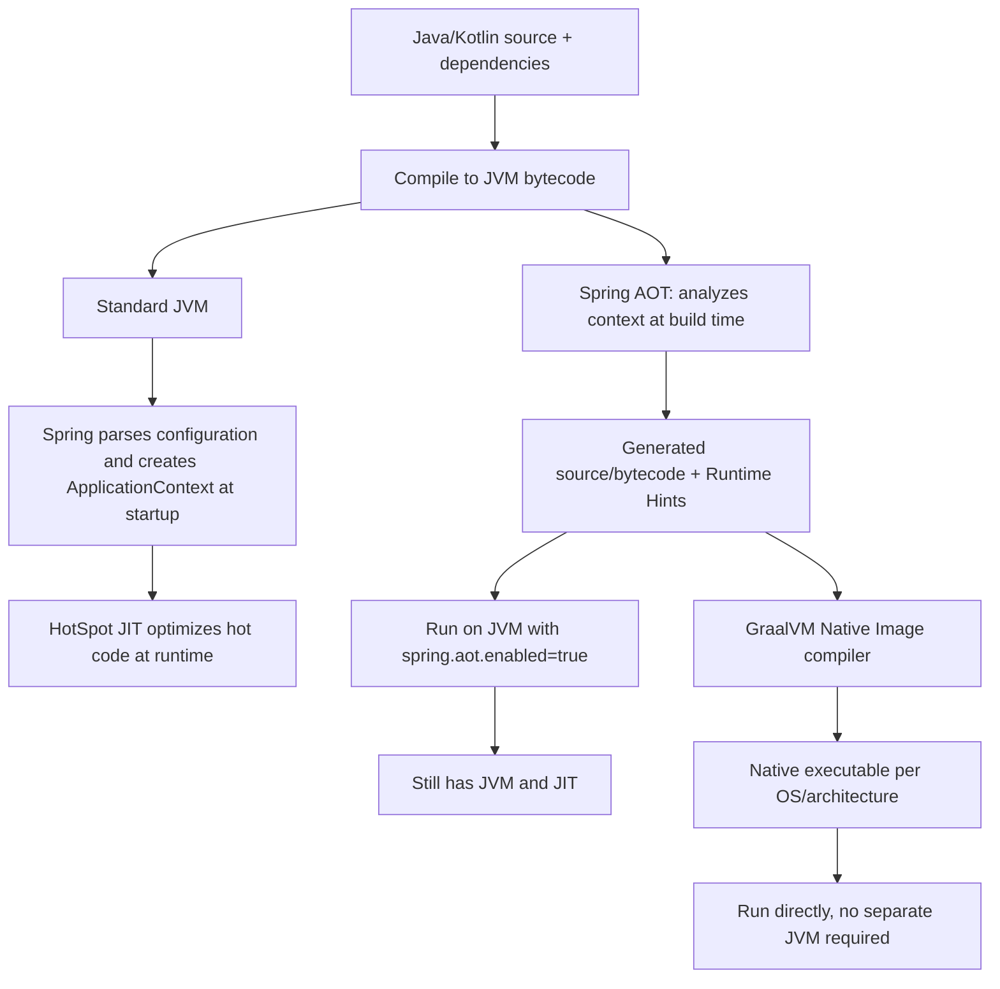

# Differences Between Standard JVM, Spring AOT, and Native Image

## 1. Three Commonly Confused Concepts

A Spring Boot application can be packaged and run in multiple ways. Three key concepts are:

- **Standard JVM**: the application is compiled into bytecode and then run on the Java Virtual Machine. Spring parses configuration and creates the ApplicationContext at startup; HotSpot can compile hot code paths using JIT while the application is running.
- **Spring AOT (Ahead-of-Time)**: Spring analyzes the application during the build process, evaluates bean definitions, and generates initialization code along with the required metadata. The output can still run on the JVM; creating a native executable is not mandatory.
- **Native image**: GraalVM Native Image uses static analysis and compiles the application into an executable tied to the target operating system/architecture. The application runs without needing a separate JVM installed and does not use the HotSpot JIT.

Therefore, Spring AOT and native image are not two names for the same thing. Spring AOT is the step that prepares the application to reduce dynamic work at runtime and provide information to the native compiler. Native image is one way of producing a deployable artifact from the AOT output.

Within the scope of Spring Cloud, this difference affects components with dynamic configuration such as Config Client, `@RefreshScope`, Gateway routes, OpenFeign clients, and discovery integration. An application that runs well on a standard JVM is not guaranteed to run properly when AOT or native image is enabled.

This lesson belongs to the **AOT and checkpoint** chapter of **SPRING_CLOUD_CORE**. The content progresses from the application execution lifecycle to builds, configuration limits, Spring Cloud support, and how to test and select an appropriate deployment option.

## 2. Lifecycle from Source Code to Running Process



On a standard JVM, many decisions about beans, profiles, auto-configuration conditions, and proxies are handled when the application starts. In AOT, Spring performs part of that work before deployment. In a native image, GraalVM further analyzes which components can be invoked and compiles them into a binary.

The difference does not lie solely in the output file format. It lies in **when the work is performed**, **how much flexibility remains at runtime**, and **the execution environment**.

## 3. How Does a Standard JVM Work?

The Java compiler (`javac` or the corresponding Kotlin compiler) turns source code into bytecode in `.class` files. A Spring Boot JAR contains bytecode, resources, and dependencies. When running:

```bash
java -jar app.jar
```

The JVM loads classes on demand, Spring reads annotations and configuration, evaluates conditions, creates beans, and builds the ApplicationContext. HotSpot JIT monitors the code being executed and compiles certain methods to machine code to optimize performance after the application has run long enough.

Key characteristics:

- Requires a compatible JRE/JDK to run.
- Can load classes dynamically and use reflection in the standard JVM way.
- Can select profiles, properties, and many bean conditions at startup.
- Some configuration changes can be applied at runtime if the application supports refresh/rebinding.
- Typically has higher startup time and initial memory footprint than a native image, but can optimize throughput after warm-up thanks to JIT.
- A single JAR can run on multiple operating systems/architectures as long as a suitable JVM is available.

A standard JVM is suitable when the application needs startup flexibility, uses dynamic libraries, or has long-term throughput requirements. It is also the most convenient environment for developing and running most unit/integration tests.

### 3.1. Spring Startup Is Still Part of the Cost

When starting a Spring Boot application, the framework must read configuration, discover components, process auto-configuration, evaluate conditions, create bean definitions, create proxies, and initialize non-lazy beans.

Applications with many starters, many beans, or multiple contexts can spend considerable time in this phase. JIT does not eliminate context initialization overhead; it mainly optimizes code that is executed frequently during runtime.

Spring AOT targets part of the work that can be completed before the application starts. Native image further compiles the identified code to reduce work at runtime.

## 4. What Does Spring AOT Perform at Build Time?

Spring AOT analyzes the application based on the main application class and the configured build environment. The AOT engine prepares a more fixed representation of the bean factory, evaluates conditions, and generates resources that help Spring initialize the context more efficiently.

The output typically includes:

| Output | Purpose |
| --- | --- |
| Generated Java source | Describes bean registration/initialization in a way that can be analyzed and compiled ahead of time |
| Generated bytecode | Supports proxies or pre-generated structures |
| Reflection hints | Declares types/members requiring reflection at runtime |
| Resource hints | Retains resources that need to be read from the classpath |
| Serialization hints | Declares types requiring dynamic serialization/deserialization |
| JDK proxy hints | Declares interfaces requiring dynamic proxy creation |
| JNI hints | Declares required native interface components |

AOT does not simply cache the entire running ApplicationContext. It generates code and metadata to recreate the context with the beans determined during the build.

Spring Framework provides the `RuntimeHints` API so applications or libraries can supply information about reflection, resources, serialization, and proxies when static analysis cannot fully infer them.

### 4.1. AOT Can Still Run on the JVM

This is an important distinction. After a build that includes AOT-generated code, you can run the application on the JVM with:

```bash
java -Dspring.aot.enabled=true -jar app.jar
```

The application still runs bytecode on the JVM. The JVM still manages memory, garbage collection, threads, and class loading; HotSpot can still use JIT to optimize hot code. The difference is that Spring uses the pre-generated initialization instead of performing the full dynamic configuration parsing process as in standard JVM mode.

AOT on the JVM is a useful way to verify generated initialization and AOT limitations before investing in building a native image. It can also improve startup without forcing a switch to a native binary.

### 4.2. Generated Code Does Not Replace All Runtime Logic

AOT generates code for the determined Spring structure. The application still reads runtime properties and executes regular business logic. However, properties that alter bean structure must be given special consideration.

For example, a value used to change a client's endpoint may just be runtime configuration data. But a property used in `@ConditionalOnProperty` to decide whether to create a bean affects the bean graph. When AOT is enabled, that bean creation decision is evaluated during the build.

You should not conclude that AOT freezes all properties. It freezes the structural decisions that AOT used to generate the context; runtime values that do not alter that structure can still be read according to the application's design.

## 5. What Is a Native Image?

GraalVM Native Image performs static analysis starting from the application entry point, finds reachable classes, methods, and fields, and then compiles them into an executable for the target platform.

A Spring Boot native executable is typically created in this sequence:

1. Spring AOT analyzes the ApplicationContext and generates code/hints.
2. GraalVM Native Image reads bytecode, generated code, dependencies, and reachability metadata.
3. Native Image analyzes the call graph under the closed-world assumption.
4. The compiler produces an executable containing the code and resources determined to be necessary.
5. The process runs directly on the operating system without needing a separate JVM.

Key characteristics:

- Does not require installing a separate JVM on the machine running the binary.
- The binary is tied to the target OS and CPU architecture.
- The classpath is fixed at build time; new JARs cannot be added at runtime like on a standard JVM.
- No lazy class loading according to the traditional JVM model.
- No HotSpot JIT in the native process.
- Code using reflection, resource loading, serialization, or dynamic proxies may need reachability metadata/hints.
- Code paths that the analysis does not recognize as reachable may be excluded from the binary.

Native image typically offers faster startup and lower initial memory footprint than a JVM deployment. In return, the build process can consume significant CPU, RAM, and time; dynamic loading capabilities are limited; long-term throughput performance depends on the workload and is not optimized by JIT like HotSpot.

You should not treat native image as always faster in every scenario. Benchmark using realistic workloads across startup, memory, throughput, and post-warm-up latency.

## 6. Comparing JVM, Spring AOT on JVM, and Native Image

| Criterion | Standard JVM | Spring AOT on JVM | Native image |
| --- | --- | --- | --- |
| Runtime input | Bytecode/JAR | JAR with generated AOT assets | Native executable |
| Spring bean analysis | Mainly at startup | Mostly at build time | At build time |
| JVM required on host | Yes | Yes | No separate JVM needed |
| HotSpot JIT | Yes | Yes | No |
| Dynamic classpath | More flexible | Classpath fixed at build | Classpath closed at build |
| Profile/bean conditions | Evaluated at startup | Constrained by build decisions | Constrained by build decisions |
| Dynamic reflection/resources | Broadly supported by JVM | Supported by JVM, but AOT code must be compatible | Needs hints/metadata if not inferred |
| Startup | Usually higher | Can be reduced via generated initialization | Usually low |
| Initial memory footprint | Usually higher | Still a JVM process | Usually lower |
| Build cost | Lower | Increases due to AOT processing | Significantly higher due to native compilation |
| Portability | Cross-platform JAR | Cross-platform JAR | Binary per OS/architecture |
| Runtime tuning | JVM flags, JIT, GC | JVM flags, JIT, GC | Native Image build/runtime options |

Spring AOT on JVM and native image share some AOT outputs, but they do not share the same execution environment. When an error only occurs in the native executable, both layers must be checked: Spring AOT output and GraalVM Native Image limitations.

## 7. Important Limitations When Enabling AOT

AOT needs to know the classpath and bean graph at build time. Therefore, the following elements must be configured consistently:

- Active profiles used to create the context during AOT processing.
- Properties used in `@ConditionalOnProperty` or equivalent conditions.
- Classpath, starters, and providers included in the build.
- `@Import`, component scans, and programmatic configuration that affect the bean graph.
- Service IDs, proxy interfaces, or resources that need to be discovered ahead of time.

Example:

```java
@Configuration(proxyBeanMethods = false)
@ConditionalOnProperty(
        prefix = "platform.discovery",
        name = "consul.enabled",
        havingValue = "true"
)
class ConsulDiscoveryConfiguration {

    @Bean
    ConsulAdapter consulAdapter(ConsulClient client) {
        return new ConsulAdapter(client);
    }
}
```

If `platform.discovery.consul.enabled=true` when running AOT processing, the bean graph is generated with the Consul branch enabled. If at runtime the property is changed to `false` expecting that bean to disappear, the result will not match a standard JVM.

Similarly, profiles activated at build time affect the generated configuration. Spring Boot explicitly states that the classpath must remain fixed and beans cannot arbitrarily change by profile/condition at runtime in AOT mode.

### 7.1. Distinguishing Structural Properties from Data Properties

| Property Type | Example | How to Think When Using AOT |
| --- | --- | --- |
| Bean graph decisions | `feature.enabled`, `@Profile`, provider creation conditions | Must be determined in the build environment |
| Runtime data | URL, timeout, queue name bound into an existing bean | Can change if it does not alter context structure and the integration supports it |
| Classpath/provider | Presence or absence of Consul/Eureka client library | Must be decided at build time |
| Dynamically loaded resources | External config files, classpath files | External files can be mounted at runtime; resources inside the image need appropriate hints |

Do not use the same native binary across environments if each environment requires a different bean graph. You can build separate artifacts for each structural variant, or design the application so that environment differences reside solely in runtime properties without changing the bean graph.

## 8. Building and Running Spring AOT on the JVM

### 8.1. With Gradle

You can apply the Spring Boot AOT plugin directly when you want to run AOT on the JVM without building a native image:

```kotlin
plugins {
    id("org.springframework.boot") version "4.1.2"
    java
}

apply(plugin = "org.springframework.boot.aot")
```

Run AOT processing and package the JAR:

```bash
./gradlew processAot bootJar
```

Then run the JAR on the JVM:

```bash
java -Dspring.aot.enabled=true -jar build/libs/my-app.jar
```

The AOT plugin can be applied automatically when using the GraalVM Native Image plugin. If you only want to try AOT JVM, you do not need to add the native plugin.

### 8.2. With Maven

If using `spring-boot-starter-parent`, the `native` profile of the Spring Boot Maven plugin can configure `process-aot` and related settings:

```bash
./mvnw -Pnative package
```

After packaging, run the JAR on the JVM with the system property:

```bash
java -Dspring.aot.enabled=true -jar target/my-app.jar
```

Check your Maven configuration if the project does not use the Spring Boot parent or has customized plugin management. The goal is to ensure `process-aot` actually runs and generated assets are included in the JAR.

## 9. Building a Native Image

A native image requires the GraalVM Native Image toolchain or Cloud Native Buildpacks configured for native builds. Building may require a compiler, linker, headers, and system libraries depending on the OS.

### 9.1. With Gradle

Add the GraalVM Native Image plugin:

```kotlin
plugins {
    id("org.springframework.boot") version "4.1.2"
    id("org.graalvm.buildtools.native") version "1.1.14"
    java
}
```

The native plugin automatically integrates Spring Boot AOT. Build the executable:

```bash
./gradlew nativeCompile
```

The `nativeCompile` task uses the output from `processAot`. The binary location is typically under `build/native/nativeCompile/`; check the Gradle log for the exact executable name.

### 9.2. With Maven

When using the Spring Boot Maven parent and the `native` profile, you can create a native container image using Buildpacks:

```bash
./mvnw -Pnative spring-boot:build-image
```

This profile configures AOT processing and appropriate settings for a native image build. For multi-module projects or custom plugins, check which module is the application module and configure the native plugin in the right place.

### 9.3. Build for the Right Target Platform

A native executable is not a cross-platform JAR. The binary is built for the target OS and architecture. If deploying on Linux ARM64, you cannot simply take a Linux AMD64 or Windows binary and run it directly.

You should build in an environment matching production or use appropriate cross-compilation/buildpacks. You should also pin JDK/GraalVM versions, compilers, and native dependencies so builds are reproducible.

## 10. Runtime Hints for Reflection and Resources

A standard JVM can look up classes and invoke methods via reflection at runtime. Native Image needs to know about these dynamic parts ahead of time to retain the right code in the executable.

Spring AOT automatically generates many hints for common Spring patterns. When an application or library has dynamic use cases that AOT does not recognize, you can declare a `RuntimeHintsRegistrar`.

Example of registering resources and reflection:

```java
import org.springframework.aot.hint.MemberCategory;
import org.springframework.aot.hint.RuntimeHints;
import org.springframework.aot.hint.RuntimeHintsRegistrar;

public class PlatformRuntimeHints implements RuntimeHintsRegistrar {

    @Override
    public void registerHints(RuntimeHints hints, ClassLoader classLoader) {
        hints.resources().registerPattern("templates/report/*.html");

        hints.reflection().registerType(
                LegacyPayload.class,
                MemberCategory.INVOKE_DECLARED_CONSTRUCTORS,
                MemberCategory.INVOKE_DECLARED_METHODS,
                MemberCategory.DECLARED_FIELDS
        );
    }
}
```

Register the registrar with `@ImportRuntimeHints`:

```java
import org.springframework.context.annotation.Configuration;
import org.springframework.context.annotation.ImportRuntimeHints;

@Configuration(proxyBeanMethods = false)
@ImportRuntimeHints(PlatformRuntimeHints.class)
class PlatformNativeConfiguration {
}
```

This example only illustrates how to declare hints. Choose the `MemberCategory` matching the constructors/methods/fields actually accessed. Registering reflection too broadly can bloat the binary and mask design issues.

Sources to check:

- Reflection invoking methods/constructors not directly called in bytecode.
- Classes loaded by name from properties or configuration files.
- Resources read via `ClassPathResource`, `getResourceAsStream`, or dynamic patterns.
- Serialization/deserialization using types not discovered through standard contracts.
- JDK dynamic proxies or CGLIB proxies.
- JNI/native libraries and service provider metadata.

Do not add hints by guessing. Use the native image build report, runtime errors, and tests to pinpoint exactly which components need declarations.

## 11. Spring Cloud Config Client in AOT and Native Image

Spring Cloud Config Client supports Spring AOT and GraalVM native image in modern release lines. However, Config Client has several important constraints.

### 11.1. Configuration Sources Must Be Accessible During AOT

When AOT processing builds the ApplicationContext, Config Client may need to connect to Config Server, Consul, Zookeeper, Vault, or another configuration source to load properties. Therefore, the configuration source must be reachable from the AOT build environment and have the address/configuration the application uses during analysis.

Properties that can alter bean creation must have appropriate values at build time and runtime. If built with one profile/provider and run with another profile/provider at runtime, the generated bean graph may not match.

Note: a native image can start the process very quickly, but Config Client still has to wait for network requests to Config Server or the backend. Remote connection time remains part of actual startup time.

### 11.2. Limitations to Check

- Config Client AOT/native does not support legacy config-first bootstrap when `spring.config.use-legacy-processing=true`.
- Context refresh and `@RefreshScope` are not supported with Spring AOT transformations/native images in Spring Cloud Commons.
- For native image, set `spring.cloud.refresh.enabled=false`.
- Do not assume property changes after deployment can alter the generated bean graph.
- If using SSH or encryption libraries for the Config backend, check native metadata/security provider requirements according to the module and GraalVM documentation.

Example configuration when using Config Client in AOT/native:

```yaml
spring:
  cloud:
    refresh:
      enabled: false
    config:
      uri: https://config.internal.example
```

This configuration illustrates the refresh setting. The URI and properties affecting bean creation must be supplied consistently during AOT processing and when running the binary.

## 12. Spring Cloud Commons and `@RefreshScope`

Spring Cloud Context supports refreshing beans managed by `@RefreshScope` when the configuration environment changes. This mechanism requires the ability to refresh the context/target beans at runtime.

AOT and native image rely on the bean structure determined at build time. Therefore, Spring Cloud Commons does not support context refresh for Spring AOT transformations and native images. When running in these modes, refresh must be disabled:

```yaml
spring:
  cloud:
    refresh:
      enabled: false
```

If the application relies on `POST /actuator/refresh`, Spring Cloud Bus refresh, or `@RefreshScope` to change endpoint/client configs without restarting, you must redesign the configuration lifecycle before enabling AOT/native.

Some runtime values can still be read from property sources, but that does not mean refresh-scoped beans can be destroyed and recreated like in standard JVM mode.

## 13. Spring Cloud Gateway and OpenFeign Examples

Spring Cloud integrations have their own levels of support and limitations. Do not infer that every module is compatible simply because Spring Boot AOT ran successfully.

### 13.1. Spring Cloud Gateway

Spring Cloud Gateway supports AOT and native image. For routes using load balancing, service IDs must be explicitly declared so AOT can process them.

They can be declared via `@LoadBalancerClient`:

```java
import org.springframework.cloud.loadbalancer.annotation.LoadBalancerClient;
import org.springframework.context.annotation.Configuration;

@LoadBalancerClient(name = "inventory-service")
@Configuration(proxyBeanMethods = false)
class InventoryLoadBalancerConfiguration {
}
```

Or declare the list of service IDs to eager-load:

```yaml
spring:
  cloud:
    loadbalancer:
      eager-load:
        clients:
          - inventory-service
          - pricing-service
```

Routes and service IDs whose structure changes arbitrarily after build time must be evaluated separately. If Gateway generates routes from a dynamic data source, verify how the integration supports runtime route updates and native image in your exact release.

### 13.2. Spring Cloud OpenFeign

OpenFeign supports Spring AOT and native image under these conditions:

- `spring.cloud.refresh.enabled=false`.
- `spring.cloud.openfeign.client.refresh-enabled` must not be set to `true` (default is `false`).
- `spring.cloud.openfeign.lazy-attributes-resolution` must not be set to `true` (default is `false`).

Example of keeping compatible modes:

```yaml
spring:
  cloud:
    refresh:
      enabled: false
    openfeign:
      client:
        refresh-enabled: false
      lazy-attributes-resolution: false
```

If a Feign client URL needs to be overridden per runtime environment, declare the URL using a configuration property instead of hard-coding it only in the `@FeignClient` annotation, and verify the override support documented by OpenFeign for native image. Do not enable refresh behavior if targeting AOT/native.

## 14. How Does Checkpoint/Restore with CRaC Differ from Native Image?

Checkpoint/restore is another optimization approach that still runs on the HotSpot JVM. Project CRaC (Coordinated Restore at Checkpoint) allows recording the memory state of a running process and restoring a process from that snapshot.

Setting up CRaC requires a JDK with checkpoint/restore support (currently Spring Framework documentation restricts this to Linux), the `org.crac:crac` dependency from version 1.4.0, and appropriate JVM options such as `-XX:CRaCCheckpointTo=PATH` or `-XX:CRaCRestoreFrom=PATH`. Check the OS, kernel, JDK vendor, and CPU architecture requirements of the runtime environment.

A typical workflow:

1. Start the application with a CRaC-enabled JDK.
2. Wait for the Spring ApplicationContext to initialize.
3. Optionally run some workload so the JVM warms up and JIT compiles frequently used code paths.
4. Instruct the JVM to take a checkpoint.
5. Save the memory snapshot and process state.
6. Launch new instances by restoring the snapshot.
7. Spring and lifecycle-integrated resources handle closing/reopening necessary resources.

Unlike native image, CRaC does not compile the application into a standalone executable. The restored process is still a JVM process, has HotSpot, and continues JIT optimization while running.

| Criterion | CRaC checkpoint/restore | Native image |
| --- | --- | --- |
| Model | Snapshot of a running JVM process | Compile code into a native executable |
| JVM at runtime | Yes | No separate JVM needed |
| Warm-up/JIT state | Can be preserved in the snapshot | No HotSpot JIT |
| Produced artifact | Checkpoint files | Native executable |
| Environment dependency | OS/kernel, CRaC JDK, process resources | OS/architecture and native toolchain |
| Primary concerns | Resource lifecycle, snapshot compatibility | Closed-world, hints, dynamic features |
| Security | Snapshot may contain all sensitive data in memory | Binary may contain data embedded into build-time state |

CRaC fits when you want to reduce startup and warm-up time while keeping JVM capabilities. Native image fits when you want to deploy a compact executable without needing a separate JVM. Both approaches solve different problems.

### 14.1. Resource Lifecycle Before and After Checkpoint

Sockets, file descriptors, thread pools, connection pools, and background tasks may no longer be valid after the process is restored. Spring Boot manages some common resources to a limited extent; applications and other libraries may need custom lifecycle integration.

Beans that need to stop resources before checkpoint and reopen them after restore can use Spring `Lifecycle`/`SmartLifecycle` or CRaC `Resource` depending on the integration. Do not assume every JDBC driver, HTTP client, or SDK handles restore properly on its own.

### 14.2. Relationship with Spring Cloud RefreshScope

Spring Cloud Commons includes `RefreshScopeLifecycle` to trigger a context refresh when the JVM is restarted/restored with CRaC. The goal is to rebind `@ConfigurationProperties` and refresh beans annotated with `@RefreshScope` after restore.

You can disable this behavior with:

```yaml
spring:
  cloud:
    refresh:
      on-restart:
        enabled: false
```

This belongs to the CRaC/JVM checkpoint restore flow. It does not mean `@RefreshScope` is supported in native image. Context refresh remains unsupported for Spring AOT transformations/native images and requires `spring.cloud.refresh.enabled=false` in those modes.

### 14.3. Protecting Checkpoint Files

A checkpoint can contain a memory snapshot of the process. Every value the JVM has seen — including credentials, tokens, configuration, request data, and session state — may appear in checkpoint files.

Therefore:

- Store checkpoints on encrypted storage with restricted read permissions.
- Do not publish checkpoints like a regular container artifact without evaluating the data inside them.
- Control where checkpoints are created, copied, stored, and deleted.
- Rotate credentials if a snapshot is exposed or shared outside the trust boundary.
- Ensure snapshots are only restored on compatible OS/JDK/CPU environments with corresponding data protection policies.

## 15. Impact on Spring Cloud Configuration and Deployment

When choosing AOT or native image, review how the application receives configuration and registers services.

| Component | Questions to Answer |
| --- | --- |
| Spring Cloud Config | Is Config Server reachable during the AOT build? Are properties affecting the bean graph identical between build and runtime? |
| Config Client bootstrap | Is the application using legacy config-first bootstrap? |
| RefreshScope | Does it depend on `@RefreshScope` or `/actuator/refresh`? |
| Discovery Client | Do the provider and HTTP/native dependencies have reachability metadata? |
| Gateway | Have load-balanced service IDs been explicitly declared? |
| OpenFeign | Are refresh mode and lazy attribute resolution disabled? |
| Secret manager/Vault | Are tokens/certificates fetched at runtime rather than embedded into the binary or build output? |
| Logging/metrics | Do backend exporters and dynamic resources have native support? |
| Serialization | Do Jackson/custom serializers have hints for dynamic types? |

With Config Server or Vault, avoid feeding production secrets into the AOT/native build process. Build time is a separate trust boundary: the environment, remote configuration, or class initialization can affect generated assets. Issue separate build credentials with least privilege and do not store them in build caches or artifacts.

## 16. Testing AOT and Native Image

You do not need to move the entire test suite to native image. Spring Boot recommends using the JVM for development and running most unit/integration tests, then focusing native testing on the areas that differ.

A sensible workflow:

1. Run unit/integration tests on a standard JVM.
2. Run Spring AOT processing to catch configurations that cannot be processed.
3. Run the AOT-generated application on the JVM with `spring.aot.enabled=true`.
4. Build the native executable.
5. Run the native executable in an environment matching production.
6. Verify endpoints, resource loading, serialization, reflection, proxies, and external connections.
7. Measure startup/memory/latency under the same workload.

Test groups to include:

| Group | What to Verify |
| --- | --- |
| Context startup | AOT context creates the right beans and conditions |
| Configuration | Profiles/conditions are locked properly during build |
| Reflection | No missing method/constructor hints |
| Resources | Template files, schemas, certificates, or metadata are present |
| Serialization | JSON/Jackson works with DTOs and custom types |
| Proxies | AOP, transaction, security, and client proxies are created properly |
| Spring Cloud Config | Config source is reachable, properties are right, not relying on refresh |
| Discovery/Gateway | Service IDs and provider integrations are recognized |
| External I/O | TLS, DNS, sockets, database, and HTTP clients work natively |
| CRaC | Resources close before checkpoint and reopen after restore |

If the native image fails while JVM/AOT JVM succeeds, check reachability metadata, resource hints, reflection, proxies, and class initialization before changing business logic.

## 17. Fair Performance Benchmarking

Compare modes using the same configuration, data, CPU/RAM environment, and workload.

Measurements should be separated:

- **Cold start**: from when the process is created until readiness reaches the ready state.
- **Warm start**: with CRaC, snapshot restore time; with JVM, startup time after runtime/caches are already available if applicable.
- **Memory footprint**: RSS/working set after startup and under steady load.
- **Throughput**: requests/second after the JVM has warmed up.
- **Latency**: p50/p95/p99 during startup and steady state.
- **Build time**: bytecode compilation, AOT processing, and native compilation time.
- **Artifact size**: JAR, native executable, container image, and checkpoint files.

A comparison example:

| Mode | Startup | Warm-up | Build | Runtime flexibility |
| --- | --- | --- | --- | --- |
| JVM | Usually longer | JIT needs time | Fast | High |
| AOT JVM | Can be faster than JVM | Still has JIT | Increases due to AOT | Constrained bean graph |
| Native image | Usually very fast | No HotSpot JIT | Takes more time | Lower |
| CRaC restore | Can be very fast | Can preserve warm-up state | Needs snapshot creation | Still a JVM, requires lifecycle management |

Do not draw conclusions from the startup time of a single run. Run repeatedly, measure under identical conditions, and distinguish Spring context startup time from waiting on Config Server, registry, database, or secret manager.

## 18. Diagnosing Common Errors

| Symptom | Possible Cause | Resolution |
| --- | --- | --- |
| AOT processing generates an unexpected bean graph | Profiles/properties used at build differ from runtime | Pin the build environment and verify conditions |
| Runtime does not see a bean even though property changed | Bean condition was evaluated at build time | Build separate artifacts for different bean structures or redesign conditions |
| Native image reports missing reflection | Missing RuntimeHints/reachability metadata | Register required types/members and add native tests |
| Template/resource not found | Resource was not retained in the native image | Add resource hints and inspect generated metadata |
| Dynamic proxy works on JVM but fails natively | Proxy interface was not declared | Register JDK proxy hint |
| Config Client AOT build fails | Config Server/Consul/Vault unreachable during build | Provide controlled build-time config source or adjust config strategy |
| Config Client native startup is still slow | Remote config request still runs at startup | Measure network latency and timeouts separately |
| `/actuator/refresh` does not work | Context refresh is unsupported in AOT/native | Disable refresh and use rollout/restart or a suitable config model |
| Load-balanced Gateway route fails to resolve | Service ID not explicitly declared for AOT | Declare `@LoadBalancerClient` or eager-load clients |
| OpenFeign native startup fails | Refresh mode or lazy attribute resolution is enabled | Disable incompatible properties and verify exact release |
| CRaC restore fails on socket/database | Resources not closed/reopened properly in lifecycle | Integrate checkpoint/restore callbacks and test after restore |
| CRaC snapshot contains secrets | Snapshot saves process memory state | Protect checkpoint files as confidential data |
| Native executable fails on another machine | Binary incompatible with OS/architecture or native dependencies | Build for the right target and verify runtime libraries |

## 19. Workflow for Choosing a Deployment Mode

You can follow this workflow:

1. Start with a standard JVM to develop and complete functionality.
2. Measure startup, memory, and throughput to determine actual costs.
3. If you mainly want to reduce Spring context creation time while still needing a JVM, try Spring AOT on the JVM.
4. If you want to reduce startup/memory and accept build-time constraints, evaluate native image.
5. If you want to keep JVM/JIT while reducing startup and warm-up via snapshots, evaluate CRaC.
6. Check support for each Spring Cloud module in use.
7. Run AOT/native/CRaC tests on the same release train and target JDK.
8. Re-measure in a production-like environment before deciding.
9. Document the profiles, properties, and classpath used to generate the AOT/native artifact.
10. Set up build/release pipelines matching OS/architecture and manage artifact security.

No single mode fits every microservice. A continuously running, high-throughput API server may suit JVM/JIT; a function needing low cold start may suit native image; a JVM workload may benefit from CRaC; a service needing high flexibility in providers/profiles may keep a standard JVM.

## 20. Self-Check Questions

1. At what time does a standard JVM analyze the Spring ApplicationContext?
2. What types of generated assets does Spring AOT produce?
3. Why can Spring AOT still run on the JVM?
4. How does a native image differ from AOT JVM in execution environment and JIT?
5. How does the closed-world assumption affect classpath and reflection?
6. Why must profiles and `@ConditionalOnProperty` be determined when building AOT?
7. What dynamic scenarios is `RuntimeHints` used to solve?
8. Why does Config Client need an accessible configuration source during AOT?
9. Why is Spring Cloud `@RefreshScope` incompatible with AOT/native image?
10. Which service IDs must Spring Cloud Gateway declare to support AOT?
11. Which properties must OpenFeign disable when running AOT/native?
12. How does CRaC checkpoint/restore differ from native image?
13. Why must checkpoint files be protected like secrets?
14. Which metrics should be measured to compare JVM, AOT JVM, native image, and CRaC?

## 21. Official References

- [Spring Boot — Ahead-of-Time Processing With the JVM](https://docs.spring.io/spring-boot/reference/packaging/aot.html) — how to run AOT-generated code on the JVM and classpath/bean graph limitations.
- [Spring Boot — Introducing GraalVM Native Images](https://docs.spring.io/spring-boot/reference/packaging/native-image/introducing-graalvm-native-images.html) — Spring AOT workflow, native image, closed-world, and generated hints.
- [Spring Boot Gradle Plugin — Ahead-of-Time Processing](https://docs.spring.io/spring-boot/gradle-plugin/aot.html) — `processAot`, `nativeCompile`, and running AOT on the JVM.
- [Spring Boot Maven Plugin — Ahead-of-Time Processing](https://docs.spring.io/spring-boot/maven-plugin/aot.html) — `process-aot`, native profile, and build image.
- [Spring Framework — Ahead of Time Optimizations](https://docs.spring.io/spring-framework/reference/core/aot.html) — AOT engine, generated initialization, and `RuntimeHints`.
- [GraalVM — Native Image Compatibility Guide](https://www.graalvm.org/dev/reference-manual/native-image/metadata/Compatibility/) — closed-world assumption, static analysis, and features requiring metadata.
- [Spring Cloud Commons — Application Context Services](https://docs.spring.io/spring-cloud-commons/reference/spring-cloud-commons/application-context-services.html) — refresh scope limitations in AOT/native and refresh on JVM restart with CRaC.
- [Spring Cloud Config — AOT and Native Image Support](https://docs.spring.io/spring-cloud-config/reference/client.html) — Config Client conditions, legacy bootstrap, refresh scope, and remote config source at build time.
- [Spring Cloud Gateway — AOT and Native Image Support](https://docs.spring.io/spring-cloud-gateway/reference/spring-cloud-gateway-server-webflux/aot-and-native-image-support.html) — requirement to declare service IDs for load-balanced routes.
- [Spring Cloud OpenFeign — AOT and Native Image Support](https://docs.spring.io/spring-cloud-openfeign/reference/spring-cloud-openfeign.html) — refresh mode and lazy attribute resolution.
- [Spring Boot — Checkpoint and Restore With the JVM](https://docs.spring.io/spring-boot/reference/packaging/checkpoint-restore.html) — CRaC and checkpoint/restore on the HotSpot JVM.
- [Spring Framework — JVM Checkpoint Restore](https://docs.spring.io/spring-framework/reference/integration/checkpoint-restore.html) — lifecycle callbacks, checkpoint files, and snapshot protection requirements.

*This document distinguishes Spring AOT, native image, and CRaC by processing time and execution environment. Choose a mode after checking Spring Cloud integration limits, verifying behavior with tests, and benchmarking on real workloads.*
