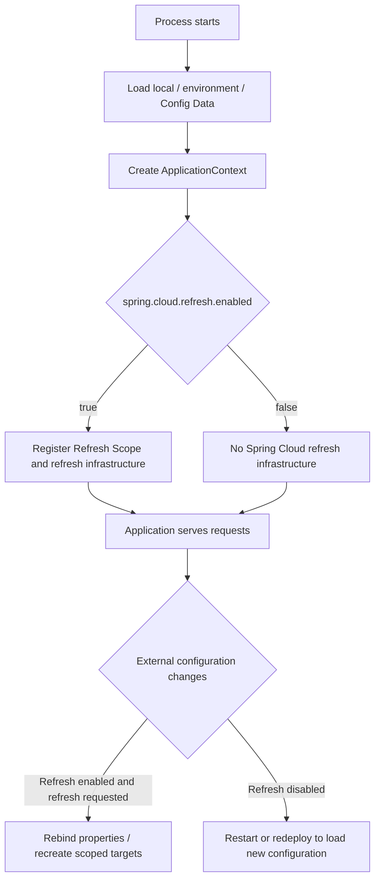

# Configuring spring.cloud.refresh.enabled by Execution Mode

## 1. Why Must Refresh Mode Be Chosen by Execution Mode?

Spring Cloud Context provides `@RefreshScope`, `ContextRefresher`, and related components so an application can receive new configuration while running. In a standard JVM application, this is a useful capability: after the Environment is updated, configuration beans can be rebound and targets belonging to Refresh Scope can be recreated.

When migrating an application to Spring AOT or GraalVM Native Image, the initialization model changes. Spring analyzes the ApplicationContext at build time, generates initialization code, and fixes many bean decisions. Spring Cloud's context refresh is not supported in these modes. Therefore, Spring Cloud requires:

```yaml
spring:
  cloud:
    refresh:
      enabled: false
```

The key point to remember is that `spring.cloud.refresh.enabled` controls the registration of Refresh Scope and related refresh features right during ApplicationContext creation. For AOT or native artifacts, `false` must be set during AOT processing/build and kept consistent at runtime. Passing `false` only after the artifact has been created does not replace the build-time decision.

After this lesson, readers can:

- Choose the appropriate `spring.cloud.refresh.enabled` setting for standard JVM, JVM AOT, and native image.
- Distinguish runtime configuration refresh from startup configuration loading.
- Configure properties at build time, in profiles, and at runtime without skewing the AOT-processed ApplicationContext.
- Separate the global refresh switch from automatic refresh when a CRaC checkpoint is restored.
- Design beans and tests properly when Refresh Scope is disabled.

## 2. Exact Meaning of spring.cloud.refresh.enabled

Spring Cloud Commons declares the `spring.cloud.refresh.enabled` property with a default value of `true`. This property enables auto-configuration for Refresh Scope and related refresh features.

| Value | Meaning |
| --- | --- |
| `true` | Allows Spring Cloud to configure Refresh Scope and related refresh features |
| `false` | Does not create auto-configuration for Refresh Scope and related refresh features |

Explicit declaration example:

```yaml
spring:
  cloud:
    refresh:
      enabled: true
```

On a standard JVM, if the application needs to refresh configuration at runtime, you can keep the default or explicitly set `true`. If the application does not use refresh, you can also set `false` to omit the refresh infrastructure from the ApplicationContext.

When setting `false`, understand the architectural impact:

- `@RefreshScope` no longer has a scope mechanism registered by Spring Cloud.
- Auto-configured refresh components are not created under that mechanism.
- `ContextRefresher` and the Spring Cloud refresh flow are no longer capabilities the application can rely on.
- Configuration loaded at startup continues to work normally.
- Using Spring Cloud Config Client, Config Data, service discovery, service registry, or LoadBalancer is not disabled simply because this property is `false`; each feature has its own configuration conditions.

Do not use `spring.cloud.refresh.enabled` as a master switch for all of Spring Cloud or all externalized configuration.

## 3. Runtime Configuration Refresh Differs from Startup Configuration Loading

These two flows are frequently confused:

1. **Config Data / externalized configuration:** the application reads `application.yml`, environment variables, mounted files, or Config Server at startup.
2. **Context refresh:** the application is already running, the Environment receives new values, beans are rebound, or Refresh Scope targets are recreated.

For example, the application can still load configuration from Config Server at startup using:

```yaml
spring:
  config:
    import: "optional:configserver:"
  cloud:
    refresh:
      enabled: false
```

`spring.config.import` controls Config Data loading. `spring.cloud.refresh.enabled` controls refresh auto-configuration. The two properties address two different phases.

When refresh is disabled, Config Server can still supply values for the current startup. If configuration on Config Server changes afterward, the application does not automatically rebind beans via Spring Cloud Context. You must restart or redeploy the instance to pick up the new configuration set.



Therefore, a native image application can still use external configuration at startup. What is unsupported is Spring Cloud's Context Refresh mechanism in AOT/native mode.

## 4. Configuration Matrix by Execution Mode

| Mode | `spring.cloud.refresh.enabled` | Manual Runtime Refresh | Notes |
| --- | --- | --- | --- |
| Standard JVM, no AOT | `true` if refresh is needed; otherwise can be `false` | Yes, if related components are configured | This is the appropriate mode when the application needs `@RefreshScope` |
| JVM running AOT-processed code | `false` | Not supported by Spring Cloud Context | Decision must be applied during AOT processing |
| GraalVM Native Image | `false` | Not supported by Spring Cloud Context | Native image is built from AOT output |
| JVM using CRaC checkpoint/restore, no AOT | Usually kept `true` if refresh on restore is needed | Yes | Also has `spring.cloud.refresh.on-restart.enabled` |
| CRaC combined with AOT | `false` per AOT limitation | Do not use Context Refresh | AOT constraint takes precedence |

Do not choose the value solely based on a deployment environment named "production" or "container". A container running a standard JVM can still use Refresh Scope; a native executable running in a container must disable refresh. Classify based on how the artifact is processed and executed.

## 5. Standard JVM: Keep Refresh When the Application Needs Bean Updates

For a JVM application without AOT enabled, Spring creates the ApplicationContext when the process starts. If you need to fetch new configuration during the process lifecycle, you can keep refresh enabled:

```yaml
# application-jvm.yml
spring:
  cloud:
    refresh:
      enabled: true
```

When running the JVM profile:

```bash
java -jar inventory-service.jar --spring.profiles.active=jvm
```

Or omit the property and rely on Spring Cloud Commons' default of `true`.

### 5.1. Which Beans Need Refresh Scope?

Only annotate beans with `@RefreshScope` if they genuinely need to be recreated when configuration changes, such as a client holding an endpoint or timeout at initialization time:

```java
import org.springframework.cloud.context.config.annotation.RefreshScope;
import org.springframework.context.annotation.Bean;
import org.springframework.context.annotation.Configuration;

@Configuration(proxyBeanMethods = false)
public class InventoryClientConfiguration {

    @Bean
    @RefreshScope
    InventoryClient inventoryClient(InventoryProperties properties) {
        return new InventoryClient(
                properties.getBaseUrl(),
                properties.getConnectTimeout()
        );
    }
}
```

`InventoryClient` is accessed through a scoped proxy. When a refresh succeeds, the current target is destroyed and a new target is created on the next invocation.

There is no need to annotate every bean or every `@ConfigurationProperties` with `@RefreshScope`. Rebinding and Refresh Scope serve different roles; only select beans that need to be recreated.

### 5.2. The Refresh Endpoint Does Not Appear Automatically Just Because the Property Is True

If you want to trigger refresh over HTTP, the application must also have Actuator and expose the appropriate endpoint:

```yaml
management:
  endpoints:
    web:
      exposure:
        include:
          - health
          - refresh
```

Then secure the endpoint using authentication, authorization, and network policies. `spring.cloud.refresh.enabled=true` enables configuring the refresh infrastructure; it does not automatically expose the management endpoint over HTTP.

## 6. JVM AOT: Set False During AOT Processing

Spring AOT analyzes the ApplicationContext at build time and generates initialization code. When running an AOT-processed JAR on the JVM, the application uses the bean structure determined during that process.

Spring Cloud Context does not support Context Refresh in Spring AOT transformations. Therefore, you must set:

```yaml
spring:
  cloud:
    refresh:
      enabled: false
```

### 6.1. Set the Property at Build Time

You can place the property in the shared configuration of the AOT artifact:

```yaml
# application-aot.yml
spring:
  cloud:
    refresh:
      enabled: false
```

The `aot` profile must be selected when running AOT processing. Spring Boot locks the active build-time profiles into the AOT output; these profiles are applied when running the AOT application. Do not wait until running the JAR to activate the `aot` profile if the AOT process was generated with a different configuration.

Conceptual example of building with an AOT profile in a Bash shell:

```bash
SPRING_PROFILES_ACTIVE=aot ./mvnw -Pnative package
```

The command above illustrates passing the profile into the build process environment. Specific Maven profile names and commands depend on project configuration; what matters is that AOT processing sees `spring.cloud.refresh.enabled=false`.

In this command, `-Pnative` is the Maven build profile used per Spring Boot configuration to include AOT-generated code in the JAR; `SPRING_PROFILES_ACTIVE=aot` is the Spring profile determining application configuration. The two profiles belong to two different systems. A JAR with AOT code can still run on the JVM with `-Dspring.aot.enabled=true`.

Another approach is setting the property directly in the configuration used during the build:

```bash
SPRING_CLOUD_REFRESH_ENABLED=false ./mvnw -Pnative package
```

Only use this approach if the environment variable is propagated to the process performing Spring AOT processing in the build pipeline. Check build logs and configuration to confirm the actual value.

### 6.2. Keep the Value Consistent at Runtime

A JAR with AOT output should be run with the same configuration decision:

```bash
java -Dspring.aot.enabled=true -jar inventory-service.jar
```

If the AOT output was generated with `spring.cloud.refresh.enabled=false`, do not try to override it to `true` at runtime. A runtime override cannot add back beans and configuration decisions that were excluded from the AOT output.

If the application needs two different execution modes:

- The standard JVM artifact can keep refresh enabled.
- The AOT artifact must be built with refresh disabled.

Create two appropriate build configurations or two artifacts instead of expecting a single AOT artifact to arbitrarily alter the ApplicationContext structure after the build.

## 7. Native Image: Disable Refresh Before Building the Executable

GraalVM Native Image uses Spring AOT to analyze and build the executable. Therefore, Spring Cloud Context's limitations in AOT also apply to native image.

For native image, set the property to `false` in the configuration used during the native build:

```yaml
# application-native.yml
spring:
  cloud:
    refresh:
      enabled: false
```

The `native` profile must be active during the AOT/native image build. If using environment variables:

```bash
SPRING_PROFILES_ACTIVE=native ./mvnw -Pnative package
```

Or:

```bash
SPRING_CLOUD_REFRESH_ENABLED=false ./mvnw -Pnative package
```

Depending on the build plugin, the command to create a native executable may vary. Verify that the property is applied in the Spring AOT process, not just in the process running the executable.

When running the native executable:

```bash
./target/inventory-service
```

Do not re-enable `spring.cloud.refresh.enabled=true` via command line or Config Server. A native image cannot restore Refresh Scope infrastructure that was not created during the AOT phase.

### 7.1. What Still Works in a Native Image?

Disabling refresh does not mean a native image cannot use Spring Cloud:

- Config Data can load configuration at startup if that integration supports AOT/native image.
- Discovery Client, Service Registry, or LoadBalancer can work if the corresponding integration supports native image and meets its specific requirements.
- `@ConfigurationProperties` are still bound when the context initializes.
- Configuration changes after startup require a restart or redeploy process.

Each integration may have its own AOT requirements. For example, Spring Cloud Config Client supports AOT/native image, but does not support legacy config-first bootstrap when `spring.config.use-legacy-processing=true`. Do not infer that because an integration supports native image, all of its configuration modes are supported.

## 8. `@RefreshScope` Beans When Refresh Is Disabled

When `spring.cloud.refresh.enabled=false`, do not leave the application registering beans annotated with `@RefreshScope`. The auto-configuration creating the scope has been disabled; a bean still requesting the `refresh` scope can cause the ApplicationContext to fail to start because no such scope exists.

If the application needs the same client in both standard JVM and AOT, separate the configuration by property:

```java
import org.springframework.boot.autoconfigure.condition.ConditionalOnProperty;
import org.springframework.cloud.context.config.annotation.RefreshScope;
import org.springframework.context.annotation.Bean;
import org.springframework.context.annotation.Configuration;

@Configuration(proxyBeanMethods = false)
@ConditionalOnProperty(
        prefix = "spring.cloud.refresh",
        name = "enabled",
        havingValue = "true",
        matchIfMissing = true
)
class RefreshableInventoryClientConfiguration {

    @Bean
    @RefreshScope
    InventoryClient inventoryClient(InventoryProperties properties) {
        return new InventoryClient(properties.getBaseUrl());
    }
}
```

When refresh mode is disabled, register a standard bean:

```java
@Configuration(proxyBeanMethods = false)
@ConditionalOnProperty(
        prefix = "spring.cloud.refresh",
        name = "enabled",
        havingValue = "false"
)
class FixedInventoryClientConfiguration {

    @Bean
    InventoryClient inventoryClient(InventoryProperties properties) {
        return new InventoryClient(properties.getBaseUrl());
    }
}
```

Both configurations provide an `InventoryClient` bean, but only one configuration is chosen based on the property. With AOT, this condition is evaluated at build time. The value must be kept consistent at runtime.

If the application does not need dynamic refresh in any mode, a simpler configuration is to remove `@RefreshScope` and use a regular bean.

## 9. CRaC Checkpoint/Restore Is a Different Case

Project CRaC (Coordinated Restore at Checkpoint) saves the state of a running JVM to restore the process later. This is HotSpot JVM checkpoint/restore; it is not GraalVM Native Image and does not automatically imply Spring AOT.

Spring Cloud supports refreshing the context when the JVM is restarted/restored via `RefreshScopeLifecycle`. This lifecycle can:

- Rebind `@ConfigurationProperties` beans.
- Refresh targets of `@RefreshScope` beans.
- Help beans pick up updated configuration or resources that need refreshing after restore.

Two properties have distinct responsibilities:

| Property | Responsibility |
| --- | --- |
| `spring.cloud.refresh.enabled` | Enables/disables Refresh Scope and related refresh features |
| `spring.cloud.refresh.on-restart.enabled` | Enables/disables automatic context refresh on restart/restore |

`spring.cloud.refresh.on-restart.enabled` defaults to `true` in current Spring Cloud Commons.

### 9.1. CRaC JVM Needing Refresh on Restore

If the application runs CRaC on a standard JVM and needs rebind/refresh after restore:

```yaml
spring:
  cloud:
    refresh:
      enabled: true
      on-restart:
        enabled: true
```

This keeps both Refresh Scope and automatic refresh behavior on restart/restore.

### 9.2. CRaC JVM Not Needing Automatic Refresh on Restore

If the application still needs manual refresh while running, but you do not want Spring Cloud to automatically refresh on every restore:

```yaml
spring:
  cloud:
    refresh:
      enabled: true
      on-restart:
        enabled: false
```

Only disable `on-restart`; do not disable `refresh.enabled`. Then the application retains standard refresh features without triggering automatic refresh via the restart lifecycle.

### 9.3. CRaC Combined with AOT

If the application uses both AOT and checkpoint/restore, AOT limitations still apply: set `spring.cloud.refresh.enabled=false`. Do not enable refresh simply because the JVM uses CRaC. When global refresh is disabled, `spring.cloud.refresh.on-restart.enabled` cannot restore Refresh Scope or Context Refresh.

## 10. Configuring Profiles per Artifact

A readable way to organize configurations for modes with different ApplicationContext structures is using profiles:

```text
src/main/resources/
├── application.yml
├── application-jvm.yml
├── application-aot.yml
├── application-native.yml
└── application-crac.yml
```

Example:

```yaml
# application-jvm.yml
spring:
  cloud:
    refresh:
      enabled: true
```

```yaml
# application-aot.yml
spring:
  cloud:
    refresh:
      enabled: false
```

```yaml
# application-native.yml
spring:
  cloud:
    refresh:
      enabled: false
```

```yaml
# application-crac.yml
spring:
  cloud:
    refresh:
      enabled: true
      on-restart:
        enabled: true
```

Profiles are simply a way to organize properties. For AOT/native, the corresponding profile must be selected during AOT processing. For standard JVM or non-AOT CRaC, profiles can be selected in the normal runtime manner.

Do not package an AOT artifact with the `aot` profile and expect switching to `jvm` at runtime to enable Refresh Scope. Beans decided at build time cannot be added back by changing profiles afterward.

## 11. External Configuration and Build-Time Consistency

In AOT, properties affecting bean creation are evaluated when processing the ApplicationContext at build time. Therefore, values such as:

- `spring.cloud.refresh.enabled`.
- Active profiles.
- Properties used in `@ConditionalOnProperty`.
- Properties altering bean creation or bean types.

must be determined consistently between build and runtime.

If AOT processing loads configuration from Config Server, the configuration source must be available during the build. Properties affecting bean structure should not change between build and runtime. Remote configuration can still provide runtime business values, but cannot arbitrarily alter ApplicationContext structural decisions locked in by AOT.

For applications using Config Server:

```yaml
spring:
  config:
    import: "optional:configserver:"
  cloud:
    refresh:
      enabled: false
```

Set `spring.cloud.refresh.enabled=false` in the build configuration dedicated to AOT/native. Then use Config Data to fetch required properties at startup. When Config Server updates values, redeploy instances to load the new configuration.

Do not use a remote property source to change `spring.cloud.refresh.enabled` from `false` to `true` after the AOT/native image has been built. That decision arrives too late to add refresh infrastructure to the artifact.

## 12. Testing by Execution Mode

Do not inspect only YAML files. Verify that the ApplicationContext is created with the right infrastructure and that the artifact behaves properly.

### 12.1. Testing Auto-Configuration Conditions on the JVM

You can use `ApplicationContextRunner` to verify that refresh infrastructure is present when enabled and not registered when disabled:

```java
import org.junit.jupiter.api.Test;
import org.springframework.boot.SpringBootConfiguration;
import org.springframework.boot.autoconfigure.EnableAutoConfiguration;
import org.springframework.boot.test.context.runner.ApplicationContextRunner;
import org.springframework.cloud.context.scope.refresh.RefreshScope;

import static org.assertj.core.api.Assertions.assertThat;

class RefreshModeConfigurationTests {

    private final ApplicationContextRunner contextRunner =
            new ApplicationContextRunner()
                    .withUserConfiguration(TestApplication.class);

    @Test
    void registersRefreshScopeWhenEnabled() {
        contextRunner
                .withPropertyValues("spring.cloud.refresh.enabled=true")
                .run(context -> assertThat(context)
                        .hasSingleBean(RefreshScope.class));
    }

    @Test
    void doesNotRegisterRefreshScopeWhenDisabled() {
        contextRunner
                .withPropertyValues("spring.cloud.refresh.enabled=false")
                .run(context -> assertThat(context)
                        .doesNotHaveBean(RefreshScope.class));
    }

    @SpringBootConfiguration
    @EnableAutoConfiguration
    static class TestApplication {
    }
}
```

The test requires Spring Cloud Context on the test classpath and uses the same dependency management as the application. It verifies auto-configuration in a JVM test context; it does not replace testing the actual AOT artifact or native image.

### 12.2. Testing Standard JVM with Refresh

For the JVM profile:

1. Start the application with `spring.cloud.refresh.enabled=true`.
2. Verify `@RefreshScope` beans are created via a proxy.
3. Update the test property source.
4. Invoke `ContextRefresher.refresh()` or the secured refresh endpoint.
5. Verify property beans receive new values and scoped targets are recreated.

### 12.3. Testing AOT and Native Image

For AOT/native:

1. Ensure `spring.cloud.refresh.enabled=false` is present during AOT processing.
2. Verify no incompatible `@RefreshScope` beans remain in the selected configuration.
3. Build the artifact and start the actual artifact.
4. Verify Config Data and other integrations still load startup configuration as expected.
5. Verify no code or endpoint assumes `ContextRefresher` always exists.
6. Change source properties and verify new instances pick up values after restart/redeploy.

For native image, run smoke tests on the generated executable; a standard JVM test does not prove the native runtime works properly.

### 12.4. Testing CRaC Restore

For CRaC JVM:

- When `spring.cloud.refresh.enabled=true` and `on-restart.enabled=true`, verify lifecycle refresh runs after restore and beans are rebound/recreated as designed.
- When `on-restart.enabled=false`, verify there is no automatic refresh triggered by the restart lifecycle.
- If manual refresh is still needed, verify `ContextRefresher` remains available when `refresh.enabled=true`.
- Verify resources such as sockets, connection pools, and schedulers recover per application requirements.

## 13. Common Errors and Diagnostics

| Symptom | Possible Cause | Resolution |
| --- | --- | --- |
| Native image reports Refresh Scope error | `spring.cloud.refresh.enabled` was still `true` during AOT processing | Set `false` in build configuration and rebuild the image |
| JVM AOT lacks refresh beans | This is expected behavior when AOT uses refresh disabled | Use standard beans or restart/redeploy when configuration changes |
| Runtime sets `true` but no RefreshScope exists | AOT output was built with `false` | Build a standard artifact if refresh is needed; do not try to re-enable at runtime |
| ApplicationContext fails to start due to missing `refresh` scope | `@RefreshScope` bean still present in config when refresh infrastructure is disabled | Conditionalize refreshable config or remove annotation in AOT/native mode |
| Config Server loads config initially but does not refresh later | Config Data startup works, Context Refresh is disabled | Restart/redeploy instances to pick up new configuration |
| CRaC restore does not rebind beans | `spring.cloud.refresh.on-restart.enabled=false` or global refresh disabled | Check both properties and the build mode |
| AOT build used a different profile than desired runtime | Profiles/properties were locked during AOT processing | Align build and runtime profiles, rebuild artifact |
| Standard JVM has no refresh even though property is true | Missing Spring Cloud Context, bean not proxied, or refresh config excluded by another condition | Check dependencies and ApplicationContext |
| Native image receives new properties but beans stay unchanged | No Context Refresh in native image | Start a new instance or redeploy |
| Using legacy Config First Bootstrap in AOT | Legacy bootstrap mode does not support AOT/native image in certain Config Client paths | Switch to Config Data API per release documentation |

## 14. Deployment Checklist

1. Identify whether the artifact runs on standard JVM, JVM AOT, native image, or JVM CRaC.
2. Set `spring.cloud.refresh.enabled=true` only when the execution mode supports it and the application needs refresh.
3. Set `spring.cloud.refresh.enabled=false` during AOT processing and native image build.
4. Keep the property consistent between AOT build and runtime.
5. Do not register `@RefreshScope` beans when refresh infrastructure is disabled.
6. Separate refreshable beans from fixed beans if multiple modes must be supported.
7. Distinguish Config Data startup from runtime Context Refresh.
8. For CRaC, decide `spring.cloud.refresh.on-restart.enabled` separately.
9. Do not confuse CRaC checkpoint/restore with GraalVM Native Image.
10. Verify all properties affecting bean creation are determined at build time.
11. Run smoke tests on the actual AOT JAR or native executable.
12. Establish a restart/redeploy workflow to pick up new configuration when refresh is disabled.

## 15. References

- [Spring Cloud Context — Application Context Services](https://docs.spring.io/spring-cloud-commons/reference/spring-cloud-commons/application-context-services.html): Context Refresh limitations with AOT/native image and `RefreshScopeLifecycle` on restart.
- [Spring Cloud Commons — Configuration Properties](https://docs.spring.io/spring-cloud-commons/reference/configprops.html): default values and descriptions of `spring.cloud.refresh.enabled`, `spring.cloud.refresh.on-restart.enabled`.
- [Spring Boot — Ahead-of-Time Processing With the JVM](https://docs.spring.io/spring-boot/reference/packaging/aot.html): AOT processing, profiles, and constraints when the bean graph is fixed at build time.
- [Spring Boot — Checkpoint and Restore With the JVM](https://docs.spring.io/spring-boot/reference/packaging/checkpoint-restore.html): JVM checkpoint/restore model.
- [Spring Framework — JVM Checkpoint Restore](https://docs.spring.io/spring-framework/reference/integration/checkpoint-restore.html): lifecycle callbacks and CRaC support.
- [Spring Cloud Config — AOT and Native Image Support](https://docs.spring.io/spring-cloud-config/reference/client.html): Config Client limitations in AOT/native image and build-time configuration requirements.

`spring.cloud.refresh.enabled` is a decision about the refresh capability of the ApplicationContext. Standard JVM can retain refresh if the application requires it; AOT and native image must disable this feature during the build; CRaC JVM can retain refresh and separately control automatic refresh on restore using `spring.cloud.refresh.on-restart.enabled`. Choose the mode before building artifacts and test the exact artifact you plan to deploy.
