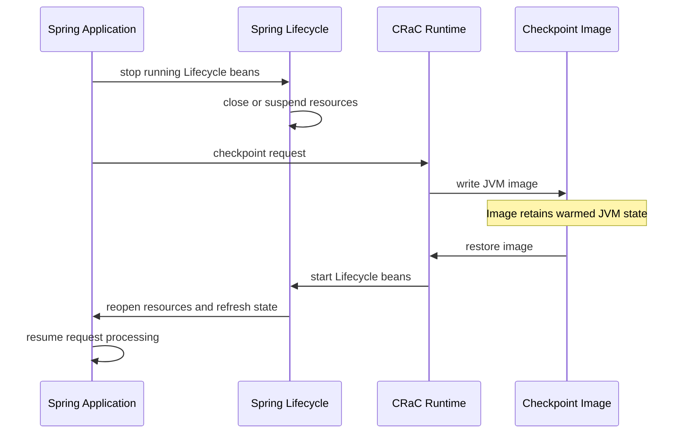
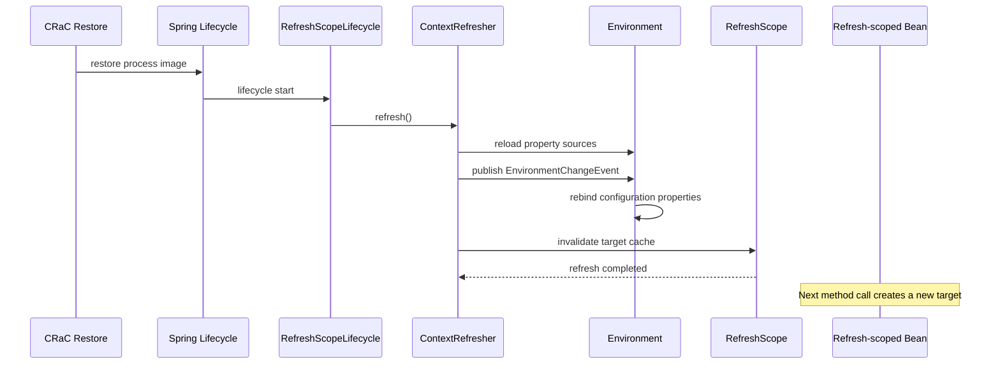

# Checkpoint, Restore, and the Role of RefreshScopeLifecycle When Supported

Checkpoint/restore allows saving the state of a running JVM as a memory image and restoring the JVM from that image. For a Spring application that has already started and warmed up, this approach can reduce startup time and preserve JIT optimizations already achieved. However, a checkpoint image also retains significant process state: objects in the heap, loaded configuration, caches, session info, and references to external resources.

Spring Framework integrates checkpoint/restore under the Lifecycle contract: stopping running beans before checkpoint and restarting them after restore. Spring Cloud Context adds RefreshScopeLifecycle to invoke ContextRefresher.refresh() during the restart lifecycle. As a result, configuration can be reloaded, ConfigurationProperties beans rebound, and RefreshScope bean targets refreshed after the JVM recovers.

This lesson belongs to the **AOT and checkpoint** chapter of the **SPRING_CLOUD_CORE** module. The content focuses on Project CRaC, Spring Framework's two checkpoint/restore modes, resource lifecycles, conditions for RefreshScopeLifecycle, enable/disable configuration, limitations when using AOT/native image, and how to test the application after restore.

## 1. Learning Objectives

After this lesson, learners can:

- Explain checkpoint/restore and the role of Project CRaC.
- Distinguish checkpointing a running JVM from automatic checkpointing at startup.
- Understand how Spring Framework uses Lifecycle.stop() and Lifecycle.start() to manage resources.
- Identify runtime requirements, dependencies, and JVM options for running CRaC.
- Explain the role of RefreshScopeLifecycle after restore.
- Configure spring.cloud.refresh.on-restart.enabled.
- Distinguish context refresh, refresh scope, and reopening resources outside the JVM.
- Handle sockets, connection pools, schedulers, tokens, and environment-dependent data.
- Test the onRefresh milestone, actual checkpoints, and post-restore bean behavior.
- Recognize Context Refresh limitations when using Spring AOT transformations or native images.

## 2. What Is Checkpoint/Restore?

Checkpoint/restore is a mechanism for capturing the state of a running process and restoring a process from the saved state. In Java, Project CRaC (Coordinated Restore at Checkpoint) provides an API for the JVM to coordinate with libraries and applications before checkpoint and after restore.

Basic workflow:

1. Start the application on a CRaC-supported JVM.
2. Execute workloads to load configuration, create beans, open connections, and warm up common code paths.
3. Request a JVM checkpoint.
4. The JVM coordinates with the application to stop or prepare resources.
5. The JVM state is written to a checkpoint image.
6. Launch a process from that image.
7. The application resumes from the saved state and restores necessary resources.

A checkpoint image retains runtime state, including the heap and JIT optimizations. Therefore, restoring can be faster than restarting the entire application and warming up from scratch.

### 2.1. Checkpoint Differs from Standard Restart

| Activity | Standard Restart | Checkpoint/Restore |
| --- | --- | --- |
| JVM | Creates a new JVM | Restores JVM from image |
| Heap/object graph | Recreated from scratch | Restores saved state |
| JIT warm-up | Typically must rerun | Can preserve warmed-up state |
| ApplicationContext | Created anew | Resumes from process image |
| External connections | Created at startup | Must be verified and restored after restore |
| Configuration | Read per fresh startup | May hold values from checkpoint time; needs refresh if source changed |

Checkpoint/restore is not serialization of a few Spring beans. It saves process state at the JVM and OS level. Therefore, references to sockets, file descriptors, threads, database connections, or session info may no longer be valid if the environment has changed.

## 3. When Is Checkpoint/Restore Useful?

Checkpoint/restore fits when startup and warm-up time represent a significant portion of the time needed to bring an instance into service.

Examples:

- Spring Cloud applications with many beans and auto-configurations.
- Applications needing to load configuration from Config Server and initialize many clients.
- Hot code paths requiring JIT warm-up before achieving stable latency.
- Deployment platforms capable of storing and distributing checkpoint images.
- Applications able to coordinate closing/reopening resources before and after checkpoint.

Checkpoint/restore requires support from the JVM, operating system, container runtime, and libraries in use. Not every Java environment can restore the same checkpoint image.

## 4. Baseline Requirements for Using CRaC

According to Spring Framework guidelines, the following components are needed:

- A JVM with checkpoint/restore support.
- A Linux environment compatible with the checkpoint runtime/engine in use.
- The org.crac:crac dependency on the classpath; Spring Framework currently supports version 1.4.0 or later.
- JVM options to create a checkpoint or restore from a checkpoint.
- Libraries and out-of-JVM resources with appropriate checkpoint/restore lifecycle handling.

Illustrative Maven dependency:

```xml
<dependency>
    <groupId>org.crac</groupId>
    <artifactId>crac</artifactId>
    <version>1.4.0</version>
</dependency>
```

In a project using dependency management, check the version managed by your BOM or selected runtime platform. The example above shows the coordinates and minimum version supported by Spring Framework; do not pin a separate version if your project's dependency management already manages it.

Common JVM options:

| Option | Purpose |
| --- | --- |
| -XX:CRaCCheckpointTo=PATH | Starts a checkpointable JVM and specifies where to write the image |
| -XX:CRaCRestoreFrom=PATH | Launches the JVM using an already created checkpoint image |
| -Dspring.context.checkpoint=onRefresh | Instructs Spring to create a checkpoint automatically at the onRefresh lifecycle phase |
| -Dspring.context.exit=onRefresh | Exits the application at the same lifecycle phase for testing without a CRaC runtime |

## 5. Two Checkpoint/Restore Modes in Spring Framework

Spring Framework supports two main usage modes. They serve different purposes and capture application state at different milestones.

| Mode | Checkpoint Timing | State at Checkpoint | Goal |
| --- | --- | --- | --- |
| On-demand checkpoint/restore | After the application has run and possibly warmed up | Can preserve warmed-up JVM, active beans, and caches | Rapidly restore a ready instance |
| Automatic checkpoint/restore at startup | During LifecycleProcessor.onRefresh | Non-lazy singletons initialized, but lifecycle not started and ContextRefreshedEvent not published | Fast-forward past context initialization |

### 5.1. On-Demand Checkpoint/Restore

With on-demand mode, the application starts normally. After warming up, an operator or deployment platform triggers the checkpoint.

Before writing the image, Spring stops running beans participating in the Lifecycle contract. After restore, Spring calls lifecycle start again so beans have a chance to reopen resources.

High-level flow:



A checkpoint taken after warm-up can preserve JIT performance and populated caches. In return, the application must have procedures for handling external resources and verifying state after restore.

### 5.2. Automatic Checkpoint at Startup

You can instruct Spring to automatically take a checkpoint at the onRefresh lifecycle phase using a JVM property:

```bash
java -Dspring.context.checkpoint=onRefresh \
  -XX:CRaCCheckpointTo=/var/lib/orders/checkpoint \
  -jar orders-service.jar
```

The checkpoint is taken after non-lazy singletons have been initialized and InitializingBean.afterPropertiesSet() callbacks have run. However, lifecycle has not yet started and ContextRefreshedEvent has not yet been published.

This approach saves a context that has passed the bean creation phase, but it is not equivalent to a JVM warmed up with a real workload. Tasks that only execute after lifecycle start or after ContextRefreshedEvent have not yet run at checkpoint time.

### 5.3. Using spring.context.exit=onRefresh for Testing

Spring Framework provides the property:

```bash
java -Dspring.context.exit=onRefresh \
  -jar orders-service.jar
```

The application exits at the lifecycle phase equivalent to automatic checkpoint. This is useful for detecting which beans or initialization callbacks open remote connections before lifecycle start.

You can use it to check:

- Does a bean request a database connection too early?
- Does a client open a socket inside its constructor?
- Do initialization tasks depend on external services before resource lifecycles are ready?
- Can the application complete context initialization when remote dependencies are temporarily unreachable?

This property does not create a checkpoint image and does not test restoring. It only helps verify behavior at that lifecycle milestone without needing a CRaC-enabled JVM or Linux.

## 6. Spring Framework Manages Resources via Lifecycle

Checkpoint/restore can invalidate resources tied to the process or environment at checkpoint time. Spring Framework coordinates via the Lifecycle contract:

- Before checkpoint, calls stop() on running Lifecycle beans.
- After restore, calls start() so beans resume operation.
- Beans managing sockets, files, or thread pools can close resources before checkpoint and reopen them after restore.
- Libraries without Spring integration can register org.crac.Resource to receive checkpoint/restore callbacks.

Example of a bean managing a connection to an external system:

```java
import org.springframework.context.SmartLifecycle;
import org.springframework.stereotype.Component;

@Component
public class CatalogConnectionLifecycle implements SmartLifecycle {

    private volatile boolean running;

    @Override
    public void start() {
        // Open a new connection after startup or restore.
        openConnection();
        running = true;
    }

    @Override
    public void stop() {
        // Close the old connection before checkpoint or shutdown.
        closeConnection();
        running = false;
    }

    @Override
    public boolean isRunning() {
        return running;
    }

    private void openConnection() {
        // Create a connection using the current runtime configuration.
    }

    private void closeConnection() {
        // Release the connection and related resources.
    }
}
```

This is a lifecycle structure example. In a real application, handle connection errors, timeouts, retries, idempotency, and shutdown callbacks suited to the client library in use.

Not every Spring bean automatically receives stop() and start() calls. Only beans participating in the lifecycle contract or resources registered with CRaC receive the corresponding callbacks. Check the documentation for the database drivers, HTTP clients, messaging clients, and native libraries your application uses.

## 7. Role of RefreshScopeLifecycle

RefreshScopeLifecycle belongs to Spring Cloud Context. This API has existed since Spring Cloud Context 4.1.0 and is created by refresh auto-configuration when the appropriate conditions are satisfied.

This bean implements Spring Lifecycle and uses ContextRefresher to perform a context refresh during the restart lifecycle. The goal is to refresh configuration after the JVM recovers from a checkpoint, because the checkpoint image may contain stale configuration.

Under current configuration:

```yaml
spring:
  cloud:
    refresh:
      on-restart:
        enabled: true
```

spring.cloud.refresh.on-restart.enabled defaults to true. You can set false to disable automatic context refresh behavior during the restart lifecycle:

```yaml
spring:
  cloud:
    refresh:
      on-restart:
        enabled: false
```

When this property is disabled:

- RefreshScopeLifecycle is not created by auto-configuration.
- Standard refresh features can still work if spring.cloud.refresh.enabled remains enabled.
- The application must decide for itself how to update configuration and refresh beans after restore if needed.

### 7.1. What Does RefreshScopeLifecycle Do?

When supported and enabled, RefreshScopeLifecycle invokes ContextRefresher.refresh() during the restart lifecycle. Spring Cloud's refresh flow can:

1. Reload or rebuild property sources according to the refresher mechanism the application uses.
2. Compute changed keys in the Environment.
3. Publish EnvironmentChangeEvent.
4. Rebind eligible ConfigurationProperties beans.
5. Update logger levels from logging.level.* properties.
6. Invalidate RefreshScope's target cache so targets are recreated on the next access.

If the application uses Spring Cloud Config Client, reloading configuration depends on the Config Data or bootstrap refresh implementation in use, Config Server reachability, and whether the profile/label configuration remains valid.

### 7.2. Post-Restore Refresh Diagram



RefreshScope beans are typically proxies. When the target cache is invalidated, a new target is created the next time the proxy is called. Thus, the time ContextRefresher.refresh() completes and the time the new target bean is actually instantiated can differ.

## 8. Distinguishing Configuration Refresh from Resource Recovery

RefreshScopeLifecycle handles configuration and refresh-scoped beans. It does not replace the lifecycle of database connections, sockets, schedulers, or external clients.

| Component | What Needs to Happen After Restore | Appropriate Mechanism |
| --- | --- | --- |
| ConfigurationProperties | Rebind to the new Environment | ContextRefresher / EnvironmentChangeEvent |
| RefreshScope bean | Recreate target with new configuration | RefreshScope invalidation |
| Database connection pool | Verify and reopen connections | Spring Lifecycle or driver-specific CRaC integration |
| HTTP connection pool | Discard old connections, create new pool if needed | Client lifecycle or CRaC Resource |
| File handle | Reopen valid file descriptors | Lifecycle or CRaC Resource |
| Scheduler | Restore appropriate execution schedule | Lifecycle, scheduler-specific handling |
| Token or session | Refresh expired credentials/sessions | Authentication client or application |
| Local cache | Refresh environment-dependent data | Cache lifecycle / application refresh logic |

Example: Config Server returns a new database URL after restore. ContextRefresher can update the Environment and invalidate a RefreshScope bean. However, if the old connection pool did not close/reopen properly in lifecycle, the application may still use connections created before checkpoint. Both configuration refresh and resource recovery must be handled.

## 9. Using RefreshScope for Beans with Changing Configuration

A bean whose configuration is injected at initialization time can be annotated with RefreshScope so Spring Cloud recreates the target upon refresh.

Example:

```java
import org.springframework.beans.factory.annotation.Value;
import org.springframework.cloud.context.config.annotation.RefreshScope;
import org.springframework.stereotype.Component;

@Component
@RefreshScope
public class CatalogEndpoint {

    private final String baseUrl;

    public CatalogEndpoint(
            @Value("${catalog.base-url}") String baseUrl) {
        this.baseUrl = baseUrl;
    }

    public String baseUrl() {
        return baseUrl;
    }
}
```

After restore, if Config Server returns a new catalog.base-url and ContextRefresher applies that property source, the old target is invalidated. The next call to baseUrl() creates a new target with the new value.

Do not annotate every bean with RefreshScope. Use it only for beans whose state or configuration genuinely needs recreation. Recreating targets can close old resources and allocate new ones, so consider lifecycle and initialization cost.

## 10. Configuration Types That Do Not Refresh Automatically in the Usual Way

Several limitations to remember:

- ConfigurationProperties using constructor binding, including Java records, cannot be rebound through the standard mechanism.
- RefreshScope on a Configuration class does not automatically place every bean declared in that class into refresh scope.
- Beans or classes listed in spring.cloud.refresh.never-refreshable are not refreshed through the standard mechanism.
- HikariDataSource is in Spring Cloud's default non-refreshable group.
- Removing a property from a config source is not equivalent to updating a new value in all cases; verify the application's absence/default behavior.
- Objects outside refresh scope may retain stale references or state after the Environment changes.

RefreshScopeLifecycle triggers the refresh flow; it does not eliminate the limitations of ConfigurationProperties, RefreshScope, or specific bean types.

## 11. Managing Schedulers and Periodic Jobs

Checkpoint/restore can have special effects on scheduled tasks. With Scheduled(fixedRate = ...), executions missed while the JVM was checkpointed may run upon restore depending on how the scheduler handles fixed rates.

Example:

```java
@Scheduled(fixedRate = 5000)
public void pollCatalog() {
    // Poll every five seconds according to fixed-rate scheduling.
}
```

If you do not want the scheduler to execute a backlog of missed runs after restore, consider fixedDelay or a cron expression:

```java
@Scheduled(fixedDelay = 5000)
public void pollCatalog() {
    // Delay is measured after each completed execution.
}

@Scheduled(cron = "0 */1 * * * *")
public void refreshCatalogSummary() {
    // Recalculate according to wall-clock schedule.
}
```

The choice depends on business semantics:

- fixedRate: suitable when a regular cadence is needed and a clear backlog policy exists.
- fixedDelay: the rest interval is measured after the previous execution finishes.
- cron: wall-clock schedule, with each run evaluated against the schedule expression.

Do not mechanically switch fixedRate to fixedDelay. Determine whether missed executions must be caught up and ensure jobs are idempotent if they can re-run.

## 12. Example of On-Demand Checkpoint and Restore

Start the application on a CRaC-enabled JVM and specify the checkpoint directory:

```bash
java -XX:CRaCCheckpointTo=/var/lib/orders/checkpoint \
  -jar orders-service.jar
```

After the application warms up, send a representative workload to exercise common code paths. Then find the PID and request a checkpoint:

```bash
jcmd <pid> JDK.checkpoint
```

Once the checkpoint completes, you can deploy the checkpoint image to a compatible environment. Launch from the image:

```bash
java -XX:CRaCRestoreFrom=/var/lib/orders/checkpoint
```

Before letting the instance accept traffic, verify:

- The JVM restored successfully.
- Lifecycle beans reopened resources.
- Config Client loaded required configuration.
- RefreshScopeLifecycle performed a refresh if enabled and supported by the version.
- Refresh-scoped beans can instantiate new targets.
- Connection pools, HTTP clients, and schedulers operate normally.
- Service registration/instance IDs do not collide when cloning the same checkpoint image.

The checkpoint path must be protected and have sufficient capacity. Checkpoint images must be created and restored on compatible operating systems, CPU architectures, and runtimes.

## 13. Configuring RefreshScopeLifecycle in Spring Cloud

For Spring Cloud to auto-configure refresh scope and restart lifecycle, the application needs Spring Cloud Context on the classpath. In many projects, this module is brought in via a Spring Cloud starter; if managing dependencies directly, use the version from the Spring Cloud BOM.

Default enabled configuration:

```yaml
spring:
  cloud:
    refresh:
      enabled: true
      on-restart:
        enabled: true
```

Disable only refresh on restart:

```yaml
spring:
  cloud:
    refresh:
      on-restart:
        enabled: false
```

Disable all refresh auto-configuration:

```yaml
spring:
  cloud:
    refresh:
      enabled: false
```

The three configurations have distinct meanings:

| Property | Impact |
| --- | --- |
| spring.cloud.refresh.enabled=true | Enables refresh scope and related refresh components |
| spring.cloud.refresh.on-restart.enabled=true | Creates RefreshScopeLifecycle to refresh the context during the restart lifecycle |
| spring.cloud.refresh.on-restart.enabled=false | Disables only automatic refresh on restart; other refresh mechanisms may still be usable |
| spring.cloud.refresh.enabled=false | Disables refresh auto-configuration, including refresh scope and related lifecycle |

## 14. Supported Versions and Relationship with Spring AOT

RefreshScopeLifecycle has been available since Spring Cloud Context 4.1.0. When using older release trains, do not assume the class or the spring.cloud.refresh.on-restart.enabled property already exists.

Verify:

- Spring Boot version.
- Compatible Spring Cloud release train.
- Actual Spring Cloud Context version in the dependency tree.
- Javadoc of RefreshScopeLifecycle in the running version.
- Whether spring.cloud.refresh.on-restart.enabled is bound and whether auto-configuration creates the bean.

Checkpoint/restore with CRaC is a mechanism for a running JVM. Spring AOT transformations and native images are different optimization/packaging approaches. They should not be conflated.

Spring Cloud explicitly states Context Refresh is not supported for Spring AOT transformations and native images. In those cases, set:

```yaml
spring:
  cloud:
    refresh:
      enabled: false
```

If the application runs CRaC on the JVM while also built with Spring AOT processing, check the exact limits of your release train and build setup. Do not assume RefreshScopeLifecycle can refresh the context in every artifact type.

## 15. Protecting Checkpoint Images and Sensitive Configuration

A checkpoint image contains JVM memory state. Any value the JVM has seen may appear in the image, including:

- Decrypted passwords and tokens.
- Secrets fetched from Config Server or a secret manager.
- Private keys and client credentials.
- Request/response data still in the heap.
- Sessions, caches, and user information.

Apply these principles:

1. Store checkpoint images in storage with access controls.
2. Encrypt volumes or artifact stores per organizational security policy.
3. Do not push checkpoint images containing secrets to public registries/container repositories.
4. Limit retention duration and purge old images per retention policy.
5. Do not share checkpoint images across dev, staging, and production environments if images contain configuration or data from the source environment.
6. Verify credentials and sessions after restore; do not assume they are still valid.
7. Do not log heap contents or secret values when investigating restore failures.

If the same checkpoint image is cloned into multiple replicas, each replica may start with identical heap data. Generate or refresh instance IDs, registration metadata, and state that must be unique after restore.

## 16. Testing Checkpoint/Restore

Test across multiple levels to separate Spring lifecycle errors from CRaC runtime errors.

### 16.1. Testing the Automatic Checkpoint Milestone

Use:

```bash
java -Dspring.context.exit=onRefresh \
  -jar orders-service.jar
```

Verify the application completes context initialization and exits at the expected lifecycle phase. If it fails, inspect which bean initialization or resource is being opened before lifecycle start.

This test does not require a CRaC-enabled JVM and does not verify restoring.

### 16.2. Verifying RefreshScopeLifecycle Is Configured

In a context test matching your Spring Cloud version:

- When spring.cloud.refresh.enabled=true and spring.cloud.refresh.on-restart.enabled=true, verify auto-configuration creates RefreshScopeLifecycle.
- When spring.cloud.refresh.on-restart.enabled=false, verify this lifecycle bean is not created.
- When spring.cloud.refresh.enabled=false, verify refresh auto-configuration is disabled.

You can use ApplicationContextRunner or a small context test to check auto-configuration conditions. You do not need to run CRaC solely to check property conditions.

### 16.3. Integration Testing with CRaC

A real restore test should:

1. Launch the application with a CRaC-enabled JVM.
2. Configure Config Server to return catalog.base-url with value A.
3. Initialize the context and invoke the CatalogEndpoint bean to create the refresh target.
4. Take a checkpoint after warm-up.
5. Change the remote property to value B.
6. Restore the JVM from the checkpoint.
7. Confirm ContextRefresher read the new configuration.
8. Call CatalogEndpoint and confirm the new target uses value B.
9. Verify connection pools/clients reopened and do not use stale sockets.
10. Confirm health/readiness only transitions to accepting traffic after recovery steps succeed.

### 16.4. Checking Health and Refresh Errors

Spring Cloud provides RefreshScopeHealthIndicator. If a bean fails to re-initialize or rebind after context refresh, the health indicator can transition to DOWN and provide exception details.

In tests, check all of:

- Did the refresh flow return success?
- Were the properties expected to change updated?
- Did refresh-scoped beans create new targets?
- Does the health indicator reflect target creation errors?
- Does the application prevent accepting traffic when configuration or resources are not yet ready?

Do not merely assert that ContextRefresher.refresh() was called. Verify configuration values and bean behavior after restore.

## 17. Common Error Diagnostics

| Symptom | Possible Cause | Resolution |
| --- | --- | --- |
| JVM fails to create checkpoint | Runtime/JDK does not support CRaC or environment lacks prerequisites | Check JVM build, Linux, CRaC engine, and permissions |
| Restore fails on another machine | Incompatible OS, CPU architecture, or runtime | Use a restore environment compatible with the checkpoint image |
| Application restores but database calls fail | Connection pool holds stale sockets or was not reopened | Add lifecycle/CRaC resource handling for the pool |
| Beans still use old configuration | Refresh lifecycle disabled or refresher failed to load new property sources | Check version, properties, Config Server, and refresh logs |
| RefreshScopeLifecycle missing from context | Spring Cloud Context too old or refresh auto-configuration disabled | Check version and spring.cloud.refresh.enabled |
| Refresh target throws error after restore | Invalid new property or constructor/factory method failure | Inspect RefreshScopeHealthIndicator and root exception |
| ConfigurationProperties record retains old values | Constructor-bound configuration does not rebind via standard mechanism | Redesign binding or create a refresh-compatible bean |
| Scheduler runs catch-up bursts after restore | Using fixed-rate and missed runs accumulated | Evaluate fixedDelay/cron and backlog policy |
| Restore succeeds but instances register duplicates | Multiple replicas created from same checkpoint image keep same instance ID | Generate unique instance IDs and re-register after restore |
| Application uses stale secrets | Secret embedded in checkpoint image or source not refreshed | Verify secret source, refresh flow, and credential rotation |
| Native image lacks refresh behavior | Context Refresh does not support AOT/native image | Set spring.cloud.refresh.enabled=false and design appropriate config |

## 18. Recommended Operational Workflow

When introducing checkpoint images into a runtime environment:

1. Build the image on the right JDK/runtime with CRaC support.
2. Run the application and warm up with a representative workload if using on-demand checkpoints.
3. Verify resource-managing beans implement Lifecycle or CRaC integration.
4. Create the checkpoint image and store it in a secure location.
5. During deployment, restore the image in a compatible environment.
6. Let lifecycle beans reopen resources.
7. Let RefreshScopeLifecycle perform context refresh if supported by version and configuration.
8. Verify Config Server, secret sources, and external dependencies.
9. Confirm refresh-scoped targets recreate successfully.
10. Update instance identity, service registration, and readiness.
11. Only route traffic to the instance after appropriate health checks turn UP.
12. Monitor latency, connection pool errors, and refresh health initially after restore.

For automatic checkpoint at startup, skip full warm-up: the checkpoint is taken before lifecycle start and before ContextRefreshedEvent. Measure real post-restore performance to decide which mode fits best.

## 19. Practice Exercise

An orders-service uses Spring Cloud Config Client, ConfigurationProperties, RefreshScope, an HTTP client, and Eureka. The operations team wants to take a checkpoint after JVM warm-up to scale replicas faster.

Design the solution:

1. Select a CRaC-enabled JDK and verify the Linux environment.
2. Add a compatible org.crac:crac to the classpath.
3. Create lifecycle beans to close and reopen HTTP clients or connection pools.
4. Enable spring.cloud.refresh.on-restart.enabled.
5. Configure Config Server to return catalog.base-url and orders.timeout.
6. Start, warm up, and take a checkpoint.
7. Update configuration on Config Server.
8. Restore two replicas from the same checkpoint image.
9. Confirm ContextRefresher updates configuration and RefreshScope beans use new values.
10. Generate unique instance IDs for each replica before registering with Eureka.
11. Verify Eureka registration, readiness, and requests from consumers.
12. Try disabling spring.cloud.refresh.on-restart.enabled and observe the difference.
13. Test failure behavior if the HTTP client does not close/reopen resources properly in lifecycle.
14. Assess secret exposure risk in the checkpoint image and propose a storage policy.

**Completion Criteria:** distinguish the two checkpoint modes; prove new configuration is applied after restore; confirm external resources are reopened; each replica has a unique identity; and the checkpoint image is protected as an artifact that may contain secrets.

## 20. Key Takeaways

- CRaC checkpoint saves JVM state; restore recovers the process from the created image.
- Spring Framework uses Lifecycle.stop() before checkpoint and Lifecycle.start() after restore to coordinate resources.
- On-demand checkpoint can preserve a warmed-up JVM; automatic checkpoint at onRefresh runs before lifecycle start and does not produce a fully warmed-up JVM.
- spring.context.exit=onRefresh helps test the initialization milestone without a CRaC runtime.
- RefreshScopeLifecycle has been available since Spring Cloud Context 4.1.0.
- spring.cloud.refresh.on-restart.enabled defaults to true in supported versions.
- RefreshScopeLifecycle calls ContextRefresher.refresh() during the restart lifecycle to rebind configuration and refresh RefreshScope beans.
- Configuration refresh does not replace closing/reopening sockets, files, connection pools, or schedulers.
- Constructor-bound ConfigurationProperties and Java records cannot be rebound via the standard refresh mechanism.
- Fixed-rate scheduled tasks may catch up on missed runs; consider fixedDelay or cron per business semantics.
- Context Refresh does not support Spring AOT transformations and native images; configure spring.cloud.refresh.enabled=false per documentation.
- Checkpoint images may contain all secrets and configuration read by the JVM; they must be protected as sensitive data.

## 21. References

- [Spring Framework — JVM Checkpoint Restore](https://docs.spring.io/spring-framework/reference/integration/checkpoint-restore.html): CRaC prerequisites, Lifecycle stop/start, on-demand and automatic checkpoints.
- [Spring Boot — Checkpoint and Restore With the JVM](https://docs.spring.io/spring-boot/reference/packaging/checkpoint-restore.html): checkpoint/restore integration in Spring Boot and resource management.
- [Spring Cloud Commons — Application Context Services](https://docs.spring.io/spring-cloud-commons/reference/spring-cloud-commons/application-context-services.html): RefreshScope, RefreshScopeLifecycle, refresh on restart, and AOT/native limitations.
- [Spring Cloud Commons — Configuration Properties](https://docs.spring.io/spring-cloud-commons/reference/configprops.html): default value of spring.cloud.refresh.on-restart.enabled.
- [RefreshScopeLifecycle Javadoc](https://www.javadoc.io/doc/org.springframework.cloud/spring-cloud-context/5.0.0-M4/org/springframework/cloud/context/refresh/RefreshScopeLifecycle.html): lifecycle contract and API introduction version.
- [Project CRaC — Checkpoint and Restore](https://crac.org/use/checkpoint-and-restore/): JVM checkpoint and restore commands.
