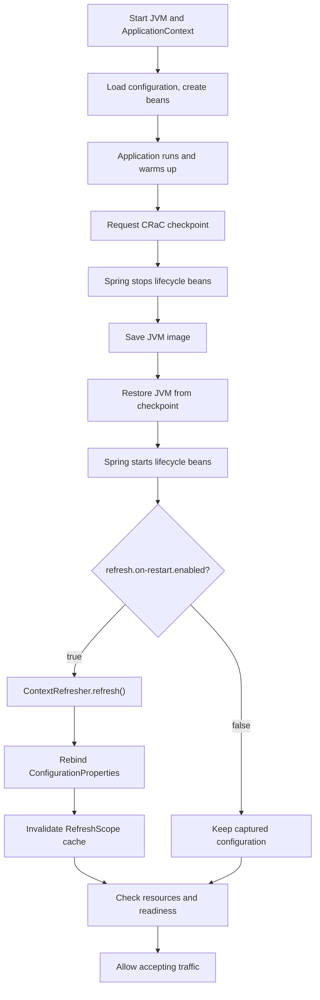

# Controlling refresh.on-restart.enabled and Verifying Restoration

> **Chapter:** AOT and checkpoint
> **Module:** `SPRING_CLOUD_CORE` — understanding core Spring Cloud foundations in distributed systems, especially Spring Cloud Commons, Context, externalized configuration, and version compatibility with Spring Boot. Learners explore refresh scope, discovery, service registry, service communication, and how to test and operate shared abstractions.
> **Focus:** spring.cloud.refresh.on-restart.enabled controls whether Spring Cloud automatically refreshes configuration when a JVM is restored from a checkpoint. This lesson explains the relationship between CRaC, Spring Lifecycle, ContextRefresher, ConfigurationProperties, and RefreshScope; it also guides checking properties, handling external resources, identifying AOT/native image limits, and verifying the application after restore.

## 1. Why Must Configuration Refresh After Restore?

Checkpoint/restore allows saving the memory state of a running JVM and restoring that state in a subsequent JVM process. With Project CRaC (Coordinated Restore at Checkpoint), a platform can pre-prepare an initialized, even warmed-up Spring application to cut startup time on the next deployment.

Fast startup comes with an issue: the in-memory state captured at checkpoint time may be stale when the JVM is restored. For example:

- container hostname or IP has changed;
- downstream endpoints have been updated;
- credentials or secrets have been rotated;
- timeout configuration, feature flags, or connection limits changed;
- sockets, connection pools, threads, or clients must be reopened;
- the service instance must re-register with discovery infrastructure.

If the application continues using the captured state as-is, it may start up very quickly yet still use invalid network addresses, configuration, or resources.

Spring Cloud Context provides a refresh-on-restart mechanism. The RefreshScopeLifecycle bean is registered by default and calls ContextRefresher.refresh() when Spring's lifecycle restarts after restore. This process updates the Environment, rebinds configuration beans, and invalidates RefreshScope's target cache.

The property controlling this mechanism is:

```properties
spring.cloud.refresh.on-restart.enabled=true
```

The default value is true in current Spring Cloud Commons. Set it to false if the application does not want automatic refresh during lifecycle restart.

### Learning Outcomes

After this lesson, learners can:

1. explain why configuration must refresh after JVM checkpoint/restore;
2. distinguish process restart, ApplicationContext restart, and CRaC restore;
3. understand the role of RefreshScopeLifecycle and ContextRefresher;
4. configure spring.cloud.refresh.on-restart.enabled;
5. distinguish this property from spring.cloud.refresh.enabled and spring.context.checkpoint;
6. verify property binding and refreshed beans;
7. recognize limitations of RefreshScope, ConfigurationProperties, and DataSource;
8. test lifecycle refresh and the restore workflow;
9. handle AOT/native image configuration;
10. protect checkpoint artifacts and control post-restore readiness.

## 2. Distinguishing Three Types of Restart

The term "restart" can refer to different behaviors. Identify the exact type of restart before configuring.

| Activity Type | What Happens? | Role of the Property |
| --- | --- | --- |
| New JVM/process startup | A new process runs the main method and creates a new ApplicationContext | Not the primary mechanism; configuration is loaded during normal startup |
| ApplicationContext restart | The context closes and reinitializes in the same process per Spring Cloud's restart mechanism | Not synonymous with /actuator/restart endpoint; inspect specific lifecycle |
| JVM checkpoint/restore | JVM state is captured and restored from a checkpoint image; Spring lifecycle beans stop/start around checkpoint | This is the primary scenario supported by RefreshScopeLifecycle |

A typical container rollout creates a new JVM. Spring Boot reloads configuration during fresh startup, so it does not need to rely on checkpoint refresh to update values.

CRaC restore differs from a fresh startup: the JVM resumes from saved memory state. Objects, beans, and property values created before checkpoint may still carry stale state. Lifecycle restart gives Spring an opportunity to close/reopen resources and refresh configuration after restore.

### 2.1. Checkpoint and Restore Under Project CRaC

General workflow:

1. Start the application on a CRaC-supported JDK.
2. Prepare the application, load configuration, and optionally execute a workload to warm up the JVM.
3. Request a checkpoint.
4. Spring stops lifecycle beans so they close or release resources before the JVM is captured.
5. The platform saves the JVM state and checkpoint memory.
6. At another time, the platform restores the JVM.
7. Spring starts the lifecycle beans again.
8. RefreshScopeLifecycle performs configuration refresh if enabled.
9. The application checks resources and readiness before accepting traffic.

RefreshScopeLifecycle does not replace full CRaC resource management. Libraries and resources not managed by Spring lifecycle may need dedicated CRaC integration or corresponding close/open callbacks.

### 2.2. Lifecycle Diagram



The diagram illustrates the main flow. Whether an instance is actually permitted to accept traffic also depends on health checks, readiness probes, the service registry, and deployment platform procedures.

## 3. What Does spring.cloud.refresh.on-restart.enabled Control?

### 3.1. Meaning and Default Value

spring.cloud.refresh.on-restart.enabled is a Spring Cloud Context property. In Spring Cloud Commons 5.0.4, the default value is true.

When the property is true or undeclared, auto-configuration creates the RefreshScopeLifecycle bean. This bean uses ContextRefresher to refresh the Environment and refresh scope when the lifecycle restarts.

Explicitly enabling example:

```yaml
spring:
  cloud:
    refresh:
      on-restart:
        enabled: true
```

Set false to disable automatic lifecycle refresh:

```yaml
spring:
  cloud:
    refresh:
      on-restart:
        enabled: false
```

If the application does not declare the property, the default behavior remains enabled. Therefore, when you need to explicitly disable it in a profile, set false in the effective configuration source and verify the final value from the Environment.

### 3.2. Which Bean Is Created?

In Spring Cloud Context auto-configuration, the lifecycle bean is created conditionally on the property:

```java
@ConditionalOnProperty(
    value = "spring.cloud.refresh.on-restart.enabled",
    matchIfMissing = true
)
@Bean
RefreshScopeLifecycle refreshScopeLifecycle(
        ContextRefresher contextRefresher) {
    return new RefreshScopeLifecycle(contextRefresher);
}
```

Key points to understand:

- matchIfMissing = true means omitting the property is also treated as enabled.
- Setting false causes the condition not to match and the RefreshScopeLifecycle bean is not created.
- This condition only controls the lifecycle helper for refresh on restart.
- It does not automatically disable all of RefreshScope or other refresh APIs.

Package details and auto-configuration organization may vary between releases. Cross-reference the API of the release train you are using before manually configuring beans or writing alternative conditions.

### 3.3. The Property Is Not Equivalent to a Manual Refresh

spring.cloud.refresh.on-restart.enabled is not a toggle for the /actuator/refresh endpoint. If Spring Cloud refresh auto-configuration remains active, the application can still use manual refresh according to the corresponding configuration and security settings.

Example:

```yaml
spring:
  cloud:
    refresh:
      enabled: true
      on-restart:
        enabled: false
```

Refresh scope and refresh features remain enabled, but Spring Cloud does not create the lifecycle bean that automatically refreshes when the JVM restores. The application can still invoke ContextRefresher or the refresh endpoint if the endpoint is configured and exposed.

## 4. Distinguishing Related Properties

Do not confuse spring.cloud.refresh.on-restart.enabled with other similarly named properties.

| Property | Control Scope | When to Use? |
| --- | --- | --- |
| spring.cloud.refresh.on-restart.enabled | Creates or omits RefreshScopeLifecycle for automatic refresh after lifecycle restart | When the application uses checkpoint/restore and needs to decide whether to refresh after restore |
| spring.cloud.refresh.enabled | Enables auto-configuration for RefreshScope and related refresh features | When needing to disable all Spring Cloud refresh support, e.g., AOT/native image |
| spring.context.checkpoint | Controls Spring Framework checkpointing, e.g., value onRefresh | When wanting to take an automatic checkpoint at a startup phase |
| spring.context.exit | Controls exiting the application at a phase, e.g., onRefresh | When testing startup phases without performing a CRaC checkpoint |
| spring.cloud.config.initialize-on-context-refresh | Controls when PropertySourceLocators run in the legacy bootstrap mechanism | When handling bootstrap and refresh config per the corresponding Spring Cloud version |

The two most commonly confused configurations:

- spring.cloud.refresh.on-restart.enabled=false only disables the automatic refresh lifecycle on restart.
- spring.cloud.refresh.enabled=false disables refresh auto-configuration more broadly; do not use it merely to turn off on-restart behavior.

### 4.1. Behavior Matrix

| refresh.enabled | refresh.on-restart.enabled | Expected Outcome |
| --- | --- | --- |
| true | true | Refresh support works and post-restart lifecycle refresh is registered |
| true | false | Refresh support still works; automatic lifecycle refresh is not registered |
| false | true | Refresh auto-configuration is inactive; on-restart property does not create a standalone lifecycle bean |
| false | false | Both refresh auto-configuration and lifecycle refresh are disabled |

The matrix assumes other dependencies and auto-configuration conditions are met. If the application declares beans manually or overrides auto-configuration, verify the actual context.

## 5. What Steps Does ContextRefresher Perform?

When RefreshScopeLifecycle invokes ContextRefresher.refresh(), Spring Cloud performs two main groups of work: updating the Environment and invalidating the refresh scope cache.

### 5.1. Reloading the Environment

Context refresher rebuilds reloadable property sources from configuration sources according to the active mechanism, then compares them with the pre-refresh state. Changed keys are identified to publish EnvironmentChangeEvent.

Depending on the application, configuration sources may include:

- Config Server via Config Data;
- mounted configuration trees;
- property sources provided by the application or an EnvironmentPostProcessor;
- other integrated configuration sources supporting reload.

Do not assume every source is automatically re-read. Identify the refresher of your release and verify whether each source is reloaded after restore.

### 5.2. Rebinding ConfigurationProperties

Spring Cloud listens for EnvironmentChangeEvent and rebinds ConfigurationProperties beans. Loggers with keys starting with logging.level. can also be updated.

Example:

```java
import java.net.URI;
import java.time.Duration;

import org.springframework.boot.context.properties.ConfigurationProperties;

@ConfigurationProperties(prefix = "client")
public class ClientProperties {

    private URI endpoint;
    private Duration timeout = Duration.ofSeconds(2);

    // getters and setters
}
```

If Config Server returns a new endpoint or timeout and the refresher loads the new property source, the configuration bean is rebound to the new Environment.

Rebinding does not mean every singleton in the application is recreated. Standard beans using @Value in constructors or storing properties in fields may continue holding old values without a corresponding update mechanism.

Objects using constructor binding, including Java records annotated with ConfigurationProperties, cannot be refreshed via the current rebinding mechanism. Review your configuration design if values need to change after restore.

### 5.3. RefreshScope Cache Invalidation

After updating the Environment, ContextRefresher.refresh() calls RefreshScope.refreshAll(). Target instances cached in refresh scope are destroyed. The next time the application invokes the proxy, the target bean is recreated and picks up the current configuration.

Example:

```java
import org.springframework.cloud.context.config.annotation.RefreshScope;
import org.springframework.context.annotation.Bean;
import org.springframework.context.annotation.Configuration;

@Configuration
public class RemoteClientConfiguration {

    @Bean
    @RefreshScope
    RemoteClient remoteClient(ClientProperties properties) {
        return new RemoteClient(
                properties.getEndpoint(),
                properties.getTimeout()
        );
    }
}
```

After restore and refresh, the remoteClient proxy remains the reference point used by other beans. The target inside the proxy is recreated on the next access.

### 5.4. Refresh Does Not Recreate Every Bean

Distinguish between:

- ConfigurationProperties beans rebound via the rebinder mechanism.
- RefreshScope beans whose target cache is invalidated and recreated on invocation.
- Standard singletons outside those two groups, which are not automatically recreated.
- Static state, library-specific caches, and external resources, which must be handled by their own lifecycles.

If a bean holds sockets, threads, or connection pools, verify that it has proper close/open lifecycle handling. Simply enabling the refresh property does not guarantee all external resources recover properly.

## 6. Configuring and Verifying the Property

### 6.1. Enabled by Default

If you want to keep the default behavior, you can omit the property. However, in systems using CRaC, explicit declaration makes the configuration decision visible to operators:

```yaml
spring:
  cloud:
    refresh:
      on-restart:
        enabled: true
```

Place the configuration in the file/profile loaded when creating the checkpoint. If using external configuration sources, identify which source has precedence to override this value.

### 6.2. Disabling Automatic Refresh

Example:

```yaml
spring:
  cloud:
    refresh:
      on-restart:
        enabled: false
```

Disable it only when the application has another configuration update and resource recreation workflow. Without an alternative mechanism, post-restore instances may use captured state and connect to stale endpoints.

### 6.3. Verifying the Effective Value

You can inspect the property via controlled configuration logs, Actuator env, or configprops if those endpoints are exposed and secured.

Questions to verify:

1. Is the property actually false or true as intended for the environment?
2. Is any configuration source overriding the property?
3. Was refresh auto-configuration loaded?
4. Does the RefreshScopeLifecycle bean appear in the ApplicationContext?
5. Do post-restore logs record lifecycle refresh?
6. Which keys changed after refresh?
7. Do critical beans or resources actually use the new values?

Do not expose management endpoints to public networks just for debugging. Use internal logs, tests, or secured management interfaces.

## 7. Choosing Enable vs Disable per Scenario

### 7.1. Applications Using CRaC Where Configuration Can Change

Usually keep spring.cloud.refresh.on-restart.enabled=true if:

- the application is checkpointed while running;
- endpoints or network identities can change between checkpoint and restore;
- Config Server or configuration sources are reachable again after restore;
- configuration beans or refresh-scoped clients need new values.

Verify that configuration sources remain available on restore and resource lifecycles are properly integrated.

### 7.2. Applications Not Using Checkpoint/Restore

If the application simply starts a fresh JVM on deployment, this property typically offers no practical benefit. You can keep the default or disable it if your organization prefers omitting unnecessary lifecycle helpers.

Do not expect this property to replace externalized configuration during normal startup.

### 7.3. Applications Needing Immutable Configuration in the Checkpoint Image

Some systems require a checkpoint to be an immutable image reproducing the exact tested state. If automatically fetching new configuration after restore would alter behavior from the approved image, you can set the property to false.

In that case, ensure external resources remain compatible with the captured configuration or have a separate migration/reinitialization workflow. Do not reuse old checkpoint images indefinitely if credentials, certificates, or endpoints have been revoked.

### 7.4. AOT and Native Image

Spring Cloud Context does not support Context Refresh in AOT-transformed applications or native images per current documentation. For AOT/native image, the required property is:

```yaml
spring:
  cloud:
    refresh:
      enabled: false
```

Do not confuse this configuration with spring.cloud.refresh.on-restart.enabled=false. Disabling on-restart does not resolve AOT/native image limitations if other refresh features remain enabled.

## 8. External Resources and Limitations to Note

### 8.1. DataSource and Connection Pools

A DataSource may hold database connections using the URL, username, or password present at checkpoint time. After restore, merely rebinding a configuration bean does not mean the connection pool has been replaced.

Spring Cloud explicitly notes that HikariDataSource is not refreshable by default and is included in the spring.cloud.refresh.never-refreshable list. Therefore:

- do not assume changing URL/credentials in the Environment will automatically replace a Hikari pool;
- verify the pool closes before checkpoint and reopens after restore;
- if pool configuration must change, design a lifecycle or appropriate mechanism to recreate the DataSource;
- verify new connectivity with health checks or test queries after restore.

Do not mechanically put DataSource into RefreshScope when the pool implementation and lifecycle do not support safe recreation.

### 8.2. Sockets, HTTP Clients, and Thread Pools

Some clients retain sockets, DNS results, connection pools, or threads. CRaC/Spring lifecycle can stop some framework-managed resources, but third-party libraries may require custom integration.

Check:

- do resources close before checkpoint;
- do resources reopen after restore;
- do clients use stale DNS or network addresses;
- do scheduled tasks handle the elapsed time while the JVM was checkpointed;
- can any threads outlive the ApplicationContext lifecycle.

### 8.3. Configuration Removed from the Environment

Spring Cloud has a refresh limitation: removing a property source or deleting a key entirely does not always manifest as a new bindable value. Design configuration with explicit states, such as false or a valid sentinel, rather than relying completely on key absence.

### 8.4. Constructor-Bound Beans and Immutable Objects

Configuration beans using constructor binding or Java records cannot be rebound like standard mutable beans. If values must change after restore, consider:

- using mutable beans that support rebinding;
- placing config-dependent components in refresh scope if suitable;
- recreating objects via a dedicated lifecycle;
- or keeping configuration immutable and creating a new checkpoint when changes are needed.

## 9. Checkpoint at onRefresh vs Checkpoint After Warm-Up

Spring Framework supports two primary ways to checkpoint.

### 9.1. Automatic Checkpoint at onRefresh

You can set the JVM system property:

```bash
-Dspring.context.checkpoint=onRefresh
```

Spring Framework takes a checkpoint during the LifecycleProcessor.onRefresh phase. At that point:

- non-lazy singletons have been initialized;
- InitializingBean.afterPropertiesSet() callbacks have run;
- lifecycle beans have not yet started;
- ContextRefreshedEvent has not yet been published.

This means beans may have already initialized clients or accessed databases before the checkpoint is taken. Do not assume onRefresh always captures the application prior to all external connections.

### 9.2. Checkpoint After the Application Has Warmed Up

With on-demand checkpoint, the application is started and can process workloads before checkpointing. The JVM image can contain warmed JIT state and caches.

In return, network resources, connections, and in-memory data are also captured. Proper lifecycle stop/start is required so stale sockets or connections are not used after restore.

### 9.3. Using spring.context.exit=onRefresh for Inspection

To observe the application at the onRefresh phase without needing a CRaC runtime, Spring Framework provides:

```bash
-Dspring.context.exit=onRefresh
```

This property makes the application exit at the corresponding phase instead of taking a checkpoint. It is useful for detecting beans that connect to remote services too early during startup.

This is a startup phase diagnostic tool; it does not replace real restore testing on a CRaC-supported JDK.

## 10. Testing Automatic Refresh on Restore

### 10.1. Testing Lifecycle Bean Creation Conditions

With context tests, verify the scenarios:

| Property | Expectation |
| --- | --- |
| Undeclared | Lifecycle refresh is enabled by default |
| spring.cloud.refresh.on-restart.enabled=true | RefreshScopeLifecycle is present |
| spring.cloud.refresh.on-restart.enabled=false | Lifecycle helper is not registered |

You can test the bean using ApplicationContextRunner or an integration test using the exact auto-configuration and dependencies of your Spring Cloud version.

### 10.2. Testing RefreshScopeLifecycle Independently

Example of testing lifecycle with a mock:

```java
import org.junit.jupiter.api.Test;
import org.springframework.cloud.context.refresh.ContextRefresher;
import org.springframework.cloud.context.refresh.RefreshScopeLifecycle;

import static org.mockito.Mockito.mock;
import static org.mockito.Mockito.verify;

class RefreshScopeLifecycleTests {

    @Test
    void refreshesContextWhenLifecycleStarts() {
        ContextRefresher refresher = mock(ContextRefresher.class);
        RefreshScopeLifecycle lifecycle =
                new RefreshScopeLifecycle(refresher);

        lifecycle.start();

        verify(refresher).refresh();
    }
}
```

This test verifies that lifecycle calls refresher when started. It does not replace real CRaC testing, as it does not simulate checkpointing, restoring, network resources, or external property sources.

### 10.3. Testing Reloaded Properties

A useful integration test should:

1. start a mock Config Server or mutable configuration source;
2. run the application with property version A;
3. verify configuration beans and refresh-scoped clients use A;
4. take a checkpoint;
5. change remote configuration to version B;
6. restore the JVM;
7. verify lifecycle refresh logs;
8. verify the Environment and configuration beans have B;
9. invoke proxies to confirm refresh-scoped targets are recreated;
10. verify clients connect to B's endpoint and credentials.

Do not just check that HTTP health returns 200. Health can be green while a bean still holds stale endpoints or credentials.

### 10.4. Testing Database Resources

If the application uses a database, test separately:

- whether the database is available before checkpoint;
- whether the pool closes at the right time;
- whether the database is available after restore;
- whether new credentials/URLs are loaded;
- whether the pool opens new connections;
- whether actual queries succeed.

With HikariCP, handle the never-refreshable limitation and pool lifecycle as a distinct part of the design. Do not conclude DataSource changed simply because a ConfigurationProperties bean rebound.

### 10.5. Testing with on-restart Disabled

Set:

```properties
spring.cloud.refresh.on-restart.enabled=false
```

After restore, verify the lifecycle helper does not run and values inside beans remain unchanged unless updated by another mechanism. Then check whether your alternative workflow actively loads new configuration and recreates resources.

## 11. Observability and Troubleshooting

### 11.1. Signs That Lifecycle Refresh Ran

Spring Cloud logs may record messages similar to:

```text
Refreshing context on restart.
Refreshed keys: [spring.cloud.client.hostname, spring.cloud.client.ip-address]
```

Changed key names depend on the environment. No changed keys does not necessarily mean refresh failed; the configuration source may simply not have changed. Verify both beans and resources after restore.

### 11.2. RefreshScopeHealthIndicator

Spring Cloud provides RefreshScopeHealthIndicator to monitor rebinding and reinitialization of refresh-scoped beans. If a bean fails to re-initialize or rebind, the indicator can transition to DOWN and provide exception details.

Do not ignore this status in post-restore readiness or monitoring. A living process does not mean every bean is ready.

### 11.3. Common Errors Table

| Symptom | Possible Cause | Resolution |
| --- | --- | --- |
| No refresh logs seen on restore | Property set to false or lifecycle bean not created | Check effective properties and auto-configuration |
| Refresh runs but keys stay unchanged | Config Server returns same values or source was not reloaded | Check property sources and remote responses |
| Value bean keeps old value | Singleton bean does not belong to refresh scope | Use rebindable configuration or appropriate refresh scope |
| ConfigurationProperties does not receive new value | Constructor-bound bean or property source not reloaded | Check binding style and Environment |
| DataSource still uses old credentials | Hikari pool is non-refreshable by default | Design pool close/open lifecycle or recreate DataSource |
| Client fails to connect after restore | Stale sockets, DNS, endpoints, or resources | Check CRaC resource lifecycle and create new client |
| RefreshScopeHealthIndicator goes DOWN | Bean rebind or reinitialize failed | Read exception and inspect dependent beans |
| AOT/native image fails due to refresh support | Context refresh unsupported in AOT/native | Set spring.cloud.refresh.enabled=false |
| Checkpoint image contains old secrets | JVM memory saved credentials at checkpoint | Protect checkpoint artifact and rotate/reload secrets cleanly |
| Service receives traffic too early | Readiness did not wait for refresh and resource initialization | Mark ready only after verifying configuration and dependencies |

### 11.4. Post-Restore Incident Response Workflow

1. Confirm the JVM restored from the right checkpoint version.
2. Confirm Spring lifecycle beans restarted.
3. Check the effective value of spring.cloud.refresh.on-restart.enabled.
4. Confirm RefreshScopeLifecycle was created in the context.
5. Check logs for Refreshing context on restart.
6. Verify Config Server or property sources are reachable after restore.
7. Inspect the list of changed keys and check the Environment.
8. Inspect ConfigurationProperties and RefreshScope beans.
9. Inspect resources such as DataSource, HTTP clients, sockets, and thread pools.
10. Verify readiness before letting the instance receive traffic.
11. If refresh fails, keep the instance out of traffic and perform rollback/restore per operational procedures.

## 12. Protecting Checkpoint Artifacts

A checkpoint image is a saved snapshot of JVM memory state. It may contain:

- passwords or tokens loaded into memory;
- private keys or TLS data;
- user information in caches;
- request/response payloads or business data;
- internal library and framework objects.

Treat checkpoint artifacts as sensitive assets:

- restrict read/write permissions;
- encrypt at rest and in transit;
- do not push checkpoints to public artifact repositories;
- enforce clear retention and deletion policies;
- version-manage code and corresponding configuration;
- control who is permitted to restore images;
- rotate secrets after an incident if a checkpoint is exposed.

If a checkpoint is packaged inside a container image, permission to pull the image can equate to permission to extract memory snapshot data. Apply controls equivalent to secret-bearing artifacts.

## 13. Deployment Checklist

Before enabling automatic refresh on restart, confirm:

- [ ] The application actually uses JVM checkpoint/restore such as CRaC.
- [ ] The Spring Cloud Context version supports RefreshScopeLifecycle.
- [ ] spring.cloud.refresh.on-restart.enabled has the right value per environment.
- [ ] Config Server or property sources are reachable after restore.
- [ ] Properties that need to change are reloaded via ContextRefresher.
- [ ] Beans requiring updates use ConfigurationProperties or RefreshScope appropriately.
- [ ] Constructor-bound configuration is not expected to rebind.
- [ ] DataSource and connection pools have dedicated lifecycles if changes are needed.
- [ ] Sockets, HTTP clients, thread pools, and external resources close/reopen properly.
- [ ] RefreshScopeHealthIndicator is monitored.
- [ ] Readiness succeeds only after resources and configuration are valid.
- [ ] Tested with property version A and B across a checkpoint/restore cycle.
- [ ] AOT/native images disabled refresh support via spring.cloud.refresh.enabled=false if applicable.
- [ ] Checkpoint artifacts are protected as secret-bearing data.

## 14. Practice Exercises

### Exercise 1 — Enable Refresh on Restore

A service runs on CRaC, with Config Server supplying downstream hostnames. After restore, the hostname may change.

Configure spring.cloud.refresh.on-restart.enabled=true and describe how to verify the Environment and beans use the new hostname.

### Exercise 2 — Disable Automatic Refresh

An application needs to preserve the exact approved configuration inside the checkpoint. The operations team wants to disable automatic refresh on restore while keeping the ability to invoke /actuator/refresh manually.

Choose the appropriate property and explain why spring.cloud.refresh.enabled=false is not used.

### Exercise 3 — Distinguish Three Properties

Explain the differences between:

- spring.cloud.refresh.on-restart.enabled;
- spring.cloud.refresh.enabled;
- spring.context.checkpoint.

Give a usage scenario for each property.

### Exercise 4 — DataSource Retaining Old Credentials

After restore, ConfigurationProperties has the new password, yet DataSource still connects using the old password.

Explain HikariDataSource's refresh limitation and propose how to manage pool lifecycle to open new connections safely.

### Exercise 5 — Checkpoint onRefresh Connecting to Database Too Early

The application uses -Dspring.context.checkpoint=onRefresh, but logs show Hibernate already initialized DataSource before checkpoint.

Explain the onRefresh phase, when singletons and afterPropertiesSet() run, then propose how to detect beans accessing remote services too early.

### Exercise 6 — Refresh Failure After Restore

Logs show Refreshing context on restart, yet RefreshScopeHealthIndicator turns DOWN because a client failed to recreate.

Propose a diagnostic procedure covering property sources, Environment, bean lifecycles, network resources, readiness, and rollback.

## 15. Quick Self-Check

1. What is the default value of spring.cloud.refresh.on-restart.enabled? **True in current Spring Cloud Commons.**
2. Which bean performs refresh during lifecycle restart? **RefreshScopeLifecycle.**
3. Which API does RefreshScopeLifecycle call? **ContextRefresher.refresh().**
4. What primary tasks does ContextRefresher perform? **Updates Environment, publishes EnvironmentChangeEvent, rebinds configuration, and refreshes scope.**
5. Does spring.cloud.refresh.on-restart.enabled=false disable all of RefreshScope? **No.**
6. Which property disables refresh auto-configuration more broadly? **spring.cloud.refresh.enabled=false.**
7. Which component does spring.context.checkpoint=onRefresh belong to? **Spring Framework LifecycleProcessor.**
8. Is the onRefresh checkpoint taken before or after lifecycle start? **Before lifecycle start and before ContextRefreshedEvent.**
9. Is HikariDataSource refreshable by default? **No.**
10. Can Java records using constructor binding be rebound? **Not via the current refresh mechanism.**
11. Do AOT/native images support Context Refresh? **No; spring.cloud.refresh.enabled=false must be set.**
12. Can checkpoint artifacts contain secrets? **Yes, because they store JVM memory state.**

**Core Message:** spring.cloud.refresh.on-restart.enabled helps Spring Cloud refresh configuration after JVM checkpoint/restore. Understand it as a lifecycle refresh with a clear scope: the Environment is updated, configuration beans are rebound, and RefreshScope targets are recreated when needed. Actual effectiveness also depends on configuration sources reloading, beans supporting refresh, and external resources having appropriate lifecycles. End-to-end restore testing, readiness checks, and protecting checkpoint artifacts are indispensable parts.

**References:**

- [Spring Cloud Commons 5.0.4 — Application Context Services, Refresh Scope on Restart](https://docs.spring.io/spring-cloud-commons/reference/spring-cloud-commons/application-context-services.html)
- [Spring Cloud Commons 5.0.4 — Configuration Properties](https://docs.spring.io/spring-cloud-commons/reference/configprops.html)
- [Spring Cloud Context API — RefreshScopeLifecycle](https://www.javadoc.io/doc/org.springframework.cloud/spring-cloud-context/latest/org/springframework/cloud/context/refresh/RefreshScopeLifecycle.html)
- [Spring Framework — JVM Checkpoint Restore](https://docs.spring.io/spring-framework/reference/integration/checkpoint-restore.html)
- [Spring Boot — Checkpoint and Restore With the JVM](https://docs.spring.io/spring-boot/reference/packaging/checkpoint-restore.html)

RefreshScopeLifecycle was introduced in Spring Cloud Context 4.1.0. Property names, API packages, and compatibility depend on the release train; check your actual Spring Cloud/Boot versions before applying.
