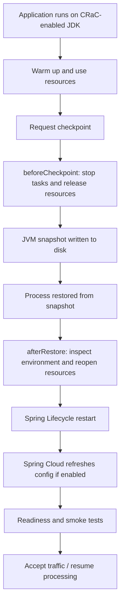

# Managing Sockets, Threads, and External Resources After Restore

Checkpoint/restore with CRaC saves the memory state of a running JVM so it can be rapidly restored at a later time. A snapshot can preserve the object graph, Spring beans, caches, and JIT warm-up. However, many resources an application uses are tied to the operating system or external services: TCP sockets, file descriptors, database connections, consumer sessions, waiting threads, distributed leases, and task schedules.

After restore, a `Socket` reference or connection pool may still exist in the heap while the external connection has closed, the network address has changed, or the lease has expired. If the application reuses stale state without reinitializing, failures may surface immediately on the first request or later as timeouts, stale connections, duplicate message processing, and hung threads.

Spring Framework integrates CRaC with the `Lifecycle` bean lifecycle: stopping beans before checkpoint and starting them again after restore. Spring Boot additionally supports some resources such as sockets, files, and thread pools to a limited extent. Spring Cloud Context adds `RefreshScopeLifecycle`, helping rebind `@ConfigurationProperties` and refresh `@RefreshScope` beans when the application restarts after restore. Dependencies and resources managed directly by external libraries or application code still need to be audited and given appropriate lifecycles.

This lesson belongs to the **AOT and checkpoint** chapter of **SPRING_CLOUD_CORE**. The content focuses on inventorying external resources, closing and reopening sockets/files, stopping and starting threads, handling database pools and message consumers, using `org.crac.Resource`, coordinating with Spring `Lifecycle`, verifying Spring Cloud refresh after restore, and building a safe CRaC testing workflow.

## 1. Learning Objectives

After this lesson, you can:

- Explain why objects in the heap may survive while external resources become invalid after restore.
- Distinguish runtime checkpoint/restore from automatic checkpoint at startup.
- Describe the roles of `Lifecycle`, `SmartLifecycle`, and `org.crac.Resource`.
- Inventory sockets, files, threads, connection pools, and sessions that need handling.
- Stop accepting new work and wait for in-flight work to finish before checkpoint.
- Close sockets and external connections before checkpoint, then create new connections after restore.
- Manage executors, schedulers, and periodic tasks to avoid unintended catch-up bursts.
- Handle database pools, message consumers, distributed locks, leases, and timers.
- Register custom CRaC resources properly and hold references to resource callbacks.
- Leverage Spring Cloud's `RefreshScopeLifecycle` on restore.
- Verify configuration, secrets, DNS, and the new environment before opening traffic.
- Build tests and runbooks to detect resource failures after restore.

## 2. How Does CRaC Checkpoint/Restore Work?

CRaC (Coordinated Restore at Checkpoint) is a mechanism coordinating between the JVM and the application to take a snapshot and restore JVM state. The application runs on a CRaC-supported JDK, warms up if needed, and then requests a checkpoint. The snapshot is written to a directory; a subsequent run can restore from that snapshot instead of starting and warming up from scratch.

A checkpoint can retain:

- Object graph and heap state.
- Already-created Spring beans.
- Caches and loaded data.
- JIT compiled code and JVM warm-up state.
- Configuration values the process has read.
- Logical state of components.

Resources depending on the operating system or external services must be handled separately. For example, a `Socket` object may still reside in the heap, yet the file descriptor and peer connection are no longer valid after restore.



The goal of callbacks is not to keep all old connections alive. The goal is to bring the application into a safely stoppable state before the snapshot and restore its ability to serve after the snapshot.

### 2.1. Baseline Requirements

Per current Spring Framework documentation, using JVM checkpoint/restore integration requires:

- A JDK supporting checkpoint/restore via CRaC.
- A compatible operating system platform and checkpoint engine; Spring guidelines currently describe Linux.
- The `org.crac:crac` library version `1.4.0` or later on the classpath.
- JVM options such as `-XX:CRaCCheckpointTo=PATH` or `-XX:CRaCRestoreFrom=PATH`.

Not every JDK distribution includes CRaC. Check the documentation of your JDK vendor, kernel, checkpoint engine, and required permissions in the runtime environment. Merely adding the `org.crac:crac` dependency does not turn a standard JDK into a CRaC-enabled runtime.

## 3. Spring's Two Checkpoint Modes

Spring Framework supports two main usage modes.

| Mode | Checkpoint Timing | Purpose |
| --- | --- | --- |
| On-demand checkpoint/restore | After the application has run, possibly warmed up | Save running JVM state for fast restore with warmed-up code paths |
| Automatic checkpoint/restore at startup | During a startup phase designated by Spring | Create a startup image to skip part of initialization on subsequent runs |

### 3.1. On-Demand Checkpoint/Restore

The application starts normally, receives warm-up workloads, and then an operator or the application requests a checkpoint. Before the snapshot, Spring stops beans implementing `Lifecycle`. After restore, Spring restarts those beans.

This mode fits when you need to snapshot a JVM that has exercised common code paths. It also requires platform integration to ensure remote resources can close, reopen, and authenticate in the restore environment.

### 3.2. Automatic Checkpoint/Restore at Startup

You can enable automatic checkpointing during Spring's refresh phase via:

```bash
java -Dspring.context.checkpoint=onRefresh \
     -XX:CRaCCheckpointTo=./crac-image \
     -jar app.jar
```

The checkpoint is taken during the `LifecycleProcessor.onRefresh` phase, after non-lazy singletons have been created and `InitializingBean.afterPropertiesSet()` callbacks have executed, but before lifecycle starts and before `ContextRefreshedEvent`.

This mode saves state that has completed part of context creation. It does not produce a fully warmed-up JVM like an on-demand checkpoint taken after running realistic workloads.

### 3.3. Inspecting the Startup Phase Without CRaC

Spring Framework provides:

```bash
java -Dspring.context.exit=onRefresh -jar app.jar
```

Instead of taking a checkpoint, the application exits at the same lifecycle phase. You can use this to check which beans connect to remote services too early, before lifecycle starts.

If the application cannot initialize when Config Server, a database, or a broker is not yet available at that stage, review connections made inside constructors or `@PostConstruct`. Connections that should open when components start ought to be managed within an appropriate lifecycle.

## 4. Spring Lifecycle Coordinating with CRaC

Spring Framework integrates CRaC by tying checkpoint/restore to the `ApplicationContext` lifecycle.

In on-demand mode:

1. CRaC notifies that a checkpoint is about to occur.
2. Spring stops running beans implementing `Lifecycle`.
3. Beans have an opportunity to close sockets, files, executors, or custom resources.
4. The JVM takes the snapshot once preparation completes.
5. On restore, Spring calls start so beans reopen resources and resume operation.

This is Spring Framework's foundational integration. A bean does not need to register its own CRaC callback if all of its resources are properly managed through the Spring lifecycle.

### 4.1. Lifecycle and SmartLifecycle

`Lifecycle` provides two basic operations:

```java
public interface Lifecycle {
    void start();
    void stop();
    boolean isRunning();
}
```

`SmartLifecycle` adds auto-startup, ordering via `phase`, and a callback for asynchronous stop. It suits components that must stop consumers, wait for workers, or close connections in a specific sequence.

Illustrative example of a component managing a socket:

```java
@Component
public class UpstreamChannel implements SmartLifecycle {

    private volatile Socket socket;
    private volatile boolean running;

    @Override
    public void start() {
        try {
            Socket candidate = new Socket();
            candidate.connect(
                    new InetSocketAddress("upstream.internal", 9000),
                    3000);
            this.socket = candidate;
            this.running = true;
        }
        catch (IOException ex) {
            throw new IllegalStateException(
                    "Cannot connect to upstream", ex);
        }
    }

    @Override
    public void stop() {
        this.running = false;
        Socket current = this.socket;
        this.socket = null;

        if (current != null) {
            try {
                current.close();
            }
            catch (IOException ex) {
                throw new IllegalStateException(
                        "Cannot close upstream socket", ex);
            }
        }
    }

    @Override
    public void stop(Runnable callback) {
        try {
            stop();
        }
        finally {
            callback.run();
        }
    }

    @Override
    public boolean isRunning() {
        return this.running;
    }

    @Override
    public boolean isAutoStartup() {
        return true;
    }

    @Override
    public int getPhase() {
        return 0;
    }
}
```

This example only illustrates the lifecycle. In a real application, add timeouts, bounded retries, peer authentication, synchronization with requests using the socket, and a readiness policy. Do not allow new requests to use the socket while the component is stopping or has not finished starting.

### 4.2. Phase and Shutdown Order

Spring uses `phase` to order `SmartLifecycle` beans. Beans with lower phases start first and stop last; beans with higher phases start last and stop first.

For example, if a consumer depends on a connection manager:

- The connection manager has a lower phase.
- The consumer has a higher phase.
- On stop, the consumer stops first so it no longer creates new work.
- The connection manager stops after the consumer has finished and closes connections.

On start after restore, the order reverses: the connection manager becomes ready first, and then the consumer begins accepting work.

Do not pick phases arbitrarily. Model dependencies between components and verify the actual order via lifecycle logs.

### 4.3. Spring Lifecycle Does Not Cover Every Object

Spring only coordinates beans with an appropriate lifecycle. A library may create internal threads or sockets without registering them with Spring. An object created with `new` in application code is also not automatically stopped by Spring.

For those resources, you must:

- Wrap them in a bean implementing `Lifecycle`/`SmartLifecycle`, or
- Integrate directly with `org.crac.Resource`.

Choose a single lifecycle owner for each resource. Avoid having both Spring lifecycle and a custom CRaC callback close/open the same socket or executor without an explicit coordination mechanism.

## 5. Inventorying Resources to Handle

Before enabling checkpoint/restore, list every external resource the application holds.

| Group | Examples | Before Checkpoint | After Restore |
| --- | --- | --- | --- |
| Socket | TCP client, server socket, HTTP connection | Stop new requests, close sockets | Resolve endpoints and open new connections |
| File | File stream, watcher, file lock | Flush, close handles, and release locks | Reopen files, check path/permissions/contents |
| Thread | Worker thread, scheduler, poller | Stop accepting work, wait or interrupt cleanly | Create/start appropriate workers |
| Database | JDBC connection, pool, transaction | Wait for transactions, close connections/pool if needed | Create new pool/connections and check health |
| Message broker | Kafka consumer, AMQP channel, stream session | Pause/stop consumer, finish or commit work | Create new session, rejoin group/rebalance |
| Distributed coordination | Lease, distributed lock, leader election | Release lock/lease or ensure controlled expiration | Acquire new lease/lock and verify ownership |
| Timer/cache | Scheduled task, token, TTL cache | Stop timers, record necessary deadlines | Recalculate time and refresh data |
| Cloud/service discovery | Client session, registration heartbeat | Stop old heartbeats/sessions if needed | Reconnect, register, or verify status |

### 5.1. Distinguishing Heap State from External System State

A Java object may still hold references to:

- A socket already closed by the peer.
- A connection pool containing timed-out connections.
- A consumer session no longer part of the group.
- A file descriptor no longer pointing to a valid file.
- An expired lease.
- A DNS result or IP address that is no longer accurate.
- A token that expired while the JVM was paused.

Therefore, after restore, do not just check `object != null`. Verify whether the resource is still valid according to the protocol and the system that owns it.

## 6. Managing Sockets and Network Connections

Sockets are among the first resources to address. TCP connections depend on kernel state, peers, network addresses, NAT, firewalls, and connection lifetimes. A heap snapshot does not guarantee external connection state remains intact.

Common cases:

- TCP clients holding sockets to internal services.
- HTTP clients holding connections in a connection pool.
- WebSocket or gRPC channels holding long-lived connections.
- Server sockets listening on a port.
- UDP sockets or multicast memberships.
- TLS sessions and channels managed by networking libraries.

### 6.1. Before Checkpoint

A safe sequence:

1. Stop accepting new requests or messages into the component.
2. Wait within a bounded timeout for in-flight requests using the connection to complete.
3. Flush outgoing data if required by the protocol.
4. Close sockets/channels or connection pools via the library's API.
5. Clear references to closed resources so code does not use them by mistake.
6. Log closed state without logging credentials or sensitive payloads.

Do not close a socket immediately while threads are still reading/writing without a handling policy. Threads may receive `SocketException`, requests may be truncated mid-flight, or messages may remain unacknowledged.

### 6.2. After Restore

Create new connections using the current configuration and environment:

- Re-resolve DNS instead of assuming the old IP is still valid.
- Verify hostnames, TLS certificates, and truststores.
- Obtain valid credentials/tokens.
- Open new sockets or HTTP channels.
- Verify connectivity via handshake or health request.
- Transition the component to running only once connections are ready.

If an endpoint is unreachable after restore, keep the component's readiness out of traffic and retry with bounded backoff.

### 6.3. HTTP Clients and Connection Pools

Not every HTTP client automatically knows the JVM just restored. Check the documentation of your implementation to determine:

- Does it directly support CRaC?
- Does it automatically close idle connections before checkpoint?
- Does it evict stale connections after restore?
- Does the client/pool need to be recreated, or only connections evicted?
- Can DNS or TLS material be updated after restore?

If a client is created as a `@RefreshScope` bean, Spring Cloud refresh can recreate the target bean on restart. However, use this only when the client and its dependencies genuinely reconstruct cleanly within that lifecycle. Do not assume every HTTP client automatically refreshes simply because Spring Cloud Context is present.

## 7. Managing File Handles and File Watchers

File descriptors are operating system resources. Open `FileInputStream`, `FileChannel`, `WatchService`, locks, or log files must be handled before checkpoint according to library capabilities.

### 7.1. Before Checkpoint

- Complete or stop active read/write operations.
- Flush buffers if data must be persisted durably.
- Call `force()` on `FileChannel` if durability requirements call for it.
- Close streams/channels.
- Release file locks.
- Stop `WatchService` and threads polling for events.
- Record the path and logical position to resume from, if required by business logic.

Not every file write requires `fsync`. Choose a policy matching your data durability requirements and filesystem. CRaC does not replace transactions or durable storage mechanisms.

### 7.2. After Restore

- Verify the file path still exists and is accessible.
- Reopen files/channels.
- Verify the inode or file identity if files may have been replaced.
- Re-read configuration if contents may have changed during the snapshot window.
- Recreate watchers and register watch keys.
- Verify file locks have been re-acquired if needed.

A file at the same path is not necessarily the same file object. In container environments, volume mounts or symlinks may point to different resources after restore.

### 7.3. Log Files

Logging frameworks may have their own mechanisms for managing file appenders. Do not arbitrarily close a logger's file descriptor without knowing how the logger manages it. Check support in your logging implementation and Spring Boot version; if you have custom appenders or file writers, add corresponding lifecycle handling.

## 8. Managing Threads and Executors

Threads represent live JVM state. A thread blocked on a socket read, waiting on a monitor, waiting on a queue, or running a long task can delay checkpointing or cause the restored application to resume from an unsafe point.

### 8.1. Before Checkpoint

For each executor or worker pool:

1. Stop accepting new tasks.
2. Pause or stop consumers/pollers feeding work.
3. Wait within a bounded timeout for running tasks to complete.
4. Cancel tasks that can be safely cancelled.
5. Shut down the executor if the restore strategy creates a new executor.
6. Close resources used by workers.
7. Confirm no background threads hold locks or sockets that need releasing.

Do not use `Thread.stop()` to force threads to halt. Use interruption, cancellation tokens, timeouts, and component shutdown protocols.

### 8.2. After Restore

You can reinitialize executors or restart stopped executors if the implementation supports it. Before opening traffic:

- Confirm worker threads are active.
- Check that queues do not hold expired tasks.
- Verify threads do not resume an operation from before checkpoint when that operation is no longer valid.
- Check thread names, daemon status, and context class loaders if creating threads manually.
- Restore metrics and tracing instrumentation if attached to the executor.

### 8.3. Avoid Executors Surviving Restore Without Valid Dependencies

A thread pool may remain in the heap and report `isShutdown() == false`, while the connections or files its tasks use have been closed. An executor's running state does not mean external dependencies are ready.

Manage the executor alongside the component owning the resources. If the component stops, workers must stop too; if the component restarts, workers must run only after dependencies are ready.

## 9. Scheduled Tasks and Periodic Jobs

A checkpoint can span a significant amount of time. This affects how schedulers handle missed runs.

With `@Scheduled(fixedRate = 5000)` or `ScheduledExecutorService.scheduleAtFixedRate`, after restore the scheduler may attempt to execute runs missed while the JVM was stopped. This behavior can cause bursts of work, excessive API calls, or re-running overdue jobs.

### 9.1. Choosing the Right Trigger

| Schedule Type | Characteristics | Post-Restore Considerations |
| --- | --- | --- |
| Fixed rate | Fixed cadence, independent of previous task completion time | May execute catch-up runs for missed intervals |
| Fixed delay | Waits an interval after the previous execution finishes | Avoids fixed-interval backlogs between executions |
| Cron | Calculates next run per calendar schedule | Recalculates against current wall clock after each execution |

If you do not want to catch up on all missed runs, Spring Framework recommends considering `fixedDelay` or a cron expression instead of fixed rate.

### 9.2. Deliberate Cancellation and Rescheduling

For self-managed schedulers:

- Cancel scheduled futures before checkpoint.
- Persist necessary business state, not just tick counts.
- After restore, compute the next execution time against the current wall clock.
- Verify tasks are idempotent.
- Use distributed locks or idempotency keys if multiple instances might run concurrently.

Example:

```java
@Scheduled(fixedDelay = 5000)
public void pollPendingWork() {
    // Poll only after the previous execution has completed.
}
```

`fixedDelay` does not solve every scheduling problem on its own. If a task must run exactly once per schedule slot, store schedules and processing state durably rather than relying on tick counts in JVM memory.

## 10. Database Connections and Connection Pools

Database connections typically hold sockets, sessions, transaction state, and authentication details. After restore, old connections may have been closed by the database server, timed out by firewalls, or invalidated by credential rotation.

### 10.1. Before Checkpoint

- Stop accepting new transactions.
- Wait for active transactions to finish or roll back per policy.
- Ensure no threads still hold borrowed connections.
- Close or invalidate the connection pool if the library does not support CRaC.
- Never snapshot an in-flight transaction midway.
- Stop health queries or background validation tasks.

A connection borrowed from the pool must not be returned while the pool is closing. Coordinate shutdown with request processing.

### 10.2. After Restore

- Create a new pool or open new connections.
- Re-authenticate credentials.
- Verify TLS and certificates.
- Run validation queries or connection tests per pool configuration.
- Verify database roles, schemas, and access permissions.
- Open traffic only after the pool can dispense valid connections.

Do not assume `Connection.isClosed()` always detects every stale connection before executing an actual request. Some errors surface only when the driver sends commands to the server.

### 10.3. Notes on HikariDataSource and Spring Cloud Refresh

Spring Cloud Commons lists `HikariDataSource` in the `never-refreshable` group by default. This pertains to refresh scope, not a guarantee that CRaC automatically closes or recreates a Hikari pool.

Do not use `/actuator/refresh` as a substitute for the pool's checkpoint/restore procedure. Check the lifecycle and CRaC support of the pool/driver you use. Without suitable support, wrap the pool in a lifecycle-aware component or choose rolling restarts as your deployment strategy.

## 11. Message Brokers and Consumer Sessions

Kafka, RabbitMQ, and other brokers maintain sessions, channels, consumer groups, heartbeats, and offsets outside the JVM. After restore, the broker may have evicted the consumer from the group or closed channels.

### 11.1. Before Checkpoint

- Pause receiving new messages.
- Wait for active handlers to finish.
- Commit offsets/acks according to broker semantics.
- Close consumers, channels, or connections if required by the library.
- Stop heartbeats and background pollers.
- Persist processing state durably.

Do not commit offsets before finishing message processing if doing so could lose messages. With at-least-once delivery, accept the possibility of redelivery and ensure handlers are idempotent.

### 11.2. After Restore

- Create new consumers/sessions.
- Connect to the broker and re-authenticate.
- Rejoin the consumer group.
- Perform rebalancing if required by the broker.
- Verify subscriptions and assignments.
- Resume only when handlers and downstream dependencies are ready.

Do not use session IDs or heartbeat state in the heap to conclude a consumer still belongs to the old group.

### 11.3. Spring Kafka, Spring AMQP, and Spring Cloud Stream

Listener containers usually have their own lifecycle to start/stop consumers. Check the documentation for your version of Spring Kafka, Spring AMQP, or binder to confirm behavior when Spring stops `Lifecycle` before checkpoint.

If a component is not Spring-managed or the library lacks CRaC integration, build a custom lifecycle. Avoid letting both the listener container stop itself and a custom callback close the same connection without ordering and idempotency.

## 12. Distributed Locks, Leases, and Leader Election

A checkpointed JVM stops executing while time continues advancing in external systems. TTL-based leases may expire; locks may be granted to other instances; leader election may pick a new leader.

### 12.1. Before Checkpoint

- Release distributed locks if the protocol permits.
- Cancel or stop lease renewal tasks.
- Step down from leader election if the component provides such an API.
- Mark the instance as not accepting new work.
- Complete or persist state of work holding the lock.

### 12.2. After Restore

- Read current ownership state from the coordination system.
- Acquire a new lease/lock.
- Check fencing tokens or generation numbers.
- Perform write operations only after new ownership is confirmed.
- Restart heartbeats/renewals once resources are ready.

A lock object remaining in the heap does not prove the lock in Redis, ZooKeeper, a database, or a service coordinator still belongs to this process.

### 12.3. Fencing Tokens

For risky write operations, use fencing tokens or monotonically increasing versions if supported by the system. Storage resources accept writes only with the latest token, preventing a newly restored old instance from overwriting data updated by a new leader.

## 13. Clocks, Timers, Tokens, and TTL Caches

Restores can happen seconds, minutes, or longer later. External system time continues passing while the JVM is inactive.

Values that can become stale:

- OAuth access tokens or signed requests.
- DNS caches and IP addresses.
- TTL caches.
- Circuit breaker state.
- Retry deadlines.
- Lease renewal deadlines.
- Session cookies or connection tickets.
- Timers based on `System.nanoTime()` or wall clocks.
- Updated certificates and trust material.

### 13.1. Recalculate Deadlines After Restore

Do not use a timestamp or deadline in the heap without accounting for the checkpoint duration. Verify tokens are unexpired, caches are valid, and leases still belong to the instance.

Distinguish:

- Wall clock: calendar time, which can shift according to system clocks.
- Monotonic clock: used to measure intervals within a single process; do not assume old values carry the same meaning across restore or different environments.

For business schedules, persist timestamps or state durably and recalculate after restore.

### 13.2. DNS and Service Addresses

If service discovery or DNS may return different addresses after restore, re-resolve and open new connections. Do not keep an old IP merely because it sat inside a client object before checkpoint.

## 14. Implementing a Custom org.crac.Resource

For libraries that do not use Spring `Lifecycle`, you can implement `org.crac.Resource` and register it with the global context.

Resource has two callbacks:

```java
public interface Resource {
    void beforeCheckpoint(Context<? extends Resource> context)
            throws Exception;

    void afterRestore(Context<? extends Resource> context)
            throws Exception;
}
```

Simple example managing a TCP socket:

```java
@Component
public class RawSocketResource {

    private final String host = "upstream.internal";
    private final int port = 9000;

    private volatile Socket socket;

    // Hold a strong reference to the callback resource.
    private final Resource cracResource = new Resource() {
        @Override
        public void beforeCheckpoint(
                Context<? extends Resource> context) throws Exception {
            closeSocket();
        }

        @Override
        public void afterRestore(
                Context<? extends Resource> context) throws Exception {
            openSocket();
        }
    };

    public RawSocketResource() {
        Core.getGlobalContext().register(this.cracResource);
    }

    @PostConstruct
    public void initialize() throws IOException {
        openSocket();
    }

    @PreDestroy
    public void destroy() throws IOException {
        closeSocket();
    }

    private synchronized void openSocket() throws IOException {
        if (this.socket != null && !this.socket.isClosed()) {
            return;
        }

        Socket candidate = new Socket();
        candidate.connect(
                new InetSocketAddress(this.host, this.port),
                3000);
        this.socket = candidate;
    }

    private synchronized void closeSocket() throws IOException {
        Socket current = this.socket;
        this.socket = null;

        if (current != null) {
            current.close();
        }
    }
}
```

Required imports include `org.crac.Core`, `org.crac.Context`, `org.crac.Resource`, `java.net.Socket`, `java.net.InetSocketAddress`, `java.io.IOException`, `jakarta.annotation.PostConstruct`, and `jakarta.annotation.PreDestroy`.

This example illustrates closing and opening a socket. A real component must also block requests using the socket before closing, handle retries after restore, authenticate TLS if applicable, and publish readiness status. Do not let other threads read `socket` while callbacks are closing or reopening it without synchronization.

### 14.1. Registering Resources Properly

`Core.getGlobalContext().register(resource)` registers the callback with CRaC. The global context manages resources using weak references. If you only write:

```java
Core.getGlobalContext().register(new MyResource());
```

without holding the object elsewhere, the resource may be garbage-collected before checkpoint.

Keep the callback in a bean field or a registry with an explicit lifecycle. The example above uses `private final Resource cracResource`.

### 14.2. Do Not Re-Register on Every Reconnect

Register the resource once when the component is created. Do not call `register()` every time a socket reopens or after every reconnect; otherwise callbacks may fire multiple times for the same component.

If a component has a dynamic lifecycle, explicitly design registration timing and reference management. Do not rely on GC to automatically remove registered callbacks.

## 15. Callback Order and Dependencies Between Resources

CRaC invokes `beforeCheckpoint` in the order resources were registered; `afterRestore` is invoked in reverse order. This enables building a close-and-open sequence aligned with dependencies.

Example:

- Consumer needs broker connection.
- Worker needs executor.
- Executor needs network client.
- Network client needs TLS material.

Desired order:

| Phase | Sequence |
| --- | --- |
| Before checkpoint | Stop consumer → stop worker → close network client → release files/connections |
| After restore | Open files/connections → create network client → start worker → resume consumer |

To achieve that reverse order, register resources in the order consumer, worker, network client, file/connection. Upon restore, callbacks fire in reverse.

### 15.1. Do Not Rely on Accidental Ordering

If multiple components register resources inside constructors or via component scanning, bean instantiation order may not reflect the dependencies you intend.

When order matters:

- Use a resource coordinator that owns the ordering.
- Or design `SmartLifecycle` beans with explicit phases.
- Log the stop/start sequence.
- Test with real checkpoint/restore.

Do not rely on component scan order or configuration file order to guess callback order.

### 15.2. One Resource Should Have One Owner

Avoid closing the same socket from both `Lifecycle.stop()` and `Resource.beforeCheckpoint()` if the two callbacks do not coordinate. Closing twice may not throw errors on some APIs, but it easily hides race conditions and lifecycle bugs.

Choose one of two approaches:

- Resources owned by Spring beans: manage via `Lifecycle`/`SmartLifecycle`.
- Resources from libraries without Spring integration: manage via `org.crac.Resource`.

If you must combine both, make operations idempotent and explicitly define which callback is the owner.

## 16. Blocking Access While Resources Are Suspended

A component may be stopped before checkpoint while still referenced by other beans. Between stop and restore, another thread might call into the component and receive a closed resource.

CRaC best practices describe several synchronization patterns:

- Read/write locks to block new access while the resource is closing.
- Phasers or barriers to wait for workers to reach a safe point.
- Event loop pausing to stop tasks on their owning thread.
- Cancellation and timeouts for workers that may wait too long.

Conceptual example using a read/write lock:

```java
private final ReadWriteLock lifecycleLock =
        new ReentrantReadWriteLock();

public Result callUpstream(Request request) {
    Lock read = this.lifecycleLock.readLock();
    read.lock();
    try {
        return invokeUsingCurrentConnection(request);
    }
    finally {
        read.unlock();
    }
}

public void beforeCheckpoint() throws Exception {
    Lock write = this.lifecycleLock.writeLock();
    write.lock();

    // Once the write lock is acquired, no callUpstream is running.
    closeCurrentConnection();
}

public void afterRestore() throws Exception {
    try {
        openNewConnection();
    }
    finally {
        this.lifecycleLock.writeLock().unlock();
    }
}
```

This is only a synchronization pattern. Add exception handling so the write lock is not held forever if reopening the connection fails. Also weigh the cost of a read lock on hot paths. For components with a single event loop, a dedicated pause mechanism may be lighter.

### 16.1. Never Let Callbacks Wait Indefinitely

A hung request can prevent a checkpoint from ever completing. Use timeouts for draining and worker shutdown. If a safe state cannot be reached within the limit, abort the checkpoint and continue normal operation rather than snapshotting an unprepared state.

## 17. Spring Cloud Context Refresh After Restore

Spring Cloud Commons integrates with Spring Framework's restart lifecycle through the `RefreshScopeLifecycle` bean.

When the application restarts after checkpoint/restore, this bean triggers a context refresh. That process supports:

- Rebinding `@ConfigurationProperties` beans.
- Refreshing beans in `@RefreshScope`.
- Reloading configuration state via Spring Cloud Context's refresh mechanism.

By default, this behavior is enabled in current Spring Cloud Commons. It can be disabled with:

```yaml
spring:
  cloud:
    refresh:
      on-restart:
        enabled: false
```

### 17.1. When Must Configuration Refresh After Restore?

For example, the JVM is checkpointed when Config Server returns:

```yaml
payments:
  gateway:
    base-url: https://gateway-v1.internal
```

While the JVM is stopped, the system may deploy a new endpoint:

```yaml
payments:
  gateway:
    base-url: https://gateway-v2.internal
```

After restore, `RefreshScopeLifecycle` helps refresh the context and refresh-scoped beans can be recreated with the new configuration. This fits when the application wants to use the current configuration of the restore environment.

If you require restoring the exact old configuration snapshot for reproducibility, manage configuration versions/labels explicitly and design the corresponding refresh policy. Do not let automatic refresh unexpectedly change configuration.

### 17.2. Refresh Does Not Reopen Every Resource

`RefreshScopeLifecycle` handles Spring Cloud Context. It does not guarantee:

- Custom sockets have reopened.
- External executors are running.
- Message consumers have rejoined groups.
- Third-party database pools have been recreated.
- Distributed leases have been re-acquired.
- Clients manually instantiated with `new` receive new configuration.

Those resources still require their own lifecycles. Distinguish refreshing properties/beans from restoring OS and external service connections.

### 17.3. Refresh Scope Health Indicator

Spring Cloud provides `RefreshScopeHealthIndicator`. If a bean fails to reinitialize or configuration rebinding fails after context refresh, the health indicator may transition to `DOWN` and surface the related exception.

Include this health check in post-restore verification. Do not open traffic simply because the JVM restored successfully; verify both refresh scope and external dependencies.

## 18. Config Server, Secrets, and the Restore Environment

A checkpoint image saves the JVM's memory state. Data the application has read may exist in the snapshot, including:

- Properties from Config Server.
- Passwords, API tokens, and access tokens.
- Private keys or TLS material loaded into the heap.
- Headers or credentials inside client objects.
- Sensitive cached data.

Therefore, checkpoint images must be treated as sensitive artifacts. Restrict read permissions, encrypt storage, manage retention, and never publish images containing secrets to public registries.

### 18.1. Restoring in a Different Environment

CRaC permits restoring in a compatible environment, but do not assume all environment attributes are identical. Before serving:

- Verify hostname, IP, and network routes.
- Re-read DNS and service endpoints if needed.
- Verify secret mounts and current credentials.
- Check timezone, wall clock, and certificates.
- Check file mounts and access permissions.
- Update service registration or instance identity.
- Verify Config Server/Vault availability.

### 18.2. Should Configuration Refresh or Retain the Snapshot?

There are two distinct strategies:

| Strategy | Behavior | Suitable Scenario |
| --- | --- | --- |
| Restore exact snapshot config | Keep the configuration version used at checkpoint time | Reproducibility required; image tied to a specific release |
| Refresh per restore environment | Rebind properties and recreate refresh-scoped beans per current config | Image shared across environments or config can change independently |

Choose the strategy before building the image. Do not combine an image from one release with newer configuration without testing code/config compatibility.

## 19. Distinguishing CRaC from AOT and Native Image

Spring AOT (Ahead-of-Time) optimizes metadata processing and generates supporting code to reduce startup cost. CRaC checkpoint/restore saves the state of a running JVM.

| Mechanism | What Is Optimized | Runtime |
| --- | --- | --- |
| Spring AOT on JVM | Preparation/initialization work before runtime | Standard JVM |
| CRaC | Startup and warm-up by restoring snapshotted JVM state | CRaC-enabled JVM |
| GraalVM Native Image | Compiles application into a native executable | Native runtime |

CRaC is not native image and does not replace AOT. An application can use AOT on the JVM and then checkpoint with CRaC if the runtime and libraries are compatible.

### 19.1. Spring Cloud Refresh and AOT/Native

Spring Cloud Commons currently does not support Context Refresh for Spring AOT transformations and native images. In those cases, documentation requires:

```yaml
spring:
  cloud:
    refresh:
      enabled: false
```

This does not mean CRaC on the JVM must disable refresh. Distinguish AOT running on the JVM from native image and verify compatibility for the exact Spring Boot/Spring Cloud versions being deployed.

## 20. Practical Checkpoint and Restore Workflow

Example running an application on a CRaC-enabled JDK:

```bash
java \
  -XX:CRaCCheckpointTo=./crac-image \
  -jar target/payments-service.jar
```

After the application warms up and resource states are verified, request a checkpoint:

```bash
jcmd <PID> JDK.checkpoint
```

Restore from the image:

```bash
java -XX:CRaCRestoreFrom=./crac-image
```

Snapshot path and creation permissions depend on the runtime, checkpoint engine, and environment. Check application logs during checkpoint; a message from `jcmd` does not replace verifying callbacks and resource state.

### 20.1. Operational Sequence

1. Start the application on a CRaC-enabled JDK.
2. Warm up required code paths if using on-demand checkpoints.
3. Take the instance out of traffic or switch it to stop accepting new work.
4. Stop consumers, schedulers, and workers.
5. Wait for in-flight requests/transactions to complete.
6. Close sockets, file handles, pools, and sessions according to ownership.
7. Request the checkpoint.
8. Check logs and verify the image is created.
9. Restore the process from the image in the target environment.
10. Reopen resources, refresh configuration if needed.
11. Verify readiness, health, connectivity, and smoke tests.
12. Only then allow the instance to receive traffic.

### 20.2. Do Not Checkpoint While Receiving Uncontrolled Workloads

A checkpoint might be requested while the system still has active requests, messages, or transactions. Without a drain mechanism, the snapshot may capture tasks mid-flight or resources under concurrent access.

Use load balancers, service meshes, or orchestration mechanisms to control traffic. Do not treat CRaC callbacks as a substitute for workload control.

## 21. Testing Resources After Restore

A CRaC test must verify behavior before checkpoint and after restore, not just check whether the JVM restarts.

| Scenario | Expected Outcome |
| --- | --- |
| Open sockets before checkpoint | Closed cleanly; new connections created after restore |
| DNS returns new IP | Client re-resolves and connects to valid endpoint |
| File replaced while JVM stopped | File reopened and contents/identity verified |
| Running workers | Drained or stopped within timeout |
| Fixed-rate scheduler paused for long time | Does not create unintended catch-up bursts |
| Stale database pool | Old connections not reused; pool operates with new connections |
| Broker consumer | New session and valid assignments established |
| Distributed lease expired | Instance acquires new lease before performing owned writes |
| Config Server property changed | Refresh policy or pinned version enforced properly |
| `@RefreshScope` bean | Target reinitialized when needed |
| Refresh bean failure | Health indicator reflects `DOWN` state |
| Secret rotation | New credentials loaded; old snapshot does not leak or misuse credentials |

### 21.1. Using spring.context.exit=onRefresh

Before running real CRaC, you can test:

```bash
java -Dspring.context.exit=onRefresh -jar app.jar
```

Check whether any bean attempts to connect remotely during initialization instead of at lifecycle start. This helps locate constructors or `@PostConstruct` methods opening sockets, initializing pools, or calling services too early.

### 21.2. Testing in a Production-Compatible Environment

CRaC depends on the JDK, kernel, checkpoint engine, filesystem, and OS permissions. Testing on a laptop or container configured differently from production is not enough to prove an image will restore safely.

Test with the same runtime, base image, network policies, secret mounts, and storage drivers as the real deployment environment.

### 21.3. Repeated Cycles and Long Pause Testing

Perform multiple checkpoint/restore cycles. Some bugs only surface on the second cycle due to:

- Duplicate resource registration.
- Executors recreated while old executors were never closed.
- New sockets opened while old sockets remained held.
- Non-idempotent callbacks.
- Unupdated caches or leases.

Additionally, test restoring after a pause long enough for tokens, leases, DNS, and certificates to have a chance to change.

## 22. Common Errors

| Symptom | Possible Cause | Resolution |
| --- | --- | --- |
| `SocketException` right after restore | Using stale socket or connection | Close before checkpoint and open new socket after restore |
| Checkpoint does not complete | Thread holding lock or task not stopping | Drain workers, enforce timeouts, and check for deadlocks |
| Requests hang after restore | Thread calling suspended component | Synchronize access and open readiness only after start |
| Intermittent database connection errors | Pool holds stale connections | Create new pool/connections and verify health |
| Consumer receives no messages | Session/group membership lost | Reconnect and rejoin consumer group |
| Messages processed twice | Offsets/acks or running tasks not persisted properly | Design idempotency and commit per broker semantics |
| Scheduler runs in a burst | Using fixed-rate with many missed runs | Use fixed-delay/cron or cancel and reschedule |
| File watcher stops working | Stale WatchService or descriptor | Close and register a new watcher |
| Callback never invoked | Resource garbage-collected or unregistered | Hold strong reference and register with global context |
| Callback runs twice for same resource | Re-registered on reconnect | Register once per component lifecycle |
| Resource closed twice | Owned by both Lifecycle and CRaC callback | Pick one owner or make operations idempotent |
| Instance uses expired lease | Snapshot kept stale ownership state | Acquire new lease and check fencing token |
| Config property remains stale after restore | Refresh lifecycle disabled or property source not updated | Check `spring.cloud.refresh.on-restart.enabled` and version policy |
| Refresh scope health `DOWN` | Bean rebind or reinitialization failed | Inspect exception and check post-restore dependencies |
| Old secrets appear in image | Snapshot saved data once present in heap | Protect image, pin versions, and design secret rotation |
| Restore fails on another host | Incompatible runtime, CPU, kernel, or filesystem | Verify checkpoint engine requirements and target environment |

## 23. Operational Checklist

- [ ] Confirm JDK and platform support CRaC.
- [ ] Compatible `org.crac:crac` dependency present.
- [ ] Resources categorized by owner and lifecycle.
- [ ] No unfinished requests/transactions before checkpoint.
- [ ] Sockets and HTTP connections closed or handled by supported integrations.
- [ ] File handles, watchers, and locks released.
- [ ] Threads, executors, and schedulers stopped cleanly.
- [ ] Fixed-rate tasks evaluated for catch-up burst risk.
- [ ] Database pools and broker sessions recreated after restore when needed.
- [ ] Distributed locks/leases re-verified.
- [ ] Resource callbacks registered once with a strong reference held.
- [ ] Stop/start order across resources tested.
- [ ] Spring Cloud refresh on restart configured properly.
- [ ] `RefreshScopeHealthIndicator` monitored.
- [ ] Config Server, Vault, DNS, TLS, and secrets re-verified.
- [ ] Snapshot image protected as a potentially secret-bearing artifact.
- [ ] Restore tested on production-compatible runtime.
- [ ] Smoke tests and readiness gates in place before opening traffic.
- [ ] Multiple checkpoint/restore cycles and rollback tested.

## 24. Summary

CRaC enables fast JVM restoration from a snapshot, but it does not turn sockets, file handles, connection pools, threads, or external sessions into durable resources. Before checkpoint, the application must stop workloads, release resources, and place components into a safe state. After restore, the application must recreate connections, validate the environment, start workers, and accept traffic only once dependencies are ready.

Spring Framework supports this workflow via `Lifecycle`; Spring Boot manages certain resources to a limited extent; libraries without Spring integration can use `org.crac.Resource`. Spring Cloud Commons adds refresh on restart to rebind configuration and refresh `@RefreshScope` beans, but it does not replace lifecycles for custom sockets, pools, or message consumers.

A system is truly ready after restore only when external resources have reopened, sessions/leases are verified, configuration aligns with deployment policy, and health/readiness pass. Test across multiple cycles on a production-like runtime and treat checkpoint images as sensitive artifacts.

## 25. References

- [Spring Boot — Checkpoint and Restore With the JVM](https://docs.spring.io/spring-boot/reference/packaging/checkpoint-restore.html)
- [Spring Framework — JVM Checkpoint Restore](https://docs.spring.io/spring-framework/reference/integration/checkpoint-restore.html)
- [Spring Cloud Commons — Application Context Services and Refresh Scope on Restart](https://docs.spring.io/spring-cloud-commons/reference/spring-cloud-commons/application-context-services.html)
- [CRaC — Checkpoint and Restore](https://crac.org/use/checkpoint-and-restore/)
- [CRaC — Implementing the API](https://crac.org/use/implementing-the-api/)
- [CRaC — Best Practices](https://crac.org/reference/best-practices/)
- [CRaC — Debugging Failures](https://crac.org/reference/debugging-failures/)
