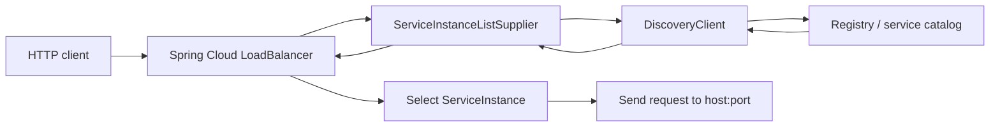

# Checking Changes in DiscoveryClient and HTTP Client Integration

When upgrading Spring Cloud from the 4.x line to 5.0.x, you need to check both the discovery contract and how HTTP clients route through the load balancer. Spring Cloud Commons 5.0 belongs to the 2025.1 release train, based on Spring Boot 4 and Spring Framework 7. Changes directly relevant to this lesson include JSpecify null-safety on public APIs, API version-based load balancing, and Spring HTTP Service Clients AutoConfiguration integration.

Two layers must be distinguished:

- **DiscoveryClient** queries service instances from Eureka, Consul, Zookeeper, or another discovery provider.
- **HTTP client integration** connects requests to LoadBalancer to pick an instance and send the request to a physical address.

`DiscoveryClient` does not automatically turn every `RestClient` or `WebClient` into a load-balanced client. The application still has to configure an appropriate builder, interceptor, filter function, or HTTP Service Client group.

This lesson belongs to the **Upgrades** chapter of **SPRING_CLOUD_CORE**. The focus is upgrading Spring Cloud Commons 4.3.x to 5.0.x, reviewing custom `DiscoveryClient` implementations, handling nullability, distinguishing blocking/reactive discovery, checking existing HTTP client integrations, and adopting Spring Framework 7's HTTP Service Clients.

## 1. Learning Objectives

After this lesson, learners can:

1. Select a Spring Cloud release train compatible with Spring Boot.
2. Identify the main changes in Spring Cloud Commons 5.0.
3. Explain the impact of JSpecify nullability on custom `DiscoveryClient` implementations and Kotlin.
4. Distinguish `DiscoveryClient` from `ReactiveDiscoveryClient`.
5. Check ordering when an application has multiple `DiscoveryClient` beans.
6. Understand how `DiscoveryClientHealthIndicator` probes discovery.
7. Describe the flow from `DiscoveryClient` to `ServiceInstanceListSupplier`, `LoadBalancer`, and the HTTP client.
8. Distinguish LoadBalancer integration for `RestTemplate`, `RestClient`, and `WebClient`.
9. Declare HTTP Service Clients using `@ImportHttpServices`.
10. Configure group `base-url` to enable or bypass load balancing.
11. Apply API version-based load balancing using `ServiceInstance` metadata.
12. Write tests for discovery contracts and actual requests.
13. Build an upgrade checklist reusable across multiple services.

## 2. Choosing Compatible Versions

Spring Cloud is released in release trains. You should not upgrade `spring-cloud-commons` alone to 5.0.x in an application that still uses release train 2025.0 or Spring Boot 3.5.x.

| Spring Cloud release train | Spring Cloud Commons | Spring Boot |
| --- | --- | --- |
| 2025.1.x (Oakwood) | 5.0.x | 4.0.x; supports 4.1.x from 2025.1.2 |
| 2025.0.x (Northfields) | 4.3.x | 3.5.x |
| 2024.0.x (Moorgate) | 4.2.x | 3.4.x |

At the time of writing, Spring Cloud documentation marks 2025.1.4 as the latest stable release train; 2026.0.0-RC2 is still a preview. When deploying to production, choose a stable release and re-verify the compatibility matrix.

A note during the transition period: Spring Cloud 2025.0.0 is incompatible with Spring Boot 4.0.1 and newer 4.0.x releases. Spring Cloud 2025.1.1 added support for Boot 4.0.1 and later; starting from 2025.1.2, the release train also supports Boot 4.1.x.

### 2.1. Upgrading by Release Train

If an application currently uses Spring Boot 3.5.x and Spring Cloud 2025.0.x, plan to upgrade Boot to generation 4 alongside Spring Cloud 2025.1.x. If you are not ready to move to Boot 4, keep using the release train compatible with Boot 3.5 instead of mixing 4.3.x and 5.0.x modules.

Maven BOM example:

```xml
<properties>
    <spring-boot.version>4.0.2</spring-boot.version>
    <spring-cloud.version>2025.1.4</spring-cloud.version>
</properties>

<dependencyManagement>
    <dependencies>
        <dependency>
            <groupId>org.springframework.cloud</groupId>
            <artifactId>spring-cloud-dependencies</artifactId>
            <version>2025.1.4</version>
            <type>pom</type>
            <scope>import</scope>
        </dependency>
    </dependencies>
</dependencyManagement>
```

This is an illustrative example of a compatible version set; use the Spring Boot and Spring Cloud patches approved by your organization. Do not specify separate versions for `spring-cloud-commons`, `spring-cloud-loadbalancer`, Eureka, or Consul when managed by the BOM.

### 2.2. Why You Should Not Upgrade Individual Modules Independently

Discovery client providers and LoadBalancer both depend on contracts in Spring Cloud Commons. If an application uses Commons 5.0 while the provider remains on an incompatible generation, failures can surface as `NoSuchMethodError`, `ClassNotFoundException`, annotation linkage errors, or mismatched auto-configurations.

Before running the application, inspect the dependency tree to confirm all Spring Cloud modules belong to the same release train. Pay special attention to starters with company-managed versions or transitive dependencies pulled in by other libraries.

## 3. Notable Changes in Spring Cloud Commons 5.0

Spring Cloud 2025.1 is a major release based on Spring Framework 7 and Spring Boot 4. Changes directly affecting `DiscoveryClient` and HTTP client integration include:

| Change | Impact on upgrade | What to check |
| --- | --- | --- |
| JSpecify null-safety on public APIs | Nullable/non-null contracts are expressed more explicitly | Custom implementations, Kotlin, and null checkers |
| LoadBalancer API versioning | Can filter instances by the requested API version | `API_VERSION` metadata and request version |
| LoadBalancer support for HTTP Service Clients AutoConfiguration | Can use HTTP interfaces by group instead of repeatedly building proxies/clients manually | `@ImportHttpServices`, group name, and `base-url` |
| Spring Framework 7 / Boot 4 | HTTP Service Registry and HTTP client config are integrated in the new foundation | Dependencies, properties, and custom client configuration |

These changes do not mean `DiscoveryClient` has been replaced or that every application must rewrite its HTTP clients. Core discovery APIs keep their previous roles; the new additions supply null-safety contracts and modern ways to integrate LoadBalancer with HTTP clients.

## 4. DiscoveryClient: API Contract to Review

`DiscoveryClient` is the blocking abstraction for querying service instances. Core methods include:

```java
public interface DiscoveryClient extends Ordered {

    String description();

    List<ServiceInstance> getInstances(String serviceId);

    List<String> getServices();

    default void probe() {
        getServices();
    }

    default int getOrder() {
        return 0;
    }
}
```

The snippet above summarizes the contract for illustration; check the Javadoc of the exact artifact you are using when implementing.

- `description()` returns a human-readable description, commonly used in health indicators.
- `getInstances(serviceId)` returns the instances of a service.
- `getServices()` returns the list of known service IDs.
- `probe()` checks whether the client can perform a discovery call. By default it calls `getServices()`, though implementations can override it with a lighter operation.
- `getOrder()` determines priority order when multiple `DiscoveryClient` beans exist.

### 4.1. Do Not Confuse Nullability with API Replacement

When upgrading to Commons 5.0, the focus of `DiscoveryClient` changes is null-safety annotations on public APIs, not renaming or replacing core query methods. Application code calling `getInstances`, `getServices`, or `probe` usually does not need to be rewritten solely because the release train moved from 4.x to 5.0.

However, custom implementations must adhere more strictly to explicit nullability contracts. In particular, do not return `null` instead of an empty list when a service has no instances.

### 4.2. Return an Empty List Instead of Null

Example of a compliant implementation:

```java
class WarehouseDiscoveryClient implements DiscoveryClient {

    private final Map<String, List<ServiceInstance>> instances;

    WarehouseDiscoveryClient(
            Map<String, List<ServiceInstance>> instances) {
        this.instances = instances;
    }

    @Override
    public String description() {
        return "Warehouse discovery";
    }

    @Override
    public List<ServiceInstance> getInstances(String serviceId) {
        return instances.getOrDefault(serviceId, List.of());
    }

    @Override
    public List<String> getServices() {
        return List.copyOf(instances.keySet());
    }
}
```

Do not write:

```java
@Override
public List<ServiceInstance> getInstances(String serviceId) {
    return instances.get(serviceId); // May return null
}
```

When no service or instances exist, return `List.of()` or an equivalent empty list. This keeps the contract stable for LoadBalancer and callers without requiring null checks on the list itself.

## 5. JSpecify Nullability and Custom Implementations

Spring Cloud Commons 5.0 adds JSpecify null-safety annotations to public APIs. JSpecify provides a way to describe nullable and non-null types at the package, class, or type-use level.

| Annotation | Meaning |
| --- | --- |
| `@NullMarked` | Parameters and return types within the marked scope default to non-null |
| `@Nullable` | The specific value may be null |
| `@NullUnmarked` | Reverts to unspecified nullability within that scope |

This is a type contract for compilers, IDEs, Kotlin, and static analysis. Annotations do not automatically inject runtime validation into every method. If an implementation returns `null` in violation of the contract, failures can appear as compile-time warnings, null-checker errors, or `NullPointerException` in callers.

### 5.1. Distinguishing DiscoveryClient from Nullable ServiceInstance Fields

Not every field in service discovery is guaranteed to have a value. For example, `ServiceInstance` has several optional fields:

| Method | How to handle |
| --- | --- |
| `getServiceId()` | Service ID must be present |
| `getHost()` | Host must be present |
| `getPort()` | Port must be present |
| `getUri()` | Instance URI must be present |
| `getInstanceId()` | May be null depending on provider |
| `getMetadata()` | May be null if provider does not supply metadata |
| `getScheme()` | May be null if scheme is not declared |

Distinguish an empty instance list from a nullable metadata field. `getInstances()` must still return a valid list; each instance inside that list may have certain optional metadata fields unset.

Example of null-safe metadata handling:

```java
String instanceId = serviceInstance.getInstanceId();

Map<String, String> metadata = serviceInstance.getMetadata();
String zone = metadata == null ? null : metadata.get("zone");
```

If the application uses Kotlin, recompile modules that implement or consume Spring Cloud APIs after updating the BOM. The Kotlin compiler can interpret JSpecify nullability more strictly than previously unannotated APIs.

### 5.2. Checking Static Analysis

If your build uses NullAway, Checker Framework, Error Prone, or another nullness checker, upgrading can surface new warnings at API boundaries. Do not disable all null analysis just to get a green build. Identify which values can genuinely be null, annotate with `@Nullable` in application code where needed, and uphold non-null contracts for required lists/parameters.

For a custom `DiscoveryClient`, verify at minimum:

1. `description()` never returns `null`.
2. `getInstances(serviceId)` never returns `null`.
3. `getServices()` never returns `null`.
4. `serviceId` is handled under a non-null contract.
5. Returned `ServiceInstance` objects have valid host, port, service ID, and URI.
6. Optional metadata is handled in a null-safe manner.

## 6. Blocking and Reactive DiscoveryClient

Spring Cloud Commons provides two separate abstractions:

| Interface | Model | Appropriate callers |
| --- | --- | --- |
| `DiscoveryClient` | Blocking, returns `List` | `RestClient`, `RestTemplate`, and imperative code |
| `ReactiveDiscoveryClient` | Reactive, returns `Flux` | WebFlux, `WebClient`, and reactive pipelines |

Do not call blocking discovery directly on a WebFlux event-loop thread. If an application is reactive, use the reactive discovery path supported by the provider. Conversely, imperative applications can use the blocking client.

Client groups can be enabled/disabled via properties:

```yaml
spring:
  cloud:
    discovery:
      blocking:
        enabled: true
      reactive:
        enabled: true
```

To disable discovery completely:

```yaml
spring:
  cloud:
    discovery:
      enabled: false
```

Before upgrading, check whether the application accidentally relies on the blocking client inside a reactive service. Having both implementations on the classpath does not mean callers can use them interchangeably without considering the execution model.

### 6.1. Is @EnableDiscoveryClient Still Required?

In modern Spring Cloud, `@EnableDiscoveryClient` is no longer required merely to activate discovery. When an appropriate discovery implementation is on the classpath, auto-configuration can register the client and service.

The annotation still exists and can be used for specific configuration, such as controlling auto-registration. Do not remove the annotation in bulk before checking whether the application uses `autoRegister=false` or specific import behavior triggered by the annotation.

If no service-registry-backed `DiscoveryClient` is on the classpath, Spring Cloud can fall back to `SimpleDiscoveryClient`, reading instances from `spring.cloud.discovery.client.simple.instances`. During dependency upgrades, if the application suddenly switches to a static instance list or stops seeing services, check whether the discovery provider starter was dropped from the dependency graph.

## 7. Multiple DiscoveryClients and Priority Order

An application can have multiple `DiscoveryClient` beans simultaneously—for instance, one reading services from Eureka and another reading services from static configuration.

`DiscoveryClient` extends `Ordered`. The default value is `0`; custom implementations can override `getOrder()` to specify the desired priority. Providers may also expose their own properties to configure order.

Example:

```java
@Override
public int getOrder() {
    return 10;
}
```

If an application has multiple discovery implementations, check:

- Which `DiscoveryClient` is selected first.
- Whether a composite client is created.
- Whether a service ID appears in multiple registries.
- Whether the same service returns different instances across providers.
- Whether discovery ordering changed when dependencies were upgraded.

Do not rely on arbitrary bean ordering or dependency declaration order in the build file. Configure order explicitly and write tests for service IDs backed by multiple instance sources.

## 8. Health Indicator and Discovery Query Cost

Spring Cloud Commons provides `DiscoveryClientHealthIndicator`. By default, the health indicator may call `getServices()` to retrieve the service list and include it in health details.

In systems with a large number of services, fetching the entire list can be expensive. You can switch it to call `probe()`:

```yaml
spring:
  cloud:
    discovery:
      client:
        health-indicator:
          use-services-query: false
```

When set, the health indicator calls `DiscoveryClient.probe()`. By default `probe()` calls `getServices()`, so if an implementation has a lighter ping/health operation, override `probe()`.

Example:

```java
@Override
public void probe() {
    registryClient.ping();
}
```

Only override when the provider has an operation that genuinely verifies connectivity. Do not return fake success just to make health checks faster.

## 9. DiscoveryClient Does Not Perform Load Balancing by Itself

A typical service-to-service call flow:



Responsibilities of each component:

- `DiscoveryClient` queries the list of instances.
- `DiscoveryClientServiceInstanceListSupplier` converts the discovery list into input for LoadBalancer.
- `ServiceInstanceListSupplier` can cache or filter by zone, hint, version, or health.
- LoadBalancer selects an instance.
- HTTP client integration sends the request to the instance's actual address.

Therefore, injecting `DiscoveryClient` and querying successfully does not prove that `RestClient` or `WebClient` requests are load-balanced. The HTTP client must be configured via the appropriate integration.

## 10. Checking Existing HTTP Client Integrations

Spring Cloud LoadBalancer supports common client types:

The examples below require `spring-cloud-starter-loadbalancer` alongside a suitable discovery provider. Having only `DiscoveryClient` on the classpath is not enough to turn an arbitrary HTTP client into a load-balanced client.

| HTTP client | Typical integration approach | Execution model |
| --- | --- | --- |
| `RestTemplate` | `@LoadBalanced RestTemplate` | Blocking |
| `RestClient` | `@LoadBalanced RestClient.Builder` | Blocking |
| `WebClient` | `@LoadBalanced WebClient.Builder` | Reactive |

### 10.1. RestTemplate

An older configuration may still use:

```java
@Bean
@LoadBalanced
RestTemplate restTemplate() {
    return new RestTemplate();
}
```

The URI must use the service ID instead of a physical hostname:

```java
restTemplate.getForObject(
    "http://inventory-service/api/items",
    ItemList.class
);
```

When the builder/interceptor is configured properly, LoadBalancer resolves the service ID to an instance's address. If you inject a `RestTemplate` without `@LoadBalanced`, the hostname `inventory-service` is treated via normal DNS/networking and bypasses Spring Cloud LoadBalancer.

### 10.2. RestClient

For newer imperative applications, you can use `RestClient`:

```java
@Bean
@LoadBalanced
RestClient.Builder loadBalancedRestClientBuilder(
        RestClientBuilderConfigurer configurer) {

    return configurer.configure(RestClient.builder());
}
```

`RestClientBuilderConfigurer` preserves Boot customizations applied to the builder, such as message converters and observability. When both a load-balanced builder and a standard builder exist, use the `@LoadBalanced` qualifier to inject the right bean.

Example:

```java
@Service
class InventoryGateway {

    private final RestClient restClient;

    InventoryGateway(
            @LoadBalanced RestClient.Builder builder) {
        this.restClient = builder.build();
    }

    ItemList findItems() {
        return restClient.get()
            .uri("http://inventory-service/api/items")
            .retrieve()
            .body(ItemList.class);
    }
}
```

### 10.3. WebClient

For reactive clients:

```java
@Bean
@LoadBalanced
WebClient.Builder loadBalancedWebClientBuilder() {
    return WebClient.builder();
}
```

Then use the service ID in the URI:

```java
Mono<ItemList> findItems(WebClient.Builder builder) {
    return builder.build()
        .get()
        .uri("http://inventory-service/api/items")
        .retrieve()
        .bodyToMono(ItemList.class);
}
```

Ensure the application uses the reactive LoadBalancer integration and does not block the event loop with blocking operations at the discovery or service call layer.

## 11. HTTP Service Clients in Spring Framework 7

Spring Framework 6 already allowed defining HTTP services via Java interfaces annotated with `@HttpExchange`, `@GetExchange`, `@PostExchange`, and related annotations. Spring Framework 7 adds a registry/configuration layer to declare HTTP service groups, automatically build client proxies, and register proxies as beans.

Example interface:

```java
@HttpExchange("/api/items")
public interface InventoryHttpService {

    @GetExchange("/{id}")
    Item findById(@PathVariable String id);

    @PostExchange
    Item create(@RequestBody CreateItemRequest request);
}
```

Instead of manually creating `HttpServiceProxyFactory` and each proxy bean, the application can declare a group:

```java
@SpringBootApplication
@ImportHttpServices(
    group = "inventory-service",
    types = InventoryHttpService.class
)
public class InventoryGatewayApplication {
}
```

`@ImportHttpServices` belongs to Spring Framework 7. A group bundles HTTP service interfaces sharing configuration and HTTP client infrastructure. By default, a group uses `RestClient`; you can select `WebClient` via the `clientType` attribute when a reactive client is needed.

### 11.1. LoadBalancer Integration Starting in Spring Cloud 5.0

Starting with Spring Cloud LoadBalancer 5.0.0, HTTP Service Clients AutoConfiguration integrates via:

- `LoadBalancerRestClientHttpServiceGroupConfigurer` for blocking clients.
- `LoadBalancerWebClientHttpServiceGroupConfigurer` for reactive clients.

These configurers attach LoadBalancer components to the group's builder when the group is configured to use service discovery. Applications can use HTTP interfaces as contracts while still leveraging service discovery and load balancing.

This is Spring Cloud LoadBalancer's integration with HTTP Service Client groups. `DiscoveryClient` remains responsible for providing instances; the HTTP Service Client registry only manages proxies and client configuration.

## 12. Important Rules for base-url

For an HTTP Service Client group, `spring.http.serviceclient.<groupName>.base-url` determines whether requests are load-balanced.

| `base-url` | Behavior |
| --- | --- |
| Not configured (`null`) | Spring Cloud constructs a URL from the group's service ID and adds LoadBalancer integration |
| `lb://inventory-service` | Uses service ID and LoadBalancer |
| `lb://inventory-service/api` | Uses service ID, preserves path, and uses LoadBalancer |
| `http://inventory-service` | Calls URL directly; no LoadBalancer integration added |
| `https://inventory.example.com` | Calls fixed URL; does not use service discovery to pick instances |

Load-balanced configuration example:

```yaml
spring:
  http:
    serviceclient:
      inventory-service:
        base-url: lb://inventory-service
        connect-timeout: 2s
        read-timeout: 5s
```

If `base-url` is omitted, a group named `inventory-service` maps to a URL based on the service ID, defaulting to the HTTP scheme. When LoadBalancer picks a `ServiceInstance` marked secure, the scheme can be switched to HTTPS.

If you specify an `http://` or `https://` URL directly, Spring Cloud does not add LoadBalancer integration for that group. This is an easy migration mistake to hit: the application declares `@ImportHttpServices`, yet still calls a fixed host directly because an old base URL setting remained.

### 12.1. Matching Group Name to Service ID

If the group name is `inventory-service`, LoadBalancer uses that exact name as the service ID when the base URL is omitted or uses the `lb` scheme.

Confirm that the group name matches the ID returned by the registry. If the registry registers the service as `inventory`, but the group is named `inventory-service`, discovery may return an empty list even though the client proxy is created successfully.

### 12.2. Separating Discovery Clients from Fixed-URL Clients

Do not share one group for both requests needing service discovery and requests calling a fixed public API. Create separate groups so timeouts, base URLs, authentication, and LoadBalancer behavior can be configured independently.

Example:

```yaml
spring:
  http:
    serviceclient:
      inventory-service:
        base-url: lb://inventory-service
        read-timeout: 3s
      tax-provider:
        base-url: https://api.tax-provider.example
        read-timeout: 8s
```

`inventory-service` goes through discovery/load balancing; `tax-provider` calls a fixed URL. Separating groups keeps configuration clear and avoids accidentally routing external APIs through service discovery.

## 13. Shared HTTP Client Configuration in Spring Boot 4

Spring Boot 4 provides properties to configure HTTP clients globally and per group.

Example:

```yaml
spring:
  http:
    clients:
      connect-timeout: 1s
      read-timeout: 4s
    serviceclient:
      inventory-service:
        base-url: lb://inventory-service
        connect-timeout: 2s
        read-timeout: 5s
```

Properties under `spring.http.clients` apply to clients globally; properties under `spring.http.serviceclient.<group>` override per group. Check the timeouts of every client when moving from manually configured `RestTemplate`/`RestClient` instances to HTTP Service Client AutoConfiguration.

Some applications call `RestClient.create()` or `WebClient.create()` directly. Doing so can bypass builders customized by Boot and the framework. When you need observability, SSL bundles, connectors, timeouts, or LoadBalancer integration, prefer builders/configurers managed by auto-configuration.

## 14. API Version-Based Load Balancing

Spring Cloud Commons 5.0 adds API version-based load balancing. This feature selects instances whose metadata matches the API version requested by the caller.

There are two suppliers:

- `BlockingApiVersionServiceInstanceListSupplier` for `RestClient`.
- `ReactiveApiVersionServiceInstanceListSupplier` for `WebClient`.

You can enable the built-in configuration:

```yaml
spring:
  cloud:
    loadbalancer:
      configurations: api-version
```

Or declare a custom `ServiceInstanceListSupplier` for the specific service ID to which it applies.

### 14.1. API_VERSION Metadata

When API versioning is enabled, LoadBalancer looks for instances with an `API_VERSION` key in their metadata map matching the version extracted from the request.

Example instance metadata:

| Instance | Metadata |
| --- | --- |
| `catalog-v1` | `API_VERSION=1.0` |
| `catalog-v2` | `API_VERSION=2.0` |
| `catalog-v3` | `API_VERSION=3.0` |

Requests can pass the version via a header, query parameter, path segment, or media type parameter. Example header configuration:

```yaml
spring:
  cloud:
    loadbalancer:
      clients:
        catalog:
          configurations: api-version
          api-version:
            header: X-Api-Version
            default: "2.0"
            required: true
```

In property-key form, the configuration above corresponds to `spring.cloud.loadbalancer.clients.catalog.configurations` and `spring.cloud.loadbalancer.clients.catalog.api-version.header`. The `default` and `required` settings sit in the same `api-version` group for client `catalog`.

When a request sends `X-Api-Version: 2.0`, the supplier keeps only instances with `API_VERSION=2.0` metadata. If no matching instance exists, the returned list is empty by default. You can enable `fallback-to-available-instances` if application policy allows routing requests to another version.

Do not enable fallback arbitrarily. If a client requests version 2.0 while only version 1.0 instances exist, returning any arbitrary instance can cause contract or data errors. Choose fallback behavior based on API backward compatibility.

### 14.2. Combining DiscoveryClient and API Versioning

`DiscoveryClient` only fetches the instance list. The LoadBalancer supplier performs the API version filtering step. Therefore, providers must publish `API_VERSION` metadata consistently for every instance.

When metadata is missing or inconsistent:

- Instances may be filtered out when requests require a specific version.
- Some instances may still appear if fallback is enabled.
- Caching must be checked so stale metadata is not used after a rollout.

## 15. Caching and Supplier Ordering During Upgrades

LoadBalancer can cache the `ServiceInstance` list. Some discovery providers also maintain their own cache. If both layers cache, stale instance data can linger longer than expected.

Spring Cloud documentation recommends placing `CachingServiceInstanceListSupplier` after the supplier fetching instances from the network—such as `DiscoveryClientServiceInstanceListSupplier`—and before request-filtering suppliers.

Some providers like Eureka already have their own discovery cache. If the provider already caches, consider disabling LoadBalancer caching to avoid double caching.

When configuring suppliers manually, verify:

1. The first supplier retrieves instances from `DiscoveryClient`.
2. The caching supplier sits immediately after the network data source when used.
3. Suppliers filtering by zone, hint, or API version sit after the cache appropriately.
4. Two cache/health-check suppliers are not combined in ways discouraged by the documentation.
5. The TTL is short enough to pick up instance changes after deployments without generating excessive registry requests.

## 16. Special Note When Upgrading Spring Cloud Netflix

Spring Cloud Netflix 5.0 removes `RestTemplate` support inside the Netflix module. This is a change in Spring Cloud Netflix; it does not mean Spring Cloud Commons LoadBalancer also dropped all `RestTemplate` integration.

Apart from Netflix's specific change, Spring Framework 7 also marks `RestTemplate` as deprecated and recommends `RestClient` for imperative applications. Deprecated does not mean the API was removed in Framework 7; distinguish framework-level deprecation warnings from Spring Cloud Netflix removing its own module-specific integration.

Distinguish:

- Spring Cloud Commons LoadBalancer still has integration for `RestTemplate`.
- Spring Cloud LoadBalancer supports `RestClient` and `WebClient`.
- Spring Cloud Netflix 5.0 removed its module-specific `RestTemplate` support.

If an application depends on a specific Netflix integration with `RestTemplate`, review the Spring Cloud Netflix release notes and plan to migrate to `RestClient`/`WebClient` or integrations supported by Spring Cloud Commons. Do not assume that merely keeping the `RestTemplate` dependency preserves all legacy Netflix behaviors.

## 17. Step-by-Step Upgrade Process

You can proceed in the following order:

1. Record the currently running Spring Boot, Spring Cloud release train, Commons, LoadBalancer, and discovery provider versions.
2. Check the compatibility matrix and select a compatible release train.
3. Upgrade the BOM, Boot, and Spring Cloud modules together.
4. Run a compile to surface changes from Framework 7, Boot 4, and JSpecify.
5. Audit custom `DiscoveryClient` and `ReactiveDiscoveryClient` implementations.
6. Ensure returned lists are non-null; handle nullable fields on `ServiceInstance`.
7. Check discovery client order if multiple providers exist.
8. Verify blocking/reactive clients are injected according to the right execution model.
9. Review every `RestTemplate`/`RestClient`/`WebClient` builder to see whether `@LoadBalanced` is needed.
10. If migrating to HTTP Service Clients, create groups and declare `@ImportHttpServices`.
11. Check `base-url`: leave empty or use `lb://` if load balancing is needed; use `http(s)://` URLs for direct calls.
12. Verify API version metadata and suppliers if version-based routing is enabled.
13. Check cache/TTL and the discovery health indicator.
14. Run integration tests with at least two simulated instances to prove instance selection.
15. Inspect the dependency tree and confirm no Spring Cloud module is out of alignment with the release train.

Do not change all HTTP clients at once if the application has many services. You can upgrade `DiscoveryClient` and LoadBalancer first, then migrate HTTP client groups incrementally to HTTP Service Clients so root causes are easy to isolate if issues arise.

## 18. Testing the DiscoveryClient Contract

A custom `DiscoveryClient` should have tests confirming its basic contract:

```java
@Test
void returnsEmptyListWhenServiceHasNoInstances() {
    List<ServiceInstance> instances =
        discoveryClient.getInstances("missing-service");

    assertThat(instances).isNotNull().isEmpty();
}

@Test
void returnsKnownServiceIds() {
    assertThat(discoveryClient.getServices())
        .contains("inventory-service");
}

@Test
void probeDoesNotThrowWhenRegistryIsReachable() {
    assertThatCode(discoveryClient::probe)
        .doesNotThrowAnyException();
}
```

If overriding `probe()`, tests should confirm the lightweight health check actually reaches the registry. If not overridden, default tests still verify `getServices()` works.

For `ServiceInstance`, add tests where metadata or instance ID is absent to ensure consumers do not assume every optional field is always populated.

## 19. Testing HTTP Client Integration

An upgrade test should verify that requests actually route through LoadBalancer rather than only checking that a client proxy is created.

Strategy:

1. Use a mock discovery client returning two `ServiceInstance` objects with different hosts/ports.
2. Run a mock HTTP server at each instance.
3. Call the client using the service ID.
4. Confirm requests reach a valid instance.
5. Change the instance list or metadata and verify cache/selection behavior.
6. Test a direct URL to confirm it bypasses LoadBalancer.
7. Test `lb://serviceId` and confirm requests resolve via discovery.

With HTTP Service Clients, test all three `base-url` cases:

| Case | Assertion |
| --- | --- |
| Not configured | Base URL is derived from group/service ID and requests are load-balanced |
| `lb://catalog` | Requests select instances from `DiscoveryClient` |
| `http://catalog` | Requests call the URL directly without using LoadBalancer |

If you only assert HTTP 200 from a mock server, you can miss cases where the client accidentally calls a fixed server. Verify the host/port or request logs on each mock instance.

### 19.1. Testing API Version-Based Selection

Create instances with different `API_VERSION` metadata. Send requests with a specific version header and confirm only matching instances are selected. Add a test with no matching version to verify empty-list or fallback behavior as configured.

## 20. Post-Upgrade Troubleshooting

| Symptom | Possible cause | How to check |
| --- | --- | --- |
| Custom `DiscoveryClient` fails to compile with null checker | New JSpecify contract exposed potentially null values | Check return types, parameters, and `@Nullable` annotations |
| LoadBalancer finds no instances | Service ID does not match registry or `getInstances` returns an empty list | Log service ID and `DiscoveryClient` results |
| HTTP client resolves hostname via normal DNS | Builder lacks LoadBalancer integration | Check `@LoadBalanced` or HTTP service group configurer |
| HTTP Service Client does not load-balance | `base-url` is a direct `http://` or `https://` URL | Change to `lb://serviceId` or omit `base-url` |
| HTTP Service Client returns no-instance error | Group name differs from service ID or discovery has no instances | Check `@ImportHttpServices` and registry metadata |
| Reactive request gets blocked | Blocking `DiscoveryClient` used on WebFlux path | Use `ReactiveDiscoveryClient` or offload blocking work to an appropriate scheduler |
| Slow health checks | Indicator calls `getServices()` on a large registry | Consider `use-services-query=false` and a lightweight `probe()` override |
| Wrong `DiscoveryClient` chosen | Multiple implementations with unclear ordering | Check `getOrder()` and provider order properties |
| API version finds no instances | Missing/wrong `API_VERSION` metadata or mismatched request version | Check metadata, headers, and supplier |
| Old instances continue receiving calls | Discovery/LoadBalancer cache TTL has not expired | Check provider cache, LoadBalancer cache, and propagation delay |
| `RestTemplate` integration disappears after Netflix upgrade | Spring Cloud Netflix 5.0 removed its module's `RestTemplate` support | Check Netflix release notes and migrate the client accordingly |
| Build fails due to mixing Commons 4.x and 5.x | Dependency versions out of sync with the release train | Check dependency tree and BOM |

## 21. Pre-Completion Upgrade Checklist

- [ ] Spring Boot and the Spring Cloud release train are in the compatibility matrix.
- [ ] Spring Cloud modules are managed by the same BOM.
- [ ] Custom `DiscoveryClient` complies with JSpecify nullability.
- [ ] `getInstances()` and `getServices()` never return `null`.
- [ ] Optional `ServiceInstance` fields are handled in a null-safe manner.
- [ ] Blocking and reactive discovery match the application's execution model.
- [ ] Ordering across multiple `DiscoveryClient` beans is defined.
- [ ] Health indicator does not query the full service list unnecessarily.
- [ ] HTTP client builders needing load balancing have integration attached.
- [ ] HTTP Service Client group names match service IDs.
- [ ] `base-url` does not accidentally specify a fixed URL when load balancing is intended.
- [ ] API version metadata is consistent across instances.
- [ ] Cache TTL matches the rate of registry changes.
- [ ] Tests prove requests reach the selected instance.
- [ ] Legacy Netflix integrations have been reviewed against release notes.

## 22. Practice Exercises

### Exercise 1. Fix a Custom DiscoveryClient

A custom `DiscoveryClient` returns `null` when a service is not found. Update the implementation to satisfy the non-null contract, and add tests for a nonexistent service and for `getServices()`.

### Exercise 2. Choose Blocking or Reactive Discovery

A WebFlux service injects `DiscoveryClient` and calls `getInstances()` directly inside a request handler. Explain the risk and migrate to the appropriate reactive discovery path. Write a test ensuring the handler returns reactive results without performing blocking calls on the event loop.

### Exercise 3. Migrate to HTTP Service Clients

An application has an `InventoryClient` interface and manually constructs `HttpServiceProxyFactory`. Migrate it to `@ImportHttpServices(group = "inventory-service", ...)`, configure `lb://inventory-service`, and test that requests are load-balanced.

### Exercise 4. Spot a base-url Disabling Load Balancing

A client sets `spring.http.serviceclient.catalog.base-url=http://catalog`. Explain why LoadBalancer is not applied and fix the configuration to use service discovery.

### Exercise 5. API Version-Based Routing

The registry has two instances, `catalog` v1 and `catalog` v2, with `API_VERSION` metadata. Enable the API version supplier, configure the `X-Api-Version` header, and test that a version 2.0 request selects only the v2 instance. Add a test for when no matching instance exists.

### Exercise 6. Audit a Netflix Upgrade

A service uses `RestTemplate` integration from Spring Cloud Netflix. Identify which integration was removed in 5.0, distinguish it from Commons LoadBalancer `RestTemplate` support, and propose a migration path.

## 23. Self-Check Questions

1. Which Spring Boot generation is Spring Cloud 2025.1.x compatible with?
2. What null-safety changes did Spring Cloud Commons 5.0 add?
3. Why should a custom `DiscoveryClient` return an empty list instead of `null`?
4. Under what circumstances can `ServiceInstance.getMetadata()` and `getInstanceId()` be `null`?
5. How does `DiscoveryClient` differ from `ReactiveDiscoveryClient`?
6. What does `probe()` do by default, and when should it be overridden?
7. How does `getOrder()` affect behavior when multiple `DiscoveryClient` beans exist?
8. How do the responsibilities of `DiscoveryClient` and LoadBalancer differ?
9. How does configuring LoadBalancer for `RestClient` differ from `WebClient`?
10. What repetitive configuration do Spring Framework 7 HTTP Service Clients eliminate?
11. What does `@ImportHttpServices` use `group` for?
12. Why can a `base-url` without the `lb` scheme cause requests to bypass LoadBalancer?
13. When is the group name used as the service ID?
14. Where does API version-based load balancing read the version from?
15. At which step is `API_VERSION` metadata used?
16. Why should caching be checked when upgrading a discovery provider?
17. Does Spring Cloud Netflix dropping `RestTemplate` support mean Commons LoadBalancer dropped `RestTemplate`?
18. Which tests prove an HTTP request is actually load-balanced?

## 24. References

- [Spring Cloud 2025.1 Release Notes](https://github.com/spring-cloud/spring-cloud-release/wiki/Spring-Cloud-2025.1-Release-Notes): breaking changes in the 2025.1 release train and changes in Spring Cloud Commons.
- [Spring Cloud Compatibility Matrix](https://spring.io/projects/spring-cloud/): mapping between Spring Cloud release trains and Spring Boot.
- [Spring Cloud Commons — Common Abstractions](https://docs.spring.io/spring-cloud-commons/reference/spring-cloud-commons/common-abstractions.html): `DiscoveryClient`, `ReactiveDiscoveryClient`, health indicator, `SimpleDiscoveryClient`, and discovery ordering.
- [Spring Cloud LoadBalancer](https://docs.spring.io/spring-cloud-commons/reference/spring-cloud-commons/loadbalancer.html): `RestTemplate`/`RestClient`/`WebClient` integration, HTTP Service Clients, `base-url`, API versioning, and caching.
- [Spring Cloud Commons PR #1594 — Initial support for JSpecify](https://github.com/spring-cloud/spring-cloud-commons/pull/1594): nullability changes on public APIs.
- [Spring Cloud Commons PR #1582 — LoadBalancer API versioning](https://github.com/spring-cloud/spring-cloud-commons/pull/1582): API version-based instance selection implementation.
- [Spring Cloud Commons PR #1491 — LoadBalancer integration for Spring Interface Clients](https://github.com/spring-cloud/spring-cloud-commons/pull/1491): configurers for `RestClient` and `WebClient` HTTP service groups.
- [Spring Framework — HTTP Service Client Enhancements](https://spring.io/blog/2025/09/23/http-service-client-enhancements/): `@ImportHttpServices`, HTTP service groups, and client registry in Framework 7.
- [Spring Boot 4.0 Migration Guide](https://github.com/spring-projects/spring-boot/wiki/Spring-Boot-4.0-Migration-Guide): platform changes, JSpecify nullability, and upgrade requirements.
- [Spring Cloud Netflix 5.0 Release Notes](https://spring.io/blog/2025/11/25/spring-cloud-2025-1-0-aka-oakwood-has-been-released/): note on removing `RestTemplate` support in Spring Cloud Netflix.

## Key Takeaways

When upgrading to Spring Cloud Commons 5.0, check JSpecify nullability on custom `DiscoveryClient` implementations, distinguish blocking vs. reactive discovery, and ensure lists never return `null`. For HTTP clients, `DiscoveryClient` only supplies instances; LoadBalancer selects the instance, and the HTTP client integration routes the request. Spring Cloud 5.0 adds integration with Framework 7's HTTP Service Clients: the group name serves as the service ID, an omitted `base-url` or `lb://` scheme enables load balancing, while a direct `http(s)://` URL calls a fixed target. Test the discovery contract, instance selection, and actual requests before completing the upgrade.
