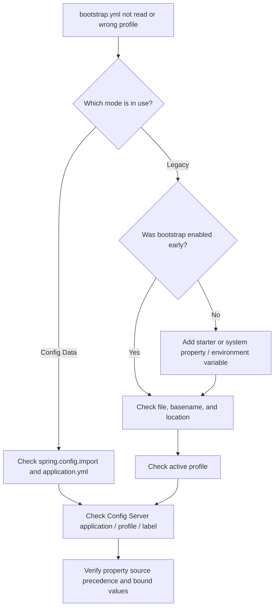

# Bootstrap.yml Not Read or Wrong Profile Read

When a Spring Cloud application does not receive the expected configuration, an easy-to-make misleading assumption is that Spring Boot always reads `bootstrap.yml` automatically. Since Spring Boot 2.4, Spring Cloud Config defaults to using Config Data via `spring.config.import`. The legacy bootstrap context mechanism still exists for compatibility, but must be explicitly enabled via a starter or startup property. Therefore, a `bootstrap.yml` file can be syntactically valid yet never loaded.

Even when the bootstrap context is active, the application may still read the wrong profile, the wrong application name, or the wrong Config Server label. A `bootstrap-prod.yml` file is only selected when the `prod` profile has been activated at the right time and in the right context. Furthermore, remote property sources from Config Server and local `bootstrap.yml` files have different precedence levels; having a file read does not mean every value in it will win.

This lesson belongs to the **Troubleshooting** chapter of **SPRING_CLOUD_CORE**. The content focuses on determining whether an application uses legacy bootstrap or Config Data, enabling and locating bootstrap files, handling profiles, querying Config Server, analyzing property precedence, reading logs, and testing the configuration loading process.

## 1. Learning Objectives

After this lesson, you can:

- Distinguish the legacy bootstrap context from Spring Boot Config Data.
- Explain why `bootstrap.yml` is not read by default in modern Config Server integration.
- Enable legacy bootstrap at the right time using a dependency or system property/environment variable.
- Distinguish `spring-cloud-starter-config` and `spring-cloud-starter-bootstrap`.
- Identify the name, location, and profile-specific variants of bootstrap files.
- Use `spring.cloud.bootstrap.location` and `spring.cloud.bootstrap.additional-location` for their intended purpose.
- Distinguish `bootstrap-prod.yml` from `application-prod.yml`.
- Determine the actual profile used by the application and Config Server.
- Inspect `spring.application.name`, `spring.cloud.config.name`, `profile`, and `label`.
- Understand precedence order among local bootstrap, application config, and remote property sources.
- Diagnose cases where Config Server returns default configuration or the wrong environment.
- Distinguish file-loading errors from Config Server connection errors.
- Interpret Config Data and Config Client logs.
- Build tests for legacy bootstrap and Config Data imports.
- Plan a migration from legacy bootstrap to Config Data.

## 2. First: Which Configuration Loading Mechanism Is the Application Using?

This is the most important triage step. The two mechanisms load files and connect to Config Server differently.

| Mechanism | Activation | Related Configuration Files | Config Server |
| --- | --- | --- | --- |
| Legacy bootstrap | `spring-cloud-starter-bootstrap` or `spring.cloud.bootstrap.enabled=true` | `bootstrap.yml`, `bootstrap-{profile}.yml` | Reads bootstrap settings such as `spring.cloud.config.uri` |
| Spring Boot Config Data | `spring.config.import=configserver:...` | `application.yml`, `application-{profile}.yml` | Imported directly via the Config Data API |

Spring Boot 2.4 introduced the Config Data API, and Spring Cloud Config now uses this as the default integration approach. With this approach, `bootstrap.yml` is not needed. The legacy bootstrap mechanism is only used when the application explicitly enables it.

Do not start fixing indentation or renaming files before determining the mode. If the application is using Config Data, editing `bootstrap.yml` will not solve the problem.

## 3. Legacy Bootstrap Is Not Enabled by Default

With Spring Boot 2.4 or later, if an application only has `spring-cloud-starter-config` and does not declare `spring.config.import`, `bootstrap.yml` is not automatically read via the legacy mechanism.

There are two ways to enable bootstrap.

### 3.1. Adding spring-cloud-starter-bootstrap

With Maven:

```xml
<dependency>
    <groupId>org.springframework.cloud</groupId>
    <artifactId>spring-cloud-starter-bootstrap</artifactId>
</dependency>
```

This starter enables the legacy bootstrap context. The application still needs the Config Client dependency if it wants to fetch configuration from Spring Cloud Config Server:

```xml
<dependency>
    <groupId>org.springframework.cloud</groupId>
    <artifactId>spring-cloud-starter-config</artifactId>
</dependency>
```

The two dependencies have different purposes:

- `spring-cloud-starter-config` provides the ability to connect to Config Server.
- `spring-cloud-starter-bootstrap` activates the legacy bootstrap context.

Do not confuse having Config Client on the classpath with having legacy bootstrap enabled.

### 3.2. Enabling via System Property or Environment Variable

You can enable it with a JVM system property:

```bash
java -Dspring.cloud.bootstrap.enabled=true -jar app.jar
```

Or an environment variable:

```bash
export SPRING_CLOUD_BOOTSTRAP_ENABLED=true
java -jar app.jar
```

In Windows PowerShell:

```powershell
$env:SPRING_CLOUD_BOOTSTRAP_ENABLED = "true"
java -jar app.jar
```

Key point: the property enabling bootstrap must exist before the bootstrap context is created. Putting `spring.cloud.bootstrap.enabled=true` inside `bootstrap.yml` itself will not work, because that file is only read after the bootstrap mechanism has already been activated.

Do not rely on an application argument `--spring.cloud.bootstrap.enabled=true` after the JAR name to activate the legacy loader if your version requires a system property or environment variable. Use `-D` before `-jar` or an environment variable to ensure the property is present early enough.

### 3.3. Inspecting Actual Dependencies

If using Maven, check the dependency tree:

```bash
mvn dependency:tree
```

Verify:

- Is `spring-cloud-starter-config` in the runtime dependencies?
- Is `spring-cloud-starter-bootstrap` added when using legacy mode?
- Are any dependency exclusions removing the starter or related modules?
- Are Spring Cloud dependencies managed by the right BOM/release train?

If using Gradle, check the runtime classpath:

```bash
./gradlew dependencies --configuration runtimeClasspath
```

Do not add an arbitrary starter version just to work around an error. Use the Spring Cloud BOM compatible with your application's Spring Boot version.

## 4. Minimal Legacy Bootstrap Configuration

Once legacy bootstrap is enabled, `bootstrap.yml` usually resides in `src/main/resources` so it is packaged onto the application's classpath.

Example:

```yaml
spring:
  application:
    name: inventory-service
  profiles:
    active: prod
  cloud:
    config:
      uri: https://config.internal.example
      label: main
```

Roles of these properties:

- `spring.application.name`: application name used to request service-specific configuration.
- `spring.profiles.active`: profile for which configuration is requested.
- `spring.cloud.config.uri`: Config Server address.
- `spring.cloud.config.label`: branch, tag, or commit used as the configuration label.

If Config Server uses authentication, credentials must be supplied via an appropriate protected configuration source. Do not write production passwords or tokens directly into committed files.

### 4.1. Typical Directory Structure

```text
src/
└── main/
    └── resources/
        ├── bootstrap.yml
        ├── bootstrap-prod.yml
        └── application.yml
```

`bootstrap.yml` holds information needed during the bootstrap phase. `bootstrap-prod.yml` holds bootstrap configuration specific to the `prod` profile. `application.yml` holds configuration for the main application context.

Do not place production files in `src/test/resources` if you want them included in the actual runtime artifact. The test directory is only added to the test classpath.

### 4.2. Verifying the File Is Packaged

After building, inspect the JAR:

```bash
jar tf target/inventory-service.jar
```

In an executable Spring Boot JAR, resource files normally appear under:

```text
BOOT-INF/classes/bootstrap.yml
BOOT-INF/classes/bootstrap-prod.yml
```

If a file exists in source yet is missing from the JAR, check resource filtering, build profiles, packaging configuration, or file location. If the file is inside a subdirectory, it does not automatically count as being at the classpath root.

## 5. Wrong Bootstrap File Name or Location

The bootstrap context uses its own naming convention. By default, the basename is `bootstrap`, not `application`.

### 5.1. Default File Names

Commonly used names:

- `bootstrap.yml`
- `bootstrap.properties`
- `bootstrap-{profile}.yml`
- `bootstrap-{profile}.properties`

Example for the `staging` profile:

```text
bootstrap.yml
bootstrap-staging.yml
```

The profile name in the file must match the actual profile. `bootstrap-stage.yml` will not be picked up if the active profile is `staging`.

### 5.2. Changing the Basename

The basename can be changed with:

`spring.cloud.bootstrap.name`

Example:

```bash
java -Dspring.cloud.bootstrap.name=service-bootstrap -Dspring.cloud.bootstrap.enabled=true -jar app.jar
```

The bootstrap loader then searches for files matching the `service-bootstrap` basename and corresponding profile variants.

If the basename has been changed while only `bootstrap.yml` exists, the old file will no longer match the name the loader looks for.

### 5.3. Changing the Location

Two properties must be distinguished:

| Property | Effect |
| --- | --- |
| `spring.cloud.bootstrap.location` | Replaces the default bootstrap locations |
| `spring.cloud.bootstrap.additional-location` | Adds locations in addition to the default locations |

Example:

```bash
java -Dspring.cloud.bootstrap.enabled=true -Dspring.cloud.bootstrap.location=file:/etc/inventory/ -jar app.jar
```

The external directory must contain a file with the matching basename, such as `/etc/inventory/bootstrap.yml`.

If you want to add a directory while keeping the default locations, use:

```bash
java -Dspring.cloud.bootstrap.enabled=true -Dspring.cloud.bootstrap.additional-location=file:/etc/inventory-extra/ -jar app.jar
```

These properties must be supplied early enough for the bootstrap context to use when searching for files.

### 5.4. Do Not Confuse Bootstrap Location with Config Location

`spring.cloud.bootstrap.location` controls file locations for legacy bootstrap. `spring.config.location` controls Spring Boot's Config Data locations.

If an application uses legacy bootstrap and you only change `spring.config.location`, that does not automatically change where `bootstrap.yml` is searched. Conversely, in Config Data mode, `spring.cloud.bootstrap.location` is not the way to add `application.yml` files.

## 6. Profile-Specific Bootstrap Files

Once legacy bootstrap is active, Spring Cloud can load profile-specific files:

```text
bootstrap.yml
bootstrap-dev.yml
bootstrap-staging.yml
bootstrap-prod.yml
```

If the active profile is `prod`, `bootstrap-prod.yml` can be loaded alongside the base bootstrap file.

### 6.1. Activating the Profile Early Enough

If Config Server needs a specific profile right during the bootstrap phase, set the profile in `bootstrap.yml`:

```yaml
spring:
  application:
    name: inventory-service
  profiles:
    active: prod
  cloud:
    config:
      uri: https://config.internal.example
```

Or supply the profile from the environment:

```bash
export SPRING_PROFILES_ACTIVE=prod
java -Dspring.cloud.bootstrap.enabled=true -jar app.jar
```

In Windows PowerShell:

```powershell
$env:SPRING_PROFILES_ACTIVE = "prod"
java -Dspring.cloud.bootstrap.enabled=true -jar app.jar
```

If the profile is only declared in a source read after the Config Client has already sent its initial request, that initial request may use the default profile.

### 6.2. Checking the Exact Profile Name

The following names are distinct:

- `prod`
- `production`
- `prod-us`
- `prod,region-a`

Spring does not automatically infer that `production` equals `prod`. Check the exact value of `Environment.getActiveProfiles()`.

For example, if the active profile is `prod`, the file looked for is `bootstrap-prod.yml`. `bootstrap-production.yml` will not be selected just because its name has a similar meaning.

### 6.3. Multiple Profiles and Override Order

If multiple profiles are activated, multiple profile-specific property sources can be loaded together. Profile order determines the final value when multiple files declare the same key.

Example:

```bash
java -Dspring.profiles.active=prod,region-a -jar app.jar
```

In that case, inspect both `bootstrap-prod.yml` and `bootstrap-region-a.yml`. Do not assume which file wins without verifying profile order and the configuration locations in use.

### 6.4. Do Not Set spring.profiles.active in a Profile-Specific File

Do not use `spring.profiles.active` inside `bootstrap-prod.yml` to activate another profile. Profile-specific configuration is selected based on already active profiles; using it to alter active profiles creates a circular dependency or is rejected by Spring Boot during Config Data processing.

Place startup profiles in `bootstrap.yml` (legacy), a non-profile `application.yml`, environment variables, or system properties.

## 7. Distinguishing bootstrap-prod.yml and application-prod.yml

The two files have similar names but belong to two different loading mechanisms.

| File | Loader | Purpose |
| --- | --- | --- |
| `bootstrap-prod.yml` | Legacy bootstrap | Bootstrap configuration specific to the `prod` profile |
| `bootstrap.yml` | Legacy bootstrap | Base configuration for the bootstrap context |
| `application-prod.yml` | Spring Boot Config Data | Application configuration for the `prod` profile |
| `application.yml` | Spring Boot Config Data | Base configuration for the main application context |

If the application uses Config Data, `application-prod.yml` can be read without legacy bootstrap. Conversely, you should not rename `application-prod.yml` to `bootstrap-prod.yml` unless legacy bootstrap was intentionally chosen and configuration is genuinely needed during the bootstrap phase.

Config Data example:

```text
src/main/resources/
├── application.yml
└── application-prod.yml
```

Legacy bootstrap example:

```text
src/main/resources/
├── bootstrap.yml
├── bootstrap-prod.yml
└── application.yml
```


## 8. Config Server Returning the Wrong Application or Profile

Even when the bootstrap file is read, Config Server can still return configuration for the wrong service or environment.

Config Server serves property sources at the path:

```text
/{application}/{profile}/{label}
```

Config Client normally obtains the corresponding values from:

| Request Component | Default Source |
| --- | --- |
| application | `spring.application.name` |
| profile | Active profiles in the Spring Environment |
| label | Default/configured label value on Config Client or server |

Example request:

```bash
curl https://config.internal.example/inventory-service/prod/main
```

If the request returns unexpected data, check the three components—application, profile, and label—independently.

### 8.1. Incorrect Application Name

If `spring.application.name` is missing, Config Client may fall back to the default name `application`. As a result, the application may receive shared generic configuration instead of service-specific configuration.

In legacy bootstrap, set the application name in `bootstrap.yml` if it needs to be available in the bootstrap context:

```yaml
spring:
  application:
    name: inventory-service
```

You can override the name requested from Config Server using `spring.cloud.config.name`. Do not use the reserved prefix `application-` in the application name.

### 8.2. Incorrect Request Profile

Check:

- `spring.profiles.active`.
- `spring.cloud.config.profile` if an override is configured.
- The `SPRING_PROFILES_ACTIVE` environment variable.
- System properties or command-line arguments.
- Profiles activated by remote configuration.
- Whether the profile actually appears in the startup logs.

If Config Server returns configuration for `default`, do not immediately rename remote files. First verify which profile the client sent.

### 8.3. Incorrect Label or Branch

`spring.cloud.config.label` can point to a branch, tag, or commit ID depending on the Git backend. If the label is wrong, Config Server may return an error or configuration from another branch.

Check:

- The label requested by the client.
- Whether the branch/tag/commit exists on the backend.
- Whether Config Server points to the right repository.
- Whether a cache or stale clone makes the result differ from current Git state.

Record the label in deployment logs so the loaded configuration can be reproduced.

## 9. Config Data Mode: No bootstrap.yml Needed

If the application uses the modern integration approach, Config Server settings are declared in `application.yml`:

```yaml
spring:
  application:
    name: inventory-service
  config:
    import: "configserver:https://config.internal.example"
```

The Config Client dependency must still be on the classpath, but `spring-cloud-starter-bootstrap` is not needed just to read Config Server with Config Data.

If you want Config Server to be an optional source:

```yaml
spring:
  config:
    import: "optional:configserver:https://config.internal.example"
```

Without the `optional:` prefix, the application will fail startup if it cannot retrieve configuration from Config Server. Only use optional when the application has safe defaults and is designed to run without the remote source.

### 9.1. Profiles in Config Data Mode

Profiles can be activated via environment:

```bash
SPRING_PROFILES_ACTIVE=prod
java -jar app.jar
```

Or startup arguments:

```bash
java -jar app.jar --spring.profiles.active=prod
```

Spring Boot loads `application.yml` and the profile-specific `application-prod.yml`. Config Client uses the active profile to request the corresponding configuration from Config Server.

### 9.2. Why Does Config Server Receive Multiple Requests?

With `spring.config.import`, Config Data processes configuration in two phases:

1. Load configuration with the `default` profile to gather properties that might activate other profiles.
2. Once the active profiles are known, load additional configuration for those profiles.

Consequently, logs may show multiple Config Server requests during a single startup. This is normal Config Data behavior and does not automatically mean Config Client is looping or bootstrap files are being read twice.

### 9.3. Placing Config Server Import in a Profile-Specific File

You can declare the import in a profile-specific file, but you must ensure that profile is already activated from a source that does not depend on the file waiting to be loaded.

For example, if the import only lives in `application-prod.yml` and the application does not activate `prod`, that file will not be chosen and Config Server will not be called via this import.

For foundational configuration shared across all profiles, placing `spring.config.import` in `application.yml` is usually easier to diagnose.

## 10. Property Precedence: File Was Read but Values Are Still Wrong

A common mistake is seeing that `bootstrap.yml` was loaded, yet values inside it do not appear in beans or the final Environment.

In legacy bootstrap, distinguish:

- The `bootstrap` property source containing remote configuration from `PropertySourceLocator`s. This remote source can have high priority.
- The `bootstrap.yml` property source containing local values used to configure bootstrap. This source has lower priority than property sources added by the main application context, such as `application.yml`.

Therefore, `application.yml` can override a value declared in the local `bootstrap.yml` file. This does not contradict the fact that remote property sources from Config Server have high precedence.

### 10.1. Example

`bootstrap.yml`:

```yaml
payments:
  timeout: 2s
```

`application.yml`:

```yaml
payments:
  timeout: 5s
```

Unless a higher-priority source changes the value, the application may receive `5s` even though `bootstrap.yml` was read.

### 10.2. Remote Property Sources Have Their Own Precedence

With legacy bootstrap, property sources added from the bootstrap phase typically have higher priority than local config. Override policy can be tuned from the remote source via `spring.cloud.config.allowOverride` and related flags.

Do not conclude that remote properties were overridden just because local `bootstrap.yml` lacks the expected value. Inspect the actual property source names and ordering.

### 10.3. Config Data Mode Has Its Own Ordering

In Config Data mode, ordering depends on import placement, import order, and Spring Boot property sources. Do not apply legacy bootstrap precedence assumptions to Config Data.

## 11. Common Reasons bootstrap.yml Is Not Read

| Symptom | Possible Cause | Resolution |
| --- | --- | --- |
| `bootstrap.yml` is completely ignored | Legacy bootstrap is not enabled | Add bootstrap starter or system property/environment variable |
| Setting `spring.cloud.bootstrap.enabled` inside the bootstrap file has no effect | Property is set too late | Set via `-D` or environment variable |
| `spring-cloud-starter-config` is present but bootstrap does not run | Config Client does not automatically enable legacy bootstrap in modern mode | Choose Config Data import or explicitly enable legacy |
| File exists in source but not in JAR | Resource was not packaged | Check `src/main/resources` and artifact |
| File is inside a subdirectory | Loader is not checking that location | Use bootstrap location/additional-location |
| File has custom name but old name is used | Basename was changed | Check `spring.cloud.bootstrap.name` |
| Configured `spring.cloud.bootstrap.location` and default file disappeared | New location replaces default locations | Use additional-location if you want to append |
| `bootstrap-prod.yml` is not loaded | `prod` profile not active or name mismatch | Check active profiles and file name |
| `bootstrap.yml` is read but Config Server fetches wrong service | `spring.application.name` wrong or missing | Check application name and `spring.cloud.config.name` |
| Config Server returns default configuration | Profile not activated or overridden | Check request profile |
| Config Server returns old branch configuration | Incorrect label | Check `spring.cloud.config.label` |
| Value in bootstrap file does not win | Main application property source has higher priority | Check precedence and remote property source |
| Local bootstrap works but remote is missing | Wrong Config Client dependency, URI, or network | Check starter, URL, TLS, auth, and Config Server |
| Application does not fail when Config Server is down | Import is marked optional | Remove `optional:` if remote source is mandatory |
| Multiple Config Server requests occur | Config Data loads default then active profile | Inspect profile phases; this may be normal behavior |
| Works in IDE but fails when running JAR | Different working directory, resources, or environment | Compare classpath, external files, and process environment |

## 12. Ordered Diagnosis

When a "bootstrap.yml is not read" issue is reported, follow this sequence to avoid fixing the wrong layer.

### Step 1 — Record Versions and Dependencies

Identify Spring Boot, the Spring Cloud release train, and related starters. Check the dependency tree to see whether Config Client and the bootstrap starter are actually on the runtime classpath.

### Step 2 — Identify the Mode

Search for `spring.config.import` in configuration and check for `spring-cloud-starter-bootstrap` or `spring.cloud.bootstrap.enabled`.

- Config Data import present: the application uses the modern mechanism; `bootstrap.yml` is not needed for Config Server.
- Bootstrap starter or bootstrap enabled present: inspect legacy bootstrap.
- Both present: clarify whether using both is intentional; if not, consolidate onto one mechanism to reduce ambiguity.

### Step 3 — Verify Bootstrap Was Enabled Early Enough

If using legacy, check JVM arguments and environment variables of the exact process.

Example:

```bash
java -Dspring.cloud.bootstrap.enabled=true -jar app.jar
```

Do not only look at YAML files in source.

### Step 4 — Inspect the Artifact

Verify whether the JAR contains `BOOT-INF/classes/bootstrap.yml` and required profile-specific files.

### Step 5 — Check Basename and Location

Cross-check `spring.cloud.bootstrap.name`, `spring.cloud.bootstrap.location`, and `spring.cloud.bootstrap.additional-location` against actual file paths.

### Step 6 — Check Active Profiles

Read the active profile list in logs or Environment. Ensure profiles are provided before the stage that selects profile-specific bootstrap files.

### Step 7 — Check Config Server Requests

Verify the application, profile, and label sent by the client. Query Config Server directly using the same triplet.

### Step 8 — Check Precedence

If the file was read, determine which property source supplies the final value. Check local application config, remote property sources, environment variables, and command-line arguments.

### Step 9 — Check Connectivity and Authentication

If the file was read yet remote property sources are missing, check DNS, network, TLS certificates, authentication, authorization, and Config Server logs.

### Step 10 — Create a Reproduction Test

Preserve the mode, profile, and configuration sources in an integration test. Verify both valid profiles and nonexistent profiles.



## 13. Enabling Logs to Inspect Config Data and Config Client

`--debug` is primarily useful for Spring Boot's condition evaluation report. It does not replace detailed logs from the Config Data loader or Config Client.

You can enable loggers by package:

```yaml
logging:
  level:
    org.springframework.boot.context.config: TRACE
    org.springframework.cloud.config.client: DEBUG
```

Logger names and log volume may vary across versions. Enable verbose levels only in test environments or during a controlled investigation window.

### 13.1. What Information to Look For

In the logs, look for:

- Which Config Data locations are processed.
- Whether the Config Server import is recognized.
- Which application/profile/label Config Client is requesting.
- Whether requests are made for the `default` profile and active profiles.
- Whether Config Server returns a successful response or an error.
- Whether there are authentication, TLS, timeout, or repository lookup errors.
- Whether the bootstrap initializer/context is created when using legacy.

Do not log credentials, tokens, or secret contents from responses.

### 13.2. Distinguishing Parse Errors from File-Not-Found Errors

Different errors require different actions:

- File not found: check basename, location, and classpath.
- YAML parse error: check indentation, quotes, tab characters, and mapping structure.
- Config Server connection error: check URL, DNS, port, TLS, and network.
- HTTP 401/403: check credentials and authorization.
- Wrong remote profile: check application/profile/label.
- Property present but final value wrong: check precedence.

## 14. Inspecting Environment and Active Profiles

Once the application has started, active profiles and property sources can be viewed via Actuator if the endpoints are exposed and secured.

Useful endpoints:

| Endpoint | Purpose |
| --- | --- |
| `/actuator/env` | View active profiles, property sources, and property origins |
| `/actuator/configprops` | Inspect values bound to `@ConfigurationProperties` |
| `/actuator/health` | View application status and dependency health indicators |

Do not expose `env` or `configprops` publicly. These endpoints can reveal property names, paths, internal endpoints, or sensitive configuration data.

### 14.1. Checking Profiles in Java

You can log active profiles and the application name without logging secrets:

```java
@Component
public class StartupProfileDiagnostic implements ApplicationRunner {

    private static final Logger log =
            LoggerFactory.getLogger(StartupProfileDiagnostic.class);

    private final Environment environment;

    public StartupProfileDiagnostic(Environment environment) {
        this.environment = environment;
    }

    @Override
    public void run(ApplicationArguments args) {
        log.info("Active profiles: {}",
                Arrays.toString(this.environment.getActiveProfiles()));

        log.info("Default profiles: {}",
                Arrays.toString(this.environment.getDefaultProfiles()));

        log.info("Application name: {}",
                this.environment.getProperty("spring.application.name"));
    }
}
```

Required imports include `org.springframework.core.env.Environment`, `org.springframework.boot.ApplicationArguments`, `org.springframework.boot.ApplicationRunner`, `org.springframework.stereotype.Component`, `org.slf4j.Logger`, `org.slf4j.LoggerFactory`, and `java.util.Arrays`.

Do not log the entire `Environment` or all property sources in production. Log only non-sensitive diagnostic details.


## 15. Testing Config Server Independently of the Application

If you suspect Config Server is returning the wrong profile, query the environment endpoint directly with the exact application/profile/label.

Example:

```bash
curl -i https://config.internal.example/inventory-service/prod/main
```

Compare the response with the configuration the client receives.

If the response is correct yet the application uses the wrong value, focus on client mode, property source precedence, and active profiles.

If the response is wrong or lacks the expected property sources, check the backend repository, file naming, label, branch, permissions, and Config Server configuration.

### 15.1. Config Server Repository Structure

A simple repository may contain:

```text
config-repo/
├── application.yml
├── application-prod.yml
├── inventory-service.yml
├── inventory-service-prod.yml
└── inventory-service-staging.yml
```

The `application` files hold shared configuration. Files named after the application hold service-specific configuration. Profile suffixes separate configuration by environment.

Do not confuse files in the Config Server repository with local files in `src/main/resources`. The client retrieves remote property sources over HTTP; it does not directly read Config Server's Git directory.

### 15.2. Config Server Accepting Multiple Configuration Names

`spring.cloud.config.name` can override `spring.application.name` or specify multiple shared configuration names. If this property is set, check the order of names because later property sources can override earlier ones.

## 16. Bootstrap Context and Context Hierarchy

In legacy mode, the bootstrap context is the parent context of the main application context. It is used to load external property sources before the main context finishes initializing.

Contexts share or inherit properties and profiles according to Spring rules. When an application uses `SpringApplicationBuilder` to create parent, child, or sibling contexts, each context can have its own profiles and property sources.

This can create situations such as:

- The bootstrap context has a different `spring.application.name` than a child context.
- Parent and child have different remote property sources.
- A bean in the child sees the parent's property source but gets overridden by a same-named property source in the child.
- Sibling contexts do not share the same active profiles.

When using a context hierarchy, identify which context creates the bean under investigation. Do not assume all contexts share the same profile merely because they live in the same JVM.

## 17. Spring Cloud Versions and Configuration Loading Changes

Configuration loading has evolved across Spring Boot and Spring Cloud generations.

### 17.1. Spring Boot 2.4 and Later

Spring Boot 2.4 introduced the Config Data API. Spring Cloud Config now uses `spring.config.import` as the default way to connect to Config Server. `bootstrap.yml` is not needed with this approach.

If you want to keep legacy bootstrap, enable it explicitly via `spring-cloud-starter-bootstrap` or `spring.cloud.bootstrap.enabled=true`.

### 17.2. PropertySourceLocator and Spring Cloud 2022.0.3

With legacy bootstrap, there were changes to when `PropertySourceLocator` runs:

- Prior to Spring Cloud 2022.0.3, the locator could run in the main application context instead of the bootstrap context.
- You could force the locator to run in the bootstrap context with `spring.cloud.config.initialize-on-context-refresh=true` in bootstrap properties.
- Starting with Spring Cloud 2022.0.3, the locator is invoked twice: first without profiles so it can activate profiles, and second with the active profiles.

If an older application behaves differently after upgrading Spring Cloud, check the release train version and when the locator is invoked before modifying profile files.

### 17.3. Using a Compatible BOM

Do not arbitrarily combine Spring Boot and Spring Cloud release trains. Use the Spring Cloud BOM published as compatible with the corresponding Spring Boot version.

When upgrading:

- Inspect dependency management.
- Check whether the bootstrap starter is still needed.
- Verify Config Data or legacy mode.
- Test profile activation.
- Check remote property precedence.
- Test behavior when Config Server is unreachable.
- Inspect Config Client logs and the Env endpoint in staging.

## 18. Migrating from Legacy Bootstrap to Config Data

If there is no custom bootstrap configuration or special requirement depending on the bootstrap context, consider migrating to Config Data to use the current integration model.

### 18.1. Before Migrating

Record:

- `spring.application.name`.
- Active profiles.
- Config Server URI.
- Label.
- Credentials and TLS settings.
- Custom `PropertySourceLocator` or `BootstrapConfiguration` classes.
- Properties currently read from `bootstrap.yml`.
- Fail-fast and retry policies.
- Property override behavior.

### 18.2. Configuration After Migration

`application.yml`:

```yaml
spring:
  application:
    name: inventory-service
  config:
    import: "configserver:https://config.internal.example"
```

Profiles can be supplied from the deployment environment:

```bash
export SPRING_PROFILES_ACTIVE=prod
```

If Config Server should be optional:

```yaml
spring:
  config:
    import: "optional:configserver:https://config.internal.example"
```

### 18.3. Migration Steps

1. Identify which properties belong to the bootstrap phase and which are solely application config.
2. Move the application name and required properties to Config Data-compatible configuration.
3. Move the Config Server URI to `spring.config.import`.
4. Move active profiles to environment variables, system properties, or non-profile base configuration.
5. Verify remote Config Server returns the right application/profile/label.
6. Remove the bootstrap starter and bootstrap enabled flag once legacy is no longer used.
7. Check any custom bootstrap extensions; do not remove them if custom functionality is still required.
8. Run integration tests for profiles, precedence, Config Server outages, and security.
9. Roll out to staging before production.

Do not delete `bootstrap.yml` until confirming every property in the file has been migrated or is no longer needed.


## 19. Testing Profiles and Config Server

A simple test can verify the application's active profiles:

```java
@SpringBootTest
class ActiveProfileTests {

    @Autowired
    Environment environment;

    @Test
    void usesExpectedProfile() {
        assertThat(environment.getActiveProfiles())
                .contains("prod");
    }
}
```

To test Config Server, use an integration test with a test Config Server or compatible HTTP stub rather than merely mocking a property in `@TestPropertySource`. The test should verify the request contains the right application, profile, and label.

### 19.1. Recommended Test Matrix

| Scenario | Expectation |
| --- | --- |
| Legacy bootstrap enabled, bootstrap.yml present | Bootstrap properties are loaded |
| Legacy bootstrap disabled, no Config Data import | bootstrap.yml is not used |
| Legacy bootstrap enabled with profile prod | bootstrap-prod.yml is considered |
| Wrong active profile | Expected profile config is not received; test catches it |
| Missing application name | Client uses default or another configured value; test catches it |
| Config Server returns right profile | Remote property source has expected values |
| Config Server unreachable, mandatory import | Startup fails |
| Config Server unreachable, optional import | Startup continues per designed fallback |
| Local application.yml shares key with bootstrap.yml | Final value per precedence is verified |
| Wrong Config Server label | Client reports error or receives configured fallback |
| Config Data import with active profile | May issue default request and profile-specific request |
| Context hierarchy | Each context receives the right profile and property sources |

### 19.2. Do Not Test Only That the File Exists

Tests must verify the final value in the Environment or bound bean. A file may exist yet:

- Not be picked up by the loader.
- Its profile may not be active.
- The property source may be overridden by another source.
- Config Server may return a response for a different application.
- Binding may fail due to wrong data type or property name.

## 20. Complete Investigation Example

Suppose `inventory-service` needs to fetch `prod` configuration from Config Server, but logs show it receives default values.

### 20.1. Check Mode

Dependencies include `spring-cloud-starter-config` without `spring-cloud-starter-bootstrap`, and `application.yml` lacks `spring.config.import`.

Conclusion: the application has neither enabled legacy bootstrap nor configured Config Data import. `bootstrap.yml` is not read.

### 20.2. Choose the Fix

If you want to keep legacy, add `spring-cloud-starter-bootstrap` or enable `spring.cloud.bootstrap.enabled=true` via system property/environment variable.

If you want to use the modern approach, add:

```yaml
spring:
  application:
    name: inventory-service
  config:
    import: "configserver:https://config.internal.example"
```

Do not deploy both approaches just to try things randomly. Choose one mode and verify behavior explicitly.

### 20.3. Check Profile

Deployment must provide the profile:

```bash
export SPRING_PROFILES_ACTIVE=prod
```

In legacy mode, if Config Server needs the profile right from the bootstrap phase, `spring.profiles.active` can be set in `bootstrap.yml`.

### 20.4. Check Request

Query Config Server:

```bash
curl -i https://config.internal.example/inventory-service/prod/main
```

If the response is right, proceed to inspect client property sources and precedence. If the response is wrong, inspect the repository, profile files, and label.

### 20.5. Verify After Fixing

Confirm:

- Active profile is `prod`.
- Application name is `inventory-service`.
- Config Server import/legacy bootstrap is activated properly.
- Remote property source appears.
- Values bind properly into beans.
- Startup behavior when Config Server is unreachable matches policy.

## 21. Diagnostic Checklist

- [ ] Determined whether the application uses legacy bootstrap or Config Data.
- [ ] Checked Spring Boot and Spring Cloud release train versions.
- [ ] If using legacy, bootstrap is enabled via starter or startup property.
- [ ] Bootstrap enabled flag is not placed inside bootstrap.yml itself.
- [ ] Config Client dependency is on the runtime classpath.
- [ ] Bootstrap file is packaged inside the JAR.
- [ ] Basename matches `spring.cloud.bootstrap.name`.
- [ ] Location matches `spring.cloud.bootstrap.location` or additional-location.
- [ ] Profile-specific file name matches the active profile.
- [ ] Active profile is supplied early enough.
- [ ] `spring.application.name` and `spring.cloud.config.name` are correct.
- [ ] `spring.cloud.config.profile` and `spring.cloud.config.label` are correct.
- [ ] Config Server returns the right application/profile/label.
- [ ] Checked property source precedence.
- [ ] Checked Config Data and Config Client logs.
- [ ] Protected Actuator Env/ConfigProps if used for diagnostics.
- [ ] Tested Config Server outage and optional/fail-fast behavior.
- [ ] Checked custom bootstrap extensions before migrating.
- [ ] Integration tests exist for profiles and remote configuration.

## 22. Summary

When `bootstrap.yml` is not read, the first thing to check is whether the application is actually using legacy bootstrap. Since Spring Boot 2.4, Spring Cloud Config defaults to Config Data via `spring.config.import`; the legacy bootstrap mechanism must be explicitly enabled. The property enabling bootstrap must be present before the bootstrap context is created, so placing it inside `bootstrap.yml` itself is too late.

If bootstrap is already active, inspect the basename, location, profile, and application name. `bootstrap-prod.yml` only takes effect when the `prod` profile is activated at the right stage. Config Server also selects property sources by application, profile, and label, so requests and responses should be verified independently.

Finally, distinguish a loaded file from the final value in the Environment. Local `bootstrap.yml` and remote bootstrap property sources have different priorities; the main `application.yml` can also override local bootstrap defaults. An effective diagnostic workflow starts with the mode, moves through dependencies, file locations, profiles, and Config Server requests, and finishes with property precedence and integration tests.

## 23. References

- [Spring Cloud Commons — Bootstrap Application Context](https://docs.spring.io/spring-cloud-commons/reference/spring-cloud-commons/application-context-services.html)
- [Spring Cloud Config — Config Client and Config Data Import](https://docs.spring.io/spring-cloud-config/reference/client.html)
- [Spring Boot — Externalized Configuration](https://docs.spring.io/spring-boot/reference/features/external-config.html)
- [Spring Boot — Profile-specific Configuration Files](https://docs.spring.io/spring-boot/reference/features/external-config.html#features.external-config.files.profile-specific)
- [Spring Cloud — Current Reference Documentation](https://docs.spring.io/spring-cloud/docs/current/reference/htmlsingle/)
