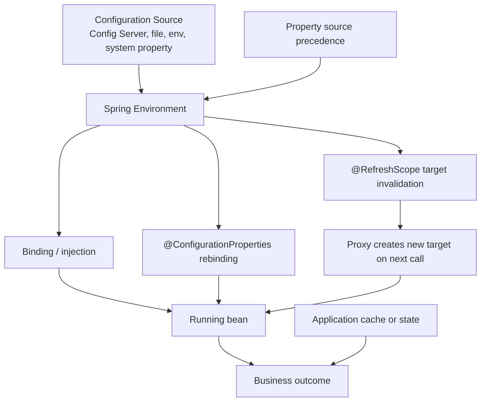
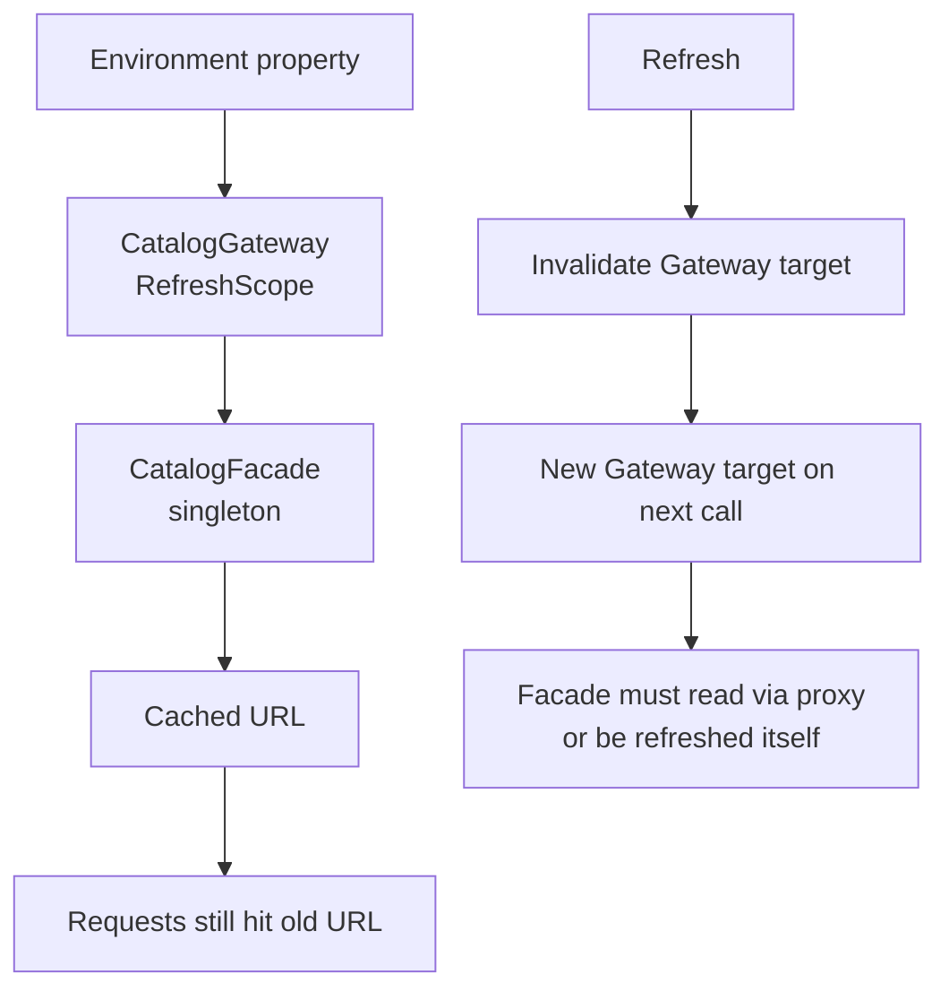

# Refresh Succeeds but Bean Still Holds Old Value

A POST /actuator/refresh command may complete and return a list of changed keys, yet the application continues using the old value. This does not necessarily mean the endpoint failed. Spring Cloud handles multiple distinct layers: updating the Environment, rebinding ConfigurationProperties, invalidating RefreshScope targets, and instantiating a new target on the next invocation.

A singleton that received a value via @Value at initialization may keep that same value. A @RefreshScope bean may have been invalidated while the new target is not created until the next access. A new property may have been loaded yet still be overridden by a higher-priority property source. One replica may have refreshed while another replica has not received the event.

This lesson belongs to the **Troubleshooting** chapter of the **SPRING_CLOUD_CORE** module. It guides you through pinpointing which layer has not updated, inspecting configuration sources and precedence, understanding bean behavior, handling caches/dependency graphs, and verifying refresh across multi-instance systems.

## 1. Learning Objectives

After this lesson, learners can:

- Explain the meaning of the response from /actuator/refresh.
- Distinguish Environment changes, property rebinding, and bean recreation.
- Check property values and supplying sources with Actuator env.
- Check values bound into beans with configprops.
- Recognize why singletons using @Value retain old values.
- Distinguish ConfigurationProperties rebinding from RefreshScope target refreshing.
- Understand how the refresh scope target cache is invalidated and lazily recreated.
- Detect property precedence, constructor binding, non-refreshable beans, and cached dependencies.
- Handle custom caches and state needing updates via EnvironmentChangeEvent.
- Synchronize refreshes across multiple replicas using Spring Cloud Bus or equivalent coordination mechanisms.
- Design repeatable tests and diagnostic procedures.

## 2. Understanding the Refresh Endpoint Response

When exposed and properly secured, the endpoint is called with HTTP POST:

```bash
curl -i -X POST http://localhost:8080/actuator/refresh
```

The response is typically a list of property keys whose values changed in Environment after the refresh process. Example:

```json
[
  "catalog.client.base-url",
  "catalog.client.timeout"
]
```

This list indicates which keys were detected as changed. It is **not a list of recreated beans**, nor does it prove every consumer is reading the new value.

Three outcomes must be distinguished:

| Outcome | Interpretation |
| --- | --- |
| Response lists changed keys | Environment detected value changes for those keys; proceed to inspect binding and beans |
| Response is an empty list | No changed keys were detected during that refresh; inspect remote source, property precedence, and before/after values |
| HTTP request fails | The refresh flow encountered an error; read status, response body, and logs to find the cause |

Refresh scope operates like a target cache. When refresh occurs, the current target is invalidated; a new target bean is created on the next call through the proxy. Therefore, you will not necessarily see constructors or factory methods run immediately while the endpoint returns its response.

## 3. Three Layers to Inspect in the Right Order

A configuration value passes through three main layers:



When a bean still uses the old value, verify sequentially:

1. Has the configuration source returned the new value?
2. Does the process's Environment resolve to the new value?
3. Through which mechanism does the bean receive configuration: @Value, @ConfigurationProperties, or @RefreshScope?
4. Was the bean or target actually rebound/recreated?
5. Is there a cache, dependent object, or another replica still holding stale state?

Do not start by restarting the entire system. Clarify the failing layer first so you do not lose track of the root cause.

## 4. Verifying the Value in Environment

First, check the value Spring resolves. If the Actuator env endpoint is exposed and operators have access:

```bash
curl -sS \
  http://localhost:8080/actuator/env/catalog.client.base-url
```

The output can provide the resolved value, property source name, and origin info depending on the Spring Boot version. Sensitive values may be masked; do not turn off masking in production just to inspect secrets.

Also check key names and spelling. For example, the following keys are not always equivalent across every access API:

- catalog.client.base-url
- catalog.client.baseUrl
- CATALOG_CLIENT_BASE_URL

Spring Boot supports relaxed binding for ConfigurationProperties, but when querying Environment or writing placeholders, use the recommended canonical form: lowercase kebab-case.

### 4.1. Comparing Before and After Refresh

Record the property value and source before refresh, then trigger refresh and inspect the same key again.

| Observation | Possible Conclusion |
| --- | --- |
| Environment still has the old value | Remote source has not updated, Config Client did not reload, or another source overrides it |
| Environment has the new value yet bean is old | Fault lies in binding, bean lifecycle, proxy, or state cache |
| Environment has the new value yet configprops is old | Check ConfigurationProperties registration/rebinding and binding style |
| configprops is new yet API still returns old data | Business bean or downstream cache holds an old copy |

If env is not exposed, you can inspect via a diagnostic component authorized to read Environment and output only necessary keys/metadata. Never create a public debug endpoint or log the entire Environment.

## 5. Checking Whether Config Server Returns the Expected Configuration

When using Spring Cloud Config, verify the request matches the exact:

- Application name, typically from spring.application.name.
- Active profile, e.g., dev, staging, or prod.
- Config label, which may be a branch, tag, or commit ID.
- Property source containing the key under inspection.

Config Server serves configuration in the form:

```text
/{application}/{profile}/{label}
```

For example, you can query the Config Server endpoint directly in an internal environment:

```bash
curl -sS \
  http://config-server:8888/orders-service/prod/main
```

Confirm the response includes the new property in the expected property source. If Config Server returns the old value, check the backend repository, branch/label, deployed commit, and backend caching.

### 5.1. Distinguishing Config Data Import from Legacy Bootstrap

Spring Cloud Config Client has two common configuration approaches:

**Config Data import:**

```yaml
spring:
  application:
    name: orders-service
  config:
    import: "configserver:http://config-server:8888"
```

**Legacy bootstrap:**

```yaml
spring:
  cloud:
    config:
      uri: http://config-server:8888
```

The second approach requires enabling the bootstrap context via the corresponding property or starter. Do not mix both mechanisms and assume they share the same load and refresh order.

With Config Data import, the URL specified in spring.config.import takes precedence over spring.cloud.config.uri. Verify the exact URL the client uses and check actual request logs.

When starting up with Config Data, the client may send a request for the default profile followed by additional requests for active profiles. This is normal Config Data behavior and does not automatically mean refresh is being called repeatedly. When investigating a refresh, distinguish startup requests from requests triggered by the refresh operation.

## 6. Checking Property Source Precedence

A new value from Config Server may have been loaded yet not be the final value returned by Environment. Spring Boot applies precedence ordering across property sources; a higher-priority source can override a lower-priority source.

Common sources to check:

- Command-line arguments.
- Java system properties.
- OS environment variables.
- SPRING_APPLICATION_JSON.
- Config Data files and profile-specific files.
- Remote property sources from Config Server.
- Property sources added by the application or tests.

For example, Config Server returns:

```yaml
catalog:
  client:
    timeout: 2500
```

Yet the container has the environment variable:

```bash
CATALOG_CLIENT_TIMEOUT=5000
```

If the source containing the environment variable has higher precedence than the remote value in the current setup, the application still resolves 5000. The refresh endpoint can run normally while the final outcome does not change.

### 6.1. Are Remote Properties Allowed to Be Overridden?

In legacy bootstrap mode, remote property sources may be protected against local overrides by default. To allow local sources to override them, Config Server must grant permission via spring.cloud.config.allowOverride=true in the remote configuration. The overrideNone and overrideSystemProperties options further adjust priority placement.

Do not add these properties on the client and assume they alter the remote source's override permissions. Check the actual Config Client mode and property source order in /actuator/env.

## 7. Singletons Using @Value Normally Retain Old Values

@Value is usually resolved when the bean is created. Example:

```java
@Component
public class CatalogGateway {

    private final String baseUrl;

    public CatalogGateway(
            @Value("${catalog.client.base-url}") String baseUrl) {
        this.baseUrl = baseUrl;
    }

    public String baseUrl() {
        return baseUrl;
    }
}
```

If CatalogGateway is a regular singleton, the baseUrl field does not automatically change just because Environment changed. Spring does not re-run that singleton's constructor on every refresh.

There are two common solutions:

- Use mutable ConfigurationProperties when configuration needs to update on a rebound bean.
- Place beans that capture values at initialization into RefreshScope so the target is recreated after refresh.

Example using refresh scope:

```java
@Component
@RefreshScope
public class CatalogGateway {

    private final String baseUrl;

    public CatalogGateway(
            CatalogClientProperties properties) {
        this.baseUrl = properties.getBaseUrl().toString();
    }

    public String baseUrl() {
        return baseUrl;
    }
}
```

When the target is invalidated, the next call through the proxy creates a new target and reads the current value from the rebound properties bean.

You do not need to put RefreshScope on every singleton. Apply it only to beans whose state needs recreation, because creating a new target may also open connections, allocate caches, or run expensive initialization logic.

## 8. Checking Whether ConfigurationProperties Rebound

Spring Cloud listens to EnvironmentChangeEvent and rebinds matching ConfigurationProperties beans. This differs from creating a new bean target.

Mutable class example:

```java
import org.springframework.boot.context.properties.ConfigurationProperties;

import java.net.URI;

@ConfigurationProperties(prefix = "catalog.client")
public class CatalogClientProperties {

    private URI baseUrl;
    private int timeout = 2000;

    public URI getBaseUrl() {
        return baseUrl;
    }

    public void setBaseUrl(URI baseUrl) {
        this.baseUrl = baseUrl;
    }

    public int getTimeout() {
        return timeout;
    }

    public void setTimeout(int timeout) {
        this.timeout = timeout;
    }
}
```

Register the properties class with ConfigurationPropertiesScan or EnableConfigurationProperties fitting your application structure.

After refresh, inspect /actuator/configprops to verify the bound values. If Environment is updated yet the properties object is stale, check:

- Is the class registered as a ConfigurationProperties bean?
- Are the prefix and property names exact?
- Do setters or mutable fields permit binding?
- Is any custom binder, converter, or nested object causing binding to fail?
- Is the bean excluded from rebinding by refresh settings?

### 8.1. Constructor Binding and Java Records

Objects using constructor binding, including Java Records annotated with ConfigurationProperties, cannot refresh via Spring Cloud's standard rebinding mechanism.

A type like the following is unsuitable if values must change at runtime:

```java
@ConfigurationProperties(prefix = "catalog.client")
public record CatalogClientProperties(
        URI baseUrl,
        Duration timeout) {
}
```

If runtime refresh is required, consider a mutable class with a no-argument constructor and setters, or place an appropriate bean in RefreshScope to recreate the object upon refresh.

### 8.2. Rebinding Does Not Replace the Object

ConfigurationProperties rebinding typically updates fields on the same instance. It does not necessarily create a new object.

Spring Cloud resets properties to their class-level defaults before rebinding when the class has a no-argument constructor as its sole constructor; binding then applies values currently in Environment. Special constructor and object graph cases exist where resetting does not occur.

Updating fields in place also means another thread might read the object while rebinding is in progress. Spring Cloud serializes rebinds of the same bean, yet that does not make the object completely safe against concurrent readers. If the application requires a consistent configuration snapshot throughout an operation, consider RefreshScope rather than reading a mutable object mid-update.

## 9. Understanding the RefreshScope Target Cache

RefreshScope does not create a new bean immediately when the endpoint returns its response. The bean is exposed via a scoped proxy, and the target is instantiated upon method invocation.

Flow:

1. Consumer holds a reference to the proxy.
2. Proxy forwards method calls to the current target.
3. Refresh flow invalidates the target cache.
4. The old target is no longer used for new calls through the proxy.
5. The next call creates a new target from the current Environment.

RefreshScope.refreshAll() clears the target cache for beans in the scope. A specific bean can be refreshed via refresh(String beanName) when calling the corresponding API.

This explains the situation where the endpoint returns success yet the bean's constructor has not run again: the new target is only created when the bean is used.

### 9.1. Verify the Proxy Is Actually Used

Consumers must invoke calls through the Spring-injected bean reference. Avoid:

- Manually creating an instance with new CatalogGateway(...).
- Saving a scalar value from the bean into another field at startup and continuing to use that field.
- Copying configuration into a static field or singleton cache with no update mechanism.
- Retaining a dependent object tied to the old target and continuing to use it after refresh.

A bean marked RefreshScope cannot automatically update copies of data previously saved by other beans.

### 9.2. RefreshScope on Configuration Does Not Cover Every Bean

Placing RefreshScope on a Configuration class does not mean every bean declared with Bean inside it automatically belongs to refresh scope.

If a service depends on a bean created by that configuration, the service may still hold the old dependency. When dependencies need to be recreated together, design the scope for the dependent beans themselves or place the scope accurately on each bean needing refresh.

## 10. Checking Whether a Bean Is Excluded from Refresh Scope

Spring Cloud provides properties controlling which beans are never refreshed and which additional beans belong to refresh scope:

```yaml
spring:
  cloud:
    refresh:
      never-refreshable: com.example.LegacyClient
      extra-refreshable: com.example.ImmutableClient
```

Class names in the example are illustrative. Use the exact bean or class names supported by the documentation for your version.

An important case is HikariDataSource: it belongs by default to Spring Cloud's non-refreshable group. If your DataSource uses Hikari, do not conclude refresh is broken just because the pool is not recreated. Choose an appropriate datasource switching strategy, such as reinitializing an abstraction/client at the proper layer or using a supported implementation.

Do not put every class into extra-refreshable. Recreating a client can drop in-flight connections, disrupt requests, or open multiple concurrent connections.

## 11. Deleting a Property Is Not Equivalent to Changing Its Value

A confusing situation is deleting a key from Config Server and calling refresh.

Spring Cloud explicitly notes that deleting a configuration value and refreshing does not automatically update property presence in the way many applications expect. If business logic needs a state change, use an explicit value.

For example, instead of deleting:

```yaml
feature:
  catalog:
    enabled: false
```

Design explicit defaults and absence states intentionally. If the application needs to detect an absent key, check Environment.containsProperty() directly or use an explicit status property, and write tests for missing keys.

## 12. Bean Refreshed Yet Downstream Cache Remains Stale

A bean may receive new configuration while business results remain stale because data was copied or precomputed earlier.

Example:

```java
@Service
public class CatalogFacade {

    private final CatalogGateway gateway;
    private final String cachedBaseUrl;

    public CatalogFacade(CatalogGateway gateway) {
        this.gateway = gateway;
        this.cachedBaseUrl = gateway.baseUrl();
    }

    public String endpoint() {
        return cachedBaseUrl;
    }
}
```

Even when CatalogGateway refreshes properly, CatalogFacade still retains the old value in cachedBaseUrl.

Types of caches to audit:

- Static fields or singleton fields storing property values.
- Cached URLs, headers, timeouts, or client options.
- DTO objects built from configuration at startup.
- Client builders that constructed an immutable HTTP client.
- Connection pools or SDK clients holding their own configuration.
- Business caches not invalidated when Environment changes.

The fix is to read through the proxy at the time of use, recreate dependent components with refresh scope, or listen for change events to update caches in a controlled way.

## 13. Updating Custom Caches via EnvironmentChangeEvent

If the application maintains custom state that must change when properties change, you can listen for EnvironmentChangeEvent:

```java
import org.springframework.cloud.context.environment.EnvironmentChangeEvent;
import org.springframework.context.event.EventListener;
import org.springframework.core.env.Environment;
import org.springframework.stereotype.Component;

@Component
public class CatalogCacheRefreshListener {

    private final Environment environment;
    private final CatalogCache catalogCache;

    public CatalogCacheRefreshListener(
            Environment environment,
            CatalogCache catalogCache) {
        this.environment = environment;
        this.catalogCache = catalogCache;
    }

    @EventListener
    public void onEnvironmentChange(EnvironmentChangeEvent event) {
        if (event.getKeys().contains("catalog.cache.ttl")) {
            int ttl = environment.getProperty(
                "catalog.cache.ttl",
                Integer.class,
                60
            );
            catalogCache.updateTtl(ttl);
        }
    }
}
```

This example handles only one specific key. In a real application, ensure you:

- Update only when relevant keys change.
- Validate new values before applying them.
- Perform updates safely under concurrent requests.
- Do not log secrets or sensitive values.
- Have a rollback mechanism or retain the old configuration if the update fails.

Do not publish a synthetic event and conclude Config Client loaded new configuration. The event listener only handles events; property sources and the refresh workflow must be verified separately.

## 14. Checking the Dependency Graph and Recreation Order

If bean A depends on bean B, refreshing B alone does not guarantee A will recompute state copied from B.

Example:



When investigating, list the bean directly receiving the property and its downstream beans:

| Component | Value Source | What to Check |
| --- | --- | --- |
| Properties bean | Environment binding | Prefix, setters, constructor binding, configprops |
| Gateway/client | Constructor or factory | Has RefreshScope, whether target recreates |
| Facade/service | Dependency injection | Copies properties into fields/caches |
| Cache | Computed values | Has listener or invalidation logic |
| HTTP client/pool | Client builder | Holds old base URL/timeout |

If bean B is refreshed yet bean A needs reinitialization, either put A in refresh scope as well or modify A to query B through the proxy when needed. Choose based on lifecycle and initialization cost.

## 15. One Refresh Does Not Automatically Update Every Replica

Each Spring instance has its own ApplicationContext and bean state. Calling POST /actuator/refresh on one Pod refreshes only that Pod's context.

Spring Cloud Config Client does not poll Config Server to detect changes by default. In a multi-replica system, events must be broadcast or refresh must be invoked on each instance per operational procedures.

Spring Cloud Bus provides a mechanism to broadcast refresh events. Once Bus is configured, the corresponding bus refresh endpoint—usually /actuator/busrefresh—can be used to send events to all instances participating in the Bus.

When troubleshooting cluster issues:

1. Record the Pod/instance ID that received the refresh request.
2. Verify Config Server returns the right application/profile/label.
3. Verify whether the event was broadcast to other replicas.
4. Read Environment and configprops on each replica.
5. Verify the target bean after the first call on each replica.
6. Compare config revision/version if the system attaches metadata.

Do not inspect one Pod and conclude the entire service is using the new configuration.

## 16. Using Actuator to Narrow Down the Fault

In a controlled diagnostic environment, helpful endpoints include:

| Endpoint | Purpose |
| --- | --- |
| /actuator/refresh | Trigger context refresh |
| /actuator/env/{property} | Inspect property value and property source |
| /actuator/configprops | Inspect values bound to ConfigurationProperties |
| /actuator/health | View health indicators, including refresh scope if enabled |
| /actuator/loggers | Inspect/adjust log levels when temporarily increasing logging |

Example exposing required endpoints:

```yaml
management:
  endpoints:
    web:
      exposure:
        include: "health,env,configprops,refresh"
  endpoint:
    health:
      show-details: when-authorized
```

The env and configprops endpoints can expose internal configuration. Expose them only on a protected management network, require authentication, and restrict access. After investigating, narrow exposure back to normal operational settings.

### 16.1. RefreshScopeHealthIndicator

Spring Cloud provides RefreshScopeHealthIndicator. If a bean fails to reinitialize or rebind after a context refresh, the indicator can transition to DOWN and report exception details.

When refresh scope health is DOWN:

- Find which bean failed to create a new target.
- Read the root exception, not just the aggregate status.
- Check required properties, constructors, factory methods, and external dependencies.
- Determine whether the failing bean belongs to refresh scope or is a ConfigurationProperties bean rebinding.

If the health indicator is UP while business results remain stale, still inspect downstream caches and non-refreshable singletons. A healthy indicator does not prove every value in the application was replaced.

## 17. Enabling Logs to Observe the Refresh Flow

You can temporarily raise log levels for relevant packages:

```yaml
logging:
  level:
    org.springframework.cloud.context.refresh: DEBUG
    org.springframework.cloud.context.scope.refresh: DEBUG
    org.springframework.cloud.config.client: DEBUG
```

Depending on the version and Config Client mode, exact logger packages may vary. Confirm the logger emits output in the running version.

Record key milestones:

- When the refresh request starts.
- Which property sources are loaded or updated.
- The list of changed keys.
- EnvironmentChangeEvent publication.
- ConfigurationProperties rebinding.
- Refresh scope target cache invalidation.
- New target creation on the subsequent invocation.
- Any bean failing during rebinding or target creation.

Do not log secret values, passwords, tokens, or the entire Environment. For correlation, log instance ID, application name, profile, config label/revision, and operation ID.

## 18. Testing Refresh Layer by Layer

One large test can obscure the failing layer. Split tests by question.

### 18.1. Testing Environment Values

Provide a property source with an old value, replace it with a new value, and confirm Environment resolves the new value. This test does not prove beans were updated.

### 18.2. Testing ConfigurationProperties Rebinding

Initialize a context containing a mutable ConfigurationProperties bean. Change the value in Environment, run the proper refresh flow, and confirm the object rebinds. Also test nested properties, defaults, and validation.

Do not use Java Records or constructor-bound properties as examples for rebind tests, since they do not refresh through the standard rebinding mechanism.

### 18.3. Testing RefreshScope Target Recreation

You can verify target recreation by updating a property in Environment and invalidating the bean's target:

```java
@Test
void refreshScopeCreatesTargetWithLatestEnvironmentValue() {
    assertThat(catalogGateway.baseUrl())
        .isEqualTo("https://catalog-old.internal");

    Map<String, Object> values = new HashMap<>();
    values.put(
        "catalog.client.base-url",
        "https://catalog-new.internal"
    );

    environment.getPropertySources().addFirst(
        new MapPropertySource("testOverride", values)
    );

    assertThat(refreshScope.refresh("catalogGateway")).isTrue();

    assertThat(catalogGateway.baseUrl())
        .isEqualTo("https://catalog-new.internal");
}
```

The example requires a catalogGateway bean registered with RefreshScope, along with appropriate test dependencies such as ConfigurableEnvironment, RefreshScope, and MapPropertySource. It verifies target recreation once Environment already has the new value; it does not test whether Config Client fetched remote properties.

In this test, catalogGateway should read the property from Environment or use @Value to capture the value when the target is created. If the constructor takes a ConfigurationProperties bean, the test must also trigger rebinding of that bean before invalidating the target; merely updating Environment does not automatically rebind properties objects.

### 18.4. Integration Testing with Config Server

To test the full path:

1. Stand up Config Server or an HTTP fixture with deterministic responses.
2. Explicitly configure application name, profile, and label.
3. Start the service with property A.
4. Confirm Environment and the bean return A.
5. Change the remote response to property B.
6. Trigger refresh using the exact mechanism Config Client uses.
7. Confirm changed keys include the relevant property.
8. Confirm Environment and ConfigurationProperties return B.
9. Invoke the refresh-scoped bean and confirm the new target returns B.
10. Verify downstream consumers/caches do not hold A.

If a test only modifies Environment directly, do not treat it as a Config Server test. If a test only mocks ContextRefresher, do not conclude remote properties were reloaded.

## 19. Common Symptoms and Causes Table

| Symptom | Possible Cause | Resolution |
| --- | --- | --- |
| Refresh returns an empty list | No property values changed or remote source has not updated | Check Config Server response, app/profile/label, and Environment |
| Environment still has old value | Config Client did not fetch new source or higher-priority source overrides it | Check request logs and /actuator/env/{property} |
| Environment updated yet @Value stays old | Bean is a regular singleton | Use mutable ConfigurationProperties or RefreshScope |
| configprops stays old | Bean not registered/rebound or uses constructor binding | Check scan, prefix, setters, and binding style |
| RefreshScope bean stays old | Target not invalidated, bean not in scope, or caller holds old copy | Check proxy, scope, bean name, and downstream caches |
| Refresh endpoint succeeds yet constructor hasn't run | New target is created lazily on next call | Call a method through the proxy and check target initialization logs |
| Bean in Configuration did not change | RefreshScope on configuration does not automatically cover every Bean | Place scope properly on beans and downstream dependencies |
| HikariDataSource does not change | Hikari is in default never-refreshable group | Design an appropriate datasource/pool lifecycle |
| Key deleted yet bean still has value | Removal is not reflected as a new value in the refresh flow | Use defaults or explicit state values |
| RefreshScopeHealthIndicator DOWN | Bean failed to rebind or target failed to initialize | Read exception details, properties, and dependencies |
| One Pod updated, another Pod stale | Only one instance refreshed or Bus failed to broadcast | Send refresh to all replicas and verify each instance |
| Bean updated yet API still returns old data | Downstream cache or derived state | Invalidate/recompute cache or stop copying properties at startup |

## 20. Practical Investigation Workflow

When encountering "refresh succeeded but bean still holds old value", follow this sequence:

1. Record the instance ID, timestamp, endpoint, and refresh response.
2. Check whether the response contains changed keys or an empty list.
3. Query Config Server with the exact application/profile/label to confirm the new value.
4. Check Config Client logs and the active import mechanism.
5. Read /actuator/env/{property} to identify the final value and the winning property source.
6. Read /actuator/configprops if the bean uses ConfigurationProperties.
7. Determine whether the bean receives values via @Value, ConfigurationProperties, or RefreshScope.
8. If using @Value, check whether the bean is a regular singleton.
9. If using RefreshScope, check the proxy, target cache, bean name, and the call that creates the new target.
10. Audit downstream dependencies, static fields, and caches that copied the old value.
11. Check never-refreshable, constructor binding, and deleted-property cases.
12. Read RefreshScopeHealthIndicator and any exceptions.
13. Repeat checks across every replica or broadcast refresh via Spring Cloud Bus.
14. Conclude completion only when the business API actually uses the new value.

## 21. Practice Exercise

An orders-service fetches configuration from Config Server:

```yaml
catalog:
  client:
    base-url: https://catalog-v1.internal
    timeout: 2000
```

The service has three components:

- CatalogClientProperties is a mutable ConfigurationProperties bean.
- CatalogGateway injects base-url using Value and is annotated with RefreshScope.
- OrderFacade is a singleton that reads gateway.baseUrl() in its constructor and stores it in a cachedBaseUrl field.

After changing the Config Server configuration to catalog-v2.internal and calling POST /actuator/refresh:

- The response contains catalog.client.base-url.
- Environment already has the new URL.
- configprops displays the new URL.
- CatalogGateway creates a new target when invoked.
- OrderFacade's API still returns the old URL.

Complete the following:

1. Draw the dependency graph of the three components.
2. Identify why Environment and properties updated while OrderFacade remained stale.
3. Fix OrderFacade to access the gateway proxy when needed instead of caching a scalar value in the constructor.
4. Write a test confirming the URL changes from v1 to v2 after refresh.
5. Add a test for a singleton using Value without RefreshScope.
6. Add a test for a constructor-bound record and explain why it does not rebind.
7. Verify property precedence with two sources declaring the same key.
8. Test refresh when a key is deleted and compare with setting an explicit state value.
9. Run a test with two simulated replicas and verify each replica receives the refresh.
10. Write a runbook listing endpoints, logs, and metrics to inspect when this issue happens.

**Completion criteria:** pinpoint the exact layer holding the old value; prove Environment and bean binding received the new value; confirm the refresh-scoped target is recreated; and ensure the business API ultimately returns the correct value across all replicas.

## 22. Key Takeaways

- HTTP success from /actuator/refresh does not prove every bean was recreated.
- The refresh response lists changed property keys, not refreshed beans.
- Check Environment first, then configprops, then beans and downstream caches.
- Value is injected at bean creation; regular singletons retain old values.
- Mutable ConfigurationProperties can be rebound; constructor-bound objects and Java Records do not refresh via the standard mechanism.
- ConfigurationProperties rebinding updates the existing object; it does not necessarily replace the instance.
- RefreshScope uses proxies and a target cache; a new target is created on the next invocation.
- RefreshScope on a Configuration class does not automatically put every Bean into refresh scope.
- HikariDataSource is in the default never-refreshable group.
- Higher-priority property sources can mask values from Config Server.
- Deleting a key is not equivalent to changing a value; use explicit states when needed.
- Downstream caches, derived fields, and singletons can hold stale data.
- Config Client does not poll automatically by default; multi-replica setups require broadcast or per-instance refresh.
- RefreshScopeHealthIndicator helps detect rebind/reinitialize failures, but does not replace checking business data.

## 23. References

- [Spring Cloud Commons — Application Context Services](https://docs.spring.io/spring-cloud-commons/reference/spring-cloud-commons/application-context-services.html): EnvironmentChangeEvent, ConfigurationProperties rebinding, RefreshScope, RefreshScopeHealthIndicator, and the refresh endpoint.
- [Spring Cloud Config Client](https://docs.spring.io/spring-cloud-config/reference/client.html): Config Data import, legacy bootstrap, application/profile/label, and Config Server connection mechanisms.
- [Spring Cloud Commons — Configuration Properties](https://docs.spring.io/spring-cloud-commons/reference/configprops.html): never-refreshable, extra-refreshable, and refresh properties.
- [Spring Boot — Externalized Configuration](https://docs.spring.io/spring-boot/reference/features/external-config.html): PropertySource precedence, Environment, Value, and ConfigurationProperties.
- [Spring Framework — Proxying Mechanisms](https://docs.spring.io/spring-framework/reference/core/aop/proxying.html): JDK proxies, CGLIB, and proxy limitations.
- [Spring Cloud Bus](https://docs.spring.io/spring-cloud-bus/reference/): broadcasting EnvironmentChangeEvent to multiple instances.
